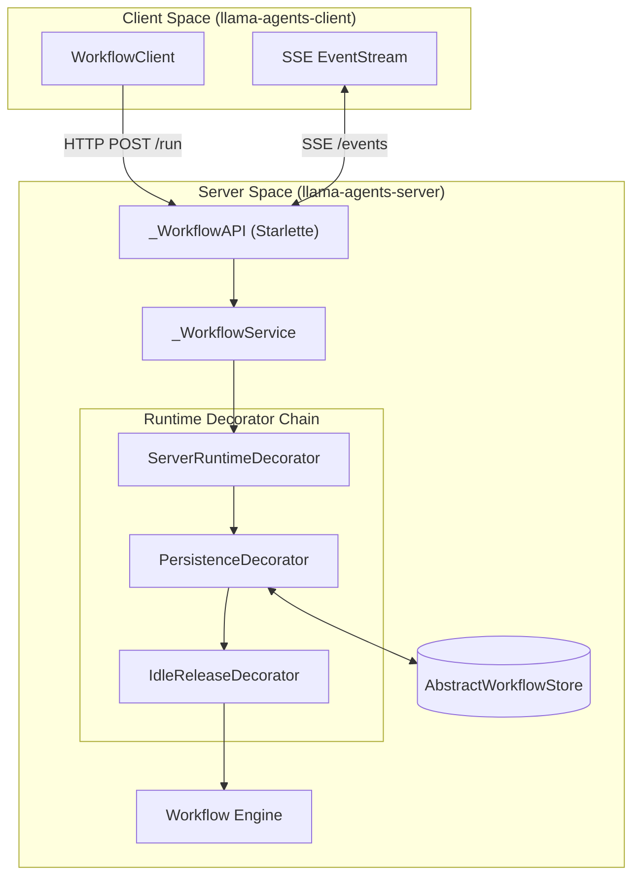
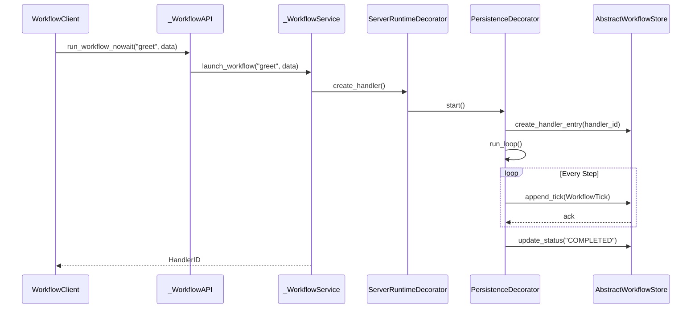

<!-- source: DeepWiki mcp.deepwiki.com · repo run-llama/llama-agents · page 3 Workflow Server and Client (llama-agents-server / llama-agents-client) · fetched 2026-10-27 -->

# Workflow Server and Client (llama-agents-server / llama-agents-client)

Relevant source files

The following files were used as context for generating this wiki page:

- [packages/llama-agents-client/CHANGELOG.md](packages/llama-agents-client/CHANGELOG.md)
- [packages/llama-agents-client/README.md](packages/llama-agents-client/README.md)
- [packages/llama-agents-client/package.json](packages/llama-agents-client/package.json)
- [packages/llama-agents-client/pyproject.toml](packages/llama-agents-client/pyproject.toml)
- [packages/llama-agents-server/CHANGELOG.md](packages/llama-agents-server/CHANGELOG.md)
- [packages/llama-agents-server/README.md](packages/llama-agents-server/README.md)
- [packages/llama-agents-server/package.json](packages/llama-agents-server/package.json)
- [packages/llama-agents-server/pyproject.toml](packages/llama-agents-server/pyproject.toml)
- [packages/llama-index-workflows/CHANGELOG.md](packages/llama-index-workflows/CHANGELOG.md)
- [packages/llama-index-workflows/package.json](packages/llama-index-workflows/package.json)
- [packages/llama-index-workflows/pyproject.toml](packages/llama-index-workflows/pyproject.toml)

The `llama-agents-server` and `llama-agents-client` packages provide the networking and persistence infrastructure required to transform standalone `llama-index-workflows` into production-ready web services. This layer handles HTTP routing, long-running execution state, and real-time event streaming.

### Purpose and Scope

The server-client architecture enables:
- **Deployment**: Exposing workflows via a Starlette-based REST API [packages/llama-agents-server/pyproject.toml:29-31]().
- **Durability**: Persisting workflow state across restarts using pluggable stores like SQLite or Postgres [packages/llama-agents-server/CHANGELOG.md:169]().
- **Interactivity**: Supporting Human-in-the-Loop (HITL) patterns where clients can inject events into running workflows [packages/llama-agents-server/README.md:51]().
- **Observability**: Real-time event streaming via Server-Sent Events (SSE) [packages/llama-agents-server/CHANGELOG.md:120]().

### System Architecture Overview

The following diagram illustrates how the server components wrap the core workflow engine and interact with the client library.

**Workflow Service Component Map**

**Sources:** [packages/llama-agents-server/CHANGELOG.md:208-214](), [packages/llama-agents-server/README.md:48-56](), [packages/llama-agents-client/README.md:15-30]().

---

### 3.1 WorkflowServer: API, Service, and Runtime Chain
The `WorkflowServer` is the primary entry point for hosting workflows [packages/llama-agents-server/README.md:33-34](). It assembles a Starlette application that routes requests to a `_WorkflowService`. The execution logic is managed through a **Runtime Decorator Chain**, which allows the server to inject cross-cutting concerns like persistence and idle-timeout management without modifying the underlying workflow logic.

For details, see [WorkflowServer: API, Service, and Runtime Chain](#3.1).

**Sources:** [packages/llama-agents-server/CHANGELOG.md:167-168](), [packages/llama-agents-server/README.md:3-4]().

---

### 3.2 Workflow Persistence Stores
To support long-running tasks, the server uses the `AbstractWorkflowStore` contract to save workflow "ticks" (execution steps), state snapshots, and events [packages/llama-agents-server/CHANGELOG.md:169](). This allows a workflow to be resumed on a different server instance or after a crash by replaying the stored ticks to reconstruct the `Context` state.

Supported stores include:
- `MemoryWorkflowStore`: Volatile storage for testing.
- `SqliteWorkflowStore`: Default local persistence [packages/llama-agents-server/README.md:52]().
- `PostgresWorkflowStore`: Production-grade storage with `LISTEN/NOTIFY` support [packages/llama-agents-server/CHANGELOG.md:7-8]().

For details, see [Workflow Persistence Stores](#3.2).

**Sources:** [packages/llama-agents-server/CHANGELOG.md:169-170](), [packages/llama-agents-server/CHANGELOG.md:7-8]().

---

### 3.3 DBOS Durable Runtime (llama-agents-dbos)
The `llama-agents-dbos` package provides a specialized `DBOSRuntime` for high-reliability environments. It leverages the DBOS platform to provide deterministic replay via a `TaskJournal` and manages distributed execution through an `ExecutorLeaseManager` [packages/llama-agents-server/CHANGELOG.md:7-8](). This runtime ensures that even if a node fails mid-step, the workflow can resume exactly where it left off with guaranteed consistency.

For details, see [DBOS Durable Runtime (llama-agents-dbos)](#3.3).

**Sources:** [packages/llama-agents-server/CHANGELOG.md:7-8](), [packages/llama-index-workflows/CHANGELOG.md:94-95]().

---

### 3.4 WorkflowClient and SSE Streaming
The `WorkflowClient` in `llama-agents-client` provides a high-level Pythonic interface for interacting with a remote `WorkflowServer` [packages/llama-agents-client/README.md:15](). It supports both synchronous execution and an asynchronous "fire-and-forget" mode that returns a `handler_id` for tracking. 

A key feature is the sequence-based SSE streaming, which allows clients to subscribe to workflow events with automatic reconnection and cursor-based recovery to ensure no events are missed during network instability [packages/llama-agents-client/CHANGELOG.md:94-95]().

For details, see [WorkflowClient and SSE Streaming](#3.4).

**Sources:** [packages/llama-agents-client/README.md:21-25](), [packages/llama-agents-client/CHANGELOG.md:94-95]().

---

### Data Flow: Request to Execution

The following diagram maps the flow of a client request through the server's internal classes and the persistence layer.

**Execution Flow and Code Entities**

**Sources:** [packages/llama-agents-server/CHANGELOG.md:167-170](), [packages/llama-agents-client/README.md:21-30](), [packages/llama-index-workflows/CHANGELOG.md:101]().

---

