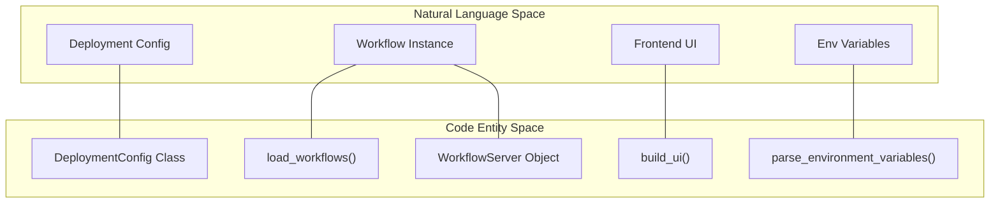
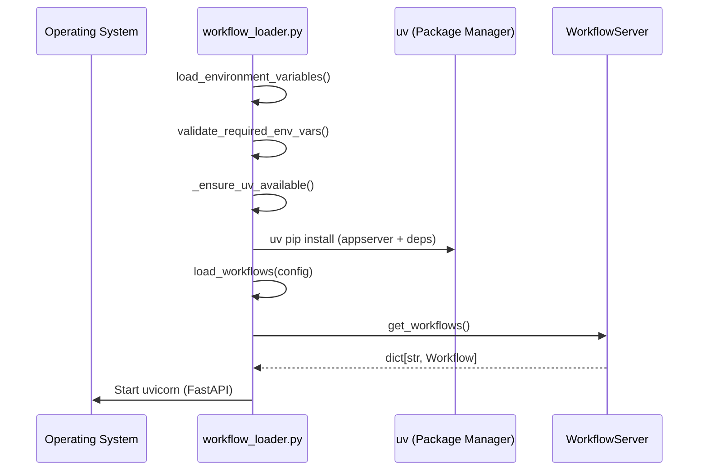

<!-- source: DeepWiki mcp.deepwiki.com · repo run-llama/llama-agents · page 4 App Server (llama-agents-appserver) · fetched 2026-10-27 -->

# App Server (llama-agents-appserver)

Relevant source files

The following files were used as context for generating this wiki page:

- [charts/llama-agents/templates/networkpolicy.yaml](charts/llama-agents/templates/networkpolicy.yaml)
- [docs/src/content/docs/llamaagents/llamactl/ui-build.md](docs/src/content/docs/llamaagents/llamactl/ui-build.md)
- [docs/src/content/docs/llamaagents/llamactl/ui-hooks.md](docs/src/content/docs/llamaagents/llamactl/ui-hooks.md)
- [docs/src/content/docs/llamaagents/llamactl/workflow-api.md](docs/src/content/docs/llamaagents/llamactl/workflow-api.md)
- [packages/llama-agents-appserver/CHANGELOG.md](packages/llama-agents-appserver/CHANGELOG.md)
- [packages/llama-agents-appserver/package.json](packages/llama-agents-appserver/package.json)
- [packages/llama-agents-appserver/pyproject.toml](packages/llama-agents-appserver/pyproject.toml)
- [packages/llama-agents-appserver/src/llama_agents/appserver/workflow_loader.py](packages/llama-agents-appserver/src/llama_agents/appserver/workflow_loader.py)
- [packages/llama-agents-appserver/tests/test_workflow_loader.py](packages/llama-agents-appserver/tests/test_workflow_loader.py)
- [packages/llama-agents-appserver/tests/test_workflow_loader_install.py](packages/llama-agents-appserver/tests/test_workflow_loader_install.py)

The `llama-agents-appserver` package provides the runtime infrastructure for running LlamaIndex workflows inside containerized environments (such as Kubernetes pods) or local development servers. It acts as a bridge between the static configuration of a deployment and the dynamic execution of workflow logic, handling environment setup, dependency management, and workflow instantiation.

## Overview

The app server's primary responsibility is to bootstrap a workflow application based on a `DeploymentConfig`. It manages the lifecycle of the service, from installing necessary dependencies using `uv` to exposing the workflows via a FastAPI-based HTTP server.

### Core Responsibilities
- **Workflow Loading**: Dynamically importing and instantiating `Workflow` or `WorkflowServer` objects defined in user code [packages/llama-agents-appserver/src/llama_agents/appserver/workflow_loader.py:50-85]().
- **Environment Management**: Parsing `.env` files and merging them with configuration-level environment variables [packages/llama-agents-appserver/src/llama_agents/appserver/workflow_loader.py:88-95]().
- **Dependency Bootstrapping**: Ensuring the target environment has the correct versions of `llama-agents-appserver` and compatible workflow libraries [packages/llama-agents-appserver/src/llama_agents/appserver/workflow_loader.py:163-193]().
- **UI Integration**: Building and proxying frontend applications (e.g., React/Vite) that communicate with the workflow backend [packages/llama-agents-appserver/src/llama_agents/appserver/workflow_loader.py:23-23]().

### System Entity Mapping

The following diagram shows how high-level deployment concepts map to specific code entities within the appserver package.

**Natural Language to Code Entity Map**

**Sources:** [packages/llama-agents-appserver/src/llama_agents/appserver/workflow_loader.py:50-142](), [packages/llama-agents-appserver/pyproject.toml:28-44]()

---

## Workflow Loading and Deployment Configuration

The app server utilizes the `DeploymentConfig` (typically parsed from `pyproject.toml` or `llama_deploy.yaml`) to locate and load workflow logic. It supports two primary loading modes:
1. **App Mode**: Loading a pre-configured `WorkflowServer` object.
2. **Workflows Mode**: Loading individual `Workflow` instances and mapping them to service IDs.

For details on configuration keys, version compatibility checks, and the `load_workflows` logic, see [Workflow Loading and Deployment Configuration](#4.1).

**Sources:** [packages/llama-agents-appserver/src/llama_agents/appserver/workflow_loader.py:50-85](), [docs/src/content/docs/llamaagents/llamactl/workflow-api.md:32-43]()

---

## Bootstrap and Execution Flow

When the app server starts, it performs a multi-step bootstrap process to ensure the runtime environment matches the deployment requirements.

**App Server Bootstrap Sequence**

**Sources:** [packages/llama-agents-appserver/src/llama_agents/appserver/workflow_loader.py:88-193](), [packages/llama-agents-appserver/pyproject.toml:42-42]()

---

## AgentCore and AWS Bedrock Integration

For specialized agentic workloads, the app server can integrate with the `llama-agents-agentcore` package. This provides a bridge to AWS Bedrock and advanced runtime decorators for durability and background task execution.

For details on the `Bedrock AgentCore` bridge and SQLite durability for local mode, see [AgentCore and AWS Bedrock Integration (llama-agents-agentcore)](#4.2).

**Sources:** [packages/llama-agents-appserver/pyproject.toml:34-34](), [packages/llama-agents-appserver/src/llama_agents/appserver/workflow_loader.py:24-24]()

---

## UI and Frontend Integration

The app server includes utilities to manage a frontend UI alongside the workflow API.
- **Development**: `llamactl` proxies requests to a local dev server (e.g., Vite on port 4502) [docs/src/content/docs/llamaagents/llamactl/ui-build.md:19-21]().
- **Production**: The app server builds static assets and serves them from a specific base path (e.g., `/deployments/<name>/ui`) [docs/src/content/docs/llamaagents/llamactl/ui-build.md:23-24]().
- **Environment Injection**: It injects specific variables like `LLAMA_DEPLOY_DEPLOYMENT_BASE_PATH` into the UI build process [docs/src/content/docs/llamaagents/llamactl/ui-build.md:28-31]().

**Sources:** [docs/src/content/docs/llamaagents/llamactl/ui-build.md:1-154](), [packages/llama-agents-appserver/src/llama_agents/appserver/workflow_loader.py:23-23]()

---

## Child Pages
- [Workflow Loading and Deployment Configuration](#4.1)
- [AgentCore and AWS Bedrock Integration (llama-agents-agentcore)](#4.2)

---

