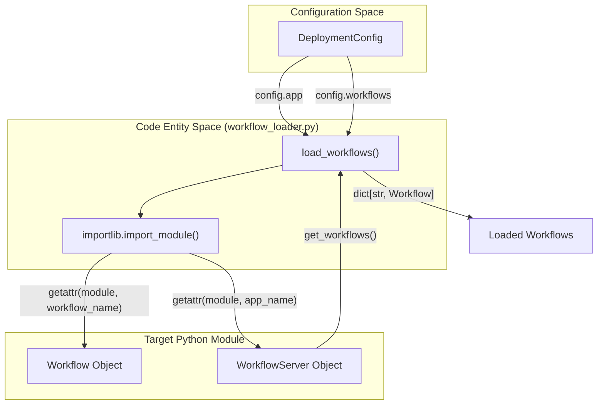
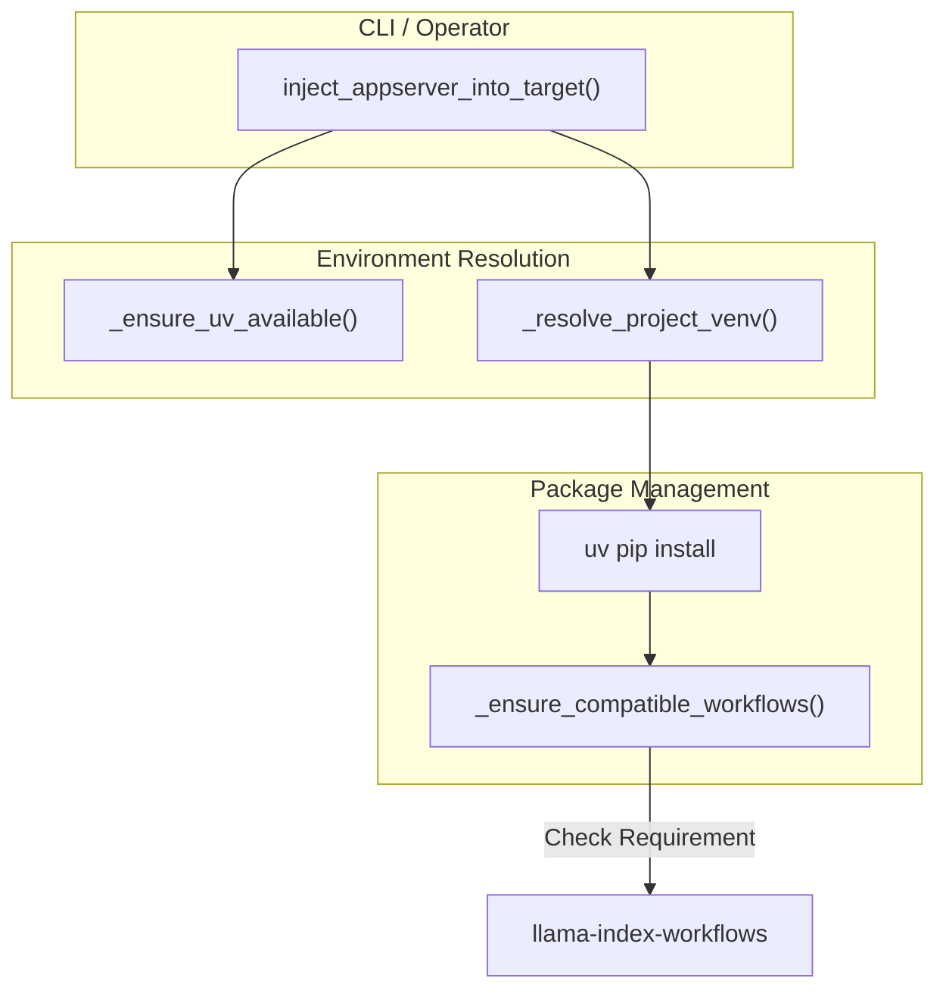

<!-- source: DeepWiki mcp.deepwiki.com · repo run-llama/llama-agents · page 4.1 Workflow Loading and Deployment Configuration · fetched 2026-10-27 -->

# Workflow Loading and Deployment Configuration

Relevant source files

The following files were used as context for generating this wiki page:

- [charts/llama-agents/templates/networkpolicy.yaml](charts/llama-agents/templates/networkpolicy.yaml)
- [docs/src/content/docs/llamaagents/llamactl/ui-build.md](docs/src/content/docs/llamaagents/llamactl/ui-build.md)
- [docs/src/content/docs/llamaagents/llamactl/ui-hooks.md](docs/src/content/docs/llamaagents/llamactl/ui-hooks.md)
- [docs/src/content/docs/llamaagents/llamactl/workflow-api.md](docs/src/content/docs/llamaagents/llamactl/workflow-api.md)
- [packages/llama-agents-appserver/CHANGELOG.md](packages/llama-agents-appserver/CHANGELOG.md)
- [packages/llama-agents-appserver/package.json](packages/llama-agents-appserver/package.json)
- [packages/llama-agents-appserver/pyproject.toml](packages/llama-agents-appserver/pyproject.toml)
- [packages/llama-agents-appserver/src/llama_agents/appserver/workflow_loader.py](packages/llama-agents-appserver/src/llama_agents/appserver/workflow_loader.py)
- [packages/llama-agents-appserver/tests/test_workflow_loader.py](packages/llama-agents-appserver/tests/test_workflow_loader.py)
- [packages/llama-agents-appserver/tests/test_workflow_loader_install.py](packages/llama-agents-appserver/tests/test_workflow_loader_install.py)

The `llama-agents-appserver` package provides the machinery to load Python workflow definitions and configure them for execution within a managed environment (such as a Kubernetes pod or a local `llamactl serve` instance). This process involves parsing configuration files, resolving Python module paths, and ensuring that the runtime environment has compatible versions of the core libraries.

## Workflow Loading Mechanism

The primary entry point for loading workflows is the `load_workflows()` function [packages/llama-agents-appserver/src/llama_agents/appserver/workflow_loader.py:50-85](). It transforms a `DeploymentConfig` object into a dictionary mapping service IDs to executable `Workflow` or `WorkflowServer` objects.

### Loading Strategies
The loader supports two distinct strategies based on the `DeploymentConfig` content:

1.  **Application-centric (`config.app`)**: If an `app` key is provided (e.g., `"my_module:my_app_server"`), the loader imports the specified attribute. This attribute must be an instance of `WorkflowServer` [packages/llama-agents-appserver/src/llama_agents/appserver/workflow_loader.py:57-69](). The server then provides its own internal workflows via `workflow.get_workflows()`.
2.  **Workflow-centric (`config.workflows`)**: If the `app` key is absent, the loader iterates through the `workflows` dictionary. Each entry maps a service ID to a string reference (e.g., `"module.path:variable_name"`) [packages/llama-agents-appserver/src/llama_agents/appserver/workflow_loader.py:71-83]().

### Workflow Loading Data Flow

The following diagram illustrates how `load_workflows` resolves configuration into live objects.

**Diagram: Workflow Object Resolution**

Sources: [packages/llama-agents-appserver/src/llama_agents/appserver/workflow_loader.py:50-85]()

## Deployment Configuration Parsing

The configuration is typically defined in `pyproject.toml`, `llama_deploy.yaml`, or `llama_deploy.toml`. These files are parsed into a `DeploymentConfig` object [packages/llama-agents-appserver/src/llama_agents/appserver/workflow_loader.py:22-22]().

### Configuration Keys
| Key | Purpose |
| :--- | :--- |
| `app` | String pointer to a `WorkflowServer` instance. |
| `workflows` | Dictionary mapping service names to `Workflow` instance pointers. |
| `env` | Key-value pairs of environment variables. |
| `env_files` | List of `.env` files to load. |
| `required_env_vars` | List of variables that must be present for the app to start. |

### Environment Variable Management
The `appserver` handles environment variables through several stages:
1.  **Parsing**: `parse_environment_variables()` merges static `env` keys with values from `env_files` [packages/llama-agents-appserver/src/llama_agents/appserver/workflow_loader.py:130-142]().
2.  **Injection**: `load_environment_variables()` updates `os.environ` [packages/llama-agents-appserver/src/llama_agents/appserver/workflow_loader.py:88-95]().
3.  **Validation**: `validate_required_env_vars()` checks for missing keys and can optionally fill them with placeholders during static analysis [packages/llama-agents-appserver/src/llama_agents/appserver/workflow_loader.py:97-128]().

Sources: [packages/llama-agents-appserver/src/llama_agents/appserver/workflow_loader.py:88-142](), [docs/src/content/docs/llamaagents/llamactl/workflow-api.md:36-43]()

## Version Compatibility and Bootstrapping

A critical role of the `workflow_loader` is ensuring the target environment is correctly set up. This is handled by `inject_appserver_into_target()` [packages/llama-agents-appserver/src/llama_agents/appserver/workflow_loader.py:163-183]().

### The `uv` Integration
The system relies on `uv` for high-performance dependency management.
-   **Availability**: `_ensure_uv_available()` checks for `uv` and installs it via `pip` if missing [packages/llama-agents-appserver/tests/test_workflow_loader_install.py:38-63]().
-   **Installation**: `_install_and_add_appserver_if_missing()` targets the virtual environment resolved by `_resolve_project_venv()` [packages/llama-agents-appserver/tests/test_workflow_loader_install.py:122-172]().

### Version Checks
The appserver performs compatibility checks to prevent obscure import errors:
-   **Workflow Compatibility**: `_ensure_compatible_workflows()` checks if the installed `llama-index-workflows` meets the minimum required version [packages/llama-agents-appserver/tests/test_workflow_loader_install.py:10-19]().
-   **Legacy Naming**: The system handles the transition from the old package name (`llama-deploy-appserver`) to the new one (`llama-agents-appserver`) based on version `0.5.3` [packages/llama-agents-appserver/src/llama_agents/appserver/workflow_loader.py:36-48]().

**Diagram: Bootstrapping and Installation Flow**

Sources: [packages/llama-agents-appserver/src/llama_agents/appserver/workflow_loader.py:163-193](), [packages/llama-agents-appserver/tests/test_workflow_loader_install.py:122-172]()

## UI Configuration and Build

If a UI is defined in the `DeploymentConfig`, the appserver manages its build and environment injection.

### UI Environment Overlays
The `_ui_env()` function prepares the environment for the UI build process [packages/llama-agents-appserver/tests/test_workflow_loader.py:80-107](). A specific feature is the `PUBLIC_*` prefix handling:
-   If `PUBLIC_FOO` is set, its value overrides `FOO` in the UI's build environment, while the backend retains the original `FOO` value [docs/src/content/docs/llamaagents/llamactl/ui-build.md:139-147]().
-   This allows the frontend to point to a public API URL while the backend uses an internal service URL [packages/llama-agents-appserver/tests/test_workflow_loader.py:80-88]().

### Build Execution
`build_ui()` executes the configured build command (e.g., `npm run build`) within the specified UI directory [packages/llama-agents-appserver/tests/test_workflow_loader.py:47-78](). It injects several standard variables:
-   `LLAMA_DEPLOY_DEPLOYMENT_BASE_PATH`: The URL prefix where the UI will be served (e.g., `/deployments/<name>/ui`) [docs/src/content/docs/llamaagents/llamactl/ui-build.md:21-23]().
-   `PORT`: The port for the development proxy [docs/src/content/docs/llamaagents/llamactl/ui-build.md:27-28]().

Sources: [packages/llama-agents-appserver/tests/test_workflow_loader.py:47-107](), [docs/src/content/docs/llamaagents/llamactl/ui-build.md:139-154]()

---

