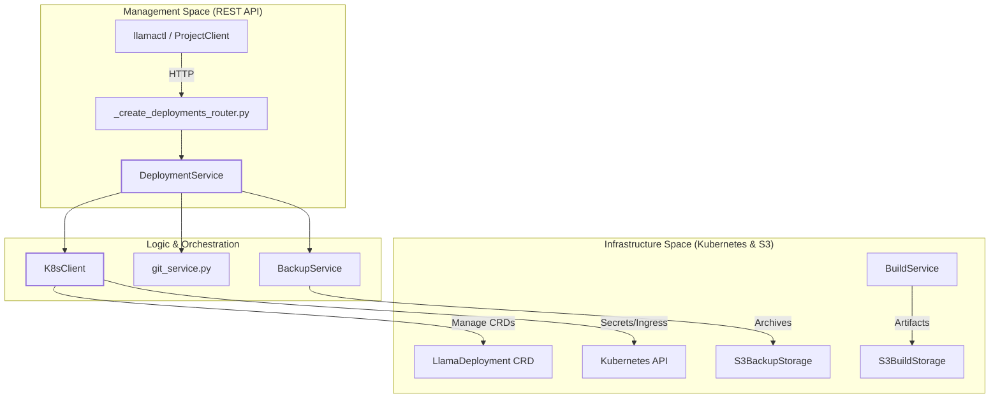
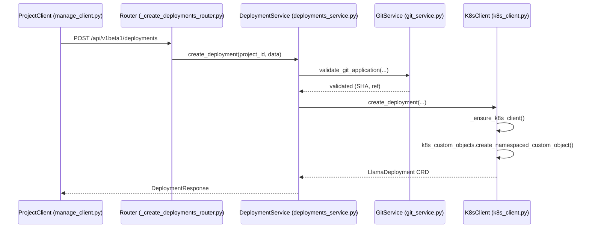

<!-- source: DeepWiki mcp.deepwiki.com · repo run-llama/llama-agents · page 5 Control Plane (llama-agents-control-plane) · fetched 2026-10-27 -->

# Control Plane (llama-agents-control-plane)

Relevant source files

The following files were used as context for generating this wiki page:

- [packages/llama-agents-control-plane/CHANGELOG.md](packages/llama-agents-control-plane/CHANGELOG.md)
- [packages/llama-agents-control-plane/package.json](packages/llama-agents-control-plane/package.json)
- [packages/llama-agents-control-plane/src/llama_agents/control_plane/backup/storage.py](packages/llama-agents-control-plane/src/llama_agents/control_plane/backup/storage.py)
- [packages/llama-agents-control-plane/src/llama_agents/control_plane/build_api/build_service.py](packages/llama-agents-control-plane/src/llama_agents/control_plane/build_api/build_service.py)
- [packages/llama-agents-control-plane/src/llama_agents/control_plane/build_api/build_storage.py](packages/llama-agents-control-plane/src/llama_agents/control_plane/build_api/build_storage.py)
- [packages/llama-agents-control-plane/src/llama_agents/control_plane/code_repo/service.py](packages/llama-agents-control-plane/src/llama_agents/control_plane/code_repo/service.py)
- [packages/llama-agents-control-plane/src/llama_agents/control_plane/k8s_client.py](packages/llama-agents-control-plane/src/llama_agents/control_plane/k8s_client.py)
- [packages/llama-agents-control-plane/src/llama_agents/control_plane/manage_api/backup_service.py](packages/llama-agents-control-plane/src/llama_agents/control_plane/manage_api/backup_service.py)
- [packages/llama-agents-control-plane/src/llama_agents/control_plane/manage_api/deployments_service.py](packages/llama-agents-control-plane/src/llama_agents/control_plane/manage_api/deployments_service.py)
- [packages/llama-agents-control-plane/src/llama_agents/control_plane/settings.py](packages/llama-agents-control-plane/src/llama_agents/control_plane/settings.py)
- [packages/llama-agents-control-plane/tests/deployments/test_deployments_service.py](packages/llama-agents-control-plane/tests/deployments/test_deployments_service.py)
- [packages/llama-agents-control-plane/tests/test_k8s_client.py](packages/llama-agents-control-plane/tests/test_k8s_client.py)
- [packages/llama-agents-core/src/llama_agents/core/client/manage_client.py](packages/llama-agents-core/src/llama_agents/core/client/manage_client.py)
- [packages/llama-agents-core/src/llama_agents/core/server/manage_api/_abstract_deployments_service.py](packages/llama-agents-core/src/llama_agents/core/server/manage_api/_abstract_deployments_service.py)
- [packages/llama-agents-core/src/llama_agents/core/server/manage_api/_create_deployments_router.py](packages/llama-agents-core/src/llama_agents/core/server/manage_api/_create_deployments_router.py)

The **Control Plane** is the centralized management service for `llama-agents`. It acts as the orchestrator that bridges user-facing management APIs with the underlying Kubernetes infrastructure. Its primary responsibilities include managing the lifecycle of agent deployments, facilitating Git-based code distribution, handling system backups, and coordinating build artifacts via S3-compatible storage.

The Control Plane exposes a RESTful management API (typically on port 8000) and a Build API (typically on port 8001) used by worker pods to fetch code and configuration.

### System Architecture Overview

The following diagram illustrates how the Control Plane components interact with Kubernetes and external storage to manage the "Natural Language Space" (Projects/Deployments) through "Code Entity Space" (CRDs/Services).

**Control Plane Architecture and Code Mapping**

Sources: [packages/llama-agents-control-plane/src/llama_agents/control_plane/manage_api/deployments_service.py:113-113](), [packages/llama-agents-core/src/llama_agents/core/server/manage_api/_create_deployments_router.py:33-40](), [packages/llama-agents-control-plane/src/llama_agents/control_plane/k8s_client.py:81-81]()

---

## Deployment Lifecycle and Orchestration

The Control Plane manages deployments through the `DeploymentService`, which implements the `AbstractDeploymentsService` interface [packages/llama-agents-core/src/llama_agents/core/server/manage_api/_abstract_deployments_service.py:23-23](). It translates high-level requests (like "create a deployment") into Kubernetes `LlamaDeployment` Custom Resources (CRDs).

Key features include:
- **Deployment Management**: CRUD operations on deployments, including validation of unique IDs and tokens [packages/llama-agents-control-plane/src/llama_agents/control_plane/k8s_client.py:165-199]().
- **Log Aggregation**: Streaming logs by merging generators from multiple ReplicaSets and build jobs [packages/llama-agents-control-plane/src/llama_agents/control_plane/manage_api/deployments_service.py:22-26]().
- **Rollbacks**: Reverting a deployment to a previous Git SHA by updating the CRD spec [packages/llama-agents-control-plane/src/llama_agents/control_plane/manage_api/deployments_service.py:32-34]().

For a deep dive into CRD management, log streaming, and the `K8sClient`, see **[Deployment Service and Kubernetes Client](#5.1)**.

Sources: [packages/llama-agents-control-plane/src/llama_agents/control_plane/manage_api/deployments_service.py:113-157](), [packages/llama-agents-control-plane/src/llama_agents/control_plane/k8s_client.py:81-158]()

---

## Git Integration and Build API

Code distribution in `llama-agents` supports both external repositories (e.g., GitHub) and an internal S3-backed Git workflow.

- **Internal Repository**: Users can push code directly to the Control Plane using the `internal://` scheme [packages/llama-agents-control-plane/src/llama_agents/control_plane/manage_api/deployments_service.py:28-28](). These repositories are stored as bare Git archives in S3 [packages/llama-agents-control-plane/src/llama_agents/control_plane/code_repo/service.py:9-22]().
- **Build API**: A dedicated service (usually on port 8001) that worker pods call to download their deployment configuration and code during the bootstrap phase.
- **Git Service**: Handles repository validation, SHA discovery, and OAuth flows for private repositories [packages/llama-agents-control-plane/src/llama_agents/control_plane/manage_api/deployments_service.py:139-150]().

For details on the S3-backed Git server, Build API proxy, and token authentication for pods, see **[Git Integration, Code Repository, and Build API](#5.2)**.

Sources: [packages/llama-agents-control-plane/src/llama_agents/control_plane/manage_api/deployments_service.py:48-97](), [packages/llama-agents-control-plane/src/llama_agents/control_plane/code_repo/service.py:1-25]()

---

## Configuration and Infrastructure

The Control Plane is configured via environment variables or Helm values, encapsulated in the `ControlPlaneSettings` class.

| Setting | Environment Variable | Description |
| :--- | :--- | :--- |
| `kubernetes_namespace` | `KUBERNETES_NAMESPACE` | The namespace where agent pods and CRDs reside [packages/llama-agents-control-plane/src/llama_agents/control_plane/settings.py:15-19](). |
| `s3_bucket` | `S3_BUCKET` | Primary storage for builds, backups, and internal Git repos [packages/llama-agents-control-plane/src/llama_agents/control_plane/settings.py:67-71](). |
| `s3_unsigned` | `S3_UNSIGNED` | If true, sends S3 requests without Auth headers (for MinIO/s3proxy) [packages/llama-agents-control-plane/src/llama_agents/control_plane/settings.py:87-95](). |
| `build_artifact_gc_grace_seconds` | `BUILD_ARTIFACT_GC_GRACE_SECONDS` | Delay before unreferenced build artifacts are deleted (default 4500s) [packages/llama-agents-control-plane/src/llama_agents/control_plane/settings.py:118-122](). |

### Data Flow: Deployment Creation
The following diagram maps the code entities involved in the transition from a client request to a running Kubernetes resource.

**Code Entity Flow: create_deployment**

Sources: [packages/llama-agents-core/src/llama_agents/core/client/manage_client.py:181-220](), [packages/llama-agents-control-plane/src/llama_agents/control_plane/manage_api/deployments_service.py:153-220](), [packages/llama-agents-control-plane/src/llama_agents/control_plane/k8s_client.py:114-158]()

---

## Backup and Restore Subsystem

The Control Plane includes a backup system that snapshots the state of the cluster, including CRD specifications and associated secrets.

- **Storage**: Backups are stored as `.tar.gz` archives in S3 under a configurable prefix (default `backups/`) [packages/llama-agents-control-plane/src/llama_agents/control_plane/backup/storage.py:47-48]().
- **Encryption**: Secrets can be encrypted within the backup archive using a password configured via `BACKUP_ENCRYPTION_PASSWORD` [packages/llama-agents-control-plane/src/llama_agents/control_plane/settings.py:103-107]().
- **Identification**: Backup IDs are generated using a sortable timestamp format: `backup-YYYYMMDD-HHMMSS` [packages/llama-agents-control-plane/src/llama_agents/control_plane/backup/storage.py:124-126]().

Sources: [packages/llama-agents-control-plane/src/llama_agents/control_plane/backup/storage.py:24-45](), [packages/llama-agents-control-plane/src/llama_agents/control_plane/manage_api/backup_service.py:1-20]() (implied)

---

