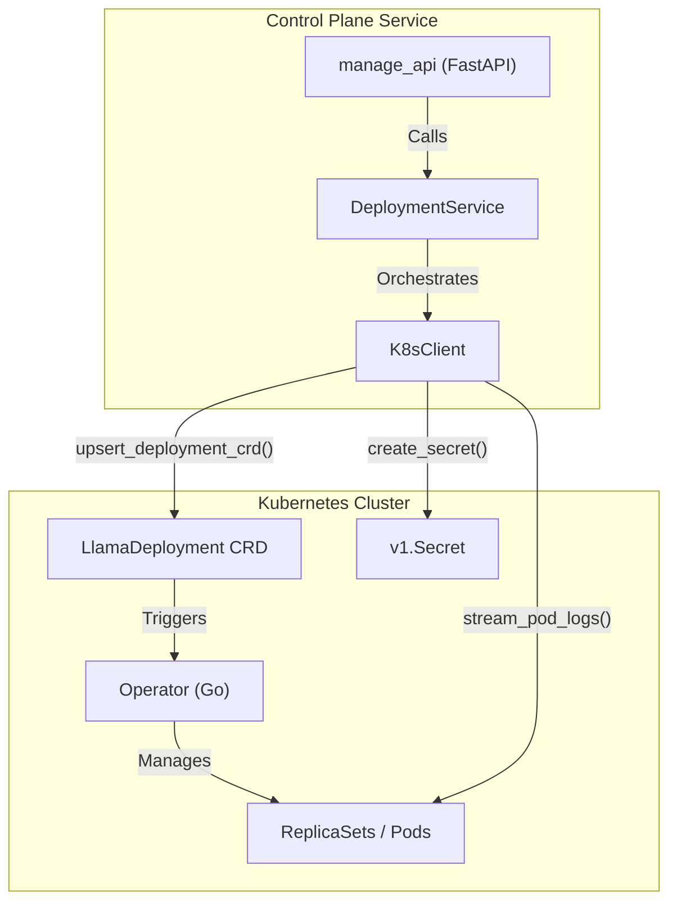
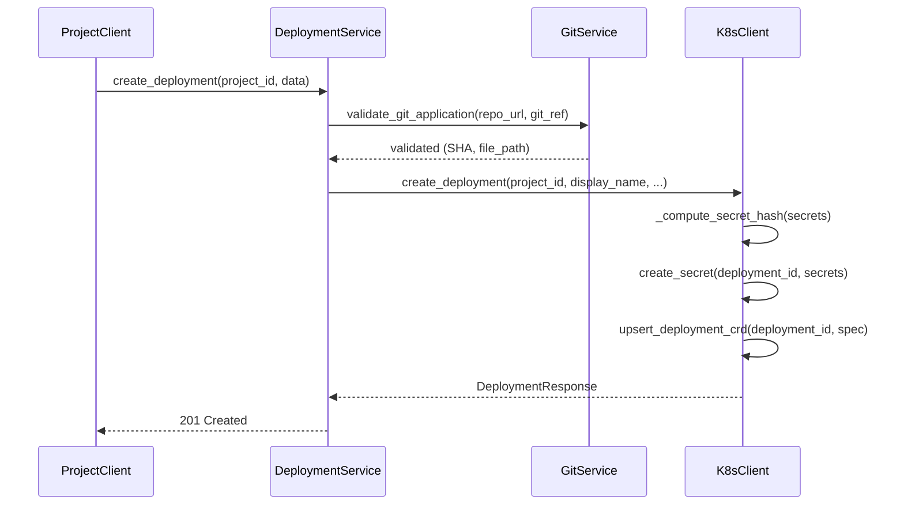

<!-- source: DeepWiki mcp.deepwiki.com · repo run-llama/llama-agents · page 5.1 Deployment Service and Kubernetes Client · fetched 2026-10-27 -->

# Deployment Service and Kubernetes Client

Relevant source files

The following files were used as context for generating this wiki page:

- [packages/llama-agents-control-plane/pyproject.toml](packages/llama-agents-control-plane/pyproject.toml)
- [packages/llama-agents-control-plane/src/llama_agents/control_plane/k8s_client.py](packages/llama-agents-control-plane/src/llama_agents/control_plane/k8s_client.py)
- [packages/llama-agents-control-plane/src/llama_agents/control_plane/manage_api/deployments_service.py](packages/llama-agents-control-plane/src/llama_agents/control_plane/manage_api/deployments_service.py)
- [packages/llama-agents-control-plane/tests/deployments/test_deployments_service.py](packages/llama-agents-control-plane/tests/deployments/test_deployments_service.py)
- [packages/llama-agents-control-plane/tests/test_endpoints.py](packages/llama-agents-control-plane/tests/test_endpoints.py)
- [packages/llama-agents-control-plane/tests/test_k8s_client.py](packages/llama-agents-control-plane/tests/test_k8s_client.py)
- [packages/llama-agents-core/pyproject.toml](packages/llama-agents-core/pyproject.toml)
- [packages/llama-agents-core/src/llama_agents/core/client/manage_client.py](packages/llama-agents-core/src/llama_agents/core/client/manage_client.py)
- [packages/llama-agents-core/src/llama_agents/core/schema/__init__.py](packages/llama-agents-core/src/llama_agents/core/schema/__init__.py)
- [packages/llama-agents-core/src/llama_agents/core/schema/deployments.py](packages/llama-agents-core/src/llama_agents/core/schema/deployments.py)
- [packages/llama-agents-core/src/llama_agents/core/schema/projects.py](packages/llama-agents-core/src/llama_agents/core/schema/projects.py)
- [packages/llama-agents-core/src/llama_agents/core/schema/public.py](packages/llama-agents-core/src/llama_agents/core/schema/public.py)
- [packages/llama-agents-core/src/llama_agents/core/server/manage_api/_abstract_deployments_service.py](packages/llama-agents-core/src/llama_agents/core/server/manage_api/_abstract_deployments_service.py)
- [packages/llama-agents-core/src/llama_agents/core/server/manage_api/_create_deployments_router.py](packages/llama-agents-core/src/llama_agents/core/server/manage_api/_create_deployments_router.py)
- [packages/llama-agents-core/tests/test_schema.py](packages/llama-agents-core/tests/test_schema.py)
- [packages/llamactl/src/llama_agents/cli/apply_yaml.py](packages/llamactl/src/llama_agents/cli/apply_yaml.py)
- [packages/llamactl/tests/test_apply_yaml.py](packages/llamactl/tests/test_apply_yaml.py)

The Control Plane manages the lifecycle of LlamaDeployments through two primary components: the `DeploymentService`, which implements the business logic for managing agentic applications, and the `K8sClient`, which serves as a low-level bridge to the Kubernetes API. Together, they handle everything from Git repository validation and secret management to log streaming and automated rollbacks.

## Deployment Architecture

The system follows a tiered architecture where high-level REST requests are processed by a service layer before being translated into Kubernetes Custom Resource (CRD) operations.

### Component Relationship Diagram
This diagram shows how the management entities in the code space interact with the underlying infrastructure.

**Sources:** [packages/llama-agents-control-plane/src/llama_agents/control_plane/manage_api/deployments_service.py:113-124](), [packages/llama-agents-control-plane/src/llama_agents/control_plane/k8s_client.py:81-96]()

## DeploymentService

The `DeploymentService` (implementing `AbstractDeploymentsService`) is responsible for the logic of creating, updating, and rolling back deployments. It integrates with `git_service` for repository validation and `code_repo_storage` for internal S3-backed Git pushes.

### Key Operations

| Operation | Logic | Code Entity |
| :--- | :--- | :--- |
| **Create** | Validates Git repo, determines appserver image tag, and creates K8s CRD/Secrets. | `create_deployment` |
| **Update** | Applies patch-style updates to CRD spec and updates associated K8s Secrets. | `update_deployment` |
| **Rollback** | Reverts the deployment to a specific Git SHA from the release history. | `rollback_deployment` |
| **Log Streaming** | Merges logs from Build Jobs and active ReplicaSets into a single stream. | `stream_deployment_logs` |

### Deployment Creation Flow
When a user runs `llamactl deploy`, the following sequence occurs:

**Sources:** [packages/llama-agents-control-plane/src/llama_agents/control_plane/manage_api/deployments_service.py:153-224](), [packages/llama-agents-control-plane/src/llama_agents/control_plane/k8s_client.py:214-219]()

## Kubernetes Client (K8sClient)

The `K8sClient` is a singleton wrapper around the official Kubernetes Python SDK. It manages the `LlamaDeployment` CRD (group: `llama-agents.llamaindex.ai`) and standard resources like `Secrets` and `Events`.

### CRD and Schema Management
The client interacts with the `LlamaDeploymentCRD` which includes:
- **Spec:** Contains `repoUrl`, `gitRef`, `gitSha`, and `deploymentFilePath`. [packages/llama-agents-core/src/llama_agents/core/schema/deployments.py:215-225]()
- **Status:** Tracks the `phase` (e.g., `Pending`, `Running`, `RollingOut`, `Failed`) and `authToken`. [packages/llama-agents-core/src/llama_agents/core/schema/deployments.py:90-99]()

### Secret Hashing and Rolling Updates
To trigger Kubernetes rolling updates when secrets change (without changing the deployment spec itself), the `K8sClient` computes a deterministic SHA-256 hash of the secret contents. This hash is stored as an annotation on the `LlamaDeployment` resource.
**Sources:** [packages/llama-agents-control-plane/src/llama_agents/control_plane/k8s_client.py:214-219]()

### Log Merging and Streaming
The log streaming implementation is complex because it must handle logs from multiple sources:
1. **Build Logs:** If a build is in progress or recently failed, logs are pulled from the K8s Job.
2. **ReplicaSet Logs:** Logs from all pods in the current and previous (during rollout) ReplicaSets are merged.
3. **Event Ordering:** Logs are sorted by timestamp and debounced to ensure a consistent stream even when pods are being rotated.

**Sources:** [packages/llama-agents-control-plane/src/llama_agents/control_plane/manage_api/deployments_service.py:317-340](), [packages/llama-agents-core/src/llama_agents/core/iter_utils.py:22-25]()

## Manage API Endpoints

The `manage_api` is exposed via FastAPI and follows a project-scoped routing pattern. Most endpoints require a `project_id` either as a query parameter or a `project-id` header.

### REST API Map

| Method | Path | Description |
| :--- | :--- | :--- |
| `POST` | `/api/v1beta1/deployments` | Create a new deployment. [packages/llama-agents-core/src/llama_agents/core/server/manage_api/_create_deployments_router.py:81-96]() |
| `GET` | `/api/v1beta1/deployments/{id}` | Get deployment status and events. [packages/llama-agents-core/src/llama_agents/core/server/manage_api/_create_deployments_router.py:105-118]() |
| `PATCH` | `/api/v1beta1/deployments/{id}` | Update deployment spec/secrets. [packages/llama-agents-core/src/llama_agents/core/server/manage_api/_create_deployments_router.py:156-184]() |
| `GET` | `/api/v1beta1/deployments/{id}/logs` | Stream logs as SSE. [packages/llama-agents-core/src/llama_agents/core/server/manage_api/_create_deployments_router.py:187-211]() |
| `POST` | `/api/v1beta1/deployments/{id}/rollback` | Rollback to a previous SHA. [packages/llama-agents-core/src/llama_agents/core/server/manage_api/_create_deployments_router.py:132-143]() |

### Data Flow: Log Streaming
The flow from the Kubernetes pod to the user's terminal:
1. `K8sClient.stream_pod_logs` calls the K8s API with `follow=True`.
2. `DeploymentService.stream_deployment_logs` wraps this in a `merge_generators` call to combine build and app logs.
3. `manage_api` returns a `StreamingResponse` (Server-Sent Events).
4. `llamactl logs` consumes the stream and renders it to stdout.

**Sources:** [packages/llama-agents-control-plane/src/llama_agents/control_plane/manage_api/deployments_service.py:317-340](), [packages/llama-agents-core/src/llama_agents/core/server/manage_api/_create_deployments_router.py:204-211]()

## Internal Code Repository
If `repo_url` is not provided during creation, the system assumes an internal push. The `DeploymentService` handles the `internal://` scheme:
- It configures the CRD with `INTERNAL_CODE_REPO_SCHEME`. [packages/llama-agents-core/src/llama_agents/core/schema/deployments.py:67]()
- It intercepts Git HTTP requests (info/refs, receive-pack) and routes them to the S3-backed `git_server`. [packages/llama-agents-control-plane/src/llama_agents/control_plane/manage_api/deployments_service.py:14-17]()
- Upon a successful push, `_on_push_complete` updates the CRD with the newly uploaded Git SHA. [packages/llama-agents-control-plane/src/llama_agents/control_plane/manage_api/deployments_service.py:48-97]()

**Sources:** [packages/llama-agents-control-plane/src/llama_agents/control_plane/manage_api/deployments_service.py:48-97](), [packages/llama-agents-core/src/llama_agents/core/schema/deployments.py:67]()

---

