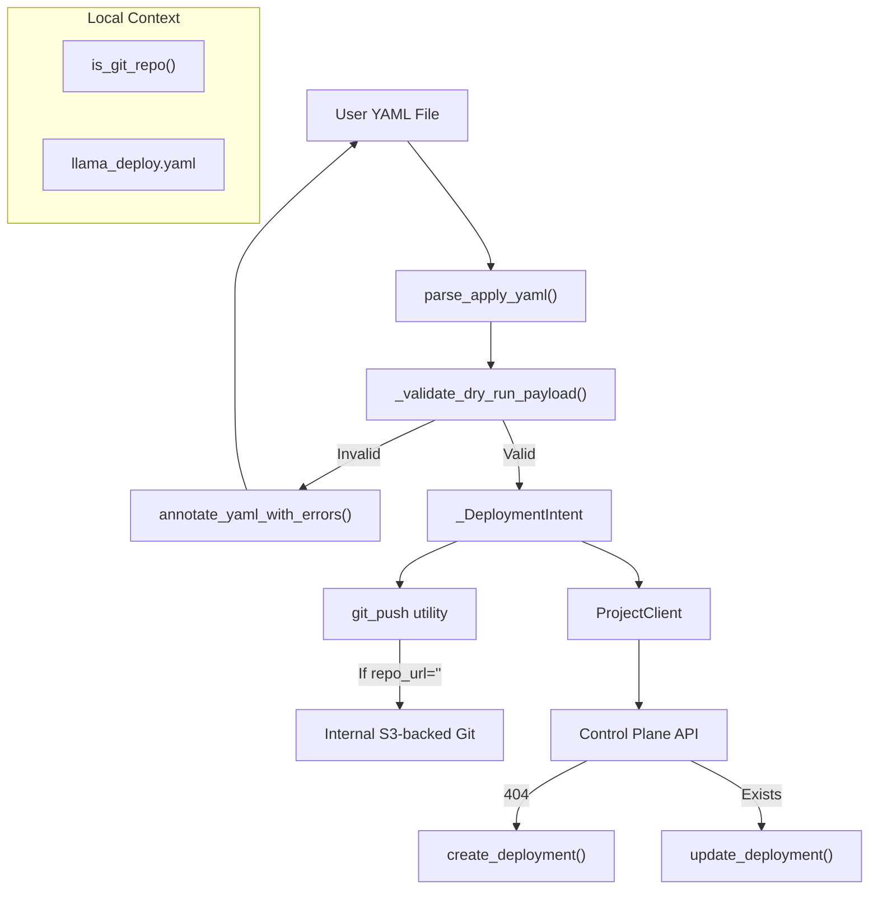
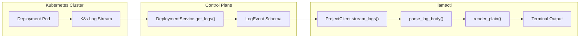

<!-- source: DeepWiki mcp.deepwiki.com · repo run-llama/llama-agents · page 7.1 Deployment Commands (apply, create, edit, template, logs) · fetched 2026-10-27 -->

# Deployment Commands (apply, create, edit, template, logs)

Relevant source files

The following files were used as context for generating this wiki page:

- [AGENTS.md](AGENTS.md)
- [packages/llamactl/AGENTS.md](packages/llamactl/AGENTS.md)
- [packages/llamactl/src/llama_agents/cli/commands/deployment.py](packages/llamactl/src/llama_agents/cli/commands/deployment.py)
- [packages/llamactl/src/llama_agents/cli/display.py](packages/llamactl/src/llama_agents/cli/display.py)
- [packages/llamactl/src/llama_agents/cli/options.py](packages/llamactl/src/llama_agents/cli/options.py)
- [packages/llamactl/src/llama_agents/cli/utils/git_push.py](packages/llamactl/src/llama_agents/cli/utils/git_push.py)
- [packages/llamactl/src/llama_agents/cli/yaml_template.py](packages/llamactl/src/llama_agents/cli/yaml_template.py)
- [packages/llamactl/tests/conftest.py](packages/llamactl/tests/conftest.py)
- [packages/llamactl/tests/test_deployments_apply_cmd.py](packages/llamactl/tests/test_deployments_apply_cmd.py)
- [packages/llamactl/tests/test_deployments_editor_cmd.py](packages/llamactl/tests/test_deployments_editor_cmd.py)
- [packages/llamactl/tests/test_deployments_get_output.py](packages/llamactl/tests/test_deployments_get_output.py)
- [packages/llamactl/tests/test_deployments_logs.py](packages/llamactl/tests/test_deployments_logs.py)
- [packages/llamactl/tests/test_deployments_template_cmd.py](packages/llamactl/tests/test_deployments_template_cmd.py)
- [packages/llamactl/tests/test_deployments_update.py](packages/llamactl/tests/test_deployments_update.py)
- [packages/llamactl/tests/test_display.py](packages/llamactl/tests/test_display.py)
- [packages/llamactl/tests/test_git_push.py](packages/llamactl/tests/test_git_push.py)
- [packages/llamactl/tests/test_yaml_template.py](packages/llamactl/tests/test_yaml_template.py)

The `deployments` command group in `llamactl` provides the primary interface for managing the lifecycle of LlamaDeploy applications. It enables users to define deployments via YAML, interactively create or edit them using local system editors, and stream logs from running services.

## The Apply Lifecycle

The `apply` command is the core idempotent operation for deployment management. It follows a multi-stage pipeline: **Parse → Validate → Push (Optional) → Upsert**.

### 1. Parse and Local Context Gathering
The CLI first attempts to gather context from the local environment, including Git repository status, current branch, and any existing `llama_deploy.yaml` configuration [packages/llamactl/src/llama_agents/cli/commands/deployment.py:54-54](). This context is used to populate defaults or validate the intent of the apply operation.

### 2. Validation and Error Annotation
Before communicating with the control plane, the CLI performs "dry-run" validation of the payload [packages/llamactl/src/llama_agents/cli/commands/deployment.py:180-197](). If the YAML input contains structural errors or missing required fields, `llamactl` uses an error annotation system to pinpoint the exact line in the YAML file.

- **Mapping**: The `_wire_path_from_loc` function maps Pydantic validation errors (which use field paths like `spec.repo_url`) back to the corresponding YAML keys [packages/llamactl/src/llama_agents/cli/commands/deployment.py:109-128]().
- **Annotation**: The `annotate_yaml_with_errors` function inserts comments directly into the YAML text to guide the user [packages/llamactl/src/llama_agents/cli/commands/deployment.py:42-42]().

### 3. Push-Mode vs. External Repository
Deployments support two primary code sourcing modes:
- **External Repo**: The `repo_url` points to a public or private Git repository (e.g., GitHub). The control plane pulls from this URL directly [packages/llamactl/src/llama_agents/cli/commands/deployment.py:4-6]().
- **Push-Mode (Internal)**: Indicated by an empty `repo_url: ""` in the YAML [packages/llamactl/src/llama_agents/cli/display.py:44-46](). In this mode, the CLI pushes the local working tree to a managed internal Git mirror using the `internal://` scheme [packages/llamactl/src/llama_agents/cli/commands/deployment.py:28-28]().

### 4. Upsert (Create or Update)
The CLI determines whether to call `create_deployment` or `update_deployment` based on the presence of the deployment ID in the control plane [packages/llamactl/tests/test_deployments_apply_cmd.py:180-193]().

### Deployment Operation Data Flow
This diagram shows how a user's YAML input is transformed into a control plane API call.

Title: Deployment Apply Data Flow

Sources: [packages/llamactl/src/llama_agents/cli/commands/deployment.py:38-45](), [packages/llamactl/src/llama_agents/cli/commands/deployment.py:180-197](), [packages/llamactl/src/llama_agents/cli/utils/git_push.py:1-10]()

---

## YAML Template Rendering

The `template` command (and `-o template` flag) generates a commented, "apply-shaped" YAML scaffold. This is implemented in the `llama_agents.cli.yaml_template` module.

### Key Features:
- **Declaration Order**: Fields are rendered in the exact order they are defined in the `DeploymentSpec` Pydantic model [packages/llamactl/src/llama_agents/cli/yaml_template.py:5-7]().
- **Smart Comments**: Uses `Doc` and `TrailingDoc` markers from the display model to attach documentation directly to YAML keys [packages/llamactl/src/llama_agents/cli/display.py:73-95]().
- **Required Markers**: Fields marked as `required` that are currently unset are rendered as `<key>: ~` with a `## REQUIRED` comment [packages/llamactl/src/llama_agents/cli/yaml_template.py:13-14]().
- **Secret Masking**: Preserves `SECRET_MASK` (`********`) placeholders so users can see which secrets are set without exposing their values [packages/llamactl/src/llama_agents/cli/display.py:42-42]().

### Identity Logic
The identity tier (top-level `name` or `generate_name`) is handled specially. `name` provides a stable ID, while `generate_name` allows the server to append a random suffix [packages/llamactl/src/llama_agents/cli/yaml_template.py:57-60]().

Sources: [packages/llamactl/src/llama_agents/cli/yaml_template.py:1-37](), [packages/llamactl/src/llama_agents/cli/display.py:1-20]()

---

## Interactive Editing

The `create` and `edit` commands support an interactive workflow using the system's default editor (via `click.edit`).

1. **Scaffolding**: For `create`, a template is generated based on local context [packages/llamactl/tests/test_deployments_editor_cmd.py:137-158]().
2. **Editing**: The YAML is opened in the user's editor.
3. **Re-validation Loop**: Upon saving, the CLI parses and validates the YAML. If validation fails, it re-opens the editor with the errors annotated at the top [packages/llamactl/src/llama_agents/cli/commands/deployment.py:42-42]().
4. **Finalization**: Once valid, the CLI performs the `apply` logic.

Sources: [packages/llamactl/src/llama_agents/cli/commands/deployment.py:18-22](), [packages/llamactl/tests/test_deployments_editor_cmd.py:101-135]()

---

## Git Utilities and Push Logic

The `llama_agents.cli.utils.git_push` module handles the complexities of internal Git mirroring.

- **`configure_git_remote`**: Automatically sets up a Git remote named `llamaagents-<deployment_id>` pointing to the control plane's internal Git service [packages/llamactl/src/llama_agents/cli/utils/git_push.py:65-65]().
- **`push_to_remote`**: Executes the `git push` command. It uses a custom refspec to ensure the local branch is pushed correctly to the remote [packages/llamactl/src/llama_agents/cli/utils/git_push.py:69-69]().
- **Fallback Behavior**: During an `update`, if a push fails (e.g., due to a transient 500 error), the CLI warns the user but continues the update using the last successfully pushed code [packages/llamactl/tests/test_deployments_update.py:71-126]().

Sources: [packages/llamactl/src/llama_agents/cli/utils/git_push.py:1-71](), [packages/llamactl/tests/test_deployments_update.py:1-25]()

---

## Log Streaming

The `logs` command provides real-time access to the logs generated by the deployment's pods.

- **Event Mapping**: The CLI consumes `LogEvent` objects from the control plane [packages/llamactl/src/llama_agents/core/schema/deployment_logs.py:1-10]().
- **Parsing**: `parse_log_body` extracts structured information (like timestamp and level) from the raw log strings [packages/llamactl/src/llama_agents/cli/commands/deployment.py:55-55]().
- **Rendering**: Logs are rendered to the terminal using `render_plain` to ensure they are readable and pipeable [packages/llamactl/src/llama_agents/cli/commands/deployment.py:55-55]().

### Log Flow Architecture
This diagram associates CLI components with the log streaming entities.

Title: Log Streaming Architecture

Sources: [packages/llamactl/src/llama_agents/cli/commands/deployment.py:26-26](), [packages/llamactl/src/llama_agents/cli/log_format.py:1-10]()

---

