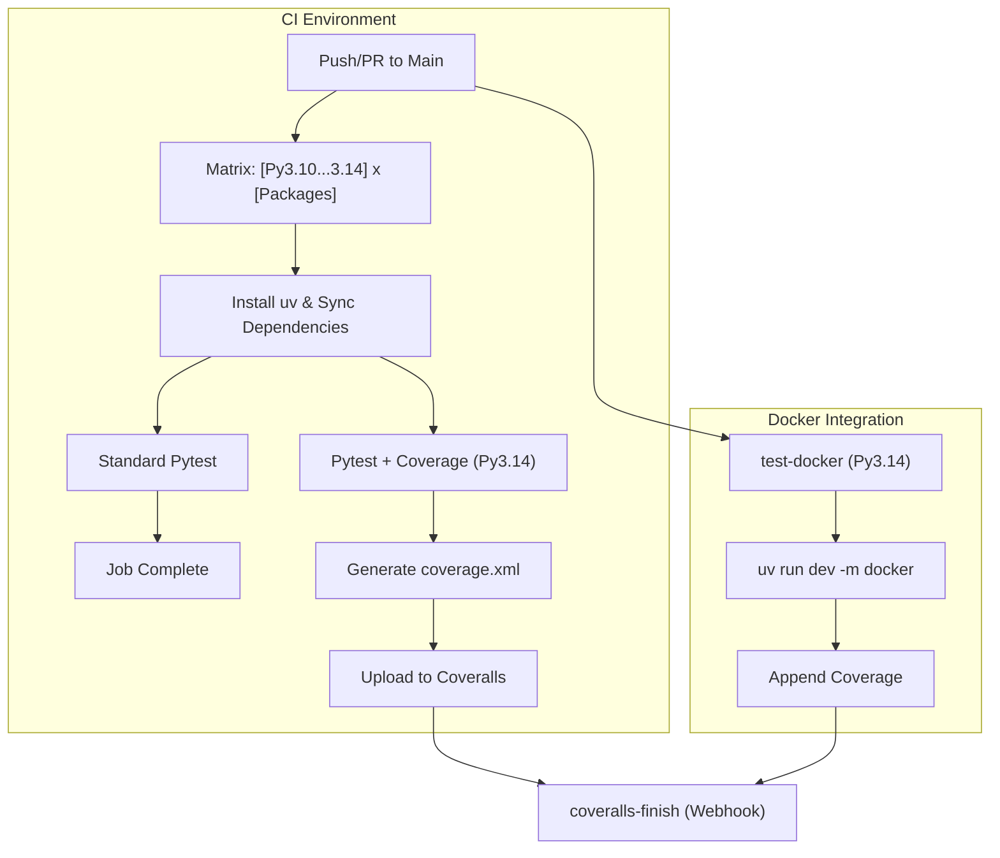
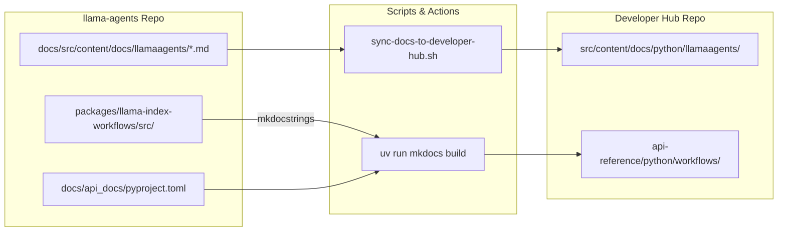

<!-- source: DeepWiki mcp.deepwiki.com · repo run-llama/llama-agents · page 8.2 Test, Lint, and Documentation Workflows · fetched 2026-10-27 -->

# Test, Lint, and Documentation Workflows

Relevant source files

The following files were used as context for generating this wiki page:

- [.github/actions/pr-fix-comment/action.yml](.github/actions/pr-fix-comment/action.yml)
- [.github/workflows/bump_llama_index_core.yml](.github/workflows/bump_llama_index_core.yml)
- [.github/workflows/lint.yml](.github/workflows/lint.yml)
- [.github/workflows/publish_openapi.yml](.github/workflows/publish_openapi.yml)
- [.github/workflows/sync-docs.yml](.github/workflows/sync-docs.yml)
- [.github/workflows/test.yml](.github/workflows/test.yml)
- [.github/workflows/update_debugger_assets.yml](.github/workflows/update_debugger_assets.yml)
- [.gitignore](.gitignore)
- [docs/api_docs/pyproject.toml](docs/api_docs/pyproject.toml)
- [examples/dbos/.gitignore](examples/dbos/.gitignore)
- [examples/dbos/docker-compose.yml](examples/dbos/docker-compose.yml)
- [scripts/sync-docs-to-developer-hub.sh](scripts/sync-docs-to-developer-hub.sh)
- [src/dev_cli/index_html.py](src/dev_cli/index_html.py)

This section covers the automated GitHub Actions workflows and scripts that maintain the quality, consistency, and documentation of the `llama-agents` monorepo. These workflows handle everything from multi-version Python testing to the synchronization of API documentation with external developer portals.

## Unit Testing and Coverage

The primary CI entry point for code validation is the `test.yml` workflow. It executes a comprehensive test matrix across multiple Python versions and packages.

### Test Matrix and Execution
The workflow uses a matrix strategy to test every package in the `packages/` directory against Python versions 3.10 through 3.14 [.github/workflows/test.yml:16-34](). It utilizes `astral-sh/setup-uv` for fast environment setup and dependency resolution [.github/workflows/test.yml:76-80]().

The testing logic is split into two modes based on the Python version:
1.  **Standard Test:** Runs `uv run pytest` for all versions except the designated coverage version [.github/workflows/test.yml:83-86]().
2.  **Coverage Test:** Runs on Python 3.14 (defined by `COV_PYTHON_VERSION`) using `pytest --cov=src --cov-report=xml` [.github/workflows/test.yml:89-90]().

### Docker and Integration Tests
A specialized job, `test-docker`, handles integration tests that require containerized environments. It executes the `dev` CLI with the `-m docker` flag, allowing for a 120-second timeout to accommodate container startup [.github/workflows/test.yml:104-121]().

### Coverage Reporting
Coverage results are aggregated using Coveralls. Each matrix job uploads its individual `coverage.xml` [.github/workflows/test.yml:92-102](), and a final `coveralls-finish` job signals the completion of the parallel suite [.github/workflows/test.yml:132-144]().

**Workflow Data Flow: Testing**

Sources: [.github/workflows/test.yml:9-144]()

## Linting and Auto-Fixing

The `lint.yml` workflow ensures code style compliance using `pre-commit`, which orchestrates tools like `ruff` and `basedpyright`.

### Automated PR Fixes
A unique feature of the linting pipeline is the `pr-fix-comment` action. If `uv run pre-commit run -a` fails during a PR check, the workflow attempts to automatically fix the issues [.github/workflows/lint.yml:21-34]().

1.  **Action Execution:** The `pr-fix-comment` composite action generates a GitHub App token [.github/actions/pr-fix-comment/action.yml:95-103]().
2.  **Branch Creation:** It creates a new branch (e.g., `chore/fix-lint-{pr_number}`) containing the corrected code [.github/actions/pr-fix-comment/action.yml:127-129]().
3.  **PR Management:** It opens a "Fix PR" and posts a comment on the original PR with instructions on how to avoid the issue locally [.github/actions/pr-fix-comment/action.yml:134-152]().

Sources: [.github/workflows/lint.yml:1-38](), [.github/actions/pr-fix-comment/action.yml:1-191]()

## Documentation Pipeline

The documentation workflow involves generating API references from source code and syncing markdown content to the central `run-llama/developers` repository.

### API Reference Generation
The API documentation is built using `mkdocs` with the `mkdocstrings` handler for Python. The configuration is managed in `docs/api_docs/pyproject.toml`, which includes dependencies for rendering Swagger/OpenAPI specs and Mermaid diagrams [docs/api_docs/pyproject.toml:12-24]().

### Syncing to Developer Hub
The `sync-docs.yml` workflow triggers on changes to the `docs/**` path [.github/workflows/sync-docs.yml:3-7](). It executes the `sync-docs-to-developer-hub.sh` script, which performs the following:
1.  **Markdown Sync:** Uses `rsync` to move `.md` and `.mdx` files from `docs/src/content/docs/llamaagents` to the destination repo [scripts/sync-docs-to-developer-hub.sh:13-29]().
2.  **API Build:** Runs `uv run mkdocs build` within the `docs/api_docs` directory to generate HTML API references [scripts/sync-docs-to-developer-hub.sh:32-38]().
3.  **Deployment:** Commits and pushes the changes to the `run-llama/developers` repository [.github/workflows/sync-docs.yml:31-47]().

**Entity Mapping: Documentation Sync**

Sources: [scripts/sync-docs-to-developer-hub.sh:1-41](), [.github/workflows/sync-docs.yml:1-47](), [docs/api_docs/pyproject.toml:1-32]()

## Dependency and Asset Management

### Debugger Assets
The `update_debugger_assets.yml` workflow allows updating the frontend assets for the workflow debugger hosted within `llama-agents-server`.
*   **Trigger:** Can be triggered via `repository_dispatch` from a frontend build pipeline or manually [.github/workflows/update_debugger_assets.yml:3-13]().
*   **Implementation:** It calls `uv run dev update-index-html` [.github/workflows/update_debugger_assets.yml:45-48](). This function, defined in `src/dev_cli/index_html.py`, uses regex patterns (`SCRIPT_PATTERN`, `CSS_PATTERN`) to replace asset URLs in the `static/index.html` file [src/dev_cli/index_html.py:11-51]().

### OpenAPI Specification
The `publish_openapi.yml` workflow automates the generation of the server's OpenAPI schema.
*   **Build:** It runs `uv run hatch run openapi` inside `packages/llama-agents-server` to generate `openapi.json` [.github/workflows/publish_openapi.yml:46-51]().
*   **Release:** The resulting file is uploaded as a GitHub Release asset [.github/workflows/publish_openapi.yml:52-59]().
*   **Downstream:** It triggers a `repository_dispatch` to `run-llama/llama-ui` to update the associated SDKs [.github/workflows/publish_openapi.yml:68-81]().

### Core Dependency Bumping
The `bump_llama_index_core.yml` workflow responds to releases of the upstream `llama-index-core` package. It runs `uv lock --upgrade-package llama-index-core` and opens a PR with the updated lockfile [.github/workflows/bump_llama_index_core.yml:1-38]().

Sources: [.github/workflows/update_debugger_assets.yml:1-95](), [src/dev_cli/index_html.py:11-51](), [.github/workflows/publish_openapi.yml:1-81](), [.github/workflows/bump_llama_index_core.yml:1-38]()

---

