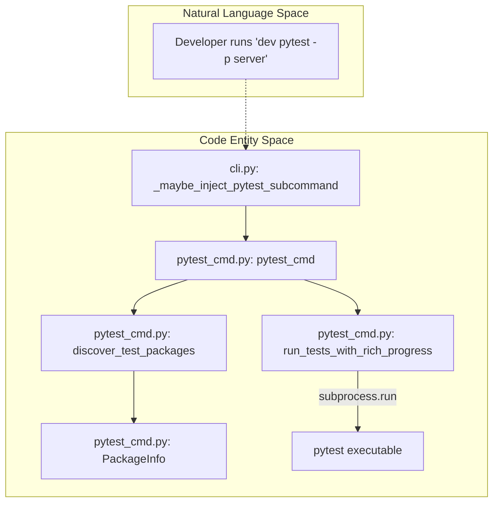
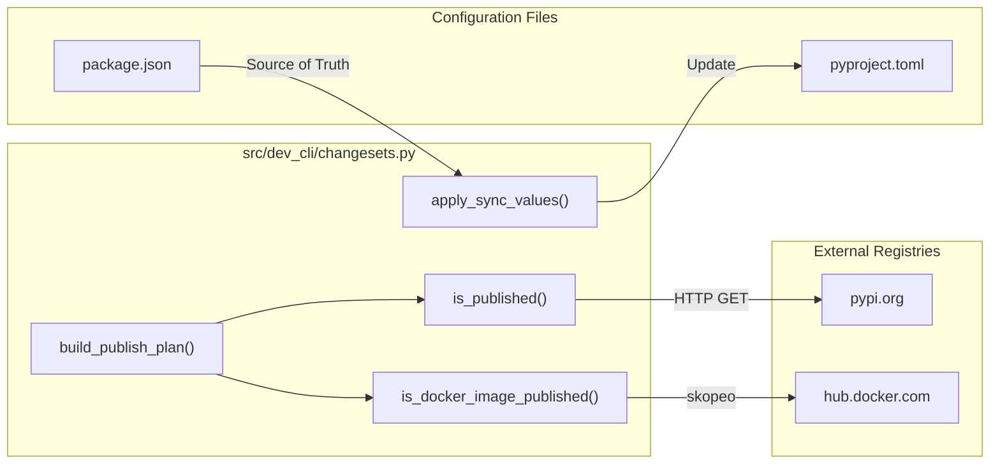

<!-- source: DeepWiki mcp.deepwiki.com · repo run-llama/llama-agents · page 8.3 Dev CLI (src/dev_cli) · fetched 2026-10-27 -->

# Dev CLI (src/dev_cli)

Relevant source files

The following files were used as context for generating this wiki page:

- [.github/actions/setup-publish/action.yml](.github/actions/setup-publish/action.yml)
- [.github/workflows/publish_changesets.yml](.github/workflows/publish_changesets.yml)
- [operator/CHANGELOG.md](operator/CHANGELOG.md)
- [operator/package.json](operator/package.json)
- [packages/llama-agents-integration-tests/pyproject.toml](packages/llama-agents-integration-tests/pyproject.toml)
- [src/dev_cli/changesets.py](src/dev_cli/changesets.py)
- [src/dev_cli/cli.py](src/dev_cli/cli.py)
- [src/dev_cli/commands/__init__.py](src/dev_cli/commands/__init__.py)
- [src/dev_cli/commands/changesets_cmd.py](src/dev_cli/commands/changesets_cmd.py)
- [src/dev_cli/commands/publish_cmd.py](src/dev_cli/commands/publish_cmd.py)
- [src/dev_cli/commands/pytest_cmd.py](src/dev_cli/commands/pytest_cmd.py)
- [src/dev_cli/commands/skills_cmd.py](src/dev_cli/commands/skills_cmd.py)
- [src/dev_cli/gha.py](src/dev_cli/gha.py)
- [tests/dev_cli/test_changesets.py](tests/dev_cli/test_changesets.py)
- [tests/dev_cli/test_pytest_cmd.py](tests/dev_cli/test_pytest_cmd.py)

The `dev` CLI is an internal developer toolset designed to manage the `llama-agents` monorepo. It orchestrates cross-package testing, handles complex versioning synchronization between Python and JavaScript/TypeScript packages, and provides the logic for the CI/CD publish-plan reconcile loop used in GitHub Actions.

## Overview and Entry Point

The CLI is built using `click` and is typically invoked via `uv run dev`. It features a smart argument injection mechanism that defaults to running tests if no known subcommand is provided [src/dev_cli/cli.py:31-49]().

### Command Architecture

| Command | Function | Key Code Entity |
| :--- | :--- | :--- |
| `pytest` | Runs parallelized tests across the workspace | `pytest_cmd` |
| `changeset-version` | Bumps versions and syncs `pyproject.toml` | `changeset_version` |
| `changeset-plan` | Computes gaps between repo and registries | `changeset_plan` |
| `publish-action` | Executes a specific plan item (PyPI/Docker/Helm) | `publish_action` |
| `sync-skills` | Symlinks agent skills for Claude Code | `sync_skills` |
| `update-index-html` | Injects asset URLs into the internal debugger UI | `update_index_html` |

Sources: [src/dev_cli/cli.py:58-121](), [src/dev_cli/commands/__init__.py:1-15]()

---

## Parallel Test Runner (`pytest_cmd`)

The `pytest` command automates test discovery and execution across all packages in the monorepo. It uses a `ThreadPoolExecutor` to run tests in parallel while providing a unified, real-time progress view using `rich.live` [src/dev_cli/commands/pytest_cmd.py:15-24]().

### Test Discovery Logic
The tool identifies "testable packages" by scanning the `packages/` directory for folders that contain both a `tests/` directory and a `pyproject.toml` file [src/dev_cli/commands/pytest_cmd.py:180-205]().

### Execution Flow
1. **Discovery**: `discover_test_packages()` finds all targets [src/dev_cli/commands/pytest_cmd.py:180]().
2. **Sync**: Runs `uv sync` for each package to ensure dependencies are current [src/dev_cli/commands/pytest_cmd.py:321]().
3. **Execution**: Runs `pytest` via `subprocess` with provided passthrough arguments [src/dev_cli/commands/pytest_cmd.py:326]().
4. **Parsing**: Captures `stdout` to extract test counts (e.g., "42 passed") and failure sections for the summary report [src/dev_cli/commands/pytest_cmd.py:58-115]().

### Code Entity Map: Test Execution

Sources: [src/dev_cli/commands/pytest_cmd.py:32-51](), [src/dev_cli/commands/pytest_cmd.py:311-340]()

---

## Changeset and Versioning System

The monorepo uses `@changesets/cli` for versioning, but because it contains both Python (`pyproject.toml`) and Node.js (`package.json`) packages, the `dev` CLI performs "Version Synchronization."

### Version Sync Engine
The `changeset-version` command performs a multi-step update [src/dev_cli/commands/changesets_cmd.py:15-45]():
1. Invokes `npx @changesets/cli version` to update `package.json` files and `CHANGELOG.md`.
2. **`apply_sync_values`**: For each package, it reads the new version from `package.json` and updates the corresponding `pyproject.toml` version using `tomlkit` to preserve formatting [src/dev_cli/changesets.py:224-260]().
3. **SemVer to PEP 440**: Automatically converts pre-release versions (e.g., `1.2.3-a.4` becomes `1.2.3a4`) to comply with Python standards [src/dev_cli/changesets.py:63-84]().
4. **`syncValues`**: Updates arbitrary files defined in a package's `package.json` under the `syncValues` key using template strings like `{self:version}` [src/dev_cli/changesets.py:172-209]().

### Publish Planning (CI Integration)
The `changeset-plan` command implements a reconcile loop for GitHub Actions [src/dev_cli/commands/publish_cmd.py:14-38]():
- It builds a `PublishPlan` by checking if the current version of a package is already present on PyPI, Docker Hub, or the Helm registry [src/dev_cli/changesets.py:465-514]().
- **PyPI Check**: Queries the PyPI JSON API [src/dev_cli/changesets.py:330-345]().
- **Docker Check**: Uses `skopeo inspect` to verify image tags [src/dev_cli/changesets.py:348-364]().

### Code Entity Map: Versioning and Publishing

Sources: [src/dev_cli/changesets.py:148-168](), [src/dev_cli/changesets.py:330-364](), [src/dev_cli/changesets.py:465-514]()

---

## Skill Synchronization (`sync-skills`)

The `sync-skills` command facilitates local development for AI agents using Claude Code. 

- **Purpose**: Claude Code looks for skills in `.claude/skills/` (gitignored), while the repo stores them in `.agents/skills/` [src/dev_cli/commands/skills_cmd.py:3-9]().
- **Implementation**: It creates relative symlinks between the two directories so that edits in the checked-in directory are immediately reflected in the AI's environment [src/dev_cli/commands/skills_cmd.py:59-93]().
- **Safety**: It refuses to overwrite existing files that are not symlinks [src/dev_cli/commands/skills_cmd.py:81-86]().

Sources: [src/dev_cli/commands/skills_cmd.py:31-104]()

---

## GitHub Actions Integration (`gha` module)

The `gha` module provides utilities for the CLI to communicate back to the GitHub Actions runner.

- **`write_outputs`**: Writes key-value pairs to the file pointed to by the `$GITHUB_OUTPUT` environment variable, allowing CLI logic to drive CI branching and matrix generation [src/dev_cli/gha.py:10-25]().
- **Usage in Publishing**: The `plan` job in `publish_changesets.yml` runs `dev changeset-plan`, which uses this module to emit the JSON matrices for parallel PyPI and Docker build jobs [ .github/workflows/publish_changesets.yml:103-106]().

Sources: [src/dev_cli/gha.py:1-25](), [.github/workflows/publish_changesets.yml:29-40]()

---

