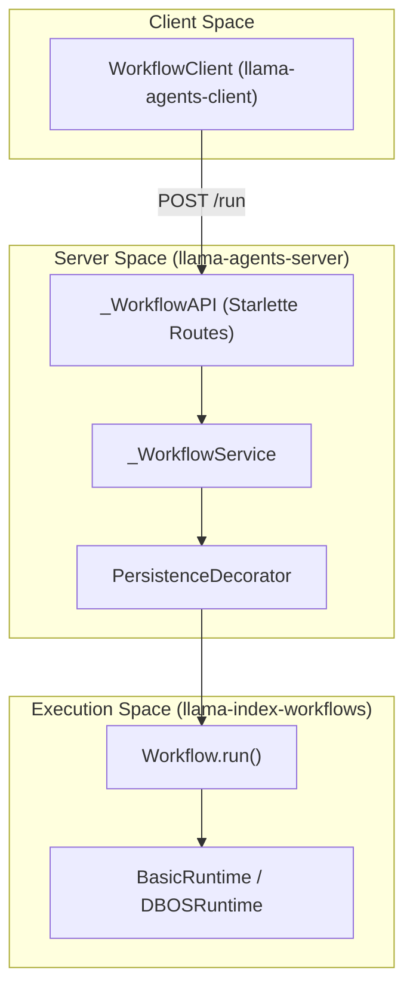
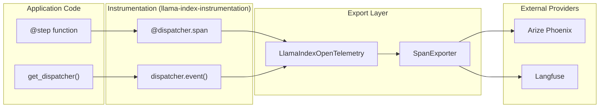

<!-- source: DeepWiki mcp.deepwiki.com · repo run-llama/llama-agents · page 9 Examples and Integration Tests · fetched 2026-10-27 -->

# Examples and Integration Tests

Relevant source files

The following files were used as context for generating this wiki page:

- [CONTRIBUTING.md](CONTRIBUTING.md)
- [README.md](README.md)
- [docs/src/content/docs/llamaagents/workflows/observability.md](docs/src/content/docs/llamaagents/workflows/observability.md)
- [examples/README.md](examples/README.md)
- [examples/client/README.md](examples/client/README.md)
- [examples/dbos/README.md](examples/dbos/README.md)
- [examples/docker/README.md](examples/docker/README.md)
- [examples/observability/README.md](examples/observability/README.md)
- [examples/observability/workflows_observability_pt1.ipynb](examples/observability/workflows_observability_pt1.ipynb)
- [examples/observability/workflows_observability_pt2.ipynb](examples/observability/workflows_observability_pt2.ipynb)
- [examples/observability/workflows_observablitiy_arize_phoenix.ipynb](examples/observability/workflows_observablitiy_arize_phoenix.ipynb)
- [examples/observability/workflows_observablitiy_langfuse.ipynb](examples/observability/workflows_observablitiy_langfuse.ipynb)
- [examples/server/README.md](examples/server/README.md)
- [examples/state_management_with_vector_databases.ipynb](examples/state_management_with_vector_databases.ipynb)

The `llama-agents` repository includes a comprehensive suite of examples and integration tests designed to demonstrate core patterns and ensure the reliability of the system across different environments. These resources range from minimal "Hello World" scripts to complex, durable, multi-replica deployments integrated with third-party observability platforms.

## Overview of Examples

The `examples/` directory serves as the primary learning resource for the framework. It is organized by functional area, demonstrating how the library scales from a simple script to a production-grade service.

### Core Server and Client Patterns
The most common entry point for users is the `WorkflowServer`, which wraps `llama-index-workflows` into a REST API. Examples demonstrate:
*   **Standalone Servers**: Minimal setups using `WorkflowServer` [examples/server/README.md:9-10]().
*   **FastAPI Integration**: Mounting a `WorkflowServer` inside an existing FastAPI application [examples/server/README.md:11-12]().
*   **Client Interaction**: Using `WorkflowClient` to submit runs and stream events via SSE [examples/client/README.md:3-9]().
*   **Human-in-the-Loop (HITL)**: Patterns for workflows that pause for human intervention using `InputRequiredEvent` and `HumanResponseEvent` [examples/client/README.md:10]().

### Durability and Persistence
The `examples/dbos/` directory highlights the use of the `llama-agents-dbos` package to achieve fault tolerance. These examples cover:
*   **Crash Recovery**: Resuming interrupted workflows from the last successful step [examples/dbos/README.md:12]().
*   **Multi-Replica Coordination**: Multiple server instances sharing a Postgres-backed event store [examples/dbos/README.md:13]().
*   **Idle Release**: Automatically offloading idle workflows from memory and resuming them upon new event arrival [examples/dbos/README.md:14]().

### Observability and Tracing
Workflows feature a native instrumentation system based on OpenTelemetry (OTel). Examples in `examples/observability/` demonstrate:
*   **Custom Instrumentation**: Defining custom spans and events using the `llama-index-instrumentation` dispatcher [docs/src/content/docs/llamaagents/workflows/observability.md:65-88]().
*   **Third-Party Integration**: Exporting traces to platforms like **Arize Phoenix**, **Langfuse**, and **Opik** [docs/src/content/docs/llamaagents/workflows/observability.md:41-62]().

For a deep dive into these patterns, see **[Workflow Examples](#9.1)**.

## Infrastructure and Deployment Examples

Beyond application code, the repository provides reference implementations for modern infrastructure stacks.

### Kubernetes and OpenTelemetry
The `k8s-otel` example provides a complete blueprint for deploying `llama-agents` in a cloud-native environment. It includes:
*   **Local Development**: A `Tiltfile` for rapid iteration on a local Kubernetes cluster.
*   **Observability Stack**: Pre-configured Prometheus and Arize Phoenix deployments for monitoring.
*   **Containerization**: Standard Docker patterns for packaging workflows and the control plane.

For details, see **[Kubernetes + OpenTelemetry Example (k8s-otel)](#9.2)**.

## Integration Test Suite

The `llama-agents-integration-tests` package contains the "Matrix Tests," which validate the interoperability of different components.

| Test Category | Description |
| :--- | :--- |
| **Store Matrix** | Validates that all `AbstractWorkflowStore` implementations (Memory, SQLite, Postgres) behave identically under load. |
| **Runtime Matrix** | Tests the execution logic across different runtimes, including the `DBOSRuntime`. |
| **Server HTTP Matrix** | Ensures the `WorkflowServer` correctly handles concurrent requests, streaming, and error states. |
| **Agent Data Store** | Validates persistence and retrieval of agent-specific state across sessions. |

For details, see **[Integration Test Matrix](#9.3)**.

## Conceptual Mapping: Natural Language to Code

The following diagrams illustrate how the concepts demonstrated in the examples map to specific code entities within the repository.

### Workflow Execution Flow
This diagram shows how a user request moves from a client example into the core workflow engine.

**Sources:** [examples/client/README.md:3-9](), [examples/server/README.md:3-9](), [README.md:45-56]()

### Observability Integration
This diagram maps the path of a trace from a workflow step to an external observability provider.

**Sources:** [docs/src/content/docs/llamaagents/workflows/observability.md:11-62](), [examples/observability/workflows_observability_pt1.ipynb:111-149]()

---

**Sources:**
- `README.md`: [1-76]()
- `docs/src/content/docs/llamaagents/workflows/observability.md`: [1-93]()
- `CONTRIBUTING.md`: [1-100]()
- `examples/server/README.md`: [1-23]()
- `examples/client/README.md`: [1-25]()
- `examples/dbos/README.md`: [1-27]()
- `examples/observability/README.md`: [1-14]()

---

