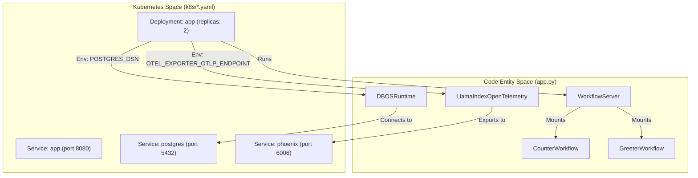
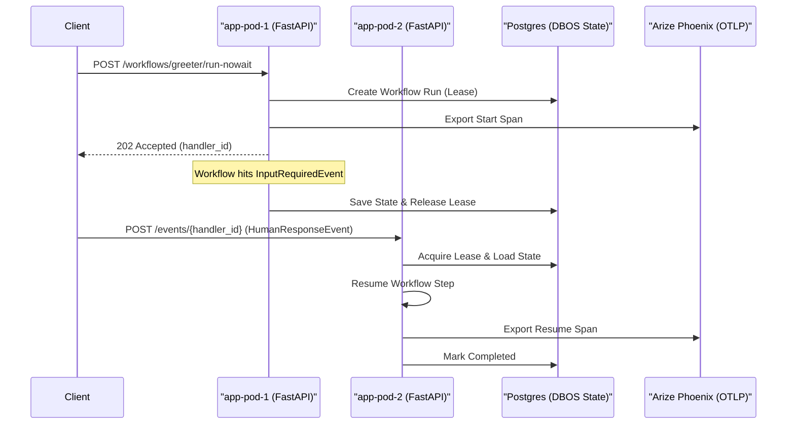

<!-- source: DeepWiki mcp.deepwiki.com · repo run-llama/llama-agents · page 9.2 Kubernetes + OpenTelemetry Example (k8s-otel) · fetched 2026-10-27 -->

# Kubernetes + OpenTelemetry Example (k8s-otel)

Relevant source files

The following files were used as context for generating this wiki page:

- [.dockerignore](.dockerignore)
- [CLAUDE.md](CLAUDE.md)
- [examples/docker/Dockerfile](examples/docker/Dockerfile)
- [examples/docker/app.py](examples/docker/app.py)
- [examples/docker/requirements.txt](examples/docker/requirements.txt)
- [examples/k8s-otel/Dockerfile](examples/k8s-otel/Dockerfile)
- [examples/k8s-otel/README.md](examples/k8s-otel/README.md)
- [examples/k8s-otel/Tiltfile](examples/k8s-otel/Tiltfile)
- [examples/k8s-otel/app.py](examples/k8s-otel/app.py)
- [examples/k8s-otel/k8s/app.yaml](examples/k8s-otel/k8s/app.yaml)
- [examples/k8s-otel/k8s/kustomization.yaml](examples/k8s-otel/k8s/kustomization.yaml)
- [examples/k8s-otel/k8s/namespace.yaml](examples/k8s-otel/k8s/namespace.yaml)
- [examples/k8s-otel/k8s/phoenix.yaml](examples/k8s-otel/k8s/phoenix.yaml)
- [examples/k8s-otel/k8s/postgres.yaml](examples/k8s-otel/k8s/postgres.yaml)
- [examples/k8s-otel/kind-config.yaml](examples/k8s-otel/kind-config.yaml)
- [examples/k8s-otel/pyproject.toml](examples/k8s-otel/pyproject.toml)

The `k8s-otel` example provides a reference implementation for deploying `llama-agents` workflows in a distributed Kubernetes environment. It demonstrates the integration of durable execution via **DBOS**, structured logging with **structlog**, and distributed tracing using **OpenTelemetry (OTLP)** and **Arize Phoenix**.

## System Architecture

The example utilizes a multi-replica deployment strategy where state is synchronized through a shared PostgreSQL instance. Observability data is collected via an OpenTelemetry collector and visualized in Phoenix and Jaeger.

### Code-to-Infrastructure Mapping

The following diagram bridges the Kubernetes manifest definitions with the Python application entities.

**Diagram: Infrastructure to Code Mapping**

Sources: [examples/k8s-otel/k8s/app.yaml:1-71](), [examples/k8s-otel/app.py:145-162](), [examples/k8s-otel/app.py:270-285]()

## Local Development Workflow (Tilt)

The project uses `Tilt` to manage the local development lifecycle. The `Tiltfile` automates the building of Docker images and the application of Kubernetes manifests to a `kind` cluster.

### Tilt Configuration
- **Context Locking**: The `Tiltfile` is restricted to the `kind-llama-k8s-otel` context to prevent accidental production deployments [examples/k8s-otel/Tiltfile:1-1]().
- **Image Building**: It builds the `k8s-otel-app` image using the monorepo root as context, ensuring all local `packages/` are available during the build [examples/k8s-otel/Tiltfile:5-15]().
- **Resource Grouping**: Resources are labeled (e.g., `infra`, `observability`, `app`) for better UI organization in the Tilt dashboard [examples/k8s-otel/Tiltfile:17-54]().

Sources: [examples/k8s-otel/Tiltfile:1-55](), [examples/k8s-otel/README.md:43-55]()

## Application Implementation

The application entry point is `app.py`, which configures the workflow environment and starts a FastAPI server.

### 1. Observability Stack
The example implements a robust observability pipeline:
- **Distributed Tracing**: `LlamaIndexOpenTelemetry` is initialized with an `OTLPSpanExporter` pointing to the collector [examples/k8s-otel/app.py:145-151]().
- **Structured Logging**: `structlog` is configured to emit JSON logs. A custom processor, `_merge_instrument_tags`, injects OpenTelemetry trace context into every log line [examples/k8s-otel/app.py:68-123]().
- **FastAPI Instrumentation**: `FastAPIInstrumentor` is used to automatically trace incoming HTTP requests [examples/k8s-otel/app.py:37-37]().

### 2. Durable Runtime (DBOS)
The application uses `DBOSRuntime` to ensure workflow state persists across pod restarts and replicas.
- **Initialization**: `DBOS` is initialized at the module level before the `WorkflowServer` to set up the system database connection [examples/k8s-otel/app.py:156-162]().
- **Replica Coordination**: The Kubernetes deployment uses `maxSurge: 0` and `maxUnavailable: 1` during rolling updates to ensure that executor lease slots are freed by old pods before new ones attempt to claim them [examples/k8s-otel/k8s/app.yaml:20-26]().

### 3. Workflow Logic
Two workflows demonstrate different execution patterns:
- **CounterWorkflow**: A background task that uses `ctx.write_event_to_stream` to emit `Tick` events while incrementing a counter in `ctx.store` [examples/k8s-otel/app.py:184-206]().
- **GreeterWorkflow**: A Human-in-the-Loop (HITL) pattern. It uses `InputRequiredEvent` to pause execution and `HumanResponseEvent` to resume once user input is received [examples/k8s-otel/app.py:211-236]().

**Diagram: Data Flow and State Persistence**

Sources: [examples/k8s-otel/app.py:211-236](), [examples/k8s-otel/README.md:100-115](), [examples/k8s-otel/k8s/app.yaml:13-26]()

## Deployment Manifests

The `k8s/` directory contains standard Kubernetes resources:
- **`app.yaml`**: Defines the `workflow-app` Deployment and Service. Includes `initContainers` to wait for PostgreSQL availability via `pg_isready` [examples/k8s-otel/k8s/app.yaml:35-45]().
- **`postgres.yaml`**: Sets up the shared database with a `PersistentVolumeClaim` and a `ConfigMap` for initialization scripts [examples/k8s-otel/k8s/postgres.yaml:1-74]().
- **`phoenix.yaml` & `jaeger.yaml`**: Deploy the observability backends [examples/k8s-otel/k8s/phoenix.yaml:1-43]().
- **`otel-collector.yaml`**: Configures the collector to receive OTLP traces and route them to Phoenix and Jaeger.

Sources: [examples/k8s-otel/k8s/kustomization.yaml:1-10](), [examples/k8s-otel/k8s/app.yaml:1-72]()

---

