# Page: Overview

# Overview

<details>
<summary>Relevant source files</summary>

The following files were used as context for generating this wiki page:

- [.agents/skills/llamactl-qa/SKILL.md](.agents/skills/llamactl-qa/SKILL.md)
- [CLAUDE.md](CLAUDE.md)
- [CONTRIBUTING.md](CONTRIBUTING.md)
- [README.md](README.md)
- [architecture-docs/overall-architecture.md](architecture-docs/overall-architecture.md)
- [architecture-docs/quick-reference.md](architecture-docs/quick-reference.md)
- [docs/src/content/docs/llamaagents/llamactl-reference/commands-config.md](docs/src/content/docs/llamaagents/llamactl-reference/commands-config.md)
- [docs/src/content/docs/llamaagents/llamactl-reference/commands-environments.md](docs/src/content/docs/llamaagents/llamactl-reference/commands-environments.md)
- [docs/src/content/docs/llamaagents/llamactl-reference/commands-organizations.md](docs/src/content/docs/llamaagents/llamactl-reference/commands-organizations.md)
- [docs/src/content/docs/llamaagents/llamactl-reference/commands-projects.md](docs/src/content/docs/llamaagents/llamactl-reference/commands-projects.md)
- [docs/src/content/docs/llamaagents/workflows/observability.md](docs/src/content/docs/llamaagents/workflows/observability.md)
- [examples/docker/Dockerfile](examples/docker/Dockerfile)
- [examples/docker/app.py](examples/docker/app.py)
- [examples/docker/requirements.txt](examples/docker/requirements.txt)
- [examples/observability/workflows_observability_pt1.ipynb](examples/observability/workflows_observability_pt1.ipynb)
- [examples/observability/workflows_observability_pt2.ipynb](examples/observability/workflows_observability_pt2.ipynb)
- [examples/observability/workflows_observablitiy_arize_phoenix.ipynb](examples/observability/workflows_observablitiy_arize_phoenix.ipynb)
- [examples/observability/workflows_observablitiy_langfuse.ipynb](examples/observability/workflows_observablitiy_langfuse.ipynb)
- [examples/state_management_with_vector_databases.ipynb](examples/state_management_with_vector_databases.ipynb)
- [packages/llamactl/README.md](packages/llamactl/README.md)
- [pyproject.toml](pyproject.toml)
- [uv.lock](uv.lock)

</details>


LlamaAgents is an open-source framework designed for building and shipping document-centric agentic applications in Python. It provides a path from simple script-based workflows to production-grade, distributed agent systems [README.md:13-17]().

The repository is a monorepo containing several interconnected packages that handle everything from the core event-driven orchestration to Kubernetes-based cloud deployment [pyproject.toml:179-202]().

## System Architecture

The LlamaAgents ecosystem bridges the gap between local development and cloud-scale deployment. It transitions from a pure Python library space into a managed infrastructure space involving Kubernetes operators and a centralized control plane [architecture-docs/overall-architecture.md:9-17]().

### From Code to Infrastructure
The following diagram illustrates how high-level system components map to specific code entities and packages within the monorepo.

**System Component to Code Entity Mapping**
```mermaid
graph TD
    subgraph "Local Development"
        "llamactl"["llamactl (CLI)"] -- "calls" --> "ControlPlaneAPI"["Control Plane API"]
        "UserWorkflow"["User Workflow (@step)"] -- "runs in" --> "WorkflowServer"["WorkflowServer"]
    end

    subgraph "Infrastructure Space"
        "ControlPlaneAPI" -- "manages" --> "LlamaDeployment"["LlamaDeployment (CRD)"]
        "LlamaDeployment" -- "reconciled by" --> "LlamaDeploymentReconciler"["LlamaDeploymentReconciler (Go)"]
        "LlamaDeploymentReconciler" -- "creates" --> "AppServerPod"["App Server (Python Pod)"]
    end

    subgraph "Code Entities"
        "llamactl" --> "packages/llamactl"
        "WorkflowServer" --> "packages/llama-agents-server"
        "LlamaDeployment" --> "operator/api/v1"
        "LlamaDeploymentReconciler" --> "operator/internal/controller"
        "AppServerPod" --> "packages/llama-agents-appserver"
    end
```
**Sources:** [architecture-docs/overall-architecture.md:9-17](), [architecture-docs/quick-reference.md:5-28](), [pyproject.toml:182-196]()

## Major Components

The monorepo is organized into functional layers:

### 1. Core Workflow Engine
The foundation of the project is `llama-index-workflows`. It provides an event-driven orchestration library where steps are asynchronous Python functions [README.md:17-18]().
- **Key Class**: `Workflow` [README.md:37]()
- **Key Decorator**: `@step` [README.md:38]()
- **For details, see [Core Workflow Engine (llama-index-workflows)](#2)**.

### 2. Service Layer
Workflows are transformed into network-accessible services using `llama-agents-server` and interacted with via `llama-agents-client` [README.md:45-48]().
- **Key Class**: `WorkflowServer` [README.md:50]()
- **For details, see [Workflow Server and Client (llama-agents-server / llama-agents-client)](#3)**.

### 3. Deployment and Orchestration
The cloud-native stack enables running workflows on Kubernetes.
- **`llamactl`**: The CLI for local development and cloud management [packages/llamactl/README.md:3-5]().
- **Control Plane**: Manages deployments, Git integration, and projects [architecture-docs/overall-architecture.md:26-32]().
- **Kubernetes Operator**: A Go-based controller that reconciles `LlamaDeployment` custom resources into active pods and services [architecture-docs/overall-architecture.md:43-51]().
- **For details, see [Control Plane (llama-agents-control-plane)](#5)** and **[Kubernetes Operator (operator/)](#6)**.

## Data and Execution Flow

The following diagram bridges the "Natural Language" intent of a user deploying code to the specific code-level interactions between system services.

**Deployment Execution Flow**
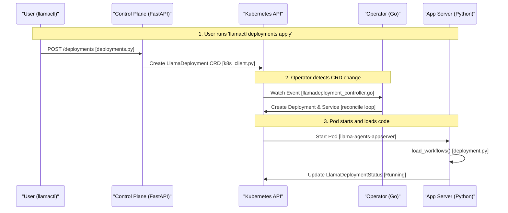
**Sources:** [architecture-docs/overall-architecture.md:106-125](), [architecture-docs/quick-reference.md:5-20]()

## Wiki Navigation

This wiki is structured to guide you from initial setup to deep technical implementation:

*   **[Getting Started](#1.1)**: Setup instructions using `uv`, environment configuration, and running your first workflow.
*   **[Repository Structure and Package Map](#1.2)**: A detailed breakdown of the `packages/` directory and how they depend on each other.
*   **Core Logic**: Sections 2 and 3 cover the internal mechanics of workflows and servers.
*   **Deployment**: Sections 4, 5, and 6 cover the infrastructure required to run agents at scale.
*   **Tooling and Examples**: Sections 7, 8, and 9 cover the CLI, CI/CD pipelines, and reference implementations.

**Sources:** [uv.lock:11-27](), [pyproject.toml:179-202](), [architecture-docs/quick-reference.md:1-27]()

---

# Page: Getting Started

# Getting Started

<details>
<summary>Relevant source files</summary>

The following files were used as context for generating this wiki page:

- [.github/workflows/lockfile.yml](.github/workflows/lockfile.yml)
- [.pre-commit-config.yaml](.pre-commit-config.yaml)
- [examples/agent.ipynb](examples/agent.ipynb)
- [examples/document_processing.ipynb](examples/document_processing.ipynb)
- [examples/feature_walkthrough.ipynb](examples/feature_walkthrough.ipynb)
- [package.json](package.json)
- [packages/llama-agents-integration-tests/pyproject.toml](packages/llama-agents-integration-tests/pyproject.toml)
- [pnpm-lock.yaml](pnpm-lock.yaml)
- [pyproject.toml](pyproject.toml)
- [src/dev_cli/cli.py](src/dev_cli/cli.py)
- [src/dev_cli/commands/__init__.py](src/dev_cli/commands/__init__.py)
- [src/dev_cli/commands/pytest_cmd.py](src/dev_cli/commands/pytest_cmd.py)
- [src/dev_cli/commands/skills_cmd.py](src/dev_cli/commands/skills_cmd.py)
- [tests/dev_cli/test_pytest_cmd.py](tests/dev_cli/test_pytest_cmd.py)
- [uv.lock](uv.lock)

</details>


This page provides technical instructions for setting up the `llama-agents` monorepo, configuring the development environment, and using the internal tooling to manage packages and tests.

## Purpose and Scope

The `llama-agents` repository is a Python-based monorepo managed by `uv` and `pnpm`. It contains the core `llama-index-workflows` engine, various server/client implementations, and the Kubernetes operator for deploying agentic workflows at scale [uv.lock:11-27](). This guide covers the initial workflow for developers to transition from a fresh clone to a fully functional development environment.

## Prerequisites

The monorepo relies on two primary package managers:
1.  **uv**: Used for Python dependency management, workspace isolation, and executing the internal developer CLI [pyproject.toml:158-181]().
2.  **pnpm**: Used for managing JavaScript-based tooling, such as `@changesets/cli`, and coordinating cross-language dependencies like the Kubernetes operator and Helm charts [pnpm-lock.yaml:1-26]().

## Development Environment Setup

### 1. Install Dependencies
Initialize the Python workspace and install Node-based development tools:

```bash
# Install Python dependencies and create virtual environment
uv sync

# Install JS-based development tools (Changesets, etc.)
pnpm install
```

### 2. Configure Pre-commit
The repository enforces code quality via `pre-commit` hooks, including `ruff` for formatting/linting and `basedpyright` for static type checking [pyproject.toml:5-15]().

```bash
uv run pre-commit install
```

The hooks are configured to run `ruff-format`, `ruff-check`, and a custom `ty` check across all packages [ .pre-commit-config.yaml:20-33]().

## Monorepo Tooling: The Dev CLI

The repository includes a specialized developer CLI located in `src/dev_cli` [pyproject.toml:101-102](). This tool abstracts common monorepo tasks such as running tests across multiple packages and managing versions.

### Dev CLI Entry Point
The CLI is exposed as a script named `dev` [pyproject.toml:37](). It uses `click` to organize subcommands and features an intelligent injection mechanism: if no subcommand is provided, it defaults to running `pytest` [src/dev_cli/cli.py:31-49]().

### Key Commands
| Command | Description | File Reference |
| :--- | :--- | :--- |
| `dev pytest` | Discovers and runs tests in all packages containing a `tests/` directory. | [src/dev_cli/commands/pytest_cmd.py:180-203]() |
| `dev changeset-version` | Consumes changesets to bump package versions and update `CHANGELOG.md`. | [src/dev_cli/cli.py:116]() |
| `dev sync-skills` | Symlinks local agent skills for use with development assistants. | [src/dev_cli/commands/skills_cmd.py:24-34]() |

### Code Entity Mapping: Dev CLI Execution
The following diagram illustrates how the `dev` CLI maps high-level developer intentions to specific code entities within the `src/dev_cli` package.

**Title: Dev CLI Command Dispatch Flow**
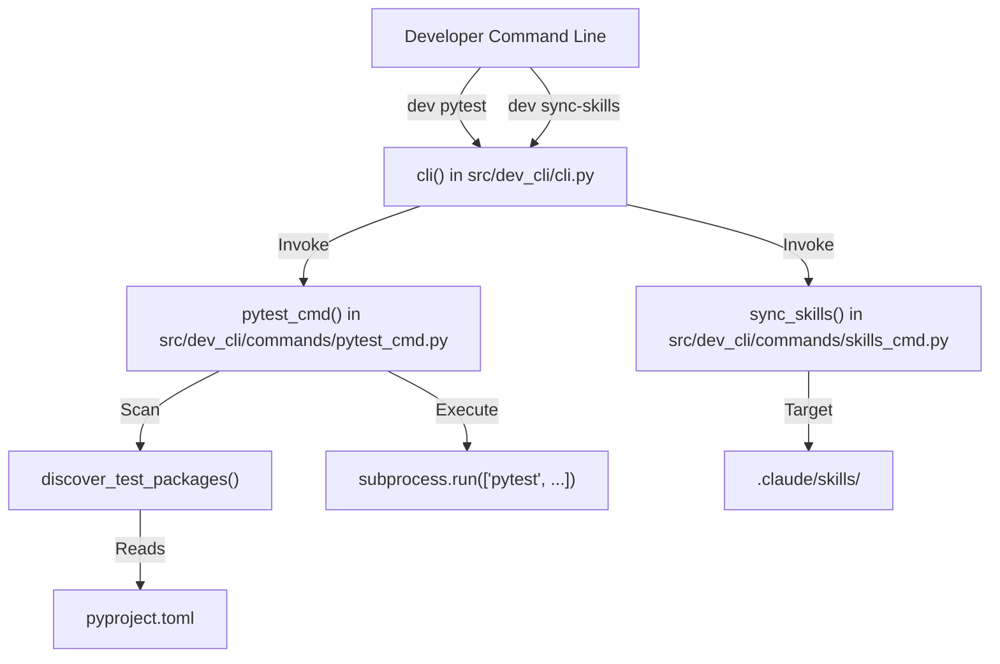
Sources: [src/dev_cli/cli.py:50-57](), [src/dev_cli/commands/pytest_cmd.py:180-192](), [src/dev_cli/commands/skills_cmd.py:30-43]()

## Running Tests

Testing is handled by the `pytest_cmd` module, which performs automatic discovery of workspace members [src/dev_cli/commands/pytest_cmd.py:3-17]().

### Test Discovery Logic
The `discover_test_packages` function scans the `packages/` directory for any folder containing both a `pyproject.toml` and a `tests/` directory [src/dev_cli/commands/pytest_cmd.py:180-203](). It also includes the repository root to cover internal tools like the `dev_cli` itself [src/dev_cli/commands/pytest_cmd.py:189-191]().

### Execution Workflow
1.  **Parallelization**: Tests are run across packages using a `ThreadPoolExecutor` [src/dev_cli/commands/pytest_cmd.py:15]().
2.  **Output Parsing**: The CLI parses pytest's stdout to extract failure counts and specific failure reasons using `extract_test_counts` and `extract_failed_test_names` [src/dev_cli/commands/pytest_cmd.py:58-84]().

**Title: Test Execution and Data Flow**
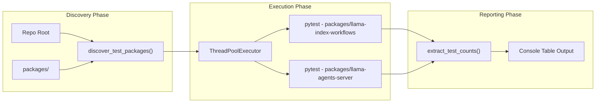
Sources: [src/dev_cli/commands/pytest_cmd.py:15-23](), [src/dev_cli/commands/pytest_cmd.py:58-76](), [src/dev_cli/commands/pytest_cmd.py:180-203]()

## First-Run Workflow

To verify the installation, users should run a basic workflow from the `examples` directory.

### Running a Simple Workflow
Workflows are defined by subclassing `Workflow` and using the `@step` decorator [examples/feature_walkthrough.ipynb:54-63]().

```python
from llama_index.core.workflow import Workflow, step, StartEvent, StopEvent

class MyWorkflow(Workflow):
    @step
    async def my_step(self, ev: StartEvent) -> StopEvent:
        return StopEvent(result="Success")

w = MyWorkflow()
# await w.run()
```

### Contribution Guidelines (CONTRIBUTING.md)
Before submitting code, developers must ensure:
1.  **Changesets**: All PRs that modify package code must include a changeset generated via `pnpm changeset` [package.json:7]().
2.  **Type Checking**: The `uv run ty check packages/` command must pass without errors [ .pre-commit-config.yaml:32]().
3.  **Dependency Updates**: If modifying dependencies, `uv lock` must be run to update `uv.lock` [uv.lock:1-27]().

Sources: [pyproject.toml:1-38](), [pnpm-lock.yaml:1-26](), [src/dev_cli/cli.py:1-50](), [src/dev_cli/commands/pytest_cmd.py:1-100](), [examples/feature_walkthrough.ipynb:54-68]()

---

# Page: Repository Structure and Package Map

# Repository Structure and Package Map

<details>
<summary>Relevant source files</summary>

The following files were used as context for generating this wiki page:

- [packages/llama-agents-appserver/CHANGELOG.md](packages/llama-agents-appserver/CHANGELOG.md)
- [packages/llama-agents-appserver/package.json](packages/llama-agents-appserver/package.json)
- [packages/llama-agents-appserver/pyproject.toml](packages/llama-agents-appserver/pyproject.toml)
- [packages/llama-agents-client/CHANGELOG.md](packages/llama-agents-client/CHANGELOG.md)
- [packages/llama-agents-client/package.json](packages/llama-agents-client/package.json)
- [packages/llama-agents-client/pyproject.toml](packages/llama-agents-client/pyproject.toml)
- [packages/llama-agents-core/CHANGELOG.md](packages/llama-agents-core/CHANGELOG.md)
- [packages/llama-agents-core/package.json](packages/llama-agents-core/package.json)
- [packages/llama-agents-server/CHANGELOG.md](packages/llama-agents-server/CHANGELOG.md)
- [packages/llama-agents-server/package.json](packages/llama-agents-server/package.json)
- [packages/llama-agents-server/pyproject.toml](packages/llama-agents-server/pyproject.toml)
- [packages/llama-index-workflows/CHANGELOG.md](packages/llama-index-workflows/CHANGELOG.md)
- [packages/llama-index-workflows/package.json](packages/llama-index-workflows/package.json)
- [packages/llama-index-workflows/pyproject.toml](packages/llama-index-workflows/pyproject.toml)
- [pyproject.toml](pyproject.toml)
- [uv.lock](uv.lock)

</details>


The `llama-agents` repository is organized as a monorepo managed by `uv` and `pnpm`. It contains a collection of Python packages that together provide a framework for building, serving, and orchestrating event-driven AI workflows. The layout separates the core execution engine from deployment-specific logic, client libraries, and cloud management infrastructure.

## Monorepo Layout and Workspace Configuration

The repository uses `uv` workspaces to manage dependencies and inter-package linking. All functional code resides within the `packages/` directory, while the root `pyproject.toml` defines the workspace members and shared development configurations [pyproject.toml:179-202]().

### Package Categories

| Category | Packages | Role |
| :--- | :--- | :--- |
| **Core Engine** | `llama-index-workflows` | The foundational event-driven workflow execution library. |
| **Server/Client** | `llama-agents-server`, `llama-agents-client` | HTTP interfaces for exposing and consuming workflows. |
| **Cloud/Deployment** | `llama-agents-control-plane`, `llama-agents-appserver`, `llama-agents-core` | Infrastructure for Kubernetes orchestration and LlamaDeploy. |
| **Integrations** | `llama-agents-dbos`, `llama-agents-agentcore` | Durable execution backends and AWS Bedrock bridges. |
| **Tooling** | `llamactl`, `llama-index-utils-workflow` | CLI management and visualization utilities. |

**Sources:** [uv.lock:11-27](), [pyproject.toml:182-201]()

---

## Core Package Map

The following diagram illustrates the primary packages and their relationships within the monorepo.

### Package Dependency Graph
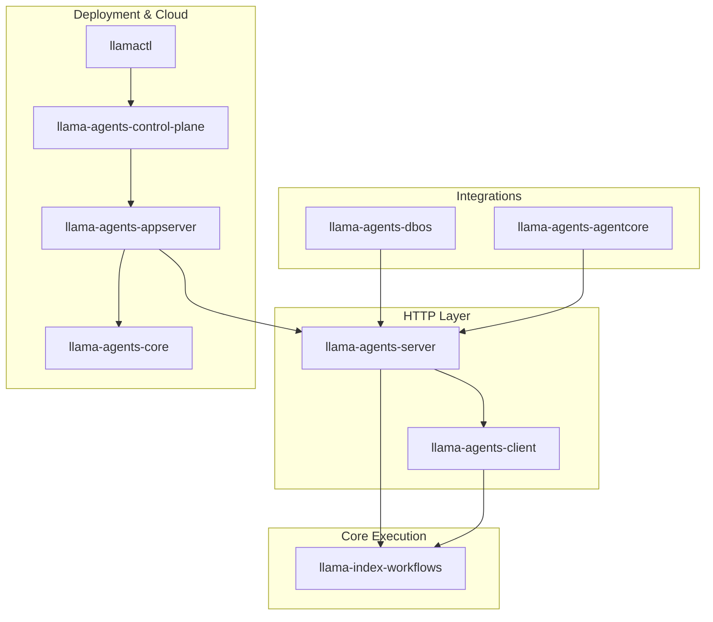
**Sources:** [packages/llama-agents-server/pyproject.toml:27-28](), [packages/llama-agents-client/pyproject.toml:23-24](), [packages/llama-agents-appserver/pyproject.toml:29-34]()

---

## Package Roles and Implementation Details

### 1. llama-index-workflows
The foundational package. It implements the `Workflow` class and the `@step` decorator pattern.
- **Key Entities**: `Workflow`, `Context`, `StartEvent`, `StopEvent`.
- **Implementation**: Provides the event-driven control loop that handles step execution and state management [packages/llama-index-workflows/pyproject.toml:24-26]().

### 2. llama-agents-server
Provides the `WorkflowServer` to wrap workflows as Starlette-based HTTP services.
- **Key Entities**: `WorkflowServer`, `AbstractWorkflowStore`, `PersistenceDecorator`.
- **Functionality**: Manages workflow lifecycles, persistence of state across restarts, and SSE (Server-Sent Events) streaming for real-time updates [packages/llama-agents-server/pyproject.toml:21-32]().

### 3. llama-agents-client
A lightweight HTTP client for interacting with a `WorkflowServer`.
- **Key Entities**: `WorkflowClient`.
- **Functionality**: Handles cursor-based SSE event streaming and automatic reconnection logic [packages/llama-agents-client/CHANGELOG.md:94-95]().

### 4. llama-agents-appserver
The runtime component designed to run inside Kubernetes pods or containerized environments.
- **Key Entities**: `DeploymentConfig`, `load_workflows`.
- **Functionality**: Bootstraps workflows based on configuration files (e.g., `llama_deploy.yaml`) and integrates with the Control Plane [packages/llama-agents-appserver/pyproject.toml:18-20]().

### 5. llamactl
The command-line interface for the entire ecosystem.
- **Functionality**: Manages deployments, streams logs from Kubernetes, and handles authentication with the Control Plane [pyproject.toml:71-72]().

---

## Workspace Integration

The monorepo leverages `uv` to ensure that local changes in one package are immediately reflected in dependent packages without requiring a manual publish to PyPI.

### Dependency Resolution
In the root `uv.lock`, all packages are resolved as workspace members [uv.lock:11-27](). For example, `llama-agents-server` depends on `llama-index-workflows` via a workspace reference:
```toml
[tool.uv.sources]
llama-index-workflows = {workspace = true}
llama-agents-client = {workspace = true}
```
**Sources:** [packages/llama-agents-server/pyproject.toml:62-64]()

### Python Versioning
The monorepo targets Python `>=3.10` [pyproject.toml:23](). Specific packages like `llama-agents-integration-tests` or the internal `dev_cli` may target newer versions (up to `3.14`) for testing and development tooling [pyproject.toml:80-84]().

---

## Code Entity to System Mapping

The following diagrams bridge the gap between high-level system components and the specific code entities that implement them.

### Workflow Execution Mapping
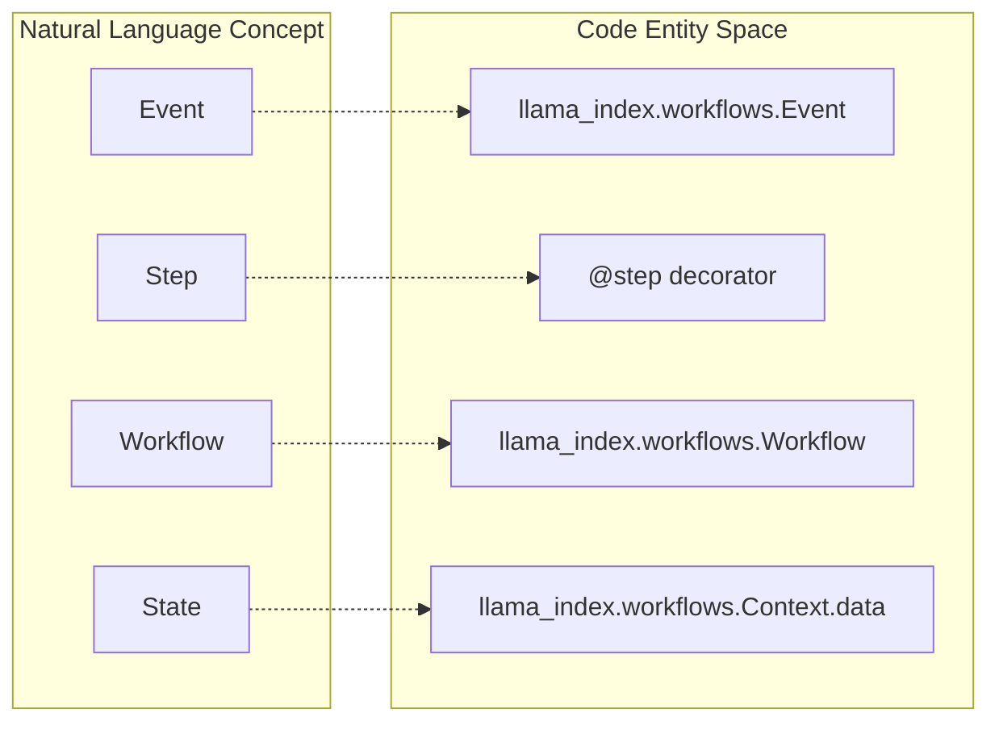
**Sources:** [packages/llama-index-workflows/pyproject.toml:24-26](), [packages/llama-index-workflows/CHANGELOG.md:8-10]()

### Server & Persistence Mapping
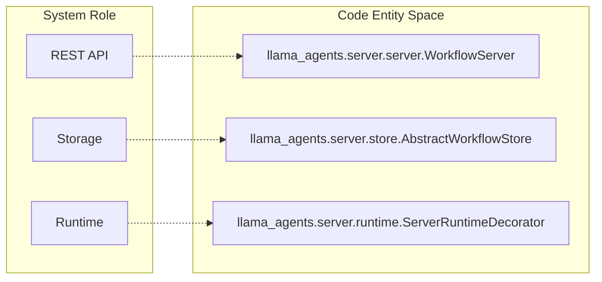
**Sources:** [packages/llama-agents-server/pyproject.toml:38](), [packages/llama-agents-server/CHANGELOG.md:167-171]()

---

## Summary of Package Roles

| Package | Directory | Primary Role |
| :--- | :--- | :--- |
| `llama-index-workflows` | `packages/llama-index-workflows` | Core logic for event-driven steps. |
| `llama-agents-server` | `packages/llama-agents-server` | Starlette server for workflow hosting. |
| `llama-agents-client` | `packages/llama-agents-client` | HTTP/SSE client for workflows. |
| `llama-agents-appserver`| `packages/llama-agents-appserver`| Deployment-ready wrapper for workflows. |
| `llama-agents-dbos` | `packages/llama-agents-dbos` | Durable execution via DBOS. |
| `llamactl` | `packages/llamactl` | CLI for management and orchestration. |

**Sources:** [uv.lock:11-27](), [pyproject.toml:182-202]()

---

# Page: Core Workflow Engine (llama-index-workflows)

# Core Workflow Engine (llama-index-workflows)

<details>
<summary>Relevant source files</summary>

The following files were used as context for generating this wiki page:

- [CONTRIBUTING.md](CONTRIBUTING.md)
- [README.md](README.md)
- [docs/src/content/docs/llamaagents/workflows/observability.md](docs/src/content/docs/llamaagents/workflows/observability.md)
- [examples/observability/workflows_observability_pt1.ipynb](examples/observability/workflows_observability_pt1.ipynb)
- [examples/observability/workflows_observability_pt2.ipynb](examples/observability/workflows_observability_pt2.ipynb)
- [examples/observability/workflows_observablitiy_arize_phoenix.ipynb](examples/observability/workflows_observablitiy_arize_phoenix.ipynb)
- [examples/observability/workflows_observablitiy_langfuse.ipynb](examples/observability/workflows_observablitiy_langfuse.ipynb)
- [examples/state_management_with_vector_databases.ipynb](examples/state_management_with_vector_databases.ipynb)
- [packages/llama-index-workflows/src/workflows/context/context.py](packages/llama-index-workflows/src/workflows/context/context.py)
- [packages/llama-index-workflows/src/workflows/context/internal_context.py](packages/llama-index-workflows/src/workflows/context/internal_context.py)
- [packages/llama-index-workflows/src/workflows/plugins/basic.py](packages/llama-index-workflows/src/workflows/plugins/basic.py)
- [packages/llama-index-workflows/src/workflows/representation/validate.py](packages/llama-index-workflows/src/workflows/representation/validate.py)
- [packages/llama-index-workflows/src/workflows/runtime/types/commands.py](packages/llama-index-workflows/src/workflows/runtime/types/commands.py)
- [packages/llama-index-workflows/src/workflows/runtime/types/plugin.py](packages/llama-index-workflows/src/workflows/runtime/types/plugin.py)
- [packages/llama-index-workflows/src/workflows/runtime/types/results.py](packages/llama-index-workflows/src/workflows/runtime/types/results.py)
- [packages/llama-index-workflows/src/workflows/runtime/types/step_function.py](packages/llama-index-workflows/src/workflows/runtime/types/step_function.py)
- [packages/llama-index-workflows/src/workflows/runtime/types/ticks.py](packages/llama-index-workflows/src/workflows/runtime/types/ticks.py)
- [packages/llama-index-workflows/src/workflows/workflow.py](packages/llama-index-workflows/src/workflows/workflow.py)
- [packages/llama-index-workflows/tests/conftest.py](packages/llama-index-workflows/tests/conftest.py)
- [packages/llama-index-workflows/tests/context/test_context.py](packages/llama-index-workflows/tests/context/test_context.py)
- [packages/llama-index-workflows/tests/runtime/conftest.py](packages/llama-index-workflows/tests/runtime/conftest.py)
- [packages/llama-index-workflows/tests/test_child_state_inheritance.py](packages/llama-index-workflows/tests/test_child_state_inheritance.py)
- [packages/llama-index-workflows/tests/test_graph_validation.py](packages/llama-index-workflows/tests/test_graph_validation.py)
- [packages/llama-index-workflows/tests/test_workflow.py](packages/llama-index-workflows/tests/test_workflow.py)

</details>


The `llama-index-workflows` package is the foundational event-driven orchestration library for the LlamaAgents monorepo. It provides a purely Pythonic, type-safe way to define complex agentic behaviors without the need for a Domain Specific Language (DSL). Workflows are composed of discrete steps that communicate by emitting and consuming typed events [README.md:15-18]().

## System Overview: From Natural Language to Code

The following diagram bridges the high-level concept of a "Workflow" to the specific code entities that manage execution.

### Workflow Execution Mapping
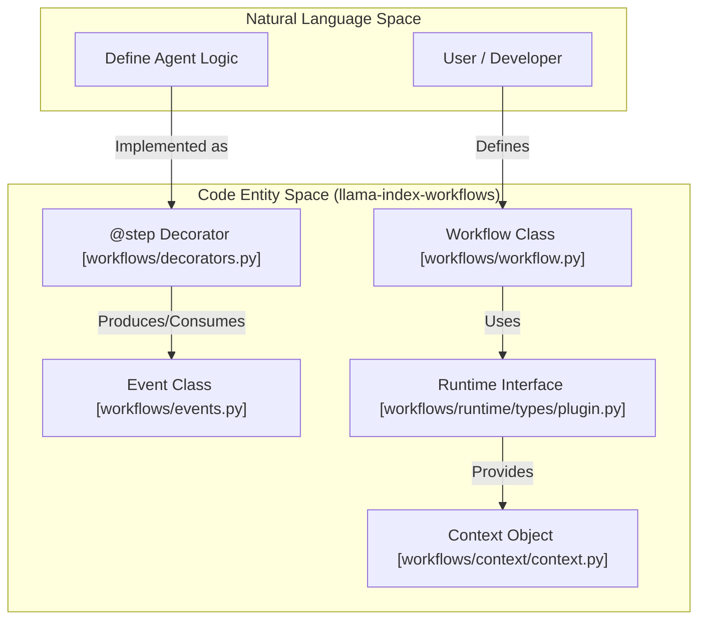
**Sources:** [packages/llama-index-workflows/src/workflows/workflow.py:41-87](), [packages/llama-index-workflows/src/workflows/runtime/types/plugin.py:81-98]()

## Core Components

### 1. Workflow, Steps, and Events
A `Workflow` is a class-based orchestrator where logic is encapsulated in methods decorated with `@step`. These steps are asynchronous functions that take a specific `Event` type as input and return another `Event` (or `None`). The system uses Python type hints to automatically validate the event graph at startup, ensuring every produced event has a consumer and that the workflow can reach a `StopEvent`.

For details, see [Workflow, Steps, and Events](#2.1).

**Sources:** [packages/llama-index-workflows/src/workflows/workflow.py:41-55](), [packages/llama-index-workflows/src/workflows/representation/validate.py:140-163]()

### 2. Control Loop and Runtime Architecture
Execution is managed by a `Runtime`. By default, workflows use a `BasicRuntime`, but the architecture supports pluggable backends for durability and distribution. The engine operates on a "tick-based" model where every event injection, step completion, or timeout is a `WorkflowTick`. An `InternalRunAdapter` manages the communication between the step execution and the central control loop.

For details, see [Control Loop and Runtime Architecture](#2.2).

**Sources:** [packages/llama-index-workflows/src/workflows/runtime/types/plugin.py:81-166](), [packages/llama-index-workflows/src/workflows/runtime/types/ticks.py:1-40]()

### 3. Context, State, and Resources
The `Context` object is the primary interface for steps to interact with the workflow's environment. It provides:
*   **State Management:** A `StateStore` for persisting data across steps.
*   **Event Streaming:** Methods like `write_event_to_stream` to surface progress to external observers.
*   **Resource Injection:** A `ResourceManager` for managing dependencies like LLMs or database connections.

For details, see [Context, State, and Resources](#2.3).

**Sources:** [packages/llama-index-workflows/src/workflows/context/context.py:58-116](), [packages/llama-index-workflows/src/workflows/workflow.py:158-158]()

### 4. Retry Policies and Error Handling
The engine includes robust error handling via the `@catch_error` decorator, which allows routing specific exceptions to designated handler steps. Steps can also define `RetryPolicy` objects (e.g., `ExponentialBackoffRetryPolicy`) to handle transient failures automatically.

For details, see [Retry Policies and Error Handling](#2.4).

**Sources:** [packages/llama-index-workflows/src/workflows/workflow.py:54-54](), [packages/llama-index-workflows/src/workflows/runtime/types/results.py:34-50]()

### 5. Workflow Visualization and Utilities
The `llama-index-utils-workflow` package provides tools to visualize the event graph and execution traces. This includes generating Mermaid diagrams or interactive PyVis graphs to debug complex branching and looping logic.

For details, see [Workflow Visualization and Utilities (llama-index-utils-workflow)](#2.5).

**Sources:** [packages/llama-index-workflows/src/workflows/workflow.py:105-105]()

## Operational Flow

The following diagram illustrates the lifecycle of an event moving through the system.

### Event Processing Lifecycle
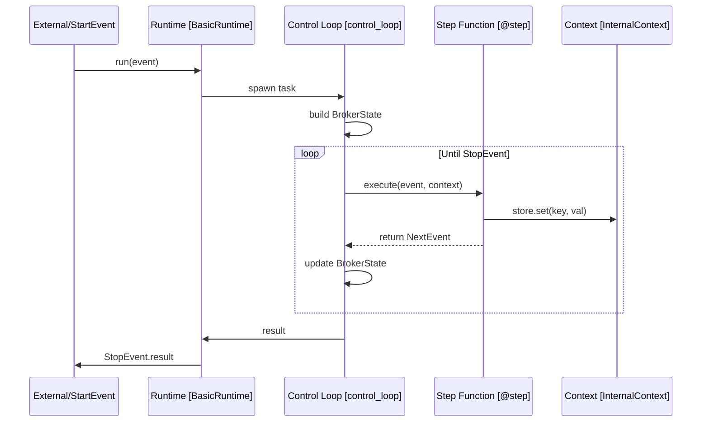
**Sources:** [packages/llama-index-workflows/src/workflows/runtime/types/step_function.py:162-210](), [packages/llama-index-workflows/src/workflows/context/context.py:149-183]()

## Observability
Workflows integrate with OpenTelemetry and third-party tools like Arize Phoenix and Langfuse. The `llama_index_instrumentation` dispatcher tracks every step's input, output, and duration, emitting `WorkflowStepOutputEvent` and `WorkflowRunOutputEvent` for detailed tracing [docs/src/content/docs/llamaagents/workflows/observability.md:11-38](), [packages/llama-index-workflows/src/workflows/runtime/types/step_function.py:71-89]().

---

# Page: Workflow, Steps, and Events

# Workflow, Steps, and Events

<details>
<summary>Relevant source files</summary>

The following files were used as context for generating this wiki page:

- [docs/api_docs/docs/api_reference/events.md](docs/api_docs/docs/api_reference/events.md)
- [docs/api_docs/docs/api_reference/index.md](docs/api_docs/docs/api_reference/index.md)
- [docs/api_docs/docs/api_reference/retry_policy.md](docs/api_docs/docs/api_reference/retry_policy.md)
- [docs/api_docs/mkdocs.yml](docs/api_docs/mkdocs.yml)
- [docs/src/content/docs/llamaagents/workflows/assets/arize.png](docs/src/content/docs/llamaagents/workflows/assets/arize.png)
- [docs/src/content/docs/llamaagents/workflows/assets/branching.png](docs/src/content/docs/llamaagents/workflows/assets/branching.png)
- [docs/src/content/docs/llamaagents/workflows/assets/different_events.png](docs/src/content/docs/llamaagents/workflows/assets/different_events.png)
- [docs/src/content/docs/llamaagents/workflows/assets/joke.png](docs/src/content/docs/llamaagents/workflows/assets/joke.png)
- [docs/src/content/docs/llamaagents/workflows/assets/loop.png](docs/src/content/docs/llamaagents/workflows/assets/loop.png)
- [docs/src/content/docs/llamaagents/workflows/branches_and_loops.md](docs/src/content/docs/llamaagents/workflows/branches_and_loops.md)
- [docs/src/content/docs/llamaagents/workflows/concurrent_execution.md](docs/src/content/docs/llamaagents/workflows/concurrent_execution.md)
- [docs/src/content/docs/llamaagents/workflows/customizing_entry_exit_points.md](docs/src/content/docs/llamaagents/workflows/customizing_entry_exit_points.md)
- [docs/src/content/docs/llamaagents/workflows/drawing.md](docs/src/content/docs/llamaagents/workflows/drawing.md)
- [docs/src/content/docs/llamaagents/workflows/durable_workflows.md](docs/src/content/docs/llamaagents/workflows/durable_workflows.md)
- [docs/src/content/docs/llamaagents/workflows/human_in_the_loop.md](docs/src/content/docs/llamaagents/workflows/human_in_the_loop.md)
- [docs/src/content/docs/llamaagents/workflows/index.md](docs/src/content/docs/llamaagents/workflows/index.md)
- [docs/src/content/docs/llamaagents/workflows/managing_state.md](docs/src/content/docs/llamaagents/workflows/managing_state.md)
- [docs/src/content/docs/llamaagents/workflows/resources.md](docs/src/content/docs/llamaagents/workflows/resources.md)
- [docs/src/content/docs/llamaagents/workflows/retry_steps.md](docs/src/content/docs/llamaagents/workflows/retry_steps.md)
- [docs/src/content/docs/llamaagents/workflows/streaming.mdx](docs/src/content/docs/llamaagents/workflows/streaming.mdx)
- [docs/src/content/docs/llamaagents/workflows/unbound_functions.md](docs/src/content/docs/llamaagents/workflows/unbound_functions.md)
- [packages/llama-index-workflows/src/workflows/decorators.py](packages/llama-index-workflows/src/workflows/decorators.py)
- [packages/llama-index-workflows/src/workflows/events.py](packages/llama-index-workflows/src/workflows/events.py)
- [packages/llama-index-workflows/src/workflows/plugins/basic.py](packages/llama-index-workflows/src/workflows/plugins/basic.py)
- [packages/llama-index-workflows/src/workflows/representation/validate.py](packages/llama-index-workflows/src/workflows/representation/validate.py)
- [packages/llama-index-workflows/src/workflows/retry_policy.py](packages/llama-index-workflows/src/workflows/retry_policy.py)
- [packages/llama-index-workflows/src/workflows/runtime/types/plugin.py](packages/llama-index-workflows/src/workflows/runtime/types/plugin.py)
- [packages/llama-index-workflows/src/workflows/workflow.py](packages/llama-index-workflows/src/workflows/workflow.py)
- [packages/llama-index-workflows/tests/conftest.py](packages/llama-index-workflows/tests/conftest.py)
- [packages/llama-index-workflows/tests/runtime/conftest.py](packages/llama-index-workflows/tests/runtime/conftest.py)
- [packages/llama-index-workflows/tests/test_event.py](packages/llama-index-workflows/tests/test_event.py)
- [packages/llama-index-workflows/tests/test_graph_validation.py](packages/llama-index-workflows/tests/test_graph_validation.py)
- [packages/llama-index-workflows/tests/test_retry_policy.py](packages/llama-index-workflows/tests/test_retry_policy.py)
- [packages/llama-index-workflows/tests/test_workflow.py](packages/llama-index-workflows/tests/test_workflow.py)

</details>


The `llama-index-workflows` package provides an event-driven engine for building complex, branching, and concurrent application logic. At its core, a workflow is a collection of steps that communicate by sending and receiving typed events.

## The Workflow Class

The `Workflow` class is the primary orchestrator. It manages the lifecycle of an execution, including validation, resource injection, and timeout management [packages/llama-index-workflows/src/workflows/workflow.py:41-87]().

Workflows are defined by subclassing `Workflow` and decorating methods with `@step`. When a workflow is instantiated, it automatically detects these steps using a metaclass (`WorkflowMeta`) [packages/llama-index-workflows/src/workflows/workflow.py:35-41]().

### Configuration and Initialization
When initializing a `Workflow`, several parameters control its behavior:
- `timeout`: Maximum seconds for completion (default 45.0) [packages/llama-index-workflows/src/workflows/workflow.py:98-141]().
- `disable_validation`: If True, skips the pre-run graph checks [packages/llama-index-workflows/src/workflows/workflow.py:99-143]().
- `verbose`: Enables printing of step activity [packages/llama-index-workflows/src/workflows/workflow.py:100-142]().
- `skip_graph_checks`: A set of specific validation rules to ignore, such as `"reachability"` or `"terminal_event"` [packages/llama-index-workflows/src/workflows/workflow.py:105-174]().

**Sources:** [packages/llama-index-workflows/src/workflows/workflow.py:41-182]()

---

## Steps and the @step Decorator

A step is a callable (method or free function) that accepts an event and optionally returns another event. The `@step` decorator extracts metadata from the function signature to build the execution graph [packages/llama-index-workflows/src/workflows/decorators.py:112-158]().

### Step Configuration
The decorator populates a `StepConfig` object which includes:
- `accepted_events`: The type of event that triggers this step [packages/llama-index-workflows/src/workflows/decorators.py:45-196]().
- `return_types`: The types of events this step might emit [packages/llama-index-workflows/src/workflows/decorators.py:47-202]().
- `num_workers`: Concurrency limit for this specific step (default 4) [packages/llama-index-workflows/src/workflows/decorators.py:49-99]().
- `retry_policy`: An optional policy for handling step failures [packages/llama-index-workflows/src/workflows/decorators.py:50-100]().

### Step Signature Validation
The engine enforces strict rules on step signatures:
1. A step must accept at least one positional argument (the event) [packages/llama-index-workflows/src/workflows/decorators.py:196]().
2. If a step requires the `Context`, it must be explicitly typed in the arguments [packages/llama-index-workflows/src/workflows/decorators.py:203]().
3. Return types must be instances of `Event` or `None` [packages/llama-index-workflows/src/workflows/decorators.py:202]().

### Free Functions as Steps
Steps do not have to be methods. They can be free functions associated with a workflow class using the `workflow` parameter in the decorator:
`@step(workflow=MyWorkflow)` [packages/llama-index-workflows/src/workflows/decorators.py:150-157]().

**Sources:** [packages/llama-index-workflows/src/workflows/decorators.py:43-209](), [packages/llama-index-workflows/src/workflows/workflow.py:89-91]()

---

## Event Types

Events are the data carriers between steps. All events must inherit from the base `Event` class [packages/llama-index-workflows/src/workflows/events.py]().

### Core Event Types

| Event Type | Purpose |
| :--- | :--- |
| `StartEvent` | The entry point. Triggered when `workflow.run()` is called [packages/llama-index-workflows/src/workflows/events.py](). |
| `StopEvent` | The exit point. Returning this terminates the workflow and returns the `result` to the caller [packages/llama-index-workflows/src/workflows/events.py](). |
| `InputRequiredEvent` | Used for Human-in-the-loop (HITL). Pauses execution until a `HumanResponseEvent` is received [packages/llama-index-workflows/src/workflows/events.py](). |
| `StepFailedEvent` | Emitted internally when a step raises an exception. It is routed to `@catch_error` handlers [packages/llama-index-workflows/src/workflows/events.py](). |

### Data Flow and System Mapping
The following diagram illustrates how natural language requirements map to the code entities that handle event transitions.

**Entity Mapping: Requirements to Code**
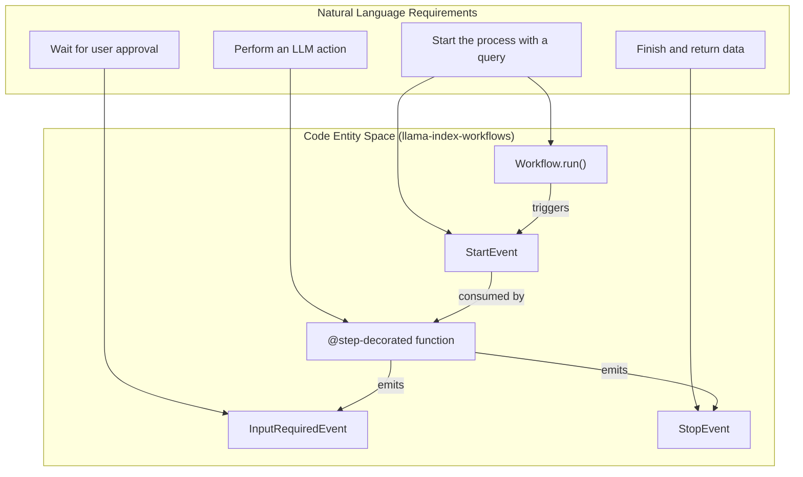
**Sources:** [packages/llama-index-workflows/src/workflows/events.py](), [packages/llama-index-workflows/src/workflows/workflow.py:64-70]()

---

## Error Handling with @catch_error

The `@catch_error` decorator allows developers to define specialized steps that handle failures from other steps. When a step raises an exception, the runtime wraps it in a `StepFailedEvent` and routes it to a matching handler [packages/llama-index-workflows/src/workflows/decorators.py:54-58]().

- **Wildcard Handlers**: If no specific step names are provided, the handler catches errors from any step [packages/llama-index-workflows/src/workflows/decorators.py:56-57]().
- **Recovery Limits**: The `catch_error_max_recoveries` parameter prevents infinite loops if a handler itself fails repeatedly [packages/llama-index-workflows/src/workflows/decorators.py:58]().

**Sources:** [packages/llama-index-workflows/src/workflows/decorators.py:43-73]()

---

## Graph Validation

Before execution (unless `disable_validation` is set), the workflow builds a `StepGraph` to ensure the logic is sound [packages/llama-index-workflows/src/workflows/representation/validate.py:51-62]().

### Validation Checks
The `validate_graph` function performs three primary checks:
1. **Reachability**: Every step must be reachable from a `StartEvent` or `HumanResponseEvent` [packages/llama-index-workflows/src/workflows/representation/validate.py:169-181]().
2. **Terminal Events**: Any event produced that is not consumed by another step must be a subclass of `StopEvent` or `InputRequiredEvent` [packages/llama-index-workflows/src/workflows/representation/validate.py:192-200]().
3. **Dead Ends**: Every step must eventually lead to a `StopEvent` [packages/llama-index-workflows/src/workflows/representation/validate.py:151]().

**Workflow Execution Flow**
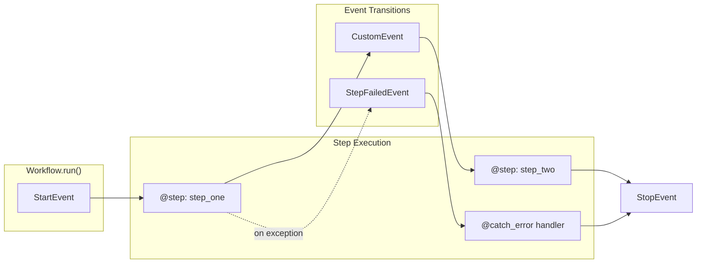
**Sources:** [packages/llama-index-workflows/src/workflows/representation/validate.py:51-110](), [packages/llama-index-workflows/src/workflows/workflow.py:148-174](), [packages/llama-index-workflows/tests/test_workflow.py:77-124]()

---

# Page: Control Loop and Runtime Architecture

# Control Loop and Runtime Architecture

<details>
<summary>Relevant source files</summary>

The following files were used as context for generating this wiki page:

- [packages/llama-index-workflows/src/workflows/context/context.py](packages/llama-index-workflows/src/workflows/context/context.py)
- [packages/llama-index-workflows/src/workflows/context/internal_context.py](packages/llama-index-workflows/src/workflows/context/internal_context.py)
- [packages/llama-index-workflows/src/workflows/plugins/basic.py](packages/llama-index-workflows/src/workflows/plugins/basic.py)
- [packages/llama-index-workflows/src/workflows/representation/validate.py](packages/llama-index-workflows/src/workflows/representation/validate.py)
- [packages/llama-index-workflows/src/workflows/runtime/control_loop.py](packages/llama-index-workflows/src/workflows/runtime/control_loop.py)
- [packages/llama-index-workflows/src/workflows/runtime/types/commands.py](packages/llama-index-workflows/src/workflows/runtime/types/commands.py)
- [packages/llama-index-workflows/src/workflows/runtime/types/named_task.py](packages/llama-index-workflows/src/workflows/runtime/types/named_task.py)
- [packages/llama-index-workflows/src/workflows/runtime/types/plugin.py](packages/llama-index-workflows/src/workflows/runtime/types/plugin.py)
- [packages/llama-index-workflows/src/workflows/runtime/types/results.py](packages/llama-index-workflows/src/workflows/runtime/types/results.py)
- [packages/llama-index-workflows/src/workflows/runtime/types/step_function.py](packages/llama-index-workflows/src/workflows/runtime/types/step_function.py)
- [packages/llama-index-workflows/src/workflows/runtime/types/ticks.py](packages/llama-index-workflows/src/workflows/runtime/types/ticks.py)
- [packages/llama-index-workflows/src/workflows/runtime/verbose.py](packages/llama-index-workflows/src/workflows/runtime/verbose.py)
- [packages/llama-index-workflows/src/workflows/workflow.py](packages/llama-index-workflows/src/workflows/workflow.py)
- [packages/llama-index-workflows/tests/conftest.py](packages/llama-index-workflows/tests/conftest.py)
- [packages/llama-index-workflows/tests/context/test_context.py](packages/llama-index-workflows/tests/context/test_context.py)
- [packages/llama-index-workflows/tests/runtime/conftest.py](packages/llama-index-workflows/tests/runtime/conftest.py)
- [packages/llama-index-workflows/tests/runtime/test_control_loop.py](packages/llama-index-workflows/tests/runtime/test_control_loop.py)
- [packages/llama-index-workflows/tests/runtime/test_control_loop_transformations.py](packages/llama-index-workflows/tests/runtime/test_control_loop_transformations.py)
- [packages/llama-index-workflows/tests/runtime/test_named_task.py](packages/llama-index-workflows/tests/runtime/test_named_task.py)
- [packages/llama-index-workflows/tests/test_child_state_inheritance.py](packages/llama-index-workflows/tests/test_child_state_inheritance.py)
- [packages/llama-index-workflows/tests/test_graph_validation.py](packages/llama-index-workflows/tests/test_graph_validation.py)
- [packages/llama-index-workflows/tests/test_verbose_decorator.py](packages/llama-index-workflows/tests/test_verbose_decorator.py)
- [packages/llama-index-workflows/tests/test_workflow.py](packages/llama-index-workflows/tests/test_workflow.py)

</details>


The Core Workflow Engine in `llama-index-workflows` is built on a deterministic, tick-based reducer pattern. This architecture separates the side-effect-heavy execution of steps from the logical state transitions of the workflow. By treating every significant occurrence (event arrival, step completion, timeout) as a discrete `WorkflowTick`, the system enables advanced features like durable execution, deterministic replay, and fine-grained observability.

## The Tick-Based Reducer Pattern

At the heart of the execution model is the `control_loop`. Instead of steps calling each other directly, they communicate via a central broker that manages a state machine.

1.  **Ticks as Inputs**: Every input to the system is encapsulated in a `WorkflowTick` [packages/llama-index-workflows/src/workflows/runtime/types/ticks.py:101-111]().
2.  **State Transformation**: The `_reduce_tick` function (and its sub-processors like `_process_add_event_tick`) takes the current `BrokerState` and a `WorkflowTick`, returning a new `BrokerState` and a list of `WorkflowCommand` objects [packages/llama-index-workflows/src/workflows/runtime/control_loop.py:34-47]().
3.  **Command Execution**: The `control_loop` executes the resulting commands (e.g., starting a worker, scheduling a timeout, or publishing an event) [packages/llama-index-workflows/src/workflows/runtime/control_loop.py:121-163]().

### Workflow Lifecycle Diagram

This diagram bridges the conceptual "Natural Language" flow to the specific "Code Entities" that manage the runtime.

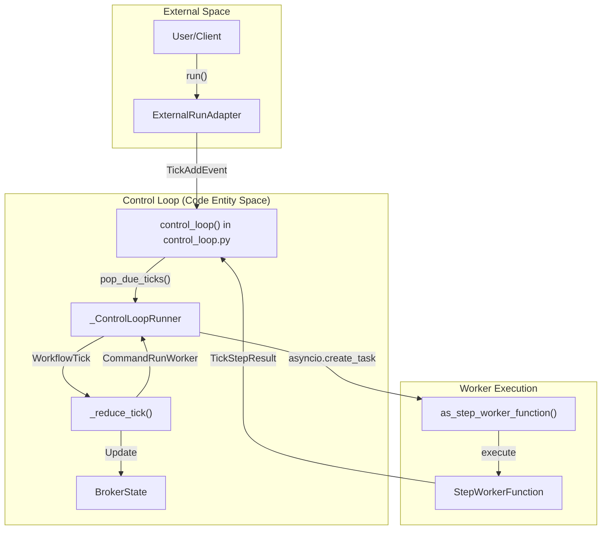
**Sources:** [packages/llama-index-workflows/src/workflows/runtime/control_loop.py:121-163](), [packages/llama-index-workflows/src/workflows/runtime/types/step_function.py:147-168](), [packages/llama-index-workflows/src/workflows/runtime/types/ticks.py:101-111]()

## Key Data Structures

### BrokerState
The `BrokerState` represents the complete logical state of a workflow run at any given moment. It includes:
*   `is_running`: Execution status [packages/llama-index-workflows/src/workflows/runtime/types/internal_state.py:50]().
*   `workers`: A map of step names to `InternalStepWorkerState`, which tracks queues and in-progress tasks [packages/llama-index-workflows/src/workflows/runtime/types/internal_state.py:50]().
*   `rehydrate_with_ticks()`: A method used to reconstruct state from a history of ticks [packages/llama-index-workflows/src/workflows/runtime/control_loop.py:149-150]().

### WorkflowTick and WorkflowCommand
The communication between the reducer and the runner is strictly typed.

| Type | Purpose | Key Variants |
| :--- | :--- | :--- |
| **WorkflowTick** | Inputs to the state machine | `TickAddEvent`, `TickStepResult`, `TickTimeout`, `TickCancelRun` |
| **WorkflowCommand** | Outputs from the state machine | `CommandRunWorker`, `CommandPublishEvent`, `CommandCompleteRun`, `CommandHalt` |

**Sources:** [packages/llama-index-workflows/src/workflows/runtime/types/ticks.py:101-111](), [packages/llama-index-workflows/src/workflows/runtime/types/commands.py:37-46]()

## Runtime Interfaces and Adapters

The engine uses a "Plugin" architecture to support different execution environments (e.g., local memory vs. durable DBOS).

### InternalRunAdapter vs. ExternalRunAdapter
*   **InternalRunAdapter**: Used *inside* the `control_loop`. It provides methods like `wait_receive()` to get the next tick and `write_to_event_stream()` to surface progress [packages/llama-index-workflows/src/workflows/runtime/types/plugin.py:81-98]().
*   **ExternalRunAdapter**: Used *outside* the loop (by the client or server). It allows sending events into the workflow via `send_event()` and streaming published events [packages/llama-index-workflows/src/workflows/runtime/types/plugin.py:213-220]().

### BasicRuntime
The `BasicRuntime` is the default implementation for local, non-durable execution. It manages in-memory queues (`AsyncioAdapterQueues`) to route ticks between the external caller and the internal control loop [packages/llama-index-workflows/src/workflows/plugins/basic.py:25-50]().

### Runtime Architecture Diagram

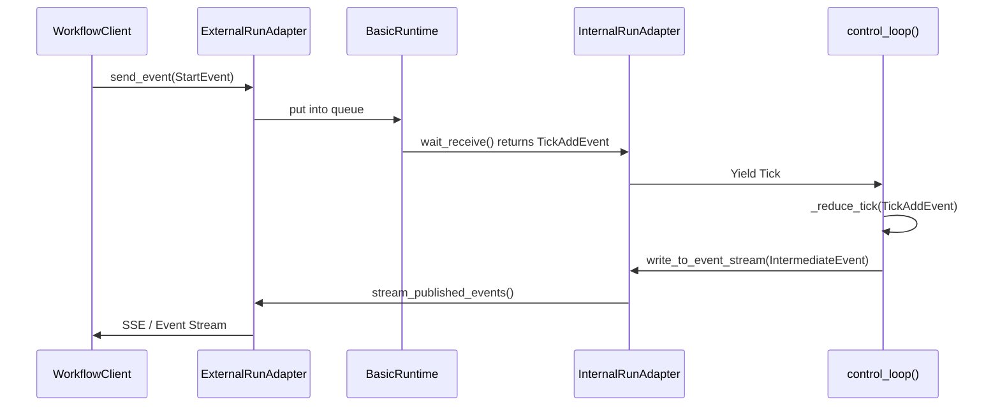
**Sources:** [packages/llama-index-workflows/src/workflows/runtime/types/plugin.py:81-220](), [packages/llama-index-workflows/src/workflows/plugins/basic.py:25-50]()

## The Control Loop Runner

The `_ControlLoopRunner` encapsulates the transient state of an active run [packages/llama-index-workflows/src/workflows/runtime/control_loop.py:121-131]().

### Deterministic Scheduling
To ensure that replays are identical to original runs, the runner avoids concurrent `asyncio.sleep` calls for timeouts. Instead:
1.  It maintains a `scheduled_wakeups` heap [packages/llama-index-workflows/src/workflows/runtime/control_loop.py:154-155]().
2.  It calculates the `next_wakeup_timeout()` based on the nearest scheduled tick [packages/llama-index-workflows/src/workflows/runtime/control_loop.py:171-180]().
3.  The `InternalRunAdapter.wait_receive(timeout)` uses this calculated value, ensuring that the loop wakes up exactly when a timeout is due or a new event arrives [packages/llama-index-workflows/src/workflows/runtime/control_loop.py:107-110]().

### Worker Execution
When a `CommandRunWorker` is issued, the runner:
1.  Wraps the step function using `as_step_worker_function` to inject `Context` and handle retries [packages/llama-index-workflows/src/workflows/runtime/types/step_function.py:147-152]().
2.  Creates an `asyncio.Task` and tracks it in `worker_tasks` [packages/llama-index-workflows/src/workflows/runtime/control_loop.py:145]().
3.  Upon completion, the task result is converted back into a `TickStepResult` and fed back into the loop [packages/llama-index-workflows/src/workflows/runtime/control_loop.py:198-214]().

**Sources:** [packages/llama-index-workflows/src/workflows/runtime/control_loop.py:121-214](), [packages/llama-index-workflows/src/workflows/runtime/types/step_function.py:147-182]()

---

# Page: Context, State, and Resources

# Context, State, and Resources

<details>
<summary>Relevant source files</summary>

The following files were used as context for generating this wiki page:

- [.changeset/add-json-serializer-allowlist.md](.changeset/add-json-serializer-allowlist.md)
- [LICENSE](LICENSE)
- [packages/llama-agents-server/src/llama_agents/server/_store/migration_utils.py](packages/llama-agents-server/src/llama_agents/server/_store/migration_utils.py)
- [packages/llama-index-workflows/src/workflows/context/__init__.py](packages/llama-index-workflows/src/workflows/context/__init__.py)
- [packages/llama-index-workflows/src/workflows/context/context.py](packages/llama-index-workflows/src/workflows/context/context.py)
- [packages/llama-index-workflows/src/workflows/context/context_types.py](packages/llama-index-workflows/src/workflows/context/context_types.py)
- [packages/llama-index-workflows/src/workflows/context/internal_context.py](packages/llama-index-workflows/src/workflows/context/internal_context.py)
- [packages/llama-index-workflows/src/workflows/context/serializers.py](packages/llama-index-workflows/src/workflows/context/serializers.py)
- [packages/llama-index-workflows/src/workflows/context/state_store.py](packages/llama-index-workflows/src/workflows/context/state_store.py)
- [packages/llama-index-workflows/src/workflows/context/utils.py](packages/llama-index-workflows/src/workflows/context/utils.py)
- [packages/llama-index-workflows/src/workflows/resource.py](packages/llama-index-workflows/src/workflows/resource.py)
- [packages/llama-index-workflows/src/workflows/runtime/types/commands.py](packages/llama-index-workflows/src/workflows/runtime/types/commands.py)
- [packages/llama-index-workflows/src/workflows/runtime/types/results.py](packages/llama-index-workflows/src/workflows/runtime/types/results.py)
- [packages/llama-index-workflows/src/workflows/runtime/types/step_function.py](packages/llama-index-workflows/src/workflows/runtime/types/step_function.py)
- [packages/llama-index-workflows/src/workflows/runtime/types/ticks.py](packages/llama-index-workflows/src/workflows/runtime/types/ticks.py)
- [packages/llama-index-workflows/src/workflows/utils.py](packages/llama-index-workflows/src/workflows/utils.py)
- [packages/llama-index-workflows/tests/context/test_context.py](packages/llama-index-workflows/tests/context/test_context.py)
- [packages/llama-index-workflows/tests/test_child_state_inheritance.py](packages/llama-index-workflows/tests/test_child_state_inheritance.py)
- [packages/llama-index-workflows/tests/test_decorator.py](packages/llama-index-workflows/tests/test_decorator.py)
- [packages/llama-index-workflows/tests/test_resources.py](packages/llama-index-workflows/tests/test_resources.py)
- [packages/llama-index-workflows/tests/test_utils.py](packages/llama-index-workflows/tests/test_utils.py)
- [packages/llamactl/src/llama_agents/cli/config/_migrations.py](packages/llamactl/src/llama_agents/cli/config/_migrations.py)
- [packages/llamactl/src/llama_agents/cli/local_context.py](packages/llamactl/src/llama_agents/cli/local_context.py)

</details>


This section covers the mechanisms for managing data, persistent state, and external dependencies within a workflow execution. The core of this system is the `Context` object, which acts as the primary interface for steps to interact with the workflow runtime and shared storage.

## The Context Object

The `Context` class provides a per-run environment for a `Workflow` [packages/llama-index-workflows/src/workflows/context/context.py:58-67](). It is responsible for coordinating event delivery, tracking in-flight work, and exposing a type-safe state store [packages/llama-index-workflows/src/workflows/context/context.py:64-66]().

To ensure safety and appropriate access at different stages of a workflow's lifecycle, the `Context` implements a "State Pattern" using three internal "faces":

| Face | Class | Purpose |
| :--- | :--- | :--- |
| **Pre-run** | `PreContext` | Used for configuration before the workflow starts (e.g., setting initial state) [packages/llama-index-workflows/src/workflows/context/pre_context.py:23-28](). |
| **Internal** | `InternalContext` | Provided to step functions via the `ctx` parameter. Allows sending events and accessing the store [packages/llama-index-workflows/src/workflows/context/internal_context.py:34-40](). |
| **External** | `ExternalContext` | Used by external observers (like a UI or a parent process) to stream events or check status [packages/llama-index-workflows/src/workflows/context/external_context.py:27-32](). |

### Context Lifecycle and Face Transitions

The `Context` transitions through these faces as the workflow execution progresses.

Title: Context Face Transition Diagram
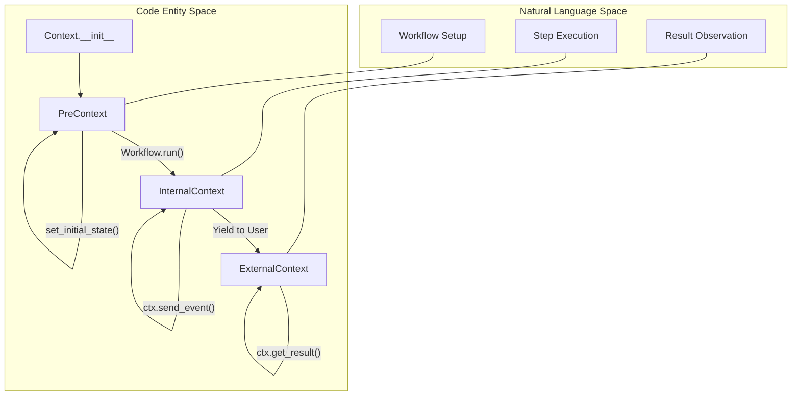
Sources: [packages/llama-index-workflows/src/workflows/context/context.py:123-146](), [packages/llama-index-workflows/src/workflows/context/context.py:186-210]()

## StateStore and Persistence

The `StateStore` provides a type-safe, asynchronous interface for persisting data across step boundaries [packages/llama-index-workflows/src/workflows/context/state_store.py:251-260](). By default, workflows use `DictState`, which behaves like a standard Python dictionary [packages/llama-index-workflows/src/workflows/context/state_store.py:238-245]().

### Key Functions
- `ctx.store.set(key, value)`: Persists a value into the store [packages/llama-index-workflows/src/workflows/context/state_store.py:313-324]().
- `ctx.store.get(key, default)`: Retrieves a value from the store [packages/llama-index-workflows/src/workflows/context/state_store.py:284-304]().
- `get_by_path(state, path)`: Accesses nested values using dot-notation (e.g., `"user.profile.name"`) [packages/llama-index-workflows/src/workflows/context/state_store.py:197-212]().

### Context Serialization
Serialization allows a workflow to be paused, saved to a database, and resumed later. The system uses `SerializedContext` (Version 1) to capture the state of the store, worker queues, and active waiters [packages/llama-index-workflows/src/workflows/context/context_types.py:125-142]().

Title: Serialization Data Flow
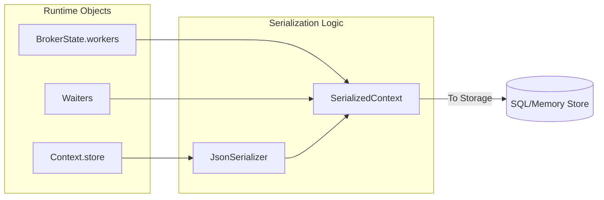
Sources: [packages/llama-index-workflows/src/workflows/context/context_types.py:125-142](), [packages/llama-index-workflows/src/workflows/context/state_store.py:83-114]()

## Resource Dependency Injection

The Resource system allows developers to inject external dependencies (like LLMs, databases, or API clients) into workflow steps without hardcoding them. This is achieved using the `Annotated` type hint and the `Resource` or `ResourceConfig` descriptors [packages/llama-index-workflows/src/workflows/resource.py:11-25]().

### Components
1. **`Resource`**: Wraps a factory function (sync or async) that produces the dependency [packages/llama-index-workflows/src/workflows/resource.py:93-105]().
2. **`ResourceConfig`**: Loads configuration for a Pydantic-based resource from a JSON file [packages/llama-index-workflows/src/workflows/resource.py:194-213]().
3. **`ResourceManager`**: Orchestrates the resolution and caching of these resources during step execution [packages/llama-index-workflows/src/workflows/resource.py:269-280]().

### Implementation in Steps
When a step is invoked, the runtime uses `partial()` to resolve all annotated resources via the `ResourceManager` before calling the step function [packages/llama-index-workflows/src/workflows/runtime/types/step_function.py:116-135]().

```python
@step
async def my_step(
    self, 
    ev: StartEvent, 
    db: Annotated[DatabaseClient, Resource(get_db_factory)]
) -> StopEvent:
    # 'db' is automatically resolved and injected
    await db.query(...)
    return StopEvent()
```
Sources: [packages/llama-index-workflows/src/workflows/runtime/types/step_function.py:128-135](), [packages/llama-index-workflows/tests/test_resources.py:240-244]()

### Resource Resolution Process
The `ResourceManager` maintains a `resolution_scope` to prevent circular dependencies and ensure that resources marked for caching are only created once per workflow context [packages/llama-index-workflows/src/workflows/resource.py:274-290]().

Title: Resource Resolution Logic
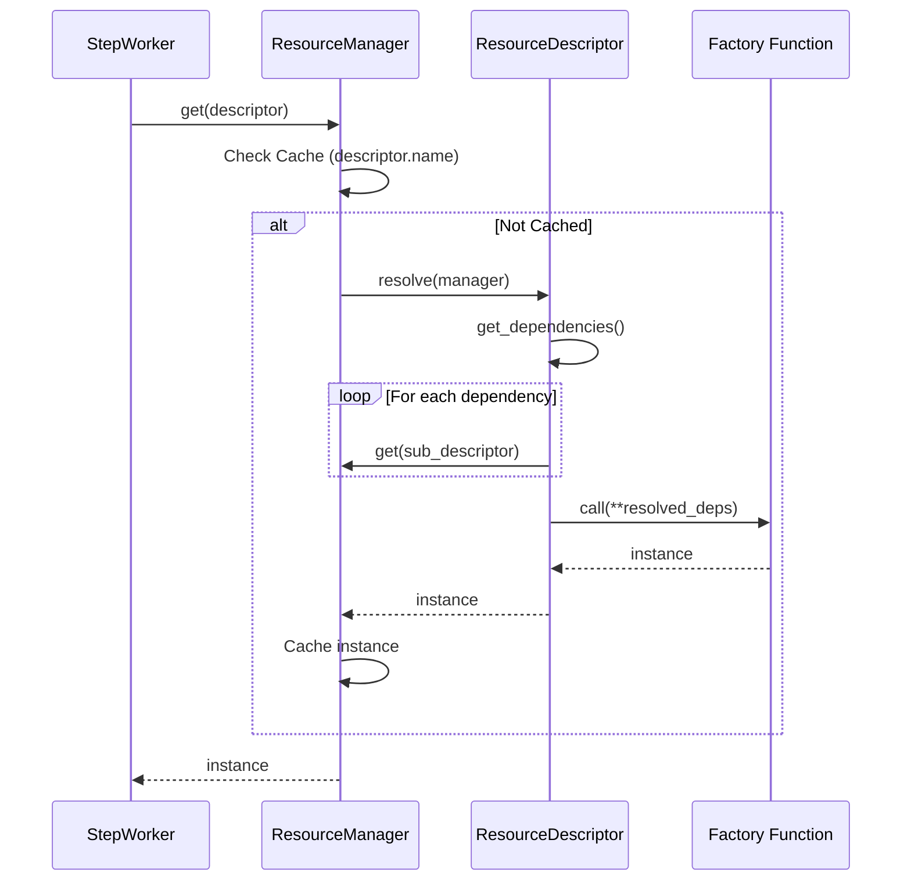
Sources: [packages/llama-index-workflows/src/workflows/resource.py:107-127](), [packages/llama-index-workflows/src/workflows/resource.py:293-315]()

---

# Page: Retry Policies and Error Handling

# Retry Policies and Error Handling

<details>
<summary>Relevant source files</summary>

The following files were used as context for generating this wiki page:

- [docs/api_docs/docs/api_reference/index.md](docs/api_docs/docs/api_reference/index.md)
- [docs/api_docs/docs/api_reference/retry_policy.md](docs/api_docs/docs/api_reference/retry_policy.md)
- [docs/api_docs/mkdocs.yml](docs/api_docs/mkdocs.yml)
- [docs/src/content/docs/llamaagents/workflows/retry_steps.md](docs/src/content/docs/llamaagents/workflows/retry_steps.md)
- [packages/llama-index-workflows/src/workflows/decorators.py](packages/llama-index-workflows/src/workflows/decorators.py)
- [packages/llama-index-workflows/src/workflows/retry_policy.py](packages/llama-index-workflows/src/workflows/retry_policy.py)
- [packages/llama-index-workflows/src/workflows/runtime/control_loop.py](packages/llama-index-workflows/src/workflows/runtime/control_loop.py)
- [packages/llama-index-workflows/tests/runtime/test_control_loop.py](packages/llama-index-workflows/tests/runtime/test_control_loop.py)
- [packages/llama-index-workflows/tests/runtime/test_control_loop_transformations.py](packages/llama-index-workflows/tests/runtime/test_control_loop_transformations.py)
- [packages/llama-index-workflows/tests/test_retry_policy.py](packages/llama-index-workflows/tests/test_retry_policy.py)

</details>


Llama-agents provides a robust error handling framework built into the `llama-index-workflows` core. This system allows developers to manage transient failures via composable retry policies and handle terminal step failures through specialized error routing.

## Retry Primitives and Policies

The retry system is modeled after the `tenacity` library, using three families of building blocks to define how a step should behave when it encounters an exception [docs/src/content/docs/llamaagents/workflows/retry_steps.md:15-23]().

### Core Components
1.  **Retry Conditions**: Predicates that decide if an exception is retryable (e.g., `retry_if_exception_type`) [packages/llama-index-workflows/src/workflows/retry_policy.py:102-105]().
2.  **Wait Strategies**: Functions that calculate the delay before the next attempt (e.g., `wait_exponential`) [packages/llama-index-workflows/src/workflows/retry_policy.py:108-111]().
3.  **Stop Conditions**: Predicates that determine when to give up (e.g., `stop_after_attempt`) [packages/llama-index-workflows/src/workflows/retry_policy.py:114-119]().

### Composable API
The `retry_policy()` function serves as the primary constructor [packages/llama-index-workflows/src/workflows/retry_policy.py:657-674](). It allows combining these blocks using operators:
*   **Retry/Stop Conditions**: Use `|` (OR) and `&` (AND) [packages/llama-index-workflows/src/workflows/retry_policy.py:128-138]().
*   **Wait Strategies**: Use `+` to combine delays [packages/llama-index-workflows/src/workflows/retry_policy.py:147-148]().

### Legacy Policies
For backward compatibility, the framework maintains two pre-configured classes:
*   `ConstantDelayRetryPolicy`: Retries with a fixed delay [packages/llama-index-workflows/src/workflows/retry_policy.py:734-754]().
*   `ExponentialBackoffRetryPolicy`: Retries with increasing delays [packages/llama-index-workflows/src/workflows/retry_policy.py:768-806]().

### Deterministic Jitter
During workflow replay (e.g., in DBOS), jitter must be deterministic. The `RetryPolicy` protocol's `next` method accepts an optional `seed` [packages/llama-index-workflows/src/workflows/retry_policy.py:86-99](). This seed is derived from a hash of the event and attempt count in the control loop to ensure the same wait times are generated during re-execution [packages/llama-index-workflows/src/workflows/runtime/control_loop.py:345-353]().

**Sources:** [packages/llama-index-workflows/src/workflows/retry_policy.py:1-120](), [packages/llama-index-workflows/src/workflows/runtime/control_loop.py:340-360](), [docs/src/content/docs/llamaagents/workflows/retry_steps.md:15-51]()

---

## Error Handling with @catch_error

When a step fails and its `RetryPolicy` (if any) is exhausted or the error is not retryable, the workflow enters the error handling phase. The `@catch_error` decorator allows defining specialized steps to intercept these failures [packages/llama-index-workflows/src/workflows/decorators.py:237-268]().

### Handler Routing Logic
1.  **Scoped Handlers**: A handler can be limited to specific steps using the `for_steps` parameter [packages/llama-index-workflows/src/workflows/decorators.py:261-262]().
2.  **Wildcard Handlers**: If `for_steps` is `None`, the handler acts as a catch-all for any step not covered by a scoped handler [packages/llama-index-workflows/src/workflows/decorators.py:56-57]().
3.  **StepFailedEvent**: Handlers receive a `StepFailedEvent`, which contains the original `exception` and the `step_name` that failed [packages/llama-index-workflows/src/workflows/events.py:108-112]().

### Recovery Mechanism
Handlers can return a new event to "recover" the workflow and continue execution from a different point. The `max_recoveries` parameter prevents infinite loops by limiting how many times a handler can be invoked for the same failure chain [packages/llama-index-workflows/src/workflows/decorators.py:58-58]().

### Code Entity Space: Error Flow
The following diagram illustrates how an exception in a worker is transformed into a `StepFailedEvent` and routed to a `@catch_error` handler.

**Error Routing Architecture**
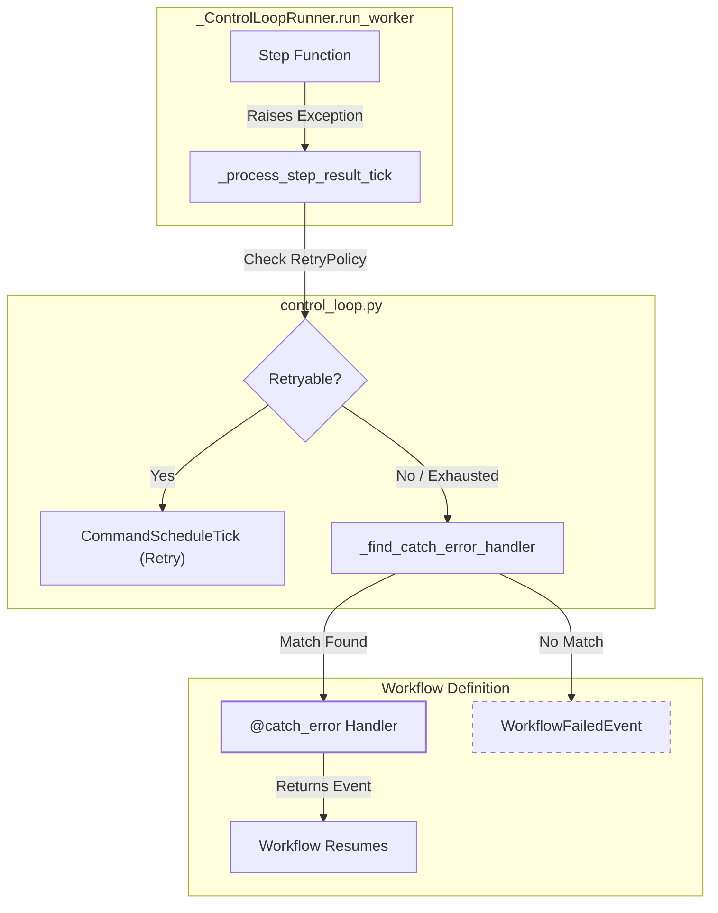
**Sources:** [packages/llama-index-workflows/src/workflows/runtime/control_loop.py:330-410](), [packages/llama-index-workflows/src/workflows/decorators.py:43-74](), [packages/llama-index-workflows/tests/runtime/test_control_loop_transformations.py:218-240]()

---

## Implementation Details and Data Flow

The `_ControlLoopRunner` manages the state of retries and failures using `BrokerState` [packages/llama-index-workflows/src/workflows/runtime/control_loop.py:121-144]().

### Data Flow for Retries
When a step fails, the control loop calls `_process_step_result_tick` [packages/llama-index-workflows/src/workflows/runtime/control_loop.py:330]().

1.  **Retry Calculation**: It retrieves the `RetryPolicy` from `InternalStepConfig` [packages/llama-index-workflows/src/workflows/runtime/types/internal_state.py:61-63]().
2.  **State Tracking**: The `InProgressState` tracks the number of `attempts` and the timestamp of the first failure [packages/llama-index-workflows/src/workflows/runtime/types/internal_state.py:51-53]().
3.  **Scheduling**: If the policy returns a delay, a `TickAddEvent` is wrapped in a `CommandScheduleTick` for future execution [packages/llama-index-workflows/src/workflows/runtime/control_loop.py:355-360]().

### Retry State Introspection
Steps can access their current retry status via `Context.retry_info()`. This returns a `RetryInfo` snapshot containing the attempt count and the last exception encountered [packages/llama-index-workflows/src/workflows/retry_policy.py:21-44]().

**Entity Mapping: State to Code**
| Concept | Code Entity | Purpose |
| :--- | :--- | :--- |
| **Retry State** | `RetryInfo` | Metadata passed to `Context` for step introspection. |
| **Policy Logic** | `RetryPolicy` | Protocol defining the `next()` retry decision method. |
| **Worker State** | `InProgressState` | Persisted state in `BrokerState` tracking attempts. |
| **Failure Event** | `StepFailedEvent` | Event emitted when a step fails permanently. |
| **Handler Metadata** | `CatchErrorHandler` | Descriptor used by the control loop for routing. |

**Data Flow: Retry and Replay**
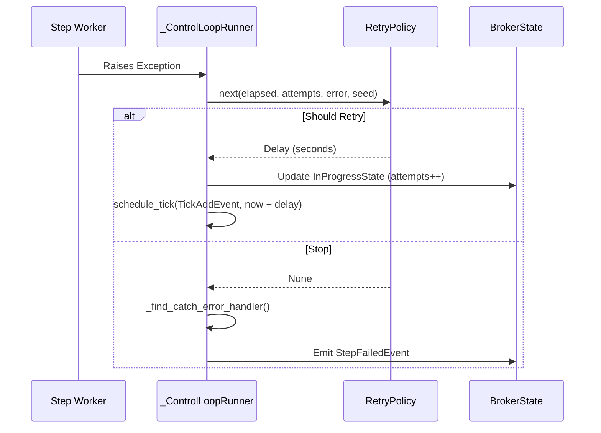
**Sources:** [packages/llama-index-workflows/src/workflows/runtime/control_loop.py:165-170](), [packages/llama-index-workflows/src/workflows/runtime/types/internal_state.py:49-63](), [packages/llama-index-workflows/src/workflows/retry_policy.py:80-99](), [packages/llama-index-workflows/src/workflows/decorators.py:61-74]()

---

# Page: Workflow Visualization and Utilities (llama-index-utils-workflow)

# Workflow Visualization and Utilities (llama-index-utils-workflow)

<details>
<summary>Relevant source files</summary>

The following files were used as context for generating this wiki page:

- [examples/visualization/resource_nodes_example.py](examples/visualization/resource_nodes_example.py)
- [packages/llama-index-utils-workflow/CHANGELOG.md](packages/llama-index-utils-workflow/CHANGELOG.md)
- [packages/llama-index-utils-workflow/package.json](packages/llama-index-utils-workflow/package.json)
- [packages/llama-index-utils-workflow/pyproject.toml](packages/llama-index-utils-workflow/pyproject.toml)
- [packages/llama-index-utils-workflow/src/llama_index/utils/workflow/__init__.py](packages/llama-index-utils-workflow/src/llama_index/utils/workflow/__init__.py)
- [packages/llama-index-utils-workflow/tests/conftest.py](packages/llama-index-utils-workflow/tests/conftest.py)
- [packages/llama-index-utils-workflow/tests/test_drawing.py](packages/llama-index-utils-workflow/tests/test_drawing.py)
- [packages/llama-index-workflows/src/workflows/protocol/__init__.py](packages/llama-index-workflows/src/workflows/protocol/__init__.py)
- [packages/llama-index-workflows/src/workflows/representation/__init__.py](packages/llama-index-workflows/src/workflows/representation/__init__.py)
- [packages/llama-index-workflows/src/workflows/representation/build.py](packages/llama-index-workflows/src/workflows/representation/build.py)
- [packages/llama-index-workflows/src/workflows/representation/types.py](packages/llama-index-workflows/src/workflows/representation/types.py)
- [packages/llama-index-workflows/tests/test_annotation_resolution.py](packages/llama-index-workflows/tests/test_annotation_resolution.py)
- [packages/llama-index-workflows/tests/test_representation_utils.py](packages/llama-index-workflows/tests/test_representation_utils.py)

</details>


The `llama-index-utils-workflow` package provides tools for inspecting, analyzing, and visualizing the structure and execution of workflows. It bridges the gap between the event-driven code defined in `llama-index-workflows` and a human-readable graphical representation. It supports static analysis (drawing all possible paths) and dynamic analysis (visualizing a specific execution trace), with rendering options for both interactive HTML (via Pyvis) and static diagrams (via Mermaid).

## Workflow Representation and Graph Model

At the core of the visualization utilities is the `WorkflowGraph` model. This model is built by performing static analysis on a `Workflow` class or instance to identify steps, the events they consume, and the events they emit.

### Key Representation Entities
The system uses several specialized node types to represent different workflow components:

| Class | Node Type | Description |
| :--- | :--- | :--- |
| `WorkflowStepNode` | `step` | Represents a function decorated with `@step`. |
| `WorkflowEventNode` | `event` | Represents an `Event` class flowing between steps. Includes the inheritance chain. |
| `WorkflowResourceNode` | `resource` | Represents an injected dependency via `Resource`. |
| `WorkflowResourceConfigNode` | `resource_config` | Represents configuration loaded from JSON files. |
| `WorkflowExternalNode` | `external` | Represents Human-in-the-loop (HITL) or external system interactions. |
| `WorkflowGenericNode` | `agent`, `tool`, etc. | Catch-all for specialized visualizations like `AgentWorkflow`. |

Sources: [packages/llama_index/utils/workflow/src/llama_index/utils/workflow/__init__.py:28-35](), [packages/llama-index-workflows/src/workflows/representation/types.py:21-158]()

### The Graph Construction Process
The function `get_workflow_representation` (defined in `workflows.representation.build`) inspects the workflow's `_get_steps_from_class()` metadata to build the `WorkflowGraph`.

1.  **Step Discovery**: Iterates through all methods decorated with `@step`.
2.  **Event Mapping**: Identifies input event types from type annotations and output event types from the return type hint.
3.  **Resource Extraction**: Scans `Annotated` parameters for `Resource` or `ResourceConfig` markers.
4.  **Edge Creation**: Connects events to steps (input) and steps to events (output).

Sources: [packages/llama-index-workflows/src/workflows/representation/build.py:155-182]()

## Visualization Utilities

The package provides four primary functions for generating visualizations, split by their source (static vs. execution) and output format (Pyvis vs. Mermaid).

### Static Analysis: All Possible Flows
These functions visualize every potential path defined in the workflow code, regardless of whether they were triggered in a specific run.

*   `draw_all_possible_flows(workflow, filename, ...)`: Generates an interactive Pyvis HTML file.
*   `draw_all_possible_flows_mermaid(workflow, filename, ...)`: Generates a Mermaid.js flowchart string or file.

### Execution Analysis: Trace Visualization
These functions visualize the actual path taken during a specific workflow execution by inspecting the `WorkflowHandler`.

*   `draw_most_recent_execution(handler, filename, ...)`: Uses the handler's execution history to draw a Pyvis graph of the steps that actually ran.
*   `draw_most_recent_execution_mermaid(handler, filename, ...)`: Similar to above, but outputs Mermaid syntax.

Sources: [packages/llama-index-utils-workflow/src/llama_index/utils/workflow/__init__.py:231-255](), [packages/llama-index-utils-workflow/src/llama_index/utils/workflow/__init__.py:410-435]()

## Mermaid Rendering Logic

The Mermaid rendering engine converts the `WorkflowGraph` into a `flowchart TD` definition. It applies specific CSS classes and shapes to differentiate node types.

### Node Mapping to Mermaid Space

| Code Entity Type | Mermaid Shape | CSS Class |
| :--- | :--- | :--- |
| `WorkflowStepNode` | `[Label]` (Box) | `stepStyle` |
| `WorkflowEventNode` (Start) | `([Label])` (Ellipse) | `startEventStyle` |
| `WorkflowEventNode` (Stop) | `([Label])` (Ellipse) | `stopEventStyle` |
| `WorkflowResourceNode` | `{{Label}}` (Hexagon) | `resourceStyle` |

### Diagram: From Code Entities to Mermaid Visualization
This diagram shows how Python objects in the `llama-index-workflows` space are transformed into Mermaid identifiers by the `_clean_id_for_mermaid` and style functions.

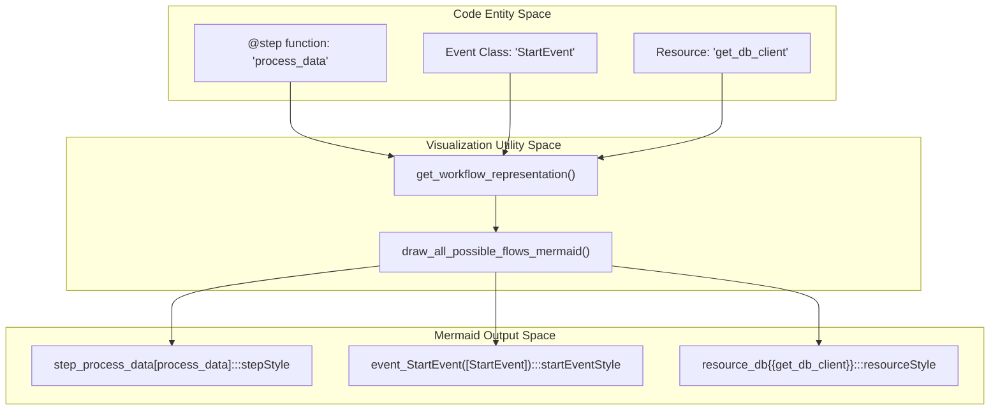
Sources: [packages/llama-index-utils-workflow/src/llama_index/utils/workflow/__init__.py:186-229](), [packages/llama-index-workflows/src/workflows/representation/build.py:155-170]()

## Nested Workflow Visualization

For complex systems where a parent workflow invokes child workflows, the utility `draw_all_possible_flows_nested_mermaid` provides a hierarchical view.

### Implementation Detail
The nested visualization uses `ast` (Abstract Syntax Tree) parsing and `inspect` to look inside step functions. It searches for instantiation of other `Workflow` subclasses.

1.  **AST Parsing**: It parses the source code of each step function.
2.  **Class Identification**: It looks for assignments where the right-hand side is a call to a class inheriting from `Workflow`.
3.  **Recursive Graphing**: It builds a sub-graph for each discovered child workflow and links it to the parent step via a `child_connector` node.

Sources: [packages/llama-index-utils-workflow/src/llama_index/utils/workflow/__init__.py:440-480](), [packages/llama-index-utils-workflow/CHANGELOG.md:87-87]()

### Diagram: Nested Workflow Data Flow
This diagram illustrates how the visualization utility traverses from a parent workflow into its children by analyzing step implementations.

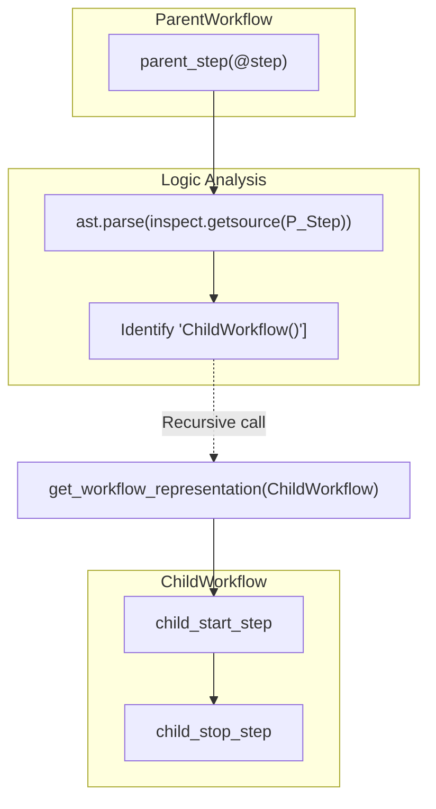
Sources: [packages/llama-index-utils-workflow/src/llama_index/utils/workflow/__init__.py:450-500](), [packages/llama-index-utils-workflow/tests/conftest.py:114-125]()

## Resource and Configuration Visualization

The utilities can visualize dependency injection. If a step requires a `Resource`, the graph includes a node for that resource and an edge pointing to the step, labeled with the parameter name.

*   **WorkflowResourceNode**: Captures the factory function name (`getter_name`), the source file, and line number.
*   **WorkflowResourceConfigNode**: Captures the path to the JSON configuration file and the specific `path_selector` used to extract data.

Sources: [packages/llama-index-workflows/src/workflows/representation/types.py:64-122](), [packages/llama-index-workflows/src/workflows/representation/build.py:116-152]()

---

# Page: Workflow Server and Client (llama-agents-server / llama-agents-client)

# Workflow Server and Client (llama-agents-server / llama-agents-client)

<details>
<summary>Relevant source files</summary>

The following files were used as context for generating this wiki page:

- [packages/llama-agents-client/CHANGELOG.md](packages/llama-agents-client/CHANGELOG.md)
- [packages/llama-agents-client/README.md](packages/llama-agents-client/README.md)
- [packages/llama-agents-client/package.json](packages/llama-agents-client/package.json)
- [packages/llama-agents-client/pyproject.toml](packages/llama-agents-client/pyproject.toml)
- [packages/llama-agents-server/CHANGELOG.md](packages/llama-agents-server/CHANGELOG.md)
- [packages/llama-agents-server/README.md](packages/llama-agents-server/README.md)
- [packages/llama-agents-server/package.json](packages/llama-agents-server/package.json)
- [packages/llama-agents-server/pyproject.toml](packages/llama-agents-server/pyproject.toml)
- [packages/llama-index-workflows/CHANGELOG.md](packages/llama-index-workflows/CHANGELOG.md)
- [packages/llama-index-workflows/package.json](packages/llama-index-workflows/package.json)
- [packages/llama-index-workflows/pyproject.toml](packages/llama-index-workflows/pyproject.toml)

</details>


The `llama-agents-server` and `llama-agents-client` packages provide the networking and persistence infrastructure required to transform standalone `llama-index-workflows` into production-ready web services. This layer handles HTTP routing, long-running execution state, and real-time event streaming.

### Purpose and Scope

The server-client architecture enables:
- **Deployment**: Exposing workflows via a Starlette-based REST API [packages/llama-agents-server/pyproject.toml:29-31]().
- **Durability**: Persisting workflow state across restarts using pluggable stores like SQLite or Postgres [packages/llama-agents-server/CHANGELOG.md:169]().
- **Interactivity**: Supporting Human-in-the-Loop (HITL) patterns where clients can inject events into running workflows [packages/llama-agents-server/README.md:51]().
- **Observability**: Real-time event streaming via Server-Sent Events (SSE) [packages/llama-agents-server/CHANGELOG.md:120]().

### System Architecture Overview

The following diagram illustrates how the server components wrap the core workflow engine and interact with the client library.

**Workflow Service Component Map**
```mermaid
graph TD
    subgraph "Client Space (llama-agents-client)"
        Client["WorkflowClient"]
        Stream["SSE EventStream"]
    end

    subgraph "Server Space (llama-agents-server)"
        API["_WorkflowAPI (Starlette)"]
        Service["_WorkflowService"]
        
        subgraph "Runtime Decorator Chain"
            Decorator["ServerRuntimeDecorator"]
            Persist["PersistenceDecorator"]
            Idle["IdleReleaseDecorator"]
        end

        Engine["Workflow Engine"]
        Store[("AbstractWorkflowStore")]
    end

    Client -->|HTTP POST /run| API
    API --> Service
    Service --> Decorator
    Decorator --> Persist
    Persist --> Idle
    Idle --> Engine
    Persist <--> Store
    Stream <-->|SSE /events| API
```
**Sources:** [packages/llama-agents-server/CHANGELOG.md:208-214](), [packages/llama-agents-server/README.md:48-56](), [packages/llama-agents-client/README.md:15-30]().

---

### 3.1 WorkflowServer: API, Service, and Runtime Chain
The `WorkflowServer` is the primary entry point for hosting workflows [packages/llama-agents-server/README.md:33-34](). It assembles a Starlette application that routes requests to a `_WorkflowService`. The execution logic is managed through a **Runtime Decorator Chain**, which allows the server to inject cross-cutting concerns like persistence and idle-timeout management without modifying the underlying workflow logic.

For details, see [WorkflowServer: API, Service, and Runtime Chain](#3.1).

**Sources:** [packages/llama-agents-server/CHANGELOG.md:167-168](), [packages/llama-agents-server/README.md:3-4]().

---

### 3.2 Workflow Persistence Stores
To support long-running tasks, the server uses the `AbstractWorkflowStore` contract to save workflow "ticks" (execution steps), state snapshots, and events [packages/llama-agents-server/CHANGELOG.md:169](). This allows a workflow to be resumed on a different server instance or after a crash by replaying the stored ticks to reconstruct the `Context` state.

Supported stores include:
- `MemoryWorkflowStore`: Volatile storage for testing.
- `SqliteWorkflowStore`: Default local persistence [packages/llama-agents-server/README.md:52]().
- `PostgresWorkflowStore`: Production-grade storage with `LISTEN/NOTIFY` support [packages/llama-agents-server/CHANGELOG.md:7-8]().

For details, see [Workflow Persistence Stores](#3.2).

**Sources:** [packages/llama-agents-server/CHANGELOG.md:169-170](), [packages/llama-agents-server/CHANGELOG.md:7-8]().

---

### 3.3 DBOS Durable Runtime (llama-agents-dbos)
The `llama-agents-dbos` package provides a specialized `DBOSRuntime` for high-reliability environments. It leverages the DBOS platform to provide deterministic replay via a `TaskJournal` and manages distributed execution through an `ExecutorLeaseManager` [packages/llama-agents-server/CHANGELOG.md:7-8](). This runtime ensures that even if a node fails mid-step, the workflow can resume exactly where it left off with guaranteed consistency.

For details, see [DBOS Durable Runtime (llama-agents-dbos)](#3.3).

**Sources:** [packages/llama-agents-server/CHANGELOG.md:7-8](), [packages/llama-index-workflows/CHANGELOG.md:94-95]().

---

### 3.4 WorkflowClient and SSE Streaming
The `WorkflowClient` in `llama-agents-client` provides a high-level Pythonic interface for interacting with a remote `WorkflowServer` [packages/llama-agents-client/README.md:15](). It supports both synchronous execution and an asynchronous "fire-and-forget" mode that returns a `handler_id` for tracking. 

A key feature is the sequence-based SSE streaming, which allows clients to subscribe to workflow events with automatic reconnection and cursor-based recovery to ensure no events are missed during network instability [packages/llama-agents-client/CHANGELOG.md:94-95]().

For details, see [WorkflowClient and SSE Streaming](#3.4).

**Sources:** [packages/llama-agents-client/README.md:21-25](), [packages/llama-agents-client/CHANGELOG.md:94-95]().

---

### Data Flow: Request to Execution

The following diagram maps the flow of a client request through the server's internal classes and the persistence layer.

**Execution Flow and Code Entities**
```mermaid
sequenceDiagram
    participant C as WorkflowClient
    participant API as _WorkflowAPI
    participant Svc as _WorkflowService
    participant R as ServerRuntimeDecorator
    participant P as PersistenceDecorator
    participant ST as AbstractWorkflowStore

    C->>API: run_workflow_nowait("greet", data)
    API->>Svc: launch_workflow("greet", data)
    Svc->>R: create_handler()
    R->>P: start()
    P->>ST: create_handler_entry(handler_id)
    P->>P: run_loop()
    loop Every Step
        P->>ST: append_tick(WorkflowTick)
        ST-->>P: ack
    end
    P->>ST: update_status("COMPLETED")
    Svc-->>C: HandlerID
```
**Sources:** [packages/llama-agents-server/CHANGELOG.md:167-170](), [packages/llama-agents-client/README.md:21-30](), [packages/llama-index-workflows/CHANGELOG.md:101]().

---

# Page: WorkflowServer: API, Service, and Runtime Chain

# WorkflowServer: API, Service, and Runtime Chain

<details>
<summary>Relevant source files</summary>

The following files were used as context for generating this wiki page:

- [packages/llama-agents-client/src/llama_agents/client/client.py](packages/llama-agents-client/src/llama_agents/client/client.py)
- [packages/llama-agents-client/tests/client/test_client.py](packages/llama-agents-client/tests/client/test_client.py)
- [packages/llama-agents-core/src/llama_agents/core/iter_utils.py](packages/llama-agents-core/src/llama_agents/core/iter_utils.py)
- [packages/llama-agents-core/tests/test_iter_utils.py](packages/llama-agents-core/tests/test_iter_utils.py)
- [packages/llama-agents-dbos/src/llama_agents/dbos/idle_release.py](packages/llama-agents-dbos/src/llama_agents/dbos/idle_release.py)
- [packages/llama-agents-dbos/tests/test_dbos_idle_release.py](packages/llama-agents-dbos/tests/test_dbos_idle_release.py)
- [packages/llama-agents-integration-tests/src/llama_agents_integration_tests/fake_agent_data.py](packages/llama-agents-integration-tests/src/llama_agents_integration_tests/fake_agent_data.py)
- [packages/llama-agents-server/src/llama_agents/server/_api.py](packages/llama-agents-server/src/llama_agents/server/_api.py)
- [packages/llama-agents-server/src/llama_agents/server/_runtime/event_interceptor.py](packages/llama-agents-server/src/llama_agents/server/_runtime/event_interceptor.py)
- [packages/llama-agents-server/src/llama_agents/server/_runtime/idle_release_runtime.py](packages/llama-agents-server/src/llama_agents/server/_runtime/idle_release_runtime.py)
- [packages/llama-agents-server/src/llama_agents/server/_runtime/persistence_runtime.py](packages/llama-agents-server/src/llama_agents/server/_runtime/persistence_runtime.py)
- [packages/llama-agents-server/src/llama_agents/server/_runtime/server_runtime.py](packages/llama-agents-server/src/llama_agents/server/_runtime/server_runtime.py)
- [packages/llama-agents-server/src/llama_agents/server/_service.py](packages/llama-agents-server/src/llama_agents/server/_service.py)
- [packages/llama-agents-server/src/llama_agents/server/_store/abstract_workflow_store.py](packages/llama-agents-server/src/llama_agents/server/_store/abstract_workflow_store.py)
- [packages/llama-agents-server/src/llama_agents/server/_store/agent_data_store.py](packages/llama-agents-server/src/llama_agents/server/_store/agent_data_store.py)
- [packages/llama-agents-server/src/llama_agents/server/server.py](packages/llama-agents-server/src/llama_agents/server/server.py)
- [packages/llama-agents-server/tests/server/server_test_fixtures.py](packages/llama-agents-server/tests/server/server_test_fixtures.py)
- [packages/llama-agents-server/tests/server/test_error_handling.py](packages/llama-agents-server/tests/server/test_error_handling.py)
- [packages/llama-agents-server/tests/server/test_handler_serialization.py](packages/llama-agents-server/tests/server/test_handler_serialization.py)
- [packages/llama-agents-server/tests/server/test_runtime_decorators.py](packages/llama-agents-server/tests/server/test_runtime_decorators.py)
- [packages/llama-agents-server/tests/server/test_server.py](packages/llama-agents-server/tests/server/test_server.py)
- [packages/llama-agents-server/tests/server/test_server_endpoints.py](packages/llama-agents-server/tests/server/test_server_endpoints.py)
- [packages/llama-agents-server/tests/server/test_server_runtime.py](packages/llama-agents-server/tests/server/test_server_runtime.py)
- [packages/llama-agents-server/tests/server/test_workflow_service.py](packages/llama-agents-server/tests/server/test_workflow_service.py)
- [packages/llama-index-workflows/src/workflows/runtime/runtime_decorators.py](packages/llama-index-workflows/src/workflows/runtime/runtime_decorators.py)

</details>


The `WorkflowServer` is the primary HTTP entry point for exposing `Workflow` instances as RESTful services. It assembles a Starlette-based API, a lifecycle service, and a sophisticated chain of runtime decorators that handle persistence, idle-state management, and event streaming.

## System Architecture

The `WorkflowServer` architecture follows a layered approach, separating the HTTP transport (`_WorkflowAPI`), the business logic and lifecycle management (`_WorkflowService`), and the execution engine (the `Runtime` decorator chain).

### Component Relationship Diagram

The following diagram bridges the natural language concepts to the specific code entities that implement them.

"WorkflowServer Component Map"
```mermaid
graph TD
    subgraph "Natural Language Space"
        API["HTTP REST API"]
        Lifecycle["Service Lifecycle"]
        Execution["Execution Engine"]
        Storage["Persistence Layer"]
    end

    subgraph "Code Entity Space"
        WS["WorkflowServer [server.py]"]
        WAPI["_WorkflowAPI [_api.py]"]
        WSRV["_WorkflowService [_service.py]"]
        SRD["ServerRuntimeDecorator [_runtime/server_runtime.py]"]
        IRD["IdleReleaseDecorator [_runtime/idle_release_runtime.py]"]
        PD["PersistenceDecorator [_runtime/persistence_runtime.py]"]
        AWS["AbstractWorkflowStore [_store/abstract_workflow_store.py]"]
    end

    WS --> WAPI
    WS --> WSRV
    WAPI --> WSRV
    WSRV --> SRD
    SRD --> IRD
    IRD --> PD
    PD --> AWS
    
    API -.-> WAPI
    Lifecycle -.-> WSRV
    Execution -.-> SRD
    Storage -.-> AWS
```
Sources: [packages/llama-agents-server/src/llama_agents/server/server.py:29-131](), [packages/llama-agents-server/src/llama_agents/server/_api.py:73-121](), [packages/llama-agents-server/src/llama_agents/server/_service.py:45-50]()

---

## WorkflowServer Assembly

The `WorkflowServer` class acts as the orchestrator. Upon initialization, it constructs the default runtime stack and prepares the ASGI application.

*   **Runtime Stack Construction**: By default, it wraps the `basic_runtime` with a `PersistenceDecorator`, followed by an `IdleReleaseDecorator`, and finally a `ServerRuntimeDecorator` [packages/llama-agents-server/src/llama_agents/server/server.py:107-120]().
*   **Workflow Registration**: Workflows are added via `add_workflow()`, which assigns a URL-safe name and injects the server's runtime into the workflow instance [packages/llama-agents-server/src/llama_agents/server/server.py:138-161]().

Sources: [packages/llama-agents-server/src/llama_agents/server/server.py:59-132]()

---

## _WorkflowAPI: Starlette Routes

The `_WorkflowAPI` class encapsulates the Starlette `app` and defines the HTTP interface for workflow interaction.

### Key Endpoints

| Route | Method | Function | Description |
| :--- | :--- | :--- | :--- |
| `/workflows/{name}/run` | POST | `_run_workflow` | Synchronous execution; waits for `StopEvent`. |
| `/workflows/{name}/run-nowait` | POST | `_run_workflow_nowait` | Returns a `handler_id` immediately. |
| `/events/{handler_id}` | GET | `_stream_events` | SSE streaming of workflow events. |
| `/events/{handler_id}` | POST | `_post_event` | Sends external events to a running workflow. |
| `/results/{handler_id}` | GET | `_get_workflow_result` | Retrieves the `StopEvent` result. |
| `/handlers` | GET | `_get_handlers` | Lists all persisted workflow handlers. |

Sources: [packages/llama-agents-server/src/llama_agents/server/_api.py:136-179]()

### SSE Event Streaming
Streaming is implemented using `StreamingResponse`. The `_stream_events` method utilizes `_service.stream_events()`, which leverages the underlying store's subscription mechanism [packages/llama-agents-server/src/llama_agents/server/_api.py:446-485](). It supports heartbeats via `: heartbeat` comments to keep connections alive [packages/llama-agents-server/src/llama_agents/server/_api.py:458-460]().

---

## _WorkflowService: Lifecycle Logic

The `_WorkflowService` acts as the bridge between the API routes and the runtime. It handles:
*   **Execution Mapping**: Converting HTTP requests into `runtime.run_workflow()` calls [packages/llama-agents-server/src/llama_agents/server/_service.py:130-170]().
*   **State Retrieval**: Querying the `AbstractWorkflowStore` for handler metadata [packages/llama-agents-server/src/llama_agents/server/_service.py:102-114]().
*   **Event Routing**: Brokering events between the store and the HTTP stream [packages/llama-agents-server/src/llama_agents/server/_service.py:220-250]().

Sources: [packages/llama-agents-server/src/llama_agents/server/_service.py:45-300]()

---

## The Runtime Decorator Chain

Execution logic is extended through a chain of decorators. Each decorator implements the `Runtime` interface and wraps an inner runtime.

"Runtime Decorator Data Flow"
```mermaid
sequenceDiagram
    participant API as _WorkflowAPI
    participant SRD as ServerRuntimeDecorator
    participant IRD as IdleReleaseDecorator
    participant PD as PersistenceDecorator
    participant Store as AbstractWorkflowStore

    API->>SRD: run_workflow(run_id, workflow)
    SRD->>IRD: run_workflow(...)
    IRD->>PD: run_workflow(...)
    PD->>Store: create_state_store(run_id)
    PD-->>IRD: ExternalRunAdapter
    IRD-->>SRD: IdleReleaseExternalRunAdapter
    SRD-->>API: handler_id

    Note over SRD, PD: Execution Loop Starts
    PD->>Store: append_tick(run_id, tick_data)
    SRD->>Store: append_event(run_id, event)
    
    loop Idle Detection
        IRD->>IRD: _deferred_release(run_id)
        IRD->>Store: update_handler_status(status="running", idle_since=now)
    end
```
Sources: [packages/llama-agents-server/src/llama_agents/server/_runtime/server_runtime.py:157-178](), [packages/llama-agents-server/src/llama_agents/server/_runtime/idle_release_runtime.py:110-130](), [packages/llama-agents-server/src/llama_agents/server/_runtime/persistence_runtime.py:134-160]()

### 1. ServerRuntimeDecorator
The outermost decorator. It is responsible for:
*   **Event Recording**: Every event emitted by the workflow is intercepted and persisted to the store via `append_event()` [packages/llama-agents-server/src/llama_agents/server/_runtime/server_runtime.py:95-145]().
*   **Status Updates**: It listens for terminal events (`StopEvent`, `WorkflowFailedEvent`) and updates the handler status in the store [packages/llama-agents-server/src/llama_agents/server/_runtime/server_runtime.py:107-142]().
*   **Retry Logic**: Implements `_retry_store_write()` to handle transient persistence failures [packages/llama-agents-server/src/llama_agents/server/_runtime/server_runtime.py:179-195]().

### 2. IdleReleaseDecorator
Manages memory efficiency for long-running workflows:
*   **Idle Detection**: Monitors the event stream for `WorkflowIdleEvent` [packages/llama-agents-server/src/llama_agents/server/_runtime/idle_release_runtime.py:62-70]().
*   **Eviction**: After `idle_timeout` seconds of inactivity, it cancels the in-memory execution task via `_abort_inner_run()` [packages/llama-agents-server/src/llama_agents/server/_runtime/idle_release_runtime.py:172-188]().
*   **Reload-on-Demand**: When a new event arrives for a released handler, it uses `context_from_ticks()` to reconstruct the workflow state and resume execution [packages/llama-agents-server/src/llama_agents/server/_runtime/idle_release_runtime.py:98-107]().

### 3. PersistenceDecorator
Provides the foundation for durability:
*   **Tick Persistence**: Uses an internal adapter to save every `WorkflowTick` to the store [packages/llama-agents-server/src/llama_agents/server/_runtime/persistence_runtime.py:108-117]().
*   **State Reconstruction**: Implements `context_from_ticks()`, which replays the entire history of ticks to rebuild a `Context` object exactly as it was before a crash or eviction [packages/llama-agents-server/src/llama_agents/server/_runtime/persistence_runtime.py:190-210]().

Sources: [packages/llama-agents-server/src/llama_agents/server/_runtime/server_runtime.py:157-250](), [packages/llama-agents-server/src/llama_agents/server/_runtime/idle_release_runtime.py:110-210](), [packages/llama-agents-server/src/llama_agents/server/_runtime/persistence_runtime.py:134-220]()

---

# Page: Workflow Persistence Stores

# Workflow Persistence Stores

<details>
<summary>Relevant source files</summary>

The following files were used as context for generating this wiki page:

- [packages/llama-agents-agentcore/src/llama_agents/agentcore/entrypoint.py](packages/llama-agents-agentcore/src/llama_agents/agentcore/entrypoint.py)
- [packages/llama-agents-integration-tests/src/llama_agents_integration_tests/fake_agent_data.py](packages/llama-agents-integration-tests/src/llama_agents_integration_tests/fake_agent_data.py)
- [packages/llama-agents-integration-tests/src/llama_agents_integration_tests/server_test_utils.py](packages/llama-agents-integration-tests/src/llama_agents_integration_tests/server_test_utils.py)
- [packages/llama-agents-integration-tests/tests/test_agent_data_store.py](packages/llama-agents-integration-tests/tests/test_agent_data_store.py)
- [packages/llama-agents-integration-tests/tests/test_runtime_matrix.py](packages/llama-agents-integration-tests/tests/test_runtime_matrix.py)
- [packages/llama-agents-integration-tests/tests/test_server_http_matrix.py](packages/llama-agents-integration-tests/tests/test_server_http_matrix.py)
- [packages/llama-agents-integration-tests/tests/test_server_store_matrix.py](packages/llama-agents-integration-tests/tests/test_server_store_matrix.py)
- [packages/llama-agents-server/src/llama_agents/server/_runtime/idle_release_runtime.py](packages/llama-agents-server/src/llama_agents/server/_runtime/idle_release_runtime.py)
- [packages/llama-agents-server/src/llama_agents/server/_runtime/persistence_runtime.py](packages/llama-agents-server/src/llama_agents/server/_runtime/persistence_runtime.py)
- [packages/llama-agents-server/src/llama_agents/server/_store/abstract_workflow_store.py](packages/llama-agents-server/src/llama_agents/server/_store/abstract_workflow_store.py)
- [packages/llama-agents-server/src/llama_agents/server/_store/agent_data_client.py](packages/llama-agents-server/src/llama_agents/server/_store/agent_data_client.py)
- [packages/llama-agents-server/src/llama_agents/server/_store/agent_data_state_store.py](packages/llama-agents-server/src/llama_agents/server/_store/agent_data_state_store.py)
- [packages/llama-agents-server/src/llama_agents/server/_store/agent_data_store.py](packages/llama-agents-server/src/llama_agents/server/_store/agent_data_store.py)
- [packages/llama-agents-server/src/llama_agents/server/_store/memory_workflow_store.py](packages/llama-agents-server/src/llama_agents/server/_store/memory_workflow_store.py)
- [packages/llama-agents-server/src/llama_agents/server/_store/postgres_state_store.py](packages/llama-agents-server/src/llama_agents/server/_store/postgres_state_store.py)
- [packages/llama-agents-server/src/llama_agents/server/_store/sqlite/migrate.py](packages/llama-agents-server/src/llama_agents/server/_store/sqlite/migrate.py)
- [packages/llama-agents-server/src/llama_agents/server/_store/sqlite/migrations/0001_init.sql](packages/llama-agents-server/src/llama_agents/server/_store/sqlite/migrations/0001_init.sql)
- [packages/llama-agents-server/src/llama_agents/server/_store/sqlite/migrations/0002_extend_handlers.sql](packages/llama-agents-server/src/llama_agents/server/_store/sqlite/migrations/0002_extend_handlers.sql)
- [packages/llama-agents-server/src/llama_agents/server/_store/sqlite/migrations/0003_add_idle_since.sql](packages/llama-agents-server/src/llama_agents/server/_store/sqlite/migrations/0003_add_idle_since.sql)
- [packages/llama-agents-server/src/llama_agents/server/_store/sqlite/sqlite_state_store.py](packages/llama-agents-server/src/llama_agents/server/_store/sqlite/sqlite_state_store.py)
- [packages/llama-agents-server/src/llama_agents/server/_store/sqlite/sqlite_workflow_store.py](packages/llama-agents-server/src/llama_agents/server/_store/sqlite/sqlite_workflow_store.py)
- [packages/llama-agents-server/tests/server/test_agent_data_store.py](packages/llama-agents-server/tests/server/test_agent_data_store.py)
- [packages/llama-agents-server/tests/server/test_durable_runtime.py](packages/llama-agents-server/tests/server/test_durable_runtime.py)
- [packages/llama-agents-server/tests/server/test_memory_workflow_store.py](packages/llama-agents-server/tests/server/test_memory_workflow_store.py)
- [packages/llama-agents-server/tests/server/test_migrations.py](packages/llama-agents-server/tests/server/test_migrations.py)
- [packages/llama-agents-server/tests/server/test_workflow_store_events.py](packages/llama-agents-server/tests/server/test_workflow_store_events.py)
- [packages/llama-index-workflows/tests/test_workflow_internal_events.py](packages/llama-index-workflows/tests/test_workflow_internal_events.py)

</details>


Workflow persistence stores provide the durability layer for `llama-agents`. They are responsible for saving the execution state of workflows, including event logs, execution "ticks," and handler metadata. This architecture allows workflows to survive server restarts, scale across multiple pods, and support long-running processes that may go idle for days.

## The AbstractWorkflowStore Contract

All persistence backends implement the `AbstractWorkflowStore` interface. This contract ensures that the `WorkflowServer` can interact with different storage engines (Memory, SQLite, Postgres, or LlamaCloud) using a unified API.

Key responsibilities of a store include:
- **Handler Management**: Tracking the lifecycle of a workflow run via `PersistentHandler` [packages/llama-agents-server/src/llama_agents/server/_store/abstract_workflow_store.py:60-70]().
- **Event Logging**: Appending and querying `StoredEvent` objects [packages/llama-agents-server/src/llama_agents/server/_store/abstract_workflow_store.py:103-107]().
- **Tick Persistence**: Storing `WorkflowTick` objects which represent the state transitions of the workflow reducer [packages/llama-agents-server/src/llama_agents/server/_store/abstract_workflow_store.py:96-101]().
- **State Store Creation**: Providing a `StateStore` for mutable workflow context data [packages/llama-agents-server/src/llama_agents/server/_store/abstract_workflow_store.py:114-125]().

### Workflow Storage Data Flow

The following diagram illustrates how the `PersistenceDecorator` coordinates with the `AbstractWorkflowStore` to persist execution data.

Title: Persistence Data Flow
```mermaid
graph TD
    subgraph "Workflow Engine"
        A["Workflow.run()"] --> B["Reducer Loop"]
        B --> C["WorkflowTick"]
    end

    subgraph "Server Runtime"
        D["PersistenceDecorator"] -- "intercepts" --> C
        D --> E["_PersistenceInternalRunAdapter"]
    end

    subgraph "Persistence Store"
        E -- "append_tick()" --> F["AbstractWorkflowStore"]
        F -- "INSERT" --> G[("Database Storage")]
    end

    subgraph "Reconstruction"
        H["context_from_ticks()"] -- "stream_ticks()" --> F
        F -- "SELECT" --> G
        H -- "replay_ticks_stream()" --> I["ReplayedContext"]
    end
```
Sources: [packages/llama-agents-server/src/llama_agents/server/_runtime/persistence_runtime.py:96-132](), [packages/llama-agents-server/src/llama_agents/server/_runtime/persistence_runtime.py:190-210](), [packages/llama-agents-server/src/llama_agents/server/_store/abstract_workflow_store.py:147-160]()

## Store Implementations

### MemoryWorkflowStore
A volatile, in-memory implementation used primarily for testing and ephemeral development environments. It uses `asyncio.Condition` variables to implement `subscribe_events` without polling [packages/llama-agents-server/src/llama_agents/server/_store/abstract_workflow_store.py:212-218]().

### SqliteWorkflowStore
The standard store for local production and single-node deployments. It supports automatic schema migrations and specialized connection modes for environments like AWS Bedrock AgentCore.

- **Migrations**: Uses a versioned SQL file system located in `migrations/` [packages/llama-agents-server/src/llama_agents/server/_store/sqlite/migrate.py:99-132]().
- **WAL Mode**: Automatically enables Write-Ahead Logging (WAL) to support concurrent read/write access [packages/llama-agents-server/src/llama_agents/server/_store/sqlite/migrate.py:77-80]().
- **Single Connection Mode**: Can be configured with `single_connection=True` and `unix-none` VFS to disable file locking, which is required in certain restricted environments [packages/llama-agents-server/src/llama_agents/server/_store/sqlite/sqlite_workflow_store.py:52-60]().

### AgentDataStore
A cloud-native store backed by the LlamaCloud Agent Data API. It is optimized for high-latency environments through several mechanisms:
- **Fire-and-Forget Writes**: Tick and event writes are dispatched as background tasks [packages/llama-agents-server/src/llama_agents/server/_store/agent_data_store.py:121-131]().
- **Write Regrouping**: Pending writes are awaited and flushed at step boundaries via `after_tick` [packages/llama-agents-server/src/llama_agents/server/_store/agent_data_store.py:154-158]().
- **In-Memory Queues**: Local subscribers receive events via internal queues instead of re-polling the API [packages/llama-agents-server/src/llama_agents/server/_store/agent_data_store.py:116-119]().

Sources: [packages/llama-agents-server/src/llama_agents/server/_store/sqlite/sqlite_workflow_store.py:32-51](), [packages/llama-agents-server/src/llama_agents/server/_store/agent_data_store.py:34-46]()

## State Reconstruction via Ticks

Llama-agents uses a "tick-based" state reconstruction model. Rather than serializing the entire Python object graph of a workflow context at every step, the system persists a stream of `WorkflowTick` objects.

When a workflow is reloaded (e.g., after an idle release or a server restart), the `PersistenceDecorator` calls `context_from_ticks` [packages/llama-agents-server/src/llama_agents/server/_runtime/persistence_runtime.py:190-192](). This function:
1. Streams all stored ticks for the `run_id` [packages/llama-agents-server/src/llama_agents/server/_runtime/persistence_runtime.py:202]().
2. Uses `replay_ticks_stream` to feed these ticks back into a fresh `Workflow` instance [packages/llama-agents-server/src/llama_agents/server/_runtime/persistence_runtime.py:26]().
3. Rebuilds the `Context` to the exact state it was in after the last persisted tick [packages/llama-agents-server/src/llama_agents/server/_runtime/persistence_runtime.py:72-73]().

### State Store Mapping

Title: Persistence Entity Mapping
```mermaid
classDiagram
    class AbstractWorkflowStore {
        <<interface>>
        +create_state_store()
        +append_tick()
        +query_events()
    }
    class SqliteWorkflowStore {
        -db_path: str
        -run_migrations()
    }
    class AgentDataStore {
        -client: AgentDataClient
        -_pending_ticks: dict
    }
    class SqliteStateStore {
        -run_id: str
        +get_state()
        +set_state()
    }
    class AgentDataStateStore {
        -run_id: str
    }

    AbstractWorkflowStore <|-- SqliteWorkflowStore
    AbstractWorkflowStore <|-- AgentDataStore
    SqliteWorkflowStore ..> SqliteStateStore : creates
    AgentDataStore ..> AgentDataStateStore : creates
```
Sources: [packages/llama-agents-server/src/llama_agents/server/_store/sqlite/sqlite_workflow_store.py:74-89](), [packages/llama-agents-server/src/llama_agents/server/_store/agent_data_store.py:78-79](), [packages/llama-agents-server/src/llama_agents/server/_store/sqlite/sqlite_state_store.py:47-52]()

## Handler Lifecycle and Status

The `PersistentHandler` tracks the high-level status of a workflow run. The status transitions are managed by the `WorkflowServer` through the `update_handler_status` method [packages/llama-agents-server/src/llama_agents/server/_store/abstract_workflow_store.py:169-177]().

| Status | Description |
| :--- | :--- |
| `running` | The workflow is currently being processed by a runtime. |
| `completed` | The workflow reached a `StopEvent`. |
| `failed` | The workflow terminated due to an unhandled exception. |
| `cancelled` | The workflow was explicitly halted by a user or system command. |

### Idle Tracking
For durable runtimes, the `idle_since` field is used to mark handlers that are waiting for external input [packages/llama-agents-server/src/llama_agents/server/_store/abstract_workflow_store.py:70](). When a handler is reloaded, `idle_since` is cleared [packages/llama-agents-server/src/llama_agents/server/_store/abstract_workflow_store.py:198-199]().

Sources: [packages/llama-agents-server/src/llama_agents/server/_store/abstract_workflow_store.py:30-32](), [packages/llama-agents-server/src/llama_agents/server/_store/abstract_workflow_store.py:60-70]()

---

# Page: DBOS Durable Runtime (llama-agents-dbos)

# DBOS Durable Runtime (llama-agents-dbos)

<details>
<summary>Relevant source files</summary>

The following files were used as context for generating this wiki page:

- [docs/src/content/docs/llamaagents/workflows/dbos.md](docs/src/content/docs/llamaagents/workflows/dbos.md)
- [examples/dbos/_replica.py](examples/dbos/_replica.py)
- [examples/dbos/durable_workflow.py](examples/dbos/durable_workflow.py)
- [examples/dbos/idle_release_demo.py](examples/dbos/idle_release_demo.py)
- [examples/dbos/server_quickstart.py](examples/dbos/server_quickstart.py)
- [examples/dbos/server_replicas.py](examples/dbos/server_replicas.py)
- [packages/llama-agents-dbos/CHANGELOG.md](packages/llama-agents-dbos/CHANGELOG.md)
- [packages/llama-agents-dbos/README.md](packages/llama-agents-dbos/README.md)
- [packages/llama-agents-dbos/conftest.py](packages/llama-agents-dbos/conftest.py)
- [packages/llama-agents-dbos/package.json](packages/llama-agents-dbos/package.json)
- [packages/llama-agents-dbos/pyproject.toml](packages/llama-agents-dbos/pyproject.toml)
- [packages/llama-agents-dbos/src/llama_agents/dbos/__init__.py](packages/llama-agents-dbos/src/llama_agents/dbos/__init__.py)
- [packages/llama-agents-dbos/src/llama_agents/dbos/executor_lease.py](packages/llama-agents-dbos/src/llama_agents/dbos/executor_lease.py)
- [packages/llama-agents-dbos/src/llama_agents/dbos/journal/__init__.py](packages/llama-agents-dbos/src/llama_agents/dbos/journal/__init__.py)
- [packages/llama-agents-dbos/src/llama_agents/dbos/journal/crud.py](packages/llama-agents-dbos/src/llama_agents/dbos/journal/crud.py)
- [packages/llama-agents-dbos/src/llama_agents/dbos/journal/task_journal.py](packages/llama-agents-dbos/src/llama_agents/dbos/journal/task_journal.py)
- [packages/llama-agents-dbos/src/llama_agents/dbos/runtime.py](packages/llama-agents-dbos/src/llama_agents/dbos/runtime.py)
- [packages/llama-agents-dbos/tests/conftest.py](packages/llama-agents-dbos/tests/conftest.py)
- [packages/llama-agents-dbos/tests/fixtures/runner.py](packages/llama-agents-dbos/tests/fixtures/runner.py)
- [packages/llama-agents-dbos/tests/fixtures/sample_workflows/slow_fan_out_hitl.py](packages/llama-agents-dbos/tests/fixtures/sample_workflows/slow_fan_out_hitl.py)
- [packages/llama-agents-dbos/tests/test_dbos_determinism_subprocess.py](packages/llama-agents-dbos/tests/test_dbos_determinism_subprocess.py)
- [packages/llama-agents-dbos/tests/test_dbos_runtime.py](packages/llama-agents-dbos/tests/test_dbos_runtime.py)
- [packages/llama-agents-dbos/tests/test_dbos_server_postgres.py](packages/llama-agents-dbos/tests/test_dbos_server_postgres.py)
- [packages/llama-agents-dbos/tests/test_executor_lease.py](packages/llama-agents-dbos/tests/test_executor_lease.py)
- [packages/llama-agents-dbos/tests/test_journal_orphan_determinism.py](packages/llama-agents-dbos/tests/test_journal_orphan_determinism.py)
- [packages/llama-agents-server/src/llama_agents/server/_pool.py](packages/llama-agents-server/src/llama_agents/server/_pool.py)
- [packages/llama-agents-server/src/llama_agents/server/_store/postgres_workflow_store.py](packages/llama-agents-server/src/llama_agents/server/_store/postgres_workflow_store.py)
- [packages/llama-agents-server/tests/server/test_pool.py](packages/llama-agents-server/tests/server/test_pool.py)
- [packages/llama-agents-server/tests/server/test_postgres_workflow_store.py](packages/llama-agents-server/tests/server/test_postgres_workflow_store.py)

</details>


The `llama-agents-dbos` package provides a durable execution runtime for LlamaIndex Workflows, powered by the [DBOS](https://www.dbos.dev/) SDK. It ensures that workflows survive process restarts, crashes, and transient errors by automatically persisting every step transition. Unlike manual checkpointing, `DBOSRuntime` makes durability transparent to the workflow developer.

## Architecture Overview

The `DBOSRuntime` implements the `Runtime` interface from `llama-index-workflows` and integrates with the `llama-agents-server` persistence layer. It leverages a centralized PostgreSQL or SQLite database to manage workflow state, event journals, and execution leases.

### Data Flow: Durable Execution Loop

When a workflow is executed under `DBOSRuntime`, the control loop is wrapped in a `@DBOS.workflow` decorator. This ensures that every operation within the loop is tracked.

1.  **Workflow Start**: The runtime registers the workflow with DBOS and assigns a `run_id` (mapped to `DBOS.workflow_id`) [packages/llama-agents-dbos/src/llama_agents/dbos/runtime.py:146-156]().
2.  **Task Journaling**: As tasks (steps) are executed, they are recorded in a `TaskJournal`. This journal acts as the source of truth for deterministic replay [packages/llama-agents-dbos/src/llama_agents/dbos/journal/task_journal.py:1-10]().
3.  **Step Execution**: Steps are executed as DBOS steps. If a crash occurs, DBOS uses the `TaskJournal` to skip already-completed steps and resume exactly where it left off [packages/llama-agents-dbos/src/llama_agents/dbos/runtime.py:724-740]().
4.  **State Persistence**: Workflow state is stored in a `workflow_state` table, managed by `PostgresStateStore` or `SqliteStateStore` [packages/llama-agents-dbos/src/llama_agents/dbos/runtime.py:111-115]().

### System Component Mapping

The following diagram maps high-level durable execution concepts to the specific code entities in the `llama-agents-dbos` and `llama-agents-server` packages.

**Durable Runtime Entity Map**

```mermaid
graph TD
    subgraph "Natural Language Space"
        A["Durable Runtime"]
        B["Deterministic Replay"]
        C["State Persistence"]
        D["Distributed Locking"]
    end

    subgraph "Code Entity Space"
        A1["DBOSRuntime"]
        B1["TaskJournal"]
        B2["JournalCrud"]
        C1["PostgresWorkflowStore"]
        C2["PostgresStateStore"]
        D1["ExecutorLeaseManager"]
    end

    A --- A1
    B --- B1
    B1 --> B2
    C --- C1
    C1 --> C2
    D --- D1
```
Sources: [packages/llama-agents-dbos/src/llama_agents/dbos/runtime.py:116-210](), [packages/llama-agents-dbos/src/llama_agents/dbos/executor_lease.py:17-43](), [packages/llama-agents-dbos/src/llama_agents/dbos/journal/crud.py:36-55]()

## Deterministic Replay via TaskJournal

A critical challenge in durable execution is ensuring that a resumed workflow does not re-execute side effects. `DBOSRuntime` solves this using the `TaskJournal`.

*   **Journal Entry**: Each entry consists of a `run_id`, `seq_num`, and `task_key` [packages/llama-agents-dbos/src/llama_agents/dbos/journal/crud.py:15-18]().
*   **Truncation Logic**: If a workflow fails and restarts, the `TaskJournal` can truncate entries from a specific sequence number to allow for clean recovery [packages/llama-agents-dbos/src/llama_agents/dbos/journal/crud.py:49-55]().
*   **Operation Purging**: To maintain consistency between the workflow journal and DBOS's internal `operation_outputs`, the `purge_operations_from` function removes DBOS-level operation rows that ran ahead of the workflow's committed journal [packages/llama-agents-dbos/src/llama_agents/dbos/journal/crud.py:98-105]().

Sources: [packages/llama-agents-dbos/src/llama_agents/dbos/journal/crud.py:1-105](), [packages/llama-agents-dbos/src/llama_agents/dbos/journal/task_journal.py:1-10]()

## ExecutorLeaseManager

In multi-replica deployments (e.g., Kubernetes), multiple server pods might attempt to run the same workflow. The `ExecutorLeaseManager` provides a distributed locking mechanism using a Postgres table.

*   **Lease Acquisition**: On launch, the runtime attempts to acquire a slot (e.g., `executor-0`) from the `executor_leases` table [packages/llama-agents-dbos/src/llama_agents/dbos/executor_lease.py:69-106]().
*   **Heartbeat Loop**: A background task periodically updates the `heartbeat_at` timestamp for the held slot [packages/llama-agents-dbos/src/llama_agents/dbos/executor_lease.py:147-172]().
*   **Stale Lease Reclamation**: If a replica crashes, its lease eventually expires (based on `lease_timeout`). Another replica can then claim the slot and resume the workflow [packages/llama-agents-dbos/src/llama_agents/dbos/executor_lease.py:82-89]().
*   **Fencing**: If the `heartbeat_loop` detects that its lease has been stolen (holder mismatch), it triggers a `lease_lost_event` to stop execution [packages/llama-agents-dbos/src/llama_agents/dbos/executor_lease.py:163-169]().

Sources: [packages/llama-agents-dbos/src/llama_agents/dbos/executor_lease.py:1-180]()

## Idle Release Mechanism

To optimize resource usage, `DBOSRuntime` supports an idle release mechanism via the `DBOSIdleReleaseDecorator`.

**Workflow Suspension and Resumption**

```mermaid
sequenceDiagram
    participant W as WorkflowInstance
    participant R as DBOSRuntime
    participant D as PostgresWorkflowStore
    participant DB as Database

    W->>R: Emit InputRequiredEvent
    Note over R: idle_timeout reached
    R->>D: Set status to "idle"
    R->>W: Terminate process (Release memory)
    
    Note over DB: External Event Arrives (LISTEN/NOTIFY)
    DB-->>D: NOTIFY wf_events, run_id
    D-->>R: Wake subscriber
    R->>R: DBOS.start_workflow(run_id)
    R->>W: Restore State & Resume Execution
```

*   **Idle Detection**: The `DBOSIdleReleaseDecorator` monitors workflow activity. If no events are processed within the `idle_timeout`, the workflow is evicted from memory [packages/llama-agents-dbos/src/llama_agents/dbos/runtime.py:97-100]().
*   **Reactivation**: The `PostgresWorkflowStore` uses `LISTEN/NOTIFY` on the `wf_events` channel. When a new event is appended for an idle workflow, the store notifies the runtime, which restarts the DBOS workflow [packages/llama-agents-server/src/llama_agents/server/_store/postgres_workflow_store.py:140-151]().

Sources: [packages/llama-agents-dbos/src/llama_agents/dbos/runtime.py:97-100](), [packages/llama-agents-server/src/llama_agents/server/_store/postgres_workflow_store.py:121-151]()

## Configuration

The runtime is configured via `DBOSRuntimeConfig` [packages/llama-agents-dbos/src/llama_agents/dbos/runtime.py:195-210]().

| Parameter | Type | Description |
| :--- | :--- | :--- |
| `polling_interval_sec` | `float` | Frequency of checking for new tasks (default: 1.0s). |
| `run_migrations_on_launch` | `bool` | Automatically run DBOS and Server migrations. |
| `pool_size` | `int` | Size of the `asyncpg` connection pool. |
| `max_recovery_attempts` | `int` | Times DBOS will attempt to recover a failed workflow. |
| `_experimental_executor_lease` | `ExecutorLeaseConfig` | Configuration for distributed executor locking. |

Sources: [packages/llama-agents-dbos/src/llama_agents/dbos/runtime.py:175-210]()

---

# Page: WorkflowClient and SSE Streaming

# WorkflowClient and SSE Streaming

<details>
<summary>Relevant source files</summary>

The following files were used as context for generating this wiki page:

- [docs/api_docs/.gitignore](docs/api_docs/.gitignore)
- [docs/api_docs/docs/api_reference/workflow_server/client.md](docs/api_docs/docs/api_reference/workflow_server/client.md)
- [docs/api_docs/docs/api_reference/workflow_server/models.md](docs/api_docs/docs/api_reference/workflow_server/models.md)
- [docs/api_docs/docs/api_reference/workflow_server/server.md](docs/api_docs/docs/api_reference/workflow_server/server.md)
- [docs/src/content/docs/llamaagents/workflows/client.md](docs/src/content/docs/llamaagents/workflows/client.md)
- [docs/src/content/docs/llamaagents/workflows/deployment.md](docs/src/content/docs/llamaagents/workflows/deployment.md)
- [examples/client/base/workflow_client.py](examples/client/base/workflow_client.py)
- [examples/client/base/workflow_server.py](examples/client/base/workflow_server.py)
- [examples/client/human_in_the_loop/workflow_client_hitl.py](examples/client/human_in_the_loop/workflow_client_hitl.py)
- [examples/client/human_in_the_loop/workflow_server_hitl.py](examples/client/human_in_the_loop/workflow_server_hitl.py)
- [packages/llama-agents-client/CHANGELOG.md](packages/llama-agents-client/CHANGELOG.md)
- [packages/llama-agents-client/package.json](packages/llama-agents-client/package.json)
- [packages/llama-agents-client/pyproject.toml](packages/llama-agents-client/pyproject.toml)
- [packages/llama-agents-client/src/llama_agents/client/__init__.py](packages/llama-agents-client/src/llama_agents/client/__init__.py)
- [packages/llama-agents-server/CHANGELOG.md](packages/llama-agents-server/CHANGELOG.md)
- [packages/llama-agents-server/package.json](packages/llama-agents-server/package.json)
- [packages/llama-agents-server/pyproject.toml](packages/llama-agents-server/pyproject.toml)
- [packages/llama-index-workflows/CHANGELOG.md](packages/llama-index-workflows/CHANGELOG.md)
- [packages/llama-index-workflows/package.json](packages/llama-index-workflows/package.json)
- [packages/llama-index-workflows/pyproject.toml](packages/llama-index-workflows/pyproject.toml)

</details>


The `llama-agents-client` package provides a high-level HTTP interface for interacting with `WorkflowServer` instances. It abstracts the underlying REST API calls and implements robust Server-Sent Events (SSE) streaming with cursor-based tracking and automatic reconnection.

## Overview of WorkflowClient

The `WorkflowClient` class is the primary entry point for client-side interactions. It manages an internal `httpx.AsyncClient` session to communicate with the server's `_WorkflowAPI` routes [packages/llama-agents-client/pyproject.toml:22]().

### Key Functionality
- **Workflow Discovery**: Listing available workflows registered on the server.
- **Execution Management**: Launching workflows synchronously (`run_workflow`) or asynchronously (`run_workflow_nowait`).
- **Event Streaming**: Consuming workflow events via SSE with built-in durability.
- **Human-in-the-Loop (HITL)**: Sending external events back into a running workflow to satisfy `InputRequiredEvent` or `ctx.wait_for_event()` requirements.

### Code Entity Mapping: Client to Server
The following diagram illustrates how `WorkflowClient` methods map to the REST endpoints defined in the server's API layer.

**Client-Server Interaction Map**
```mermaid
graph TD
    subgraph "llama-agents-client"
        Client["WorkflowClient"]
        Client -- "list_workflows()" --> GET_W["GET /workflows"]
        Client -- "run_workflow_nowait()" --> POST_RNW["POST /workflows/{name}/run-nowait"]
        Client -- "get_workflow_events()" --> GET_EV["GET /events/{handler_id}"]
        Client -- "send_event()" --> POST_EV["POST /events/{handler_id}"]
    end

    subgraph "llama-agents-server (_WorkflowAPI)"
        GET_W --> Routes["Starlette Routes"]
        POST_RNW --> Routes
        GET_EV --> Routes
        POST_EV --> Routes
    end
```
Sources: [docs/src/content/docs/llamaagents/workflows/deployment.md:102-115](), [examples/client/base/workflow_client.py:16-33]()

## SSE Cursor-Based Streaming

One of the most critical features of the `WorkflowClient` is its implementation of event streaming. Unlike simple HTTP streaming, it uses sequence-based cursors to ensure no events are lost during network instability.

### Implementation Details
The client implements a cursor-based iteration pattern via `get_workflow_events`. 
1. **Sequence Tracking**: Every event emitted by the server includes a sequence ID (often derived from the `WorkflowTick` or event log in the `AbstractWorkflowStore`) [packages/llama-agents-server/CHANGELOG.md:169-170]().
2. **Reconnection Logic**: If the connection drops, the client automatically re-establishes the SSE connection, passing the `last_sequence_id` to the server [packages/llama-agents-client/CHANGELOG.md:94-95]().
3. **Server-Side Filtering**: The server uses this cursor to resume the stream from the exact point of failure, preventing duplicate processing or missed events.

### Data Flow for Streaming
```mermaid
sequenceDiagram
    participant C as WorkflowClient
    participant S as WorkflowServer
    participant DB as WorkflowStore

    C->>S: GET /events/{handler_id}
    S->>DB: Subscribe to events for handler
    DB-->>S: Event (seq: 1)
    S-->>C: SSE Message (data: Event, id: 1)
    Note over C,S: Connection Drops
    C->>S: GET /events/{handler_id}?last_seq=1
    S->>DB: Fetch events where seq > 1
    DB-->>S: Event (seq: 2)
    S-->>C: SSE Message (data: Event, id: 2)
```
Sources: [packages/llama-agents-client/CHANGELOG.md:94-98](), [packages/llama-agents-server/CHANGELOG.md:169-170]()

## Human-in-the-Loop (HITL) Patterns

The client facilitates HITL workflows by providing the `send_event` method. This is used when a workflow enters an idle state, waiting for external input via `HumanResponseEvent` or other custom event types.

### HITL Communication Flow
1. **Detection**: The client iterates through the event stream and identifies a specific "Request" event type (e.g., `InputRequiredEvent`) [examples/client/human_in_the_loop/workflow_client_hitl.py:23-28]().
2. **Input Collection**: The client application (e.g., a CLI or Web UI) collects data from the user.
3. **Injection**: The client calls `send_event(handler_id, event)`, which POSTs the serialized event to the server [examples/client/human_in_the_loop/workflow_client_hitl.py:30-33]().
4. **Resumption**: The server's runtime receives the event, matches it to the waiting `handler_id`, and triggers the next step in the workflow execution loop.

**HITL Entity Relationship**
```mermaid
graph LR
    subgraph "User Space"
        User["Human User"]
    end

    subgraph "Code Entity Space"
        WC["WorkflowClient"]
        EV["HumanResponseEvent"]
        WS["WorkflowServer"]
        RH["_WorkflowService.handle_event()"]
    end

    User -- "Provides Input" --> WC
    WC -- "send_event()" --> WS
    WS -- "Calls" --> RH
    RH -- "Resumes Workflow" --> EV
```
Sources: [examples/client/human_in_the_loop/workflow_client_hitl.py:18-39](), [docs/src/content/docs/llamaagents/workflows/deployment.md:112]()

## Summary of Client Interface

| Method | Role | Primary Use Case |
| :--- | :--- | :--- |
| `list_workflows()` | Discovery | Fetching names of workflows available to run [examples/client/base/workflow_client.py:17](). |
| `run_workflow_nowait()` | Initiation | Starting a long-running task without blocking [examples/client/base/workflow_client.py:21-25](). |
| `get_workflow_events()` | Monitoring | Real-time SSE streaming with auto-reconnect [packages/llama-agents-client/CHANGELOG.md:94-95](). |
| `send_event()` | Interaction | Injecting events for HITL or multi-agent coordination [examples/client/human_in_the_loop/workflow_client_hitl.py:30-33](). |
| `get_handler()` | Inspection | Retrieving final result and status of a completed handler [examples/client/base/workflow_client.py:33](). |

Sources: [packages/llama-agents-client/CHANGELOG.md:1-155](), [examples/client/base/workflow_client.py:15-39]()

---

# Page: App Server (llama-agents-appserver)

# App Server (llama-agents-appserver)

<details>
<summary>Relevant source files</summary>

The following files were used as context for generating this wiki page:

- [charts/llama-agents/templates/networkpolicy.yaml](charts/llama-agents/templates/networkpolicy.yaml)
- [docs/src/content/docs/llamaagents/llamactl/ui-build.md](docs/src/content/docs/llamaagents/llamactl/ui-build.md)
- [docs/src/content/docs/llamaagents/llamactl/ui-hooks.md](docs/src/content/docs/llamaagents/llamactl/ui-hooks.md)
- [docs/src/content/docs/llamaagents/llamactl/workflow-api.md](docs/src/content/docs/llamaagents/llamactl/workflow-api.md)
- [packages/llama-agents-appserver/CHANGELOG.md](packages/llama-agents-appserver/CHANGELOG.md)
- [packages/llama-agents-appserver/package.json](packages/llama-agents-appserver/package.json)
- [packages/llama-agents-appserver/pyproject.toml](packages/llama-agents-appserver/pyproject.toml)
- [packages/llama-agents-appserver/src/llama_agents/appserver/workflow_loader.py](packages/llama-agents-appserver/src/llama_agents/appserver/workflow_loader.py)
- [packages/llama-agents-appserver/tests/test_workflow_loader.py](packages/llama-agents-appserver/tests/test_workflow_loader.py)
- [packages/llama-agents-appserver/tests/test_workflow_loader_install.py](packages/llama-agents-appserver/tests/test_workflow_loader_install.py)

</details>


The `llama-agents-appserver` package provides the runtime infrastructure for running LlamaIndex workflows inside containerized environments (such as Kubernetes pods) or local development servers. It acts as a bridge between the static configuration of a deployment and the dynamic execution of workflow logic, handling environment setup, dependency management, and workflow instantiation.

## Overview

The app server's primary responsibility is to bootstrap a workflow application based on a `DeploymentConfig`. It manages the lifecycle of the service, from installing necessary dependencies using `uv` to exposing the workflows via a FastAPI-based HTTP server.

### Core Responsibilities
- **Workflow Loading**: Dynamically importing and instantiating `Workflow` or `WorkflowServer` objects defined in user code [packages/llama-agents-appserver/src/llama_agents/appserver/workflow_loader.py:50-85]().
- **Environment Management**: Parsing `.env` files and merging them with configuration-level environment variables [packages/llama-agents-appserver/src/llama_agents/appserver/workflow_loader.py:88-95]().
- **Dependency Bootstrapping**: Ensuring the target environment has the correct versions of `llama-agents-appserver` and compatible workflow libraries [packages/llama-agents-appserver/src/llama_agents/appserver/workflow_loader.py:163-193]().
- **UI Integration**: Building and proxying frontend applications (e.g., React/Vite) that communicate with the workflow backend [packages/llama-agents-appserver/src/llama_agents/appserver/workflow_loader.py:23-23]().

### System Entity Mapping

The following diagram shows how high-level deployment concepts map to specific code entities within the appserver package.

**Natural Language to Code Entity Map**
```mermaid
graph TD
    subgraph "Natural Language Space"
        A["Deployment Config"]
        B["Workflow Instance"]
        C["Frontend UI"]
        D["Env Variables"]
    end

    subgraph "Code Entity Space"
        A1["DeploymentConfig Class"]
        B1["load_workflows()"]
        C1["build_ui()"]
        D1["parse_environment_variables()"]
        E1["WorkflowServer Object"]
    end

    A --- A1
    B --- B1
    B --- E1
    C --- C1
    D --- D1
```
**Sources:** [packages/llama-agents-appserver/src/llama_agents/appserver/workflow_loader.py:50-142](), [packages/llama-agents-appserver/pyproject.toml:28-44]()

---

## Workflow Loading and Deployment Configuration

The app server utilizes the `DeploymentConfig` (typically parsed from `pyproject.toml` or `llama_deploy.yaml`) to locate and load workflow logic. It supports two primary loading modes:
1. **App Mode**: Loading a pre-configured `WorkflowServer` object.
2. **Workflows Mode**: Loading individual `Workflow` instances and mapping them to service IDs.

For details on configuration keys, version compatibility checks, and the `load_workflows` logic, see [Workflow Loading and Deployment Configuration](#4.1).

**Sources:** [packages/llama-agents-appserver/src/llama_agents/appserver/workflow_loader.py:50-85](), [docs/src/content/docs/llamaagents/llamactl/workflow-api.md:32-43]()

---

## Bootstrap and Execution Flow

When the app server starts, it performs a multi-step bootstrap process to ensure the runtime environment matches the deployment requirements.

**App Server Bootstrap Sequence**
```mermaid
sequenceDiagram
    participant OS as Operating System
    participant WL as workflow_loader.py
    participant UV as uv (Package Manager)
    participant WS as WorkflowServer

    WL->>WL: load_environment_variables()
    WL->>WL: validate_required_env_vars()
    WL->>WL: _ensure_uv_available()
    WL->>UV: uv pip install (appserver + deps)
    WL->>WL: load_workflows(config)
    WL->>WS: get_workflows()
    WS-->>WL: dict[str, Workflow]
    WL->>OS: Start uvicorn (FastAPI)
```
**Sources:** [packages/llama-agents-appserver/src/llama_agents/appserver/workflow_loader.py:88-193](), [packages/llama-agents-appserver/pyproject.toml:42-42]()

---

## AgentCore and AWS Bedrock Integration

For specialized agentic workloads, the app server can integrate with the `llama-agents-agentcore` package. This provides a bridge to AWS Bedrock and advanced runtime decorators for durability and background task execution.

For details on the `Bedrock AgentCore` bridge and SQLite durability for local mode, see [AgentCore and AWS Bedrock Integration (llama-agents-agentcore)](#4.2).

**Sources:** [packages/llama-agents-appserver/pyproject.toml:34-34](), [packages/llama-agents-appserver/src/llama_agents/appserver/workflow_loader.py:24-24]()

---

## UI and Frontend Integration

The app server includes utilities to manage a frontend UI alongside the workflow API.
- **Development**: `llamactl` proxies requests to a local dev server (e.g., Vite on port 4502) [docs/src/content/docs/llamaagents/llamactl/ui-build.md:19-21]().
- **Production**: The app server builds static assets and serves them from a specific base path (e.g., `/deployments/<name>/ui`) [docs/src/content/docs/llamaagents/llamactl/ui-build.md:23-24]().
- **Environment Injection**: It injects specific variables like `LLAMA_DEPLOY_DEPLOYMENT_BASE_PATH` into the UI build process [docs/src/content/docs/llamaagents/llamactl/ui-build.md:28-31]().

**Sources:** [docs/src/content/docs/llamaagents/llamactl/ui-build.md:1-154](), [packages/llama-agents-appserver/src/llama_agents/appserver/workflow_loader.py:23-23]()

---

## Child Pages
- [Workflow Loading and Deployment Configuration](#4.1)
- [AgentCore and AWS Bedrock Integration (llama-agents-agentcore)](#4.2)

---

# Page: Workflow Loading and Deployment Configuration

# Workflow Loading and Deployment Configuration

<details>
<summary>Relevant source files</summary>

The following files were used as context for generating this wiki page:

- [charts/llama-agents/templates/networkpolicy.yaml](charts/llama-agents/templates/networkpolicy.yaml)
- [docs/src/content/docs/llamaagents/llamactl/ui-build.md](docs/src/content/docs/llamaagents/llamactl/ui-build.md)
- [docs/src/content/docs/llamaagents/llamactl/ui-hooks.md](docs/src/content/docs/llamaagents/llamactl/ui-hooks.md)
- [docs/src/content/docs/llamaagents/llamactl/workflow-api.md](docs/src/content/docs/llamaagents/llamactl/workflow-api.md)
- [packages/llama-agents-appserver/CHANGELOG.md](packages/llama-agents-appserver/CHANGELOG.md)
- [packages/llama-agents-appserver/package.json](packages/llama-agents-appserver/package.json)
- [packages/llama-agents-appserver/pyproject.toml](packages/llama-agents-appserver/pyproject.toml)
- [packages/llama-agents-appserver/src/llama_agents/appserver/workflow_loader.py](packages/llama-agents-appserver/src/llama_agents/appserver/workflow_loader.py)
- [packages/llama-agents-appserver/tests/test_workflow_loader.py](packages/llama-agents-appserver/tests/test_workflow_loader.py)
- [packages/llama-agents-appserver/tests/test_workflow_loader_install.py](packages/llama-agents-appserver/tests/test_workflow_loader_install.py)

</details>


The `llama-agents-appserver` package provides the machinery to load Python workflow definitions and configure them for execution within a managed environment (such as a Kubernetes pod or a local `llamactl serve` instance). This process involves parsing configuration files, resolving Python module paths, and ensuring that the runtime environment has compatible versions of the core libraries.

## Workflow Loading Mechanism

The primary entry point for loading workflows is the `load_workflows()` function [packages/llama-agents-appserver/src/llama_agents/appserver/workflow_loader.py:50-85](). It transforms a `DeploymentConfig` object into a dictionary mapping service IDs to executable `Workflow` or `WorkflowServer` objects.

### Loading Strategies
The loader supports two distinct strategies based on the `DeploymentConfig` content:

1.  **Application-centric (`config.app`)**: If an `app` key is provided (e.g., `"my_module:my_app_server"`), the loader imports the specified attribute. This attribute must be an instance of `WorkflowServer` [packages/llama-agents-appserver/src/llama_agents/appserver/workflow_loader.py:57-69](). The server then provides its own internal workflows via `workflow.get_workflows()`.
2.  **Workflow-centric (`config.workflows`)**: If the `app` key is absent, the loader iterates through the `workflows` dictionary. Each entry maps a service ID to a string reference (e.g., `"module.path:variable_name"`) [packages/llama-agents-appserver/src/llama_agents/appserver/workflow_loader.py:71-83]().

### Workflow Loading Data Flow

The following diagram illustrates how `load_workflows` resolves configuration into live objects.

**Diagram: Workflow Object Resolution**
```mermaid
graph TD
    subgraph "Configuration Space"
        DC["DeploymentConfig"]
    end

    subgraph "Code Entity Space (workflow_loader.py)"
        LW["load_workflows()"]
        IM["importlib.import_module()"]
    end

    subgraph "Target Python Module"
        WF["Workflow Object"]
        WS["WorkflowServer Object"]
    end

    DC -->|"config.app"| LW
    DC -->|"config.workflows"| LW
    LW --> IM
    IM -->|"getattr(module, app_name)"| WS
    IM -->|"getattr(module, workflow_name)"| WF
    WS -->|"get_workflows()"| LW
    LW -->|"dict[str, Workflow]"| Result["Loaded Workflows"]
```
Sources: [packages/llama-agents-appserver/src/llama_agents/appserver/workflow_loader.py:50-85]()

## Deployment Configuration Parsing

The configuration is typically defined in `pyproject.toml`, `llama_deploy.yaml`, or `llama_deploy.toml`. These files are parsed into a `DeploymentConfig` object [packages/llama-agents-appserver/src/llama_agents/appserver/workflow_loader.py:22-22]().

### Configuration Keys
| Key | Purpose |
| :--- | :--- |
| `app` | String pointer to a `WorkflowServer` instance. |
| `workflows` | Dictionary mapping service names to `Workflow` instance pointers. |
| `env` | Key-value pairs of environment variables. |
| `env_files` | List of `.env` files to load. |
| `required_env_vars` | List of variables that must be present for the app to start. |

### Environment Variable Management
The `appserver` handles environment variables through several stages:
1.  **Parsing**: `parse_environment_variables()` merges static `env` keys with values from `env_files` [packages/llama-agents-appserver/src/llama_agents/appserver/workflow_loader.py:130-142]().
2.  **Injection**: `load_environment_variables()` updates `os.environ` [packages/llama-agents-appserver/src/llama_agents/appserver/workflow_loader.py:88-95]().
3.  **Validation**: `validate_required_env_vars()` checks for missing keys and can optionally fill them with placeholders during static analysis [packages/llama-agents-appserver/src/llama_agents/appserver/workflow_loader.py:97-128]().

Sources: [packages/llama-agents-appserver/src/llama_agents/appserver/workflow_loader.py:88-142](), [docs/src/content/docs/llamaagents/llamactl/workflow-api.md:36-43]()

## Version Compatibility and Bootstrapping

A critical role of the `workflow_loader` is ensuring the target environment is correctly set up. This is handled by `inject_appserver_into_target()` [packages/llama-agents-appserver/src/llama_agents/appserver/workflow_loader.py:163-183]().

### The `uv` Integration
The system relies on `uv` for high-performance dependency management.
-   **Availability**: `_ensure_uv_available()` checks for `uv` and installs it via `pip` if missing [packages/llama-agents-appserver/tests/test_workflow_loader_install.py:38-63]().
-   **Installation**: `_install_and_add_appserver_if_missing()` targets the virtual environment resolved by `_resolve_project_venv()` [packages/llama-agents-appserver/tests/test_workflow_loader_install.py:122-172]().

### Version Checks
The appserver performs compatibility checks to prevent obscure import errors:
-   **Workflow Compatibility**: `_ensure_compatible_workflows()` checks if the installed `llama-index-workflows` meets the minimum required version [packages/llama-agents-appserver/tests/test_workflow_loader_install.py:10-19]().
-   **Legacy Naming**: The system handles the transition from the old package name (`llama-deploy-appserver`) to the new one (`llama-agents-appserver`) based on version `0.5.3` [packages/llama-agents-appserver/src/llama_agents/appserver/workflow_loader.py:36-48]().

**Diagram: Bootstrapping and Installation Flow**
```mermaid
graph TD
    subgraph "CLI / Operator"
        START["inject_appserver_into_target()"]
    end

    subgraph "Environment Resolution"
        EUV["_ensure_uv_available()"]
        RPV["_resolve_project_venv()"]
    end

    subgraph "Package Management"
        UPV["uv pip install"]
        ECW["_ensure_compatible_workflows()"]
    end

    START --> EUV
    START --> RPV
    RPV --> UPV
    UPV --> ECW
    ECW -->|"Check Requirement"| PKG["llama-index-workflows"]
```
Sources: [packages/llama-agents-appserver/src/llama_agents/appserver/workflow_loader.py:163-193](), [packages/llama-agents-appserver/tests/test_workflow_loader_install.py:122-172]()

## UI Configuration and Build

If a UI is defined in the `DeploymentConfig`, the appserver manages its build and environment injection.

### UI Environment Overlays
The `_ui_env()` function prepares the environment for the UI build process [packages/llama-agents-appserver/tests/test_workflow_loader.py:80-107](). A specific feature is the `PUBLIC_*` prefix handling:
-   If `PUBLIC_FOO` is set, its value overrides `FOO` in the UI's build environment, while the backend retains the original `FOO` value [docs/src/content/docs/llamaagents/llamactl/ui-build.md:139-147]().
-   This allows the frontend to point to a public API URL while the backend uses an internal service URL [packages/llama-agents-appserver/tests/test_workflow_loader.py:80-88]().

### Build Execution
`build_ui()` executes the configured build command (e.g., `npm run build`) within the specified UI directory [packages/llama-agents-appserver/tests/test_workflow_loader.py:47-78](). It injects several standard variables:
-   `LLAMA_DEPLOY_DEPLOYMENT_BASE_PATH`: The URL prefix where the UI will be served (e.g., `/deployments/<name>/ui`) [docs/src/content/docs/llamaagents/llamactl/ui-build.md:21-23]().
-   `PORT`: The port for the development proxy [docs/src/content/docs/llamaagents/llamactl/ui-build.md:27-28]().

Sources: [packages/llama-agents-appserver/tests/test_workflow_loader.py:47-107](), [docs/src/content/docs/llamaagents/llamactl/ui-build.md:139-154]()

---

# Page: AgentCore and AWS Bedrock Integration (llama-agents-agentcore)

# AgentCore and AWS Bedrock Integration (llama-agents-agentcore)

<details>
<summary>Relevant source files</summary>

The following files were used as context for generating this wiki page:

- [architecture-docs/control-loop.md](architecture-docs/control-loop.md)
- [architecture-docs/core-overview.md](architecture-docs/core-overview.md)
- [architecture-docs/server-architecture.md](architecture-docs/server-architecture.md)
- [charts/llama-agents/CHANGELOG.md](charts/llama-agents/CHANGELOG.md)
- [charts/llama-agents/Chart.yaml](charts/llama-agents/Chart.yaml)
- [charts/llama-agents/README.md](charts/llama-agents/README.md)
- [charts/llama-agents/package.json](charts/llama-agents/package.json)
- [charts/llama-agents/values.yaml](charts/llama-agents/values.yaml)
- [docs/api_docs/docs/api_reference/context.md](docs/api_docs/docs/api_reference/context.md)
- [docs/api_docs/docs/api_reference/decorators.md](docs/api_docs/docs/api_reference/decorators.md)
- [packages/llama-agents-agentcore/CHANGELOG.md](packages/llama-agents-agentcore/CHANGELOG.md)
- [packages/llama-agents-agentcore/package.json](packages/llama-agents-agentcore/package.json)
- [packages/llama-agents-agentcore/pyproject.toml](packages/llama-agents-agentcore/pyproject.toml)
- [packages/llama-agents-agentcore/src/llama_agents/agentcore/_runtime_decorator.py](packages/llama-agents-agentcore/src/llama_agents/agentcore/_runtime_decorator.py)
- [packages/llama-agents-agentcore/src/llama_agents/agentcore/_service.py](packages/llama-agents-agentcore/src/llama_agents/agentcore/_service.py)
- [packages/llama-agents-agentcore/src/llama_agents/agentcore/deploy.py](packages/llama-agents-agentcore/src/llama_agents/agentcore/deploy.py)
- [packages/llama-agents-agentcore/src/llama_agents/agentcore/entrypoint.py](packages/llama-agents-agentcore/src/llama_agents/agentcore/entrypoint.py)
- [packages/llama-agents-agentcore/tests/test_export.py](packages/llama-agents-agentcore/tests/test_export.py)
- [packages/llama-agents-integration-tests/tests/test_runtime_matrix.py](packages/llama-agents-integration-tests/tests/test_runtime_matrix.py)
- [packages/llama-agents-server/src/llama_agents/server/_store/agent_data_state_store.py](packages/llama-agents-server/src/llama_agents/server/_store/agent_data_state_store.py)
- [packages/llama-agents-server/src/llama_agents/server/_store/postgres_state_store.py](packages/llama-agents-server/src/llama_agents/server/_store/postgres_state_store.py)
- [packages/llama-agents-server/src/llama_agents/server/_store/sqlite/sqlite_state_store.py](packages/llama-agents-server/src/llama_agents/server/_store/sqlite/sqlite_state_store.py)
- [packages/llama-agents-server/src/llama_agents/server/_store/sqlite/sqlite_workflow_store.py](packages/llama-agents-server/src/llama_agents/server/_store/sqlite/sqlite_workflow_store.py)

</details>


The `llama-agents-agentcore` package provides a specialized integration bridge between LlamaIndex Workflows and the **AWS Bedrock AgentCore** runtime. It allows workflows to be deployed as Bedrock Agents, mapping AgentCore sessions to persistent workflow handlers and providing a robust execution environment with SQLite-backed durability and background task execution.

## Overview and Purpose

The primary goal of `llama-agents-agentcore` is to wrap LlamaIndex Workflows using the `BedrockAgentCoreApp` [packages/llama-agents-agentcore/src/llama_agents/agentcore/entrypoint.py:37-37](). It exposes workflow capabilities over a single AgentCore invoke channel, supporting both synchronous and asynchronous execution patterns.

Key features include:
- **Session-to-Handler Mapping**: Automatically uses the AgentCore `session_id` as the default `handler_id` to provide idempotent execution within a session [packages/llama-agents-agentcore/src/llama_agents/agentcore/entrypoint.py:8-12]().
- **Local Mode Durability**: Uses a specialized SQLite implementation for persistence, optimized for the single-process environment typical of AgentCore [packages/llama-agents-agentcore/src/llama_agents/agentcore/entrypoint.py:147-148]().
- **Action-Based Routing**: Supports a command-based payload (e.g., `run`, `get_result`, `send_event`) to interact with workflows via the AgentCore interface [packages/llama-agents-agentcore/src/llama_agents/agentcore/entrypoint.py:15-26]().

**Sources:** [packages/llama-agents-agentcore/src/llama_agents/agentcore/entrypoint.py:1-26](), [packages/llama-agents-agentcore/pyproject.toml:16-29]()

## System Architecture and Data Flow

The integration bridges the Bedrock AgentCore request/response model with the internal `WorkflowService` and `Runtime` chain.

### Entity Mapping: Natural Language to Code
This diagram maps high-level AgentCore concepts to their implementation classes in the codebase.

| Conceptual Entity | Code Entity | File Path |
| :--- | :--- | :--- |
| **AgentCore Application** | `BedrockAgentCoreApp` | [packages/llama-agents-agentcore/src/llama_agents/agentcore/entrypoint.py:37-37]() |
| **Workflow Bridge** | `AgentCoreService` | [packages/llama-agents-agentcore/src/llama_agents/agentcore/_service.py:39-39]() |
| **Execution Decorator** | `AgentCoreRuntimeDecorator` | [packages/llama-agents-agentcore/src/llama_agents/agentcore/_runtime_decorator.py:1-1]() |
| **Local Store** | `SqliteWorkflowStore` | [packages/llama-agents-server/src/llama_agents/server/_store/sqlite/sqlite_workflow_store.py:32-32]() |
| **Session State** | `SqliteStateStore` | [packages/llama-agents-server/src/llama_agents/server/_store/sqlite/sqlite_state_store.py:47-47]() |

**Sources:** [packages/llama-agents-agentcore/src/llama_agents/agentcore/entrypoint.py:37-61](), [packages/llama-agents-agentcore/src/llama_agents/agentcore/_service.py:39-61]()

### Execution Flow Diagram
The following diagram illustrates how an AgentCore invocation is routed through the runtime stack.

```mermaid
graph TD
    subgraph "Bedrock AgentCore Space"
        A["Invoke (session_id, action)"] --> B["BedrockAgentCoreApp"]
    end

    subgraph "llama-agents-agentcore Bridge"
        B --> C["AgentCoreService.run_workflow_with_session()"]
        C --> D["_WorkflowService.start_workflow()"]
    end

    subgraph "Runtime Decorator Chain"
        D --> E["AgentCoreRuntimeDecorator"]
        E --> F["IdleReleaseDecorator"]
        F --> G["PersistenceDecorator"]
        G --> H["basic_runtime"]
    end

    subgraph "Persistence Layer"
        E -.-> I["SqliteWorkflowStore (single_connection=True)"]
        G -.-> I
        I -.-> J[("workflows.db (unix-none VFS)")]
    end
```
**Sources:** [packages/llama-agents-agentcore/src/llama_agents/agentcore/_service.py:48-61](), [packages/llama-agents-agentcore/src/llama_agents/agentcore/entrypoint.py:144-152](), [packages/llama-agents-server/src/llama_agents/server/_store/sqlite/sqlite_workflow_store.py:53-60]()

## Runtime Decorator Chain

The `AgentCoreService` assembles a specific chain of `ServerRuntimeDecorator` instances to manage the workflow lifecycle [packages/llama-agents-agentcore/src/llama_agents/agentcore/_service.py:48-58]().

1.  **AgentCoreRuntimeDecorator**: The outermost layer that handles background task execution for workflows, ensuring they can run asynchronously within the AgentCore environment [packages/llama-agents-agentcore/src/llama_agents/agentcore/_service.py:53-58]().
2.  **IdleReleaseDecorator**: Manages resource cleanup by releasing workflow instances after a period of inactivity (default 60 seconds) [packages/llama-agents-agentcore/src/llama_agents/agentcore/_service.py:19-19](), [packages/llama-agents-agentcore/src/llama_agents/agentcore/_service.py:48-52]().
3.  **PersistenceDecorator**: Interfaces with the `SqliteWorkflowStore` to save and restore workflow state and event history between ticks [packages/llama-agents-agentcore/src/llama_agents/agentcore/_service.py:49-49]().

**Sources:** [packages/llama-agents-agentcore/src/llama_agents/agentcore/_service.py:39-61](), [packages/llama-agents-agentcore/CHANGELOG.md:49-50]()

## SQLite Durability for Local Mode

In AgentCore environments, workflows often require local persistence that is resilient to the ephemeral nature of the container while avoiding the overhead of a full database server.

### SqliteWorkflowStore
The `SqliteWorkflowStore` is configured with `single_connection=True` for AgentCore [packages/llama-agents-agentcore/src/llama_agents/agentcore/entrypoint.py:147-147](). It uses the `unix-none` VFS (Virtual File System) to disable `fcntl` locking calls, which is safe for single-process access and improves performance in session storage [packages/llama-agents-server/src/llama_agents/server/_store/sqlite/sqlite_workflow_store.py:53-60]().

### SqliteStateStore
The `SqliteStateStore` implements the `StateStore` interface for persistent context data.
- **Direct Write-Through**: Every `set_state` call writes directly to the database, and `get_state` reads from it, ensuring no state is lost if the process restarts [packages/llama-agents-server/src/llama_agents/server/_store/sqlite/sqlite_state_store.py:47-52]().
- **State Seeding**: Supports seeding new runs from existing serialized state or SQL-level copies from other `run_id`s [packages/llama-agents-server/src/llama_agents/server/_store/sqlite/sqlite_state_store.py:89-102]().

**Sources:** [packages/llama-agents-server/src/llama_agents/server/_store/sqlite/sqlite_workflow_store.py:32-60](), [packages/llama-agents-server/src/llama_agents/server/_store/sqlite/sqlite_state_store.py:47-154]()

## Entrypoint and Deployment

The package includes an entrypoint that handles workflow loading and environment configuration.

### Workflow Loading
The `_load_workflows()` function performs the following steps:
1.  Locates `pyproject.toml` in the current working directory [packages/llama-agents-agentcore/src/llama_agents/agentcore/entrypoint.py:104-110]().
2.  Reads deployment configuration using `read_deployment_config_from_git_root_or_cwd` [packages/llama-agents-agentcore/src/llama_agents/agentcore/entrypoint.py:111-113]().
3.  Loads environment variables and validates required keys [packages/llama-agents-agentcore/src/llama_agents/agentcore/entrypoint.py:117-118]().
4.  Instantiates workflows defined in the configuration [packages/llama-agents-agentcore/src/llama_agents/agentcore/entrypoint.py:120-128]().

### Session Storage Path
The SQLite database is stored at `/mnt/workspace/workflows.db` if the AgentCore workspace directory exists; otherwise, it defaults to the local directory [packages/llama-agents-agentcore/src/llama_agents/agentcore/entrypoint.py:131-140]().

**Sources:** [packages/llama-agents-agentcore/src/llama_agents/agentcore/entrypoint.py:98-152]()

---

# Page: Control Plane (llama-agents-control-plane)

# Control Plane (llama-agents-control-plane)

<details>
<summary>Relevant source files</summary>

The following files were used as context for generating this wiki page:

- [packages/llama-agents-control-plane/CHANGELOG.md](packages/llama-agents-control-plane/CHANGELOG.md)
- [packages/llama-agents-control-plane/package.json](packages/llama-agents-control-plane/package.json)
- [packages/llama-agents-control-plane/src/llama_agents/control_plane/backup/storage.py](packages/llama-agents-control-plane/src/llama_agents/control_plane/backup/storage.py)
- [packages/llama-agents-control-plane/src/llama_agents/control_plane/build_api/build_service.py](packages/llama-agents-control-plane/src/llama_agents/control_plane/build_api/build_service.py)
- [packages/llama-agents-control-plane/src/llama_agents/control_plane/build_api/build_storage.py](packages/llama-agents-control-plane/src/llama_agents/control_plane/build_api/build_storage.py)
- [packages/llama-agents-control-plane/src/llama_agents/control_plane/code_repo/service.py](packages/llama-agents-control-plane/src/llama_agents/control_plane/code_repo/service.py)
- [packages/llama-agents-control-plane/src/llama_agents/control_plane/k8s_client.py](packages/llama-agents-control-plane/src/llama_agents/control_plane/k8s_client.py)
- [packages/llama-agents-control-plane/src/llama_agents/control_plane/manage_api/backup_service.py](packages/llama-agents-control-plane/src/llama_agents/control_plane/manage_api/backup_service.py)
- [packages/llama-agents-control-plane/src/llama_agents/control_plane/manage_api/deployments_service.py](packages/llama-agents-control-plane/src/llama_agents/control_plane/manage_api/deployments_service.py)
- [packages/llama-agents-control-plane/src/llama_agents/control_plane/settings.py](packages/llama-agents-control-plane/src/llama_agents/control_plane/settings.py)
- [packages/llama-agents-control-plane/tests/deployments/test_deployments_service.py](packages/llama-agents-control-plane/tests/deployments/test_deployments_service.py)
- [packages/llama-agents-control-plane/tests/test_k8s_client.py](packages/llama-agents-control-plane/tests/test_k8s_client.py)
- [packages/llama-agents-core/src/llama_agents/core/client/manage_client.py](packages/llama-agents-core/src/llama_agents/core/client/manage_client.py)
- [packages/llama-agents-core/src/llama_agents/core/server/manage_api/_abstract_deployments_service.py](packages/llama-agents-core/src/llama_agents/core/server/manage_api/_abstract_deployments_service.py)
- [packages/llama-agents-core/src/llama_agents/core/server/manage_api/_create_deployments_router.py](packages/llama-agents-core/src/llama_agents/core/server/manage_api/_create_deployments_router.py)

</details>


The **Control Plane** is the centralized management service for `llama-agents`. It acts as the orchestrator that bridges user-facing management APIs with the underlying Kubernetes infrastructure. Its primary responsibilities include managing the lifecycle of agent deployments, facilitating Git-based code distribution, handling system backups, and coordinating build artifacts via S3-compatible storage.

The Control Plane exposes a RESTful management API (typically on port 8000) and a Build API (typically on port 8001) used by worker pods to fetch code and configuration.

### System Architecture Overview

The following diagram illustrates how the Control Plane components interact with Kubernetes and external storage to manage the "Natural Language Space" (Projects/Deployments) through "Code Entity Space" (CRDs/Services).

**Control Plane Architecture and Code Mapping**
```mermaid
graph TD
    subgraph "Management Space (REST API)"
        Client["llamactl / ProjectClient"] -- "HTTP" --> Router["_create_deployments_router.py"]
        Router --> DS["DeploymentService"]
    end

    subgraph "Logic & Orchestration"
        DS --> K8sC["K8sClient"]
        DS --> GS["git_service.py"]
        DS --> BS["BackupService"]
    end

    subgraph "Infrastructure Space (Kubernetes & S3)"
        K8sC -- "Manage CRDs" --> CRD["LlamaDeployment CRD"]
        K8sC -- "Secrets/Ingress" --> K8sAPI["Kubernetes API"]
        BS -- "Archives" --> S3B["S3BackupStorage"]
        BuildS["BuildService"] -- "Artifacts" --> S3Artifacts["S3BuildStorage"]
    end

    style DS stroke-width:2px
    style K8sC stroke-width:2px
```
Sources: [packages/llama-agents-control-plane/src/llama_agents/control_plane/manage_api/deployments_service.py:113-113](), [packages/llama-agents-core/src/llama_agents/core/server/manage_api/_create_deployments_router.py:33-40](), [packages/llama-agents-control-plane/src/llama_agents/control_plane/k8s_client.py:81-81]()

---

## Deployment Lifecycle and Orchestration

The Control Plane manages deployments through the `DeploymentService`, which implements the `AbstractDeploymentsService` interface [packages/llama-agents-core/src/llama_agents/core/server/manage_api/_abstract_deployments_service.py:23-23](). It translates high-level requests (like "create a deployment") into Kubernetes `LlamaDeployment` Custom Resources (CRDs).

Key features include:
- **Deployment Management**: CRUD operations on deployments, including validation of unique IDs and tokens [packages/llama-agents-control-plane/src/llama_agents/control_plane/k8s_client.py:165-199]().
- **Log Aggregation**: Streaming logs by merging generators from multiple ReplicaSets and build jobs [packages/llama-agents-control-plane/src/llama_agents/control_plane/manage_api/deployments_service.py:22-26]().
- **Rollbacks**: Reverting a deployment to a previous Git SHA by updating the CRD spec [packages/llama-agents-control-plane/src/llama_agents/control_plane/manage_api/deployments_service.py:32-34]().

For a deep dive into CRD management, log streaming, and the `K8sClient`, see **[Deployment Service and Kubernetes Client](#5.1)**.

Sources: [packages/llama-agents-control-plane/src/llama_agents/control_plane/manage_api/deployments_service.py:113-157](), [packages/llama-agents-control-plane/src/llama_agents/control_plane/k8s_client.py:81-158]()

---

## Git Integration and Build API

Code distribution in `llama-agents` supports both external repositories (e.g., GitHub) and an internal S3-backed Git workflow.

- **Internal Repository**: Users can push code directly to the Control Plane using the `internal://` scheme [packages/llama-agents-control-plane/src/llama_agents/control_plane/manage_api/deployments_service.py:28-28](). These repositories are stored as bare Git archives in S3 [packages/llama-agents-control-plane/src/llama_agents/control_plane/code_repo/service.py:9-22]().
- **Build API**: A dedicated service (usually on port 8001) that worker pods call to download their deployment configuration and code during the bootstrap phase.
- **Git Service**: Handles repository validation, SHA discovery, and OAuth flows for private repositories [packages/llama-agents-control-plane/src/llama_agents/control_plane/manage_api/deployments_service.py:139-150]().

For details on the S3-backed Git server, Build API proxy, and token authentication for pods, see **[Git Integration, Code Repository, and Build API](#5.2)**.

Sources: [packages/llama-agents-control-plane/src/llama_agents/control_plane/manage_api/deployments_service.py:48-97](), [packages/llama-agents-control-plane/src/llama_agents/control_plane/code_repo/service.py:1-25]()

---

## Configuration and Infrastructure

The Control Plane is configured via environment variables or Helm values, encapsulated in the `ControlPlaneSettings` class.

| Setting | Environment Variable | Description |
| :--- | :--- | :--- |
| `kubernetes_namespace` | `KUBERNETES_NAMESPACE` | The namespace where agent pods and CRDs reside [packages/llama-agents-control-plane/src/llama_agents/control_plane/settings.py:15-19](). |
| `s3_bucket` | `S3_BUCKET` | Primary storage for builds, backups, and internal Git repos [packages/llama-agents-control-plane/src/llama_agents/control_plane/settings.py:67-71](). |
| `s3_unsigned` | `S3_UNSIGNED` | If true, sends S3 requests without Auth headers (for MinIO/s3proxy) [packages/llama-agents-control-plane/src/llama_agents/control_plane/settings.py:87-95](). |
| `build_artifact_gc_grace_seconds` | `BUILD_ARTIFACT_GC_GRACE_SECONDS` | Delay before unreferenced build artifacts are deleted (default 4500s) [packages/llama-agents-control-plane/src/llama_agents/control_plane/settings.py:118-122](). |

### Data Flow: Deployment Creation
The following diagram maps the code entities involved in the transition from a client request to a running Kubernetes resource.

**Code Entity Flow: create_deployment**
```mermaid
sequenceDiagram
    participant C as ProjectClient (manage_client.py)
    participant R as Router (_create_deployments_router.py)
    participant S as DeploymentService (deployments_service.py)
    participant G as GitService (git_service.py)
    participant K as K8sClient (k8s_client.py)

    C->>R: POST /api/v1beta1/deployments
    R->>S: create_deployment(project_id, data)
    S->>G: validate_git_application(...)
    G-->>S: validated (SHA, ref)
    S->>K: create_deployment(...)
    K->>K: _ensure_k8s_client()
    K->>K: k8s_custom_objects.create_namespaced_custom_object()
    K-->>S: LlamaDeployment CRD
    S-->>C: DeploymentResponse
```
Sources: [packages/llama-agents-core/src/llama_agents/core/client/manage_client.py:181-220](), [packages/llama-agents-control-plane/src/llama_agents/control_plane/manage_api/deployments_service.py:153-220](), [packages/llama-agents-control-plane/src/llama_agents/control_plane/k8s_client.py:114-158]()

---

## Backup and Restore Subsystem

The Control Plane includes a backup system that snapshots the state of the cluster, including CRD specifications and associated secrets.

- **Storage**: Backups are stored as `.tar.gz` archives in S3 under a configurable prefix (default `backups/`) [packages/llama-agents-control-plane/src/llama_agents/control_plane/backup/storage.py:47-48]().
- **Encryption**: Secrets can be encrypted within the backup archive using a password configured via `BACKUP_ENCRYPTION_PASSWORD` [packages/llama-agents-control-plane/src/llama_agents/control_plane/settings.py:103-107]().
- **Identification**: Backup IDs are generated using a sortable timestamp format: `backup-YYYYMMDD-HHMMSS` [packages/llama-agents-control-plane/src/llama_agents/control_plane/backup/storage.py:124-126]().

Sources: [packages/llama-agents-control-plane/src/llama_agents/control_plane/backup/storage.py:24-45](), [packages/llama-agents-control-plane/src/llama_agents/control_plane/manage_api/backup_service.py:1-20]() (implied)

---

# Page: Deployment Service and Kubernetes Client

# Deployment Service and Kubernetes Client

<details>
<summary>Relevant source files</summary>

The following files were used as context for generating this wiki page:

- [packages/llama-agents-control-plane/pyproject.toml](packages/llama-agents-control-plane/pyproject.toml)
- [packages/llama-agents-control-plane/src/llama_agents/control_plane/k8s_client.py](packages/llama-agents-control-plane/src/llama_agents/control_plane/k8s_client.py)
- [packages/llama-agents-control-plane/src/llama_agents/control_plane/manage_api/deployments_service.py](packages/llama-agents-control-plane/src/llama_agents/control_plane/manage_api/deployments_service.py)
- [packages/llama-agents-control-plane/tests/deployments/test_deployments_service.py](packages/llama-agents-control-plane/tests/deployments/test_deployments_service.py)
- [packages/llama-agents-control-plane/tests/test_endpoints.py](packages/llama-agents-control-plane/tests/test_endpoints.py)
- [packages/llama-agents-control-plane/tests/test_k8s_client.py](packages/llama-agents-control-plane/tests/test_k8s_client.py)
- [packages/llama-agents-core/pyproject.toml](packages/llama-agents-core/pyproject.toml)
- [packages/llama-agents-core/src/llama_agents/core/client/manage_client.py](packages/llama-agents-core/src/llama_agents/core/client/manage_client.py)
- [packages/llama-agents-core/src/llama_agents/core/schema/__init__.py](packages/llama-agents-core/src/llama_agents/core/schema/__init__.py)
- [packages/llama-agents-core/src/llama_agents/core/schema/deployments.py](packages/llama-agents-core/src/llama_agents/core/schema/deployments.py)
- [packages/llama-agents-core/src/llama_agents/core/schema/projects.py](packages/llama-agents-core/src/llama_agents/core/schema/projects.py)
- [packages/llama-agents-core/src/llama_agents/core/schema/public.py](packages/llama-agents-core/src/llama_agents/core/schema/public.py)
- [packages/llama-agents-core/src/llama_agents/core/server/manage_api/_abstract_deployments_service.py](packages/llama-agents-core/src/llama_agents/core/server/manage_api/_abstract_deployments_service.py)
- [packages/llama-agents-core/src/llama_agents/core/server/manage_api/_create_deployments_router.py](packages/llama-agents-core/src/llama_agents/core/server/manage_api/_create_deployments_router.py)
- [packages/llama-agents-core/tests/test_schema.py](packages/llama-agents-core/tests/test_schema.py)
- [packages/llamactl/src/llama_agents/cli/apply_yaml.py](packages/llamactl/src/llama_agents/cli/apply_yaml.py)
- [packages/llamactl/tests/test_apply_yaml.py](packages/llamactl/tests/test_apply_yaml.py)

</details>


The Control Plane manages the lifecycle of LlamaDeployments through two primary components: the `DeploymentService`, which implements the business logic for managing agentic applications, and the `K8sClient`, which serves as a low-level bridge to the Kubernetes API. Together, they handle everything from Git repository validation and secret management to log streaming and automated rollbacks.

## Deployment Architecture

The system follows a tiered architecture where high-level REST requests are processed by a service layer before being translated into Kubernetes Custom Resource (CRD) operations.

### Component Relationship Diagram
This diagram shows how the management entities in the code space interact with the underlying infrastructure.

```mermaid
graph TD
    subgraph "Control Plane Service"
        MA["manage_api (FastAPI)"]
        DS["DeploymentService"]
        KC["K8sClient"]
    end

    subgraph "Kubernetes Cluster"
        CRD["LlamaDeployment CRD"]
        OP["Operator (Go)"]
        RS["ReplicaSets / Pods"]
        SEC["v1.Secret"]
    end

    MA -- "Calls" --> DS
    DS -- "Orchestrates" --> KC
    KC -- "upsert_deployment_crd()" --> CRD
    KC -- "create_secret()" --> SEC
    CRD -- "Triggers" --> OP
    OP -- "Manages" --> RS
    KC -- "stream_pod_logs()" --> RS
```
**Sources:** [packages/llama-agents-control-plane/src/llama_agents/control_plane/manage_api/deployments_service.py:113-124](), [packages/llama-agents-control-plane/src/llama_agents/control_plane/k8s_client.py:81-96]()

## DeploymentService

The `DeploymentService` (implementing `AbstractDeploymentsService`) is responsible for the logic of creating, updating, and rolling back deployments. It integrates with `git_service` for repository validation and `code_repo_storage` for internal S3-backed Git pushes.

### Key Operations

| Operation | Logic | Code Entity |
| :--- | :--- | :--- |
| **Create** | Validates Git repo, determines appserver image tag, and creates K8s CRD/Secrets. | `create_deployment` |
| **Update** | Applies patch-style updates to CRD spec and updates associated K8s Secrets. | `update_deployment` |
| **Rollback** | Reverts the deployment to a specific Git SHA from the release history. | `rollback_deployment` |
| **Log Streaming** | Merges logs from Build Jobs and active ReplicaSets into a single stream. | `stream_deployment_logs` |

### Deployment Creation Flow
When a user runs `llamactl deploy`, the following sequence occurs:

```mermaid
sequenceDiagram
    participant C as ProjectClient
    participant DS as DeploymentService
    participant GS as GitService
    participant KC as K8sClient

    C->>DS: create_deployment(project_id, data)
    DS->>GS: validate_git_application(repo_url, git_ref)
    GS-->>DS: validated (SHA, file_path)
    DS->>KC: create_deployment(project_id, display_name, ...)
    KC->>KC: _compute_secret_hash(secrets)
    KC->>KC: create_secret(deployment_id, secrets)
    KC->>KC: upsert_deployment_crd(deployment_id, spec)
    KC-->>DS: DeploymentResponse
    DS-->>C: 201 Created
```
**Sources:** [packages/llama-agents-control-plane/src/llama_agents/control_plane/manage_api/deployments_service.py:153-224](), [packages/llama-agents-control-plane/src/llama_agents/control_plane/k8s_client.py:214-219]()

## Kubernetes Client (K8sClient)

The `K8sClient` is a singleton wrapper around the official Kubernetes Python SDK. It manages the `LlamaDeployment` CRD (group: `llama-agents.llamaindex.ai`) and standard resources like `Secrets` and `Events`.

### CRD and Schema Management
The client interacts with the `LlamaDeploymentCRD` which includes:
- **Spec:** Contains `repoUrl`, `gitRef`, `gitSha`, and `deploymentFilePath`. [packages/llama-agents-core/src/llama_agents/core/schema/deployments.py:215-225]()
- **Status:** Tracks the `phase` (e.g., `Pending`, `Running`, `RollingOut`, `Failed`) and `authToken`. [packages/llama-agents-core/src/llama_agents/core/schema/deployments.py:90-99]()

### Secret Hashing and Rolling Updates
To trigger Kubernetes rolling updates when secrets change (without changing the deployment spec itself), the `K8sClient` computes a deterministic SHA-256 hash of the secret contents. This hash is stored as an annotation on the `LlamaDeployment` resource.
**Sources:** [packages/llama-agents-control-plane/src/llama_agents/control_plane/k8s_client.py:214-219]()

### Log Merging and Streaming
The log streaming implementation is complex because it must handle logs from multiple sources:
1. **Build Logs:** If a build is in progress or recently failed, logs are pulled from the K8s Job.
2. **ReplicaSet Logs:** Logs from all pods in the current and previous (during rollout) ReplicaSets are merged.
3. **Event Ordering:** Logs are sorted by timestamp and debounced to ensure a consistent stream even when pods are being rotated.

**Sources:** [packages/llama-agents-control-plane/src/llama_agents/control_plane/manage_api/deployments_service.py:317-340](), [packages/llama-agents-core/src/llama_agents/core/iter_utils.py:22-25]()

## Manage API Endpoints

The `manage_api` is exposed via FastAPI and follows a project-scoped routing pattern. Most endpoints require a `project_id` either as a query parameter or a `project-id` header.

### REST API Map

| Method | Path | Description |
| :--- | :--- | :--- |
| `POST` | `/api/v1beta1/deployments` | Create a new deployment. [packages/llama-agents-core/src/llama_agents/core/server/manage_api/_create_deployments_router.py:81-96]() |
| `GET` | `/api/v1beta1/deployments/{id}` | Get deployment status and events. [packages/llama-agents-core/src/llama_agents/core/server/manage_api/_create_deployments_router.py:105-118]() |
| `PATCH` | `/api/v1beta1/deployments/{id}` | Update deployment spec/secrets. [packages/llama-agents-core/src/llama_agents/core/server/manage_api/_create_deployments_router.py:156-184]() |
| `GET` | `/api/v1beta1/deployments/{id}/logs` | Stream logs as SSE. [packages/llama-agents-core/src/llama_agents/core/server/manage_api/_create_deployments_router.py:187-211]() |
| `POST` | `/api/v1beta1/deployments/{id}/rollback` | Rollback to a previous SHA. [packages/llama-agents-core/src/llama_agents/core/server/manage_api/_create_deployments_router.py:132-143]() |

### Data Flow: Log Streaming
The flow from the Kubernetes pod to the user's terminal:
1. `K8sClient.stream_pod_logs` calls the K8s API with `follow=True`.
2. `DeploymentService.stream_deployment_logs` wraps this in a `merge_generators` call to combine build and app logs.
3. `manage_api` returns a `StreamingResponse` (Server-Sent Events).
4. `llamactl logs` consumes the stream and renders it to stdout.

**Sources:** [packages/llama-agents-control-plane/src/llama_agents/control_plane/manage_api/deployments_service.py:317-340](), [packages/llama-agents-core/src/llama_agents/core/server/manage_api/_create_deployments_router.py:204-211]()

## Internal Code Repository
If `repo_url` is not provided during creation, the system assumes an internal push. The `DeploymentService` handles the `internal://` scheme:
- It configures the CRD with `INTERNAL_CODE_REPO_SCHEME`. [packages/llama-agents-core/src/llama_agents/core/schema/deployments.py:67]()
- It intercepts Git HTTP requests (info/refs, receive-pack) and routes them to the S3-backed `git_server`. [packages/llama-agents-control-plane/src/llama_agents/control_plane/manage_api/deployments_service.py:14-17]()
- Upon a successful push, `_on_push_complete` updates the CRD with the newly uploaded Git SHA. [packages/llama-agents-control-plane/src/llama_agents/control_plane/manage_api/deployments_service.py:48-97]()

**Sources:** [packages/llama-agents-control-plane/src/llama_agents/control_plane/manage_api/deployments_service.py:48-97](), [packages/llama-agents-core/src/llama_agents/core/schema/deployments.py:67]()

---

# Page: Git Integration, Code Repository, and Build API

# Git Integration, Code Repository, and Build API

<details>
<summary>Relevant source files</summary>

The following files were used as context for generating this wiki page:

- [docker/Dockerfile](docker/Dockerfile)
- [operator/internal/controller/resources.go](operator/internal/controller/resources.go)
- [operator/internal/controller/resources_build_unit_test.go](operator/internal/controller/resources_build_unit_test.go)
- [packages/llama-agents-appserver/src/llama_agents/appserver/bootstrap.py](packages/llama-agents-appserver/src/llama_agents/appserver/bootstrap.py)
- [packages/llama-agents-appserver/tests/test_bootstrap.py](packages/llama-agents-appserver/tests/test_bootstrap.py)
- [packages/llama-agents-control-plane/src/llama_agents/control_plane/backup/storage.py](packages/llama-agents-control-plane/src/llama_agents/control_plane/backup/storage.py)
- [packages/llama-agents-control-plane/src/llama_agents/control_plane/build_api/build_gc.py](packages/llama-agents-control-plane/src/llama_agents/control_plane/build_api/build_gc.py)
- [packages/llama-agents-control-plane/src/llama_agents/control_plane/build_api/build_service.py](packages/llama-agents-control-plane/src/llama_agents/control_plane/build_api/build_service.py)
- [packages/llama-agents-control-plane/src/llama_agents/control_plane/build_api/build_storage.py](packages/llama-agents-control-plane/src/llama_agents/control_plane/build_api/build_storage.py)
- [packages/llama-agents-control-plane/src/llama_agents/control_plane/code_repo/service.py](packages/llama-agents-control-plane/src/llama_agents/control_plane/code_repo/service.py)
- [packages/llama-agents-control-plane/src/llama_agents/control_plane/code_repo/storage.py](packages/llama-agents-control-plane/src/llama_agents/control_plane/code_repo/storage.py)
- [packages/llama-agents-control-plane/src/llama_agents/control_plane/git/_git_service.py](packages/llama-agents-control-plane/src/llama_agents/control_plane/git/_git_service.py)
- [packages/llama-agents-control-plane/src/llama_agents/control_plane/git/github_api_client.py](packages/llama-agents-control-plane/src/llama_agents/control_plane/git/github_api_client.py)
- [packages/llama-agents-control-plane/src/llama_agents/control_plane/manage_api/backup_service.py](packages/llama-agents-control-plane/src/llama_agents/control_plane/manage_api/backup_service.py)
- [packages/llama-agents-control-plane/src/llama_agents/control_plane/settings.py](packages/llama-agents-control-plane/src/llama_agents/control_plane/settings.py)
- [packages/llama-agents-control-plane/src/llama_agents/control_plane/storage.py](packages/llama-agents-control-plane/src/llama_agents/control_plane/storage.py)
- [packages/llama-agents-control-plane/tests/code_repo/test_storage.py](packages/llama-agents-control-plane/tests/code_repo/test_storage.py)
- [packages/llama-agents-control-plane/tests/test_build_gc.py](packages/llama-agents-control-plane/tests/test_build_gc.py)
- [packages/llama-agents-control-plane/tests/test_git_service.py](packages/llama-agents-control-plane/tests/test_git_service.py)
- [packages/llama-agents-control-plane/tests/test_ui_build_path.py](packages/llama-agents-control-plane/tests/test_ui_build_path.py)
- [packages/llamactl/src/llama_agents/cli/utils/retry.py](packages/llamactl/src/llama_agents/cli/utils/retry.py)
- [packages/llamactl/tests/test_retry.py](packages/llamactl/tests/test_retry.py)

</details>


The llama-agents control plane provides a centralized infrastructure for managing application source code, build artifacts, and system-wide backups. It leverages S3-compatible object storage to handle large binary blobs and integrates with GitHub for secure code retrieval.

## Code Repository and Internal Git Storage

The system supports two primary methods for sourcing application code: external Git repositories (e.g., GitHub) and an internal S3-backed repository (using the `internal://` scheme).

### Internal S3 Storage (`internal://`)
When a deployment is created using the internal scheme, the control plane stores a compressed archive of the source code in S3. This is managed by the `CodeRepoStorage` class [packages/llama-agents-control-plane/src/llama_agents/control_plane/code_repo/storage.py](). The `create_code_repo_storage` function initializes this service using settings such as `s3_bucket` and `code_repo_s3_key_prefix` [packages/llama-agents-control-plane/src/llama_agents/control_plane/code_repo/service.py:9-22]().

### GitHub Integration and OAuth Flow
For external repositories, the `GitService` [packages/llama-agents-control-plane/src/llama_agents/control_plane/git/_git_service.py]() handles authentication and metadata retrieval.
- **GitHub App Auth**: The system uses `GitHubAppAuth` to generate JWTs for API access [packages/llama-agents-control-plane/src/llama_agents/control_plane/git/_github_auth.py]().
- **API Clients**: The `GitHubAppApiClient` [packages/llama-agents-control-plane/src/llama_agents/control_plane/git/github_api_client.py:110]() handles installation-level tokens, while `pat_api_client` [packages/llama-agents-control-plane/src/llama_agents/control_plane/git/github_api_client.py:154]() supports Personal Access Tokens.
- **Validation**: Before deployment, `validate_git_application` checks repository accessibility and parses the `pyproject.toml` or `llama_deploy.yaml` to locate workflows and UI directories [packages/llama-agents-control-plane/tests/test_ui_build_path.py:70-81]().

**Sources:**
- [packages/llama-agents-control-plane/src/llama_agents/control_plane/code_repo/service.py:9-22]()
- [packages/llama-agents-control-plane/src/llama_agents/control_plane/git/github_api_client.py:110-170]()
- [packages/llama-agents-control-plane/src/llama_agents/control_plane/settings.py:124-129]()

---

## Build API and Artifact Management

The Build API (typically exposed on port 8001) acts as a proxy for managing build artifacts. These artifacts are `.tar.gz` bundles containing the fully prepared application environment (including installed dependencies and built UI assets).

### Build Artifact Storage
The `BuildArtifactStorage` class [packages/llama-agents-control-plane/src/llama_agents/control_plane/build_api/build_storage.py:27]() extends `S3ObjectStorage` to provide:
- **Streaming Downloads**: `download_artifact_streaming` allows pods to pull large artifacts without loading them into the control plane's memory [packages/llama-agents-control-plane/src/llama_agents/control_plane/build_api/build_storage.py:78]().
- **Existence Checks**: `artifact_exists` is used by bootstrap processes to determine if a build needs to be triggered [packages/llama-agents-control-plane/src/llama_agents/control_plane/build_api/build_storage.py:116]().

### Bootstrap Workflow
Pods utilize `bootstrap_app_from_repo` [packages/llama-agents-appserver/src/llama_agents/appserver/bootstrap.py:195]() to initialize. The logic branches based on the presence of `LLAMA_DEPLOY_BUILD_ID`:
1. **Cache Hit**: If the artifact exists in S3, the pod calls `_download_and_extract_artifact` [packages/llama-agents-appserver/src/llama_agents/appserver/bootstrap.py:77]().
2. **Cache Miss**: The pod performs a full `clone_repo`, installs dependencies, and then calls `_upload_artifact` to store the result for future replicas [packages/llama-agents-appserver/src/llama_agents/appserver/bootstrap.py:170]().

### Build Artifact Garbage Collection
To prevent S3 bloat, `build_gc.py` implements a cleanup routine. It respects a grace period defined by `BUILD_ARTIFACT_GC_GRACE_SECONDS` (default 4500s) to ensure artifacts for active or recently finished Kubernetes Jobs are not deleted [packages/llama-agents-control-plane/src/llama_agents/control_plane/settings.py:118-122]().

**Sources:**
- [packages/llama-agents-control-plane/src/llama_agents/control_plane/build_api/build_storage.py:27-171]()
- [packages/llama-agents-appserver/src/llama_agents/appserver/bootstrap.py:77-183]()
- [packages/llama-agents-control-plane/src/llama_agents/control_plane/settings.py:109-122]()

---

## Data Flow: Source to Pod

The following diagram illustrates how source code is transformed into a running pod artifact and stored in S3.

**Build and Bootstrap Data Flow**
```mermaid
sequenceDiagram
    participant CLI as llamactl
    participant CP as Control Plane (Build API)
    participant S3 as S3 Object Storage
    participant Pod as AppServer Pod (Init Container)

    CLI->>CP: Create Deployment (Git URL / internal://)
    CP->>S3: Store Source Archive (if internal)
    
    Pod->>CP: GET /deployments/{id}/builds/{sha}
    CP->>S3: Check for existing artifact
    S3-->>CP: Not Found
    CP-->>Pod: 404 Not Found
    
    Note over Pod: Full Build Process
    Pod->>Pod: clone_repo()
    Pod->>Pod: build_ui()
    Pod->>Pod: _create_tarball()
    
    Pod->>CP: PUT /deployments/{id}/builds/{sha}
    CP->>S3: upload_artifact() [build_storage.py]
    
    Note over Pod: Subsequent Pod Starts
    Pod->>CP: GET /deployments/{id}/builds/{sha}
    CP->>S3: download_artifact_streaming()
    S3-->>Pod: Binary Stream (.tar.gz)
```
**Sources:**
- [packages/llama-agents-appserver/src/llama_agents/appserver/bootstrap.py:6-10]()
- [packages/llama-agents-control-plane/src/llama_agents/control_plane/build_api/build_storage.py:78-114]()

---

## Backup and Restore Subsystem

The `BackupService` provides disaster recovery by archiving Kubernetes Custom Resource Definitions (CRDs) and their associated Secrets.

### Backup Creation
When `create_backup` is invoked [packages/llama-agents-control-plane/src/llama_agents/manage_api/backup_service.py:32]():
1. **CRD Export**: It fetches all deployment CRDs via `k8s_client.get_all_deployment_crds()` [packages/llama-agents-control-plane/src/llama_agents/manage_api/backup_service.py:41]().
2. **Secret Collection**: It retrieves paired secrets (e.g., `{deployment}-secrets`) [packages/llama-agents-control-plane/src/llama_agents/manage_api/backup_service.py:59]().
3. **Encryption**: If `BACKUP_ENCRYPTION_PASSWORD` is set, secrets are encrypted within the archive [packages/llama-agents-control-plane/src/llama_agents/manage_api/backup_service.py:74]().
4. **S3 Upload**: The final `.tar.gz` is uploaded via `S3BackupStorage` [packages/llama-agents-control-plane/src/llama_agents/backup/storage.py:50]().

### Restore Logic
The `_perform_restore` method [packages/llama-agents-control-plane/src/llama_agents/manage_api/backup_service.py:130]() downloads the archive and reconstructs the environment. It includes safety checks, such as refusing to overwrite deployments belonging to different project IDs [packages/llama-agents-control-plane/src/llama_agents/manage_api/backup_service.py:181-187]().

**Backup Entity Mapping**
```mermaid
graph TD
    subgraph "Kubernetes Space"
        CRD["LlamaDeployment CRD"]
        SEC["K8s Secret (name-secrets)"]
    end

    subgraph "Backup Service Space"
        BS["BackupService (backup_service.py)"]
        AC["BackupContents (archive.py)"]
        S3B["S3BackupStorage (storage.py)"]
    end

    CRD -->|k8s_client.get_all_deployment_crds| BS
    SEC -->|k8s_client.get_secret_data| BS
    BS -->|create_backup_archive| AC
    AC -->|S3BackupStorage.upload| S3B
    S3B -->|S3 Key: backups/backup-YYYYMMDD.tar.gz| S3[(S3 Bucket)]
```
**Sources:**
- [packages/llama-agents-control-plane/src/llama_agents/manage_api/backup_service.py:32-87]()
- [packages/llama-agents-control-plane/src/llama_agents/backup/storage.py:47-57]()

---

## Authentication and Security

### Token Authentication for Pods
Pods authenticate with the Build API and Control Plane using a Bearer token. This token is typically passed via the `LLAMA_DEPLOY_AUTH_TOKEN` environment variable [packages/llama-agents-appserver/src/llama_agents/appserver/bootstrap.py:81]().

### S3 Configuration
The `S3ObjectStorage` base class [packages/llama-agents-control-plane/src/llama_agents/control_plane/storage.py:27]() handles the underlying `aioboto3` session. It supports:
- **Signed Requests**: Using `aws_access_key_id` and `aws_secret_access_key` [packages/llama-agents-control-plane/src/llama_agents/control_plane/storage.py:57-59]().
- **Unsigned Requests**: Enabled via `S3_UNSIGNED=true` for backends like `s3proxy` or local MinIO instances without authentication [packages/llama-agents-control-plane/src/llama_agents/control_plane/storage.py:52-56]().

**Sources:**
- [packages/llama-agents-control-plane/src/llama_agents/control_plane/storage.py:46-60]()
- [packages/llama-agents-control-plane/src/llama_agents/control_plane/settings.py:62-95]()
- [packages/llama-agents-appserver/src/llama_agents/appserver/bootstrap.py:89-93]()

---

# Page: Kubernetes Operator (operator/)

# Kubernetes Operator (operator/)

<details>
<summary>Relevant source files</summary>

The following files were used as context for generating this wiki page:

- [charts/llama-agents/CHANGELOG.md](charts/llama-agents/CHANGELOG.md)
- [charts/llama-agents/Chart.yaml](charts/llama-agents/Chart.yaml)
- [charts/llama-agents/README.md](charts/llama-agents/README.md)
- [charts/llama-agents/package.json](charts/llama-agents/package.json)
- [charts/llama-agents/values.yaml](charts/llama-agents/values.yaml)
- [operator/Tiltfile](operator/Tiltfile)
- [operator/dev.py](operator/dev.py)
- [operator/go.mod](operator/go.mod)
- [operator/go.sum](operator/go.sum)
- [operator/tilt/scripts/install-prometheus.sh](operator/tilt/scripts/install-prometheus.sh)
- [packages/llama-agents-agentcore/CHANGELOG.md](packages/llama-agents-agentcore/CHANGELOG.md)
- [packages/llama-agents-agentcore/package.json](packages/llama-agents-agentcore/package.json)
- [packages/llama-agents-agentcore/pyproject.toml](packages/llama-agents-agentcore/pyproject.toml)

</details>


The Kubernetes Operator is a Go-based controller built with the `controller-runtime` framework [operator/go.mod:13-13](). It is responsible for the lifecycle of LlamaIndex workflows within a Kubernetes cluster. The operator observes `LlamaDeployment` Custom Resources (CRs) and automates the creation and maintenance of the underlying infrastructure required to run them, such as Pods, Services, and Ingresses.

The operator works in tandem with the **Control Plane** (which manages the API and build logic) and the **App Server** (the runtime container for workflows).

### System Architecture: Operator Reconciliation Loop

The following diagram illustrates how the Go-based operator translates high-level `LlamaDeployment` definitions into concrete Kubernetes entities.

**Operator Resource Mapping**
```mermaid
graph TD
    subgraph "Natural Language Space"
        A["'Deploy my Workflow'"]
        B["'Expose it via HTTP'"]
        C["'Isolate the network'"]
    end

    subgraph "Kubernetes Entity Space (Code)"
        CRD["LlamaDeployment CRD"]
        
        subgraph "Operator (operator/)"
            RECON["Reconciler Loop"]
            TEMPL["LlamaDeploymentTemplate"]
        end

        DEP["Deployment (AppServer)"]
        SVC["Service"]
        ING["Ingress"]
        NP["NetworkPolicy"]
    end

    A --> CRD
    CRD --> RECON
    RECON --> DEP
    RECON --> SVC
    B --> ING
    C --> NP
    TEMPL -.-> RECON
```
**Sources:** [operator/go.mod:1-14](), [charts/llama-agents/README.md:10-12]()

---

### Core Responsibilities

The operator's primary role is to act as the "brain" for deployments, ensuring the actual state of the cluster matches the desired state defined in the `LlamaDeployment` CRD.

| Component | Role | Code Pointer |
| :--- | :--- | :--- |
| **LlamaDeployment CRD** | Defines the desired state: container image, environment variables, and workflow configuration. | [charts/llama-agents/README.md:12-12]() |
| **Reconciliation** | Watches for changes to CRDs and manages the transition through phases (e.g., `Pending`, `Running`, `RollingOut`). | [charts/llama-agents/README.md:10-10]() |
| **Resource Management** | Creates and updates `Deployment`, `Service`, `Secret`, `Ingress`, and `NetworkPolicy` objects for each workflow. | [charts/llama-agents/values.yaml:175-181]() |
| **Namespace Isolation** | Supports running app resources in a dedicated `apps.namespace` separate from the operator. | [charts/llama-agents/values.yaml:175-181]() |

For technical details on the reconciliation logic and CRD fields, see [LlamaDeployment CRD and Reconciliation Controller](#6.1).

---

### Deployment and Configuration

The operator is typically deployed using the `llama-agents` Helm chart. This chart bundles the operator, the control plane, and the necessary CRDs.

**Deployment Flow**
```mermaid
graph LR
    subgraph "Helm Chart (charts/llama-agents)"
        V["values.yaml"]
        T["Templates"]
    end

    subgraph "Cluster"
        OP["llama-agents-operator"]
        CP["llama-agents-control-plane"]
        CRDS["CRDs Installed"]
    end

    V --> T
    T --> OP
    T --> CP
    T --> CRDS
```
**Sources:** [charts/llama-agents/Chart.yaml:1-5](), [charts/llama-agents/values.yaml:26-35]()

The operator uses the `llama-agents-appserver` image [charts/llama-agents/values.yaml:36-45]() as the base for all managed pods. It injects default resource requests (e.g., `750m` CPU, `2Gi` Memory) unless overridden in the `LlamaDeployment` spec [charts/llama-agents/values.yaml:201-207]().

For a guide on deploying the operator and configuring its settings via Helm, see [Helm Chart Deployment (charts/llama-agents)](#6.2).

---

### Local Development

For developers working on the operator, the repository provides a Python-based `dev.py` utility [operator/dev.py:1-25]() and a `Tiltfile` [operator/Tiltfile:1-10]() to orchestrate a local Kubernetes environment using `kind` or `Docker Desktop`.

- **Cluster Setup:** `python dev.py up` creates a local cluster and installs an Nginx ingress controller [operator/dev.py:59-114]().
- **Live Development:** `tilt up` builds the Go operator image [operator/Tiltfile:37-45]() and the Python control plane [operator/Tiltfile:22-34](), deploying them into the local cluster for rapid iteration.

**Sources:** [operator/dev.py:1-46](), [operator/Tiltfile:1-68]()

---

## Child Pages
- [LlamaDeployment CRD and Reconciliation Controller](#6.1)
- [Helm Chart Deployment (charts/llama-agents)](#6.2)

---

# Page: LlamaDeployment CRD and Reconciliation Controller

# LlamaDeployment CRD and Reconciliation Controller

<details>
<summary>Relevant source files</summary>

The following files were used as context for generating this wiki page:

- [charts/llama-agents/templates/operator-deployment-template.yaml](charts/llama-agents/templates/operator-deployment-template.yaml)
- [charts/llama-agents/templates/operator-deployment.yaml](charts/llama-agents/templates/operator-deployment.yaml)
- [charts/llama-agents/templates/rbac.yaml](charts/llama-agents/templates/rbac.yaml)
- [charts/llama-agents/tests/apps_namespace_test.yaml](charts/llama-agents/tests/apps_namespace_test.yaml)
- [operator/go.mod](operator/go.mod)
- [operator/go.sum](operator/go.sum)
- [operator/internal/controller/apps_namespace_test.go](operator/internal/controller/apps_namespace_test.go)
- [packages/llama-agents-control-plane/src/llama_agents/control_plane/k8s_client.py](packages/llama-agents-control-plane/src/llama_agents/control_plane/k8s_client.py)
- [packages/llama-agents-control-plane/src/llama_agents/control_plane/manage_api/deployments_service.py](packages/llama-agents-control-plane/src/llama_agents/control_plane/manage_api/deployments_service.py)
- [packages/llama-agents-control-plane/tests/deployments/test_deployments_service.py](packages/llama-agents-control-plane/tests/deployments/test_deployments_service.py)
- [packages/llama-agents-control-plane/tests/test_k8s_client.py](packages/llama-agents-control-plane/tests/test_k8s_client.py)
- [packages/llama-agents-core/src/llama_agents/core/client/manage_client.py](packages/llama-agents-core/src/llama_agents/core/client/manage_client.py)
- [packages/llama-agents-core/src/llama_agents/core/server/manage_api/_abstract_deployments_service.py](packages/llama-agents-core/src/llama_agents/core/server/manage_api/_abstract_deployments_service.py)
- [packages/llama-agents-core/src/llama_agents/core/server/manage_api/_create_deployments_router.py](packages/llama-agents-core/src/llama_agents/core/server/manage_api/_create_deployments_router.py)

</details>


The Kubernetes Operator for `llama-agents` is a Go-based controller built with the `controller-runtime` library. It manages the lifecycle of `LlamaDeployment` custom resources, orchestrating the underlying Kubernetes primitives (Deployments, Services, Ingress, etc.) required to run agentic workflows in a cloud-native environment.

## LlamaDeployment CRD Structure

The `LlamaDeployment` Custom Resource Definition (CRD) is the primary interface for deploying agent applications. It defines the desired state of a deployment, including its source code location, configuration, and environment.

### LlamaDeploymentSpec
The `spec` field defines the configuration for the deployment:
*   **`name`**: The unique identifier for the deployment.
*   **`projectId`**: The project to which this deployment belongs.
*   **`repoUrl`**: The URL of the Git repository (or `internal://` for S3-backed code push).
*   **`gitRef`**: The branch, tag, or commit SHA to deploy.
*   **`gitSha`**: The specific commit SHA used for the current rollout.
*   **`deploymentFilePath`**: Path to the `llama_deploy.yaml` or `pyproject.toml` inside the repo.
*   **`secretName`**: Optional reference to a Kubernetes Secret containing environment variables.

### LlamaDeploymentStatus
The `status` field tracks the observed state and provides metadata to the Control Plane:
*   **`phase`**: The current lifecycle stage (e.g., `Pending`, `Running`, `Failed`, `RollingOut`).
*   **`authToken`**: A generated token used by the appserver to authenticate with the Control Plane.
*   **`observedGeneration`**: The generation of the spec that was last reconciled.
*   **`conditions`**: Standard Kubernetes conditions describing the health of the resource.

### LlamaDeploymentTemplate
The `LlamaDeploymentTemplate` is a cluster-scoped or namespace-scoped resource that provides default values for `LlamaDeployment` objects, such as default container images or resource limits.

**Sources:**
*   [packages/llama-agents-core/src/llama_agents/core/schema/deployments.py:39-52]() (Python definitions for CRD fields)
*   [charts/llama-agents/templates/operator-deployment-template.yaml:1-10]() (Template definition)

## Reconciliation Loop and Phases

The controller implements a state machine to transition the `LlamaDeployment` through various phases. The reconciliation logic ensures that for every `LlamaDeployment` object, the corresponding Kubernetes resources are created or updated.

### Reconciliation Flow
The controller watches for changes to `LlamaDeployment` resources and triggers the `Reconcile` function.

```mermaid
graph TD
    subgraph "Reconciliation Loop"
        Start["Object Detected"] --> Fetch["Fetch LlamaDeployment CRD"]
        Fetch --> CheckPhase{"Check Phase"}
        
        CheckPhase -- "Pending" --> Init["Generate authToken & Set Initial Status"]
        Init --> CreateResources["Create Managed Resources"]
        
        CheckPhase -- "Running/RollingOut" --> Sync["Sync Deployment/Service/Ingress"]
        Sync --> UpdateStatus["Update Status Phase"]
        
        CreateResources --> Sync
        UpdateStatus --> End["Requeue/Finish"]
    end
```

### Deployment Phases
1.  **`Pending`**: The resource has been created but resources are not yet fully provisioned.
2.  **`RollingOut`**: A change in `gitSha` or `secretName` has triggered a rolling update of the underlying Kubernetes Deployment.
3.  **`Running`**: The underlying Pods are ready and the Service is reachable.
4.  **`Failed`**: A terminal error occurred (e.g., image pull error or build failure).

**Sources:**
*   [packages/llama-agents-control-plane/src/llama_agents/control_plane/k8s_client.py:44-48]() (Phase definitions)
*   [operator/go.mod:1-14]() (Controller dependencies)

## Managed Resource Creation

When a `LlamaDeployment` is reconciled, the controller ensures the existence and correctness of several sub-resources.

| Resource | Purpose |
| :--- | :--- |
| **Deployment** | Runs the `llama-agents-appserver` container. Injects environment variables from `secretName` and sets the `LLAMA_DEPLOY_TOKEN`. |
| **Service** | Provides a stable cluster-internal DNS name for the appserver (typically port 8000). |
| **Secret** | If using internal code storage, the controller may manage secrets for S3 access. |
| **Ingress** | (Optional) Exposes the deployment to the internet using a host-based routing rule (e.g., `{deploy-id}.example.com`). |
| **NetworkPolicy** | Restricts traffic to ensure isolation between different agent deployments. |

### Data Flow: CRD to Kubernetes
This diagram bridges the high-level CRD fields to the specific Kubernetes API objects managed by the controller.

```mermaid
graph LR
    subgraph "Natural Language Space"
        User["User Config"]
        Repo["Git Repo"]
        Secrets["Env Vars"]
    end

    subgraph "Code Entity Space (LlamaDeployment CRD)"
        LD["LlamaDeploymentSpec"]
        LD_Repo["repoUrl"]
        LD_Ref["gitRef"]
        LD_Sec["secretName"]
    end

    subgraph "Kubernetes Resources"
        K8s_Dep["V1Deployment"]
        K8s_Svc["V1Service"]
        K8s_Ing["V1Ingress"]
    end

    User --> LD
    LD_Repo --> K8s_Dep
    LD_Ref --> K8s_Dep
    LD_Sec --> K8s_Dep
    LD --> K8s_Svc
    LD --> K8s_Ing
```

**Sources:**
*   [packages/llama-agents-control-plane/src/llama_agents/control_plane/k8s_client.py:27-35]() (K8s API imports)
*   [charts/llama-agents/templates/operator-deployment.yaml:51-93]() (Operator environment configuration)

## RBAC and Namespace Isolation

The operator supports two modes of operation: **Single Namespace** and **Split Namespace**.

### RBAC Permissions
The operator requires a `Role` with permissions to manage the entire lifecycle of its sub-resources. Key permissions include:
*   `create`, `patch`, `update` on `apps/deployments` and `services`.
*   `get`, `list`, `watch` on `llama-agents.deploy.llamaindex.ai/llamadeployments`.
*   `update` on `llamadeployments/status` and `llamadeployments/finalizers`.

### Namespace Modes
*   **Single Namespace**: The operator, the control plane, and all managed agent deployments run in the same namespace (e.g., `llama-agents`).
*   **Split Namespace**: The operator and control plane run in a "system" namespace, while managed agent deployments are isolated in a separate "apps" namespace. This is controlled by the `WATCH_NAMESPACE` environment variable on the operator.

```mermaid
graph TD
    subgraph "System Namespace (llama-agents)"
        Operator["Operator Pod"]
        CP["Control Plane Pod"]
    end

    subgraph "Apps Namespace (llama-agents-apps)"
        LD_Res["LlamaDeployment CRD"]
        App_Pod["Appserver Pod 1"]
        App_Svc["Service 1"]
    end

    Operator -- "Watches" --> LD_Res
    Operator -- "Creates" --> App_Pod
    Operator -- "Creates" --> App_Svc
    CP -- "API Calls" --> LD_Res
```

**Sources:**
*   [charts/llama-agents/templates/rbac.yaml:12-62]() (RBAC Role definition)
*   [charts/llama-agents/templates/operator-deployment.yaml:52-57]() (WATCH_NAMESPACE configuration)
*   [charts/llama-agents/tests/apps_namespace_test.yaml:77-115]() (Split namespace test logic)

## Integration with Control Plane

The Control Plane acts as the API gateway for the Operator. It uses a `K8sClient` to interact with the Kubernetes API and manipulate `LlamaDeployment` objects.

### Key Functions
*   **`create_deployment`**: Called by the `DeploymentService` when a user runs `llamactl deploy`. It calculates the initial CRD spec and creates the object in K8s. [packages/llama-agents-control-plane/src/llama_agents/control_plane/manage_api/deployments_service.py:153-200]()
*   **`update_deployment`**: Updates the `gitSha` or `gitRef` in the CRD, which triggers the Operator to perform a rolling update. [packages/llama-agents-control-plane/src/llama_agents/control_plane/manage_api/deployments_service.py:88-91]()
*   **`validate_deployment_token`**: Used to verify that an incoming request from an appserver pod contains the correct `authToken` stored in the `LlamaDeployment` status. [packages/llama-agents-control-plane/src/llama_agents/control_plane/k8s_client.py:181-199]()

**Sources:**
*   [packages/llama-agents-control-plane/src/llama_agents/control_plane/manage_api/deployments_service.py:113-124]() (DeploymentService implementation)
*   [packages/llama-agents-control-plane/src/llama_agents/control_plane/k8s_client.py:81-160]() (K8sClient class)

---

# Page: Helm Chart Deployment (charts/llama-agents)

# Helm Chart Deployment (charts/llama-agents)

<details>
<summary>Relevant source files</summary>

The following files were used as context for generating this wiki page:

- [charts/llama-agents/CHANGELOG.md](charts/llama-agents/CHANGELOG.md)
- [charts/llama-agents/Chart.yaml](charts/llama-agents/Chart.yaml)
- [charts/llama-agents/README.md](charts/llama-agents/README.md)
- [charts/llama-agents/README.md.gotmpl](charts/llama-agents/README.md.gotmpl)
- [charts/llama-agents/package.json](charts/llama-agents/package.json)
- [charts/llama-agents/templates/_helpers.tpl](charts/llama-agents/templates/_helpers.tpl)
- [charts/llama-agents/templates/_s3proxy.tpl](charts/llama-agents/templates/_s3proxy.tpl)
- [charts/llama-agents/templates/_secrets.tpl](charts/llama-agents/templates/_secrets.tpl)
- [charts/llama-agents/templates/controlplane-s3-secret.yaml](charts/llama-agents/templates/controlplane-s3-secret.yaml)
- [charts/llama-agents/templates/deployment.yaml](charts/llama-agents/templates/deployment.yaml)
- [charts/llama-agents/templates/s3proxy-configmap.yaml](charts/llama-agents/templates/s3proxy-configmap.yaml)
- [charts/llama-agents/templates/s3proxy-secret.yaml](charts/llama-agents/templates/s3proxy-secret.yaml)
- [charts/llama-agents/tests/object_storage_test.yaml](charts/llama-agents/tests/object_storage_test.yaml)
- [charts/llama-agents/tests/operator_image_tag_env_test.yaml](charts/llama-agents/tests/operator_image_tag_env_test.yaml)
- [charts/llama-agents/tests/s3proxy_test.yaml](charts/llama-agents/tests/s3proxy_test.yaml)
- [charts/llama-agents/values.yaml](charts/llama-agents/values.yaml)
- [packages/llama-agents-agentcore/CHANGELOG.md](packages/llama-agents-agentcore/CHANGELOG.md)
- [packages/llama-agents-agentcore/package.json](packages/llama-agents-agentcore/package.json)
- [packages/llama-agents-agentcore/pyproject.toml](packages/llama-agents-agentcore/pyproject.toml)

</details>


The `llama-agents` Helm chart provides a production-ready deployment mechanism for the Llama Agents ecosystem on Kubernetes [charts/llama-agents/Chart.yaml:1-5](). It orchestrates the lifecycle of the **Control Plane** and the **Operator**, while providing extensive configuration for object storage, networking, and namespace isolation [charts/llama-agents/README.md:5-12]().

## Architecture and Components

The chart deploys two primary long-running services and manages the Custom Resource Definitions (CRDs) required for the agentic infrastructure.

### Component Map

| Component | Code Entity / Image | Role |
| :--- | :--- | :--- |
| **Control Plane** | `llamaindex/llama-agents-control-plane` | API server for managing deployments, builds, and backups [charts/llama-agents/README.md:9-9](). |
| **Operator** | `llamaindex/llama-agents-operator` | Kubernetes controller that reconciles `LlamaDeployment` CRs into Pods [charts/llama-agents/README.md:10-10](). |
| **App Server** | `llamaindex/llama-agents-appserver` | The base image used by the operator for managed agent pods [charts/llama-agents/values.yaml:36-42](). |
| **S3 Proxy** | `gaul/s3proxy` | Optional sidecar for non-S3 object storage backends [charts/llama-agents/README.md:75-80](). |

### Deployment Data Flow

The following diagram illustrates how the Helm chart configures the relationship between the management components and the target applications.

**System Component Interaction**
```mermaid
graph TD
    subgraph "Release Namespace"
        CP["llama-agents-control-plane"]
        OP["llama-agents-operator"]
        S3P["s3proxy sidecar"]
    end

    subgraph "Apps Namespace"
        LD["LlamaDeployment CR"]
        AP["Agent Pods (appserver)"]
    end

    CP -- "Watch/Manage" --> LD
    OP -- "Reconcile" --> LD
    LD -- "Creates" --> AP
    CP -- "S3 API" --> S3P
    S3P -- "JClouds" --> EXT["External Storage (GCS/Azure/etc)"]
```
**Sources:** [charts/llama-agents/README.md:5-15](), [charts/llama-agents/templates/deployment.yaml:50-60](), [charts/llama-agents/README.md:57-62]().

---

## Configuration and Implementation

### Control Plane Deployment
The control plane is deployed as a `Deployment` with a `Recreate` strategy [charts/llama-agents/templates/deployment.yaml:1-15](). It exposes two primary ports:
1.  **HTTP (8000)**: The main management API [charts/llama-agents/values.yaml:61-64]().
2.  **Build API (8001)**: Dedicated port for Git proxying and token validation [charts/llama-agents/values.yaml:107-110]().

It is configured via environment variables that define the operational context for the `llama-agents-control-plane` package:
- `KUBERNETES_NAMESPACE`: Derived from `.Values.apps.namespace` to tell the control plane where to look for `LlamaDeployment` resources [charts/llama-agents/templates/deployment.yaml:51-52]().
- `DEFAULT_APPSERVER_IMAGE_TAG`: Injected into the control plane to ensure managed deployments use the version of `llama-agents-appserver` compatible with the current release [charts/llama-agents/templates/deployment.yaml:53-54]().

**Sources:** [charts/llama-agents/templates/deployment.yaml:36-80](), [charts/llama-agents/values.yaml:57-115]().

### Object Storage Integration
Llama Agents requires S3-compatible storage for build artifacts, code repositories (via the internal Git scheme), and backups. The chart supports three credential modes [charts/llama-agents/README.md:106-135]():

1.  **BYO Secret**: User provides an existing Secret containing `S3_ACCESS_KEY` and `S3_SECRET_KEY` via `controlPlane.objectStorage.s3.secret` [charts/llama-agents/values.yaml:138-141]().
2.  **Inline Credentials**: Chart renders a `Secret` named `llama-agents-controlplane-s3` from `accessKey` and `secretKey` values [charts/llama-agents/templates/_helpers.tpl:36-39](), [charts/llama-agents/tests/object_storage_test.yaml:147-171]().
3.  **Workload Identity**: No keys provided; the Pod relies on IAM roles for service accounts (IRSA) [charts/llama-agents/README.md:130-135]().

#### S3Proxy Sidecar
For non-AWS backends (e.g., Azure Blob, GCS), the chart can inject an `s3proxy` sidecar [charts/llama-agents/README.md:75-80]().
- When `s3proxy.enabled` is `true`, the Control Plane's `S3_ENDPOINT_URL` is automatically set to `http://localhost:8080` [charts/llama-agents/templates/deployment.yaml:55-62]().
- `S3_UNSIGNED` defaults to `true` in this mode unless explicitly overridden [charts/llama-agents/templates/deployment.yaml:67-74]().

**Sources:** [charts/llama-agents/values.yaml:115-157](), [charts/llama-agents/templates/deployment.yaml:55-80](), [charts/llama-agents/README.md:75-105]().

### Namespace Isolation
By default, the operator and the agent pods it manages reside in the same namespace. Setting `apps.namespace` enables isolation [charts/llama-agents/README.md:57-62]():
- **Release Namespace**: Contains the Control Plane and Operator.
- **Apps Namespace**: Contains `LlamaDeployment` CRs, generated `Deployments`, `Services`, and `Secrets`.

The helper `llama-agents.apps.namespace` resolves this logic across all templates [charts/llama-agents/templates/_helpers.tpl:50-57]().

**Sources:** [charts/llama-agents/templates/_helpers.tpl:50-65](), [charts/llama-agents/values.yaml:175-181]().

---

## Custom Resource Definitions (CRDs)

The chart includes CRDs in the `crds/` directory, which Helm installs only on the initial installation [charts/llama-agents/README.md:12-15]().

### Managed CRD Upgrades
Because Helm does not upgrade CRDs, the project provides a companion `llama-agents-crds` chart. The `llama-agents` chart pins the compatible version in its values:
- `crds.version`: Tracks the specific version of the CRD schema required by the current Operator [charts/llama-agents/values.yaml:183-186]().

The synchronization of these versions is handled by the `syncValues` engine during the release pipeline, which maps `{llama-agents-crds:version}` to the `crds.version` field in `values.yaml` [charts/llama-agents/package.json:12-19]().

**Sources:** [charts/llama-agents/README.md:34-55](), [charts/llama-agents/package.json:12-19](), [charts/llama-agents/values.yaml:183-187]().

## Resource Mapping Diagram

The following diagram maps Helm value keys to the resulting environment variables and configuration logic within the Control Plane container.

**Value-to-Runtime Mapping**
```mermaid
graph LR
    subgraph "Helm values.yaml"
        V_S3["controlPlane.objectStorage.s3"]
        V_NS["apps.namespace"]
        V_TAG["images.appserver.tag"]
    end

    subgraph "Control Plane Container Env"
        E_S3_B["S3_BUCKET"]
        E_S3_E["S3_ENDPOINT_URL"]
        E_NS["KUBERNETES_NAMESPACE"]
        E_TAG["DEFAULT_APPSERVER_IMAGE_TAG"]
    end

    V_S3 -- "required check" --> E_S3_B
    V_S3 -- "logic: endpointUrl OR s3proxy" --> E_S3_E
    V_NS -- "llama-agents.apps.namespace" --> E_NS
    V_TAG -- "fallback: controlPlane.defaultAppserverImageTag" --> E_TAG
```
**Sources:** [charts/llama-agents/templates/deployment.yaml:50-80](), [charts/llama-agents/templates/_helpers.tpl:50-57](), [charts/llama-agents/values.yaml:115-125]().

## Network Isolation and Security
The chart implements `NetworkPolicy` to restrict traffic to the managed agent applications.
- **Namespace Isolation**: Policies can be configured to allow traffic only from the Control Plane or specific ingress controllers [charts/llama-agents/CHANGELOG.md:46-52]().
- **Egress Control**: Supports `extraEgressRules` and a `blockPrivateRanges` toggle to prevent agents from accessing internal cluster services unless explicitly permitted [charts/llama-agents/CHANGELOG.md:52-53]().

**Sources:** [charts/llama-agents/CHANGELOG.md:46-57]().

---

# Page: llamactl CLI

# llamactl CLI

<details>
<summary>Relevant source files</summary>

The following files were used as context for generating this wiki page:

- [.agents/skills/llamactl-qa/SKILL.md](.agents/skills/llamactl-qa/SKILL.md)
- [architecture-docs/overall-architecture.md](architecture-docs/overall-architecture.md)
- [architecture-docs/quick-reference.md](architecture-docs/quick-reference.md)
- [docs/src/content/docs/llamaagents/llamactl-reference/commands-auth.md](docs/src/content/docs/llamaagents/llamactl-reference/commands-auth.md)
- [docs/src/content/docs/llamaagents/llamactl-reference/commands-config.md](docs/src/content/docs/llamaagents/llamactl-reference/commands-config.md)
- [docs/src/content/docs/llamaagents/llamactl-reference/commands-deployments.md](docs/src/content/docs/llamaagents/llamactl-reference/commands-deployments.md)
- [docs/src/content/docs/llamaagents/llamactl-reference/commands-environments.md](docs/src/content/docs/llamaagents/llamactl-reference/commands-environments.md)
- [docs/src/content/docs/llamaagents/llamactl-reference/commands-init.md](docs/src/content/docs/llamaagents/llamactl-reference/commands-init.md)
- [docs/src/content/docs/llamaagents/llamactl-reference/commands-organizations.md](docs/src/content/docs/llamaagents/llamactl-reference/commands-organizations.md)
- [docs/src/content/docs/llamaagents/llamactl-reference/commands-projects.md](docs/src/content/docs/llamaagents/llamactl-reference/commands-projects.md)
- [docs/src/content/docs/llamaagents/llamactl-reference/commands-serve.md](docs/src/content/docs/llamaagents/llamactl-reference/commands-serve.md)
- [docs/src/content/docs/llamaagents/llamactl/cd-with-github-actions.md](docs/src/content/docs/llamaagents/llamactl/cd-with-github-actions.md)
- [docs/src/content/docs/llamaagents/llamactl/configuration-reference.md](docs/src/content/docs/llamaagents/llamactl/configuration-reference.md)
- [docs/src/content/docs/llamaagents/llamactl/getting-started.md](docs/src/content/docs/llamaagents/llamactl/getting-started.md)
- [packages/llamactl/CHANGELOG.md](packages/llamactl/CHANGELOG.md)
- [packages/llamactl/README.md](packages/llamactl/README.md)
- [packages/llamactl/package.json](packages/llamactl/package.json)
- [packages/llamactl/pyproject.toml](packages/llamactl/pyproject.toml)

</details>


`llamactl` is the primary command-line interface for developing LlamaAgents applications locally and managing their lifecycle on LlamaCloud. It provides tools for scaffolding projects, running local development servers, and performing declarative deployment management via a centralized Control Plane [packages/llamactl/README.md:1-5]().

The CLI is built using the `click` library and is distributed as the `llamactl` package [packages/llamactl/pyproject.toml:18-45]().

### System Interaction Overview

The following diagram illustrates how `llamactl` bridges the local development environment with the remote LlamaCloud infrastructure.

**CLI to Control Plane Bridge**
```mermaid
graph TD
    subgraph "Local Environment"
        USER["Developer"]
        CLI["llamactl (Click CLI)"]
        CONF["~/.config/llamactl/config.yaml"]
        REPO["Local Git Repo"]
    end

    subgraph "LlamaCloud / Control Plane"
        CP_API["Control Plane FastAPI"]
        DB["PostgreSQL (Metadata)"]
        K8S["Kubernetes Cluster"]
        BUILD["Build API (Port 8001)"]
    end

    USER -->|"invokes commands"| CLI
    CLI -->|"reads/writes profiles"| CONF
    CLI -->|"REST API (ProjectClient)"| CP_API
    CLI -->|"git push (internal://)"| BUILD
    CP_API -->|"reconciles"| K8S
    CP_API -->|"persists state"| DB
    REPO -->|"source code"| CLI
```
Sources: [architecture-docs/overall-architecture.md:9-17](), [packages/llamactl/pyproject.toml:33-45](), [packages/llamactl/README.md:77-88]()

---

## Command Groups

`llamactl` organizes its functionality into several major command groups:

| Command Group | Purpose | Key Commands |
| --- | --- | --- |
| `deployments` | Manage cloud-hosted workflow instances | `apply`, `create`, `get`, `logs`, `update` |
| `auth` | Manage credentials and login sessions | `login`, `token`, `use`, `logout` |
| `environments` | Switch between LlamaCloud API targets | `use`, `get`, `add` |
| `projects` | Context switching between LlamaCloud projects | `use`, `get` |
| `init` | Scaffold new projects from templates | `llamactl init` |
| `serve` | Run the local app server and UI proxy | `llamactl serve` |

Sources: [packages/llamactl/README.md:64-76](), [docs/src/content/docs/llamaagents/llamactl-reference/commands-deployments.md:16-30]()

---

## Deployment Management

The `deployments` group is the core of `llamactl`'s cloud interaction. It supports both interactive workflows (using `$EDITOR` for YAML editing) and declarative CI/CD workflows using the `apply` command [docs/src/content/docs/llamaagents/llamactl-reference/commands-deployments.md:128-156]().

*   **Lifecycle**: Deployments move through phases like `Syncing`, `Pending`, and `Running` as the Kubernetes Operator reconciles the `LlamaDeployment` CRD [architecture-docs/overall-architecture.md:61]().
*   **Push-Mode**: `llamactl` can mirror local code to LlamaCloud's internal S3-backed Git repository using an `internal://` scheme [packages/llamactl/CHANGELOG.md:207-209]().

For details on the deployment lifecycle and YAML specs, see [Deployment Commands (apply, create, edit, template, logs)](#7.1).

---

## Authentication and Context

`llamactl` uses a hierarchical configuration system. Users select an **Environment** (e.g., production vs. local), then a **Profile** (credentials), and finally a **Project** context [docs/src/content/docs/llamaagents/llamactl-reference/commands-auth.md:6-7]().

*   **OIDC Flow**: `auth login` initiates a browser-based device flow [docs/src/content/docs/llamaagents/llamactl-reference/commands-auth.md:48-55]().
*   **Environment Variables**: For CI/CD, `LLAMA_CLOUD_API_KEY` and `LLAMA_AGENTS_PROJECT_ID` override local profiles [docs/src/content/docs/llamaagents/llamactl/cd-with-github-actions.md:12-20]().

For details on managing tokens and switching projects, see [Authentication, Projects, and Organizations](#7.2).

---

## Local Development: `init` and `serve`

`llamactl` provides a complete local loop for workflow development:

1.  **Scaffolding**: `llamactl init` uses a template picker to create a project with `pyproject.toml` configuration [docs/src/content/docs/llamaagents/llamactl/getting-started.md:62-71]().
2.  **Serving**: `llamactl serve` starts a local `WorkflowServer`, installs dependencies via `uv`, and can proxy a frontend development server [docs/src/content/docs/llamaagents/llamactl/getting-started.md:82-91]().

**Local Development Entity Map**
```mermaid
graph LR
    subgraph "CLI Entity"
        SERVE["llamactl serve"]
    end

    subgraph "Code Entities (packages/llama-agents-appserver)"
        DEPL_MGR["DeploymentManager"]
        CONFIG["DeploymentConfig"]
        WF_LOAD["load_workflows()"]
    end

    subgraph "Runtime Entities"
        SRV["Starlette / FastAPI Server"]
        UI_PROXY["Frontend Proxy (pnpm/npm)"]
    end

    SERVE -->|"parses"| CONFIG
    SERVE -->|"instantiates"| DEPL_MGR
    DEPL_MGR -->|"calls"| WF_LOAD
    SERVE -->|"spawns"| SRV
    SERVE -->|"optionally spawns"| UI_PROXY
```
Sources: [docs/src/content/docs/llamaagents/llamactl/getting-started.md:82-112](), [architecture-docs/quick-reference.md:15-20]()

---

## CLI Internals and Configuration

`llamactl` features a robust internal framework for handling output and configuration:

*   **Output Dispatcher**: Supports `-o text`, `-o json`, `-o yaml`, and `-o wide` using a declarative column framework [packages/llamactl/CHANGELOG.md:46-49]().
*   **Config Management**: The `ConfigManager` handles the `~/.config/llamactl/config.yaml` file and merges it with environment variables [architecture-docs/quick-reference.md:26]().
*   **Shell Completion**: Built-in support for generating and installing completion scripts for `bash`, `zsh`, and `fish` [packages/llamactl/README.md:90-102]().

For details on the internal rendering engine and configuration schema, see [CLI Internals: Display, Output, and Configuration](#7.3).

Sources:
- [packages/llamactl/pyproject.toml:18-45]()
- [packages/llamactl/README.md:1-113]()
- [architecture-docs/overall-architecture.md:9-17]()
- [docs/src/content/docs/llamaagents/llamactl/getting-started.md:10-155]()
- [docs/src/content/docs/llamaagents/llamactl-reference/commands-deployments.md:6-30]()
- [docs/src/content/docs/llamaagents/llamactl-reference/commands-auth.md:6-102]()
- [architecture-docs/quick-reference.md:22-27]()

---

# Page: Deployment Commands (apply, create, edit, template, logs)

# Deployment Commands (apply, create, edit, template, logs)

<details>
<summary>Relevant source files</summary>

The following files were used as context for generating this wiki page:

- [AGENTS.md](AGENTS.md)
- [packages/llamactl/AGENTS.md](packages/llamactl/AGENTS.md)
- [packages/llamactl/src/llama_agents/cli/commands/deployment.py](packages/llamactl/src/llama_agents/cli/commands/deployment.py)
- [packages/llamactl/src/llama_agents/cli/display.py](packages/llamactl/src/llama_agents/cli/display.py)
- [packages/llamactl/src/llama_agents/cli/options.py](packages/llamactl/src/llama_agents/cli/options.py)
- [packages/llamactl/src/llama_agents/cli/utils/git_push.py](packages/llamactl/src/llama_agents/cli/utils/git_push.py)
- [packages/llamactl/src/llama_agents/cli/yaml_template.py](packages/llamactl/src/llama_agents/cli/yaml_template.py)
- [packages/llamactl/tests/conftest.py](packages/llamactl/tests/conftest.py)
- [packages/llamactl/tests/test_deployments_apply_cmd.py](packages/llamactl/tests/test_deployments_apply_cmd.py)
- [packages/llamactl/tests/test_deployments_editor_cmd.py](packages/llamactl/tests/test_deployments_editor_cmd.py)
- [packages/llamactl/tests/test_deployments_get_output.py](packages/llamactl/tests/test_deployments_get_output.py)
- [packages/llamactl/tests/test_deployments_logs.py](packages/llamactl/tests/test_deployments_logs.py)
- [packages/llamactl/tests/test_deployments_template_cmd.py](packages/llamactl/tests/test_deployments_template_cmd.py)
- [packages/llamactl/tests/test_deployments_update.py](packages/llamactl/tests/test_deployments_update.py)
- [packages/llamactl/tests/test_display.py](packages/llamactl/tests/test_display.py)
- [packages/llamactl/tests/test_git_push.py](packages/llamactl/tests/test_git_push.py)
- [packages/llamactl/tests/test_yaml_template.py](packages/llamactl/tests/test_yaml_template.py)

</details>


The `deployments` command group in `llamactl` provides the primary interface for managing the lifecycle of LlamaDeploy applications. It enables users to define deployments via YAML, interactively create or edit them using local system editors, and stream logs from running services.

## The Apply Lifecycle

The `apply` command is the core idempotent operation for deployment management. It follows a multi-stage pipeline: **Parse → Validate → Push (Optional) → Upsert**.

### 1. Parse and Local Context Gathering
The CLI first attempts to gather context from the local environment, including Git repository status, current branch, and any existing `llama_deploy.yaml` configuration [packages/llamactl/src/llama_agents/cli/commands/deployment.py:54-54](). This context is used to populate defaults or validate the intent of the apply operation.

### 2. Validation and Error Annotation
Before communicating with the control plane, the CLI performs "dry-run" validation of the payload [packages/llamactl/src/llama_agents/cli/commands/deployment.py:180-197](). If the YAML input contains structural errors or missing required fields, `llamactl` uses an error annotation system to pinpoint the exact line in the YAML file.

- **Mapping**: The `_wire_path_from_loc` function maps Pydantic validation errors (which use field paths like `spec.repo_url`) back to the corresponding YAML keys [packages/llamactl/src/llama_agents/cli/commands/deployment.py:109-128]().
- **Annotation**: The `annotate_yaml_with_errors` function inserts comments directly into the YAML text to guide the user [packages/llamactl/src/llama_agents/cli/commands/deployment.py:42-42]().

### 3. Push-Mode vs. External Repository
Deployments support two primary code sourcing modes:
- **External Repo**: The `repo_url` points to a public or private Git repository (e.g., GitHub). The control plane pulls from this URL directly [packages/llamactl/src/llama_agents/cli/commands/deployment.py:4-6]().
- **Push-Mode (Internal)**: Indicated by an empty `repo_url: ""` in the YAML [packages/llamactl/src/llama_agents/cli/display.py:44-46](). In this mode, the CLI pushes the local working tree to a managed internal Git mirror using the `internal://` scheme [packages/llamactl/src/llama_agents/cli/commands/deployment.py:28-28]().

### 4. Upsert (Create or Update)
The CLI determines whether to call `create_deployment` or `update_deployment` based on the presence of the deployment ID in the control plane [packages/llamactl/tests/test_deployments_apply_cmd.py:180-193]().

### Deployment Operation Data Flow
This diagram shows how a user's YAML input is transformed into a control plane API call.

Title: Deployment Apply Data Flow
```mermaid
graph TD
    UserYAML["User YAML File"] --> Parser["parse_apply_yaml()"]
    Parser --> Validator["_validate_dry_run_payload()"]
    
    subgraph "Local Context"
        Git["is_git_repo()"]
        Config["llama_deploy.yaml"]
    end
    
    Validator -- "Invalid" --> Annotator["annotate_yaml_with_errors()"]
    Annotator --> UserYAML
    
    Validator -- "Valid" --> Intent["_DeploymentIntent"]
    Intent --> GitPush["git_push utility"]
    
    GitPush -- "If repo_url=''" --> InternalGit["Internal S3-backed Git"]
    
    Intent --> Client["ProjectClient"]
    Client --> API["Control Plane API"]
    
    API -- "404" --> Create["create_deployment()"]
    API -- "Exists" --> Update["update_deployment()"]
```
Sources: [packages/llamactl/src/llama_agents/cli/commands/deployment.py:38-45](), [packages/llamactl/src/llama_agents/cli/commands/deployment.py:180-197](), [packages/llamactl/src/llama_agents/cli/utils/git_push.py:1-10]()

---

## YAML Template Rendering

The `template` command (and `-o template` flag) generates a commented, "apply-shaped" YAML scaffold. This is implemented in the `llama_agents.cli.yaml_template` module.

### Key Features:
- **Declaration Order**: Fields are rendered in the exact order they are defined in the `DeploymentSpec` Pydantic model [packages/llamactl/src/llama_agents/cli/yaml_template.py:5-7]().
- **Smart Comments**: Uses `Doc` and `TrailingDoc` markers from the display model to attach documentation directly to YAML keys [packages/llamactl/src/llama_agents/cli/display.py:73-95]().
- **Required Markers**: Fields marked as `required` that are currently unset are rendered as `<key>: ~` with a `## REQUIRED` comment [packages/llamactl/src/llama_agents/cli/yaml_template.py:13-14]().
- **Secret Masking**: Preserves `SECRET_MASK` (`********`) placeholders so users can see which secrets are set without exposing their values [packages/llamactl/src/llama_agents/cli/display.py:42-42]().

### Identity Logic
The identity tier (top-level `name` or `generate_name`) is handled specially. `name` provides a stable ID, while `generate_name` allows the server to append a random suffix [packages/llamactl/src/llama_agents/cli/yaml_template.py:57-60]().

Sources: [packages/llamactl/src/llama_agents/cli/yaml_template.py:1-37](), [packages/llamactl/src/llama_agents/cli/display.py:1-20]()

---

## Interactive Editing

The `create` and `edit` commands support an interactive workflow using the system's default editor (via `click.edit`).

1. **Scaffolding**: For `create`, a template is generated based on local context [packages/llamactl/tests/test_deployments_editor_cmd.py:137-158]().
2. **Editing**: The YAML is opened in the user's editor.
3. **Re-validation Loop**: Upon saving, the CLI parses and validates the YAML. If validation fails, it re-opens the editor with the errors annotated at the top [packages/llamactl/src/llama_agents/cli/commands/deployment.py:42-42]().
4. **Finalization**: Once valid, the CLI performs the `apply` logic.

Sources: [packages/llamactl/src/llama_agents/cli/commands/deployment.py:18-22](), [packages/llamactl/tests/test_deployments_editor_cmd.py:101-135]()

---

## Git Utilities and Push Logic

The `llama_agents.cli.utils.git_push` module handles the complexities of internal Git mirroring.

- **`configure_git_remote`**: Automatically sets up a Git remote named `llamaagents-<deployment_id>` pointing to the control plane's internal Git service [packages/llamactl/src/llama_agents/cli/utils/git_push.py:65-65]().
- **`push_to_remote`**: Executes the `git push` command. It uses a custom refspec to ensure the local branch is pushed correctly to the remote [packages/llamactl/src/llama_agents/cli/utils/git_push.py:69-69]().
- **Fallback Behavior**: During an `update`, if a push fails (e.g., due to a transient 500 error), the CLI warns the user but continues the update using the last successfully pushed code [packages/llamactl/tests/test_deployments_update.py:71-126]().

Sources: [packages/llamactl/src/llama_agents/cli/utils/git_push.py:1-71](), [packages/llamactl/tests/test_deployments_update.py:1-25]()

---

## Log Streaming

The `logs` command provides real-time access to the logs generated by the deployment's pods.

- **Event Mapping**: The CLI consumes `LogEvent` objects from the control plane [packages/llamactl/src/llama_agents/core/schema/deployment_logs.py:1-10]().
- **Parsing**: `parse_log_body` extracts structured information (like timestamp and level) from the raw log strings [packages/llamactl/src/llama_agents/cli/commands/deployment.py:55-55]().
- **Rendering**: Logs are rendered to the terminal using `render_plain` to ensure they are readable and pipeable [packages/llamactl/src/llama_agents/cli/commands/deployment.py:55-55]().

### Log Flow Architecture
This diagram associates CLI components with the log streaming entities.

Title: Log Streaming Architecture
```mermaid
graph LR
    subgraph "Kubernetes Cluster"
        Pod["Deployment Pod"] --> K8sAPI["K8s Log Stream"]
    end
    
    subgraph "Control Plane"
        K8sAPI --> LogSvc["DeploymentService.get_logs()"]
        LogSvc --> LogEvent["LogEvent Schema"]
    end
    
    subgraph "llamactl"
        LogEvent --> Client["ProjectClient.stream_logs()"]
        Client --> Parser["parse_log_body()"]
        Parser --> Renderer["render_plain()"]
        Renderer --> User["Terminal Output"]
    end
```
Sources: [packages/llamactl/src/llama_agents/cli/commands/deployment.py:26-26](), [packages/llamactl/src/llama_agents/cli/log_format.py:1-10]()

---

# Page: Authentication, Projects, and Organizations

# Authentication, Projects, and Organizations

<details>
<summary>Relevant source files</summary>

The following files were used as context for generating this wiki page:

- [packages/llamactl/src/llama_agents/cli/app.py](packages/llamactl/src/llama_agents/cli/app.py)
- [packages/llamactl/src/llama_agents/cli/auth/client.py](packages/llamactl/src/llama_agents/cli/auth/client.py)
- [packages/llamactl/src/llama_agents/cli/client.py](packages/llamactl/src/llama_agents/cli/client.py)
- [packages/llamactl/src/llama_agents/cli/commands/agentcore.py](packages/llamactl/src/llama_agents/cli/commands/agentcore.py)
- [packages/llamactl/src/llama_agents/cli/commands/auth.py](packages/llamactl/src/llama_agents/cli/commands/auth.py)
- [packages/llamactl/src/llama_agents/cli/commands/config.py](packages/llamactl/src/llama_agents/cli/commands/config.py)
- [packages/llamactl/src/llama_agents/cli/commands/dev.py](packages/llamactl/src/llama_agents/cli/commands/dev.py)
- [packages/llamactl/src/llama_agents/cli/commands/environments.py](packages/llamactl/src/llama_agents/cli/commands/environments.py)
- [packages/llamactl/src/llama_agents/cli/commands/init.py](packages/llamactl/src/llama_agents/cli/commands/init.py)
- [packages/llamactl/src/llama_agents/cli/commands/organizations.py](packages/llamactl/src/llama_agents/cli/commands/organizations.py)
- [packages/llamactl/src/llama_agents/cli/commands/pkg.py](packages/llamactl/src/llama_agents/cli/commands/pkg.py)
- [packages/llamactl/src/llama_agents/cli/commands/projects.py](packages/llamactl/src/llama_agents/cli/commands/projects.py)
- [packages/llamactl/src/llama_agents/cli/commands/serve.py](packages/llamactl/src/llama_agents/cli/commands/serve.py)
- [packages/llamactl/src/llama_agents/cli/log_format.py](packages/llamactl/src/llama_agents/cli/log_format.py)
- [packages/llamactl/src/llama_agents/cli/param_types.py](packages/llamactl/src/llama_agents/cli/param_types.py)
- [packages/llamactl/src/llama_agents/cli/render.py](packages/llamactl/src/llama_agents/cli/render.py)
- [packages/llamactl/tests/test_auth_cli.py](packages/llamactl/tests/test_auth_cli.py)
- [packages/llamactl/tests/test_auth_login.py](packages/llamactl/tests/test_auth_login.py)
- [packages/llamactl/tests/test_commands_core.py](packages/llamactl/tests/test_commands_core.py)
- [packages/llamactl/tests/test_init_command.py](packages/llamactl/tests/test_init_command.py)
- [packages/llamactl/tests/test_log_format.py](packages/llamactl/tests/test_log_format.py)
- [packages/llamactl/tests/test_param_types.py](packages/llamactl/tests/test_param_types.py)
- [packages/llamactl/tests/test_render.py](packages/llamactl/tests/test_render.py)
- [packages/llamactl/tests/test_serve_llama_cloud.py](packages/llamactl/tests/test_serve_llama_cloud.py)

</details>


The `llamactl` CLI manages the security and organizational context for interacting with LlamaDeploy control planes. This system handles identity via OpenID Connect (OIDC) or API tokens, manages local configuration profiles, and allows users to switch between different projects and organizations.

## Authentication Mechanisms

The CLI supports two primary authentication flows: browser-based OIDC and static API tokens.

### Browser-based Login (OIDC)
The `llamactl auth login` command initiates a device code flow [packages/llamactl/src/llama_agents/cli/commands/auth.py:141-144](). It utilizes the `PlatformAuthDiscoveryClient` to probe the control plane for OIDC support [packages/llamactl/src/llama_agents/cli/auth/client.py:10-13](). If the server returns a 400 error during discovery, the CLI catches the `OIDCNotEnabledError` and suggests using token-based authentication instead [packages/llamactl/src/llama_agents/cli/commands/auth.py:157-162]().

### Token-based Authentication
Users can authenticate non-interactively or as a fallback using `llamactl auth token`. In non-interactive mode, both `--api-key` and `--project` are mandatory [packages/llamactl/src/llama_agents/cli/commands/auth.py:105-112]().

### Authentication Data Flow
The following diagram illustrates the transition from user input to the internal configuration state.

**Auth Flow: Input to Config**
```mermaid
graph TD
    subgraph "Natural Language Space"
        User["User runs 'llamactl auth login'"]
        Browser["Web Browser (OIDC Flow)"]
    end

    subgraph "Code Entity Space"
        AuthCmd["auth.py: device_login()"]
        Discovery["PlatformAuthDiscoveryClient: oidc_discovery()"]
        AuthSvc["AuthService: create_or_update_profile_from_oidc()"]
        Profile["Auth (Schema Class)"]
        EnvSvc["EnvService: current_auth_service()"]
    end

    User --> AuthCmd
    AuthCmd --> Discovery
    Discovery -- "400 Bad Request" --> AuthCmd
    AuthCmd -- "Fallback" --> User
    Discovery -- "Success" --> Browser
    Browser -- "Token Exchange" --> AuthSvc
    AuthSvc --> Profile
    Profile --> EnvSvc
```
Sources: [packages/llamactl/src/llama_agents/cli/commands/auth.py:141-166](), [packages/llamactl/src/llama_agents/cli/auth/client.py:82-98](), [packages/llamactl/src/llama_agents/cli/config/env_service.py:63-65]()

## Profile and Environment Management

The CLI maintains multiple "profiles" within an "environment". An environment defines the `api_url` of the control plane, while a profile stores the credentials and current project context for that URL [packages/llamactl/src/llama_agents/cli/commands/auth.py:172-177]().

- **Profile Switching**: `llamactl auth use <name>` sets the active profile [packages/llamactl/src/llama_agents/cli/commands/auth.py:204-207]().
- **Environment Management**: Managed via `llamactl environments`, allowing context switching between local development, staging, and production control planes [packages/llamactl/src/llama_agents/cli/commands/environments.py:1-10]().

### Profile Display
Profiles are rendered using the `AuthProfileDisplay` class, which highlights the currently active profile in the terminal output [packages/llamactl/src/llama_agents/cli/commands/auth.py:191-196]().

Sources: [packages/llamactl/src/llama_agents/cli/commands/auth.py:18-20](), [packages/llamactl/src/llama_agents/cli/commands/auth.py:172-196]()

## Projects and Organizations

LlamaDeploy organizes resources into **Projects**, which belong to **Organizations**.

### Context Switching
- **Organizations**: Users can view accessible organizations via `llamactl organizations get` [packages/llamactl/src/llama_agents/cli/commands/organizations.py:1-10]().
- **Projects**: `llamactl projects use <project_id>` switches the active project for the current profile [packages/llamactl/src/llama_agents/cli/commands/projects.py:85-96]().

### Project Discovery and Validation
When switching projects, the CLI validates the existence of the `project_id` across all accessible organizations to ensure the user has appropriate permissions [packages/llamactl/src/llama_agents/cli/commands/projects.py:105-118](). Interactive sessions provide a selection menu populated by `_list_projects` [packages/llamactl/src/llama_agents/cli/commands/projects.py:127-141]().

Sources: [packages/llamactl/src/llama_agents/cli/commands/projects.py:42-82](), [packages/llamactl/src/llama_agents/cli/commands/projects.py:85-170]()

## ProjectClient HTTP Session Lifecycle

The `ProjectClient` is the primary interface for performing operations (like deployments) within a specific project context.

### Session Initialization
The client is typically obtained via `get_project_client()`, which resolves the authentication context in the following order of precedence [packages/llamactl/src/llama_agents/cli/client.py:144-160]():
1. **Environment Variables**: `LLAMA_CLOUD_API_KEY` and `LLAMA_AGENTS_PROJECT_ID` [packages/llamactl/src/llama_agents/cli/client.py:28-48]().
2. **Active Profile**: The profile currently selected in the CLI configuration [packages/llamactl/src/llama_agents/cli/client.py:51-66]().

### Lifecycle Management
The `project_client_context` async context manager ensures that the HTTP session is properly closed after use, even if exceptions occur [packages/llamactl/src/llama_agents/cli/client.py:185-197]().

**ProjectClient Lifecycle**
```mermaid
graph LR
    subgraph "Context Resolution"
        Env["Environment Variables"]
        Prof["CLI Profile"]
    end

    subgraph "Code Entity Space"
        Getter["client.py: get_project_client()"]
        CtxMgr["client.py: project_client_context()"]
        PClient["ProjectClient (core)"]
        AClose["PClient.aclose()"]
    end

    Env --> Getter
    Prof --> Getter
    Getter --> CtxMgr
    CtxMgr --> PClient
    PClient -- "yield" --> Operations["CLI Operations (Apply/Logs)"]
    Operations --> AClose
```
Sources: [packages/llamactl/src/llama_agents/cli/client.py:71-78](), [packages/llamactl/src/llama_agents/cli/client.py:144-160](), [packages/llamactl/src/llama_agents/cli/client.py:185-197]()

## Shell Completion and Parameter Types

To improve UX, `llamactl` implements custom Click `ParamType` classes that perform lazy, asynchronous fetching of resources for shell completion.

| Class | Description | Implementation Detail |
| :--- | :--- | :--- |
| `ProfileType` | Completes profile names from local config | Calls `auth_svc.list_profiles()` [packages/llamactl/src/llama_agents/cli/param_types.py:99-112]() |
| `ProjectType` | Completes project IDs from the control plane | Calls `client.list_projects()` via `_fetch_projects` [packages/llamactl/src/llama_agents/cli/param_types.py:115-121]() |
| `OrgType` | Completes organization IDs | Calls `client.list_organizations()` via `_fetch_organizations` [packages/llamactl/src/llama_agents/cli/param_types.py:124-130]() |
| `DeploymentType` | Completes deployment IDs | Scoped by `--project` override if present [packages/llamactl/src/llama_agents/cli/param_types.py:86-96]() |

All remote fetches are wrapped in `_safe_fetch` with a 2.0s timeout to prevent the CLI from hanging during completion if the network is unstable [packages/llamactl/src/llama_agents/cli/param_types.py:14-23]().

Sources: [packages/llamactl/src/llama_agents/cli/param_types.py:14-130]()

---

# Page: CLI Internals: Display, Output, and Configuration

# CLI Internals: Display, Output, and Configuration

<details>
<summary>Relevant source files</summary>

The following files were used as context for generating this wiki page:

- [AGENTS.md](AGENTS.md)
- [packages/llamactl/src/llama_agents/cli/__init__.py](packages/llamactl/src/llama_agents/cli/__init__.py)
- [packages/llamactl/src/llama_agents/cli/client.py](packages/llamactl/src/llama_agents/cli/client.py)
- [packages/llamactl/src/llama_agents/cli/commands/completion.py](packages/llamactl/src/llama_agents/cli/commands/completion.py)
- [packages/llamactl/src/llama_agents/cli/commands/deployment.py](packages/llamactl/src/llama_agents/cli/commands/deployment.py)
- [packages/llamactl/src/llama_agents/cli/config/_config.py](packages/llamactl/src/llama_agents/cli/config/_config.py)
- [packages/llamactl/src/llama_agents/cli/display.py](packages/llamactl/src/llama_agents/cli/display.py)
- [packages/llamactl/src/llama_agents/cli/log_format.py](packages/llamactl/src/llama_agents/cli/log_format.py)
- [packages/llamactl/src/llama_agents/cli/options.py](packages/llamactl/src/llama_agents/cli/options.py)
- [packages/llamactl/src/llama_agents/cli/param_types.py](packages/llamactl/src/llama_agents/cli/param_types.py)
- [packages/llamactl/src/llama_agents/cli/paths.py](packages/llamactl/src/llama_agents/cli/paths.py)
- [packages/llamactl/src/llama_agents/cli/render.py](packages/llamactl/src/llama_agents/cli/render.py)
- [packages/llamactl/src/llama_agents/cli/yaml_template.py](packages/llamactl/src/llama_agents/cli/yaml_template.py)
- [packages/llamactl/tests/test_commands_core.py](packages/llamactl/tests/test_commands_core.py)
- [packages/llamactl/tests/test_completion_commands.py](packages/llamactl/tests/test_completion_commands.py)
- [packages/llamactl/tests/test_deployments_get_output.py](packages/llamactl/tests/test_deployments_get_output.py)
- [packages/llamactl/tests/test_deployments_template_cmd.py](packages/llamactl/tests/test_deployments_template_cmd.py)
- [packages/llamactl/tests/test_display.py](packages/llamactl/tests/test_display.py)
- [packages/llamactl/tests/test_local_context.py](packages/llamactl/tests/test_local_context.py)
- [packages/llamactl/tests/test_log_format.py](packages/llamactl/tests/test_log_format.py)
- [packages/llamactl/tests/test_param_types.py](packages/llamactl/tests/test_param_types.py)
- [packages/llamactl/tests/test_render.py](packages/llamactl/tests/test_render.py)
- [packages/llamactl/tests/test_yaml_template.py](packages/llamactl/tests/test_yaml_template.py)

</details>


This page details the internal architecture of `llamactl`, focusing on how data is transformed from API responses into user-facing displays, the declarative framework for tabular and YAML output, and the management of CLI configurations and shell completions.

## Declarative Column Framework

`llamactl` uses a declarative system to define how Pydantic models are rendered in the terminal. Instead of manual string formatting in every command, models use `Annotated` metadata to define their tabular representation.

### Key Annotations

- **`Column`**: Marks a field to be included in tabular output. It specifies the header name, an optional formatter function, a default value for nulls, and whether the column is "wide-only" [packages/llamactl/src/llama_agents/cli/display.py:99-118]().
- **`Doc`**: Attaches documentation comments to fields, primarily used by the YAML template generator to provide guidance in scaffolded files [packages/llamactl/src/llama_agents/cli/display.py:73-88]().
- **`TrailingDoc`**: Adds a short note rendered after a scalar value in YAML [packages/llamactl/src/llama_agents/cli/display.py:92-95]().

### Column Resolution and Rendering

The `resolve_columns` function performs a recursive walk of a `BaseModel`, discovering all fields marked with `Column` [packages/llamactl/src/llama_agents/cli/display.py:148-180](). This metadata is then consumed by `render_columns`, which uses the `rich` library or plain text to output a formatted table [packages/llamactl/src/llama_agents/cli/display.py:196-224]().

### Data Flow: API to Table
The following diagram illustrates how a `DeploymentResponse` from the Control Plane is projected into a `DeploymentDisplay` and finally rendered.

**Tabular Rendering Pipeline**
```mermaid
graph TD
    subgraph "Code Entity Space"
        A["DeploymentResponse (Pydantic)"] -- "DeploymentDisplay.from_response()" --> B["DeploymentDisplay"]
        B -- "resolve_columns()" --> C["List[ResolvedColumn]"]
        C -- "render_columns(wide=True/False)" --> D["Rich Table / Plain Text"]
    end

    subgraph "Natural Language Space"
        B -- "Contains Annotated fields" --> E["Metadata-driven Schema"]
        D -- "Terminal Output" --> F["User View"]
    end
    
    style A ffill:none
    style B ffill:none
    style C ffill:none
    style D ffill:none
    style E ffill:none
    style F ffill:none
```
Sources: [packages/llamactl/src/llama_agents/cli/display.py:3-19](), [packages/llamactl/src/llama_agents/cli/display.py:148-180](), [packages/llamactl/src/llama_agents/cli/options.py:129-150]().

---

## Output Dispatching (`render_output`)

The `render_output()` function serves as the central dispatcher for all CLI read commands. It supports four primary modes via the `-o` (or `--output`) flag [packages/llamactl/src/llama_agents/cli/options.py:107-125]().

| Mode | Implementation | Behavior |
| :--- | :--- | :--- |
| `text` | `render_columns(wide=False)` | Standard tabular view with essential columns. |
| `wide` | `render_columns(wide=True)` | Extended tabular view (similar to `kubectl -o wide`). |
| `json` | `json.dumps()` | Canonical JSON output for machine parsing. |
| `yaml` | `yaml.safe_dump()` | Standard YAML representation of the Pydantic model. |
| `template`| `yaml_template.render()` | Specialized annotated YAML for `deployments apply`. |

The dispatcher automatically detects if the payload model supports the `Column` framework. If it does not, it falls back to a provided `text_renderer` callback [packages/llamactl/src/llama_agents/cli/options.py:140-159]().

Sources: [packages/llamactl/src/llama_agents/cli/options.py:107-184](), [packages/llamactl/src/llama_agents/cli/display.py:99-118]().

---

## YAML Template Generation

The `template` output mode (and the `deployments template` command) uses a specialized renderer to create "apply-shaped" YAML. Unlike standard YAML dumping, this process:
1. **Preserves Declaration Order**: Fields appear in the order defined in the Python class [packages/llamactl/src/llama_agents/cli/yaml_template.py:149-155]().
2. **Injects Documentation**: `Doc` annotations are converted into `##` comments above fields [packages/llamactl/src/llama_agents/cli/yaml_template.py:160-170]().
3. **Handles Unset Fields**: Optional fields that are not set are rendered as commented-out examples (e.g., `# git_ref: main`) using a predefined `_EXAMPLES` map [packages/llamactl/src/llama_agents/cli/yaml_template.py:63-74]().
4. **Masks Secrets**: Preserves `SECRET_MASK` (`********`) placeholders so users can see which keys exist without leaking values [packages/llamactl/src/llama_agents/cli/yaml_template.py:31-36]().

Sources: [packages/llamactl/src/llama_agents/cli/yaml_template.py:3-37](), [packages/llamactl/src/llama_agents/cli/yaml_template.py:77-121]().

---

## Configuration and Parameter Types

### Project and Environment Resolution
`llamactl` determines the target project and API endpoint through a hierarchy of configuration:
1. **Command Line Overrides**: The `--project` flag [packages/llamactl/src/llama_agents/cli/options.py:90-104]().
2. **Environment Variables**: `LLAMA_CLOUD_API_KEY` and `LLAMA_AGENTS_PROJECT_ID` [packages/llamactl/src/llama_agents/cli/client.py:28-48]().
3. **Active Profile**: The profile selected via `llamactl auth login` or `llamactl auth profile` [packages/llamactl/src/llama_agents/cli/client.py:51-66]().

### Shell Completion
Custom `click.ParamType` classes provide dynamic shell completion by fetching data from the Control Plane API:
- **`DeploymentType`**: Completes deployment IDs for the current project [packages/llamactl/src/llama_agents/cli/param_types.py:86-96]().
- **`GitShaType`**: Completes Git SHAs from a deployment's history [packages/llamactl/src/llama_agents/cli/param_types.py:167-182]().
- **`ProjectType`**: Completes project IDs accessible to the user [packages/llamactl/src/llama_agents/cli/param_types.py:115-121]().

**Configuration and Client Resolution**
```mermaid
graph TD
    subgraph "Code Entity Space"
        A["read_env_settings()"] --> B["_auth_context_or_none()"]
        C["service.current_auth_service()"] --> B
        B -- "Provides Base URL/API Key" --> D["get_project_client()"]
        D -- "Used by" --> E["DeploymentType.shell_complete()"]
    end

    subgraph "Natural Language Space"
        F["Environment Variables"] --> A
        G["Config Profile"] --> C
        H["Tab Completion"] --> E
    end

    style A ffill:none
    style B ffill:none
    style C ffill:none
    style D ffill:none
    style E ffill:none
    style F ffill:none
    style G ffill:none
    style H ffill:none
```
Sources: [packages/llamactl/src/llama_agents/cli/client.py:69-79](), [packages/llamactl/src/llama_agents/cli/client.py:144-159](), [packages/llamactl/src/llama_agents/cli/param_types.py:26-33]().

---

## Implementation Details

### Secret Masking
To prevent sensitive data from round-tripping through the CLI, `strip_masks()` is used to remove `SECRET_MASK` sentinels before the data is parsed for an `apply` operation [packages/llamactl/src/llama_agents/cli/display.py:49-69](). Conversely, the `DeploymentDisplay.from_response()` method injects these masks when receiving data from the API [packages/llamactl/tests/test_display.py:96-105]().

### Interactive vs. Non-Interactive Auth
The `get_project_client()` function checks `is_interactive_session()`. In an interactive terminal, it will trigger `validate_authenticated_profile()`, which may prompt the user to login if no credentials exist. In scripts or CI/CD, it raises a `ClickException` immediately [packages/llamactl/src/llama_agents/cli/client.py:161-182]().

Sources: [packages/llamactl/src/llama_agents/cli/display.py:49-69](), [packages/llamactl/src/llama_agents/cli/client.py:161-182](), [packages/llamactl/src/llama_agents/cli/interactive.py:18-22]().

---

# Page: CI/CD, Publishing, and Developer Tooling

# CI/CD, Publishing, and Developer Tooling

<details>
<summary>Relevant source files</summary>

The following files were used as context for generating this wiki page:

- [.github/actions/setup-publish/action.yml](.github/actions/setup-publish/action.yml)
- [.github/workflows/bump_llama_index_core.yml](.github/workflows/bump_llama_index_core.yml)
- [.github/workflows/publish_changesets.yml](.github/workflows/publish_changesets.yml)
- [.github/workflows/publish_openapi.yml](.github/workflows/publish_openapi.yml)
- [.github/workflows/sync-docs.yml](.github/workflows/sync-docs.yml)
- [.github/workflows/test.yml](.github/workflows/test.yml)
- [.github/workflows/update_debugger_assets.yml](.github/workflows/update_debugger_assets.yml)
- [operator/CHANGELOG.md](operator/CHANGELOG.md)
- [operator/package.json](operator/package.json)
- [src/dev_cli/changesets.py](src/dev_cli/changesets.py)
- [src/dev_cli/commands/changesets_cmd.py](src/dev_cli/commands/changesets_cmd.py)
- [src/dev_cli/commands/publish_cmd.py](src/dev_cli/commands/publish_cmd.py)
- [src/dev_cli/gha.py](src/dev_cli/gha.py)
- [src/dev_cli/index_html.py](src/dev_cli/index_html.py)
- [tests/dev_cli/test_changesets.py](tests/dev_cli/test_changesets.py)

</details>


This section provides an overview of the automated release pipeline, continuous integration (CI) workflows, and the internal developer CLI used to manage the `llama-agents` monorepo. The repository utilizes a hybrid approach to manage both Python and TypeScript-based components, ensuring synchronized versioning across PyPI, Docker Hub, and Helm registries.

## Automated Release Pipeline

The release process is driven by the `publish_changesets.yml` workflow, which implements a "plan and execute" pattern. It uses [Changesets](https://changesets.js.org/) to manage version bumps and changelogs, combined with a custom reconciliation loop to publish artifacts.

- **Versioning**: Changesets are used to generate a "version packages" PR. When merged, the `changeset-version` command synchronizes `package.json` versions with `pyproject.toml` files and updates the `uv` lockfile [.github/workflows/publish_changesets.yml:75-84](), [src/dev_cli/commands/changesets_cmd.py:15-43]().
- **Reconcile Loop**: The pipeline runs `dev changeset-plan` to diff the current workspace against remote registries (PyPI, Docker Hub, Helm) [.github/workflows/publish_changesets.yml:103-105]().
- **Parallel Publishing**: Based on the plan, the workflow fans out into parallel jobs for PyPI uploads, multi-arch Docker builds (native amd64/arm64), and Helm chart publishing [.github/workflows/publish_changesets.yml:117-175]().

For details, see [Release Pipeline and Changeset Publishing](#8.1).

### Release Pipeline Mapping
The following diagram illustrates how the CI system bridges high-level release concepts to specific code entities and external registries.

```mermaid
graph TD
    subgraph "Natural Language Space"
        ReleasePlan["Release Plan"]
        VersionSync["Version Synchronization"]
        MultiArch["Multi-Arch Build"]
    end

    subgraph "Code Entity Space"
        CS_Plan["dev_cli.changesets.build_publish_plan()"]
        SyncEngine["dev_cli.changesets.apply_sync_values()"]
        DockerAct["dev_cli.changesets.DockerBuildAction"]
        ManifestAct["dev_cli.changesets.DockerManifestAction"]
    end

    subgraph "External Registries"
        PyPI["PyPI (PEP 440)"]
        DockerHub["Docker Hub"]
        Helm["Helm Registry"]
    end

    ReleasePlan --> CS_Plan
    VersionSync --> SyncEngine
    MultiArch --> DockerAct
    MultiArch --> ManifestAct

    CS_Plan -.-> PyPI
    CS_Plan -.-> DockerHub
    CS_Plan -.-> Helm
    SyncEngine -.-> PyProject["pyproject.toml"]
```
**Sources:** [.github/workflows/publish_changesets.yml:103-175](), [src/dev_cli/changesets.py:122-210](), [src/dev_cli/commands/changesets_cmd.py:15-43]()

## CI and Documentation Workflows

Continuous Integration ensures code quality through rigorous testing and linting across multiple Python versions (3.10 through 3.14) [.github/workflows/test.yml:19-34]().

- **Testing**: The `test.yml` workflow runs `pytest` for every package in the monorepo. It includes specialized jobs for Docker-based integration tests [.github/workflows/test.yml:82-120]().
- **Documentation**: Documentation is automatically synced to the LlamaIndex Developer Hub upon pushes to the main branch [.github/workflows/sync-docs.yml:4-7]().
- **Maintenance**: Automated workflows handle routine tasks like bumping `llama-index-core` dependencies and updating debugger assets for the `WorkflowServer` [.github/workflows/bump_llama_index_core.yml:1-18](), [.github/workflows/update_debugger_assets.yml:1-50]().

For details, see [Test, Lint, and Documentation Workflows](#8.2).

## Dev CLI Tooling

The internal `dev` CLI (located in `src/dev_cli`) is the primary interface for developer operations. It abstracts complex monorepo tasks into simple commands.

- **Changeset Management**: Commands like `changeset-version` and `changeset-publish` allow developers to simulate or execute the release pipeline locally [src/dev_cli/commands/changesets_cmd.py:15-70]().
- **Asset Updates**: The `update-index-html` command manages the injection of remote JavaScript and CSS assets into the server's static debugger page [src/dev_cli/index_html.py:31-52]().
- **Version Conversion**: Utility functions handle the translation between SemVer (used by Changesets/NPM) and PEP 440 (required by PyPI) [src/dev_cli/changesets.py:63-102]().

For details, see [Dev CLI (src/dev_cli)](#8.3).

### Tooling Architecture
This diagram shows the relationship between the CLI commands and the underlying logic modules.

```mermaid
graph LR
    subgraph "CLI Interface"
        CV["dev changeset-version"]
        CP["dev changeset-publish"]
        UIH["dev update-index-html"]
    end

    subgraph "Internal Logic (src/dev_cli/)"
        CS_Mod["changesets.py"]
        IH_Mod["index_html.py"]
        GHA_Mod["gha.py"]
    end

    CV --> CS_Mod
    CP --> CS_Mod
    UIH --> IH_Mod
    CS_Mod --> GHA_Mod
    
    IH_Mod --> IndexFile["llama_agents/server/static/index.html"]
    CS_Mod --> PnpmWork["pnpm-workspace.yaml"]
```
**Sources:** [src/dev_cli/commands/changesets_cmd.py:1-70](), [src/dev_cli/index_html.py:17-52](), [src/dev_cli/changesets.py:1-102]()

## Configuration Summary

The publishing behavior is controlled by metadata within `package.json` files found in each package directory.

| Field | Description | Example |
| :--- | :--- | :--- |
| `docker` | Configures image name, Dockerfile path, and target platforms | [operator/package.json:5-13]() |
| `publish` | Toggles for `pypi`, `docker`, and `helm` channels | [src/dev_cli/changesets.py:126-134]() |
| `syncValues` | Rules for syncing versions into arbitrary files (e.g., Helm `values.yaml`) | [src/dev_cli/changesets.py:143-143]() |
| `postVersion` | Shell commands to run after a version bump | [src/dev_cli/changesets.py:144-144]() |

**Sources:** [src/dev_cli/changesets.py:105-157](), [operator/package.json:1-14]()

---

# Page: Release Pipeline and Changeset Publishing

# Release Pipeline and Changeset Publishing

<details>
<summary>Relevant source files</summary>

The following files were used as context for generating this wiki page:

- [.changeset/config.json](.changeset/config.json)
- [.github/actions/setup-publish/action.yml](.github/actions/setup-publish/action.yml)
- [.github/workflows/lockfile.yml](.github/workflows/lockfile.yml)
- [.github/workflows/publish_changesets.yml](.github/workflows/publish_changesets.yml)
- [operator/CHANGELOG.md](operator/CHANGELOG.md)
- [operator/package.json](operator/package.json)
- [package.json](package.json)
- [packages/llama-agents-server/tests/server/test_sse_heartbeat.py](packages/llama-agents-server/tests/server/test_sse_heartbeat.py)
- [pnpm-lock.yaml](pnpm-lock.yaml)
- [src/dev_cli/changesets.py](src/dev_cli/changesets.py)
- [src/dev_cli/commands/changesets_cmd.py](src/dev_cli/commands/changesets_cmd.py)
- [src/dev_cli/commands/publish_cmd.py](src/dev_cli/commands/publish_cmd.py)
- [src/dev_cli/gha.py](src/dev_cli/gha.py)
- [tests/dev_cli/test_changesets.py](tests/dev_cli/test_changesets.py)

</details>


The llama-agents repository utilizes an automated release pipeline to manage its mixed TypeScript/Python monorepo structure. The pipeline is designed to synchronize versions across different package managers, generate multi-architecture Docker images, and publish artifacts to PyPI, Docker Hub, and Helm registries.

## Overview

The release process is governed by the `.github/workflows/publish_changesets.yml` workflow and the internal `dev` CLI tool. It follows a reconcile-loop pattern where the system compares the current state of the workspace against remote registries to determine what needs to be published.

### Key Components
- **Changesets**: Manages the versioning and changelog generation for the monorepo [package.json:12]().
- **Publish Plan**: A JSON manifest generated by `dev changeset-plan` that identifies missing versions in remote registries [.github/workflows/publish_changesets.yml:103-105]().
- **SyncValues Engine**: A templating system that propagates versions and metadata across different file types (e.g., from `package.json` to `pyproject.toml` or Helm `values.yaml`) [src/dev_cli/changesets.py:169-172]().
- **Multi-Arch Build System**: Parallelized GitHub Actions jobs that build Docker images on native `amd64` and `arm64` runners without QEMU emulation [.github/workflows/publish_changesets.yml:137-146]().

---

## Release Pipeline Architecture

The pipeline consists of a planning phase followed by a parallelized execution phase (fan-out).

### 1. Planning Phase
The `plan` job identifies pending changesets and builds the `publish-plan.json`.

- **Changeset Action**: If changesets exist, it creates or updates a "version packages" Pull Request [.github/workflows/publish_changesets.yml:75-84]().
- **Plan Generation**: The `dev changeset-plan` command scans all packages in the `pnpm` workspace [src/dev_cli/commands/publish_cmd.py:45-46](). It checks:
    - **PyPI**: If the package has a `pyproject.toml` and the version is not on PyPI [src/dev_cli/changesets.py:300-305]().
    - **Docker**: If `package.json` contains a `docker` key and the tag is missing from Docker Hub [src/dev_cli/changesets.py:105-115]().
    - **Helm**: If `package.json` contains a `helm` key and the version is missing from the registry [src/dev_cli/changesets.py:118-120]().

### 2. Execution Phase (Fan-out)
The plan is exported as GitHub Action outputs, which are used to drive matrix strategies for parallel execution [.github/workflows/publish_changesets.yml:34-39]().

#### Pipeline Flow Diagram
The following diagram illustrates the flow from code change to published artifact, highlighting the internal `dev_cli` entities.

```mermaid
graph TD
    subgraph "CI Workflow: publish_changesets.yml"
        START["Push to main/dev"] --> PLAN["Job: plan"]
        PLAN --> CP["dev changeset-plan"]
        CP --> PLAN_JSON["publish-plan.json"]
        
        PLAN_JSON --> PYPI_MATRIX["Job: pypi (Matrix)"]
        PLAN_JSON --> DOCKER_BUILD["Job: docker-build (Matrix)"]
        PLAN_JSON --> HELM_MATRIX["Job: helm (Matrix)"]
        
        DOCKER_BUILD --> DOCKER_MANIFEST["Job: docker-manifest"]
    end

    subgraph "Internal Logic: dev_cli.changesets"
        CP -.-> BPP["build_publish_plan()"]
        BPP --> PJSON["PackageJson Parser"]
        PJSON --> SV["apply_sync_values()"]
        
        PYPI_MATRIX --> PA_PYPI["publish-action --id pypi:..."]
        DOCKER_BUILD --> PA_DOCKER["publish-action --id docker:..."]
        
        PA_PYPI --> EXEC_PYPI["execute_action(PypiAction)"]
        PA_DOCKER --> EXEC_DOCKER["execute_action(DockerBuildAction)"]
    end

    EXEC_PYPI --> PYPI_REG["PyPI"]
    EXEC_DOCKER --> DOCKER_REG["Docker Hub"]
```
**Sources:** [.github/workflows/publish_changesets.yml:29-170](), [src/dev_cli/changesets.py:461-480](), [src/dev_cli/commands/publish_cmd.py:29-48]().

---

## Version Synchronization (SyncValues)

Because the repository is a hybrid of TypeScript (via `pnpm`) and Python (via `uv`), the `package.json` file serves as the "source of truth" for versioning. The `SyncValues` engine propagates these versions to other files.

### Template Resolution
Templates use the syntax `{package-name:property}` or `{self:property}` [src/dev_cli/changesets.py:172]().
Supported properties include:
- `version`: The raw SemVer string.
- `pep440Version`: The version converted for Python compatibility.
- `dockerTag`: The version string used for container images.

### Implementation Detail: `apply_sync_values`
The function `apply_sync_values` performs the following steps:
1. Iterates through the `syncValues` configuration in a package's `package.json` [src/dev_cli/changesets.py:234-235]().
2. Resolves templates using the `_resolve_template` function [src/dev_cli/changesets.py:175-180]().
3. Updates target files (YAML, TOML, or JSON) using dot-path notation (e.g., `project.version`) [src/dev_cli/changesets.py:212-220]().

### SemVer to PEP 440 Conversion
Python packages require PEP 440 compliant versions. The `semver_to_pep440` function handles this mapping:
- `1.2.3-a.4` $\rightarrow$ `1.2.3a4`
- `1.2.3-rc.2` $\rightarrow$ `1.2.3rc2`

**Sources:** [src/dev_cli/changesets.py:63-84](), [src/dev_cli/changesets.py:175-210](), [src/dev_cli/changesets.py:234-260]().

---

## Docker and Helm Publishing

### Multi-Architecture Docker Builds
To avoid slow QEMU emulation, the pipeline splits Docker builds into two stages:
1. **`docker-build`**: Runs in parallel on `ubuntu-latest` (amd64) and `ubuntu-24.04-arm` (arm64) runners [.github/workflows/publish_changesets.yml:137-141](). Each build pushes a platform-specific tag (e.g., `image:version-amd64`).
2. **`docker-manifest`**: Uses `docker buildx imagetools create` to stitch the platform-specific tags into a single multi-arch manifest [.github/workflows/publish_changesets.yml:160-175]().

### Helm Chart Processing
Helm charts are published using the `HelmAction`. The process includes:
- Updating `Chart.yaml` version and `appVersion` via `syncValues`.
- Running `helm-docs` to regenerate documentation [.github/workflows/publish_changesets.yml:70-74]().
- Packaging and pushing to the OCI registry defined in the package's `HelmConfig` [src/dev_cli/changesets.py:118-120]().

### Configuration Example: `operator/package.json`
The operator package demonstrates how Docker and Helm publishing are configured in the monorepo.

```json
{
  "name": "llama-agents-operator",
  "version": "0.11.1",
  "docker": {
    "dockerfile": "docker/operator.Dockerfile",
    "imageName": "llamaindex/llama-agents-operator",
    "platforms": ["linux/amd64", "linux/arm64"],
    "cacheMode": "min"
  }
}
```
**Sources:** [operator/package.json:1-14](), [.github/workflows/publish_changesets.yml:137-175](), [src/dev_cli/changesets.py:105-115]().

---

## Data Structures and Flow

The following diagram maps the configuration keys in `package.json` to the internal Python classes that process them.

```mermaid
classDiagram
    class PackageJsonFile {
        +str name
        +DockerConfig docker
        +HelmConfig helm
        +PublishConfig publish
        +dict syncValues
    }
    class DockerConfig {
        +str dockerfile
        +str imageName
        +list platforms
        +str cacheMode
    }
    class PublishPlan {
        +list pypi
        +list docker_builds
        +list docker_manifests
        +list helm
        +find(action_id)
    }
    class PypiAction {
        +str id
        +str package
        +str version
    }

    PackageJsonFile *-- DockerConfig
    PackageJsonFile *-- PublishConfig
    PublishPlan *-- PypiAction
    
    note for PackageJsonFile "Parsed from packages/*/package.json"
    note for PublishPlan "Generated by build_publish_plan()"
```
**Sources:** [src/dev_cli/changesets.py:105-158](), [src/dev_cli/changesets.py:461-480]().

### Publish Action Dispatch
The `publish-action` command is the entry point for each CI matrix shard. It validates the plan and executes the specific action identified by the `--id` flag [src/dev_cli/commands/publish_cmd.py:83-92]().

| Action Type | Implementation Function | Side Effect |
| :--- | :--- | :--- |
| `PypiAction` | `execute_action` | `uv build` & `uv publish` |
| `DockerBuildAction` | `execute_action` | `docker buildx build --push` |
| `DockerManifestAction` | `execute_action` | `docker buildx imagetools create` |
| `HelmAction` | `execute_action` | `helm package` & `helm push` |

**Sources:** [src/dev_cli/changesets.py:590-650](), [src/dev_cli/commands/publish_cmd.py:68-92]().

---

# Page: Test, Lint, and Documentation Workflows

# Test, Lint, and Documentation Workflows

<details>
<summary>Relevant source files</summary>

The following files were used as context for generating this wiki page:

- [.github/actions/pr-fix-comment/action.yml](.github/actions/pr-fix-comment/action.yml)
- [.github/workflows/bump_llama_index_core.yml](.github/workflows/bump_llama_index_core.yml)
- [.github/workflows/lint.yml](.github/workflows/lint.yml)
- [.github/workflows/publish_openapi.yml](.github/workflows/publish_openapi.yml)
- [.github/workflows/sync-docs.yml](.github/workflows/sync-docs.yml)
- [.github/workflows/test.yml](.github/workflows/test.yml)
- [.github/workflows/update_debugger_assets.yml](.github/workflows/update_debugger_assets.yml)
- [.gitignore](.gitignore)
- [docs/api_docs/pyproject.toml](docs/api_docs/pyproject.toml)
- [examples/dbos/.gitignore](examples/dbos/.gitignore)
- [examples/dbos/docker-compose.yml](examples/dbos/docker-compose.yml)
- [scripts/sync-docs-to-developer-hub.sh](scripts/sync-docs-to-developer-hub.sh)
- [src/dev_cli/index_html.py](src/dev_cli/index_html.py)

</details>


This section covers the automated GitHub Actions workflows and scripts that maintain the quality, consistency, and documentation of the `llama-agents` monorepo. These workflows handle everything from multi-version Python testing to the synchronization of API documentation with external developer portals.

## Unit Testing and Coverage

The primary CI entry point for code validation is the `test.yml` workflow. It executes a comprehensive test matrix across multiple Python versions and packages.

### Test Matrix and Execution
The workflow uses a matrix strategy to test every package in the `packages/` directory against Python versions 3.10 through 3.14 [.github/workflows/test.yml:16-34](). It utilizes `astral-sh/setup-uv` for fast environment setup and dependency resolution [.github/workflows/test.yml:76-80]().

The testing logic is split into two modes based on the Python version:
1.  **Standard Test:** Runs `uv run pytest` for all versions except the designated coverage version [.github/workflows/test.yml:83-86]().
2.  **Coverage Test:** Runs on Python 3.14 (defined by `COV_PYTHON_VERSION`) using `pytest --cov=src --cov-report=xml` [.github/workflows/test.yml:89-90]().

### Docker and Integration Tests
A specialized job, `test-docker`, handles integration tests that require containerized environments. It executes the `dev` CLI with the `-m docker` flag, allowing for a 120-second timeout to accommodate container startup [.github/workflows/test.yml:104-121]().

### Coverage Reporting
Coverage results are aggregated using Coveralls. Each matrix job uploads its individual `coverage.xml` [.github/workflows/test.yml:92-102](), and a final `coveralls-finish` job signals the completion of the parallel suite [.github/workflows/test.yml:132-144]().

**Workflow Data Flow: Testing**

```mermaid
graph TD
    subgraph "CI Environment"
        Trigger["Push/PR to Main"] --> Matrix["Matrix: [Py3.10...3.14] x [Packages]"]
        Matrix --> UV["Install uv & Sync Dependencies"]
        UV --> Standard["Standard Pytest"]
        UV --> Cov["Pytest + Coverage (Py3.14)"]
        
        Standard --> Finish["Job Complete"]
        Cov --> XML["Generate coverage.xml"]
        XML --> Coveralls["Upload to Coveralls"]
    end
    
    subgraph "Docker Integration"
        Trigger --> DockerJob["test-docker (Py3.14)"]
        DockerJob --> DevCLI["uv run dev -m docker"]
        DevCLI --> DockerCov["Append Coverage"]
    end
    
    Coveralls --> Finalize["coveralls-finish (Webhook)"]
    DockerCov --> Finalize
```
Sources: [.github/workflows/test.yml:9-144]()

## Linting and Auto-Fixing

The `lint.yml` workflow ensures code style compliance using `pre-commit`, which orchestrates tools like `ruff` and `basedpyright`.

### Automated PR Fixes
A unique feature of the linting pipeline is the `pr-fix-comment` action. If `uv run pre-commit run -a` fails during a PR check, the workflow attempts to automatically fix the issues [.github/workflows/lint.yml:21-34]().

1.  **Action Execution:** The `pr-fix-comment` composite action generates a GitHub App token [.github/actions/pr-fix-comment/action.yml:95-103]().
2.  **Branch Creation:** It creates a new branch (e.g., `chore/fix-lint-{pr_number}`) containing the corrected code [.github/actions/pr-fix-comment/action.yml:127-129]().
3.  **PR Management:** It opens a "Fix PR" and posts a comment on the original PR with instructions on how to avoid the issue locally [.github/actions/pr-fix-comment/action.yml:134-152]().

Sources: [.github/workflows/lint.yml:1-38](), [.github/actions/pr-fix-comment/action.yml:1-191]()

## Documentation Pipeline

The documentation workflow involves generating API references from source code and syncing markdown content to the central `run-llama/developers` repository.

### API Reference Generation
The API documentation is built using `mkdocs` with the `mkdocstrings` handler for Python. The configuration is managed in `docs/api_docs/pyproject.toml`, which includes dependencies for rendering Swagger/OpenAPI specs and Mermaid diagrams [docs/api_docs/pyproject.toml:12-24]().

### Syncing to Developer Hub
The `sync-docs.yml` workflow triggers on changes to the `docs/**` path [.github/workflows/sync-docs.yml:3-7](). It executes the `sync-docs-to-developer-hub.sh` script, which performs the following:
1.  **Markdown Sync:** Uses `rsync` to move `.md` and `.mdx` files from `docs/src/content/docs/llamaagents` to the destination repo [scripts/sync-docs-to-developer-hub.sh:13-29]().
2.  **API Build:** Runs `uv run mkdocs build` within the `docs/api_docs` directory to generate HTML API references [scripts/sync-docs-to-developer-hub.sh:32-38]().
3.  **Deployment:** Commits and pushes the changes to the `run-llama/developers` repository [.github/workflows/sync-docs.yml:31-47]().

**Entity Mapping: Documentation Sync**

```mermaid
graph LR
    subgraph "llama-agents Repo"
        MD_SRC["docs/src/content/docs/llamaagents/*.md"]
        API_SRC["packages/llama-index-workflows/src/"]
        MKDOCS_CONF["docs/api_docs/pyproject.toml"]
    end

    subgraph "Scripts & Actions"
        SYNC_SH["sync-docs-to-developer-hub.sh"]
        MKDOCS_CMD["uv run mkdocs build"]
    end

    subgraph "Developer Hub Repo"
        MD_DEST["src/content/docs/python/llamaagents/"]
        API_DEST["api-reference/python/workflows/"]
    end

    MD_SRC --> SYNC_SH
    API_SRC -- "mkdocstrings" --> MKDOCS_CMD
    MKDOCS_CONF --> MKDOCS_CMD
    SYNC_SH --> MD_DEST
    MKDOCS_CMD --> API_DEST
```
Sources: [scripts/sync-docs-to-developer-hub.sh:1-41](), [.github/workflows/sync-docs.yml:1-47](), [docs/api_docs/pyproject.toml:1-32]()

## Dependency and Asset Management

### Debugger Assets
The `update_debugger_assets.yml` workflow allows updating the frontend assets for the workflow debugger hosted within `llama-agents-server`.
*   **Trigger:** Can be triggered via `repository_dispatch` from a frontend build pipeline or manually [.github/workflows/update_debugger_assets.yml:3-13]().
*   **Implementation:** It calls `uv run dev update-index-html` [.github/workflows/update_debugger_assets.yml:45-48](). This function, defined in `src/dev_cli/index_html.py`, uses regex patterns (`SCRIPT_PATTERN`, `CSS_PATTERN`) to replace asset URLs in the `static/index.html` file [src/dev_cli/index_html.py:11-51]().

### OpenAPI Specification
The `publish_openapi.yml` workflow automates the generation of the server's OpenAPI schema.
*   **Build:** It runs `uv run hatch run openapi` inside `packages/llama-agents-server` to generate `openapi.json` [.github/workflows/publish_openapi.yml:46-51]().
*   **Release:** The resulting file is uploaded as a GitHub Release asset [.github/workflows/publish_openapi.yml:52-59]().
*   **Downstream:** It triggers a `repository_dispatch` to `run-llama/llama-ui` to update the associated SDKs [.github/workflows/publish_openapi.yml:68-81]().

### Core Dependency Bumping
The `bump_llama_index_core.yml` workflow responds to releases of the upstream `llama-index-core` package. It runs `uv lock --upgrade-package llama-index-core` and opens a PR with the updated lockfile [.github/workflows/bump_llama_index_core.yml:1-38]().

Sources: [.github/workflows/update_debugger_assets.yml:1-95](), [src/dev_cli/index_html.py:11-51](), [.github/workflows/publish_openapi.yml:1-81](), [.github/workflows/bump_llama_index_core.yml:1-38]()

---

# Page: Dev CLI (src/dev_cli)

# Dev CLI (src/dev_cli)

<details>
<summary>Relevant source files</summary>

The following files were used as context for generating this wiki page:

- [.github/actions/setup-publish/action.yml](.github/actions/setup-publish/action.yml)
- [.github/workflows/publish_changesets.yml](.github/workflows/publish_changesets.yml)
- [operator/CHANGELOG.md](operator/CHANGELOG.md)
- [operator/package.json](operator/package.json)
- [packages/llama-agents-integration-tests/pyproject.toml](packages/llama-agents-integration-tests/pyproject.toml)
- [src/dev_cli/changesets.py](src/dev_cli/changesets.py)
- [src/dev_cli/cli.py](src/dev_cli/cli.py)
- [src/dev_cli/commands/__init__.py](src/dev_cli/commands/__init__.py)
- [src/dev_cli/commands/changesets_cmd.py](src/dev_cli/commands/changesets_cmd.py)
- [src/dev_cli/commands/publish_cmd.py](src/dev_cli/commands/publish_cmd.py)
- [src/dev_cli/commands/pytest_cmd.py](src/dev_cli/commands/pytest_cmd.py)
- [src/dev_cli/commands/skills_cmd.py](src/dev_cli/commands/skills_cmd.py)
- [src/dev_cli/gha.py](src/dev_cli/gha.py)
- [tests/dev_cli/test_changesets.py](tests/dev_cli/test_changesets.py)
- [tests/dev_cli/test_pytest_cmd.py](tests/dev_cli/test_pytest_cmd.py)

</details>


The `dev` CLI is an internal developer toolset designed to manage the `llama-agents` monorepo. It orchestrates cross-package testing, handles complex versioning synchronization between Python and JavaScript/TypeScript packages, and provides the logic for the CI/CD publish-plan reconcile loop used in GitHub Actions.

## Overview and Entry Point

The CLI is built using `click` and is typically invoked via `uv run dev`. It features a smart argument injection mechanism that defaults to running tests if no known subcommand is provided [src/dev_cli/cli.py:31-49]().

### Command Architecture

| Command | Function | Key Code Entity |
| :--- | :--- | :--- |
| `pytest` | Runs parallelized tests across the workspace | `pytest_cmd` |
| `changeset-version` | Bumps versions and syncs `pyproject.toml` | `changeset_version` |
| `changeset-plan` | Computes gaps between repo and registries | `changeset_plan` |
| `publish-action` | Executes a specific plan item (PyPI/Docker/Helm) | `publish_action` |
| `sync-skills` | Symlinks agent skills for Claude Code | `sync_skills` |
| `update-index-html` | Injects asset URLs into the internal debugger UI | `update_index_html` |

Sources: [src/dev_cli/cli.py:58-121](), [src/dev_cli/commands/__init__.py:1-15]()

---

## Parallel Test Runner (`pytest_cmd`)

The `pytest` command automates test discovery and execution across all packages in the monorepo. It uses a `ThreadPoolExecutor` to run tests in parallel while providing a unified, real-time progress view using `rich.live` [src/dev_cli/commands/pytest_cmd.py:15-24]().

### Test Discovery Logic
The tool identifies "testable packages" by scanning the `packages/` directory for folders that contain both a `tests/` directory and a `pyproject.toml` file [src/dev_cli/commands/pytest_cmd.py:180-205]().

### Execution Flow
1. **Discovery**: `discover_test_packages()` finds all targets [src/dev_cli/commands/pytest_cmd.py:180]().
2. **Sync**: Runs `uv sync` for each package to ensure dependencies are current [src/dev_cli/commands/pytest_cmd.py:321]().
3. **Execution**: Runs `pytest` via `subprocess` with provided passthrough arguments [src/dev_cli/commands/pytest_cmd.py:326]().
4. **Parsing**: Captures `stdout` to extract test counts (e.g., "42 passed") and failure sections for the summary report [src/dev_cli/commands/pytest_cmd.py:58-115]().

### Code Entity Map: Test Execution
```mermaid
graph TD
    subgraph "Natural Language Space"
        User["Developer runs 'dev pytest -p server'"]
    end

    subgraph "Code Entity Space"
        CLI["cli.py: _maybe_inject_pytest_subcommand"]
        CMD["pytest_cmd.py: pytest_cmd"]
        DISC["pytest_cmd.py: discover_test_packages"]
        RUN["pytest_cmd.py: run_tests_with_rich_progress"]
        INFO["pytest_cmd.py: PackageInfo"]
        
        CLI --> CMD
        CMD --> DISC
        DISC --> INFO
        CMD --> RUN
        RUN -->|"subprocess.run"| PYTEST["pytest executable"]
    end
    
    User -.-> CLI
```
Sources: [src/dev_cli/commands/pytest_cmd.py:32-51](), [src/dev_cli/commands/pytest_cmd.py:311-340]()

---

## Changeset and Versioning System

The monorepo uses `@changesets/cli` for versioning, but because it contains both Python (`pyproject.toml`) and Node.js (`package.json`) packages, the `dev` CLI performs "Version Synchronization."

### Version Sync Engine
The `changeset-version` command performs a multi-step update [src/dev_cli/commands/changesets_cmd.py:15-45]():
1. Invokes `npx @changesets/cli version` to update `package.json` files and `CHANGELOG.md`.
2. **`apply_sync_values`**: For each package, it reads the new version from `package.json` and updates the corresponding `pyproject.toml` version using `tomlkit` to preserve formatting [src/dev_cli/changesets.py:224-260]().
3. **SemVer to PEP 440**: Automatically converts pre-release versions (e.g., `1.2.3-a.4` becomes `1.2.3a4`) to comply with Python standards [src/dev_cli/changesets.py:63-84]().
4. **`syncValues`**: Updates arbitrary files defined in a package's `package.json` under the `syncValues` key using template strings like `{self:version}` [src/dev_cli/changesets.py:172-209]().

### Publish Planning (CI Integration)
The `changeset-plan` command implements a reconcile loop for GitHub Actions [src/dev_cli/commands/publish_cmd.py:14-38]():
- It builds a `PublishPlan` by checking if the current version of a package is already present on PyPI, Docker Hub, or the Helm registry [src/dev_cli/changesets.py:465-514]().
- **PyPI Check**: Queries the PyPI JSON API [src/dev_cli/changesets.py:330-345]().
- **Docker Check**: Uses `skopeo inspect` to verify image tags [src/dev_cli/changesets.py:348-364]().

### Code Entity Map: Versioning and Publishing
```mermaid
graph LR
    subgraph "External Registries"
        PyPI["pypi.org"]
        DockerHub["hub.docker.com"]
    end

    subgraph "src/dev_cli/changesets.py"
        Plan["build_publish_plan()"]
        IsPub["is_published()"]
        IsDockPub["is_docker_image_published()"]
        Sync["apply_sync_values()"]
    end

    subgraph "Configuration Files"
        PJ["package.json"]
        PYP["pyproject.toml"]
    end

    PJ -- "Source of Truth" --> Sync
    Sync -- "Update" --> PYP
    Plan --> IsPub
    Plan --> IsDockPub
    IsPub -- "HTTP GET" --> PyPI
    IsDockPub -- "skopeo" --> DockerHub
```
Sources: [src/dev_cli/changesets.py:148-168](), [src/dev_cli/changesets.py:330-364](), [src/dev_cli/changesets.py:465-514]()

---

## Skill Synchronization (`sync-skills`)

The `sync-skills` command facilitates local development for AI agents using Claude Code. 

- **Purpose**: Claude Code looks for skills in `.claude/skills/` (gitignored), while the repo stores them in `.agents/skills/` [src/dev_cli/commands/skills_cmd.py:3-9]().
- **Implementation**: It creates relative symlinks between the two directories so that edits in the checked-in directory are immediately reflected in the AI's environment [src/dev_cli/commands/skills_cmd.py:59-93]().
- **Safety**: It refuses to overwrite existing files that are not symlinks [src/dev_cli/commands/skills_cmd.py:81-86]().

Sources: [src/dev_cli/commands/skills_cmd.py:31-104]()

---

## GitHub Actions Integration (`gha` module)

The `gha` module provides utilities for the CLI to communicate back to the GitHub Actions runner.

- **`write_outputs`**: Writes key-value pairs to the file pointed to by the `$GITHUB_OUTPUT` environment variable, allowing CLI logic to drive CI branching and matrix generation [src/dev_cli/gha.py:10-25]().
- **Usage in Publishing**: The `plan` job in `publish_changesets.yml` runs `dev changeset-plan`, which uses this module to emit the JSON matrices for parallel PyPI and Docker build jobs [ .github/workflows/publish_changesets.yml:103-106]().

Sources: [src/dev_cli/gha.py:1-25](), [.github/workflows/publish_changesets.yml:29-40]()

---

# Page: Examples and Integration Tests

# Examples and Integration Tests

<details>
<summary>Relevant source files</summary>

The following files were used as context for generating this wiki page:

- [CONTRIBUTING.md](CONTRIBUTING.md)
- [README.md](README.md)
- [docs/src/content/docs/llamaagents/workflows/observability.md](docs/src/content/docs/llamaagents/workflows/observability.md)
- [examples/README.md](examples/README.md)
- [examples/client/README.md](examples/client/README.md)
- [examples/dbos/README.md](examples/dbos/README.md)
- [examples/docker/README.md](examples/docker/README.md)
- [examples/observability/README.md](examples/observability/README.md)
- [examples/observability/workflows_observability_pt1.ipynb](examples/observability/workflows_observability_pt1.ipynb)
- [examples/observability/workflows_observability_pt2.ipynb](examples/observability/workflows_observability_pt2.ipynb)
- [examples/observability/workflows_observablitiy_arize_phoenix.ipynb](examples/observability/workflows_observablitiy_arize_phoenix.ipynb)
- [examples/observability/workflows_observablitiy_langfuse.ipynb](examples/observability/workflows_observablitiy_langfuse.ipynb)
- [examples/server/README.md](examples/server/README.md)
- [examples/state_management_with_vector_databases.ipynb](examples/state_management_with_vector_databases.ipynb)

</details>


The `llama-agents` repository includes a comprehensive suite of examples and integration tests designed to demonstrate core patterns and ensure the reliability of the system across different environments. These resources range from minimal "Hello World" scripts to complex, durable, multi-replica deployments integrated with third-party observability platforms.

## Overview of Examples

The `examples/` directory serves as the primary learning resource for the framework. It is organized by functional area, demonstrating how the library scales from a simple script to a production-grade service.

### Core Server and Client Patterns
The most common entry point for users is the `WorkflowServer`, which wraps `llama-index-workflows` into a REST API. Examples demonstrate:
*   **Standalone Servers**: Minimal setups using `WorkflowServer` [examples/server/README.md:9-10]().
*   **FastAPI Integration**: Mounting a `WorkflowServer` inside an existing FastAPI application [examples/server/README.md:11-12]().
*   **Client Interaction**: Using `WorkflowClient` to submit runs and stream events via SSE [examples/client/README.md:3-9]().
*   **Human-in-the-Loop (HITL)**: Patterns for workflows that pause for human intervention using `InputRequiredEvent` and `HumanResponseEvent` [examples/client/README.md:10]().

### Durability and Persistence
The `examples/dbos/` directory highlights the use of the `llama-agents-dbos` package to achieve fault tolerance. These examples cover:
*   **Crash Recovery**: Resuming interrupted workflows from the last successful step [examples/dbos/README.md:12]().
*   **Multi-Replica Coordination**: Multiple server instances sharing a Postgres-backed event store [examples/dbos/README.md:13]().
*   **Idle Release**: Automatically offloading idle workflows from memory and resuming them upon new event arrival [examples/dbos/README.md:14]().

### Observability and Tracing
Workflows feature a native instrumentation system based on OpenTelemetry (OTel). Examples in `examples/observability/` demonstrate:
*   **Custom Instrumentation**: Defining custom spans and events using the `llama-index-instrumentation` dispatcher [docs/src/content/docs/llamaagents/workflows/observability.md:65-88]().
*   **Third-Party Integration**: Exporting traces to platforms like **Arize Phoenix**, **Langfuse**, and **Opik** [docs/src/content/docs/llamaagents/workflows/observability.md:41-62]().

For a deep dive into these patterns, see **[Workflow Examples](#9.1)**.

## Infrastructure and Deployment Examples

Beyond application code, the repository provides reference implementations for modern infrastructure stacks.

### Kubernetes and OpenTelemetry
The `k8s-otel` example provides a complete blueprint for deploying `llama-agents` in a cloud-native environment. It includes:
*   **Local Development**: A `Tiltfile` for rapid iteration on a local Kubernetes cluster.
*   **Observability Stack**: Pre-configured Prometheus and Arize Phoenix deployments for monitoring.
*   **Containerization**: Standard Docker patterns for packaging workflows and the control plane.

For details, see **[Kubernetes + OpenTelemetry Example (k8s-otel)](#9.2)**.

## Integration Test Suite

The `llama-agents-integration-tests` package contains the "Matrix Tests," which validate the interoperability of different components.

| Test Category | Description |
| :--- | :--- |
| **Store Matrix** | Validates that all `AbstractWorkflowStore` implementations (Memory, SQLite, Postgres) behave identically under load. |
| **Runtime Matrix** | Tests the execution logic across different runtimes, including the `DBOSRuntime`. |
| **Server HTTP Matrix** | Ensures the `WorkflowServer` correctly handles concurrent requests, streaming, and error states. |
| **Agent Data Store** | Validates persistence and retrieval of agent-specific state across sessions. |

For details, see **[Integration Test Matrix](#9.3)**.

## Conceptual Mapping: Natural Language to Code

The following diagrams illustrate how the concepts demonstrated in the examples map to specific code entities within the repository.

### Workflow Execution Flow
This diagram shows how a user request moves from a client example into the core workflow engine.

```mermaid
graph TD
    subgraph "Client Space"
        A["WorkflowClient (llama-agents-client)"]
    end

    subgraph "Server Space (llama-agents-server)"
        B["_WorkflowAPI (Starlette Routes)"]
        C["_WorkflowService"]
        D["PersistenceDecorator"]
    end

    subgraph "Execution Space (llama-index-workflows)"
        E["Workflow.run()"]
        F["BasicRuntime / DBOSRuntime"]
    end

    A -- "POST /run" --> B
    B --> C
    C --> D
    D --> E
    E --> F
```
**Sources:** [examples/client/README.md:3-9](), [examples/server/README.md:3-9](), [README.md:45-56]()

### Observability Integration
This diagram maps the path of a trace from a workflow step to an external observability provider.

```mermaid
graph LR
    subgraph "Application Code"
        Step["@step function"]
        Disp["get_dispatcher()"]
    end

    subgraph "Instrumentation (llama-index-instrumentation)"
        Span["@dispatcher.span"]
        Ev["dispatcher.event()"]
    end

    subgraph "Export Layer"
        OTel["LlamaIndexOpenTelemetry"]
        Ex["SpanExporter"]
    end

    subgraph "External Providers"
        Phoenix["Arize Phoenix"]
        Langfuse["Langfuse"]
    end

    Step --> Span
    Disp --> Ev
    Span --> OTel
    Ev --> OTel
    OTel --> Ex
    Ex --> Phoenix
    Ex --> Langfuse
```
**Sources:** [docs/src/content/docs/llamaagents/workflows/observability.md:11-62](), [examples/observability/workflows_observability_pt1.ipynb:111-149]()

---

**Sources:**
- `README.md`: [1-76]()
- `docs/src/content/docs/llamaagents/workflows/observability.md`: [1-93]()
- `CONTRIBUTING.md`: [1-100]()
- `examples/server/README.md`: [1-23]()
- `examples/client/README.md`: [1-25]()
- `examples/dbos/README.md`: [1-27]()
- `examples/observability/README.md`: [1-14]()

---

# Page: Workflow Examples

# Workflow Examples

<details>
<summary>Relevant source files</summary>

The following files were used as context for generating this wiki page:

- [.pre-commit-config.yaml](.pre-commit-config.yaml)
- [examples/agent.ipynb](examples/agent.ipynb)
- [examples/client/base/workflow_client.py](examples/client/base/workflow_client.py)
- [examples/client/base/workflow_server.py](examples/client/base/workflow_server.py)
- [examples/client/human_in_the_loop/workflow_client_hitl.py](examples/client/human_in_the_loop/workflow_client_hitl.py)
- [examples/client/human_in_the_loop/workflow_server_hitl.py](examples/client/human_in_the_loop/workflow_server_hitl.py)
- [examples/dbos/_replica.py](examples/dbos/_replica.py)
- [examples/dbos/durable_workflow.py](examples/dbos/durable_workflow.py)
- [examples/dbos/idle_release_demo.py](examples/dbos/idle_release_demo.py)
- [examples/dbos/server_quickstart.py](examples/dbos/server_quickstart.py)
- [examples/dbos/server_replicas.py](examples/dbos/server_replicas.py)
- [examples/document_processing.ipynb](examples/document_processing.ipynb)
- [examples/feature_walkthrough.ipynb](examples/feature_walkthrough.ipynb)
- [examples/server/fastapi_server_example.ipynb](examples/server/fastapi_server_example.ipynb)
- [examples/server/server_example.ipynb](examples/server/server_example.ipynb)
- [examples/server/server_example.py](examples/server/server_example.py)

</details>


This section provides a technical deep dive into the practical implementations and usage patterns of the `llama-agents` ecosystem. The examples demonstrate how to bridge the gap between local workflow execution and distributed, durable service architectures using the server, client, and DBOS integration layers.

## Server-Side Workflow Deployment

The `WorkflowServer` is the primary entry point for exposing `llama-index-workflows` as HTTP services. It wraps workflows in a service layer that handles request routing, event streaming, and state persistence.

### Basic Server Implementation
In a typical server setup, multiple `Workflow` classes are registered to a single `WorkflowServer` instance. Each workflow can define custom `StartEvent` and `StopEvent` subclasses to enforce strict input/output schemas.

```mermaid
graph TD
    subgraph "Code Entity Space"
        WS["WorkflowServer [llama_agents.server]"]
        GW["GreetingWorkflow [server_example.py]"]
        PW["ProcessingWorkflow [server_example.py]"]
        CW["ComplicatedWorkflow [server_example.py]"]
    end

    subgraph "Natural Language Space (API)"
        R1["POST /workflows/greeting/run"]
        R2["POST /workflows/processing/run"]
        R3["GET /workflows/complicated/tasks/{id}/events"]
    end

    WS -->|add_workflow| GW
    WS -->|add_workflow| PW
    WS -->|add_workflow| CW
    R1 -.->|triggers| GW
    R2 -.->|triggers| PW
    R3 -.->|streams from| CW
```

Key implementation details from `examples/server/server_example.py`:
- **Streaming Events**: Steps use `ctx.write_event_to_stream()` to emit intermediate progress without terminating the workflow [examples/server/server_example.py:37, 90]().
- **Complex Branching**: The `ComplicatedWorkflow` demonstrates returning union types (e.g., `ChildTerrestrialEvent | AdultTerrestrialEvent`) to route execution dynamically based on logic in `first_step` [examples/server/server_example.py:152-197]().
- **Async Execution**: Steps are defined as `async def` and can include `await asyncio.sleep()` to simulate long-running tasks or I/O [examples/server/server_example.py:38, 101]().

**Sources:** [examples/server/server_example.py:3-219](), [llama_agents/server/__init__.py]()

---

## Client Interaction Patterns

The `WorkflowClient` provides a high-level async interface to interact with a remote `WorkflowServer`. It abstracts the underlying HTTP and SSE (Server-Sent Events) communication.

### Execution and Event Streaming
The client supports both blocking runs and "fire-and-forget" patterns via `run_workflow_nowait`. The latter returns a `handler_id` used to poll results or stream events.

```python
# From examples/client/base/workflow_client.py
client = WorkflowClient(base_url="http://localhost:8000")
handler = await client.run_workflow_nowait(
    "add_or_subtract",
    start_event=InputNumbers(a=1, b=3, operation="addition")
)

async for event in client.get_workflow_events(handler_id=handler.handler_id):
    print(f"Received {event.type}: {event.value}")
```

**Sources:** [examples/client/base/workflow_client.py:16-35](), [llama_agents/client/__init__.py]()

---

## Human-in-the-Loop (HITL)

HITL patterns are implemented using `InputRequiredEvent` and `HumanResponseEvent`. These special events signal the server to pause execution and wait for external input.

### HITL Data Flow
1. **Workflow Side**: A step returns an `InputRequiredEvent` (or subclass). The workflow engine pauses execution for that specific `run_id`.
2. **Client Side**: The client listens to the event stream. Upon detecting an event of type `RequestEvent`, it prompts the user.
3. **Resumption**: The client calls `client.send_event()`, passing a `HumanResponseEvent`. This triggers the workflow to resume from the next step configured to handle that event type.

```mermaid
sequenceDiagram
    participant C as WorkflowClient
    participant S as WorkflowServer
    participant W as HumanInTheLoopWorkflow

    C->>S: run_workflow_nowait("human")
    S->>W: start()
    W->>S: return RequestEvent(prompt="...")
    S-->>C: SSE Stream: RequestEvent
    Note over C: User provides input
    C->>S: send_event(handler_id, ResponseEvent)
    S->>W: resume(ResponseEvent)
    W->>S: return StopEvent
    S-->>C: SSE Stream: StopEvent
```

**Sources:** [examples/client/human_in_the_loop/workflow_server_hitl.py:12-32](), [examples/client/human_in_the_loop/workflow_client_hitl.py:20-39]()

---

## Durable Workflows with DBOS

Durable execution ensures that workflows can survive process crashes and resume exactly where they left off. This is achieved using the `DBOSRuntime`.

### Multi-Replica Durability
In a distributed environment, multiple server replicas can share a single Postgres database. If Replica A crashes while executing a workflow, Replica B can pick up the task using the shared state and the DBOS `TaskJournal`.

| Component | Role | File Reference |
| :--- | :--- | :--- |
| `DBOSRuntime` | Orchestrates the durable runtime and state reconstruction. | [llama_agents/dbos/__init__.py]() |
| `PostgresWorkflowStore` | Persists workflow ticks and events using LISTEN/NOTIFY. | [llama_agents/server/stores/postgres.py]() |
| `_replica.py` | A standalone server instance configured with a shared `POSTGRES_DSN`. | [examples/dbos/_replica.py:23, 84-88]() |
| `server_replicas.py` | Demo script that launches two replicas and tests failover. | [examples/dbos/server_replicas.py:178-218]() |

### Implementation Example: Durable Counter
The `CounterWorkflow` in `examples/dbos/durable_workflow.py` demonstrates a loop that increments a counter. By using `DBOSRuntime`, the `run_id` is persisted. If the script is interrupted (Ctrl+C), running it again with the `--resume` flag allows the `DBOSRuntime` to recover the `WorkflowHandler` and continue from the last successful tick [examples/dbos/durable_workflow.py:79-84]().

**Sources:** [examples/dbos/durable_workflow.py:42-92](), [examples/dbos/_replica.py:38-96](), [examples/dbos/server_replicas.py:9-18]()

---

## Specialized Agentic Workflows

Beyond simple logic, the examples include advanced notebooks for agentic behavior and document processing.

### Function Calling Agent
The `examples/agent.ipynb` notebook implements a full agentic loop:
1. **State Management**: Uses `ctx.store` to persist `ChatMemoryBuffer` and `sources` across steps [examples/agent.ipynb:135-151]().
2. **Tool Execution Loop**: The `handle_llm_input` step determines if tool calls are needed. If so, it emits a `ToolCallEvent` which routes to `handle_tool_calls`, eventually looping back to the LLM with the results [examples/agent.ipynb:158-185]().

### Iterative Document Extraction
The `examples/document_processing.ipynb` notebook demonstrates a multi-service workflow:
- **LlamaParse**: Converts raw documents to markdown [examples/document_processing.ipynb:61]().
- **Schema Generation**: Uses OpenAI to propose a JSON schema based on user prompts [examples/document_processing.ipynb:119-134]().
- **Validation**: Uses `jsonschema` to validate LLM output before passing it to `LlamaExtract` [examples/document_processing.ipynb:158]().

**Sources:** [examples/agent.ipynb:119-200](), [examples/document_processing.ipynb:50-160]()

---

# Page: Kubernetes + OpenTelemetry Example (k8s-otel)

# Kubernetes + OpenTelemetry Example (k8s-otel)

<details>
<summary>Relevant source files</summary>

The following files were used as context for generating this wiki page:

- [.dockerignore](.dockerignore)
- [CLAUDE.md](CLAUDE.md)
- [examples/docker/Dockerfile](examples/docker/Dockerfile)
- [examples/docker/app.py](examples/docker/app.py)
- [examples/docker/requirements.txt](examples/docker/requirements.txt)
- [examples/k8s-otel/Dockerfile](examples/k8s-otel/Dockerfile)
- [examples/k8s-otel/README.md](examples/k8s-otel/README.md)
- [examples/k8s-otel/Tiltfile](examples/k8s-otel/Tiltfile)
- [examples/k8s-otel/app.py](examples/k8s-otel/app.py)
- [examples/k8s-otel/k8s/app.yaml](examples/k8s-otel/k8s/app.yaml)
- [examples/k8s-otel/k8s/kustomization.yaml](examples/k8s-otel/k8s/kustomization.yaml)
- [examples/k8s-otel/k8s/namespace.yaml](examples/k8s-otel/k8s/namespace.yaml)
- [examples/k8s-otel/k8s/phoenix.yaml](examples/k8s-otel/k8s/phoenix.yaml)
- [examples/k8s-otel/k8s/postgres.yaml](examples/k8s-otel/k8s/postgres.yaml)
- [examples/k8s-otel/kind-config.yaml](examples/k8s-otel/kind-config.yaml)
- [examples/k8s-otel/pyproject.toml](examples/k8s-otel/pyproject.toml)

</details>


The `k8s-otel` example provides a reference implementation for deploying `llama-agents` workflows in a distributed Kubernetes environment. It demonstrates the integration of durable execution via **DBOS**, structured logging with **structlog**, and distributed tracing using **OpenTelemetry (OTLP)** and **Arize Phoenix**.

## System Architecture

The example utilizes a multi-replica deployment strategy where state is synchronized through a shared PostgreSQL instance. Observability data is collected via an OpenTelemetry collector and visualized in Phoenix and Jaeger.

### Code-to-Infrastructure Mapping

The following diagram bridges the Kubernetes manifest definitions with the Python application entities.

**Diagram: Infrastructure to Code Mapping**
```mermaid
graph TD
    subgraph "Kubernetes Space (k8s/*.yaml)"
        K8S_SVC["Service: app (port 8080)"]
        K8S_DEPLOY["Deployment: app (replicas: 2)"]
        K8S_DB["Service: postgres (port 5432)"]
        K8S_PHOENIX["Service: phoenix (port 6006)"]
    end

    subgraph "Code Entity Space (app.py)"
        WF_SERVER["WorkflowServer"]
        DBOS_RUNTIME["DBOSRuntime"]
        OTEL_INST["LlamaIndexOpenTelemetry"]
        CW_CLASS["CounterWorkflow"]
        GW_CLASS["GreeterWorkflow"]
    end

    K8S_DEPLOY -->|Runs| WF_SERVER
    K8S_DEPLOY -->|Env: POSTGRES_DSN| DBOS_RUNTIME
    K8S_DEPLOY -->|Env: OTEL_EXPORTER_OTLP_ENDPOINT| OTEL_INST
    WF_SERVER -->|Mounts| CW_CLASS
    WF_SERVER -->|Mounts| GW_CLASS
    DBOS_RUNTIME -->|Connects to| K8S_DB
    OTEL_INST -->|Exports to| K8S_PHOENIX
```
Sources: [examples/k8s-otel/k8s/app.yaml:1-71](), [examples/k8s-otel/app.py:145-162](), [examples/k8s-otel/app.py:270-285]()

## Local Development Workflow (Tilt)

The project uses `Tilt` to manage the local development lifecycle. The `Tiltfile` automates the building of Docker images and the application of Kubernetes manifests to a `kind` cluster.

### Tilt Configuration
- **Context Locking**: The `Tiltfile` is restricted to the `kind-llama-k8s-otel` context to prevent accidental production deployments [examples/k8s-otel/Tiltfile:1-1]().
- **Image Building**: It builds the `k8s-otel-app` image using the monorepo root as context, ensuring all local `packages/` are available during the build [examples/k8s-otel/Tiltfile:5-15]().
- **Resource Grouping**: Resources are labeled (e.g., `infra`, `observability`, `app`) for better UI organization in the Tilt dashboard [examples/k8s-otel/Tiltfile:17-54]().

Sources: [examples/k8s-otel/Tiltfile:1-55](), [examples/k8s-otel/README.md:43-55]()

## Application Implementation

The application entry point is `app.py`, which configures the workflow environment and starts a FastAPI server.

### 1. Observability Stack
The example implements a robust observability pipeline:
- **Distributed Tracing**: `LlamaIndexOpenTelemetry` is initialized with an `OTLPSpanExporter` pointing to the collector [examples/k8s-otel/app.py:145-151]().
- **Structured Logging**: `structlog` is configured to emit JSON logs. A custom processor, `_merge_instrument_tags`, injects OpenTelemetry trace context into every log line [examples/k8s-otel/app.py:68-123]().
- **FastAPI Instrumentation**: `FastAPIInstrumentor` is used to automatically trace incoming HTTP requests [examples/k8s-otel/app.py:37-37]().

### 2. Durable Runtime (DBOS)
The application uses `DBOSRuntime` to ensure workflow state persists across pod restarts and replicas.
- **Initialization**: `DBOS` is initialized at the module level before the `WorkflowServer` to set up the system database connection [examples/k8s-otel/app.py:156-162]().
- **Replica Coordination**: The Kubernetes deployment uses `maxSurge: 0` and `maxUnavailable: 1` during rolling updates to ensure that executor lease slots are freed by old pods before new ones attempt to claim them [examples/k8s-otel/k8s/app.yaml:20-26]().

### 3. Workflow Logic
Two workflows demonstrate different execution patterns:
- **CounterWorkflow**: A background task that uses `ctx.write_event_to_stream` to emit `Tick` events while incrementing a counter in `ctx.store` [examples/k8s-otel/app.py:184-206]().
- **GreeterWorkflow**: A Human-in-the-Loop (HITL) pattern. It uses `InputRequiredEvent` to pause execution and `HumanResponseEvent` to resume once user input is received [examples/k8s-otel/app.py:211-236]().

**Diagram: Data Flow and State Persistence**
```mermaid
sequenceDiagram
    participant Client
    participant AppReplica1 as "app-pod-1 (FastAPI)"
    participant AppReplica2 as "app-pod-2 (FastAPI)"
    participant DB as "Postgres (DBOS State)"
    participant Phoenix as "Arize Phoenix (OTLP)"

    Client->>AppReplica1: POST /workflows/greeter/run-nowait
    AppReplica1->>DB: Create Workflow Run (Lease)
    AppReplica1->>Phoenix: Export Start Span
    AppReplica1-->>Client: 202 Accepted (handler_id)
    
    Note over AppReplica1: Workflow hits InputRequiredEvent
    AppReplica1->>DB: Save State & Release Lease
    
    Client->>AppReplica2: POST /events/{handler_id} (HumanResponseEvent)
    AppReplica2->>DB: Acquire Lease & Load State
    AppReplica2->>AppReplica2: Resume Workflow Step
    AppReplica2->>Phoenix: Export Resume Span
    AppReplica2->>DB: Mark Completed
```
Sources: [examples/k8s-otel/app.py:211-236](), [examples/k8s-otel/README.md:100-115](), [examples/k8s-otel/k8s/app.yaml:13-26]()

## Deployment Manifests

The `k8s/` directory contains standard Kubernetes resources:
- **`app.yaml`**: Defines the `workflow-app` Deployment and Service. Includes `initContainers` to wait for PostgreSQL availability via `pg_isready` [examples/k8s-otel/k8s/app.yaml:35-45]().
- **`postgres.yaml`**: Sets up the shared database with a `PersistentVolumeClaim` and a `ConfigMap` for initialization scripts [examples/k8s-otel/k8s/postgres.yaml:1-74]().
- **`phoenix.yaml` & `jaeger.yaml`**: Deploy the observability backends [examples/k8s-otel/k8s/phoenix.yaml:1-43]().
- **`otel-collector.yaml`**: Configures the collector to receive OTLP traces and route them to Phoenix and Jaeger.

Sources: [examples/k8s-otel/k8s/kustomization.yaml:1-10](), [examples/k8s-otel/k8s/app.yaml:1-72]()

---

# Page: Integration Test Matrix

# Integration Test Matrix

<details>
<summary>Relevant source files</summary>

The following files were used as context for generating this wiki page:

- [packages/llama-agents-agentcore/src/llama_agents/agentcore/entrypoint.py](packages/llama-agents-agentcore/src/llama_agents/agentcore/entrypoint.py)
- [packages/llama-agents-integration-tests/pyproject.toml](packages/llama-agents-integration-tests/pyproject.toml)
- [packages/llama-agents-integration-tests/src/llama_agents_integration_tests/server_test_utils.py](packages/llama-agents-integration-tests/src/llama_agents_integration_tests/server_test_utils.py)
- [packages/llama-agents-integration-tests/tests/test_runtime_matrix.py](packages/llama-agents-integration-tests/tests/test_runtime_matrix.py)
- [packages/llama-agents-integration-tests/tests/test_server_http_matrix.py](packages/llama-agents-integration-tests/tests/test_server_http_matrix.py)
- [packages/llama-agents-integration-tests/tests/test_server_store_matrix.py](packages/llama-agents-integration-tests/tests/test_server_store_matrix.py)
- [packages/llama-agents-server/src/llama_agents/server/_store/agent_data_state_store.py](packages/llama-agents-server/src/llama_agents/server/_store/agent_data_state_store.py)
- [packages/llama-agents-server/src/llama_agents/server/_store/postgres_state_store.py](packages/llama-agents-server/src/llama_agents/server/_store/postgres_state_store.py)
- [packages/llama-agents-server/src/llama_agents/server/_store/sqlite/sqlite_state_store.py](packages/llama-agents-server/src/llama_agents/server/_store/sqlite/sqlite_state_store.py)
- [packages/llama-agents-server/src/llama_agents/server/_store/sqlite/sqlite_workflow_store.py](packages/llama-agents-server/src/llama_agents/server/_store/sqlite/sqlite_workflow_store.py)
- [packages/llama-agents-server/tests/server/test_agent_data_store.py](packages/llama-agents-server/tests/server/test_agent_data_store.py)
- [packages/llama-agents-server/tests/server/test_durable_runtime.py](packages/llama-agents-server/tests/server/test_durable_runtime.py)
- [packages/llama-agents-server/tests/server/test_workflow_store_events.py](packages/llama-agents-server/tests/server/test_workflow_store_events.py)
- [packages/llama-index-workflows/tests/test_workflow_internal_events.py](packages/llama-index-workflows/tests/test_workflow_internal_events.py)
- [src/dev_cli/cli.py](src/dev_cli/cli.py)
- [src/dev_cli/commands/__init__.py](src/dev_cli/commands/__init__.py)
- [src/dev_cli/commands/pytest_cmd.py](src/dev_cli/commands/pytest_cmd.py)
- [src/dev_cli/commands/skills_cmd.py](src/dev_cli/commands/skills_cmd.py)
- [tests/dev_cli/test_pytest_cmd.py](tests/dev_cli/test_pytest_cmd.py)

</details>


The `llama-agents-integration-tests` package provides a comprehensive testing suite designed to validate the interoperability of different storage backends, runtimes, and HTTP server configurations. It ensures that core workflow logic remains consistent whether running in-memory, via SQLite, or within a durable PostgreSQL/DBOS environment.

## Overview and Purpose

The integration test matrix is structured to verify three primary dimensions of the system:
1.  **Storage Backends**: Consistency across `MemoryWorkflowStore`, `SqliteWorkflowStore`, and `PostgresWorkflowStore`.
2.  **Runtimes**: Behavioral parity between the synchronous `BasicRuntime` and the durable, distributed `DBOSRuntime`.
3.  **Communication**: End-to-end validation of the `WorkflowServer` (HTTP/SSE) and `WorkflowClient` interaction.

Sources: [packages/llama-agents-integration-tests/tests/test_server_http_matrix.py:4-35](), [packages/llama-agents-integration-tests/tests/test_runtime_matrix.py:4-11]()

## Server HTTP Matrix Tests

The HTTP matrix tests validate the `WorkflowServer` by running a live Uvicorn instance for every supported backend. These tests use `WorkflowClient` to perform operations, ensuring the network layer and serialization logic are functional.

### Test Architecture

The `live_server` utility is used to spin up ephemeral server instances. For PostgreSQL tests, a `PostgresContainer` is managed via `testcontainers` to provide a real database environment.

| Component | Code Entity | Role |
| :--- | :--- | :--- |
| **Server** | `WorkflowServer` | Exposes the Workflow API over HTTP. |
| **Client** | `WorkflowClient` | Communicates with the server using the protocol. |
| **Runner** | `uvicorn.Server` | Hosts the Starlette app in a background task. |
| **Backend** | `AbstractWorkflowStore` | Persists handler states and events. |

### Data Flow: HTTP Integration

```mermaid
sequenceDiagram
    participant C as "WorkflowClient"
    participant S as "WorkflowServer"
    participant R as "Runtime (Basic/DBOS)"
    participant ST as "WorkflowStore (Sqlite/PG)"

    C->>S: POST /run (StartEvent)
    S->>R: launch_workflow()
    R->>ST: append_event(run_id, StartEvent)
    ST-->>R: Ack
    R-->>S: HandlerData
    S-->>C: 202 Accepted (handler_id)
    
    rect rgb(240, 240, 240)
    Note over C, ST: SSE Stream for Events
    C->>S: GET /events (stream)
    S->>ST: subscribe_events(run_id)
    ST-->>S: yield StoredEvent
    S-->>C: data: {event_json}
    end
```

Sources: [packages/llama-agents-integration-tests/tests/test_server_http_matrix.py:96-150](), [packages/llama-agents-integration-tests/tests/test_server_http_matrix.py:178-212]()

## Runtime Matrix Tests

The runtime matrix ensures that workflows behave identically across different execution engines. It specifically tests `BasicRuntime` against `DBOSRuntime` (both SQLite and PostgreSQL flavors).

### Key Test Workflows
*   **SimpleWorkflow**: Validates basic step transitions and `StopEvent` results.
*   **SlowWorkflow**: Tests timeouts and asynchronous execution using `asyncio.sleep`.
*   **EventTrackingWorkflow**: Verifies that state changes and side effects are correctly recorded during execution.
*   **SyncAsyncWorkflow**: Ensures parity when mixing synchronous and asynchronous step definitions.

### DBOS Lifecycle Management
Because `DBOS` is a singleton, the test suite uses fixtures to carefully initialize and destroy the `DBOS` instance between tests to avoid state leakage, particularly regarding the global `ThreadPoolExecutor`.

Sources: [packages/llama-agents-integration-tests/tests/test_runtime_matrix.py:43-59](), [packages/llama-agents-integration-tests/tests/test_runtime_matrix.py:73-106](), [packages/llama-agents-integration-tests/tests/test_runtime_matrix.py:180-215]()

## Store Matrix Tests

The store matrix validates the implementation of `AbstractWorkflowStore` across different persistence layers. It focuses on the durability of events and the accuracy of the `HandlerQuery` filtering logic.

### Handler CRUD and Querying
Tests verify that `update()` correctly handles `ON CONFLICT` scenarios (upserts) and that `query()` respects filters for `status`, `workflow_name`, and `run_id`.

### Event Persistence
The `append_event` and `query_events` methods are tested for:
*   **Sequence Integrity**: Ensuring events are assigned monotonically increasing sequence numbers.
*   **Isolation**: Verifying that events from `run-a` do not appear in queries for `run-b`.
*   **Subscription**: Testing that `subscribe_events` correctly wakes up and yields new events as they are appended to the store.

Sources: [packages/llama-agents-server/src/llama_agents/server/_store/sqlite/sqlite_workflow_store.py:118-168](), [packages/llama-agents-server/tests/server/test_workflow_store_events.py:107-130](), [packages/llama-agents-server/tests/server/test_workflow_store_events.py:185-200]()

## Agent Data Store Integration

The `AgentDataStore` is a specialized implementation used in environments like AWS Bedrock AgentCore. It integrates a custom backend (e.g., `FakeAgentDataBackend` in tests) with the standard workflow persistence requirements.

### Implementation Details
*   **State Management**: Uses `AgentDataStateStore` to map workflow context state to the underlying agent data backend.
*   **Event Handling**: Implements an in-memory subscription queue (`_subscriber_queues`) to support real-time event streaming even when the primary backend is a simple key-value or document store.

### Entity Mapping: AgentCore to Code

```mermaid
graph TD
    subgraph "Natural Language Space"
        Session["Agent Session"]
        History["Chat History"]
        State["Internal Variables"]
    end

    subgraph "Code Entity Space"
        H_ID["handler_id (Session ID)"]
        STORE["AgentDataStore"]
        STATE_STORE["AgentDataStateStore"]
        BACKEND["FakeAgentDataBackend"]
    end

    Session -.-> H_ID
    History -.-> STORE
    State -.-> STATE_STORE
    STORE --> BACKEND
    STATE_STORE --> BACKEND
```

Sources: [packages/llama-agents-server/tests/server/test_agent_data_store.py:17-22](), [packages/llama-agents-agentcore/src/llama_agents/agentcore/entrypoint.py:7-26](), [packages/llama-agents-server/tests/server/test_agent_data_store.py:70-90]()

## Test Utilities and Dev CLI

The repository includes developer tooling to run these complex matrices efficiently.

### `dev pytest` Command
The `dev_cli` provides a `pytest` wrapper that discovers all packages containing a `tests/` directory and runs them in parallel or sequence.

*   **Discovery**: `discover_test_packages()` searches the `packages/` directory for `pyproject.toml` and `tests/` folders.
*   **Output Parsing**: `extract_test_counts()` and `extract_failures_section()` parse raw pytest output to provide a clean summary in the terminal using the `rich` library.

### Common Test Fixtures
The `server_test_utils` and `server_test_fixtures` provide:
*   `wait_for_passing`: A polling utility for assertions that may take time (e.g., waiting for a handler to reach `completed` status).
*   `InteractiveWorkflow`: A workflow designed to test `ctx.wait_for_event()` and human-in-the-loop patterns.

Sources: [src/dev_cli/commands/pytest_cmd.py:58-84](), [src/dev_cli/commands/pytest_cmd.py:180-200](), [packages/llama-agents-server/tests/server/test_durable_runtime.py:66-81](), [packages/llama-agents-integration-tests/src/llama_agents_integration_tests/server_test_utils.py:20-28]()

---

# Page: Glossary

# Glossary

<details>
<summary>Relevant source files</summary>

The following files were used as context for generating this wiki page:

- [.github/actions/setup-publish/action.yml](.github/actions/setup-publish/action.yml)
- [.github/workflows/publish_changesets.yml](.github/workflows/publish_changesets.yml)
- [charts/llama-agents/CHANGELOG.md](charts/llama-agents/CHANGELOG.md)
- [charts/llama-agents/Chart.yaml](charts/llama-agents/Chart.yaml)
- [charts/llama-agents/README.md](charts/llama-agents/README.md)
- [charts/llama-agents/package.json](charts/llama-agents/package.json)
- [charts/llama-agents/values.yaml](charts/llama-agents/values.yaml)
- [operator/CHANGELOG.md](operator/CHANGELOG.md)
- [operator/package.json](operator/package.json)
- [packages/llama-agents-agentcore/CHANGELOG.md](packages/llama-agents-agentcore/CHANGELOG.md)
- [packages/llama-agents-agentcore/package.json](packages/llama-agents-agentcore/package.json)
- [packages/llama-agents-agentcore/pyproject.toml](packages/llama-agents-agentcore/pyproject.toml)
- [packages/llama-agents-client/CHANGELOG.md](packages/llama-agents-client/CHANGELOG.md)
- [packages/llama-agents-client/package.json](packages/llama-agents-client/package.json)
- [packages/llama-agents-client/pyproject.toml](packages/llama-agents-client/pyproject.toml)
- [packages/llama-agents-control-plane/pyproject.toml](packages/llama-agents-control-plane/pyproject.toml)
- [packages/llama-agents-control-plane/tests/test_endpoints.py](packages/llama-agents-control-plane/tests/test_endpoints.py)
- [packages/llama-agents-core/pyproject.toml](packages/llama-agents-core/pyproject.toml)
- [packages/llama-agents-core/src/llama_agents/core/schema/deployments.py](packages/llama-agents-core/src/llama_agents/core/schema/deployments.py)
- [packages/llama-agents-core/tests/test_schema.py](packages/llama-agents-core/tests/test_schema.py)
- [packages/llama-agents-dbos/src/llama_agents/dbos/executor_lease.py](packages/llama-agents-dbos/src/llama_agents/dbos/executor_lease.py)
- [packages/llama-agents-dbos/src/llama_agents/dbos/runtime.py](packages/llama-agents-dbos/src/llama_agents/dbos/runtime.py)
- [packages/llama-agents-dbos/tests/test_dbos_runtime.py](packages/llama-agents-dbos/tests/test_dbos_runtime.py)
- [packages/llama-agents-dbos/tests/test_executor_lease.py](packages/llama-agents-dbos/tests/test_executor_lease.py)
- [packages/llama-agents-server/CHANGELOG.md](packages/llama-agents-server/CHANGELOG.md)
- [packages/llama-agents-server/package.json](packages/llama-agents-server/package.json)
- [packages/llama-agents-server/pyproject.toml](packages/llama-agents-server/pyproject.toml)
- [packages/llama-agents-server/src/llama_agents/server/_pool.py](packages/llama-agents-server/src/llama_agents/server/_pool.py)
- [packages/llama-agents-server/src/llama_agents/server/_store/postgres_workflow_store.py](packages/llama-agents-server/src/llama_agents/server/_store/postgres_workflow_store.py)
- [packages/llama-agents-server/tests/server/test_pool.py](packages/llama-agents-server/tests/server/test_pool.py)
- [packages/llama-agents-server/tests/server/test_postgres_workflow_store.py](packages/llama-agents-server/tests/server/test_postgres_workflow_store.py)
- [packages/llama-index-workflows/CHANGELOG.md](packages/llama-index-workflows/CHANGELOG.md)
- [packages/llama-index-workflows/package.json](packages/llama-index-workflows/package.json)
- [packages/llama-index-workflows/pyproject.toml](packages/llama-index-workflows/pyproject.toml)
- [packages/llama-index-workflows/src/workflows/plugins/basic.py](packages/llama-index-workflows/src/workflows/plugins/basic.py)
- [packages/llama-index-workflows/src/workflows/representation/validate.py](packages/llama-index-workflows/src/workflows/representation/validate.py)
- [packages/llama-index-workflows/src/workflows/runtime/control_loop.py](packages/llama-index-workflows/src/workflows/runtime/control_loop.py)
- [packages/llama-index-workflows/src/workflows/runtime/types/plugin.py](packages/llama-index-workflows/src/workflows/runtime/types/plugin.py)
- [packages/llama-index-workflows/src/workflows/workflow.py](packages/llama-index-workflows/src/workflows/workflow.py)
- [packages/llama-index-workflows/tests/conftest.py](packages/llama-index-workflows/tests/conftest.py)
- [packages/llama-index-workflows/tests/runtime/conftest.py](packages/llama-index-workflows/tests/runtime/conftest.py)
- [packages/llama-index-workflows/tests/runtime/test_control_loop.py](packages/llama-index-workflows/tests/runtime/test_control_loop.py)
- [packages/llama-index-workflows/tests/runtime/test_control_loop_transformations.py](packages/llama-index-workflows/tests/runtime/test_control_loop_transformations.py)
- [packages/llama-index-workflows/tests/test_graph_validation.py](packages/llama-index-workflows/tests/test_graph_validation.py)
- [packages/llama-index-workflows/tests/test_workflow.py](packages/llama-index-workflows/tests/test_workflow.py)
- [packages/llamactl/CHANGELOG.md](packages/llamactl/CHANGELOG.md)
- [packages/llamactl/package.json](packages/llamactl/package.json)
- [packages/llamactl/pyproject.toml](packages/llamactl/pyproject.toml)
- [packages/llamactl/src/llama_agents/cli/apply_yaml.py](packages/llamactl/src/llama_agents/cli/apply_yaml.py)
- [packages/llamactl/tests/test_apply_yaml.py](packages/llamactl/tests/test_apply_yaml.py)
- [src/dev_cli/changesets.py](src/dev_cli/changesets.py)
- [src/dev_cli/commands/changesets_cmd.py](src/dev_cli/commands/changesets_cmd.py)
- [src/dev_cli/commands/publish_cmd.py](src/dev_cli/commands/publish_cmd.py)
- [src/dev_cli/gha.py](src/dev_cli/gha.py)
- [tests/dev_cli/test_changesets.py](tests/dev_cli/test_changesets.py)

</details>


This page provides a comprehensive reference for terms, abbreviations, and domain concepts specific to the `llama-agents` codebase. It serves as a bridge between high-level architectural concepts and their concrete implementations in the Python and Go packages.

## Core Concepts

### Workflow
An event-driven, async-first orchestration unit. Workflows are defined by decorating methods with `@step` and using `Context` to manage state and event flow.
*   **Implementation**: Defined in `Workflow` class [packages/llama-index-workflows/src/workflows/workflow.py:1-100]().
*   **Key Functions**: 
    *   `@step`: Decorator that registers a method as a workflow step.
    *   `run()`: Entry point for executing a workflow instance.

### Step
A discrete unit of execution within a Workflow. Steps consume specific `Event` types and emit new ones.
*   **Implementation**: Wrapped by `StepWorkerFunction` [packages/llama-index-workflows/src/workflows/runtime/control_loop.py:115-115]().
*   **Behavior**: Steps can be retried using `ExponentialBackoffRetryPolicy` [packages/llama-index-workflows/CHANGELOG.md:69-69]().

### Event
The primary mechanism for communication between steps. Events are Pydantic models that carry data through the system.
*   **Implementation**: Base class `Event` in [packages/llama-index-workflows/src/workflows/events.py:23-23]().
*   **System Events**:
    *   `StartEvent`: Triggered when a workflow begins.
    *   `StopEvent`: Terminates the workflow and returns a result.
    *   `InputRequiredEvent`: Signals that the workflow is waiting for external human-in-the-loop (HITL) input.

### Tick
A discrete, serializable record of a state change or event within the workflow runtime. Ticks enable deterministic replay and persistence.
*   **Implementation**: `WorkflowTick` [packages/llama-index-workflows/src/workflows/runtime/control_loop.py:87-87]().
*   **Types**: `TickStepResult`, `TickAddEvent`, `TickIdleCheck` [packages/llama-index-workflows/src/workflows/runtime/control_loop.py:79-88]().

---

## Architecture & Runtime

### Control Loop
The sequential, deterministic engine that manages the execution of steps, event dispatching, and timeouts.
*   **Implementation**: `_ControlLoopRunner` [packages/llama-index-workflows/src/workflows/runtime/control_loop.py:121-164]().
*   **Mechanism**: Uses a `tick_buffer` and `scheduled_wakeups` heap to ensure ordering [packages/llama-index-workflows/src/workflows/runtime/control_loop.py:146-154]().

### Runtime
The abstraction layer that executes the control loop. It can be local (Basic) or distributed (DBOS).
*   **Implementation**: `Runtime` interface [packages/llama-agents-dbos/src/llama_agents/dbos/runtime.py:77-77]().
*   **DBOS Runtime**: Provides durable execution by journaling ticks to a database and using `ExecutorLeaseManager` for distributed coordination [packages/llama-agents-dbos/src/llama_agents/dbos/runtime.py:4-8]().

### Persistence Decorators
Wrappers around the Workflow Server runtime that inject cross-cutting concerns like database storage and idle management.
*   **ServerRuntimeDecorator**: Base class for runtime extensions [packages/llama-agents-server/CHANGELOG.md:167-170]().
*   **PersistenceDecorator**: Automatically saves ticks and state to a `WorkflowStore` [packages/llama-agents-server/CHANGELOG.md:208-209]().
*   **IdleReleaseDecorator**: Drops workflow handlers from memory when they are waiting on external input to save resources [packages/llama-agents-server/CHANGELOG.md:167-170]().

### Diagram: Natural Language to Code Entity (Runtime)

```mermaid
graph TD
    subgraph "Natural Language Space"
        A["'The Workflow Engine'"]
        B["'State Persistence'"]
        C["'Distributed Locking'"]
    end

    subgraph "Code Entity Space"
        A --- D["_ControlLoopRunner [control_loop.py]"]
        B --- E["AbstractWorkflowStore [abstract_workflow_store.py]"]
        C --- F["ExecutorLeaseManager [executor_lease.py]"]
        
        D -->|Emits| G["WorkflowTick"]
        E -->|Stores| G
        F -->|Coordinates| H["PostgresWorkflowStore"]
    end
```
Sources: [packages/llama-index-workflows/src/workflows/runtime/control_loop.py:121-164](), [packages/llama-agents-dbos/src/llama_agents/dbos/executor_lease.py:1-50](), [packages/llama-agents-server/src/llama_agents/server/_store/abstract_workflow_store.py:34-40]()

---

## Infrastructure & Tooling

### LlamaDeployment (CRD)
A Kubernetes Custom Resource Definition that defines the desired state of a workflow deployment, including replicas, environment variables, and workflow source.
*   **Implementation**: Reconciled by the Go-based operator in `operator/` [Wiki Table of Contents: Section 6]().

### llamactl
The command-line interface used to interact with the Control Plane and manage deployments.
*   **Implementation**: [packages/llamactl/pyproject.toml:45-45]().
*   **Key Command**: `llamactl apply` parses YAML configurations and upserts them to the Control Plane [Wiki Table of Contents: Section 7.1]().

### Changesets
A mechanism for managing versioning and changelogs in the monorepo.
*   **Implementation**: Managed via `dev changeset-plan` in the CI pipeline [.github/workflows/publish_changesets.yml:103-105]().

### Diagram: Deployment Flow (Natural Language to Code)

```mermaid
graph LR
    subgraph "Natural Language Space"
        User["'Deploy my Workflow'"]
        Config["'YAML Config'"]
    end

    subgraph "Code Entity Space"
        User -->|Runs| CLI["llamactl [llama_agents.cli]"]
        Config -->|Parsed by| Parser["apply_yaml.py"]
        CLI -->|HTTP POST| CP["Control Plane [llama-agents-control-plane]"]
        CP -->|Creates| CRD["LlamaDeployment (K8s)"]
        CRD -->|Reconciled by| OP["Operator [operator/]"]
    end
```
Sources: [packages/llamactl/src/llama_agents/cli/apply_yaml.py:1-50](), [packages/llamactl/pyproject.toml:45-45](), [.github/workflows/publish_changesets.yml:1-40]()

---

## Glossary Table

| Term | Definition | Code Pointer |
| :--- | :--- | :--- |
| **BrokerState** | The internal state of the runtime's event broker, tracking in-progress workers and queued events. | [packages/llama-index-workflows/src/workflows/runtime/types/internal_state.py:50-50]() |
| **InternalRunAdapter** | Interface used by the control loop to receive ticks and send commands to the host environment. | [packages/llama-index-workflows/src/workflows/runtime/types/plugin.py:63-63]() |
| **StateStore** | Protocol for persisting arbitrary key-value state associated with a specific workflow run. | [packages/llama-index-workflows/CHANGELOG.md:121-122]() |
| **JournalCrud** | Database operations for the DBOS Task Journal, used for deterministic replay. | [packages/llama-agents-dbos/src/llama_agents/dbos/journal/crud.py:98-103]() |
| **PoolProvider** | Manages shared database connection pools (e.g., `asyncpg`) across different server components. | [packages/llama-agents-server/src/llama_agents/server/_pool.py:25-25]() |
| **SSE Streaming** | Server-Sent Events used by the client to receive real-time updates from a running workflow. | [packages/llama-agents-server/CHANGELOG.md:120-120]() |

Sources: [packages/llama-index-workflows/src/workflows/runtime/control_loop.py:49-88](), [packages/llama-agents-dbos/src/llama_agents/dbos/runtime.py:98-110](), [packages/llama-agents-server/CHANGELOG.md:1-200]()