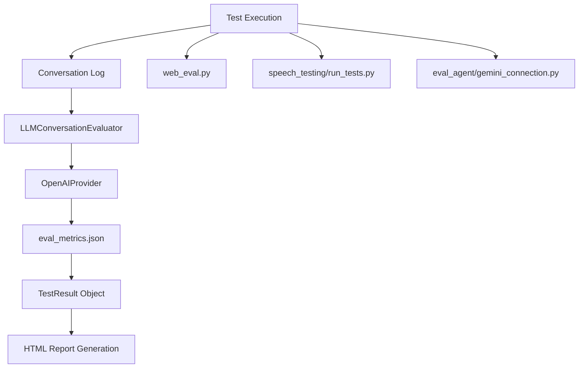
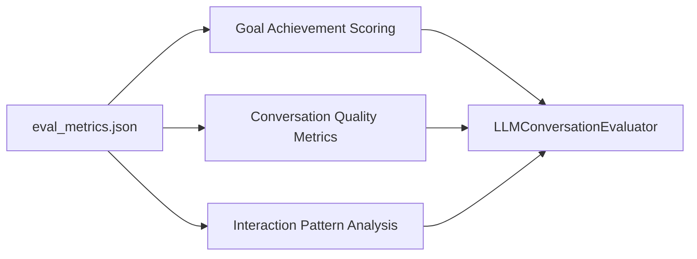
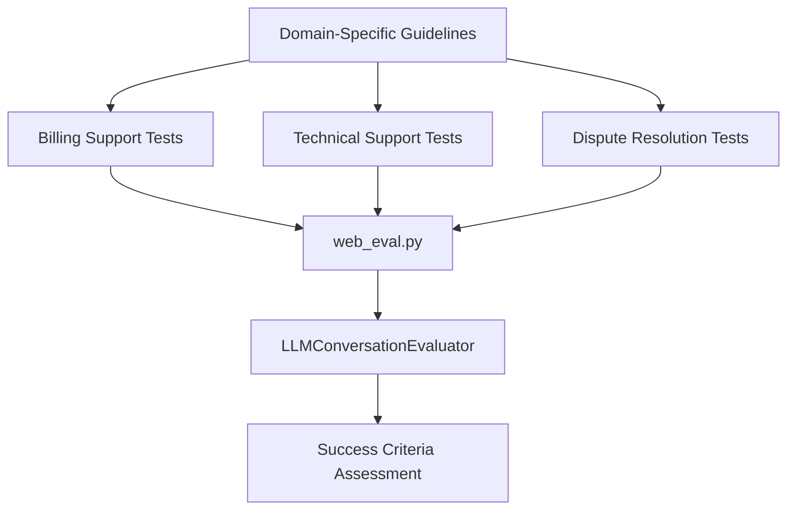

<!-- source: DeepWiki mcp.deepwiki.com · repo saharmor/voice-lab · page 10 FAQ & Guidelines · fetched 2026-10-27 -->

# FAQ & Guidelines

Relevant source files

The following files were used as context for generating this wiki page:

- [faqs/billing_notion.md](faqs/billing_notion.md)
- [faqs/fraud_substack.md](faqs/fraud_substack.md)
- [faqs/sonos_connection_issue.md](faqs/sonos_connection_issue.md)

This document provides frequently asked questions about the Voice Lab testing framework and domain-specific guidelines used in web chatbot testing scenarios. It covers common issues encountered during setup and testing, best practices for configuration, and guidelines for creating effective test scenarios across different testing modalities.

For detailed information about test configuration formats, see [Test Configuration](#4). For evaluation methodology and metrics interpretation, see [Evaluation & Metrics](#5).

## Framework Overview FAQs

### What testing modalities does Voice Lab support?

Voice Lab supports four primary testing approaches:

- **LLM Conversation Testing**: Goal-based conversation evaluation using `GoalBasedTestRunner`
- **Web Chatbot Evaluation**: Browser automation testing via `pyppeteer` integration
- **Speech Analysis Testing**: Audio processing and interruption detection
- **Real-time Voice Interaction**: Live bidirectional voice communication with Gemini API

### How does the evaluation system work?

The framework uses an LLM-as-a-Judge approach implemented in `LLMConversationEvaluator`. Test results are evaluated against predefined success criteria using GPT models to assess conversation quality, goal achievement, and interaction patterns.

Sources: [core/evaluator.py](), [core/providers/openai.py](), [core/data_types.py]()

### What LLM providers are supported?

Currently, Voice Lab primarily supports OpenAI models through the `OpenAIProvider` class. The framework is designed with provider abstraction to support additional LLM services. Gemini integration is available specifically for real-time voice interactions.

### How are test results stored and presented?

Test results are structured using `TestResult` objects and compiled into interactive HTML reports. The reporting system generates comprehensive dashboards showing conversation history, evaluation metrics, and performance statistics.

Sources: [core/data_types.py:1-50](), [core/utils/generate_report.py]()

## Configuration FAQs

### How do I define test scenarios?

Test scenarios are defined in JSON configuration files:

- `test_scenarios.json`: LLM conversation scenarios with personas and goals
- `web_test_scenarios.json`: Web chatbot testing scenarios with success criteria
- `eval_metrics.json`: Evaluation criteria and scoring parameters

Each scenario includes caller persona, callee persona, conversation goals, and success metrics.

### What environment variables are required?

Essential environment variables include:

- `OPENAI_API_KEY`: Required for LLM evaluation and conversation testing
- `GOOGLE_API_KEY`: Required for Gemini real-time voice features
- Additional service-specific keys for speech processing models

Sources: [.env.example](), [core/providers/openai.py]()

### How do I customize evaluation metrics?

Evaluation metrics are configured in `eval_metrics.json` with customizable scoring criteria:

Sources: [eval_metrics.json](), [core/evaluator.py]()

## Testing System-Specific FAQs

### Web Chatbot Testing

**Q: How does browser automation work?**
The web evaluation system uses `pyppeteer` for browser control, automatically navigating to chatbot interfaces and simulating user interactions. Test scenarios include user personas and expected conversation flows.

**Q: What browsers are supported?**
The system primarily uses Chromium through `pyppeteer`. Browser configuration is handled automatically during test execution.

Sources: [web_eval.py](), [web_test_scenarios.json]()

### Speech Analysis Testing

**Q: What audio formats are supported?**
The speech testing system processes various audio formats using `torchaudio` and `stable-whisper`. Audio files are stored in `speech_testing/audio_files/`.

**Q: How are interruptions detected?**
Interruption detection uses voice activity detection (VAD) models and speaker diarization through `pyannote.audio` to identify overlapping speech patterns.

Sources: [speech_testing/](), [speech_testing/audio_files/]()

### Real-time Voice Integration

**Q: How does real-time voice communication work?**
The system establishes bidirectional voice communication with Google Gemini API, handling real-time audio streaming, voice activity detection, and concurrent conversation processing.

**Q: What are the latency requirements?**
Real-time testing requires low-latency audio processing and network connectivity for optimal performance with the Gemini API.

Sources: [eval_agent/gemini_connection.py](), [eval_agent/]()

## Domain-Specific Testing Guidelines

### Customer Support Testing Scenarios

When testing chatbots for customer support scenarios, the framework includes domain-specific guidelines based on common support topics:

#### Billing and Payment Scenarios
Test scenarios should cover billing inquiries, payment method updates, refund requests, and subscription management. These scenarios test the chatbot's ability to handle sensitive financial information and provide accurate billing information.

#### Technical Support Scenarios  
Include connectivity issues, device setup problems, and troubleshooting workflows. Test the chatbot's ability to guide users through multi-step technical processes and escalate complex issues appropriately.

#### Service Dispute Scenarios
Test scenarios involving subscription disputes, chargeback handling, and service dissatisfaction. Evaluate the chatbot's conflict resolution capabilities and appropriate escalation procedures.

Sources: [faqs/billing_notion.md](), [faqs/sonos_connection_issue.md](), [faqs/fraud_substack.md]()

## Testing Best Practices

### Scenario Design Guidelines

1. **Persona Definition**: Create realistic caller personas with specific goals and communication styles
2. **Success Criteria**: Define measurable outcomes for conversation success
3. **Edge Cases**: Include scenarios testing error handling and boundary conditions
4. **Context Variation**: Test different conversation contexts and user backgrounds

### Evaluation Guidelines

1. **Metric Interpretation**: Understand evaluation scores in context of conversation goals
2. **Bias Consideration**: Account for potential LLM evaluator biases in scoring
3. **Human Validation**: Supplement automated evaluation with human review for critical scenarios
4. **Iteration Cycles**: Use evaluation results to refine test scenarios and success criteria

Sources: [test_scenarios.json](), [eval_metrics.json](), [core/evaluator.py]()

## Troubleshooting Common Issues

### Setup and Configuration Issues

**Issue: API Authentication Failures**
- Verify environment variables are properly set
- Check API key validity and permissions
- Ensure `.env` file is in correct location

**Issue: Missing Dependencies**
- Run dependency installation for speech processing models
- Verify Python version compatibility
- Check system-specific audio library requirements

### Test Execution Issues

**Issue: Web Automation Failures**
- Verify target website accessibility
- Check for browser compatibility issues
- Review network connectivity and firewall settings

**Issue: Speech Processing Errors**
- Validate audio file formats and quality
- Check model download and initialization
- Verify system audio device configuration

### Report Generation Issues

**Issue: HTML Report Generation Failures**
- Check file permissions for output directory
- Verify test result data integrity
- Review template file accessibility

Sources: [core/providers/openai.py](), [web_eval.py](), [speech_testing/run_tests.py](), [core/utils/generate_report.py]()