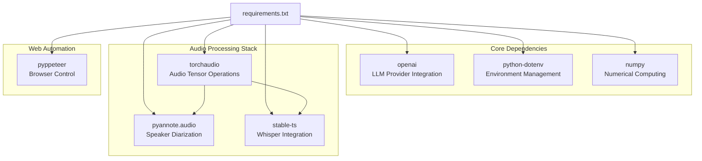
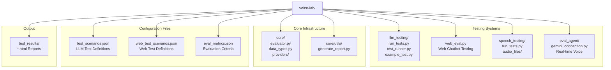

<!-- source: DeepWiki mcp.deepwiki.com · repo saharmor/voice-lab · page 2 Getting Started · fetched 2026-10-27 -->

# Getting Started

<details>
<summary>Relevant source files</summary>

The following files were used as context for generating this wiki page:

- [.example.env](.example.env)
- [.gitignore](.gitignore)
- [requirements.txt](requirements.txt)

</details>


This document provides a complete setup guide for Voice Lab, covering installation, environment configuration, dependencies, and running your first test. Voice Lab is a comprehensive testing framework for evaluating LLM-powered voice agents across multiple modalities including text conversations, web chatbots, speech analysis, and real-time voice interactions.

For detailed information about specific testing systems, see [Testing Systems](#3). For configuration of test scenarios, see [Test Configuration](#4).

## Prerequisites

Before installing Voice Lab, ensure you have the following requirements:

| Requirement | Version | Purpose |
|-------------|---------|---------|
| Python | 3.8+ | Core runtime environment |
| pip | Latest | Package management |
| Git | Any | Repository cloning |
| Audio drivers | System default | Speech testing capabilities |

### API Access Requirements

Voice Lab requires API keys for various services depending on which testing systems you plan to use:

- **OpenAI API Key** - Required for LLM conversation testing and web evaluation
- **Hugging Face Token** - Required for speech analysis and audio processing models
- **Google Gemini API Key** - Required for real-time voice interaction testing

## Installation Process

### Step 1: Clone Repository

```bash
git clone https://github.com/saharmor/voice-lab.git
cd voice-lab
```

### Step 2: Install Dependencies

Voice Lab uses a straightforward requirements-based installation:

```bash
pip install -r requirements.txt
```

**Dependency Architecture**



Sources: [requirements.txt:1-7]()

### Step 3: Environment Configuration

Voice Lab uses environment variables for API key management. Create your environment file:

```bash
cp .example.env .env
```

Edit the `.env` file with your actual API keys:

```bash
OPENAI_API_KEY=your_openai_api_key_here
HUGGING_FACE_TOKEN=your_hugging_face_token_here
```

**Environment Variable Usage**

| Variable | Used By | Purpose |
|----------|---------|---------|
| `OPENAI_API_KEY` | `core/providers/openai.py` | LLM API authentication |
| `HUGGING_FACE_TOKEN` | `speech_testing/` modules | Audio model downloads |

Sources: [.example.env:1-2](), [.gitignore:125]()

## Project Structure Overview

Understanding the Voice Lab directory structure helps you navigate to the right testing system:

**Voice Lab Architecture**



Sources: [.gitignore:163-164](), [.gitignore:169]()

## Running Your First Test

### Quick Start: LLM Conversation Testing

The fastest way to verify your installation is to run a basic LLM conversation test:

```bash
cd llm_testing
python example_test.py
```

This will execute a simple conversation test using the default test scenarios and generate an HTML report in the `test_results/` directory.

**Test Execution Flow**

```mermaid
sequenceDiagram
    participant User
    participant ExampleTest["example_test.py"]
    participant TestRunner["test_runner.py<br/>GoalBasedTestRunner"]
    participant OpenAI["core/providers/openai.py<br/>OpenAIProvider"]
    participant Evaluator["core/evaluator.py<br/>LLMConversationEvaluator"]
    participant ReportGen["core/utils/generate_report.py"]
    
    User->>ExampleTest: "python example_test.py"
    ExampleTest->>TestRunner: "load test scenarios"
    TestRunner->>OpenAI: "initiate conversation"
    OpenAI-->>TestRunner: "conversation responses"
    TestRunner->>Evaluator: "evaluate conversation"
    Evaluator-->>TestRunner: "test results"
    TestRunner->>ReportGen: "generate HTML report"
    ReportGen-->>User: "test_results/*.html"
```

### Alternative Testing Systems

Once your basic setup is working, you can explore other testing modalities:

| Testing System | Entry Point | Purpose |
|----------------|-------------|---------|
| Web Chatbot Testing | `python web_eval.py` | Browser automation testing |
| Speech Analysis | `cd speech_testing && python run_tests.py` | Audio file analysis |
| Real-time Voice | `cd eval_agent` | Live voice interaction |

Sources: System architecture diagrams above

## Verification Steps

### 1. Dependency Check

Verify all dependencies are installed correctly:

```bash
python -c "import openai, torch, pyannote, stable_whisper, pyppeteer; print('All dependencies installed successfully')"
```

### 2. Environment Variables

Verify your environment setup:

```bash
python -c "import os; from dotenv import load_dotenv; load_dotenv(); print('OpenAI:', bool(os.getenv('OPENAI_API_KEY'))); print('HF Token:', bool(os.getenv('HUGGING_FACE_TOKEN')))"
```

### 3. Core Components

Test core component imports:

```bash
python -c "from core.data_types import TestResult; from core.providers.openai import OpenAIProvider; print('Core components loaded successfully')"
```

## Next Steps

After successful installation and verification:

1. **Configure Test Scenarios**: Customize test scenarios in `test_scenarios.json` and `web_test_scenarios.json` - see [Test Configuration](#4)
2. **Explore Testing Systems**: Learn about the four different testing modalities - see [Testing Systems](#3)
3. **Understand Evaluation**: Review how conversations are evaluated - see [Evaluation & Metrics](#5)
4. **View Sample Reports**: Examine the generated HTML reports - see [Test Results & Reporting](#6)

## Troubleshooting Common Issues

| Issue | Solution |
|-------|----------|
| `ModuleNotFoundError` for audio dependencies | Install system audio libraries: `sudo apt-get install portaudio19-dev` (Linux) or use Homebrew (macOS) |
| OpenAI API errors | Verify API key in `.env` file and check account balance |
| Browser automation failures | Ensure Chrome/Chromium is installed for pyppeteer |
| Permission errors with audio files | Check file permissions in `speech_testing/audio_files/` directory |

Sources: [requirements.txt:1-7](), [.gitignore:125-131](), [.example.env:1-2]()

---

