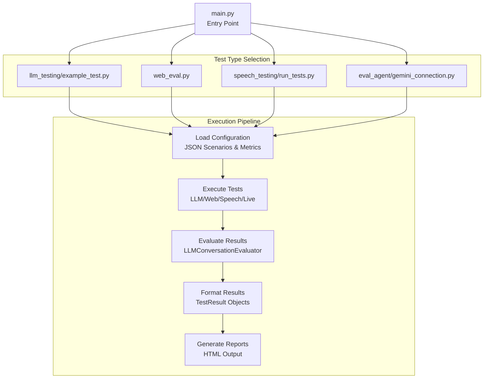
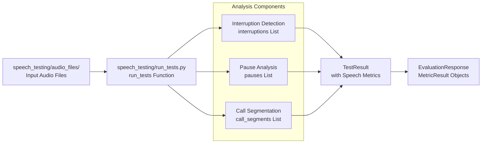
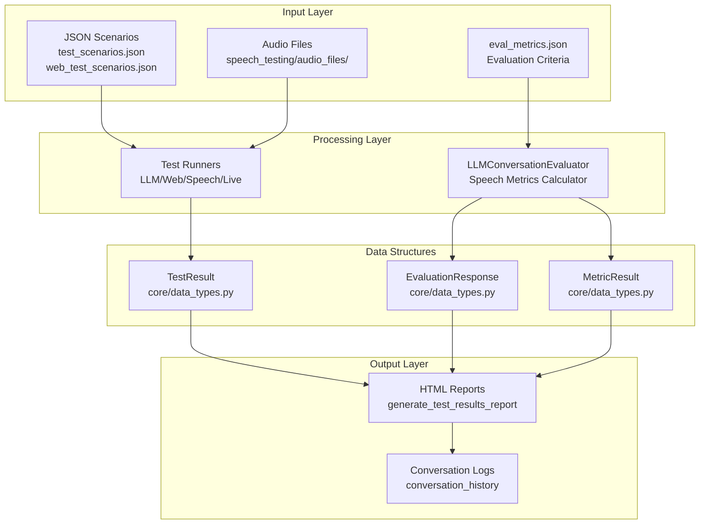
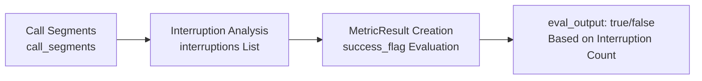
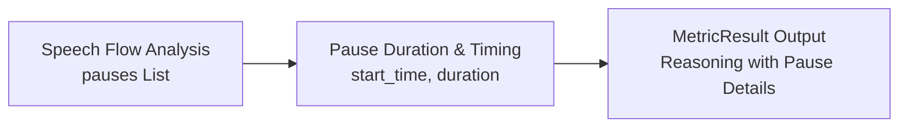

<!-- source: DeepWiki mcp.deepwiki.com · repo saharmor/voice-lab · page 3 Testing Systems · fetched 2026-10-27 -->

# Testing Systems

Relevant source files

The following files were used as context for generating this wiki page:

- [.DS_Store](.DS_Store)
- [LICENSE](LICENSE)
- [README.md](README.md)
- [llm_testing/.DS_Store](llm_testing/.DS_Store)
- [main.py](main.py)

This document provides an architectural overview of the four distinct testing modalities supported by Voice Lab: LLM conversation testing, web chatbot evaluation, speech analysis testing, and real-time voice interaction. Each system operates independently while sharing common infrastructure components for evaluation, reporting, and data management.

For detailed configuration of test scenarios, see [Test Configuration](#4). For evaluation methodology and metrics, see [Evaluation & Metrics](#5). For result processing and reporting, see [Test Results & Reporting](#6).

## System Architecture Overview

Voice Lab implements a modular testing architecture where each testing system can operate independently while leveraging shared core components for evaluation and reporting.

```mermaid
graph TB
    subgraph "Testing Systems"
        LLMTests["llm_testing/run_tests.py<br/>LLM Conversation Testing"]
        WebTests["web_eval.py<br/>Web Chatbot Testing"] 
        SpeechTests["speech_testing/run_tests.py<br/>Speech Analysis Testing"]
        LiveTests["eval_agent/gemini_connection.py<br/>Real-time Voice Testing"]
    end
    
    subgraph "Core Infrastructure"
        DataTypes["core/data_types.py<br/>TestResult, EvaluationResponse"]
        Evaluator["core/evaluator.py<br/>LLMConversationEvaluator"]
        Providers["core/providers/openai.py<br/>OpenAIProvider"]
        ReportGen["core/utils/generate_report.py<br/>generate_test_results_report"]
    end
    
    subgraph "Configuration & Data"
        TestScenarios["test_scenarios.json<br/>LLM Test Definitions"]
        WebScenarios["web_test_scenarios.json<br/>Web Test Definitions"]
        EvalMetrics["eval_metrics.json<br/>Evaluation Criteria"]
        AudioFiles["speech_testing/audio_files/<br/>Audio Test Data"]
    end
    
    subgraph "External Services"
        OpenAI["OpenAI API"]
        Gemini["Google Gemini API"]
        WebTargets["Target Websites"]
    end
    
    LLMTests --> DataTypes
    LLMTests --> Evaluator
    LLMTests --> Providers
    LLMTests --> TestScenarios
    LLMTests --> EvalMetrics
    LLMTests --> OpenAI
    
    WebTests --> DataTypes
    WebTests --> Evaluator
    WebTests --> Providers
    WebTests --> WebScenarios
    WebTests --> EvalMetrics
    WebTests --> OpenAI
    WebTests --> WebTargets
    
    SpeechTests --> DataTypes
    SpeechTests --> AudioFiles
    
    LiveTests --> Gemini
    LiveTests --> DataTypes
    
    LLMTests --> ReportGen
    WebTests --> ReportGen  
    SpeechTests --> ReportGen
    LiveTests --> ReportGen
```

**Sources**: [main.py:1-79](), [README.md:14-27]()

## Test Execution Flow

The framework provides a unified execution model where different test types follow similar patterns for initialization, execution, evaluation, and reporting.

**Sources**: [main.py:32-79](), [README.md:64-69]()

## LLM Conversation Testing System

The LLM testing system evaluates goal-based conversations between simulated users and language model agents using the `GoalBasedTestRunner` class and `LLMConversationEvaluator`.

### Key Components

| Component | File Path | Purpose |
|-----------|-----------|---------|
| `GoalBasedTestRunner` | `llm_testing/test_runner.py` | Orchestrates conversation flows |
| `LLMConversationEvaluator` | `core/evaluator.py` | Performs LLM-as-a-Judge evaluation |
| `OpenAIProvider` | `core/providers/openai.py` | Handles OpenAI API interactions |
| Test Scenarios | `test_scenarios.json` | Defines conversation scenarios |
| Evaluation Metrics | `eval_metrics.json` | Specifies success criteria |

**Sources**: [README.md:66-69]()

## Web Chatbot Evaluation System

The web evaluation system uses browser automation to test chatbots embedded in websites, combining automated interaction with LLM-based evaluation of conversation quality.

### Key Components

- Browser automation via `pyppeteer`
- Web-specific test scenarios in `web_test_scenarios.json`
- Integration with `LLMConversationEvaluator` for conversation analysis
- Support for multiple website targets

**Sources**: [README.md:64-79]()

## Speech Analysis Testing System

The speech testing system processes audio files to detect conversation quality metrics including interruptions, pauses, and speaker behavior patterns.

**Sources**: [main.py:37-69]()

## Real-time Voice Interaction System

The real-time system provides bidirectional voice communication with Google Gemini API for live voice agent testing and evaluation.

### Key Components

- `gemini_connection.py` for real-time API integration
- Voice activity detection and processing
- Live conversation flow management
- Real-time evaluation capabilities

**Sources**: [README.md:148]()

## Data Flow Integration

The testing systems share common data structures and evaluation pathways while maintaining distinct execution contexts.

**Sources**: [main.py:43-77](), [core/data_types.py:1-2]()

## Speech Metrics Processing

The speech testing system implements specialized metrics for voice interaction quality assessment.

### Interruption Detection

### Pause Analysis

**Sources**: [main.py:54-69]()

## Test Result Standardization

All testing systems converge on standardized data structures for consistent evaluation and reporting across modalities.

| Data Structure | Purpose | Key Fields |
|----------------|---------|------------|
| `TestResult` | Container for test outcomes | `evaluation_result`, `conversation_history` |
| `EvaluationResponse` | LLM evaluation results | `summary`, `evaluation_results` |
| `MetricResult` | Individual metric assessment | `name`, `eval_output`, `reasoning`, `evidence` |

The `completed_tests` dictionary structure used in `main.py` demonstrates the unified approach:
- `tested_component`: List of components under test
- `result`: `TestResult` object containing evaluation and conversation data

**Sources**: [main.py:71-77](), [core/data_types.py:1-2]()

---

