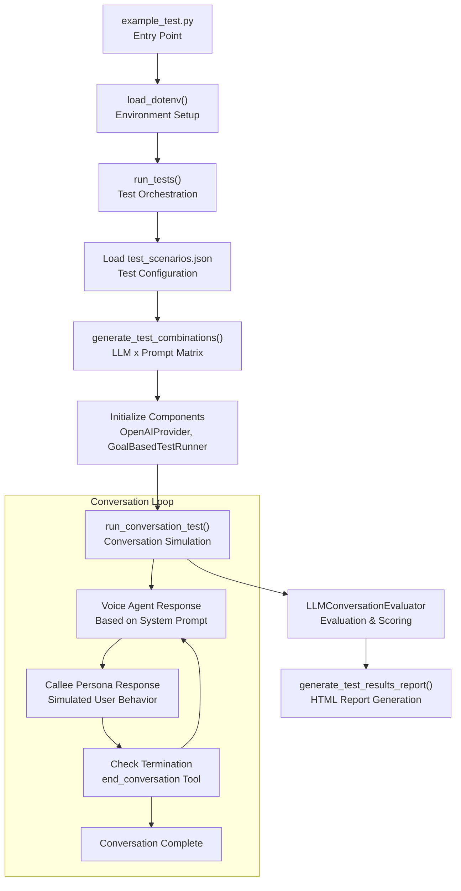
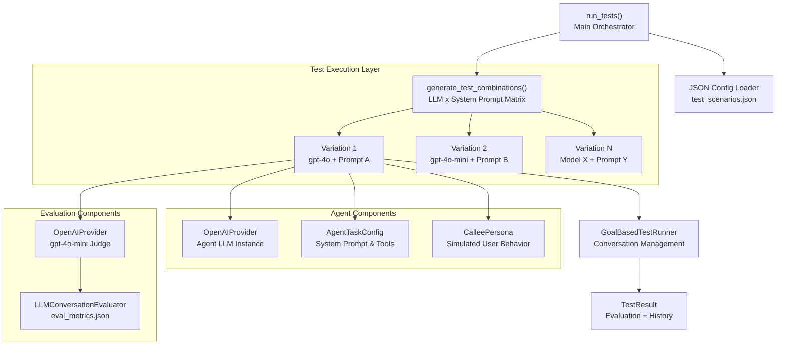
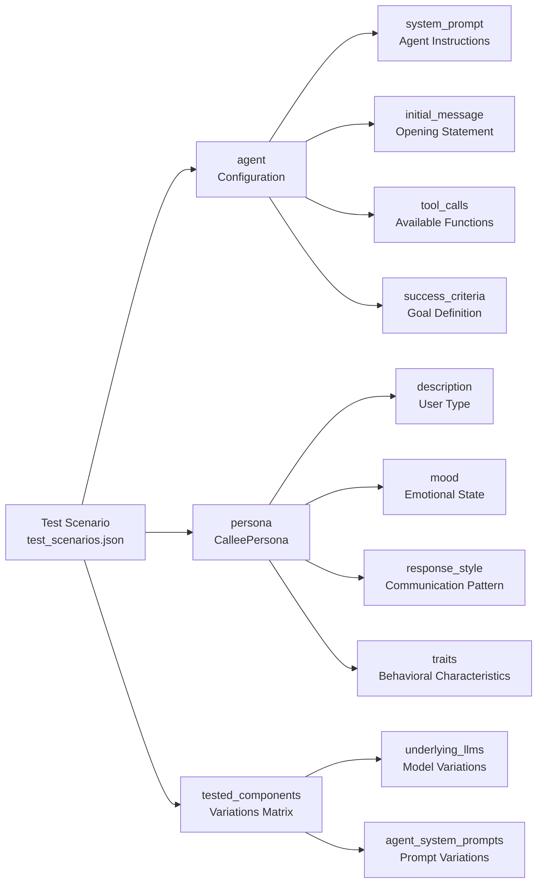
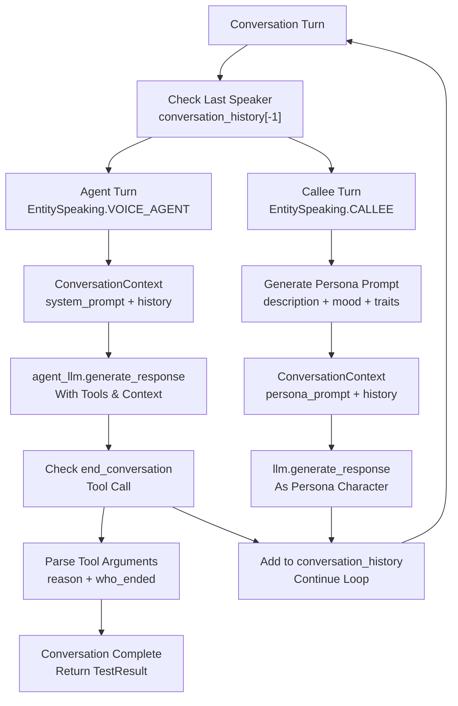
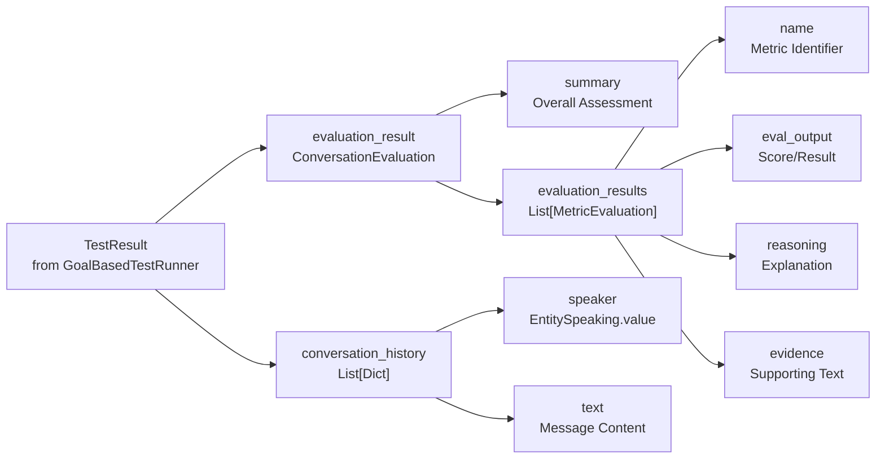

<!-- source: DeepWiki mcp.deepwiki.com · repo saharmor/voice-lab · page 3.1 LLM Conversation Testing · fetched 2026-10-27 -->

# LLM Conversation Testing

Relevant source files

The following files were used as context for generating this wiki page:

- [llm_testing/example_test.py](llm_testing/example_test.py)
- [llm_testing/run_tests.py](llm_testing/run_tests.py)
- [llm_testing/test_runner.py](llm_testing/test_runner.py)

## Purpose and Scope

The LLM Conversation Testing system provides goal-based conversation evaluation for LLM-powered voice agents. This system simulates realistic phone call scenarios where a voice agent interacts with various callee personas to accomplish specific business objectives. The testing framework evaluates conversation quality, goal achievement, and agent behavior across different LLM models and system prompts.

For web-based chatbot testing, see [Web Chatbot Evaluation](#3.2). For speech analysis and audio processing, see [Speech Analysis Testing](#3.3). For evaluation metrics and scoring methodology, see [Evaluation & Metrics](#5).

## System Overview

The LLM Conversation Testing system operates as a multi-component framework that orchestrates conversations between AI agents and simulated personas, then evaluates the results using LLM-as-a-Judge methodology.

### Core Test Execution Flow

Sources: [llm_testing/example_test.py:1-9](), [llm_testing/run_tests.py:32-98](), [llm_testing/test_runner.py:62-123]()

## Core Components

### GoalBasedTestRunner

The `GoalBasedTestRunner` class manages the conversation flow between voice agents and callee personas. It maintains conversation state and handles turn-based interaction simulation.

| Component | Purpose | Key Methods |
|-----------|---------|-------------|
| `GoalBasedTestRunner` | Orchestrates agent-persona conversations | `run_conversation_test()`, `_generate_callee_response()` |
| `LLMInterface` | Abstracts LLM provider interactions | `generate_response_with_conversation_history()` |
| `ConversationEvaluator` | Evaluates conversation quality and success | `evaluate()` |

### Test Orchestration Architecture

Sources: [llm_testing/run_tests.py:14-30](), [llm_testing/run_tests.py:56-81](), [llm_testing/test_runner.py:11-17]()

## Test Configuration and Scenarios

### Test Scenario Structure

Test scenarios are defined in `test_scenarios.json` and specify the complete testing environment including agent configuration, persona details, and tested component variations.

Sources: [llm_testing/run_tests.py:42-44](), [llm_testing/run_tests.py:54-69](), [llm_testing/test_runner.py:19-38]()

### Agent Task Configuration

The `AgentTaskConfig` class encapsulates all agent-specific configuration including system prompts, tools, and success criteria.

| Configuration Field | Purpose | Usage |
|---------------------|---------|--------|
| `system_prompt` | Defines agent behavior and instructions | Core agent personality and task definition |
| `initial_message` | Agent's opening statement | First message in conversation |
| `tool_calls` | Available function calls | Actions agent can perform (e.g., `end_conversation`) |
| `success_criteria` | Goal definition for evaluation | Used by evaluator to measure success |
| `additional_context` | Supplementary information | Domain-specific knowledge |

Sources: [llm_testing/run_tests.py:63-69]()

## Conversation Simulation

### Persona-Based Response Generation

The system generates realistic callee responses using persona-driven prompting. Each persona includes behavioral traits, mood, communication style, and background information to create consistent character simulation.

Sources: [llm_testing/test_runner.py:76-111](), [llm_testing/test_runner.py:19-53]()

### Conversation Termination

Conversations can be terminated through the `end_conversation` tool call, which requires specifying the reason for termination, who ended the conversation, and supporting evidence.

Sources: [llm_testing/test_runner.py:98-107]()

## Integration with Evaluation System

### LLM-as-a-Judge Integration

The system uses LLM-as-a-Judge methodology for conversation evaluation, with configurable evaluator models and metrics.

| Evaluator Model | Use Case | Configuration |
|----------------|----------|---------------|
| `gpt-4o-mini` | Default cost-effective evaluation | [llm_testing/run_tests.py:38]() |
| `gpt-4o` | Higher quality evaluation | [llm_testing/run_tests.py:39]() |
| `o1-preview` | Advanced reasoning evaluation | [llm_testing/run_tests.py:40]() |

Sources: [llm_testing/run_tests.py:73-75](), [llm_testing/test_runner.py:116-123]()

## Test Execution and Results

### Multi-Variation Testing

The system supports testing multiple combinations of LLM models and system prompts to evaluate performance across different configurations.

### Verbose Output and Debugging

The test runner provides detailed output including conversation transcripts, evaluation metrics, and success indicators for debugging and analysis.

Sources: [llm_testing/run_tests.py:83-93]()

### Result Storage and Reporting

Test results are stored in a structured format and can be processed by the HTML report generation system for interactive visualization and analysis.

Sources: [llm_testing/example_test.py:8-9](), [llm_testing/run_tests.py:78-81]()

---

