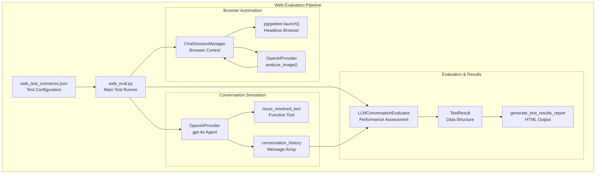
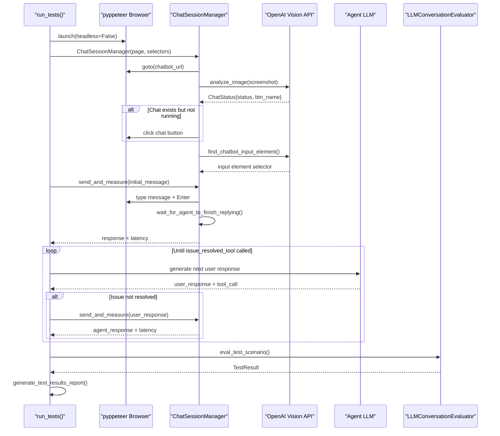
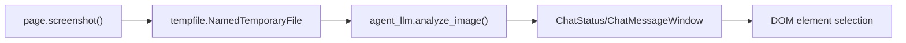

<!-- source: DeepWiki mcp.deepwiki.com · repo saharmor/voice-lab · page 3.2 Web Chatbot Evaluation · fetched 2026-10-27 -->

# Web Chatbot Evaluation

<details>
<summary>Relevant source files</summary>

The following files were used as context for generating this wiki page:

- [web_eval.py](web_eval.py)
- [web_test_scenarios.json](web_test_scenarios.json)

</details>


## Purpose and Scope

The Web Chatbot Evaluation system provides automated testing capabilities for web-embedded chatbots through browser automation and AI-powered interaction simulation. This system navigates to live chatbot interfaces, initiates conversations, simulates realistic user behavior, and evaluates chatbot performance using structured metrics.

This document covers the browser automation framework, conversation simulation, and evaluation processes specific to web-based chatbots. For text-based LLM conversation testing without web interfaces, see [LLM Conversation Testing](#3.1). For speech-based testing, see [Speech Analysis Testing](#3.3). For test result reporting and metrics, see [Test Results & Reporting](#6).

## System Architecture

The web chatbot evaluation system integrates browser automation, visual AI analysis, conversation simulation, and performance evaluation into a unified testing pipeline.



Sources: [web_eval.py:1-550](), [web_test_scenarios.json:1-284]()

## Test Execution Flow

The web evaluation process follows a structured workflow from browser initialization through conversation completion and evaluation.



Sources: [web_eval.py:439-537](), [web_eval.py:150-256](), [web_eval.py:27-58]()

## Core Components

### ChatSessionManager Class

The `ChatSessionManager` class handles all browser automation and chat interface interactions through a comprehensive set of methods for chat detection, message handling, and conversation tracking.

| Method | Purpose | Key Parameters |
|--------|---------|----------------|
| `check_if_support_chat_running()` | Visual AI analysis to detect chat state | Returns `ChatStatus` |
| `initiate_support_chat()` | Navigate and start chat session | `chatbot_url` |
| `get_chatbot_input_element()` | Locate message input field | `chat_input_selector` |
| `send_and_measure()` | Send message and measure response time | `message`, `typing_delay` |
| `wait_for_agent_to_finish_replying()` | Wait for chatbot response completion | `CHATBOT_REPLY_TIMEOUT_SEC` |
| `get_conversation_history()` | Extract full conversation from DOM | Returns message array |

```python
# ChatSessionManager initialization pattern
chat_session_manager = ChatSessionManager(
    page, 
    scenario["chat_input_selector"], 
    scenario["shadow_root_selector"]
)
```

Sources: [web_eval.py:150-436]()

### Data Models

The system uses Pydantic models for structured data handling and API responses:

```python
class ChatStatus(BaseModel):
    status: str
    btn_name: Optional[str] = None

class ChatMessageWindow(BaseModel):
    status: str
    placeholder_txt: Optional[str] = None
```

Sources: [web_eval.py:141-149]()

### Conversation Resolution Detection

The `issue_resolved_tool` function tool enables the agent LLM to automatically detect when user issues are resolved:

```python
issue_resolved_tool = {
    "type": "function",
    "function": {
        "name": "user_issue_resolved",
        "description": "Call when conversation reaches resolution...",
        "parameters": {
            "issue_resolved": {"type": "boolean"},
            "confirmation_type": {"enum": ["explicit", "implicit", "none"]}
        }
    }
}
```

Sources: [web_eval.py:27-58]()

## Configuration System

### Test Scenario Structure

Web test scenarios are defined in `web_test_scenarios.json` with comprehensive configuration for each test case:

| Field | Purpose | Example |
|-------|---------|---------|
| `scenario_id` | Unique test identifier | `"refund_policy_question"` |
| `chatbot_url` | Target chatbot URL | `"https://decagon.ai/embed/notion"` |
| `chat_input_selector` | CSS selector for input field | `"textarea[placeholder='Ask...']"` |
| `shadow_root_selector` | Shadow DOM container selector | `"div[data-sierra-chat-container]"` |
| `successful_outcome` | Success criteria description | Detailed evaluation criteria |
| `user_persona` | Simulated user characteristics | Profession, emotional state, chat style |
| `guidelines` | Reference FAQ file | `"billing_notion.md"` |

Sources: [web_test_scenarios.json:1-284]()

### User Persona Configuration

Each test scenario includes detailed user persona configuration to drive realistic conversation simulation:

```json
{
  "user_persona": {
    "profession": "Product Manager",
    "emotional_state": "frustrated and confused",
    "chat_style": "somewhat tech-challenged, needs step-by-step guidance",
    "context": "Recently moved apartments and can't get Sonos One speaker to work",
    "initial_message": "Hi, I just moved to a new apartment..."
  }
}
```

Sources: [web_test_scenarios.json:69-75]()

## Browser Automation Details

### Visual AI Integration

The system uses OpenAI's vision capabilities to analyze webpage screenshots and automatically detect chat interface elements:



The visual analysis prompts are specifically designed for chat interface detection:

```python
prompt = """Analyze this webpage screenshot and determine if the chat is already running...
Your response should be {status: <status_string>, btn_name: <button_name>}.
Respond with status running if the chat is already running.
Respond with status exists and the name of the button to start the chat...
"""
```

Sources: [web_eval.py:156-169](), [web_eval.py:200-217]()

### Shadow DOM Handling

The system supports chatbots embedded in Shadow DOM structures through specialized element selection logic:

```python
async def get_element_from_dom(self, selector):     
    if self.shadow_root_selector:
        shadow_root = await self.get_shadow_root()
        searched_element = await self.page.evaluateHandle('''(root, selector) => {
            if (!root) return null;
            return root.querySelector(selector);
        }''', shadow_root, selector)
```

Sources: [web_eval.py:182-198]()

### Conversation History Extraction

The system includes sophisticated DOM parsing logic to extract conversation history from different chatbot implementations (Sierra, Decagon):

```python
# Sierra chat detection
const messageContainer = root.querySelector('ol');
const allMessages = Array.from(messageContainer.querySelectorAll('li[aria-roledescription="message"]'));

# Decagon chat detection  
const decagonContainer = root.querySelector('#chatbot-container');
const allMessages = Array.from(decagonContainer.querySelectorAll('[role=listitem], .flex.undefined'));
```

Sources: [web_eval.py:273-351]()

## Evaluation Process

### LLMConversationEvaluator Integration

The web evaluation system leverages the same evaluation framework used for LLM conversation testing:

```python
def eval_test_scenario(scenario, conversation_history):
    eval_llm = OpenAIProvider(api_key, "gpt-4o")
    evaluator = LLMConversationEvaluator(
        eval_llm, 
        "eval_metrics.json",
        "You are an objective conversational AI chatbot evaluator..."
    )
    
    return TestResult(
        evaluation_result=evaluator.evaluate(
            conversation_history,
            None,
            user_persona,
            success_criteria,
            scenario_guidelines
        ),
        conversation_history=conversation_history
    )
```

Sources: [web_eval.py:100-138]()

### Performance Metrics

The system tracks multiple performance metrics during test execution:

| Metric | Measurement | Usage |
|--------|-------------|-------|
| Response Latency | Time from message send to response complete | Per-message timing |
| Average Latency | Mean response time across conversation | Overall performance |
| Max Latency | Longest response time in conversation | Performance ceiling |
| Conversation Length | Total messages exchanged | Efficiency measure |

Sources: [web_eval.py:412-435](), [web_eval.py:525-533]()

## Results and Reporting

### Test Results Structure

Each completed test produces a structured result containing evaluation data and performance metrics:

```python
test_results_report[scenario["scenario_id"]] = {
    "tested_component": scenario,
    "result": eval_response,
    "avg_latency": sum(reply_latencies) / len(reply_latencies),
    "max_latency": max(reply_latencies)
}
```

The results are processed through the shared report generation system that produces interactive HTML reports with conversation history, evaluation scores, and performance data.

Sources: [web_eval.py:525-537](), [web_eval.py:16]()

---

