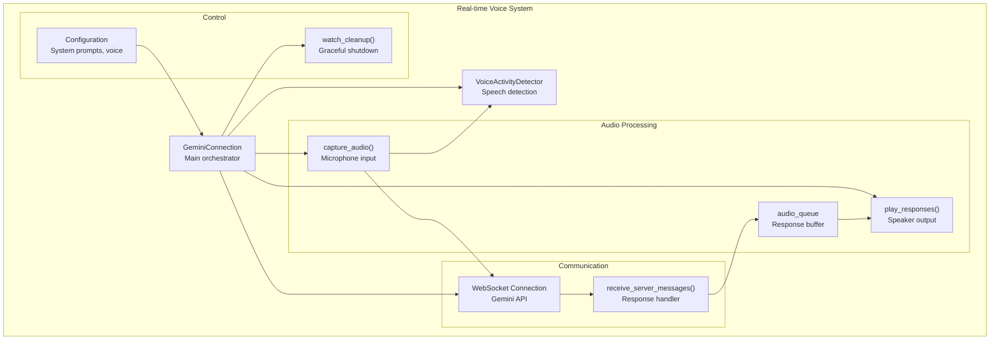
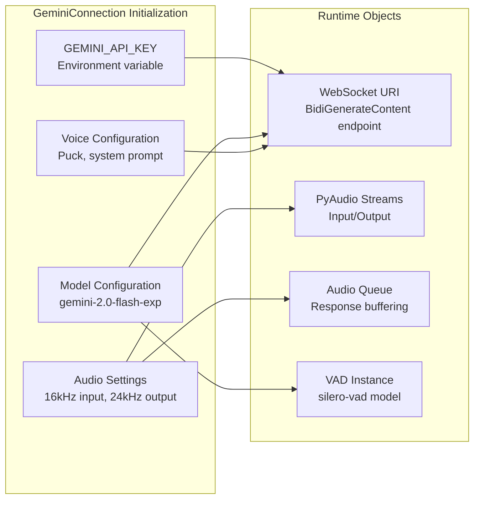
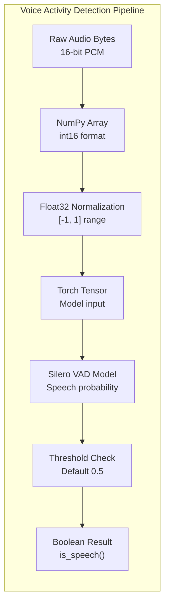
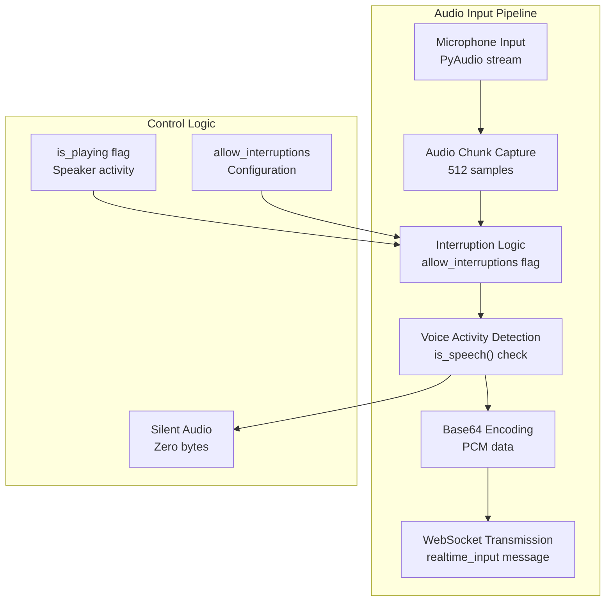
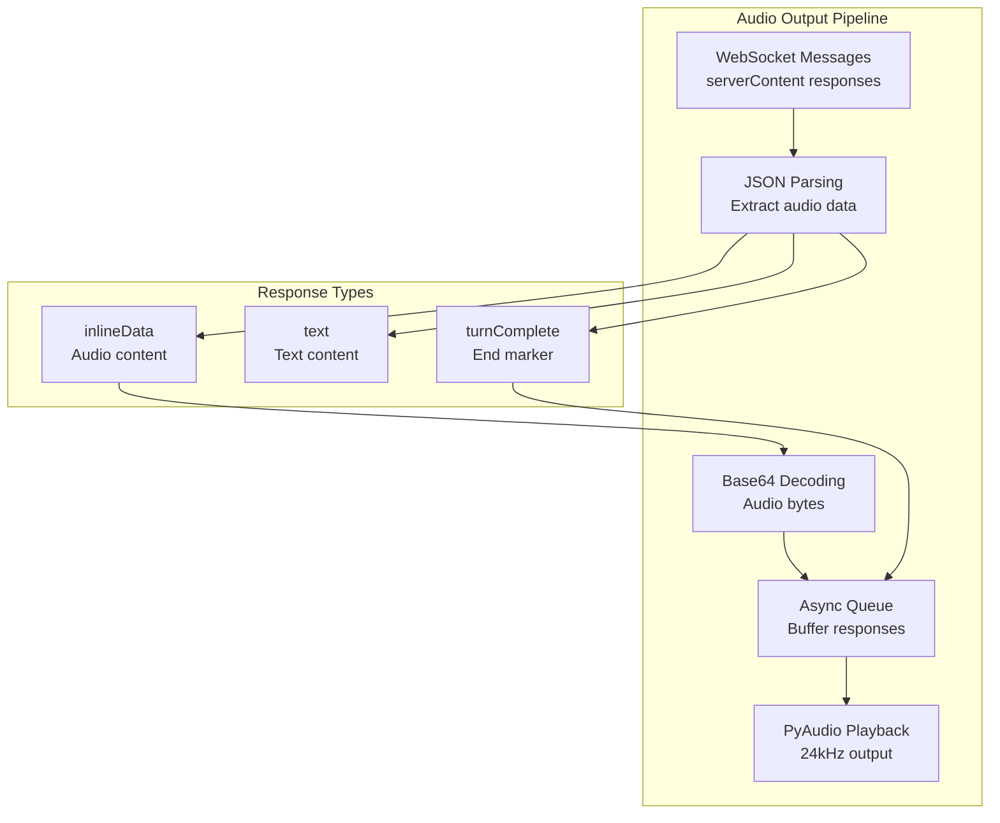
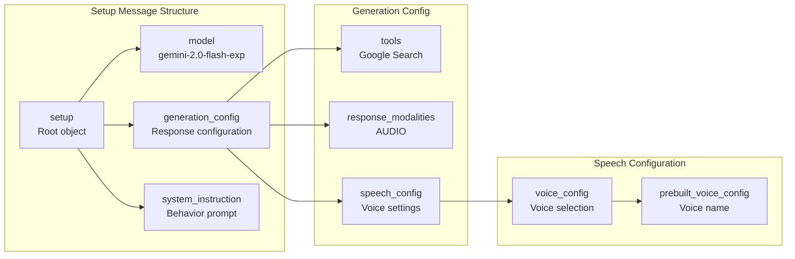
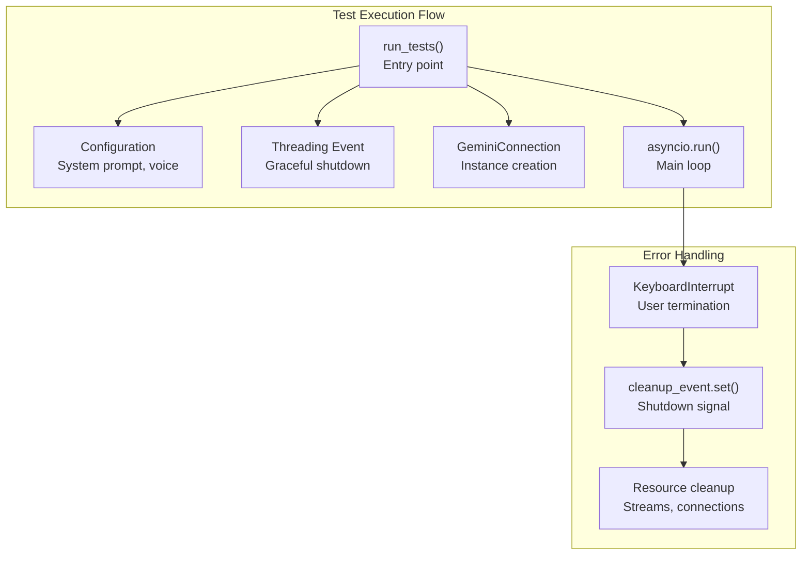
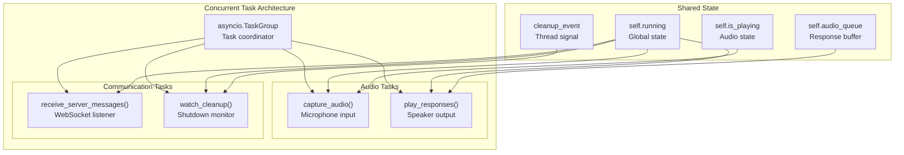

<!-- source: DeepWiki mcp.deepwiki.com · repo saharmor/voice-lab · page 3.4 Real-time Voice Interaction · fetched 2026-10-27 -->

# Real-time Voice Interaction

Relevant source files

The following files were used as context for generating this wiki page:

- [eval_agent/gemini_connection.py](eval_agent/gemini_connection.py)
- [eval_agent/requirements.txt](eval_agent/requirements.txt)
- [eval_agent/run_tests.py](eval_agent/run_tests.py)
- [eval_agent/voice_activity_detector.py](eval_agent/voice_activity_detector.py)

This document covers the real-time voice interaction system that enables bidirectional voice communication with Google Gemini 2.0 Flash model. This system provides live voice agent testing capabilities through continuous audio streaming, voice activity detection, and real-time response generation.

For text-based LLM conversation testing, see [LLM Conversation Testing](#3.1). For web-based chatbot evaluation, see [Web Chatbot Evaluation](#3.2). For audio file analysis, see [Speech Analysis Testing](#3.3).

## System Overview

The real-time voice interaction system is built around the `GeminiConnection` class, which manages WebSocket connections to Google's BidiGenerateContent API for streaming audio communication. The system captures live microphone input, performs voice activity detection, streams audio to Gemini, and plays back responses in real-time.

### Core Architecture

The system consists of three main components operating concurrently:

Sources: [eval_agent/gemini_connection.py:13-51]()

## Core Components

### GeminiConnection Class

The `GeminiConnection` class serves as the main orchestrator for real-time voice interactions. It manages WebSocket connections, audio streaming, and concurrent task execution.

| Component | Purpose | Key Methods |
|-----------|---------|-------------|
| WebSocket Management | Establish and maintain connection to Gemini API | `start()`, `cleanup()` |
| Audio Processing | Handle input/output audio streams | `capture_audio()`, `play_responses()` |
| Message Handling | Process server responses and audio data | `receive_server_messages()` |
| Lifecycle Management | Coordinate concurrent tasks and cleanup | `watch_cleanup()` |

The class initialization configures essential parameters:

Sources: [eval_agent/gemini_connection.py:14-51]()

### Voice Activity Detection

The `VoiceActivityDetector` class uses the Silero VAD model to distinguish speech from noise, preventing unnecessary audio transmission to the Gemini API.

The detector processes raw audio bytes and returns a boolean indicating speech presence:

Sources: [eval_agent/voice_activity_detector.py:12-24]()

## Audio Processing Pipeline

### Input Audio Flow

The audio capture process runs continuously, processing microphone input through multiple stages:

The system implements interruption handling logic where audio input can be conditionally processed based on whether the system is currently playing responses:

Sources: [eval_agent/gemini_connection.py:116-184]()

### Output Audio Flow

Response audio from Gemini is processed through an asynchronous queue system:

Sources: [eval_agent/gemini_connection.py:186-214](), [eval_agent/gemini_connection.py:215-238]()

## Configuration and Setup

### System Configuration

The real-time voice system accepts a configuration dictionary with the following parameters:

| Parameter | Default | Purpose |
|-----------|---------|---------|
| `system_prompt` | Friendly assistant prompt | Instructions for Gemini behavior |
| `voice` | "Puck" | Gemini voice selection |
| `google_search` | `True` | Enable Google Search tool |
| `allow_interruptions` | `False` | Allow input during playback |

### WebSocket Setup Message

The system initializes the Gemini connection with a structured setup message:

Sources: [eval_agent/gemini_connection.py:66-96]()

## Integration Points

### Test Runner Integration

The system integrates with the broader Voice Lab framework through the `run_tests()` function, which provides a simple interface for voice conversation testing:

Sources: [eval_agent/run_tests.py:15-41]()

### Dependencies and Requirements

The real-time voice system requires specific dependencies for audio processing and WebSocket communication:

| Package | Version | Purpose |
|---------|---------|---------|
| `websockets` | Latest | WebSocket client for Gemini API |
| `python-dotenv` | 1.0.0 | Environment variable management |
| `pyaudio` | 0.2.14 | Audio input/output handling |
| `google-genai` | 0.2.2 | Google AI SDK |
| `torch` | Latest | PyTorch for VAD model |
| `numpy` | Latest | Audio data processing |

Sources: [eval_agent/requirements.txt:1-8]()

## Concurrent Task Management

The system uses `asyncio.TaskGroup` to manage four concurrent tasks that handle different aspects of the real-time interaction:

Sources: [eval_agent/gemini_connection.py:105-109](), [eval_agent/gemini_connection.py:240-246]()

---

