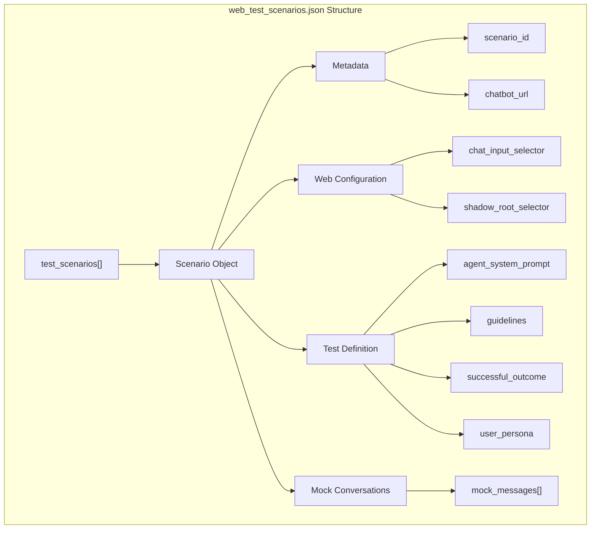
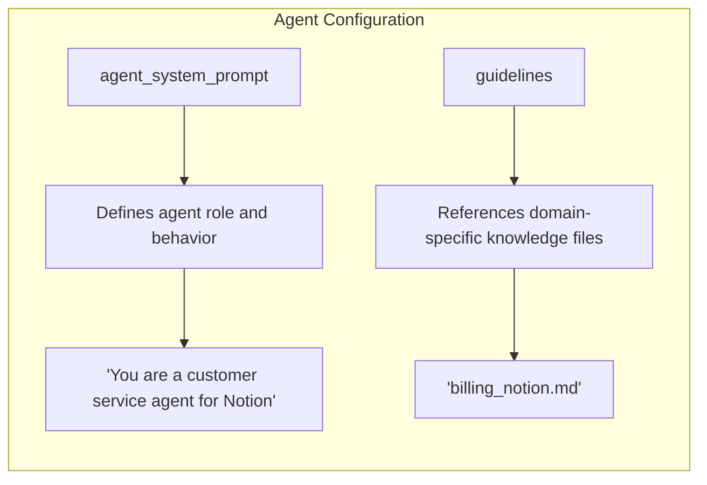
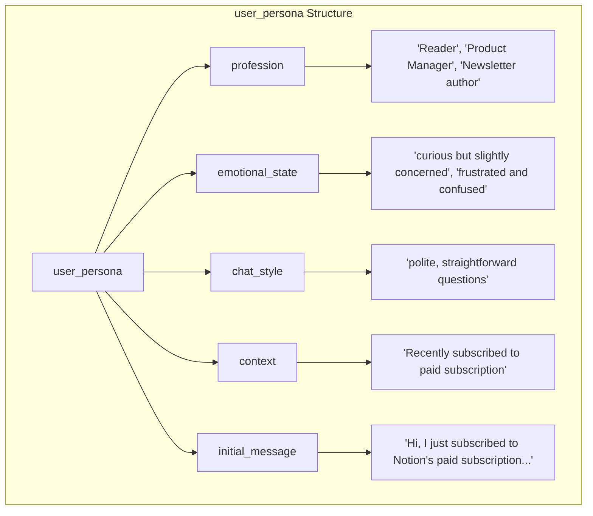
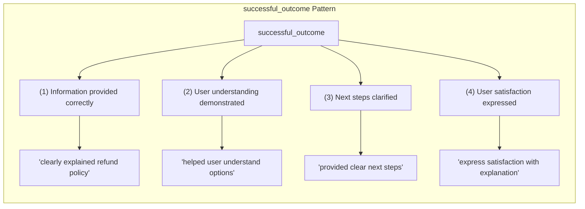
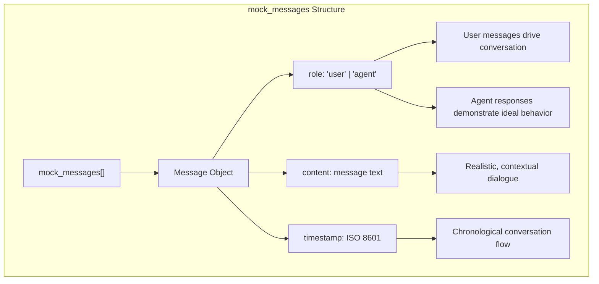
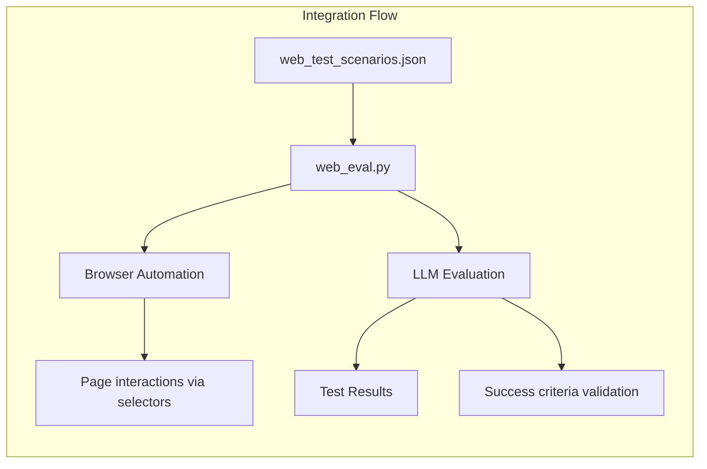

<!-- source: DeepWiki mcp.deepwiki.com · repo saharmor/voice-lab · page 4.2 Web Test Scenarios · fetched 2026-10-27 -->

# Web Test Scenarios

Relevant source files

The following files were used as context for generating this wiki page:

- [web_test_scenarios.json](web_test_scenarios.json)

This document covers the configuration and structure of web test scenarios used by Voice Lab's web chatbot evaluation system. Web test scenarios define the test cases, user personas, success criteria, and interaction patterns for automated testing of web-embedded chatbots through browser automation.

For information about executing web tests, see [Web Chatbot Evaluation](#3.2). For details on evaluation metrics and success measurement, see [Evaluation & Metrics](#5).

## Purpose and Scope

Web test scenarios serve as the declarative configuration layer for automated chatbot testing across different websites and use cases. Each scenario defines:

- Target chatbot URL and browser interaction selectors
- User persona with behavioral characteristics and context
- Success criteria for conversation outcomes  
- Mock conversation examples for reference
- Domain-specific guidelines and system prompts

The scenarios are consumed by the web evaluation system to conduct automated browser-based testing with realistic user interactions.

Sources: [web_test_scenarios.json:1-284]()

## Scenario Structure Overview

Web test scenarios are defined in JSON format within `web_test_scenarios.json`. The root structure contains a `test_scenarios` array with individual scenario objects.

Each scenario object contains eight core components that define the complete test case configuration.

Sources: [web_test_scenarios.json:1-284]()

## Configuration Components

### Web Interface Configuration

The web configuration section specifies how the automation system interacts with the target chatbot interface:

| Component | Purpose | Example Values |
|-----------|---------|----------------|
| `chatbot_url` | Target website URL | `"https://decagon.ai/embed/notion"` |
| `chat_input_selector` | CSS selector for chat input | `"textarea[placeholder='Ask a detailed question...']"` |
| `shadow_root_selector` | Shadow DOM selector if needed | `"div[data-sierra-chat-container]"` |

The selectors enable the browser automation system to locate and interact with chat interfaces across different websites and implementations.

### Agent Configuration

Agent configuration defines the expected behavior and context for the chatbot being tested:

The system prompt establishes the agent's role, while guidelines reference external knowledge files containing domain-specific information.

Sources: [web_test_scenarios.json:6-7](), [web_test_scenarios.json:64-65](), [web_test_scenarios.json:122-123]()

## User Persona Modeling

User personas define realistic user characteristics that drive conversation behavior during testing:

The persona model creates consistent, realistic user behavior patterns that test different interaction styles and emotional contexts.

Sources: [web_test_scenarios.json:11-17](), [web_test_scenarios.json:69-75](), [web_test_scenarios.json:128-133]()

## Success Criteria Definition

Success criteria define the specific outcomes required for a test scenario to be considered successful:

### Multi-Component Success Patterns

Success outcomes typically follow a structured pattern with multiple verification points:

This structured approach enables precise evaluation of conversation quality and completeness.

### Scenario-Specific Success Examples

Different scenario types have tailored success criteria:

| Scenario Type | Key Success Components |
|---------------|------------------------|
| Refund Policy | Policy explanation, options clarification, next steps, user satisfaction |
| Technical Support | Issue identification, setup process, troubleshooting steps, functional verification |
| Fraud Prevention | System explanation, reporting process, prevention guidance, confidence building |
| Security Testing | Confidentiality maintenance, role adherence, professional deflection |

Sources: [web_test_scenarios.json:10](), [web_test_scenarios.json:68](), [web_test_scenarios.json:126](), [web_test_scenarios.json:184]()

## Mock Conversation Patterns

Mock conversations provide reference examples of successful interactions for each scenario:

### Conversation Flow Patterns

Mock conversations demonstrate typical interaction patterns:

1. **Problem Introduction**: User presents issue with context
2. **Information Gathering**: Agent asks clarifying questions  
3. **Solution Provision**: Agent provides relevant information/steps
4. **Confirmation**: User confirms understanding
5. **Resolution**: Agent ensures satisfaction and next steps

These patterns serve as templates for generating realistic test conversations during automated testing.

Sources: [web_test_scenarios.json:18-59](), [web_test_scenarios.json:76-117](), [web_test_scenarios.json:134-175]()

## Scenario Types and Use Cases

The configuration supports diverse testing scenarios across different domains:

### Customer Service Scenarios
- **Refund Policy Inquiries**: Testing policy explanation and customer satisfaction
- **Technical Support**: Validating troubleshooting guidance and problem resolution
- **Subscription Management**: Verifying pricing information and plan comparisons

### Security and Compliance Scenarios
- **System Prompt Extraction**: Testing agent resilience against manipulation attempts
- **Fraud Prevention**: Validating security awareness and reporting procedures

### Integration with Web Testing System

Web test scenarios integrate with the broader testing infrastructure:

The scenarios provide the declarative configuration that drives automated browser testing and conversation evaluation through the web testing system.

Sources: [web_test_scenarios.json:1-284]()

---

