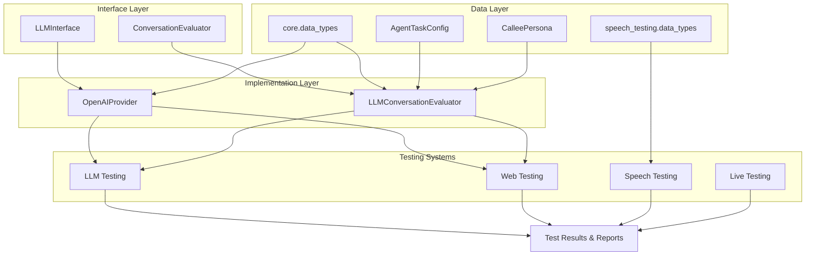
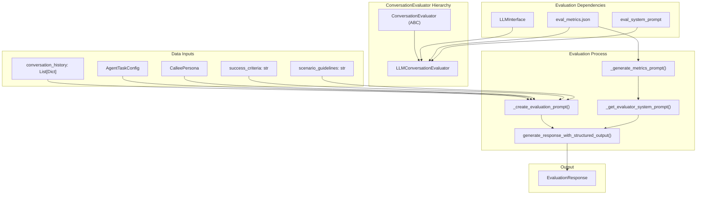
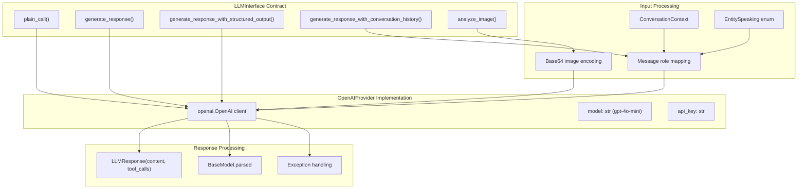
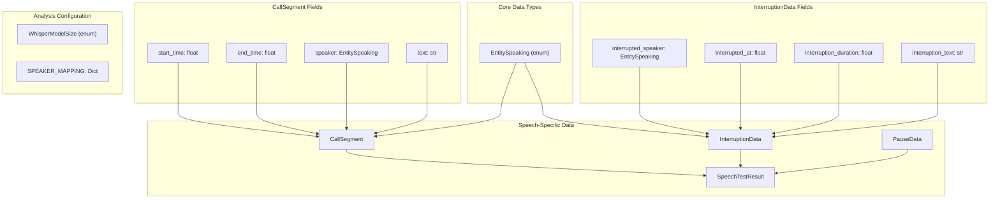
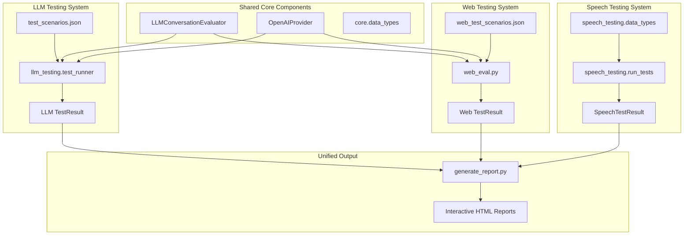

<!-- source: DeepWiki mcp.deepwiki.com · repo saharmor/voice-lab · page 7 Core Architecture · fetched 2026-10-27 -->

# Core Architecture

<details>
<summary>Relevant source files</summary>

The following files were used as context for generating this wiki page:

- [core/evaluator.py](core/evaluator.py)
- [core/providers/openai.py](core/providers/openai.py)
- [speech_testing/data_types.py](speech_testing/data_types.py)

</details>


This document covers the internal architecture of the Voice Lab testing framework, focusing on the foundational components, interfaces, and design patterns that enable multi-modal voice agent testing. This includes the core abstractions, provider implementations, and architectural patterns used across all testing systems.

For detailed information about specific data structures and models, see [Data Types & Models](#7.1). For in-depth coverage of LLM provider implementations, see [LLM Providers & Interfaces](#7.2).

## Architectural Overview

The Voice Lab framework follows a layered architecture with clear separation of concerns between interfaces, implementations, and domain-specific components. The core architecture provides abstractions that enable different testing modalities while maintaining consistency in evaluation and data handling.

### Core Architecture Layers



**Sources:** [core/evaluator.py:12-19](), [core/providers/openai.py:9-13](), [speech_testing/data_types.py:7-51]()

## Core Component Architecture

The framework is built around several key architectural components that provide the foundation for all testing modalities.

### Evaluation System Architecture



**Sources:** [core/evaluator.py:12-39](), [core/evaluator.py:61-76](), [core/evaluator.py:41-59]()

### LLM Provider Interface Architecture



**Sources:** [core/providers/openai.py:9-85](), [core/providers/openai.py:15-30](), [core/providers/openai.py:32-42]()

## Data Architecture Patterns

The framework employs consistent data modeling patterns across different testing domains, with specialized extensions for each modality.

### Speech Testing Data Model



**Sources:** [speech_testing/data_types.py:7-51](), [speech_testing/data_types.py:32-51](), [speech_testing/data_types.py:15-27]()

## Cross-System Integration Patterns

The architecture supports multiple testing modalities through shared interfaces and consistent data flow patterns.

### Multi-Modal Integration Architecture



**Sources:** [core/evaluator.py:21-39](), [core/providers/openai.py:9-55](), [speech_testing/data_types.py:47-51]()

## Design Patterns and Principles

### Abstract Base Class Pattern

The framework uses abstract base classes to define contracts for key components, ensuring consistent interfaces across implementations.

| Interface | Implementation | Purpose |
|-----------|----------------|---------|
| `ConversationEvaluator` | `LLMConversationEvaluator` | Conversation evaluation abstraction |
| `LLMInterface` | `OpenAIProvider` | LLM service abstraction |

The `ConversationEvaluator` abstract base class [core/evaluator.py:12-19]() defines the evaluation contract with a single `evaluate()` method that all concrete evaluators must implement.

### Dependency Injection Pattern

Components accept their dependencies through constructor injection, enabling flexible configuration and testing:

```python
# LLMConversationEvaluator constructor signature
def __init__(self, evaluation_llm: LLMInterface, eval_metrics_path: str, eval_system_prompt: str)
```

**Sources:** [core/evaluator.py:23-26]()

### Configuration-Driven Architecture

The system uses external JSON configuration files to define behavior, keeping code generic and scenarios configurable:

- Evaluation metrics loaded from `eval_metrics.json` [core/evaluator.py:43-50]()
- Test scenarios defined in separate JSON files
- System prompts externalized for easy modification

**Sources:** [core/evaluator.py:41-59](), [core/evaluator.py:52-59]()

---

