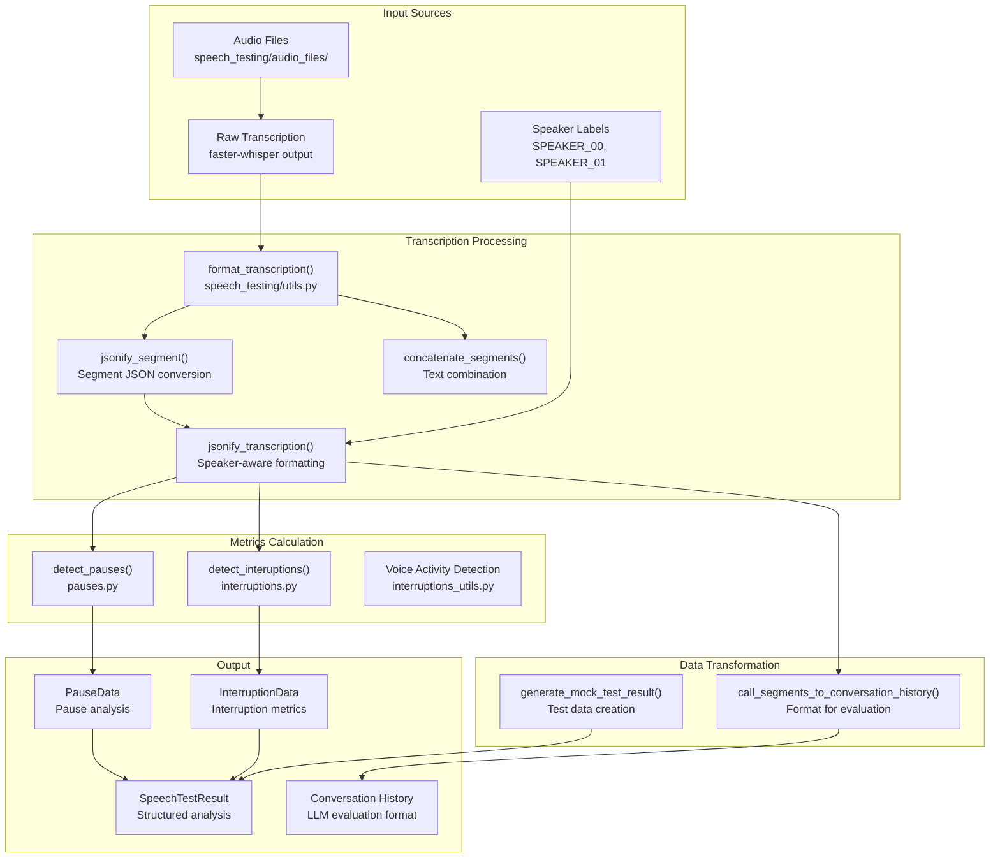
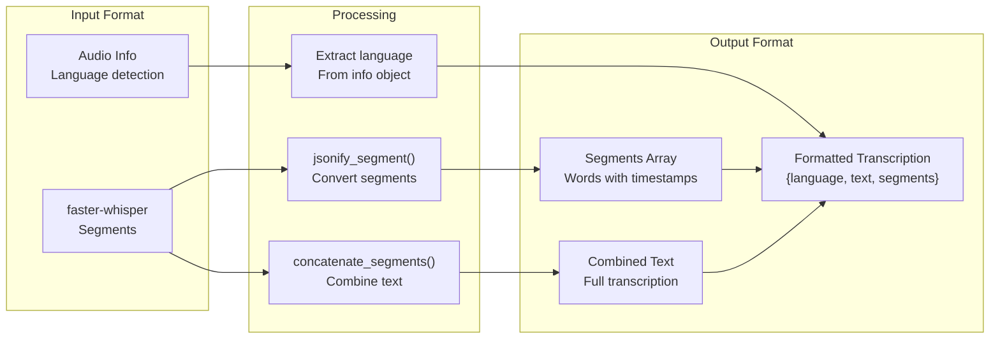
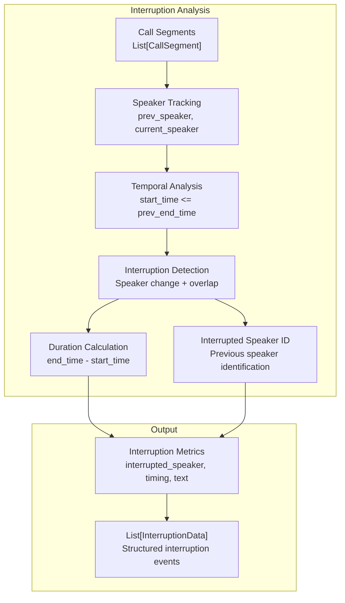
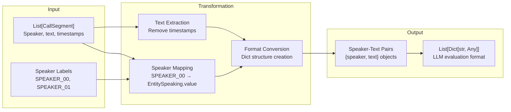

<!-- source: DeepWiki mcp.deepwiki.com · repo saharmor/voice-lab · page 8 Speech Processing Components · fetched 2026-10-27 -->

# Speech Processing Components

Relevant source files

The following files were used as context for generating this wiki page:

- [speech_testing/example_test.py](speech_testing/example_test.py)
- [speech_testing/metrics/interruptions.py](speech_testing/metrics/interruptions.py)
- [speech_testing/metrics/interruptions_utils.py](speech_testing/metrics/interruptions_utils.py)
- [speech_testing/metrics/pauses.py](speech_testing/metrics/pauses.py)
- [speech_testing/utils.py](speech_testing/utils.py)

This document covers the speech analysis and processing utilities that power Voice Lab's audio-based testing capabilities. These components handle transcription processing, speech metrics calculation, and audio analysis workflows for evaluating voice agent interactions.

For information about the broader speech testing system and test execution, see [Speech Analysis Testing](#3.3). For core data structures used in speech processing, see [Data Types & Models](#7.1).

## Speech Processing Pipeline

The speech processing system consists of three main processing stages: transcription processing, metrics calculation, and data transformation. The pipeline takes raw audio transcriptions and produces structured analysis results including interruption detection, pause analysis, and conversation formatting.

Sources: [speech_testing/utils.py:1-192](), [speech_testing/metrics/interruptions.py:1-39](), [speech_testing/metrics/pauses.py:1-35]()

## Transcription Processing Utilities

The transcription processing utilities in `speech_testing/utils.py` handle conversion between different transcription formats and provide standardized data structures for downstream processing.

### Core Processing Functions

| Function | Purpose | Input | Output |
|----------|---------|-------|---------|
| `jsonify_transcription()` | Convert speaker-aware transcription to JSON format | List of (speaker, text, start, end) tuples | JSON objects with speaker mapping |
| `format_transcription()` | Format faster-whisper output for stable-ts inference | Segments and info objects | Structured transcription dict |
| `concatenate_segments()` | Combine transcription segments into single text | List of segments | Combined text string |
| `jsonify_segment()` | Convert faster-whisper segment to JSON | Segment object | JSON representation |
| `jsonify_word()` | Convert faster-whisper word to JSON | Word object | JSON with word, timestamps, probability |

### Transcription Format Conversion

The `format_transcription()` function creates a standardized format compatible with stable-ts inference systems:

Sources: [speech_testing/utils.py:69-82](), [speech_testing/utils.py:50-66](), [speech_testing/utils.py:27-34]()

### Speaker Processing

The system uses a `SPEAKER_MAPPING` configuration to standardize speaker labels and provides utilities for speaker identification:

- `extract_speaker_id()` - Extracts numeric speaker ID from labels like "SPEAKER_01"
- Speaker mapping from numeric IDs to standardized labels
- Integration with `EntitySpeaking` enum for voice agent and callee identification

Sources: [speech_testing/utils.py:85-92](), [speech_testing/utils.py:6-17]()

## Speech Metrics Calculation

The speech metrics system analyzes conversation flow to detect interruptions and pauses, providing quantitative measures of conversation quality and natural speech patterns.

### Interruption Detection

The `detect_interuptions()` function in `speech_testing/metrics/interruptions.py` identifies when speakers interrupt each other based on temporal overlap analysis:

The algorithm detects interruptions when:
1. Speaker changes from previous segment
2. Current segment start time ≤ previous segment end time
3. Overlap duration is calculated and recorded

Sources: [speech_testing/metrics/interruptions.py:8-39]()

### Pause Detection

The `detect_pauses()` function identifies significant pauses in conversation flow using a minimum duration threshold:

- **Minimum pause duration**: 2 seconds (`MIN_PAUSE_DURATION`)
- **Detection criteria**: Gap between callee speech end and voice agent response start
- **Output**: `PauseData` objects with duration, timing, and surrounding text context

The pause detection specifically tracks pauses after callee segments to measure voice agent response latency.

Sources: [speech_testing/metrics/pauses.py:7-34]()

### Advanced Audio Processing

The `interruptions_utils.py` module provides sophisticated audio analysis capabilities for channel-based processing:

| Function | Purpose | Key Features |
|----------|---------|--------------|
| `get_speech_activity()` | Voice Activity Detection using WebRTC VAD | Configurable aggressiveness, frame-based analysis |
| `find_overlaps()` | Detect temporal overlaps between speaker segments | Precise timestamp overlap calculation |
| `merge_close_segments()` | Combine nearby speech segments | Configurable merge threshold |
| `reduce_noise()` | Audio noise reduction preprocessing | Spectral subtraction noise reduction |
| `split_audio_channels()` | Separate stereo audio into mono channels | Channel isolation for multi-speaker analysis |

Sources: [speech_testing/metrics/interruptions_utils.py:9-188]()

## Data Type Transformations

The speech processing system provides utilities for converting between different data representations required by various components of the Voice Lab framework.

### Conversation History Conversion

The `call_segments_to_conversation_history()` function transforms speech analysis results into the format expected by LLM evaluation systems:

Sources: [speech_testing/utils.py:161-169]()

### Mock Data Generation

The `generate_mock_test_result()` function creates comprehensive test data for development and testing purposes, including:

- **Call segments**: Multi-turn conversation with realistic timing
- **Interruption data**: Sample interruption event with United Airlines scenario
- **Pause data**: Extended pause detection example
- **Realistic timestamps**: Proper temporal sequencing for testing algorithms

This mock data supports development and testing of speech analysis algorithms without requiring actual audio files.

Sources: [speech_testing/utils.py:94-159]()

## Audio Format Processing

The system includes specialized utilities for handling different audio formats and processing requirements:

### Whisper Integration

- `reformat_chunk()` - Converts audio chunks to float32 format required by Whisper ASR
- Format compatibility with faster-whisper transcription pipeline
- Proper data type handling for neural network inference

### Audio Chunk Processing

The `reformat_chunk()` function ensures audio data compatibility:
- Converts input audio to float32 numpy array
- Reshapes data to 1D array format
- Prepares audio for Whisper ASR processing

Sources: [speech_testing/utils.py:20-24]()

---

