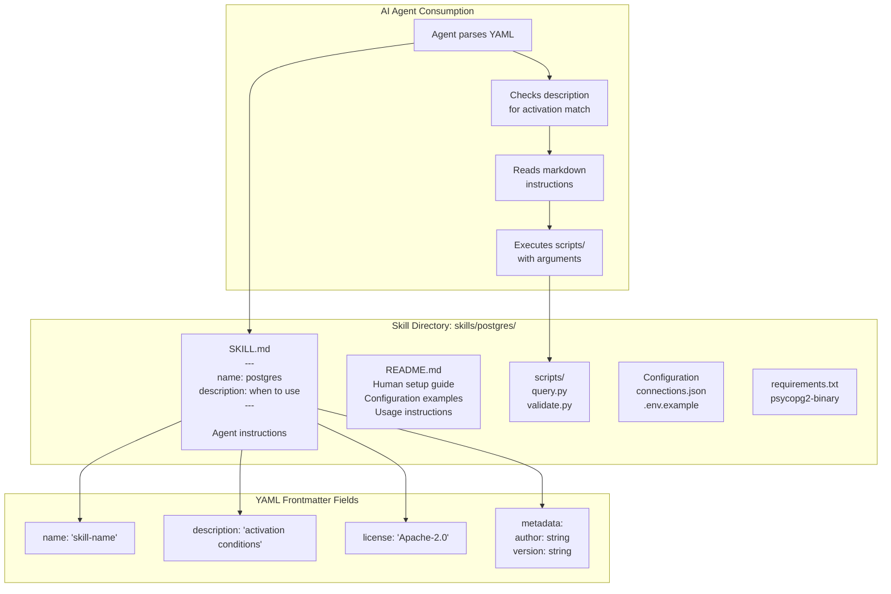
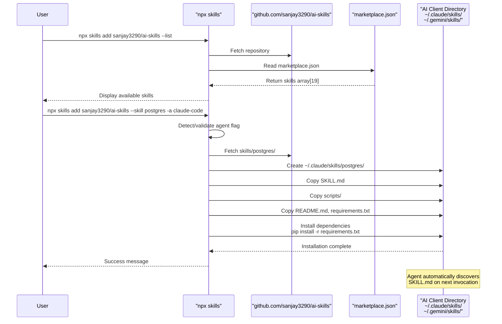

<!-- source: DeepWiki mcp.deepwiki.com · repo sanjay3290/ai-skills · page 1 Home · fetched 2026-10-27 -->

# Home

<details>
<summary>Relevant source files</summary>

The following files were used as context for generating this wiki page:

- [.claude-plugin/marketplace.json](.claude-plugin/marketplace.json)
- [README.md](README.md)
- [skills/jules/SKILL.md](skills/jules/SKILL.md)
- [skills/manus/SKILL.md](skills/manus/SKILL.md)

</details>


## Purpose and Scope

This wiki documents the **ai-skills** repository, a collection of 19+ portable skills for AI coding assistants that follow the [Agent Skills Standard](https://agentskills.io). This page provides an overview of the ecosystem architecture, the `npx skills` CLI package manager, the skill catalog, and how skills achieve portability across 40+ AI clients.

For initial setup and installation instructions, see [Getting Started](#2). For detailed architecture and design patterns, see [Architecture](#3). For skill-specific documentation, see [Skills by Category](#4).

## What is ai-skills?

The **ai-skills** repository is a curated collection of agent skills that enable AI coding assistants to interact with external services, databases, and tools. Each skill is a self-contained module that follows a standardized structure, making it compatible with any AI client that supports the Agent Skills Standard.

**Key characteristics:**
- **Portable**: One skill definition works across Claude Code, Gemini CLI, Cursor, Goose, and 40+ other AI clients
- **Standardized**: All skills follow the same directory structure and `SKILL.md` format with YAML frontmatter
- **Discoverable**: Centralized catalog in [marketplace.json:1-39]() enables CLI-based discovery and installation
- **Safe**: Built-in safety mechanisms including read-only database access, query validation, and credential sanitization

**The three-layer architecture:**
1. **Package Management Layer**: `npx skills` CLI reads [marketplace.json:1-39]() to fetch and install skills
2. **AI Client Environments**: Skills install to agent-specific directories (`~/.claude/skills/`, `~/.gemini/skills/`, etc.)
3. **External Services**: Skills connect to databases, APIs, and services through secure authentication

## Core Concepts

### Agent Skills Standard

The Agent Skills Standard defines a portable format for AI agent capabilities. Each skill must contain:

| Component | File/Directory | Purpose |
|-----------|---------------|---------|
| Agent Instructions | `SKILL.md` | YAML frontmatter + markdown instructions for AI agents |
| Human Documentation | `README.md` | Setup guides, examples, and reference for humans |
| Executable Scripts | `scripts/` | Python/shell scripts that interact with external services |
| Configuration Templates | `.env.example` | Environment variable templates |
| Dependencies | `requirements.txt` | Python package dependencies |

**SKILL.md Structure:**
```yaml
---
name: skill-name
description: "Activation conditions and use cases"
license: Apache-2.0
metadata:
  author: username
  version: "1.0"
---

# Markdown instructions for AI agent
```

### npx skills CLI

The `npx skills` CLI is the universal package manager for agent skills. It provides:

- **Discovery**: `npx skills add sanjay3290/ai-skills --list` shows all available skills
- **Installation**: Automatically detects AI client and installs to correct directory
- **Multi-agent support**: Install same skill to multiple clients with `-a` flag
- **Scope control**: Global (`-g`) vs project-scoped installation
- **Management**: List, update, and remove installed skills

### Skill Portability

Skills achieve portability through standardization:

1. **Directory structure**: All skills follow identical layout
2. **SKILL.md format**: AI agents parse YAML frontmatter to determine activation conditions
3. **Script conventions**: Executable scripts in `scripts/` directory with standard interfaces
4. **No agent-specific code**: Skills use generic patterns that work across all clients

## Skills Catalog

The repository contains **19+ skills** organized into five functional categories:

### Database Skills

| Skill | Description | Safety Features |
|-------|-------------|-----------------|
| [postgres](#4.2.1) | PostgreSQL read-only queries | 4-layer defense-in-depth: query validation, TLS enforcement, execution limits, output sanitization |
| [mysql](#4.2.2) | MySQL read-only queries | Session-level `SET TRANSACTION READ ONLY`, SSL connections |
| [mssql](#4.2.3) | SQL Server read-only queries | Whitelist filtering, TOP N query transformation |

### Google Workspace Skills

All skills share unified OAuth infrastructure with keyring storage:

| Skill | Description | Key Capabilities |
|-------|-------------|------------------|
| [gmail](#5.2) | Email management | Search, read, send, drafts, labels |
| [google-calendar](#5.3) | Calendar operations | Events, scheduling, free time |
| [google-chat](#5.4) | Chat messaging | Spaces, DMs, threads, attachments |
| [google-docs](#5.5) | Document editing | Create, read, edit documents |
| [google-drive](#5.6) | File management | Search, upload, download, folders |
| [google-sheets](#5.7) | Spreadsheet operations | Read, update, append, batch operations |
| [google-slides](#5.8) | Presentation editing | Read, create, modify slides |

### AI & ML Services

| Skill | Description | Response Type |
|-------|-------------|---------------|
| [imagen](#4.3.1) | Gemini text-to-image generation | Synchronous image URLs |
| [deep-research](#4.3.2) | Autonomous multi-phase research | Asynchronous (2-10 min) with streaming |
| [notebooklm](#4.3.3) | NotebookLM browser automation | Synchronous via Playwright |
| [elevenlabs](#4.3.4) | ElevenLabs text-to-speech | Audio files (single/dual voice) |
| [google-tts](#4.3.5) | Google Cloud TTS | Audio files (40+ languages) |

### Agent Delegation

Long-running asynchronous task delegation:

| Skill | Description | Typical Duration |
|-------|-------------|------------------|
| [jules](#4.4.1) | GitHub coding agent | 5-30 minutes (bug fixes, tests, docs) |
| [manus](#4.4.2) | Research/analysis agent | 1-10+ minutes (deep research, reports) |

### Development Tools

| Skill | Description | Integration Scope |
|-------|-------------|-------------------|
| [azure-devops](#4.5.1) | Azure DevOps integration | 99 tools across 13 domains (work items, repos, pipelines, wikis, security, approvals, policies) |
| [outline](#4.5.2) | Outline wiki integration | Search, read, manage wiki documents |

**Source:** [README.md:1-404](), [.claude-plugin/marketplace.json:1-39]()

## Repository Structure

```mermaid
graph TB
    subgraph "Root Directory"
        README["README.md<br/>Main documentation"]
        Marketplace["marketplace.json<br/>Skill catalog<br/>19 skill paths"]
    end
    
    subgraph "skills/ Directory"
        DBSkills["Database Skills"]
        Postgres["postgres/<br/>SKILL.md + scripts/query.py"]
        MySQL["mysql/<br/>SKILL.md + scripts/query.py"]
        MSSQL["mssql/<br/>SKILL.md + scripts/query.py"]
        
        GWSSkills["Google Workspace"]
        Gmail["gmail/<br/>SKILL.md + scripts/auth.py"]
        GDocs["google-docs/<br/>SKILL.md + scripts/"]
        GSheets["google-sheets/<br/>SKILL.md + scripts/"]
        
        AISkills["AI Services"]
        Imagen["imagen/<br/>SKILL.md + scripts/generate.py"]
        DeepResearch["deep-research/<br/>SKILL.md + scripts/research.py"]
        NotebookLM["notebooklm/<br/>SKILL.md + scripts/"]
        
        AgentSkills["Agent Delegation"]
        Jules["jules/<br/>SKILL.md + templates"]
        Manus["manus/<br/>SKILL.md + references/api.md"]
        
        DevOpsSkills["DevOps Tools"]
        AzureDevOps["azure-devops/<br/>SKILL.md + scripts/"]
        Outline["outline/<br/>SKILL.md + scripts/"]
    end
    
    subgraph ".claude-plugin/ Directory"
        MarketplaceDef["marketplace.json<br/>Plugin definitions<br/>skills array"]
    end
    
    README --> Marketplace
    Marketplace --> DBSkills
    Marketplace --> GWSSkills
    Marketplace --> AISkills
    Marketplace --> AgentSkills
    Marketplace --> DevOpsSkills
    
    DBSkills --> Postgres
    DBSkills --> MySQL
    DBSkills --> MSSQL
    
    GWSSkills --> Gmail
    GWSSkills --> GDocs
    GWSSkills --> GSheets
    
    AISkills --> Imagen
    AISkills --> DeepResearch
    AISkills --> NotebookLM
    
    AgentSkills --> Jules
    AgentSkills --> Manus
    
    DevOpsSkills --> AzureDevOps
    DevOpsSkills --> Outline
    
    MarketplaceDef -.->|catalogs| Postgres
    MarketplaceDef -.->|catalogs| Gmail
    MarketplaceDef -.->|catalogs| Imagen
```



**Sources:** [README.md:27-59](), [.claude-plugin/marketplace.json:10-37]()

## Skill Standard Structure

Every skill in the repository follows this standardized directory layout:



**SKILL.md Example Structure:**

The `SKILL.md` file contains YAML frontmatter followed by markdown instructions. Example from [skills/manus/SKILL.md:1-8]():

```yaml
---
name: manus
description: Delegate complex, long-running tasks to Manus AI agent for autonomous execution. Use when user says 'use manus', 'delegate to manus', 'send to manus', 'have manus do', 'ask manus', 'check manus sessions'...
license: Apache-2.0
metadata:
  author: sanjay3290
  version: "1.0"
---
```

**Sources:** [README.md:365-388](), [skills/manus/SKILL.md:1-8](), [skills/jules/SKILL.md:1-8]()

## Installation Flow

The `npx skills` CLI automates skill installation across different AI clients:



**Installation Paths by AI Client:**

| AI Client | Project Directory | Global Directory | CLI Flag |
|-----------|-------------------|------------------|----------|
| Claude Code | `.claude/skills/` | `~/.claude/skills/` | `-a claude-code` |
| Gemini CLI | `.gemini/skills/` | `~/.gemini/skills/` | `-a gemini-cli` |
| Cursor | `.cursor/skills/` | `~/.cursor/skills/` | `-a cursor` |
| Goose | `.goose/skills/` | `~/.config/goose/skills/` | `-a goose` |
| GitHub Copilot | `.github/skills/` | `~/.github/skills/` | `-a github-copilot` |

**Global vs Project Scope:**
- Default (no `-g`): Installs to project directory (`.claude/skills/`, `.gemini/skills/`, etc.)
- With `-g` flag: Installs to user home directory (`~/.claude/skills/`, `~/.gemini/skills/`, etc.)

**Sources:** [README.md:61-140](), [README.md:18-25]()

## Marketplace Catalog Structure

The [.claude-plugin/marketplace.json:1-39]() file defines the skill catalog:

```json
{
  "name": "ai-skills",
  "owner": {
    "name": "Sanjay"
  },
  "metadata": {
    "description": "Collection of agent skills for AI coding assistants",
    "version": "1.1.0"
  },
  "plugins": [
    {
      "name": "ai-skills",
      "description": "Collection of agent skills: PostgreSQL, MySQL, MSSQL, Imagen, Azure DevOps...",
      "source": "./",
      "skills": [
        "./skills/postgres",
        "./skills/imagen",
        "./skills/azure-devops",
        ...
      ]
    }
  ]
}
```

The `skills` array at [.claude-plugin/marketplace.json:15-36]() contains relative paths to all skill directories. The `npx skills` CLI reads this array to:
1. Discover available skills with `--list` flag
2. Validate skill names with `--skill` flag
3. Copy skill directories during installation

**Sources:** [.claude-plugin/marketplace.json:1-39]()

## How It Works

### For End Users

1. **Discovery**: Run `npx skills add sanjay3290/ai-skills --list` to browse 19+ available skills
2. **Installation**: Run `npx skills add sanjay3290/ai-skills --skill <name>` to install to auto-detected AI client
3. **Configuration**: Follow skill-specific setup in `README.md` (API keys, connections, OAuth)
4. **Usage**: Skills activate automatically when AI agent detects matching keywords in user requests

### For AI Agents

1. **Skill Discovery**: Agent scans skills directory (`~/.claude/skills/`, etc.) for `SKILL.md` files
2. **Parsing**: Agent parses YAML frontmatter to extract `name` and `description` fields
3. **Activation**: Agent checks if user request matches keywords in `description` field
4. **Execution**: Agent reads markdown instructions and executes `scripts/` with appropriate arguments
5. **Response**: Agent formats script output and returns to user

### For Skill Developers

1. **Structure**: Create skill directory following standard layout (see [Creating a New Skill](#7.1))
2. **Documentation**: Write `SKILL.md` with YAML frontmatter and agent instructions
3. **Implementation**: Add executable scripts in `scripts/` directory
4. **Catalog**: Add skill path to [.claude-plugin/marketplace.json:15-36]() `skills` array
5. **Testing**: Test across multiple AI clients to ensure portability

**Sources:** [README.md:288-364](), [README.md:390-396]()

## Key Design Principles

### Defense-in-Depth Security

Database skills implement four sequential protection layers:
1. **Query Validation**: Whitelist filtering for read-only operations
2. **Connection Security**: TLS/SSL enforcement with timeouts
3. **Execution Limits**: Query timeouts (30s), row limits (10k), column width caps
4. **Output Sanitization**: Strip credentials from error messages

See [Execution & Safety Features](#3.5) for details.

### Shared Authentication Infrastructure

Google Workspace skills share a common OAuth implementation:
- Single `scripts/auth.py` module across all 7 skills
- Cross-platform keyring storage (macOS Keychain, Windows Credential Locker, Linux Secret Service)
- Cloud function for token refresh (same infrastructure as official Google Workspace MCP)
- Service-scoped token isolation (`gmail-skill-oauth`, `google-sheets-skill-oauth`, etc.)

See [Shared Authentication](#5.1) for details.

### Asynchronous Agent Delegation

Skills like Jules and Manus implement asynchronous patterns:
1. Create task → immediate task ID return
2. Poll status → periodic checks until completion
3. Retrieve results → extract output and files

This allows AI agents to initiate long-running tasks without blocking. See [Agent Delegation](#4.4) for details.

**Sources:** [README.md:31-33](), [README.md:45-59](), [skills/manus/SKILL.md:56-66](), [skills/jules/SKILL.md:36-63]()

## Next Steps

- **First-time users**: Start with [Getting Started](#2) for installation and quick examples
- **Architecture deep-dive**: See [Architecture](#3) for design patterns and mechanisms
- **Skill documentation**: Browse [Skills by Category](#4) for specific skill details
- **Configuration**: See [Configuration Guide](#6) for credential and connection setup
- **Development**: See [Development Guide](#7) to create new skills or contribute

**Sources:** [README.md:1-404]()

---

