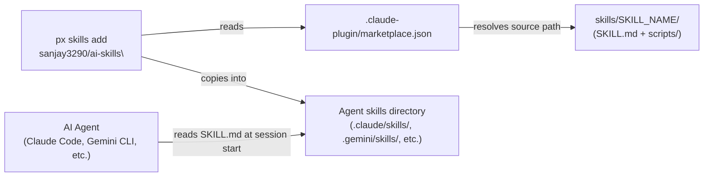
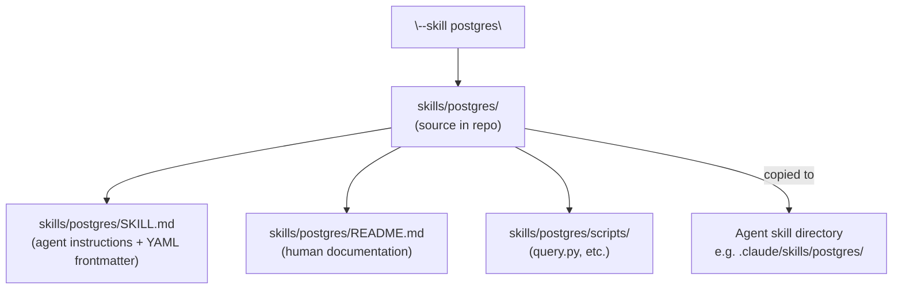
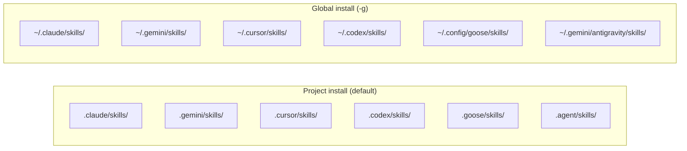

<!-- source: DeepWiki mcp.deepwiki.com · repo sanjay3290/ai-skills · page 2 Getting Started · fetched 2026-10-27 -->

# Getting Started

<details>
<summary>Relevant source files</summary>

The following files were used as context for generating this wiki page:

- [README.md](README.md)
- [skills/jules/SKILL.md](skills/jules/SKILL.md)
- [skills/manus/SKILL.md](skills/manus/SKILL.md)

</details>


This page covers the prerequisites and minimum steps needed to install your first skill and activate it inside an AI agent session. It does not cover per-skill configuration (credentials, OAuth, database connections) — see the [Configuration Guide](#6) for that. For a detailed walkthrough of every installation method, see [Installation Methods](#2.1). For the full list of supported AI clients and their directory paths, see [Supported AI Clients](#2.2). For a step-by-step end-to-end example, see [Quick Start Example](#2.3).

---

## How Skills Work

Skills are directories containing a `SKILL.md` file. When an AI agent session starts, it scans its configured skills directory, reads each `SKILL.md` file, and makes those capabilities available for the session. No daemon, no service — the agent reads the files at startup.

**Installation flow:**



Sources: [README.md:60-105](), [README.md:346-370]()

---

## Prerequisites

| Requirement | Details |
|---|---|
| Node.js | Required to run `npx skills` |
| An AI agent client | Claude Code, Gemini CLI, Cursor, etc. (see [Supported AI Clients](#2.2)) |
| Python 3 | Required by most skill scripts |
| Per-skill dependencies | Varies; see [Skills by Category](#4) and [Configuration Guide](#6) |

No global installation of the `skills` CLI is required — `npx` fetches and runs it on demand.

---

## Installing Your First Skill

The `npx skills` CLI is the standard way to install skills. All commands fetch skills from the `sanjay3290/ai-skills` GitHub repository, using the metadata in [.claude-plugin/marketplace.json]() to resolve skill sources.

**List available skills before installing:**

```bash
npx skills add sanjay3290/ai-skills --list
```

**Install a single skill (auto-detects your AI agent):**

```bash
npx skills add sanjay3290/ai-skills --skill postgres
```

**Install for a specific agent using the `-a` flag:**

```bash
npx skills add sanjay3290/ai-skills --skill postgres -a claude-code
```

**Install globally (available in all projects) with `-g`:**

```bash
npx skills add sanjay3290/ai-skills --skill postgres -g
```

**Install multiple skills at once:**

```bash
npx skills add sanjay3290/ai-skills --skill postgres --skill mysql --skill imagen
```

Sources: [README.md:64-105]()

---

## What Gets Installed

The diagram below maps the `--skill` flag value to the files that are copied into your agent's skill directory.



Every skill directory follows this layout [README.md:350-358]():

```
skill-name/
├── SKILL.md              # Required: read by the AI agent at session start
├── README.md             # Human documentation
├── requirements.txt      # Python dependencies (if any)
├── .env.example          # Environment variable template (if any)
└── scripts/              # Executable scripts invoked by the agent
```

The `SKILL.md` file contains YAML frontmatter with `name` and `description` fields. The AI agent uses the `description` to decide when to invoke the skill.

```
---
name: postgres
description: "When to use this skill..."
---

# Instructions for the AI agent
```

Sources: [README.md:346-370](), [skills/manus/SKILL.md:1-8](), [skills/jules/SKILL.md:1-8]()

---

## Agent Directory Reference

By default, skills install into the **current project directory**. Use `-g` for a **global** install available across all projects.



| Agent | `-a` flag | Project directory | Global directory |
|---|---|---|---|
| Claude Code | `claude-code` | `.claude/skills/` | `~/.claude/skills/` |
| Gemini CLI | `gemini-cli` | `.gemini/skills/` | `~/.gemini/skills/` |
| Cursor | `cursor` | `.cursor/skills/` | `~/.cursor/skills/` |
| OpenAI Codex | `codex` | `.codex/skills/` | `~/.codex/skills/` |
| Goose | `goose` | `.goose/skills/` | `~/.config/goose/skills/` |
| GitHub Copilot | `github-copilot` | `.github/skills/` | `~/.github/skills/` |
| Google Antigravity | `antigravity` | `.agent/skills/` | `~/.gemini/antigravity/skills/` |

Sources: [README.md:110-120]()

---

## After Installation: Skill Setup

Most skills require configuration before they can be used. The table below summarizes the first step for each category.

| Skill category | First-time setup |
|---|---|
| postgres, mysql, mssql | Create `connections.json` in the skill directory; install the relevant Python driver |
| imagen, deep-research | Set `GEMINI_API_KEY` environment variable |
| elevenlabs | Create `skills/elevenlabs/config.json` or set `ELEVENLABS_API_KEY`; install `ffmpeg` |
| google-tts | Set `GOOGLE_TTS_API_KEY`; install `ffmpeg` |
| notebooklm | Run `pip install -r skills/notebooklm/requirements.txt`, install Playwright, run `auth_manager.py setup` |
| jules | Run `npm install -g @google/jules`, then `jules login` |
| manus | Set `MANUS_API_KEY` environment variable |
| outline | Set `OUTLINE_API_KEY` environment variable |
| azure-devops | Run `pip install keyring`, then `python skills/azure-devops/scripts/auth.py login` |
| Google Workspace skills (7 skills) | Run `pip install keyring`, then `python .../auth.py login` for each skill |

Full configuration details are in the [Configuration Guide](#6).

Sources: [README.md:178-275]()

---

## Managing Installed Skills

```bash
# List currently installed skills
npx skills list

# Check for updates
npx skills check

# Update all skills
npx skills update

# Remove a specific skill
npx skills remove postgres

# Remove all skills from a specific agent
npx skills remove --skill '*' -a cursor
```

Sources: [README.md:123-139]()

---

## Next Steps

- **[Installation Methods](#2.1)** — All installation options: `npx skills`, manual `git clone`, file copy, and symlink.
- **[Supported AI Clients](#2.2)** — Full details on agent flags and directory paths.
- **[Quick Start Example](#2.3)** — End-to-end walkthrough: list, install, verify, invoke.
- **[Configuration Guide](#6)** — Environment variables, OAuth setup, database credentials, and API keys.
- **[Skills by Category](#4)** — Per-skill documentation with all CLI options.

---

