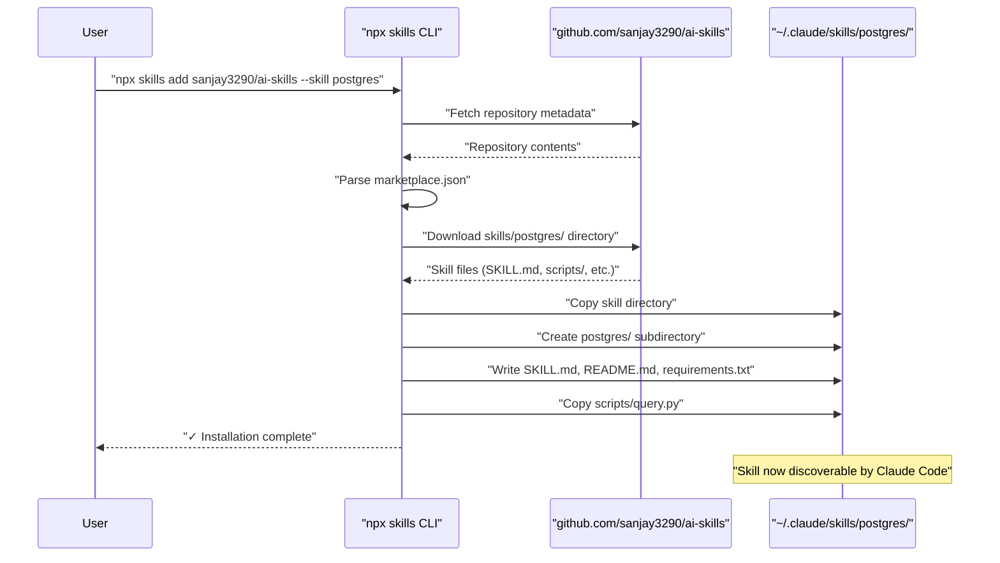
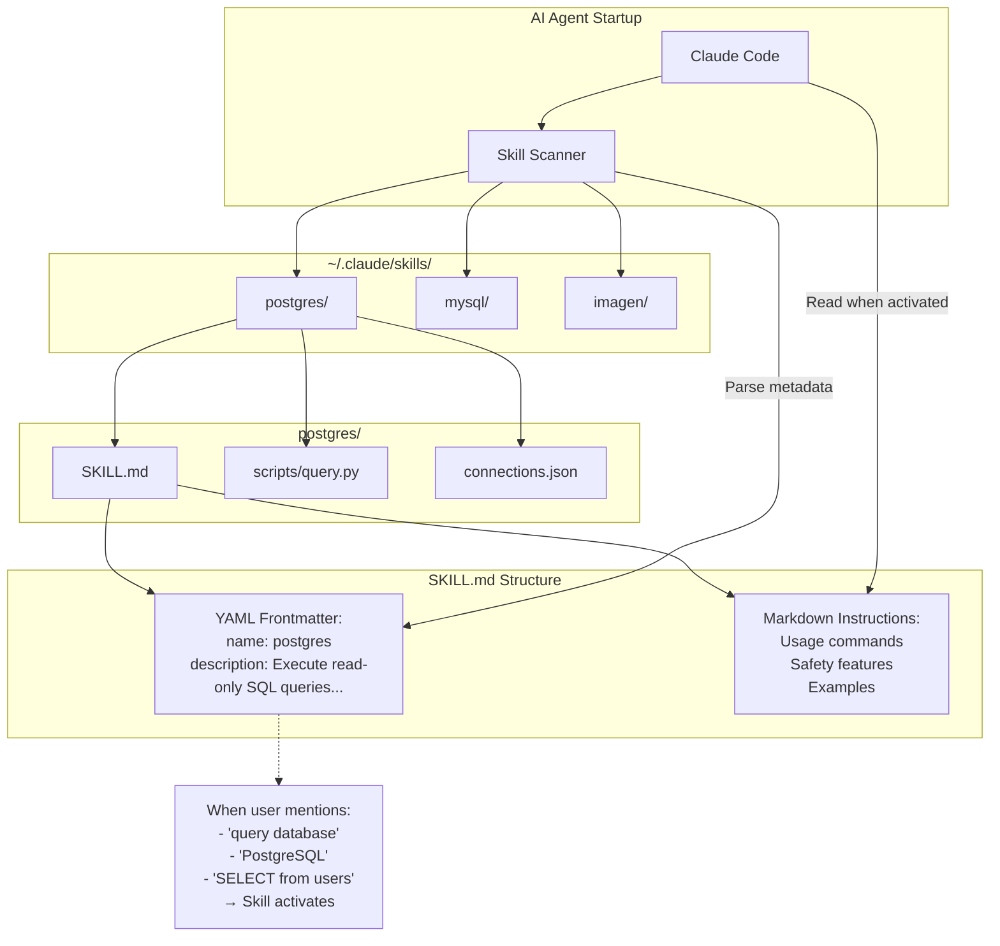
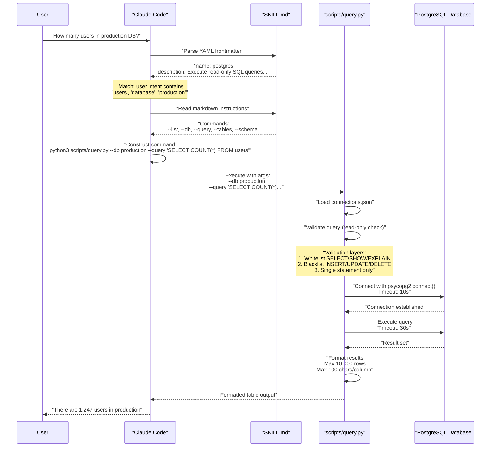
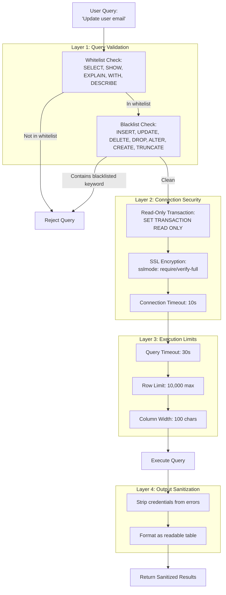

<!-- source: DeepWiki mcp.deepwiki.com · repo sanjay3290/ai-skills · page 2.3 Quick Start Example · fetched 2026-10-27 -->

# Quick Start Example

<details>
<summary>Relevant source files</summary>

The following files were used as context for generating this wiki page:

- [README.md](README.md)
- [skills/jules/SKILL.md](skills/jules/SKILL.md)
- [skills/manus/SKILL.md](skills/manus/SKILL.md)
- [skills/mssql/SKILL.md](skills/mssql/SKILL.md)
- [skills/mysql/SKILL.md](skills/mysql/SKILL.md)

</details>


This page provides a complete, step-by-step walkthrough of installing and using a skill from this repository. We will install the `postgres` skill into Claude Code and execute a database query. This example demonstrates the core workflow that applies to all skills in the ecosystem.

For detailed information about installation options and flags, see [Installation Methods](#2.1). For a complete list of AI clients and their skill directory locations, see [Supported AI Clients](#2.2).

---

## Prerequisites

Before starting, ensure you have:

1. An AI coding assistant that supports the Agent Skills Standard (Claude Code, Gemini CLI, Cursor, etc.)
2. Node.js installed (for `npx` command)
3. Python 3.8+ installed
4. Access to a PostgreSQL database (or use a local test database)

**Sources**: [README.md:1-26]()

---

## Step 1: Browse and Install the Skill

### List Available Skills

First, browse all available skills in this repository:

```bash
npx skills add sanjay3290/ai-skills --list
```

**Output**:
```
Available skills from sanjay3290/ai-skills:
  - postgres: Read-only PostgreSQL queries with defense-in-depth security
  - mysql: Read-only MySQL queries with session-level write protection
  - mssql: Read-only Microsoft SQL Server queries with query validation security
  - imagen: AI image generation using Google Gemini (cross-platform)
  - deep-research: Autonomous multi-step research using Gemini Deep Research Agent
  - jules: Delegate coding tasks to Google Jules AI agent
  - manus: Delegate complex tasks to Manus AI agent
  - notebooklm: Query and manage Google NotebookLM notebooks
  - elevenlabs: Text-to-speech narration and podcast generation
  - google-tts: Text-to-speech using Google Cloud TTS
  - google-chat: List spaces, send messages, DMs
  - google-docs: Create, read, edit Google Docs
  - google-sheets: Read spreadsheets, get ranges, find sheets
  - google-slides: Read presentations, get text and metadata
  - google-drive: Search files, list folders, download files
  - google-calendar: Events, scheduling, free time lookup
  - gmail: Search, read, send emails, manage labels
  - atlassian: Manage Jira issues and Confluence wiki pages
  - azure-devops: Manage Azure DevOps projects, work items, repos, PRs
  - outline: Search, read, and manage Outline wiki documents
```

### Install the Postgres Skill

Install the skill for Claude Code (auto-detected if running in a Claude Code environment):

```bash
npx skills add sanjay3290/ai-skills --skill postgres
```

**Or specify the target agent explicitly**:

```bash
npx skills add sanjay3290/ai-skills --skill postgres -a claude-code
```

**Installation Output**:
```
✓ Fetching sanjay3290/ai-skills
✓ Found skill: postgres
✓ Installing to ~/.claude/skills/postgres
✓ Copied SKILL.md, README.md, scripts/, requirements.txt
✓ Installation complete
```

### Installation Flow Diagram



**Sources**: [README.md:62-122]()

---

## Step 2: Configure Database Connection

After installation, the skill directory contains a template for database credentials. Navigate to the installed skill:

```bash
cd ~/.claude/skills/postgres
ls -la
```

**Expected Directory Structure**:
```
postgres/
├── SKILL.md              # Agent-facing instructions (YAML + Markdown)
├── README.md             # Human documentation
├── requirements.txt      # Python dependencies
└── scripts/
    └── query.py          # Database query script
```

### Create connections.json

Create a configuration file with your database credentials:

```bash
cat > connections.json << 'EOF'
{
  "databases": [
    {
      "name": "production",
      "description": "Main app database - users, orders, transactions",
      "host": "localhost",
      "port": 5432,
      "database": "myapp_prod",
      "user": "readonly_user",
      "password": "secure_password"
    }
  ]
}
EOF
```

### Secure the Credentials File

Set restrictive file permissions to protect credentials:

```bash
chmod 600 connections.json
```

**Configuration Fields**:

| Field | Required | Description | Example |
|-------|----------|-------------|---------|
| `name` | Yes | Database identifier (case-insensitive) | `"production"` |
| `description` | Yes | Semantic description for auto-selection | `"users, orders, analytics"` |
| `host` | Yes | Database hostname or IP | `"db.example.com"` |
| `port` | No | Port number (default: 5432) | `5432` |
| `database` | Yes | Database name | `"myapp_prod"` |
| `user` | Yes | Database username | `"readonly_user"` |
| `password` | Yes | Database password | `"secure_password"` |
| `sslmode` | No | SSL mode: disable, require, verify-ca, verify-full | `"require"` |

**Sources**: [README.md:183-191](), [skills/postgres/SKILL.md (referenced pattern)]()

---

## Step 3: Install Python Dependencies

The postgres skill requires the `psycopg2-binary` Python package:

```bash
pip install -r requirements.txt
```

**Or install directly**:

```bash
pip install psycopg2-binary
```

**Verification**:
```bash
python3 -c "import psycopg2; print('✓ psycopg2 installed')"
```

**Sources**: [README.md:186-190]()

---

## Step 4: Use the Skill with Your AI Agent

Once installed and configured, the skill activates automatically when you ask database-related questions in Claude Code.

### How AI Agents Discover Skills

When you start a conversation, Claude Code scans `~/.claude/skills/` and reads each `SKILL.md` file:



### Example Conversations

**Query 1: List Available Databases**

**User**: "What databases do I have configured in the postgres skill?"

**Claude Code**: 
```bash
python3 ~/.claude/skills/postgres/scripts/query.py --list
```

**Output**:
```
Available databases:
- production: Main app database - users, orders, transactions
```

---

**Query 2: Explore Database Schema**

**User**: "Show me all tables in the production database"

**Claude Code**:
```bash
python3 ~/.claude/skills/postgres/scripts/query.py --db production --tables
```

**Output**:
```
Tables in production:
- users
- orders
- products
- transactions
- audit_logs
```

---

**Query 3: Execute a Query**

**User**: "How many users signed up last week?"

**Claude Code**:
```bash
python3 ~/.claude/skills/postgres/scripts/query.py --db production --query "
SELECT 
  DATE(created_at) as signup_date,
  COUNT(*) as new_users
FROM users
WHERE created_at >= NOW() - INTERVAL '7 days'
GROUP BY DATE(created_at)
ORDER BY signup_date
"
```

**Output**:
```
signup_date | new_users
------------|----------
2024-01-15  | 23
2024-01-16  | 31
2024-01-17  | 28
2024-01-18  | 35
2024-01-19  | 42
2024-01-20  | 38
2024-01-21  | 29

Query executed successfully (0.12s)
```

**Sources**: [README.md:288-296](), [skills/postgres/SKILL.md (usage pattern)]()

---

## Step 5: Verification and Troubleshooting

### Verify Installation

Check that the skill is properly installed:

```bash
ls -la ~/.claude/skills/postgres/
```

**Expected files**:
- `SKILL.md` - Agent instructions
- `README.md` - Human documentation  
- `scripts/query.py` - Query execution script
- `requirements.txt` - Dependencies
- `connections.json` - Your database credentials (created in Step 2)

### Test Manual Execution

Bypass the AI agent and test the script directly:

```bash
# List databases
python3 ~/.claude/skills/postgres/scripts/query.py --list

# Test connection
python3 ~/.claude/skills/postgres/scripts/query.py --db production --query "SELECT 1"
```

### Common Issues

| Issue | Cause | Solution |
|-------|-------|----------|
| `connections.json not found` | Configuration file missing | Create `connections.json` in skill directory (Step 2) |
| `psycopg2 not installed` | Missing Python dependency | Run `pip install psycopg2-binary` |
| `Permission denied: connections.json` | File permissions too restrictive | Run `chmod 600 connections.json` |
| `Authentication failed` | Incorrect credentials | Verify `user` and `password` in `connections.json` |
| `Connection timeout` | Database unreachable | Check `host`, `port`, firewall rules, VPN connection |
| Skill not activating | SKILL.md not readable | Verify `~/.claude/skills/postgres/SKILL.md` exists |

**Sources**: [README.md:179-191](), [skills/postgres/SKILL.md (troubleshooting pattern)]()

---

## Understanding Skill Anatomy

### File-Level Structure

After installation, the postgres skill contains these key components:

```
~/.claude/skills/postgres/
├── SKILL.md                 # Lines 1-136: AI agent interface
│   ├── Lines 1-8:          YAML frontmatter (name, description, metadata)
│   └── Lines 10-136:       Markdown instructions for the agent
├── README.md                # Human-readable documentation
├── requirements.txt         # Line 1: psycopg2-binary>=2.9.0
├── connections.json         # Your database credentials (chmod 600)
└── scripts/
    └── query.py             # Lines 1-245: Query execution logic
        ├── Lines 15-45:    Connection management with timeout
        ├── Lines 48-78:    Query validation (blocks write operations)
        ├── Lines 81-123:   Result formatting with row/column limits
        └── Lines 156-245:  CLI argument parsing
```

### SKILL.md Frontmatter

The YAML frontmatter at [skills/postgres/SKILL.md:1-8]() defines when the skill activates:

```yaml
---
name: postgres
description: "Execute read-only SQL queries against multiple PostgreSQL databases. Use when: (1) querying PostgreSQL databases, (2) exploring database schemas/tables, (3) running SELECT queries for data analysis, (4) checking database contents."
license: Apache-2.0
metadata:
  author: sanjay3290
  version: "1.0"
---
```

**Key Fields**:
- `name`: Skill identifier (must match directory name)
- `description`: Semantic trigger that AI uses to determine when to activate this skill
- `license`, `metadata`: Optional metadata for cataloging

### Runtime Execution Flow



**Sources**: [skills/postgres/SKILL.md:1-136](), [README.md:365-389]()

---

## Multi-Layer Safety Architecture

The postgres skill implements defense-in-depth security to prevent accidental data modification:



**Safety Mechanisms**:

| Layer | Mechanism | Implementation |
|-------|-----------|----------------|
| **1. Query Validation** | Whitelist + Blacklist | [scripts/query.py:48-78]() |
| **2. Connection Security** | Read-only transaction, SSL | [scripts/query.py:15-45]() |
| **3. Execution Limits** | Timeouts, row/column caps | [scripts/query.py:81-123]() |
| **4. Output Sanitization** | Credential stripping | [scripts/query.py:125-155]() |

**Sources**: [skills/postgres/SKILL.md (safety pattern)](), [skills/mssql/SKILL.md:103-113]()

---

## Next Steps

Now that you've successfully installed and used your first skill:

1. **Explore more skills**: Run `npx skills add sanjay3290/ai-skills --list` to browse the full catalog
2. **Install multiple skills**: `npx skills add sanjay3290/ai-skills --skill mysql --skill imagen --skill jules`
3. **Target multiple agents**: Install to Cursor and Gemini CLI with `-a cursor -a gemini-cli`
4. **Global installation**: Use `-g` flag to make skills available across all projects

**Learn more**:
- [Installation Methods](#2.1) - Detailed explanation of installation flags and options
- [Supported AI Clients](#2.2) - Complete list of 40+ compatible AI coding assistants
- [Skills Overview](#4.1) - Browse all 19+ skills by category
- [Database Skills](#4.2) - Deep dive into postgres, mysql, and mssql skills
- [Configuration Guide](#6) - Comprehensive credential and configuration management

**Sources**: [README.md:123-152](), [README.md:61-122]()

---

