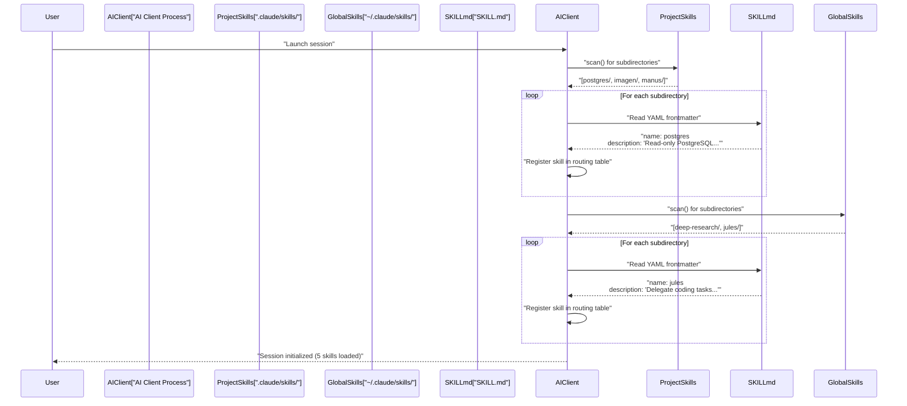
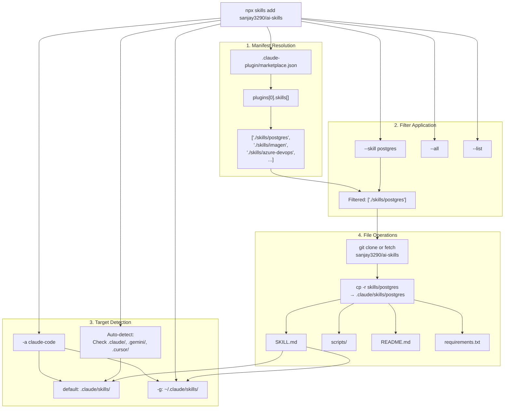
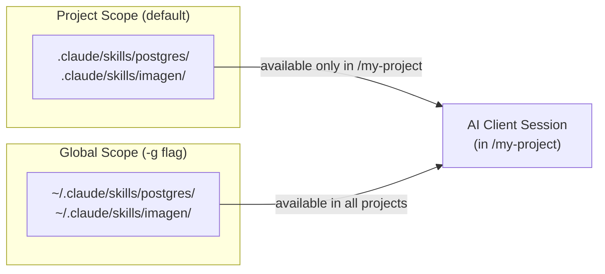
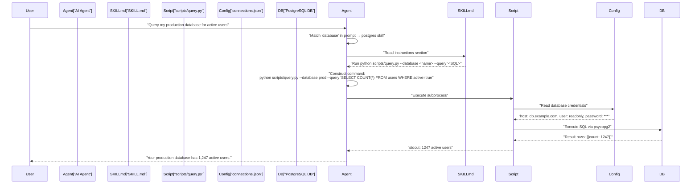

<!-- source: DeepWiki mcp.deepwiki.com · repo sanjay3290/ai-skills · page 3.2 Skill Discovery & Installation · fetched 2026-10-27 -->

# Skill Discovery & Installation

<details>
<summary>Relevant source files</summary>

The following files were used as context for generating this wiki page:

- [.claude-plugin/marketplace.json](.claude-plugin/marketplace.json)
- [README.md](README.md)
- [skills/jules/SKILL.md](skills/jules/SKILL.md)
- [skills/manus/SKILL.md](skills/manus/SKILL.md)

</details>


This page documents the skill resolution and installation mechanisms: how AI clients discover `SKILL.md` files at session start, how `npx skills` reads `.claude-plugin/marketplace.json` to resolve skill paths, and the file copying workflow that places skill directories into agent-specific paths. For `SKILL.md` YAML frontmatter format, see [Agent Skills Standard](#3.1). For `marketplace.json` schema, see [Marketplace & Plugin System](#3.3).

---

## Session-Start Skill Discovery

AI clients perform filesystem scans of predefined skill directories at session initialization. Each directory containing a `SKILL.md` file with valid YAML frontmatter is registered as an available skill. Clients parse the frontmatter to extract `name` and `description` fields [skills/manus/SKILL.md:1-8](), which enable routing decisions during agent execution.

### Discovery Mechanism

The `description` field contains natural language trigger phrases that the agent's prompt router uses for skill selection. Example patterns:

| Skill | Trigger Phrases in `description` |
|---|---|
| `skills/manus/SKILL.md` | `"use manus"`, `"delegate to manus"`, `"send to manus"`, `"deep web research"` |
| `skills/jules/SKILL.md` | `"have Jules fix"`, `"delegate to Jules"`, `"jules add tests"`, `"check Jules sessions"` |

Discovery is stateless: no registration API, configuration file, or initialization step. Presence of `SKILL.md` in a scanned directory is sufficient.

**Skill Loading Sequence at Session Start**



Sources: [README.md:18-25](), [skills/manus/SKILL.md:1-8](), [skills/jules/SKILL.md:1-8]()

---

## Skill Directory Paths by Client

Each AI client defines its own convention for where skill directories live. All clients support both a **project-scoped** path (relative to the current working directory) and a **global** path (relative to the user's home directory).

| Client | `-a` Flag | Project Directory | Global Directory |
|---|---|---|---|
| Claude Code | `claude-code` | `.claude/skills/` | `~/.claude/skills/` |
| Gemini CLI | `gemini-cli` | `.gemini/skills/` | `~/.gemini/skills/` |
| Cursor | `cursor` | `.cursor/skills/` | `~/.cursor/skills/` |
| OpenAI Codex | `codex` | `.codex/skills/` | `~/.codex/skills/` |
| Goose | `goose` | `.goose/skills/` | `~/.config/goose/skills/` |
| GitHub Copilot | `github-copilot` | `.github/skills/` | `~/.github/skills/` |
| Google Antigravity | `antigravity` | `.agent/skills/` | `~/.gemini/antigravity/skills/` |

For the full list of supported clients and their configuration, see [Supported AI Clients](#2.2).

Sources: [README.md:110-120]()

---

## CLI Installation Workflow: `npx skills`

The `npx skills` command (external package: `nicepkg/skills`) performs manifest parsing, skill resolution, target path detection, and directory copying. It reads `.claude-plugin/marketplace.json` [.claude-plugin/marketplace.json:1-39]() to enumerate available skills, resolves filters (`--skill`, `--all`), detects the active agent (or uses `-a` override), determines install scope (`-g` flag), and copies skill directories from source to target.

### Skill Resolution Pipeline

**CLI Execution Flow: Manifest → Filter → Target → Copy**



Sources: [README.md:62-139](), [.claude-plugin/marketplace.json:1-39]()

### CLI Command Reference

| Command | Operation | Target Resolution |
|---|---|---|
| `npx skills add sanjay3290/ai-skills --list` | Read `marketplace.json`, print `plugins[0].skills[]` | None (list only) |
| `npx skills add sanjay3290/ai-skills --skill postgres` | Filter to `./skills/postgres`, copy to detected agent's project dir | Auto-detect from `.claude/`, `.gemini/`, `.cursor/` |
| `npx skills add sanjay3290/ai-skills --skill postgres -a claude-code` | Filter to `./skills/postgres`, copy to `.claude/skills/` | Explicit: `.claude/skills/` |
| `npx skills add sanjay3290/ai-skills --skill postgres -g` | Filter to `./skills/postgres`, copy to `~/.claude/skills/` | Global scope |
| `npx skills add sanjay3290/ai-skills --all` | Copy all 19 skills from `marketplace.json` | Auto-detect |
| `npx skills add sanjay3290/ai-skills --all -a '*'` | Copy all 19 skills to all detected agents | All agents in `~/.claude/`, `~/.gemini/`, `~/.cursor/`, etc. |
| `npx skills list` | Scan local skills dirs, print installed skill names | Current project + global |
| `npx skills update` | Re-fetch from GitHub, overwrite existing skill dirs | Same paths as original install |
| `npx skills remove postgres` | `rm -rf` matching skill directory | Auto-detect |

Sources: [README.md:64-148]()

### Agent Detection Logic

The CLI inspects the current directory for agent-specific hidden directories:

| Detection File/Dir | Resolved Agent | Target Path (project) |
|---|---|---|
| `.claude/` or `.claude-plugin/` | `claude-code` | `.claude/skills/` |
| `.gemini/` | `gemini-cli` | `.gemini/skills/` |
| `.cursor/` | `cursor` | `.cursor/skills/` |
| `.codex/` | `codex` | `.codex/skills/` |
| `.goose/` | `goose` | `.goose/skills/` |
| `.agent/` | `antigravity` | `.agent/skills/` |

If multiple detection files exist, priority is undefined (CLI implementation-specific). Use `-a` flag for explicit control.

Sources: [README.md:110-121]()

---

## Project vs. Global Installation

The scope of an installation determines which sessions can see a skill.

**Figure 3: Scope Resolution at Session Start**



| Scope | Install Command | Target Path (Claude Code example) | Availability |
|---|---|---|---|
| **Project** (default) | `npx skills add sanjay3290/ai-skills --skill postgres` | `.claude/skills/postgres/` | Current repo only |
| **Global** | `npx skills add sanjay3290/ai-skills --skill postgres -g` | `~/.claude/skills/postgres/` | All projects on the machine |

**When to use project scope:** Skills that are relevant only to a specific repo (e.g., a database skill configured with that project's `connections.json`).

**When to use global scope:** General-purpose skills like `imagen` or `deep-research` that are useful across all work.

Sources: [README.md:95-105]()

---

## Manual Installation Methods

Skills can be placed in agent directories without using `npx skills`. Any valid skill directory tree (containing `SKILL.md`) in the correct path will be discovered at session start.

### Installation Techniques

| Method | Command | Use Case |
|---|---|---|
| Clone entire repo | `git clone https://github.com/sanjay3290/ai-skills.git ~/.claude/skills/ai-skills` | Access all skills, manual updates via `git pull` |
| Copy single skill | `cp -r skills/postgres ~/.claude/skills/postgres` | Isolated skill, no git dependency |
| Symlink (development) | `ln -s /path/to/ai-skills/skills/postgres ~/.claude/skills/postgres` | Immediate edit propagation, no reinstall |

**Symlink Development Workflow:**

```bash
# 1. Clone repo to development directory
git clone https://github.com/sanjay3290/ai-skills.git ~/dev/ai-skills

# 2. Symlink skill to agent directory
ln -s ~/dev/ai-skills/skills/postgres ~/.claude/skills/postgres

# 3. Edit source files
vim ~/dev/ai-skills/skills/postgres/SKILL.md

# 4. Changes are immediately visible to agent (restart session)
```

Symlinks enable iterative development: modify `SKILL.md` or `scripts/*.py` in the source directory, restart the AI client session, and test updated skill behavior without reinstalling.

Sources: [README.md:154-176]()

---

## Skill Directory Structure & File Roles

Installation copies the entire skill directory tree. Only `SKILL.md` is required for agent operation; other files support execution or provide developer documentation.

### Standard Skill Layout

```
skills/postgres/
├── SKILL.md              ← Mandatory: YAML frontmatter + agent instructions
├── README.md             ← Human-readable docs (ignored by agent)
├── requirements.txt      ← Python dependencies: psycopg2-binary
├── .env.example          ← Environment variable template
├── connections.json      ← Skill-specific config (user-populated)
└── scripts/
    └── query.py          ← Executable invoked by agent via SKILL.md instructions
```

### File Purpose Table

| File | Read By | Purpose | Example: `skills/postgres/` |
|---|---|---|---|
| `SKILL.md` | AI client at session start | YAML frontmatter defines routing; markdown body contains execution instructions | [skills/postgres/SKILL.md]() |
| `README.md` | Developers | Human-facing usage docs, configuration guide | [skills/postgres/README.md]() |
| `scripts/*.py` | Agent during execution | Executable code invoked per `SKILL.md` instructions | [skills/postgres/scripts/query.py]() |
| `requirements.txt` | Developer (manual `pip install -r`) | Python package dependencies | `psycopg2-binary` |
| `.env.example` | Developer (manual copy to `.env`) | Environment variable template | `DATABASE_URL=postgres://...` |
| `connections.json` | Script at runtime | Skill-specific configuration | Database credentials (see [Configuration Guide](#6)) |

### Execution Flow: SKILL.md → scripts/

The agent parses `SKILL.md` markdown to determine when and how to execute scripts. Example from `skills/postgres/SKILL.md`:

```markdown
## Usage
Use `python scripts/query.py --database <name> --query "<SQL>"`
```

The agent generates a shell command based on this instruction, then executes it. The script (`scripts/query.py`) reads configuration from `connections.json` and outputs results to stdout, which the agent parses and presents to the user.

**Skill Invocation Sequence**



Sources: [README.md:365-376](), [.claude-plugin/marketplace.json:15-36]()

---

## Skill Registry: `marketplace.json`

The `npx skills` CLI locates available skills by reading [.claude-plugin/marketplace.json]() at the root of the repository. The `plugins[0].skills` array [.claude-plugin/marketplace.json:15-34]() lists relative paths to each of the 18 skill directories:

```
./skills/postgres
./skills/imagen
./skills/azure-devops
./skills/deep-research
./skills/outline
./skills/jules
./skills/gmail
./skills/google-calendar
./skills/google-chat
./skills/google-docs
./skills/google-drive
./skills/google-sheets
./skills/google-slides
./skills/notebooklm
./skills/manus
./skills/elevenlabs
./skills/mysql
./skills/mssql
```

Each path is resolved relative to the `source` field [.claude-plugin/marketplace.json:14](), which is `"./"` — the repository root. For a full description of the manifest format, see [Marketplace & Plugin System](#3.3).

Sources: [.claude-plugin/marketplace.json:1-37]()

---

