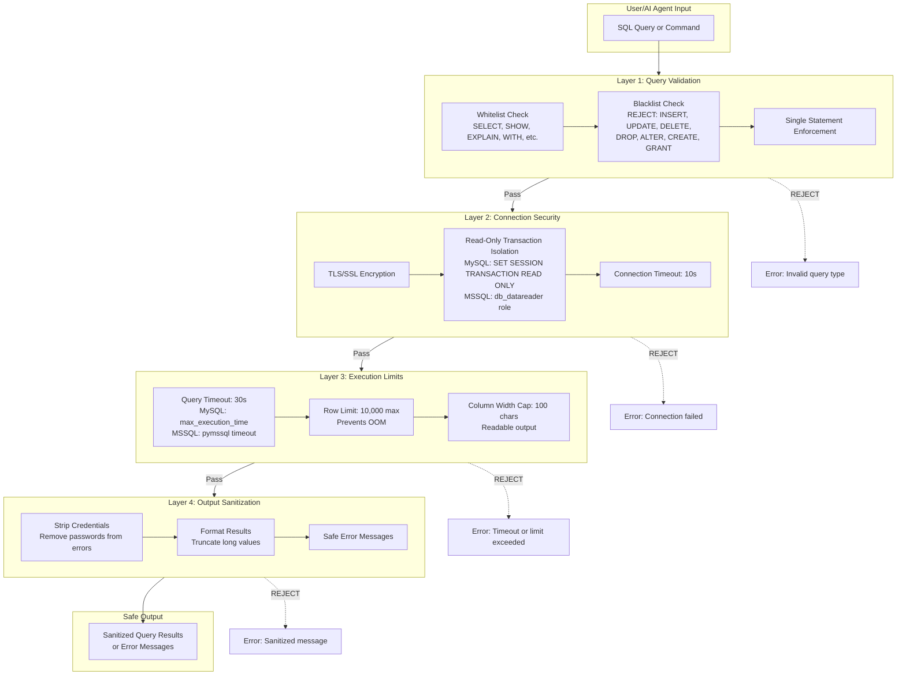
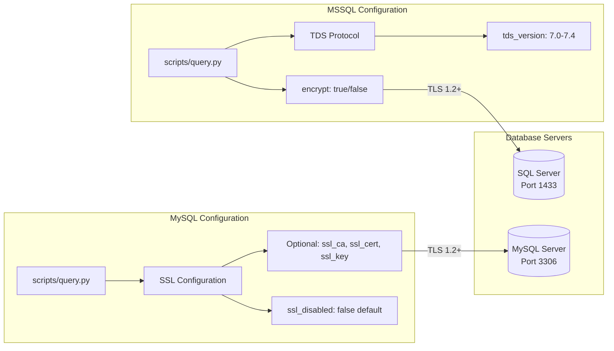
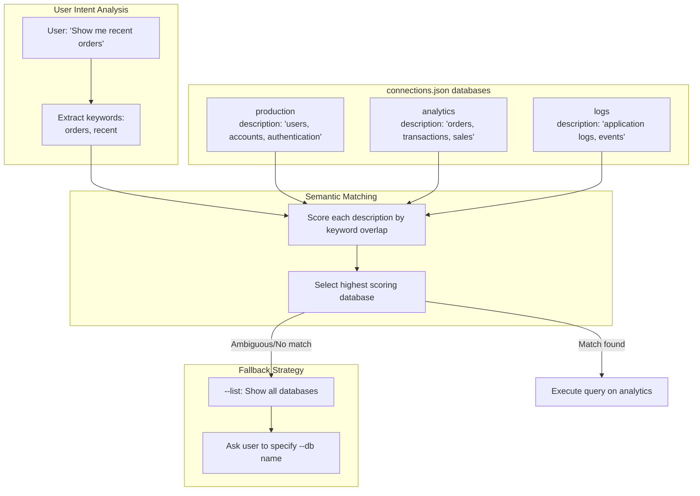
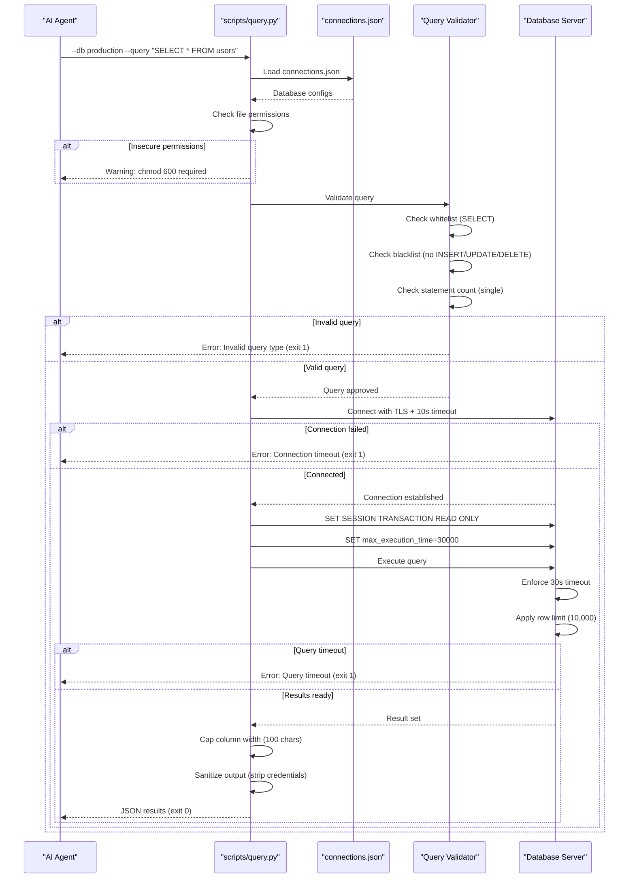

<!-- source: DeepWiki mcp.deepwiki.com · repo sanjay3290/ai-skills · page 3.5 Execution & Safety Features · fetched 2026-10-27 -->

# Execution & Safety Features

<details>
<summary>Relevant source files</summary>

The following files were used as context for generating this wiki page:

- [skills/mssql/SKILL.md](skills/mssql/SKILL.md)
- [skills/mysql/SKILL.md](skills/mysql/SKILL.md)

</details>


## Purpose and Scope

This document describes the multi-layer safety mechanisms implemented across AI skills to enable autonomous AI agent operation without risk of data corruption or security breaches. The architecture employs defense-in-depth principles with four sequential protection layers: query validation, connection security, execution limits, and output sanitization.

This page focuses on execution-time safety enforcement. For authentication and credential management patterns, see [Authentication Patterns](#3.4). For database configuration setup, see [Database Connections](#6.3).

---

## Defense-in-Depth Architecture

The skills system implements a four-layer security model where each layer provides independent protection. Even if one layer fails, subsequent layers prevent damage. This architecture is primarily documented in database skills but applies conceptually to other skill types.



**Sources:**
- [skills/mssql/SKILL.md:102-113]()
- [skills/mysql/SKILL.md:101-111]()

---

## Layer 1: Query Validation

Query validation is the first line of defense, implementing application-level filtering to block dangerous operations before they reach the database. This layer uses both whitelist and blacklist approaches.

### Supported Operations

Database skills permit only read operations and schema inspection commands:

| Operation Type | Allowed Keywords | Purpose |
|----------------|------------------|---------|
| Data retrieval | `SELECT` | Fetch rows from tables |
| Schema inspection | `SHOW`, `DESCRIBE`, `EXPLAIN`, `SP_HELP` | Explore database structure |
| Common table expressions | `WITH` | Complex read queries with CTEs |
| Information schema | `INFORMATION_SCHEMA` queries | Metadata inspection |

### Blocked Operations

All write, DDL, and privilege operations are rejected:

| Operation Type | Blocked Keywords | Risk if Allowed |
|----------------|------------------|-----------------|
| Data modification | `INSERT`, `UPDATE`, `DELETE`, `REPLACE`, `MERGE` | Data corruption |
| Schema changes | `CREATE`, `ALTER`, `DROP`, `TRUNCATE`, `RENAME` | Structure damage |
| Privilege management | `GRANT`, `REVOKE` | Security breach |
| Transaction control | `COMMIT`, `ROLLBACK`, `BEGIN`, `START TRANSACTION` | Bypass read-only mode |
| Procedural code | `CALL`, `EXECUTE`, `EXEC` (except system procs) | Arbitrary code execution |

### Single Statement Enforcement

Multiple statements separated by semicolons are rejected to prevent SQL injection patterns:

```python
# Rejected: Multiple statements
"SELECT * FROM users; DROP TABLE users;"

# Accepted: Single statement
"SELECT * FROM users"
```

This validation occurs in `scripts/query.py` for each database skill before connection establishment.

**Sources:**
- [skills/mssql/SKILL.md:104-106]()
- [skills/mysql/SKILL.md:103-105]()

---

## Layer 2: Connection Security

Connection security establishes database-level protections that operate independently of application-level validation.

### Encryption and Transport Security



**MySQL SSL Configuration:**
- Default: SSL enabled unless `"ssl_disabled": true`
- Certificate validation: `ssl_ca`, `ssl_cert`, `ssl_key` parameters
- Location: [skills/mysql/SKILL.md:56-59]()

**MSSQL Encryption:**
- Configurable via `"encrypt": true` in connections.json
- TDS protocol versions 7.0-7.4 supported
- Required for Azure SQL Database
- Location: [skills/mssql/SKILL.md:39-40]()

### Read-Only Transaction Enforcement

Database skills use server-side read-only modes that cannot be bypassed by client-side validation failures:

**MySQL Implementation:**
```python
# Executed at connection establishment
cursor.execute("SET SESSION TRANSACTION READ ONLY")
```
This session-level setting prevents all write operations at the database engine level, even if application-level validation is bypassed. Requires MySQL 5.7.8+ or MariaDB 10.1.1+.

**MSSQL Implementation:**
Uses database role-based protection. The recommended approach is to configure the `readonly_user` with only the `db_datareader` role, which lacks write permissions at the server level.

**Sources:**
- [skills/mysql/SKILL.md:103]()
- [skills/mssql/SKILL.md:104]()

### Connection Timeouts

Both MySQL and MSSQL skills implement 10-second connection timeouts to prevent hanging on unreachable databases:

```python
# MSSQL: timeout parameter in pymssql.connect()
conn = pymssql.connect(
    server=host,
    port=port,
    user=user,
    password=password,
    database=database,
    timeout=10,  # connection timeout
    login_timeout=10  # login timeout
)

# MySQL: connect_timeout in mysql.connector.connect()
conn = mysql.connector.connect(
    host=host,
    port=port,
    user=user,
    password=password,
    database=database,
    connect_timeout=10
)
```

**Sources:**
- [skills/mssql/SKILL.md:109]()
- [skills/mysql/SKILL.md:107]()

---

## Layer 3: Execution Limits

Execution limits prevent resource exhaustion and ensure queries terminate in reasonable timeframes.

### Query Timeout Enforcement

| Database | Mechanism | Timeout | Configuration |
|----------|-----------|---------|---------------|
| MySQL | `max_execution_time` system variable | 30 seconds | `SET max_execution_time=30000` (milliseconds) |
| MSSQL | `pymssql` connection timeout | 30 seconds | `timeout=30` in connect params |
| PostgreSQL | Statement timeout | 30 seconds | Implementation similar to MySQL |

**MySQL-specific note:** Requires MySQL 5.7.8+ or MariaDB 10.1.1+ for `max_execution_time` support. Earlier versions lack query-level timeout enforcement.

### Memory Protection

All database skills implement a 10,000 row limit to prevent out-of-memory errors when fetching large result sets:

```python
# Automatic limit enforcement
if not query.upper().strip().startswith("SELECT"):
    results = cursor.fetchall()
else:
    # Limit result set size
    results = cursor.fetchmany(10000)
    
    if cursor.rowcount > 10000:
        print(f"Warning: Results truncated to 10,000 rows", file=sys.stderr)
```

This protection operates independently of user-specified `LIMIT` clauses or `--limit` flags.

### Column Width Capping

Output formatting limits each column to 100 characters to ensure terminal readability:

```python
# Format column values
def format_value(value):
    if value is None:
        return "NULL"
    str_value = str(value)
    if len(str_value) > 100:
        return str_value[:97] + "..."
    return str_value
```

Long text fields, JSON columns, or binary data are automatically truncated with "..." suffix.

### MSSQL-Specific: TOP N Transformation

MSSQL uses `TOP N` syntax instead of `LIMIT N`. The `--limit` flag automatically transforms queries:

```python
# User input:
--limit 100

# Query transformation:
"SELECT * FROM orders"
# becomes:
"SELECT TOP 100 * FROM orders"
```

This transformation occurs at [skills/mssql/SKILL.md:87]() and is documented at [skills/mssql/SKILL.md:69-87]().

**Sources:**
- [skills/mssql/SKILL.md:108-111]()
- [skills/mysql/SKILL.md:107-109]()

---

## Layer 4: Output Sanitization

The final layer ensures that even when errors occur, sensitive information is not leaked to the AI agent or user.

### Credential Stripping

Error messages containing connection parameters are sanitized to remove passwords:

```python
def sanitize_error(error_message, config):
    """Remove sensitive information from error messages"""
    sanitized = error_message
    
    # Strip password
    if 'password' in config:
        sanitized = sanitized.replace(config['password'], '***')
    
    # Strip connection string
    if 'host' in config and 'user' in config:
        conn_string = f"{config['user']}@{config['host']}"
        sanitized = sanitized.replace(conn_string, "***@***")
    
    return sanitized
```

This prevents accidental credential exposure in logs or AI agent context.

### Safe Error Message Patterns

Database skills follow standardized error output formats:

```python
# Success output
print(json.dumps({
    "status": "success",
    "rows": results,
    "row_count": len(results)
}))

# Error output (credentials stripped)
print(json.dumps({
    "status": "error",
    "error": "Authentication failed for user '***' at host '***'",
    "exit_code": 1
}), file=sys.stderr)
```

Exit codes standardize error handling:
- `0`: Success
- `1`: Error (configuration, authentication, query validation, database error)

**Sources:**
- [skills/mssql/SKILL.md:112]()
- [skills/mysql/SKILL.md:110]()
- [skills/mssql/SKILL.md:125-128]()
- [skills/mysql/SKILL.md:124-126]()

---

## Database-Specific Implementation Comparison

| Feature | MySQL | MSSQL | PostgreSQL (Assumed) |
|---------|-------|-------|---------------------|
| **Read-only enforcement** | `SET SESSION TRANSACTION READ ONLY` | `db_datareader` role | Similar to MySQL |
| **Encryption** | SSL with optional cert validation | TLS via `encrypt` flag | SSL/TLS support |
| **Protocol** | MySQL protocol | TDS 7.0-7.4 | PostgreSQL wire protocol |
| **Query timeout** | `max_execution_time` (30s) | `pymssql.timeout` (30s) | Statement timeout (30s) |
| **Connection timeout** | `connect_timeout` (10s) | `login_timeout` (10s) | Connection timeout (10s) |
| **Default port** | 3306 | 1433 | 5432 |
| **Limit syntax** | `LIMIT N` | `TOP N` (auto-transformed) | `LIMIT N` |
| **Library** | `mysql-connector-python` | `pymssql` | `psycopg2` (assumed) |
| **Special notes** | Requires 5.7.8+ for timeout | Azure SQL requires `encrypt: true` | N/A |

**Sources:**
- [skills/mysql/SKILL.md:1-134]()
- [skills/mssql/SKILL.md:1-136]()

---

## Configuration File Security

Database connection configurations contain sensitive credentials and must be protected at the filesystem level.

### File Permissions

The `connections.json` file must have restricted permissions:

```bash
chmod 600 connections.json
```

This ensures only the file owner can read or write the configuration. Skills check permissions and warn if misconfigured:

```python
import os
import stat

def check_file_permissions(filepath):
    st = os.stat(filepath)
    mode = st.st_mode
    
    # Check if file is readable by group or others
    if mode & (stat.S_IRGRP | stat.S_IROTH):
        print(f"Warning: {filepath} has insecure permissions. Run: chmod 600 {filepath}", 
              file=sys.stderr)
```

### Configuration File Locations

Database skills search for `connections.json` in multiple locations:

1. Skill directory: `./connections.json`
2. User config directory: `~/.config/claude/mysql-connections.json`
3. User config directory: `~/.config/claude/mssql-connections.json`

The first found file is used. This allows both project-specific and global configurations.

### connections.json Structure

```json
{
  "databases": [
    {
      "name": "production",
      "description": "Main app database - users, orders, transactions",
      "host": "db.example.com",
      "port": 3306,
      "database": "app_prod",
      "user": "readonly_user",
      "password": "your-password",
      "ssl_disabled": false
    }
  ]
}
```

**Required fields:**
- `name`: Database identifier (case-insensitive)
- `description`: Used for semantic database selection
- `host`: Database hostname or IP
- `database`: Database/schema name
- `user`: Username
- `password`: Password

**Optional fields:**
- `port`: Override default port
- `ssl_disabled` (MySQL): Disable SSL
- `ssl_ca`, `ssl_cert`, `ssl_key` (MySQL): Certificate paths
- `encrypt` (MSSQL): Enable TLS encryption
- `tds_version` (MSSQL): TDS protocol version

**Sources:**
- [skills/mysql/SKILL.md:21-26]()
- [skills/mssql/SKILL.md:21-26]()
- [skills/mysql/SKILL.md:28-43]()
- [skills/mssql/SKILL.md:28-44]()

---

## Intelligent Database Selection

The `description` field enables semantic database selection based on user intent. AI agents match query context to database descriptions using keyword matching:



### Matching Table

| User Query About | Description Keywords to Match |
|------------------|-------------------------------|
| users, accounts, authentication | users, accounts, customers, auth |
| orders, sales, purchases | orders, transactions, sales, purchases |
| analytics, metrics, reports | analytics, metrics, reports, business intelligence |
| logs, events, audit | logs, events, audit, monitoring |

If no clear match exists, skills run `--list` to display all configured databases and their descriptions, allowing the user or AI agent to explicitly specify the target with `--db <name>`.

**Sources:**
- [skills/mysql/SKILL.md:88-100]()
- [skills/mssql/SKILL.md:89-100]()

---

## Error Handling and Exit Codes

All database skills follow a consistent error handling pattern with standardized exit codes for programmatic consumption.

### Exit Code Standards

```python
import sys

# Success
sys.exit(0)

# Error categories (all use exit code 1)
sys.exit(1)  # Configuration missing
sys.exit(1)  # Authentication failed
sys.exit(1)  # Invalid query
sys.exit(1)  # Database error
```

Exit code `0` indicates successful execution. Exit code `1` indicates any error condition. Specific error types are distinguished by error messages in stderr, not exit codes.

### Common Error Scenarios

| Error Type | Cause | Resolution | Exit Code |
|------------|-------|------------|-----------|
| Config not found | Missing `connections.json` | Create config file | 1 |
| Authentication failed | Wrong username/password | Verify credentials | 1 |
| Connection timeout | Unreachable host/port | Check firewall, VPN | 1 |
| Permission warning | World-readable config file | Run `chmod 600` | 1 (warning only) |
| TLS/SSL error | Missing certificates | Configure SSL properly | 1 |
| Query timeout | Long-running query | Optimize query, increase timeout | 1 |
| Row limit exceeded | Result set too large | Add LIMIT clause | 0 (warning in stderr) |
| Invalid query type | Attempted write operation | Use SELECT only | 1 |

### Error Output Format

```json
{
  "status": "error",
  "error": "Authentication failed",
  "details": "Login failed for user '***'",
  "exit_code": 1
}
```

This JSON format enables AI agents to parse errors programmatically.

**Sources:**
- [skills/mssql/SKILL.md:125-128]()
- [skills/mysql/SKILL.md:124-126]()
- [skills/mssql/SKILL.md:114-123]()
- [skills/mysql/SKILL.md:113-121]()

---

## Workflow Integration

Database skills follow a standardized execution workflow that integrates all safety layers:



### Step-by-Step Workflow

1. **Configuration Loading**: Read `connections.json` and check file permissions
2. **Database Selection**: Match user intent to database description
3. **Query Validation**: Whitelist/blacklist checks, statement count validation
4. **Connection Establishment**: TLS encryption, connection timeout, read-only mode
5. **Execution**: Query timeout, row limit, column width capping
6. **Output**: Credential sanitization, formatted results, exit code

This workflow ensures that safety mechanisms are applied consistently across all query executions.

**Sources:**
- [skills/mysql/SKILL.md:129-134]()
- [skills/mssql/SKILL.md:131-136]()

---

