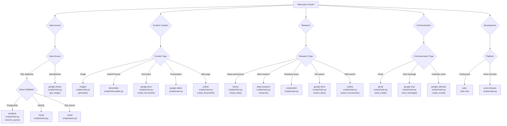
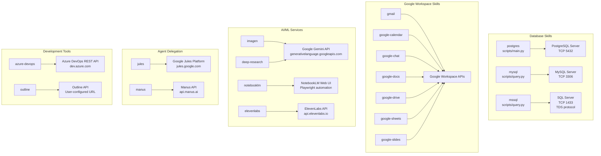

<!-- source: DeepWiki mcp.deepwiki.com · repo sanjay3290/ai-skills · page 4 Skills by Category · fetched 2026-10-27 -->

# Skills by Category

<details>
<summary>Relevant source files</summary>

The following files were used as context for generating this wiki page:

- [.claude-plugin/marketplace.json](.claude-plugin/marketplace.json)
- [README.md](README.md)
- [skills/jules/SKILL.md](skills/jules/SKILL.md)
- [skills/manus/SKILL.md](skills/manus/SKILL.md)

</details>


This document organizes all 18 skills in the ai-skills repository into five functional categories, each following a distinct architectural pattern optimized for its integration scenario. For detailed documentation of individual skills, see the child pages: [Database Skills](#4.2), [AI & ML Services](#4.3), [Agent Delegation](#4.4), [Development Tools](#4.5), and [Google Workspace Skills](#5).

## Overview of Categories

The repository contains 18 skills organized into five categories based on their architectural patterns and use cases:

| Category | Count | Skills | Core Pattern | Use Cases |
|----------|-------|--------|--------------|-----------|
| **Database Skills** | 3 | postgres, mysql, mssql | Read-only query wrapper with `connections.json` | Database analytics, schema inspection, data exploration |
| **Google Workspace Skills** | 7 | gmail, google-calendar, google-chat, google-docs, google-drive, google-sheets, google-slides | OAuth + keyring with shared `auth.py` | Productivity, collaboration, document management |
| **AI/ML Services** | 4 | imagen, deep-research, notebooklm, elevenlabs | Request/response API adapters | Content generation, research, multimedia creation |
| **Agent Delegation** | 2 | jules, manus | Async task submission with polling | Autonomous coding tasks, deep research projects |
| **Development Tools** | 2 | azure-devops, outline | Comprehensive platform wrappers | DevOps workflows, wiki management |

**Sources:** [README.md:27-42](), [.claude-plugin/marketplace.json:15-34]()
</thinking>

## Category Architectural Patterns

Each category implements a distinct architectural pattern tailored to its integration requirements:

```mermaid
graph TB
    subgraph "Database Skills Pattern"
        DB_User["User Query"] --> DB_Skill["scripts/main.py<br/>execute_query()"]
        DB_Skill --> DB_Config["connections.json<br/>named connections"]
        DB_Skill --> DB_Validate["Query Validator<br/>read-only enforcement"]
        DB_Validate --> DB_Driver["psycopg2 / mysql.connector / pymssql"]
        DB_Driver --> DB_External["Database Server"]
    end
    
    subgraph "Google Workspace Pattern"
        GW_User["User Request"] --> GW_Skill["scripts/main.py<br/>service operations"]
        GW_Skill --> GW_Auth["scripts/auth.py<br/>OAuth + keyring"]
        GW_Auth --> GW_Keyring["System Keyring<br/>refresh tokens"]
        GW_Skill --> GW_Client["google-api-python-client"]
        GW_Client --> GW_External["Google Workspace APIs"]
    end
    
    subgraph "AI/ML Services Pattern"
        AI_User["User Request"] --> AI_Skill["scripts/main.py<br/>API wrapper"]
        AI_Skill --> AI_Env["Environment Variables<br/>API keys"]
        AI_Skill --> AI_Client["requests / SDK"]
        AI_Client --> AI_External["AI Service API"]
    end
    
    subgraph "Agent Delegation Pattern"
        AG_User["Task Submission"] --> AG_Skill["scripts/main.py<br/>create_task()"]
        AG_Skill --> AG_API["Agent API<br/>async execution"]
        AG_API --> AG_Poll["Polling Loop<br/>status checks"]
        AG_Poll --> AG_Results["scripts/main.py<br/>retrieve_results()"]
    end
    
    subgraph "Development Tools Pattern"
        DT_User["User Command"] --> DT_Skill["scripts/main.py<br/>multi-module CLI"]
        DT_Skill --> DT_Auth["OAuth or PAT<br/>keyring storage"]
        DT_Skill --> DT_Client["Platform SDK"]
        DT_Client --> DT_External["Platform API"]
    end
```



**Diagram 1: Architectural Patterns by Category**

This diagram illustrates the five distinct integration patterns. Database skills emphasize safety through query validation. Google Workspace skills share OAuth infrastructure. AI/ML services are stateless request/response wrappers. Agent delegation uses async execution with polling. Development tools provide comprehensive multi-command interfaces.

**Sources:** [README.md:27-42](), skill directory structures, [skills/postgres/scripts/main.py](), [skills/gmail/scripts/auth.py](), [skills/jules/SKILL.md](), [skills/manus/SKILL.md]()

## Database Skills (3 Skills)

Database skills follow a **read-only query pattern** with multiple named connections and defense-in-depth safety features. All three skills share the same security architecture: query validation, write operation blocking, timeouts, row limits, and credential sanitization.

| Skill | Database | Driver | Key Feature | Configuration |
|-------|----------|--------|-------------|---------------|
| **postgres** | PostgreSQL | `psycopg2-binary` | Multiple databases in `connections.json` | [skills/postgres/connections.json]() |
| **mysql** | MySQL | `mysql-connector-python` | SSL configuration, LIMIT clause handling | [skills/mysql/connections.json]() |
| **mssql** | Microsoft SQL Server | `pymssql` | TDS protocol, TOP N conversion | [skills/mssql/connections.json]() |

**Common Pattern:**
- Execute queries via `scripts/main.py execute_query` or `scripts/query.py`
- Configuration in `connections.json` with named connections
- Query validation: single statement, read-only enforcement
- Safety limits: 30s query timeout, 10K row maximum
- Error sanitization: credentials removed from error messages

**See [Database Skills](#4.2) for detailed documentation of each skill.**

**Sources:** [README.md:31-33](), [.claude-plugin/marketplace.json:16](), [.claude-plugin/marketplace.json:32-33]()

## Google Workspace Skills (7 Skills)

Google Workspace skills implement a shared **OAuth + keyring pattern** with automatic token refresh. These skills comprise 39% of the repository (7 of 18 skills) and provide lightweight alternatives to the full Google Workspace MCP server.

| Skill | Service | Primary Operations | Script Entry Point |
|-------|---------|-------------------|-------------------|
| **gmail** | Gmail API | Search, send, read, labels | [skills/gmail/scripts/main.py]() |
| **google-calendar** | Calendar API | Events, scheduling, free time | [skills/google-calendar/scripts/main.py]() |
| **google-chat** | Chat API | Spaces, messages, DMs, threads | [skills/google-chat/scripts/main.py]() |
| **google-docs** | Docs API | Create, read, edit documents | [skills/google-docs/scripts/main.py]() |
| **google-drive** | Drive API | Search, download, list folders | [skills/google-drive/scripts/main.py]() |
| **google-sheets** | Sheets API | Read ranges, write cells, formulas | [skills/google-sheets/scripts/main.py]() |
| **google-slides** | Slides API | Read presentations, extract text | [skills/google-slides/scripts/main.py]() |

**Common Pattern:**
- Authentication via `scripts/auth.py login` (opens browser OAuth flow)
- Tokens stored in system keyring (macOS Keychain, Windows Credential Locker, Linux Secret Service)
- Each skill has unique keyring service identifier (e.g., `gmail-skill-oauth`)
- Auto-refresh via Google Cloud Function
- Requires Google Workspace account (personal Gmail not supported)

**See [Google Workspace Skills](#5) for detailed documentation of each skill.**

**Sources:** [README.md:43-57](), [.claude-plugin/marketplace.json:22-28](), [README.md:249-267]()

## AI & ML Services (4 Skills)

AI/ML skills are **stateless request/response adapters** for various AI APIs. These skills enable AI-assisted content generation, research, and multimedia creation within coding workflows.

| Skill | API Service | Primary Capability | Authentication | Model/Technology |
|-------|-------------|-------------------|----------------|------------------|
| **imagen** | Google Gemini | Text-to-image generation | `GEMINI_API_KEY` | imagen-3.0-generate-001 |
| **deep-research** | Google Gemini | Autonomous web research | `GEMINI_API_KEY` | gemini-2.0-flash-thinking-exp-01-21 |
| **notebooklm** | NotebookLM | Query AI notebooks | Playwright browser automation | Chrome profile persistence |
| **elevenlabs** | ElevenLabs | Text-to-speech, podcasts | `ELEVENLABS_API_KEY` in `config.json` | TTS with multi-voice support |

**Pattern Characteristics:**
- **imagen**: Generate 512px, 1K, or 2K images from text prompts (~$0.02-0.08 per image)
- **deep-research**: Multi-step research consuming 250K-900K tokens ($2-5 per query, 2-10 min duration)
- **notebooklm**: Browser automation via Playwright (no official API), persistent Chrome profiles
- **elevenlabs**: Single-voice narration or two-host podcast generation, requires `ffmpeg` for concatenation

**See [AI & ML Services](#4.3) for detailed documentation of each skill.**

**Sources:** [README.md:34-40](), [.claude-plugin/marketplace.json:17,19,29,31](), [README.md:192-235]()

## Agent Delegation (2 Skills)

Agent delegation skills implement an **async execution pattern** where tasks are submitted to autonomous agents for completion, then results are retrieved after polling for status.

| Skill | Agent Platform | Primary Use Case | Task Duration | Authentication |
|-------|---------------|------------------|---------------|----------------|
| **jules** | Google Jules | GitHub repository tasks: bugs, tests, docs, features | Minutes to hours | CLI OAuth via `jules login` |
| **manus** | Manus | Deep research, market analysis, product comparisons | 1-10+ minutes | `MANUS_API_KEY` |

**Common Workflow:**
1. **Submit task** → Returns `task_id` or `session_id`
2. **Poll status** → Check until `completed` or `failed`
3. **Retrieve results** → Pull diffs (Jules) or reports/visualizations (Manus)

**Pattern Details:**

**jules**:
- Requires `@google/jules` npm package globally installed
- Credentials stored in `~/.jules/credentials`
- Submit via `jules new "task description"`
- Monitor via `jules remote list --session`
- Retrieve via `jules remote pull --session <id>`
- User feedback required via web UI (no CLI interaction for agent questions)

**manus**:
- Three agent profiles: `manus-1.6-lite` (fast), `manus-1.6` (standard), `manus-1.6-max` (complex)
- API endpoint: `https://api.manus.ai`
- Parallel processing for multi-faceted research
- Outputs markdown reports, CSVs, charts, and visualizations
- Tasks accessible at `https://manus.im/app/{task_id}`

**See [Agent Delegation](#4.4) for detailed documentation of each skill.**

**Sources:** [README.md:37-38](), [.claude-plugin/marketplace.json:21,30](), [skills/jules/SKILL.md:1-201](), [skills/manus/SKILL.md:1-185]()

## Development Tools (2 Skills)

Development tools are **comprehensive platform integrations** providing multi-module CLIs with extensive command coverage for DevOps and documentation workflows.

| Skill | Platform | Modules/Domains | Total Commands | Authentication Options |
|-------|----------|-----------------|----------------|----------------------|
| **azure-devops** | Azure DevOps | 13 domains (work items, repos, pipelines, test plans, security, wiki, etc.) | 99 commands | OAuth (default) or PAT |
| **outline** | Outline Wiki | Wiki operations (collections, documents, search) | ~10 commands | API key |

**Pattern Characteristics:**

**azure-devops**:
- Most comprehensive skill with 13 modules covering the entire DevOps lifecycle
- Modules: work items, repositories, pull requests, pipelines, builds, test plans, security alerts, variable groups, environments, approvals, branch policies, wiki, attachments
- Dual authentication: OAuth device code flow (default) or Personal Access Token (`--pat` flag)
- Credentials stored in system keyring with service identifier `azure-devops-skill`
- Organization required: `--org MyOrganization` parameter

**outline**:
- Wiki/knowledge base operations: search, read, create, update documents
- Manage collections and document hierarchy
- Requires `OUTLINE_API_KEY` and optional `OUTLINE_API_URL` (defaults to user's instance)
- Simple HTTP API client via `requests` library

**See [Development Tools](#4.5) for detailed documentation of each skill.**

**Sources:** [README.md:41](), [README.md:36](), [.claude-plugin/marketplace.json:18,20](), [README.md:237-246](), [README.md:199-204]()

## Category Selection Decision Tree



**Diagram 2: Category Selection Decision Tree**

This decision tree maps user intent to specific skills and their entry point functions. Each leaf node shows the skill name, script path, and primary function. This bridges natural language requests to code entities.

**Sources:** [README.md:27-42](), [.claude-plugin/marketplace.json:15-34](), skill directory structures

## Skill Structure by Category

```mermaid
graph TB
    subgraph "Database Skills Structure"
        DB_SKILL["SKILL.md<br/>name: postgres/mysql/mssql<br/>description: read-only queries"]
        DB_CONN["connections.json<br/>named connections"]
        DB_SCRIPT["scripts/main.py or query.py<br/>execute_query()"]
        
        DB_SKILL --> DB_SCRIPT
        DB_CONN --> DB_SCRIPT
    end
    
    subgraph "Google Workspace Skills Structure"
        GW_SKILL["SKILL.md<br/>name: gmail/calendar/chat/etc<br/>description: service operations"]
        GW_AUTH["scripts/auth.py<br/>login() logout()"]
        GW_MAIN["scripts/main.py<br/>service_operation()"]
        GW_KEYRING["System Keyring<br/>*-skill-oauth"]
        
        GW_SKILL --> GW_MAIN
        GW_AUTH --> GW_KEYRING
        GW_KEYRING --> GW_MAIN
    end
    
    subgraph "AI/ML Services Structure"
        AI_SKILL["SKILL.md<br/>name: imagen/deep-research/etc<br/>description: AI capabilities"]
        AI_ENV[".env or config.json<br/>API keys"]
        AI_SCRIPT["scripts/main.py<br/>generate() / research()"]
        
        AI_SKILL --> AI_SCRIPT
        AI_ENV --> AI_SCRIPT
    end
    
    subgraph "Agent Delegation Structure"
        AG_SKILL["SKILL.md<br/>name: jules/manus<br/>description: async tasks"]
        AG_SCRIPT["scripts/main.py or CLI<br/>create_task() poll() results()"]
        AG_AUTH["Auth Storage<br/>~/.jules or MANUS_API_KEY"]
        
        AG_SKILL --> AG_SCRIPT
        AG_AUTH --> AG_SCRIPT
    end
    
    subgraph "Development Tools Structure"
        DT_SKILL["SKILL.md<br/>name: azure-devops/outline<br/>description: platform ops"]
        DT_MAIN["scripts/main.py<br/>multi-module commands"]
        DT_AUTH["scripts/auth.py or API_KEY<br/>OAuth or token"]
        DT_KEYRING["System Keyring<br/>platform credentials"]
        
        DT_SKILL --> DT_MAIN
        DT_AUTH --> DT_KEYRING
        DT_KEYRING --> DT_MAIN
    end
    
    AI_Client["AI Client"] --> DB_SKILL
    AI_Client --> GW_SKILL
    AI_Client --> AI_SKILL
    AI_Client --> AG_SKILL
    AI_Client --> DT_SKILL
```



**Diagram 3: Skill Structure by Category**

This diagram shows how each category's skills are structured. Database skills use `connections.json` for configuration. Google Workspace skills share OAuth via `scripts/auth.py` and system keyring. AI/ML services use environment variables or config files. Agent delegation uses external auth storage. Development tools combine OAuth/keyring with multi-module CLIs.

**Sources:** [README.md:332-356](), skill directory structures, [skills/postgres/connections.json](), [skills/gmail/scripts/auth.py]()

## Category Execution Patterns

### Database Skills Execution

All database skills execute read-only queries with safety validation:

```bash
# PostgreSQL
python skills/postgres/scripts/main.py execute_query \
  --connection production \
  --query "SELECT * FROM users LIMIT 10"

# MySQL
python skills/mysql/scripts/query.py \
  --connection staging \
  --query "SELECT COUNT(*) FROM orders"

# SQL Server
python skills/mssql/scripts/query.py \
  --connection warehouse \
  --query "SELECT TOP 5 * FROM products"
```

**Common safety features:** Single statement validation, 30s timeout, 10K row limit, credential sanitization in errors.

**Sources:** [skills/postgres/scripts/main.py](), [skills/mysql/scripts/query.py](), [skills/mssql/scripts/query.py]()

### Google Workspace Skills Execution

All Google Workspace skills follow the pattern: authenticate once, then execute operations:

```bash
# One-time authentication (opens browser)
python skills/gmail/scripts/auth.py login

# Execute operations (auto-uses keyring token)
python skills/gmail/scripts/main.py search_messages --query "from:john@example.com"
python skills/google-calendar/scripts/main.py list_events --days 7
python skills/google-chat/scripts/main.py send_message --space "Project Alpha" --text "Update"
```

**Common pattern:** `scripts/auth.py` for OAuth setup, `scripts/main.py` for operations, keyring auto-refresh.

**Sources:** [skills/gmail/scripts/auth.py](), [skills/gmail/scripts/main.py](), [README.md:249-262]()

### AI/ML Services Execution

AI/ML skills use stateless API calls with environment variable authentication:

```bash
# Imagen (requires GEMINI_API_KEY)
export GEMINI_API_KEY=your_key
python skills/imagen/scripts/main.py generate \
  --text "mountain landscape at sunset" \
  --output image.png

# Deep Research (expensive, 2-10 min runtime)
python skills/deep-research/scripts/main.py research \
  --query "Compare EV battery technologies" \
  --output research.md

# ElevenLabs (requires config.json or ELEVENLABS_API_KEY)
python skills/elevenlabs/scripts/elevenlabs.py narrate \
  --input document.pdf \
  --output audio.mp3
```

**Pattern:** Simple request/response, no state, API key in environment or config file.

**Sources:** [skills/imagen/scripts/main.py](), [skills/deep-research/scripts/main.py](), [skills/elevenlabs/scripts/elevenlabs.py]()

### Agent Delegation Execution

Agent skills use async workflows: submit task, poll status, retrieve results:

```bash
# Jules (requires npm install -g @google/jules && jules login)
jules new "Fix authentication bug in src/auth.js"
jules remote list --session  # Check status
jules remote pull --session <id>  # Get results when complete

# Manus (requires MANUS_API_KEY)
curl -X POST https://api.manus.ai/v1/tasks \
  -H "API_KEY:$MANUS_API_KEY" \
  -d '{"prompt":"Research best 4K monitors","agentProfile":"manus-1.6"}'
# Poll task status, extract results when complete
```

**Pattern:** Async execution, requires polling, external web UI for feedback (Jules) or API status checks (Manus).

**Sources:** [skills/jules/SKILL.md:38-63](), [skills/manus/SKILL.md:64-116]()

### Development Tools Execution

Development tools provide multi-command CLIs with comprehensive platform coverage:

```bash
# Azure DevOps (requires auth.py login)
python skills/azure-devops/scripts/auth.py login --org MyOrganization
python skills/azure-devops/scripts/main.py work-items list --project Sandbox
python skills/azure-devops/scripts/main.py repos list-repos --org MyOrg --project MyProject
python skills/azure-devops/scripts/main.py pipelines run --org MyOrg --project MyProject --pipeline-id 123

# Outline (requires OUTLINE_API_KEY)
export OUTLINE_API_KEY=your_key
python skills/outline/scripts/main.py search_documents --query "deployment"
python skills/outline/scripts/main.py create_document --title "API Spec" --text "..."
```

**Pattern:** Multi-module organization, comprehensive command sets, platform-specific authentication.

**Sources:** [skills/azure-devops/scripts/main.py](), [skills/outline/scripts/main.py](), [README.md:237-246](), [README.md:199-204]()

## Cross-Category Comparison

### Authentication Methods by Category

| Category | Authentication Type | Storage Location | First-Time Setup | Renewal |
|----------|-------------------|------------------|------------------|---------|
| Database Skills | Credentials in JSON | [skills/*/connections.json]() | Manual JSON editing | Manual rotation |
| Google Workspace | OAuth + keyring | System keyring (`*-skill-oauth`) | `scripts/auth.py login` (browser) | Automatic via cloud function |
| AI/ML Services | API keys | Environment vars or config file | Set `*_API_KEY` variable | Manual rotation |
| Agent Delegation | CLI OAuth or API key | `~/.jules/credentials` or env var | `jules login` or set env var | Automatic (Jules) or manual (Manus) |
| Development Tools | OAuth or PAT | System keyring | `scripts/auth.py login` or config | Automatic (OAuth) or manual (PAT) |

**Sources:** [README.md:177-267](), skill authentication scripts

### Execution Time and Cost by Category

| Category | Typical Duration | Cost Model | Use Case |
|----------|-----------------|------------|----------|
| Database Skills | < 1 second | Free (user's infrastructure) | Quick data lookups, analytics queries |
| Google Workspace | 1-3 seconds | Free (Workspace subscription) | Document operations, email, calendar |
| AI/ML Services | 2 seconds - 10 minutes | $0.02 - $5.00 per operation | Image generation ($0.02-0.08), research ($2-5), TTS (usage-based) |
| Agent Delegation | Minutes to hours | Platform-dependent | Complex multi-step tasks, code generation, deep research |
| Development Tools | < 5 seconds | Free (platform subscriptions) | DevOps workflows, wiki management |

**Note:** `deep-research` is an outlier with 2-10 minute execution and $2-5 cost per query due to autonomous multi-step processing.

**Sources:** [README.md:196](), [skills/deep-research/SKILL.md](), [skills/manus/SKILL.md]()

## Category Dependencies

### Python Dependencies by Category

| Category | Common Dependencies | Skill-Specific Dependencies |
|----------|-------------------|---------------------------|
| **Database Skills** | `psycopg2-binary`, `mysql-connector-python`, `pymssql` | None (driver per database type) |
| **Google Workspace** | `google-auth`, `google-auth-oauthlib`, `google-api-python-client`, `keyring` | Service-specific scopes in auth |
| **AI/ML Services** | `requests`, `google-generativeai` | `playwright` (notebooklm), `pymupdf`, `python-docx` (elevenlabs) |
| **Agent Delegation** | None (Jules uses npm, Manus uses curl) | `@google/jules` (npm), `jq` for JSON parsing |
| **Development Tools** | `keyring`, `requests` | `azure-devops` (azure-devops skill) |

**Sources:** [README.md:185-189](), [README.md:231-233](), skill `requirements.txt` files

### External Service Dependencies by Category



**Diagram 4: External Service Dependencies by Category**

This diagram maps each category to its external services. Database skills connect to RDBMS servers. Google Workspace skills share a common API gateway. AI/ML services use various APIs (Gemini, ElevenLabs) or browser automation (NotebookLM). Agent skills delegate to autonomous platforms. Development tools integrate with DevOps/wiki platforms.

**Sources:** [README.md:27-42](), [.claude-plugin/marketplace.json:15-34](), skill script files

## Configuration by Category

### Configuration Patterns

| Category | Configuration Method | Storage Location | Setup Command | Renewal |
|----------|---------------------|------------------|---------------|---------|
| **Database Skills** | JSON file with named connections | [skills/*/connections.json]() | Manual editing, `chmod 600` | Manual credential rotation |
| **Google Workspace** | OAuth browser flow | System keyring (`*-skill-oauth`) | `python scripts/auth.py login` | Automatic via cloud function |
| **AI/ML Services** | Environment variables or JSON | `.env` or `config.json` | `export *_API_KEY=...` | Manual key rotation |
| **Agent Delegation** | Platform-specific | `~/.jules/credentials` or env var | `jules login` or `export MANUS_API_KEY=...` | Automatic (Jules), manual (Manus) |
| **Development Tools** | OAuth or API key | System keyring or env var | `python scripts/auth.py login` or export | Depends on method |

**Sources:** [README.md:177-267](), skill configuration files

### Required Configuration Fields by Category

**Database Skills:**
```json
{
  "connections": [
    {
      "name": "production",
      "host": "db.example.com",
      "port": 5432,
      "database": "myapp",
      "user": "readonly",
      "password": "secret"
    }
  ]
}
```

**AI/ML Services:**
```bash
# Environment variables
GEMINI_API_KEY=your_key           # imagen, deep-research
ELEVENLABS_API_KEY=your_key       # elevenlabs
MANUS_API_KEY=your_key            # manus
OUTLINE_API_KEY=your_key          # outline
OUTLINE_API_URL=https://wiki.example.com/api  # outline (optional)
```

**Google Workspace (OAuth):**
```bash
# One-time browser authentication
python ~/.claude/skills/gmail/scripts/auth.py login
# Tokens stored in keyring: gmail-skill-oauth, google-calendar-skill-oauth, etc.
```

**Agent Delegation:**
```bash
# Jules: CLI installation + OAuth
npm install -g @google/jules
jules login  # Opens browser, stores in ~/.jules/credentials

# Manus: API key
export MANUS_API_KEY=your_key
```

**Development Tools:**
```bash
# Azure DevOps: OAuth or PAT
python scripts/auth.py login --org MyOrganization
# or
python scripts/auth.py login --org MyOrganization --pat YOUR_PAT

# Outline: API key (covered in AI/ML Services above)
```

**Sources:** [README.md:182-246](), skill README files

## Usage Examples by Category

### Data Access Queries

| Operation | Skill | Natural Language Example |
|-----------|-------|-------------------------|
| SQL query | postgres | "Query the users table for accounts created last week" |
| Spreadsheet data | google-sheets | "Get the Q4 revenue data from the Budget spreadsheet" |
| Database schema | postgres | "Show me the schema of the orders table" |
| Cell range | google-sheets | "Read cells A1:D10 from the Sales sheet" |

### Content Creation

| Operation | Skill | Natural Language Example |
|-----------|-------|-------------------------|
| Image generation | imagen | "Generate a sunset over mountains in 1024x1024 resolution" |
| Document creation | google-docs | "Create a new Google Doc titled 'Project Proposal'" |
| Wiki page | outline | "Create a wiki page documenting the API endpoints" |
| Presentation | google-slides | "Create a new presentation about Q1 results" |

### Research Operations

| Operation | Skill | Natural Language Example |
|-----------|-------|-------------------------|
| Deep research | deep-research | "Research the competitive landscape of EV batteries" |
| Document search | outline | "Search the wiki for deployment procedures" |
| File search | google-drive | "Find all PDFs containing 'invoice' in my Drive" |
| Email search | gmail | "Search my emails for messages from john@example.com last month" |

### Communication

| Operation | Skill | Natural Language Example |
|-----------|-------|-------------------------|
| Send email | gmail | "Send an email to team@example.com with subject 'Meeting Notes'" |
| Chat message | google-chat | "Send a message to the Project Alpha space" |
| Calendar event | google-calendar | "Create a meeting tomorrow at 2pm for the team sync" |
| Find availability | google-calendar | "When is everyone free next week for a 1-hour meeting?" |

**Sources:** [README.md:179-210]()

## Cost and Performance Considerations

| Skill | Cost Model | Typical Execution Time | Rate Limits |
|-------|-----------|----------------------|-------------|
| postgres | Free (user's database) | < 1 second | Database-dependent |
| imagen | ~$0.02-0.08 per image (Gemini API pricing) | 2-5 seconds | Gemini API limits |
| deep-research | $2-5 per query (Gemini API usage) | 2-10 minutes | Gemini API limits |
| outline | Free (user's instance) | < 1 second | Outline API limits |
| gmail | Free (Workspace) | 1-3 seconds | Google API quota |
| google-calendar | Free (Workspace) | 1-3 seconds | Google API quota |
| google-chat | Free (Workspace) | 1-3 seconds | Google API quota |
| google-docs | Free (Workspace) | 1-3 seconds | Google API quota |
| google-drive | Free (Workspace) | 1-5 seconds (download varies) | Google API quota |
| google-sheets | Free (Workspace) | 1-3 seconds | Google API quota |
| google-slides | Free (Workspace) | 1-3 seconds | Google API quota |

**Note:** The `deep-research` skill is significantly more expensive and slower than other skills due to its multi-step autonomous research process using Gemini's experimental thinking model.

**Sources:** [README.md:150]()

## Skill Compatibility Matrix

### AI Client Support

All skills in this repository follow the [Agent Skills Standard](https://agentskills.io) and are compatible with:

- Claude Code (`~/.claude/skills/` or `.claude/skills/`)
- Gemini CLI (`~/.gemini/skills/` or `.gemini/skills/`)
- Google Antigravity (`~/.gemini/antigravity/skills/` or `.agent/skills/`)
- Cursor (`~/.cursor/skills/` or `.cursor/skills/`)
- OpenAI Codex CLI (`~/.codex/skills/` or `.codex/skills/`)
- Goose (`~/.config/goose/skills/` or `.goose/skills/`)

### Platform Support

| Skill | Windows | macOS | Linux | Special Requirements |
|-------|---------|-------|-------|---------------------|
| postgres | ✓ | ✓ | ✓ | Network access to PostgreSQL |
| imagen | ✓ | ✓ | ✓ | None |
| deep-research | ✓ | ✓ | ✓ | None |
| outline | ✓ | ✓ | ✓ | Network access to Outline API |
| gmail | ✓ | ✓ | ✓ | Google Workspace account |
| google-calendar | ✓ | ✓ | ✓ | Google Workspace account |
| google-chat | ✓ | ✓ | ✓ | Google Workspace account |
| google-docs | ✓ | ✓ | ✓ | Google Workspace account |
| google-drive | ✓ | ✓ | ✓ | Google Workspace account |
| google-sheets | ✓ | ✓ | ✓ | Google Workspace account |
| google-slides | ✓ | ✓ | ✓ | Google Workspace account |

**Important:** Personal Gmail accounts are NOT supported for Google Workspace skills. A paid Google Workspace account is required.

**Sources:** [README.md:5-24](), [README.md:38]()

---

