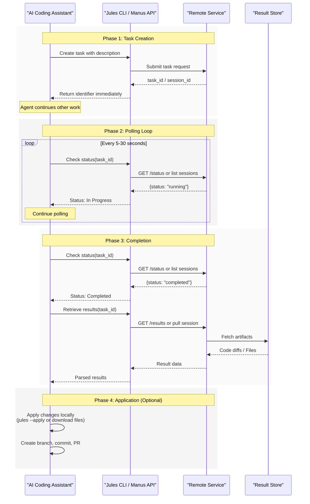
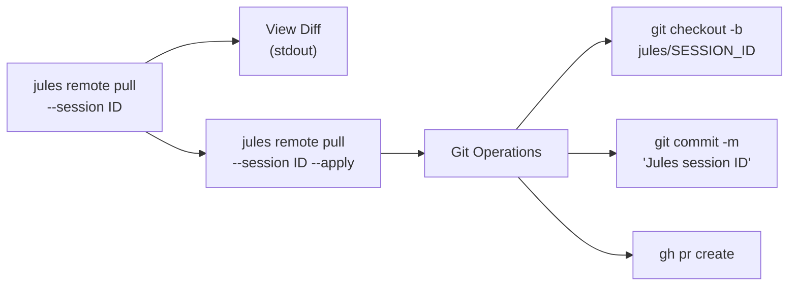
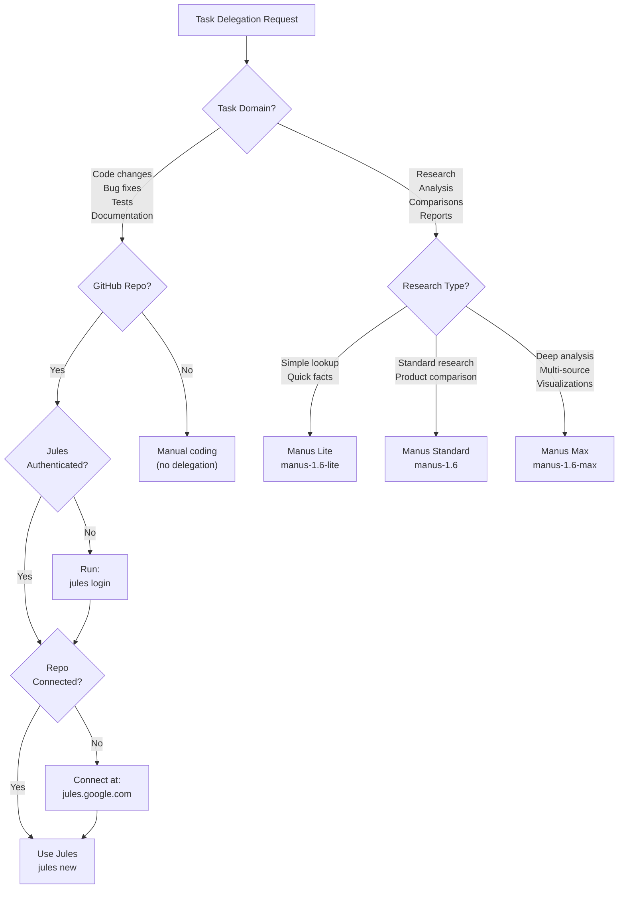

<!-- source: DeepWiki mcp.deepwiki.com · repo sanjay3290/ai-skills · page 4.4 Agent Delegation · fetched 2026-10-27 -->

# Agent Delegation

<details>
<summary>Relevant source files</summary>

The following files were used as context for generating this wiki page:

- [README.md](README.md)
- [skills/jules/SKILL.md](skills/jules/SKILL.md)
- [skills/manus/SKILL.md](skills/manus/SKILL.md)

</details>


## Purpose and Scope

This document covers skills that delegate long-running tasks to external AI agents for asynchronous execution. These skills enable AI coding assistants to offload complex work that would otherwise block the main conversation flow. Two delegation skills are available: **Jules** for GitHub coding tasks and **Manus** for deep research tasks.

For implementation details on specific agents, see [Jules (GitHub Agent)](#4.4.1) and [Manus (Research Agent)](#4.4.2). For other AI service integrations that run synchronously, see [AI & ML Services](#4.3).

## Core Concept

Agent delegation skills implement a task handoff pattern where the AI coding assistant creates a task, receives an immediate task identifier, and then polls for completion rather than blocking on the response. This enables:

- **Long-running operations** that take minutes to hours
- **Parallel task execution** while the AI continues other work
- **Resource-intensive processing** offloaded to specialized agents
- **Autonomous execution** without human supervision during processing

The delegation pattern differs from direct API calls in that the initiating agent does not wait for results, instead treating the delegated task as a background job.

## Architectural Comparison

```mermaid
graph TB
    subgraph Jules["Jules Delegation (GitHub Coding)"]
        JulesUser["AI Agent"]
        JulesCLI["jules CLI<br/>(@google/jules)"]
        JulesRemote["Jules Remote Service<br/>jules.google.com"]
        JulesGitHub["GitHub API<br/>Repos, PRs, Branches"]
        
        JulesUser -->|"jules new"| JulesCLI
        JulesCLI -->|"Create session"| JulesRemote
        JulesRemote -->|"session_id"| JulesCLI
        JulesCLI -->|"session_id"| JulesUser
        
        JulesUser -.->|"Poll: jules remote list --session"| JulesCLI
        JulesCLI -.->|"GET /sessions"| JulesRemote
        JulesRemote -.->|"Status: Planning/InProgress/Completed"| JulesCLI
        
        JulesUser -->|"jules remote pull --session ID --apply"| JulesCLI
        JulesCLI -->|"GET /results"| JulesRemote
        JulesRemote -->|"Code diffs"| JulesCLI
        
        JulesRemote -->|"Autonomous coding"| JulesGitHub
    end
    
    subgraph Manus["Manus Delegation (Research)"]
        ManusUser["AI Agent"]
        ManusAPI["Manus REST API<br/>api.manus.ai/v1/tasks"]
        ManusAgent["Manus Agent<br/>manus-1.6 / manus-1.6-max"]
        ManusWeb["Web Sources<br/>Research + Scraping"]
        
        ManusUser -->|"POST /v1/tasks"| ManusAPI
        ManusAPI -->|"{task_id, task_url}"| ManusUser
        
        ManusUser -.->|"Poll: GET /v1/tasks/ID"| ManusAPI
        ManusAPI -.->|"{status: pending/running/completed}"| ManusUser
        
        ManusUser -->|"GET /v1/tasks/ID"| ManusAPI
        ManusAPI -->|"{output[], attachments[]}"| ManusUser
        
        ManusAPI -->|"Execute task"| ManusAgent
        ManusAgent -->|"Autonomous research"| ManusWeb
    end
```



**Sources**: [skills/jules/SKILL.md:1-201](), [skills/manus/SKILL.md:1-185]()

## Delegation Pattern Comparison

| Aspect | Jules | Manus |
|--------|-------|-------|
| **Interface** | CLI (`@google/jules` npm package) | REST API (`https://api.manus.ai`) |
| **Task Creation** | `jules new "description" --repo owner/repo` | `POST /v1/tasks` with `{prompt, agentProfile}` |
| **Task Identifier** | `session_id` from stdout | `task_id` from JSON response |
| **Status Check** | `jules remote list --session` | `GET /v1/tasks/{task_id}` |
| **Status Values** | Planning, In Progress, Completed, Failed, Awaiting User Feedback | pending, running, completed, failed |
| **Poll Interval** | 30 seconds | 5-30 seconds (task complexity dependent) |
| **Result Retrieval** | `jules remote pull --session ID` | Parse `output[]` array from status response |
| **Result Format** | Code diffs (git format) | Text + file attachments (markdown, CSV, PNG) |
| **Apply Results** | `jules remote pull --session ID --apply` | Manual file download via `fileUrl` |
| **Typical Duration** | 5-30 minutes | 1-10 minutes |
| **Specialization** | GitHub repositories, code changes | Web research, data analysis |
| **Authentication** | OAuth via `jules login` | API key in `MANUS_API_KEY` |
| **Multi-turn** | Not supported (single session) | Supported via `taskId` continuation |
| **Parallel Execution** | `--parallel N` flag | Create multiple tasks |

**Sources**: [skills/jules/SKILL.md:39-63](), [skills/manus/SKILL.md:56-116]()

## Task Lifecycle Workflow



**Sources**: [skills/jules/SKILL.md:109-128](), [skills/manus/SKILL.md:56-96]()

## Task Creation Patterns

### Jules Task Creation

Jules uses the `jules new` command with auto-detection of the current Git repository:

```bash
# Auto-detect repo from git remote
jules new "Fix authentication bug in src/auth.js"

# Explicit repo specification
jules new --repo owner/repo "Add unit tests for payment module"

# Parallel execution
jules new --repo owner/repo --parallel 3 "Implement feature X"

# From stdin (for longer prompts)
cat task_description.md | jules new --repo owner/repo
```

The command flow in [skills/jules/SKILL.md:39-44]() shows:
1. CLI checks authentication status via `jules remote list --repo`
2. Auto-detects repo using `git remote get-url origin`
3. Submits task to jules.google.com
4. Returns session_id for tracking

**Sources**: [skills/jules/SKILL.md:39-57](), [skills/jules/SKILL.md:28-34]()

### Manus Task Creation

Manus uses HTTP POST to create tasks with configurable agent profiles:

```bash
curl -X POST "https://api.manus.ai/v1/tasks" \
  -H "API_KEY:$MANUS_API_KEY" \
  -H "Content-Type:application/json" \
  -d '{
    "prompt": "Research best 4K monitors for Mac with Thunderbolt",
    "agentProfile": "manus-1.6"
  }'
```

Response structure from [skills/manus/SKILL.md:73-76]():
```json
{
  "task_id": "abc123",
  "task_title": "Research best 4K monitors for Mac",
  "task_url": "https://manus.im/app/abc123"
}
```

**Agent profile selection**:
- `manus-1.6-lite`: Fast, simple lookups (< 1 minute)
- `manus-1.6`: Standard research tasks (1-5 minutes)
- `manus-1.6-max`: Deep multi-source analysis (5-10 minutes)

**Sources**: [skills/manus/SKILL.md:64-76](), [skills/manus/SKILL.md:68-71]()

## Status Polling Implementation

### Jules Status Polling

Jules polling uses CLI command parsing:

```bash
# List all sessions
jules remote list --session

# Extract latest session status
LATEST=$(jules remote list --session 2>/dev/null | awk 'NR==2 {print $1}')
STATUS=$(jules remote list --session 2>/dev/null | grep "$SESSION_ID" | awk '{print $NF}')
```

Status interpretation from [skills/jules/SKILL.md:187-193]():
- **Planning** / **In Progress**: Continue polling
- **Awaiting User Feedback**: User must respond via web UI (no CLI interaction)
- **Completed**: Ready to pull results
- **Failed**: Check web UI for error details

Polling loop pattern from [skills/jules/SKILL.md:135-154]():
```bash
while true; do
  STATUS=$(jules remote list --session 2>/dev/null | grep "$SESSION_ID" | awk '{print $NF}')
  case "$STATUS" in
    Completed) break ;;
    Failed) break ;;
    *User*) break ;;  # Needs input
    *) sleep 30 ;;
  esac
done
```

**Sources**: [skills/jules/SKILL.md:61-63](), [skills/jules/SKILL.md:135-154](), [skills/jules/SKILL.md:187-193]()

### Manus Status Polling

Manus polling uses JSON API responses:

```bash
# Check task status
curl -s -X GET "https://api.manus.ai/v1/tasks/{task_id}" \
  -H "API_KEY:$MANUS_API_KEY"
```

Response structure from [skills/manus/SKILL.md:79-86]():
```json
{
  "task_id": "abc123",
  "status": "running",
  "output": [],
  "credit_usage": 0.5
}
```

Status values: `pending`, `running`, `completed`, `failed`

Recommended poll interval from [skills/manus/SKILL.md:163-164]():
- Simple tasks (lite): 5-10 seconds
- Research tasks (standard/max): 15-30 seconds

**Sources**: [skills/manus/SKILL.md:79-96](), [skills/manus/SKILL.md:163-164]()

## Result Retrieval and Application

### Jules Result Retrieval



Application workflow from [skills/jules/SKILL.md:109-128]():
```bash
SESSION_ID="<id>"
TASK_DESC="Fix authentication bug"

# Create feature branch
git checkout -b "jules/$SESSION_ID"

# Apply Jules changes
jules remote pull --session "$SESSION_ID" --apply

# Commit
git add -A
git commit -m "feat: $TASK_DESC

Jules session: $SESSION_ID"

# Push and create PR
git push -u origin "jules/$SESSION_ID"
gh pr create --title "$TASK_DESC" --body "Automated changes from Jules session $SESSION_ID"
```

**Sources**: [skills/jules/SKILL.md:53-57](), [skills/jules/SKILL.md:109-128]()

### Manus Result Extraction

Manus returns structured output with text and file attachments:

```bash
# Extract text output
curl -s -X GET "https://api.manus.ai/v1/tasks/{task_id}" \
  -H "API_KEY:$MANUS_API_KEY" | \
  jq -r '.output[] | select(.role=="assistant") | .content[] | select(.type=="output_text") | .text'

# Extract file attachments
curl -s -X GET "https://api.manus.ai/v1/tasks/{task_id}" \
  -H "API_KEY:$MANUS_API_KEY" | \
  jq -r '.output[] | select(.role=="assistant") | .content[] | select(.type=="output_file") | "\(.fileName): \(.fileUrl)"'
```

Output structure from [skills/manus/SKILL.md:88-96]():
- **Text content**: Markdown reports, analysis summaries
- **File attachments**: CSV data, PNG charts, generated documents
- Each has URL for download: `https://manus.im/files/...`

Research tasks typically produce multiple artifacts as noted in [skills/manus/SKILL.md:167-168]().

**Sources**: [skills/manus/SKILL.md:88-96](), [skills/manus/SKILL.md:167-168]()

## Context Injection Strategies

### Jules Context Enhancement

Jules benefits from additional repository context in task prompts. The skill implements context injection from [skills/jules/SKILL.md:65-78]():

```bash
# Extract current branch
BRANCH=$(git branch --show-current)

# Recently modified files
RECENT_FILES=$(git diff --name-only HEAD~3 2>/dev/null | head -10 | tr '\n' ', ')

# Recent commits
RECENT_COMMITS=$(git log --oneline -5 | tr '\n' '; ')

# Staged changes
STAGED=$(git diff --cached --name-only | tr '\n' ', ')

# Create enriched prompt
jules new --repo owner/repo "Fix bug in auth module. Context: branch=$BRANCH, recently modified: $RECENT_FILES, recent commits: $RECENT_COMMITS"
```

Template prompts from [skills/jules/SKILL.md:83-107]():
- **Add tests**: Automatically detect recently modified source files
- **Add documentation**: Target files changed in last N commits
- **Fix lint errors**: Provide linter output as context
- **Review PR**: Include PR metadata via `gh pr view`

**Sources**: [skills/jules/SKILL.md:65-78](), [skills/jules/SKILL.md:83-107]()

### Manus Research Scoping

Manus tasks benefit from specific scope constraints in the prompt. Best practices from [skills/manus/SKILL.md:23-50]():

**Effective research prompt structure**:
```
Find [product type] with [specific requirements].
Focus on [brands/sources]. Only include [filters].
Compare [dimensions]. Output [desired format].
```

Example from [skills/manus/SKILL.md:28-32]():
```
Find the best 4K monitors for Mac with Thunderbolt connectivity and 120Hz+ refresh rate.
Focus on BenQ, Samsung, Dell, LG. Only include models released in the last year.
Compare specs, prices, and Mac-specific features. Output a comparison table.
```

**Sources**: [skills/manus/SKILL.md:23-50](), [skills/manus/SKILL.md:159-166]()

## Multi-Turn Conversations

### Jules Session Limitations

Jules does not support multi-turn conversations within a single session as noted in [skills/jules/SKILL.md:197-198](). Each `jules new` command creates an independent session. For follow-up work:
1. Wait for first session to complete
2. Create new session referencing previous session_id in prompt
3. Use context injection to maintain continuity

**Sources**: [skills/jules/SKILL.md:197-198]()

### Manus Task Continuation

Manus supports follow-up queries on completed tasks via [skills/manus/SKILL.md:104-110]():

```bash
# Initial task
TASK_ID=$(curl -s -X POST "https://api.manus.ai/v1/tasks" \
  -H "API_KEY:$MANUS_API_KEY" \
  -H "Content-Type:application/json" \
  -d '{"prompt":"Research EV battery technologies","agentProfile":"manus-1.6"}' | \
  jq -r '.task_id')

# Wait for completion...

# Follow-up question (continues same task)
curl -s -X POST "https://api.manus.ai/v1/tasks" \
  -H "API_KEY:$MANUS_API_KEY" \
  -H "Content-Type:application/json" \
  -d "{\"prompt\":\"Which technology has best energy density?\",\"taskId\":\"$TASK_ID\",\"agentProfile\":\"manus-1.6\"}"
```

Follow-ups preserve research context and previous findings.

**Sources**: [skills/manus/SKILL.md:104-110]()

## Agent Selection Decision Tree



**Sources**: [skills/jules/SKILL.md:1-8](), [skills/manus/SKILL.md:1-8](), [skills/manus/SKILL.md:68-71]()

## Best Practices

### General Delegation Principles

1. **Always report task URL**: Both Jules and Manus provide web UI URLs for monitoring
   - Jules: `https://jules.google.com/session/{session_id}`
   - Manus: `https://manus.im/app/{task_id}` (from [skills/manus/SKILL.md:73-76]())

2. **Implement timeout protection**: Set maximum poll duration to prevent infinite loops
   ```bash
   MAX_POLLS=60  # 30 minutes at 30s intervals
   poll_count=0
   while [ $poll_count -lt $MAX_POLLS ]; do
     # poll logic
     poll_count=$((poll_count + 1))
     sleep 30
   done
   ```

3. **Handle failed states gracefully**: Check for failure status and extract error messages

4. **Track resource consumption**: Manus provides `credit_usage` field ([skills/manus/SKILL.md:165]())

**Sources**: [skills/manus/SKILL.md:159-169](), [skills/jules/SKILL.md:197-200]()

### Jules-Specific Best Practices

From [skills/jules/SKILL.md:156-185]():

- **Use AGENTS.md**: Create `AGENTS.md` in repo root with project context, tech stack, code conventions, testing requirements
- **Verify authentication before delegation**: Check `jules remote list --repo` succeeds
- **Confirm repo connectivity**: Ensure repo appears in Jules connected repos list
- **Use parallel execution judiciously**: `--parallel N` for independent tasks only
- **Apply changes to feature branches**: Never apply directly to main/master
- **Include session_id in commit messages**: Enables traceability

**Sources**: [skills/jules/SKILL.md:14-34](), [skills/jules/SKILL.md:109-128](), [skills/jules/SKILL.md:156-184]()

### Manus-Specific Best Practices

From [skills/manus/SKILL.md:159-169]():

- **Choose agent profile appropriately**: Lite for speed, Max for depth
- **Be specific in research prompts**: Include scope, timeframe, sources, output format
- **Extract all attachments**: Research tasks produce multiple files (reports, CSVs, charts)
- **Use projects for shared context**: Create project with `POST /v1/projects` for repeated instructions
- **Monitor parallel processing**: Manus handles multi-faceted research in single prompt
- **Download files promptly**: File URLs may expire

**Sources**: [skills/manus/SKILL.md:159-169](), [skills/manus/SKILL.md:149-157]()

## Error Handling

### Jules Error Scenarios

From [skills/jules/SKILL.md:197-200]():

| Error | Detection | Resolution |
|-------|-----------|------------|
| Not authenticated | `jules remote list --repo` fails | Run `jules login` or `jules login --no-launch-browser` |
| Repo not connected | Repo missing from list | Visit jules.google.com to connect repo |
| Session failed | Status shows "Failed" | Check web UI for error details (no CLI error messages) |
| Needs user input | Status shows "Awaiting User Feedback" | Respond via web UI (CLI cannot interact) |
| Session timeout | No status change after max polls | Check web UI, may need to recreate task |

**Sources**: [skills/jules/SKILL.md:14-25](), [skills/jules/SKILL.md:187-200]()

### Manus Error Scenarios

From [skills/manus/SKILL.md:171-181]():

```bash
# Check for errors
curl -s -X GET "https://api.manus.ai/v1/tasks/{task_id}" \
  -H "API_KEY:$MANUS_API_KEY" | \
  jq '{status, error}'
```

| Error | HTTP Status | Cause | Resolution |
|-------|-------------|-------|------------|
| Invalid API key | 401 | `MANUS_API_KEY` missing or wrong | Set correct API key from manus.im/settings |
| Task failed | 200 (status: failed) | Task execution error | Check `error` field in response |
| Task timeout | 200 (status: failed) | Prompt too complex | Simplify prompt or use `manus-1.6-max` |
| Rate limited | 429 | Too many requests | Wait and retry with backoff |
| No credit | 402 | Account balance depleted | Add credits at manus.im |

**Sources**: [skills/manus/SKILL.md:171-181](), [skills/manus/SKILL.md:54]()

## Configuration Requirements

### Jules Setup

From [skills/jules/SKILL.md:14-34]():

1. **Install CLI**: `npm install -g @google/jules`
2. **Authenticate**: `jules login` (opens browser for OAuth)
3. **Connect repositories**: Visit jules.google.com to authorize GitHub repos
4. **Verify setup**: `jules remote list --repo` should show connected repos

Configuration file: None (OAuth tokens managed by CLI)

**Sources**: [skills/jules/SKILL.md:14-34](), [README.md:209-216]()

### Manus Setup

From [skills/manus/SKILL.md:54]() and [README.md:218-222]():

1. **Set API key**: `export MANUS_API_KEY=your-api-key`
2. **Get API key**: Register at manus.im, find key in settings

Configuration file: Environment variable only

Optional: Create projects for reusable instructions via `POST /v1/projects` ([skills/manus/SKILL.md:149-157]())

**Sources**: [skills/manus/SKILL.md:54](), [README.md:218-222](), [skills/manus/SKILL.md:149-157]()

---

