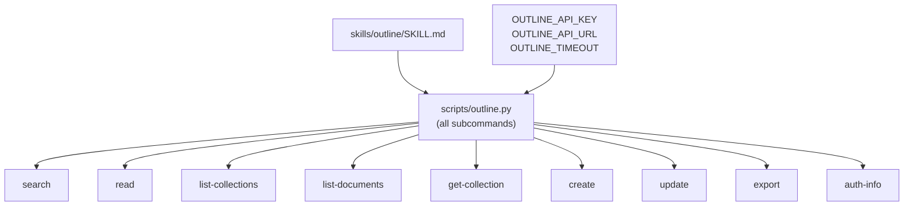
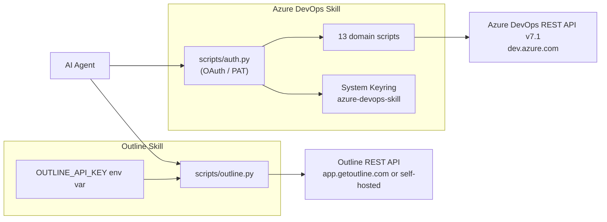

<!-- source: DeepWiki mcp.deepwiki.com · repo sanjay3290/ai-skills · page 4.5 Development Tools · fetched 2026-10-27 -->

# Development Tools

Relevant source files

The following files were used as context for generating this wiki page:

- [skills/azure-devops/SKILL.md](skills/azure-devops/SKILL.md)
- [skills/deep-research/SKILL.md](skills/deep-research/SKILL.md)
- [skills/elevenlabs/SKILL.md](skills/elevenlabs/SKILL.md)

This section covers the two skills in the **development and productivity tools** category: **Azure DevOps** and **Outline Wiki**. Both skills provide AI agents with programmatic access to external project management and documentation platforms used in software development workflows.

For detailed documentation of each skill, see:
- [Azure DevOps](#4.5.1) — full coverage of auth, work items, repos, pipelines, and all other modules
- [Outline Wiki](#4.5.2) — full coverage of search, read, create, update, and export operations

For skills that delegate tasks to external AI agents rather than directly calling APIs, see [Agent Delegation](#4.4).

---

## Skills in This Category

| Skill | Directory | Primary Script | Auth Method | External Service |
|---|---|---|---|---|
| azure-devops | `skills/azure-devops/` | `scripts/auth.py`, multiple module scripts | OAuth device code flow or PAT | Azure DevOps REST API v7.1 |
| outline | `skills/outline/` | `scripts/outline.py` | API key (`OUTLINE_API_KEY`) | Outline wiki REST API |

Sources: [skills/azure-devops/SKILL.md:1-13](), [skills/outline/SKILL.md:1-8]()

---

## Skill Architecture

Both skills follow the Agent Skills Standard: a `SKILL.md` file with YAML frontmatter describes the skill to the AI agent, and a `scripts/` directory contains the executable Python modules. For a description of how skills are discovered and loaded at agent session start, see [Skill Discovery & Installation](#3.2).

**Azure DevOps Skill — Module Structure**

The azure-devops skill is decomposed into one script per functional domain rather than a single monolithic script. Each domain module operates independently via its own CLI.

```mermaid
graph TD
    SKILLMD["skills/azure-devops/SKILL.md"]
    AUTH["scripts/auth.py\n(OAuth / PAT login, status, logout)"]
    CORE["scripts/core.py\n(projects, teams, identities)"]
    WORKITEMS["scripts/work_items.py\n(CRUD, WIQL, comments, links)"]
    REPOS["scripts/repos.py\n(git repos, branches, PRs, diffs)"]
    WORK["scripts/work.py\n(iterations, capacity)"]
    PIPELINES["scripts/pipelines.py\n(builds, runs, artifacts, stages)"]
    SEARCH["scripts/search.py\n(code, wiki, work items)"]
    WIKI["scripts/wiki.py\n(list, get, create/update pages)"]
    TESTPLANS["scripts/test_plans.py\n(plans, suites, cases, results)"]
    SECURITY["scripts/security.py\n(alert listing and detail)"]
    VARGROUPS["scripts/variable_groups.py\n(create, update, secrets)"]
    ENVS["scripts/environments.py\n(create, approve, reject)"]
    POLICIES["scripts/policies.py\n(branch policies, evaluations)"]
    ATTACHMENTS["scripts/attachments.py\n(upload, attach, download)"]

    SKILLMD --> AUTH
    AUTH --> CORE
    AUTH --> WORKITEMS
    AUTH --> REPOS
    AUTH --> WORK
    AUTH --> PIPELINES
    AUTH --> SEARCH
    AUTH --> WIKI
    AUTH --> TESTPLANS
    AUTH --> SECURITY
    AUTH --> VARGROUPS
    AUTH --> ENVS
    AUTH --> POLICIES
    AUTH --> ATTACHMENTS
```

Sources: [skills/azure-devops/SKILL.md:58-442]()

**Outline Wiki Skill — Module Structure**

The outline skill uses a single script with subcommands.

Sources: [skills/outline/SKILL.md:39-115]()

---

## Authentication Comparison

The two skills use different authentication mechanisms suited to their respective platforms.

| Aspect | Azure DevOps | Outline |
|---|---|---|
| Primary method | OAuth 2.0 device code flow | Static API key |
| Fallback method | Personal Access Token (PAT) | — |
| Credential storage | System keyring (`azure-devops-skill`) | Environment variable |
| Auth entry point | `scripts/auth.py login --org <org>` | `export OUTLINE_API_KEY=...` |
| Token refresh | Automatic (OAuth) | Not applicable |
| Verification command | `scripts/auth.py status` | `scripts/outline.py auth-info` |

Sources: [skills/azure-devops/SKILL.md:19-46](), [skills/azure-devops/SKILL.md:470-477](), [skills/outline/SKILL.md:21-37](), [skills/outline/SKILL.md:117-123]()

For broader context on the keyring storage pattern used by `auth.py` in the azure-devops skill, see [Authentication Patterns](#3.4). The keyring approach here mirrors the pattern used by all Google Workspace skills (documented in [Shared Authentication](#5.1)), but targets `azure-devops-skill` as the keychain service name rather than a Google-specific name.

---

## Functional Domain Coverage

**Azure DevOps** covers 13 functional domains exposed via 99 tools through the Azure DevOps REST API v7.1:

| Domain | Script | Key Operations |
|---|---|---|
| Authentication | `scripts/auth.py` | `login`, `status`, `logout` |
| Projects & Teams | `scripts/core.py` | `list-projects`, `list-teams`, `get-identity` |
| Work Items | `scripts/work_items.py` | `get`, `create`, `update`, `batch-get`, `run-wiql`, `add-comment`, `link`, `delete` |
| Git Repos & PRs | `scripts/repos.py` | `list`, `list-branches`, `create-branch`, `list-prs`, `create-pr`, `complete-pr`, `get-diff` |
| Iterations & Capacity | `scripts/work.py` | `list-iterations`, `create-iteration`, `team-iterations`, `set-capacity` |
| Pipelines & Builds | `scripts/pipelines.py` | `list-builds`, `run`, `get-build`, `build-logs`, `cancel-build`, `get-artifacts` |
| Code/Wiki/WI Search | `scripts/search.py` | `code`, `wiki`, `work-items` |
| Wiki | `scripts/wiki.py` | `list`, `list-pages`, `get-page`, `create-or-update-page` |
| Test Plans | `scripts/test_plans.py` | `list-plans`, `create-plan`, `list-suites`, `list-test-cases`, `list-results` |
| Advanced Security | `scripts/security.py` | `list-alerts`, `get-alert` |
| Variable Groups | `scripts/variable_groups.py` | `list`, `create`, `update`, `add-variable`, `remove-variable`, `delete` |
| Environments & Approvals | `scripts/environments.py` | `list`, `create`, `list-approvals`, `approve`, `reject` |
| Branch Policies | `scripts/policies.py` | `list`, `create-min-reviewers`, `create-build-policy`, `update`, `list-evaluations` |
| Attachments | `scripts/attachments.py` | `upload`, `attach`, `upload-and-attach`, `list`, `download`, `remove` |

Sources: [skills/azure-devops/SKILL.md:1-8](), [skills/azure-devops/SKILL.md:58-442]()

**Outline** covers document management operations against any Outline wiki instance (cloud or self-hosted):

| Command | Description |
|---|---|
| `search` | Full-text search across the wiki |
| `read` | Retrieve full document content by ID |
| `list-collections` | List all top-level collections |
| `list-documents` | List documents, optionally scoped to a collection |
| `get-collection` | Get metadata for a specific collection |
| `create` | Create a new document (supports `--draft`) |
| `update` | Update title, content, or publish status |
| `export` | Export document as a Markdown file |
| `auth-info` | Verify API connectivity and token validity |

Sources: [skills/outline/SKILL.md:39-115]()

---

## Relationship Between the Two Skills

These two skills are independent — they do not share authentication infrastructure, configuration files, or code. They are grouped together because both target developer-facing platforms used in the software development lifecycle: Azure DevOps for project management and CI/CD, and Outline for internal knowledge bases.

Sources: [skills/azure-devops/SKILL.md:17-18](), [skills/azure-devops/SKILL.md:470-477](), [skills/outline/SKILL.md:117-123]()

---

