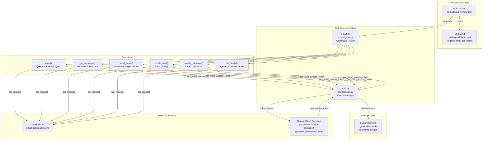
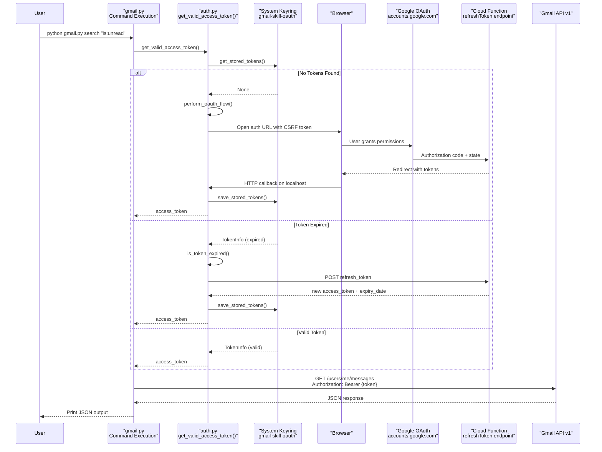
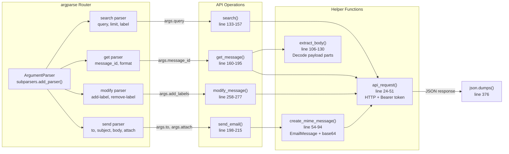
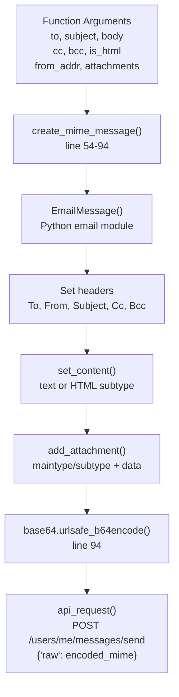
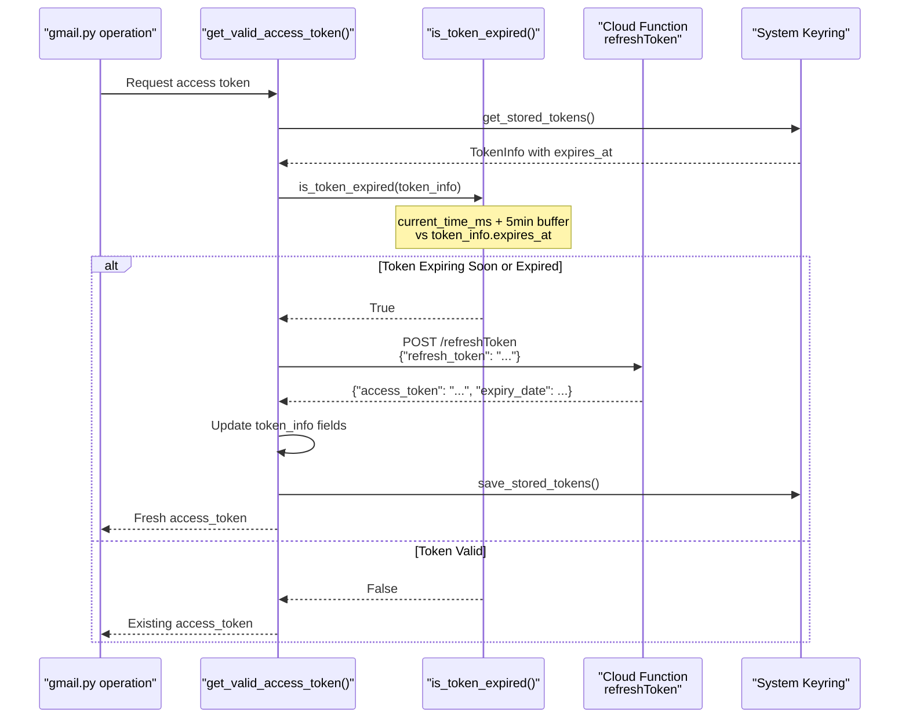

<!-- source: DeepWiki mcp.deepwiki.com · repo sanjay3290/ai-skills · page 5.2 Gmail · fetched 2026-10-27 -->

# Gmail

<details>
<summary>Relevant source files</summary>

The following files were used as context for generating this wiki page:

- [skills/gmail/SKILL.md](skills/gmail/SKILL.md)
- [skills/google-sheets/SKILL.md](skills/google-sheets/SKILL.md)

</details>


## Purpose and Scope

This document describes the Gmail skill, a lightweight Gmail API integration that enables AI assistants to search, read, send, and manage email messages through standalone OAuth authentication. The skill provides operations for email search, message retrieval, sending emails with attachments, draft management, and label modification (archiving, starring, marking as read/unread).

For other Google Workspace services, see [Google Calendar](5.3), [Google Chat](5.4), [Google Docs](5.5), [Google Drive](5.6), [Google Sheets](5.7), and [Google Slides](5.8). For the authentication pattern shared across all Google Workspace skills, see [Shared Authentication](5.1).

**Requirements**: Google Workspace account only. Personal Gmail accounts are not supported due to API access restrictions.

---

## Architecture Overview

The Gmail skill follows a stateless command pattern where each operation is a discrete API call with automatic authentication handling.



**Sources**: [skills/gmail/SKILL.md:1-184](), [skills/gmail/scripts/gmail.py:1-384](), [skills/gmail/scripts/auth.py:1-367]()

The skill uses a **three-layer architecture**:

1. **Command Router** ([scripts/gmail.py:302-383]()): Implements argparse-based CLI with subcommands for each operation
2. **OAuth Manager** ([scripts/auth.py:253-329]()): Handles token retrieval, validation, and refresh logic
3. **API Layer** ([scripts/gmail.py:24-51]()): Executes authenticated HTTP requests to Gmail API endpoints

All operations call `get_valid_access_token()` ([scripts/auth.py:253-300]()) before making API requests, ensuring automatic token refresh when expired.

---

## Authentication System

The Gmail skill uses the **OAuth + Keyring** authentication pattern with automatic token refresh. Service identifier: `gmail-skill-oauth`. This pattern is shared across all seven Google Workspace skills — see [Shared Authentication](5.1) for the full design.



**Sources**: [skills/gmail/scripts/auth.py:253-300](), [skills/gmail/scripts/auth.py:199-250](), [skills/gmail/scripts/auth.py:56-71]()

### OAuth Configuration

| Component | Value | Location |
|-----------|-------|----------|
| Client ID | `338689075775-o75k922vn5fdl18qergr96rp8g63e4d7.apps.googleusercontent.com` | [scripts/auth.py:24]() |
| Cloud Function | `https://google-workspace-extension.geminicli.com` | [scripts/auth.py:25]() |
| Refresh Endpoint | `/refreshToken` | [scripts/auth.py:26]() |
| Keyring Service | `gmail-skill-oauth` | [scripts/auth.py:29]() |
| Scopes | `gmail.modify`, `userinfo.profile` | [scripts/auth.py:33-36]() |

### TokenInfo Structure

The `TokenInfo` dataclass ([scripts/auth.py:42-46]()) stores credentials in the system keyring:

```python
@dataclass
class TokenInfo:
    access_token: str
    refresh_token: Optional[str]
    expires_at: Optional[int]  # Unix timestamp in milliseconds
    scope: Optional[str]
```

Tokens are stored as JSON in keyring with automatic expiry checking using a 5-minute buffer ([scripts/auth.py:38]()): `TOKEN_EXPIRY_BUFFER_MS = 5 * 60 * 1000`.

**Sources**: [skills/gmail/scripts/auth.py:42-46](), [skills/gmail/scripts/auth.py:74-91](), [skills/gmail/scripts/auth.py:103-108]()

---

## Command Execution Flow

Each command follows a consistent pattern: parse arguments → authenticate → make API request → format output.



**Sources**: [skills/gmail/scripts/gmail.py:302-383](), [skills/gmail/scripts/gmail.py:24-51]()

### Core API Request Function

The `api_request()` function ([scripts/gmail.py:24-51]()) handles all HTTP communication:

```python
def api_request(method: str, endpoint: str, data: Optional[dict] = None, 
                params: Optional[dict] = None) -> dict:
    token = get_valid_access_token()
    url = f"{GMAIL_API_BASE}/{endpoint}"  # GMAIL_API_BASE = "https://gmail.googleapis.com/gmail/v1"
    headers = {
        "Authorization": f"Bearer {token}",
        "Content-Type": "application/json"
    }
    req = urllib.request.Request(url, data=body, headers=headers, method=method)
    with urllib.request.urlopen(req, timeout=30) as response:
        return json.loads(response.read().decode('utf-8'))
```

All API responses and errors are returned as JSON dictionaries. HTTP errors are caught and returned as `{"error": "..."}` objects ([scripts/gmail.py:45-51]()).

**Sources**: [skills/gmail/scripts/gmail.py:24-51](), [skills/gmail/scripts/gmail.py:376-379]()

---

## Operations Reference

### Search Operation

The `search()` function ([scripts/gmail.py:133-157]()) queries messages using Gmail query syntax:

| Parameter | Type | Description | Example |
|-----------|------|-------------|---------|
| `query` | `Optional[str]` | Gmail search query | `"from:boss@company.com is:unread"` |
| `max_results` | `int` | Results to return (default: 10) | `20` |
| `page_token` | `Optional[str]` | Pagination token | From `nextPageToken` in response |
| `label_ids` | `Optional[list]` | Filter by labels | `["INBOX", "UNREAD"]` |
| `include_spam_trash` | `bool` | Include spam/trash (default: False) | `True` |

**API Endpoint**: `GET /users/me/messages` ([scripts/gmail.py:148]())

**Response Structure**:
```json
{
  "messages": [
    {"id": "18c2f9a3b4e5f6g7", "threadId": "18c2f9a3b4e5f6g7"}
  ],
  "nextPageToken": "CAUQAA",
  "resultSizeEstimate": 42
}
```

**CLI Usage**:
```bash
# Search with query
python scripts/gmail.py search "from:someone@example.com is:unread"

# Paginate results
python scripts/gmail.py search "has:attachment" --limit 50 --page-token CAUQAA

# Filter by label
python scripts/gmail.py search --label INBOX --label STARRED --limit 10
```

**Sources**: [skills/gmail/SKILL.md:41-55](), [skills/gmail/scripts/gmail.py:133-157](), [skills/gmail/scripts/gmail.py:306-312]()

### Get Message Operation

The `get_message()` function ([scripts/gmail.py:160-195]()) retrieves full message content with multiple format options:

| Format | Description | Body Content |
|--------|-------------|--------------|
| `full` (default) | Complete message with headers and body | Extracted via `extract_body()` |
| `metadata` | Headers only, no body | Snippet only |
| `minimal` | IDs and labels only | None |
| `raw` | Raw RFC 2822 format | Base64-encoded MIME |

**API Endpoint**: `GET /users/me/messages/{message_id}` ([scripts/gmail.py:163]())

The `extract_body()` helper ([scripts/gmail.py:106-130]()) recursively parses MIME parts:
1. Check for `payload.body.data` (simple messages)
2. Iterate through `payload.parts` for multipart messages
3. Prefer `text/plain` over `text/html`
4. Decode base64url-encoded data ([scripts/gmail.py:97-103]())

**Response Structure** (full format):
```json
{
  "id": "18c2f9a3b4e5f6g7",
  "threadId": "18c2f9a3b4e5f6g7",
  "labelIds": ["INBOX", "UNREAD"],
  "snippet": "Message preview text...",
  "subject": "Re: Project Update",
  "from": "sender@example.com",
  "to": "recipient@example.com",
  "date": "Mon, 15 Jan 2024 10:30:00 -0800",
  "body": "Full message body text..."
}
```

**Sources**: [skills/gmail/SKILL.md:57-68](), [skills/gmail/scripts/gmail.py:160-195](), [skills/gmail/scripts/gmail.py:106-130]()

### Send Email Operation

The `send_email()` function ([scripts/gmail.py:198-215]()) creates and sends RFC 2822 MIME messages:



**Sources**: [skills/gmail/scripts/gmail.py:198-215](), [skills/gmail/scripts/gmail.py:54-94]()

**Attachment Handling** ([scripts/gmail.py:79-91]()):
- Expands `~` in file paths
- Validates file existence
- Guesses MIME type from extension (defaults to `application/octet-stream`)
- Splits MIME type into `maintype/subtype`
- Reads binary data and attaches to `EmailMessage`

**CLI Usage**:
```bash
# Simple email
python scripts/gmail.py send --to "user@example.com" --subject "Hello" --body "Message"

# With CC/BCC and HTML
python scripts/gmail.py send --to "user@example.com" --cc "cc@example.com" \
  --subject "Update" --body "<h1>HTML Content</h1>" --html

# With attachments
python scripts/gmail.py send --to "user@example.com" --subject "Files" \
  --body "See attached" --attach ~/document.pdf --attach ~/image.png

# From alias (must be configured in Gmail settings)
python scripts/gmail.py send --to "user@example.com" --subject "Reply" \
  --body "Message" --from "Team <team@company.com>"
```

**Sources**: [skills/gmail/SKILL.md:70-87](), [skills/gmail/scripts/gmail.py:320-329]()

### Draft Management

Two operations manage email drafts:

**`create_draft()`** ([scripts/gmail.py:218-240]()):
- API Endpoint: `POST /users/me/drafts`
- Creates MIME message using same `create_mime_message()` function
- Stores draft in `{"message": {"raw": mime_message}}` envelope

**`send_draft()`** ([scripts/gmail.py:243-255]()):
- API Endpoint: `POST /users/me/drafts/send`
- Sends existing draft by ID: `{"id": draft_id}`
- No message content needed (already stored in draft)

**CLI Usage**:
```bash
# Create draft
python scripts/gmail.py create-draft --to "user@example.com" \
  --subject "Draft Subject" --body "Draft content"
# Returns: {"id": "r-1234567890", "status": "draft_created"}

# Send draft
python scripts/gmail.py send-draft r-1234567890
# Returns: {"id": "18c2f9a3b4e5f6g7", "status": "sent"}
```

**Sources**: [skills/gmail/SKILL.md:89-98](), [skills/gmail/scripts/gmail.py:218-255]()

### Modify Labels Operation

The `modify_message()` function ([scripts/gmail.py:258-277]()) adds or removes Gmail labels in a single atomic operation.

**API Endpoint**: `POST /users/me/messages/{message_id}/modify`

**Request Body**:
```json
{
  "addLabelIds": ["STARRED", "IMPORTANT"],
  "removeLabelIds": ["INBOX", "UNREAD"]
}
```

**Common Operations**:

| Operation | Command | Label Change |
|-----------|---------|--------------|
| Mark as read | `--remove-label UNREAD` | Remove `UNREAD` |
| Mark as unread | `--add-label UNREAD` | Add `UNREAD` |
| Archive | `--remove-label INBOX` | Remove `INBOX` |
| Star | `--add-label STARRED` | Add `STARRED` |
| Unstar | `--remove-label STARRED` | Remove `STARRED` |
| Mark important | `--add-label IMPORTANT` | Add `IMPORTANT` |

**CLI Usage**:
```bash
# Mark as read and archive
python scripts/gmail.py modify MESSAGE_ID --remove-label UNREAD --remove-label INBOX

# Star and mark important
python scripts/gmail.py modify MESSAGE_ID --add-label STARRED --add-label IMPORTANT

# Multiple operations in single call
python scripts/gmail.py modify MESSAGE_ID \
  --remove-label UNREAD --add-label STARRED --add-label IMPORTANT
```

**Sources**: [skills/gmail/SKILL.md:100-123](), [skills/gmail/scripts/gmail.py:258-277](), [skills/gmail/scripts/gmail.py:346-352]()

### List Labels Operation

The `list_labels()` function ([scripts/gmail.py:280-299]()) retrieves all system and user-created labels.

**API Endpoint**: `GET /users/me/labels`

**Response Structure**:
```json
{
  "labels": [
    {
      "id": "INBOX",
      "name": "INBOX",
      "type": "system",
      "messageListVisibility": "show",
      "labelListVisibility": "labelShow"
    },
    {
      "id": "Label_5",
      "name": "Work",
      "type": "user"
    }
  ]
}
```

**Sources**: [skills/gmail/SKILL.md:125-130](), [skills/gmail/scripts/gmail.py:280-299]()

---

## Gmail Query Syntax

Gmail search queries use operators that can be combined with `AND` (space), `OR`, or `NOT` (`-`). The skill passes queries directly to the Gmail API ([scripts/gmail.py:139-140]()).

### Search Operators

| Operator | Description | Example |
|----------|-------------|---------|
| `from:` | Sender email address | `from:boss@company.com` |
| `to:` | Recipient email address | `to:team@example.com` |
| `subject:` | Subject line contains | `subject:meeting` |
| `is:unread` | Unread messages | `is:unread` |
| `is:starred` | Starred messages | `is:starred` |
| `is:important` | Important messages | `is:important` |
| `has:attachment` | Has attachments | `has:attachment` |
| `after:` | Date filter (YYYY/MM/DD) | `after:2024/01/01` |
| `before:` | Date filter (YYYY/MM/DD) | `before:2024/12/31` |
| `newer_than:` | Relative date | `newer_than:7d` (7 days) |
| `older_than:` | Relative date | `older_than:1m` (1 month) |
| `label:` | Has specific label | `label:work` |
| `in:` | Location filter | `in:inbox`, `in:sent`, `in:trash` |

**Sources**: [skills/gmail/SKILL.md:132-153]()

### Query Combinations

Operators can be combined using boolean logic:

```bash
# AND (implicit with space)
python scripts/gmail.py search "from:boss@company.com is:unread newer_than:1d"

# OR (explicit keyword)
python scripts/gmail.py search "subject:urgent OR subject:important"

# NOT (minus prefix)
python scripts/gmail.py search "from:newsletter@example.com -is:starred"

# Complex query
python scripts/gmail.py search "(from:alice@example.com OR from:bob@example.com) is:unread has:attachment"
```

**Sources**: [skills/gmail/SKILL.md:154-159]()

---

## System Labels

Gmail provides system-defined label IDs that are consistent across all accounts:

| Label | ID | Description |
|-------|-----|-------------|
| Inbox | `INBOX` | Messages in inbox (remove to archive) |
| Sent | `SENT` | Sent messages |
| Drafts | `DRAFT` | Draft messages |
| Spam | `SPAM` | Spam folder |
| Trash | `TRASH` | Deleted messages |
| Starred | `STARRED` | Starred messages |
| Important | `IMPORTANT` | Important marker |
| Unread | `UNREAD` | Unread status |

User-created labels have auto-generated IDs like `Label_5` and can be listed via `list-labels` command.

**Sources**: [skills/gmail/SKILL.md:161-173]()

---

## Token Storage and Management

### Keyring Storage

Tokens are stored using the `keyring` library ([requirements.txt:1]()), which provides platform-native secure storage:

| Platform | Backend | Location |
|----------|---------|----------|
| macOS | Keychain | Keychain Access.app → `gmail-skill-oauth` |
| Windows | Credential Locker | Credential Manager → `gmail-skill-oauth` |
| Linux | Secret Service API | GNOME Keyring / KDE Wallet |

**Service Identifier**: `gmail-skill-oauth` ([scripts/auth.py:29]())  
**Account Name**: `main-account` ([scripts/auth.py:30]())

**Storage Functions**:
- `get_stored_tokens()` ([scripts/auth.py:56-71]()): Retrieves and parses JSON from keyring
- `save_stored_tokens()` ([scripts/auth.py:74-91]()): Serializes TokenInfo to JSON and stores
- `clear_stored_tokens()` ([scripts/auth.py:94-100]()): Deletes keyring entry

**Sources**: [skills/gmail/SKILL.md:175-183](), [skills/gmail/scripts/auth.py:56-100]()

### Token Refresh Mechanism



**Sources**: [skills/gmail/scripts/auth.py:279-300](), [skills/gmail/scripts/auth.py:103-108](), [skills/gmail/scripts/auth.py:111-126]()

The `is_token_expired()` function ([scripts/auth.py:103-108]()) implements a **5-minute expiry buffer** ([scripts/auth.py:38]()) to prevent tokens from expiring mid-request:

```python
TOKEN_EXPIRY_BUFFER_MS = 5 * 60 * 1000  # 5 minutes

def is_token_expired(token_info: TokenInfo) -> bool:
    if not token_info.expires_at:
        return False
    current_time_ms = int(time.time() * 1000)
    return token_info.expires_at < (current_time_ms + TOKEN_EXPIRY_BUFFER_MS)
```

If refresh fails, the system attempts re-authentication ([scripts/auth.py:289-296]()):
1. Call `perform_oauth_flow()` to initiate browser-based OAuth
2. Store new tokens if successful
3. Return None if user cancels or authentication fails

**Sources**: [skills/gmail/scripts/auth.py:279-300](), [skills/gmail/scripts/auth.py:111-126]()

---

## Authentication CLI

The `auth.py` script provides standalone commands for token management:

| Command | Function | Description |
|---------|----------|-------------|
| `login` | `perform_oauth_flow()` | Opens browser for OAuth consent |
| `logout` | `clear_stored_tokens()` | Removes tokens from keyring |
| `status` | `get_stored_tokens()` | Shows authentication status and expiry |
| `token` | `get_valid_access_token()` | Prints current access token |

**Usage**:
```bash
# Initial authentication
python scripts/auth.py login
# Output:
# Opening browser for authentication...
# Waiting for authentication...
# Login successful!
# Tokens stored in system keyring.

# Check status
python scripts/auth.py status
# Output:
# Status: Authenticated
# Storage: System keyring
# Token expired: False
# Expires in: 55.3 minutes

# Get raw token
python scripts/auth.py token
# Output: ya29.a0AfH6SMBx...

# Logout
python scripts/auth.py logout
# Output: Logged out successfully.
```

**Sources**: [skills/gmail/SKILL.md:20-35](), [skills/gmail/scripts/auth.py:308-366]()

---

## Error Handling

All operations return JSON with an `"error"` key on failure. The main script exits with code 1 when errors occur ([scripts/gmail.py:378-379]()).

### Common Error Scenarios

| Error | Cause | Solution |
|-------|-------|----------|
| `"Failed to get access token"` | No valid tokens found | Run `python scripts/auth.py login` |
| `"HTTP 401: Unauthorized"` | Invalid or expired token | Token refresh should happen automatically; re-run `auth.py login` |
| `"HTTP 403: Forbidden"` | Insufficient OAuth scopes | Re-authenticate to grant new scopes |
| `"HTTP 404: Not Found"` | Invalid message ID or draft ID | Verify ID from search results |
| `"HTTP 400: Bad Request"` | Invalid query syntax or parameters | Check Gmail query operators |
| `"Attachment not found"` | File path doesn't exist | Verify file path and permissions |

**API Request Error Handling** ([scripts/gmail.py:45-51]()):
```python
try:
    with urllib.request.urlopen(req, timeout=30) as response:
        return json.loads(response.read().decode('utf-8'))
except urllib.error.HTTPError as e:
    error_body = e.read().decode('utf-8') if e.fp else str(e)
    return {"error": f"HTTP {e.code}: {error_body}"}
except urllib.error.URLError as e:
    return {"error": f"Request failed: {e.reason}"}
```

All HTTP operations have a **30-second timeout** ([scripts/gmail.py:43](), [scripts/auth.py:150]()).

**Sources**: [skills/gmail/scripts/gmail.py:41-51](), [skills/gmail/scripts/gmail.py:378-379]()

---

## SKILL.md Trigger Description

The AI assistant uses the skill description to determine when to invoke Gmail operations. From [skills/gmail/SKILL.md:3-7]():

```yaml
description: |
  Interact with Gmail - search emails, read messages, send emails, create drafts, and manage labels.
  Use when user asks to: search email, read email, send email, create email draft, mark as read,
  archive email, star email, or manage Gmail labels. Lightweight alternative to full Google
  Workspace MCP server with standalone OAuth authentication.
```

This description contains semantic triggers:
- **Search operations**: "search email", "find messages"
- **Read operations**: "read email", "get message content"
- **Send operations**: "send email", "compose message"
- **Draft operations**: "create email draft", "save draft"
- **Label operations**: "mark as read", "archive email", "star email", "manage labels"

The AI assistant performs semantic matching between user queries and these trigger phrases to determine skill activation.

**Sources**: [skills/gmail/SKILL.md:1-12]()

---

