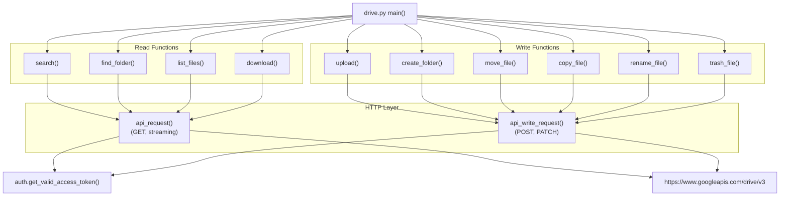
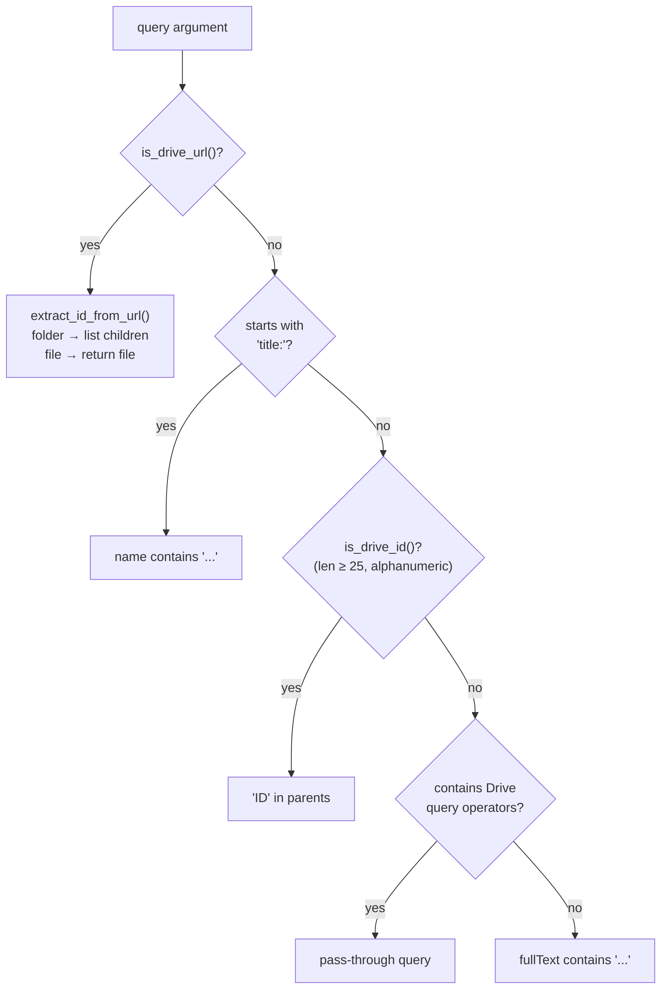
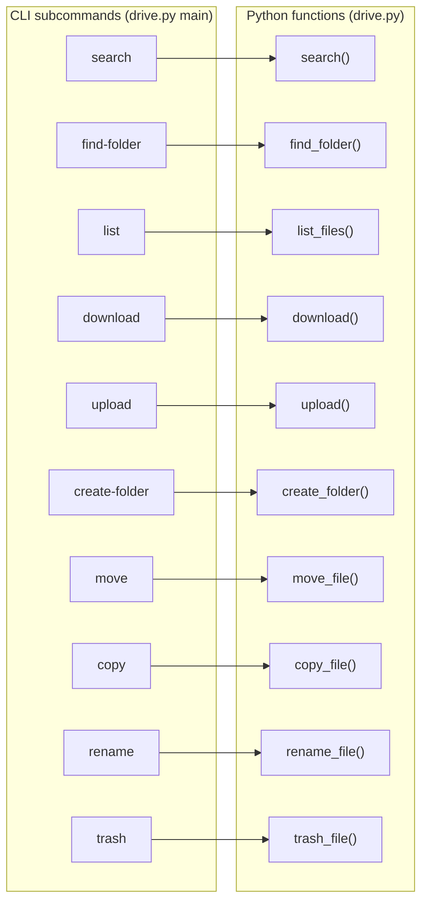
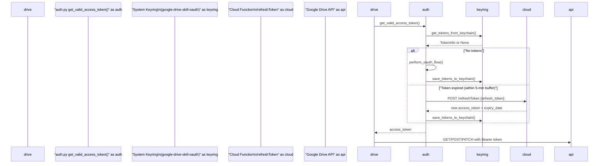

<!-- source: DeepWiki mcp.deepwiki.com · repo sanjay3290/ai-skills · page 5.6 Google Drive · fetched 2026-10-27 -->

# Google Drive

<details>
<summary>Relevant source files</summary>

The following files were used as context for generating this wiki page:

- [skills/google-drive/SKILL.md](skills/google-drive/SKILL.md)
- [skills/google-slides/SKILL.md](skills/google-slides/SKILL.md)

</details>


This page documents the `google-drive` skill, which provides read/write access to Google Drive through the `scripts/drive.py` CLI. It covers authentication setup, all available commands, search query formats, file ID conventions, and download limitations.

> **Requires a Google Workspace account.** Personal Gmail accounts are not supported.

For the shared OAuth mechanism used by all Google Workspace skills, see [Shared Authentication](#5.1). For other Google Workspace skills, see [Google Docs](#5.5), [Google Sheets](#5.7), or [Google Slides](#5.8).

---

## Authentication

The skill uses the same OAuth 2.0 pattern as all other Google Workspace skills. Tokens are managed by `scripts/auth.py` and stored in the system keyring under the service name `google-drive-skill-oauth`.

[skills/google-drive/scripts/auth.py:29-31]()

| Platform | Storage Backend |
|---|---|
| macOS | Keychain |
| Windows | Windows Credential Locker |
| Linux | Secret Service API (GNOME Keyring, KDE Wallet, etc.) |

**Setup commands:**

```bash
# Authenticate (opens browser)
python scripts/auth.py login

# Check status
python scripts/auth.py status

# Remove stored tokens
python scripts/auth.py logout
```

The `get_valid_access_token` function in `auth.py` handles the full token lifecycle: it checks the keyring, refreshes expired tokens via the cloud function at `https://google-workspace-extension.geminicli.com/refreshToken`, and falls back to a new OAuth flow if refresh fails.

[skills/google-drive/scripts/auth.py:262-309]()

**OAuth scopes requested:**

```
https://www.googleapis.com/auth/drive
https://www.googleapis.com/auth/userinfo.profile
```

[skills/google-drive/scripts/auth.py:34-37]()

Sources: `skills/google-drive/scripts/auth.py`, `skills/google-drive/SKILL.md`

---

## Script Architecture

All Drive operations go through `scripts/drive.py`. It calls `auth.get_valid_access_token()` on every request and auto-triggers the OAuth flow interactively if no tokens are present.

**Architecture of `drive.py`:**



Sources: `skills/google-drive/scripts/drive.py`

---

## File ID Format

Google Drive identifies every file and folder with a long alphanumeric ID, e.g. `1ABC123xyz_-abc123`. The code defines a minimum length of 25 characters to distinguish IDs from search terms:

[skills/google-drive/scripts/drive.py:32]()

IDs can be obtained from:
- Output of `search`, `find-folder`, or `list` commands
- Extracted automatically from Google Drive URLs by `extract_id_from_url`

### URL ID Extraction

The `extract_id_from_url` function [skills/google-drive/scripts/drive.py:70-76]() uses the following URL patterns to extract IDs and determine whether the target is a file or folder:

| URL Pattern | Detected Type |
|---|---|
| `/folders/...` | `folder` |
| `/file/d/...` | `file` |
| `/document/d/...` | `file` |
| `/spreadsheets/d/...` | `file` |
| `/presentation/d/...` | `file` |
| `/forms/d/...` | `file` |
| `?id=...` or `&id=...` | `unknown` |

When the type is `unknown`, `drive.py` makes an additional API call to check the `mimeType` and determine whether to list the folder's children or return the file directly.

[skills/google-drive/scripts/drive.py:114-136]()

Sources: `skills/google-drive/scripts/drive.py`

---

## Search Query Formats

The `search` command interprets the query argument in several different modes:



| Format | Example | Resulting Drive query |
|---|---|---|
| Full-text | `"quarterly report"` | `fullText contains 'quarterly report'` |
| Title prefix | `"title:budget"` | `name contains 'budget'` |
| Google Drive URL | `https://drive.google.com/drive/folders/1ABC...` | `'1ABC...' in parents` |
| Folder ID (≥25 chars) | `1ABC123xyz_abc123456789` | `'1ABC123xyz_abc123456789' in parents` |
| Native Drive syntax | `mimeType='application/pdf'` | passed through unchanged |

The `--shared-with-me` flag appends `and sharedWithMe` to whatever query is built.

[skills/google-drive/scripts/drive.py:91-189]()

Sources: `skills/google-drive/scripts/drive.py`, `skills/google-drive/SKILL.md`

---

## Commands Reference

### Read Commands

All commands call `api_request` [skills/google-drive/scripts/drive.py:40-67]() which performs a GET against `https://www.googleapis.com/drive/v3`.

#### `search`

```bash
python scripts/drive.py search "quarterly report"
python scripts/drive.py search "title:budget"
python scripts/drive.py search "https://drive.google.com/drive/folders/1ABC123..."
python scripts/drive.py search --shared-with-me
python scripts/drive.py search "report" --limit 5 --page-token "TOKEN"
```

| Argument | Default | Description |
|---|---|---|
| `query` | _(optional)_ | Search query, URL, folder ID, or native Drive syntax |
| `--limit` | 10 | Maximum number of results |
| `--page-token` | — | Pagination token from a previous response |
| `--shared-with-me` | false | Filter to files shared with the authenticated user |

Returns: `{ "files": [...], "nextPageToken": "..." }`

#### `find-folder`

```bash
python scripts/drive.py find-folder "Project Documents"
```

Uses an exact name match: `mimeType='application/vnd.google-apps.folder' and name = '...'`.

[skills/google-drive/scripts/drive.py:192-208]()

Returns: `{ "folders": [{ "id": "...", "name": "..." }] }`

#### `list`

```bash
python scripts/drive.py list                          # Root Drive
python scripts/drive.py list 1ABC123xyz --limit 20   # Specific folder
```

Lists files in the given folder (or root if no `folder_id` is provided).

[skills/google-drive/scripts/drive.py:211-233]()

Returns: `{ "files": [...], "nextPageToken": "..." }`

#### `download`

```bash
python scripts/drive.py download 1ABC123xyz ./downloads/report.pdf
```

[skills/google-drive/scripts/drive.py:236-303]()

The function first fetches file metadata to check the `mimeType`. **Google Workspace native formats cannot be downloaded directly:**

| MIME type | Behavior |
|---|---|
| `application/vnd.google-apps.document` | Returns error, suggests `docs.getText` |
| `application/vnd.google-apps.spreadsheet` | Returns error, suggests `sheets.getText` |
| `application/vnd.google-apps.presentation` | Returns error, suggests `slides.getText` |
| Any other `application/vnd.google-apps.*` | Returns error |
| Regular files (PDF, images, etc.) | Downloads via `?alt=media` |

On success, creates any missing parent directories and writes the file to the given path.

---

### Write Commands

Write operations use `api_write_request` [skills/google-drive/scripts/drive.py:306-335]() which sends POST or PATCH requests with a JSON body.

#### `upload`

```bash
python scripts/drive.py upload ~/Documents/report.pdf
python scripts/drive.py upload ~/Documents/report.pdf --folder 1ABC123xyz
python scripts/drive.py upload ~/Documents/report.pdf --name "Q4 Report.pdf"
```

| Argument | Default | Description |
|---|---|---|
| `local_path` | _(required)_ | Path to the file on disk |
| `--folder` | — | Target folder ID; uploads to Drive root if omitted |
| `--name` | local filename | Name the file will have in Drive |

Uses a multipart upload to `https://www.googleapis.com/upload/drive/v3/files?uploadType=multipart`. The MIME type is inferred from the file extension via `mimetypes.guess_type`.

[skills/google-drive/scripts/drive.py:338-403]()

Returns: `{ "success": true, "fileId": "...", "name": "...", "mimeType": "..." }`

#### `create-folder`

```bash
python scripts/drive.py create-folder "Project Documents"
python scripts/drive.py create-folder "Attachments" --parent 1ABC123xyz
```

Creates a folder by POSTing metadata with `mimeType: application/vnd.google-apps.folder`.

[skills/google-drive/scripts/drive.py:406-421]()

#### `move`

```bash
python scripts/drive.py move FILE_ID DESTINATION_FOLDER_ID
```

Fetches the file's current `parents`, then issues a PATCH to add the new parent and remove the old ones atomically.

[skills/google-drive/scripts/drive.py:424-445]()

#### `copy`

```bash
python scripts/drive.py copy FILE_ID
python scripts/drive.py copy FILE_ID --name "Report Copy" --folder 1ABC123xyz
```

POSTs to `files/{file_id}/copy`. The Drive API defaults the copy name to `"Copy of <original>"` if `--name` is not provided.

[skills/google-drive/scripts/drive.py:448-463]()

#### `rename`

```bash
python scripts/drive.py rename FILE_ID "New Name.pdf"
```

Issues a PATCH with `{ "name": "New Name.pdf" }`.

[skills/google-drive/scripts/drive.py:466-475]()

#### `trash`

```bash
python scripts/drive.py trash FILE_ID
```

Issues a PATCH with `{ "trashed": true }`. The file is moved to Drive Trash and can be restored from the Drive UI.

[skills/google-drive/scripts/drive.py:478-486]()

---

## Command-to-Function Mapping



Sources: `skills/google-drive/scripts/drive.py:489-578`

---

## Output Format

All commands print a single JSON object to stdout. The exit code is `1` if the returned object contains an `"error"` key, `0` otherwise.

[skills/google-drive/scripts/drive.py:571-574]()

**Example `search` response:**

```json
{
  "files": [
    {
      "id": "1ABC123xyz",
      "name": "Q4 Report.pdf",
      "modifiedTime": "2024-01-15T10:30:00.000Z",
      "mimeType": "application/pdf",
      "parents": ["0ABCDEF"]
    }
  ],
  "nextPageToken": null
}
```

**Example `upload` response:**

```json
{
  "success": true,
  "fileId": "1XYZ789abc",
  "name": "Q4 Report.pdf",
  "mimeType": "application/pdf"
}
```

---

## Token Lifecycle



Sources: `skills/google-drive/scripts/auth.py:262-309`, `skills/google-drive/scripts/auth.py:29-39`

---

