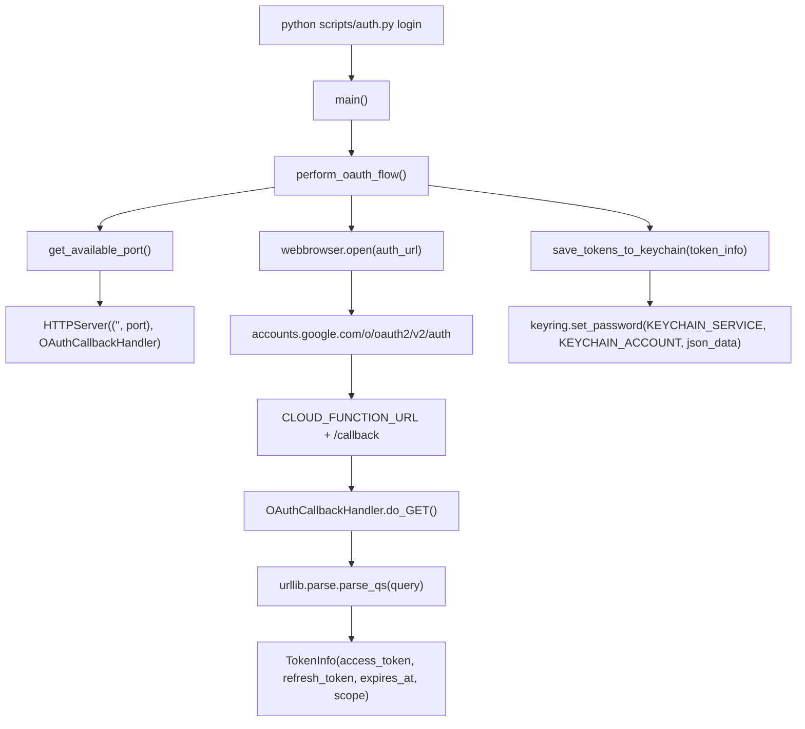
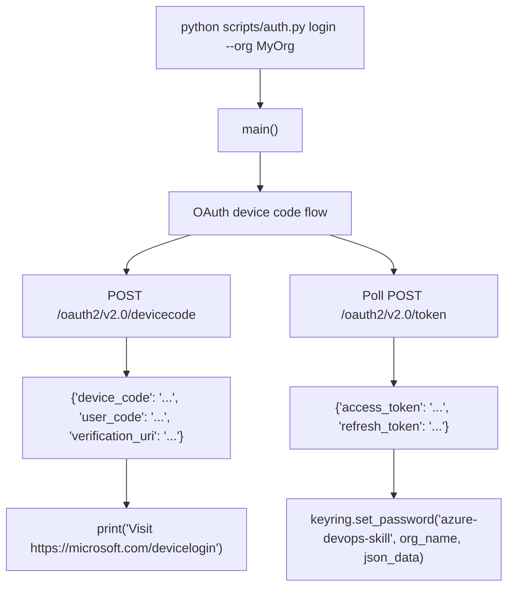
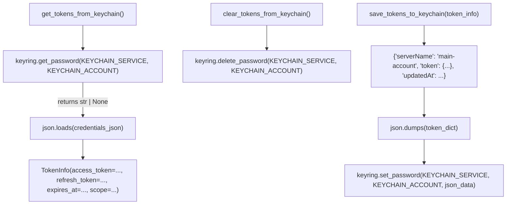
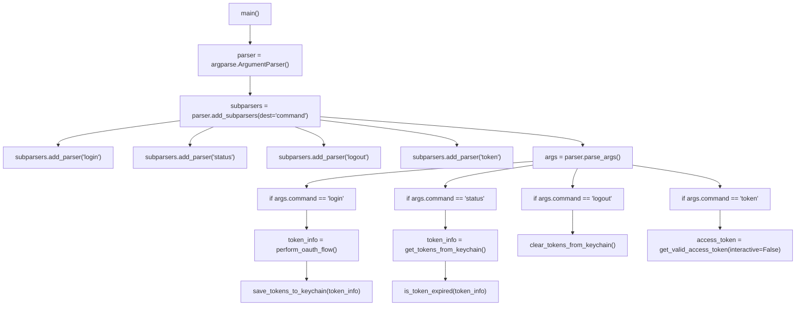
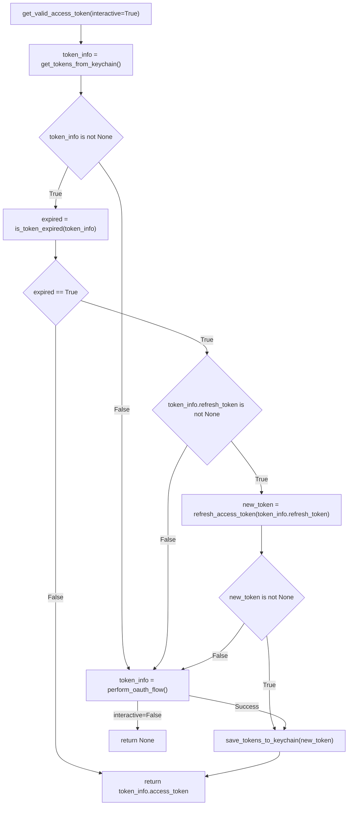

<!-- source: DeepWiki mcp.deepwiki.com · repo sanjay3290/ai-skills · page 6.2 OAuth & Keyring Setup · fetched 2026-10-27 -->

# OAuth & Keyring Setup

<details>
<summary>Relevant source files</summary>

The following files were used as context for generating this wiki page:

- [skills/azure-devops/SKILL.md](skills/azure-devops/SKILL.md)
- [skills/deep-research/SKILL.md](skills/deep-research/SKILL.md)
- [skills/elevenlabs/SKILL.md](skills/elevenlabs/SKILL.md)
- [skills/gmail/SKILL.md](skills/gmail/SKILL.md)
- [skills/google-drive/SKILL.md](skills/google-drive/SKILL.md)
- [skills/google-sheets/SKILL.md](skills/google-sheets/SKILL.md)
- [skills/google-slides/SKILL.md](skills/google-slides/SKILL.md)

</details>


This document covers the OAuth authentication system and keyring-based token storage used by Google Workspace skills and Azure DevOps. These skills require secure credential management through OS-native credential stores to eliminate plaintext token storage.

For information about configuring environment variables for other skills (imagen, deep-research, manus, outline), see [Environment Variables](6.1). For individual skill documentation, see the [Google Workspace Skills](5) and [Azure DevOps](4.5.1) sections.

## Purpose and Scope

Eight skills in this repository use OAuth 2.0 authentication with system keyring storage:

**Google Workspace Skills (7 skills):**
- Uses browser-based OAuth 2.0 authorization code flow
- Stores tokens via `keyring.set_password()` with unique service names per skill
- Shares `CLOUD_FUNCTION_URL` for token exchange
- All skills use identical `scripts/auth.py` implementation

**Azure DevOps (1 skill):**
- Uses OAuth 2.0 device code flow
- Stores tokens via `keyring.set_password()` with service name `azure-devops-skill`
- Requires organization name during authentication
- Supports Personal Access Token (PAT) as fallback

The `keyring` Python library provides cross-platform compatibility:
- **macOS**: Keychain
- **Windows**: Credential Locker
- **Linux**: Secret Service API (GNOME Keyring, KDE Wallet)

**Sources:** [skills/gmail/SKILL.md:1-36](), [skills/azure-devops/SKILL.md:17-56](), [skills/google-drive/SKILL.md:129-138]()

## OAuth Authentication Architecture

Two distinct OAuth flows are implemented across the skills:

### Google Workspace OAuth Configuration

All seven Google Workspace skills share these OAuth constants defined in their `scripts/auth.py`:

| Constant | Value | Purpose | File Reference |
|----------|-------|---------|----------------|
| `CLIENT_ID` | `338689075775-o75k922vn5fdl18qergr96rp8g63e4d7...` | OAuth client identifier | [skills/google-drive/scripts/auth.py:24]() |
| `CLOUD_FUNCTION_URL` | `https://google-workspace-extension.geminicli.com` | OAuth endpoint | [skills/google-drive/scripts/auth.py:26]() |
| `REFRESH_ENDPOINT` | `{CLOUD_FUNCTION_URL}/refreshToken` | Token refresh URL | [skills/google-drive/scripts/auth.py:27]() |
| `TOKEN_EXPIRY_BUFFER_MS` | `5 * 60 * 1000` | Refresh 5 minutes early | [skills/google-drive/scripts/auth.py:39]() |

The `SCOPES` constant varies per skill. Example from Google Drive:
```python
SCOPES = [
    "https://www.googleapis.com/auth/drive",
    "https://www.googleapis.com/auth/userinfo.profile",
]
```

### Azure DevOps OAuth Configuration

Azure DevOps uses Microsoft identity platform with device code flow. Configuration is handled in [skills/azure-devops/scripts/auth.py]():

| Component | Value | Purpose |
|-----------|-------|---------|
| Authorization Endpoint | `https://login.microsoftonline.com/organizations/oauth2/v2.0/authorize` | Device code flow |
| Token Endpoint | `https://login.microsoftonline.com/organizations/oauth2/v2.0/token` | Token exchange |
| Service Name | `azure-devops-skill` | Keyring identifier |
| Required Scope | `499b84ac-1321-427f-aa17-267ca6975798/.default` | Azure DevOps API access |

**Sources:** [skills/google-drive/scripts/auth.py:24-39](), [skills/azure-devops/SKILL.md:21-35]()

### Google Workspace Browser OAuth Flow

**Diagram: Google Workspace OAuth Code Flow with Code Entities**



**Key Code Entities:**

| Function/Class | File Location | Purpose |
|----------------|---------------|---------|
| `perform_oauth_flow()` | [skills/google-drive/scripts/auth.py:208-259]() | Orchestrates browser OAuth flow |
| `get_available_port()` | [skills/google-drive/scripts/auth.py:105-109]() | Finds free port 8080-8099 via `socket.bind()` |
| `OAuthCallbackHandler` | [skills/google-drive/scripts/auth.py:138-206]() | `http.server.BaseHTTPRequestHandler` subclass |
| `OAuthCallbackHandler.do_GET()` | [skills/google-drive/scripts/auth.py:149-206]() | Parses callback URL query parameters |
| `save_tokens_to_keychain()` | [skills/google-drive/scripts/auth.py:72-89]() | JSON serialization + `keyring.set_password()` |
| `TokenInfo` | [skills/google-drive/scripts/auth.py:42-48]() | `@dataclass` with `access_token`, `refresh_token`, `expires_at`, `scope` |

**Sources:** [skills/google-drive/scripts/auth.py:42-259](), [skills/google-sheets/scripts/auth.py:42-259]()

### Azure DevOps Device Code Flow

Azure DevOps uses a different OAuth flow that displays a device code in the terminal. The user must visit a URL and enter the code manually.

**Diagram: Azure DevOps Device Code OAuth Flow with Code Entities**



**Note:** Azure DevOps prompts display "Visual Studio Code" branding during authorization due to the client ID used.

**Sources:** [skills/azure-devops/SKILL.md:21-27](), [skills/azure-devops/SKILL.md:470-477]()

## Token Storage Architecture

Each skill stores OAuth tokens under a unique service identifier. The `keyring.set_password()` call requires two parameters:
- `service`: Unique identifier per skill (e.g., `"gmail-skill-oauth"`)
- `username`: Account identifier (e.g., `"main-account"` for Google Workspace, organization name for Azure DevOps)

### Keyring Service Names by Skill

| Skill | `KEYCHAIN_SERVICE` / Service Name | `KEYCHAIN_ACCOUNT` / Username | File Reference |
|-------|-----------------------------------|------------------------------|----------------|
| Gmail | `"gmail-skill-oauth"` | `"main-account"` | [skills/gmail/scripts/auth.py:29-31]() |
| Google Chat | `"google-chat-skill-oauth"` | `"main-account"` | [skills/google-chat/scripts/auth.py:29-31]() |
| Google Docs | `"google-docs-skill-oauth"` | `"main-account"` | [skills/google-docs/scripts/auth.py:29-31]() |
| Google Sheets | `"google-sheets-skill-oauth"` | `"main-account"` | [skills/google-sheets/scripts/auth.py:29-31]() |
| Google Slides | `"google-slides-skill-oauth"` | `"main-account"` | [skills/google-slides/scripts/auth.py:29-31]() |
| Google Drive | `"google-drive-skill-oauth"` | `"main-account"` | [skills/google-drive/scripts/auth.py:29-31]() |
| Google Calendar | `"google-calendar-skill-oauth"` | `"main-account"` | [skills/google-calendar/scripts/auth.py:29-31]() |
| Azure DevOps | `"azure-devops-skill"` | `{organization_name}` | [skills/azure-devops/SKILL.md:477]() |

### TokenInfo Data Structure

Google Workspace skills use a `TokenInfo` dataclass defined in [skills/google-drive/scripts/auth.py:42-48]():

```python
from dataclasses import dataclass
from typing import Optional

@dataclass
class TokenInfo:
    access_token: str
    refresh_token: Optional[str]
    expires_at: Optional[int]  # milliseconds since epoch
    scope: Optional[str]
```

Azure DevOps stores tokens differently, with the organization name as the username parameter.

**Sources:** [skills/google-drive/scripts/auth.py:42-48](), [skills/google-sheets/scripts/auth.py:42-48]()

### Storage and Retrieval Functions

**Diagram: Keyring Storage Functions with Code Entities**



**Function Implementations:**

| Function | File Location | Return Type | Purpose |
|----------|---------------|-------------|---------|
| `get_tokens_from_keychain()` | [skills/google-drive/scripts/auth.py:54-69]() | `Optional[TokenInfo]` | Calls `keyring.get_password()` + `json.loads()` |
| `save_tokens_to_keychain()` | [skills/google-drive/scripts/auth.py:72-89]() | `None` | Calls `json.dumps()` + `keyring.set_password()` |
| `clear_tokens_from_keychain()` | [skills/google-drive/scripts/auth.py:92-98]() | `None` | Calls `keyring.delete_password()` |

**Exception Handling:**

All three functions wrap `keyring` calls in try-except blocks:
```python
try:
    keyring.set_password(KEYCHAIN_SERVICE, KEYCHAIN_ACCOUNT, json_data)
except keyring.errors.KeyringError as e:
    print(f"Failed to save tokens: {e}", file=sys.stderr)
```

**Sources:** [skills/google-drive/scripts/auth.py:54-98](), [skills/google-sheets/scripts/auth.py:54-98]()

### Cross-Platform Storage Backends

The `keyring` library automatically selects the appropriate backend via `keyring.get_keyring()`:

| Platform | Backend Class | Storage Location | CLI Access |
|----------|---------------|------------------|------------|
| **macOS** | `keyring.backends.macOS.Keyring` | `~/Library/Keychains/login.keychain-db` | `security find-generic-password -s {service} -w` |
| **Windows** | `keyring.backends.Windows.WinVaultKeyring` | Windows Credential Manager | `cmdkey /list` |
| **Linux** | `keyring.backends.SecretService.Keyring` | GNOME Keyring / KDE Wallet | `secret-tool lookup service {service}` |

**Platform Detection:**

The `keyring` library uses `sys.platform` and checks for available backends:
1. macOS: Imports `keyring.backends.macOS`
2. Windows: Imports `keyring.backends.Windows`
3. Linux: Imports `keyring.backends.SecretService` (requires D-Bus)

**Sources:** [skills/gmail/SKILL.md:176-182](), [skills/google-drive/SKILL.md:131-138]()

## Setting Up Authentication

### Prerequisites

All OAuth-based skills require the `keyring` Python library:

```bash
pip install keyring
```

For Google Workspace skills, install from `requirements.txt` in each skill directory:
```bash
cd skills/gmail && pip install -r requirements.txt
```

**Source:** [skills/gmail/SKILL.md:20-35]()

### Google Workspace Skills Authentication

Each Google Workspace skill must be authenticated independently. Authentication opens a browser window to complete OAuth flow.

**Authentication Commands:**

| Skill | Command | Service Name |
|-------|---------|--------------|
| **Gmail** | `python scripts/auth.py login` | `gmail-skill-oauth` |
| **Google Calendar** | `python scripts/auth.py login` | `google-calendar-skill-oauth` |
| **Google Chat** | `python scripts/auth.py login` | `google-chat-skill-oauth` |
| **Google Docs** | `python scripts/auth.py login` | `google-docs-skill-oauth` |
| **Google Sheets** | `python scripts/auth.py login` | `google-sheets-skill-oauth` |
| **Google Slides** | `python scripts/auth.py login` | `google-slides-skill-oauth` |
| **Google Drive** | `python scripts/auth.py login` | `google-drive-skill-oauth` |

**Example for Gmail:**
```bash
cd skills/gmail
python scripts/auth.py login
# Browser opens to accounts.google.com
# After authorization: "Login successful!"
python scripts/auth.py status
# Output: Status: Authenticated, Expires in: 55.3 minutes
```

### Azure DevOps Authentication

Azure DevOps requires organization name during authentication:

```bash
cd skills/azure-devops
python scripts/auth.py login --org MyOrganization
# Output: Visit https://microsoft.com/devicelogin
# Enter code: ABC-DEF-GHI
# After authorization: "Login successful!"
python scripts/auth.py status
# Output: Authenticated for organization: MyOrganization
```

**Alternative: PAT Authentication:**
```bash
python scripts/auth.py login --org MyOrganization --pat dummypat123
```

PAT must have scopes: Work Items (R/W), Code (R/W), Build (R/E), Wiki (R/W), Test Management (R/W), Advanced Security (R).

**Sources:** [skills/gmail/SKILL.md:20-35](), [skills/azure-devops/SKILL.md:21-56]()

## auth.py Script Reference

Each Google Workspace skill includes an identical `scripts/auth.py` with four subcommands. Azure DevOps has similar commands but with `--org` parameter support.

### Google Workspace auth.py Command Structure

**Diagram: auth.py CLI Argument Parsing with Code Entities**



**Subcommand Implementations:**

| Command | Function Called | File Location | Standard Output |
|---------|----------------|---------------|-----------------|
| `login` | `perform_oauth_flow()` + `save_tokens_to_keychain()` | [skills/google-drive/scripts/auth.py:324-338]() | `"Login successful!"` |
| `status` | `get_tokens_from_keychain()` + `is_token_expired()` | [skills/google-drive/scripts/auth.py:354-369]() | `"Status: Authenticated\nToken expired: False\nExpires in: X.X minutes"` |
| `logout` | `clear_tokens_from_keychain()` | [skills/google-drive/scripts/auth.py:340-352]() | `"Logged out successfully."` |
| `token` | `get_valid_access_token(interactive=False)` | [skills/google-drive/scripts/auth.py:371-377]() | `"ya29.a0AfH6SMB..."` (raw token) |

### Azure DevOps auth.py Command Structure

Azure DevOps `auth.py` requires `--org` parameter for login:

```bash
python scripts/auth.py login --org MyOrganization
python scripts/auth.py login --org MyOrganization --pat YOUR_PAT
python scripts/auth.py status
python scripts/auth.py logout
```

**Sources:** [skills/google-drive/scripts/auth.py:317-377](), [skills/azure-devops/SKILL.md:21-56]()

## Token Lifecycle and Refresh

OAuth access tokens expire after approximately 1 hour. Refresh tokens are long-lived (months) and used to obtain new access tokens without re-authentication.

### Token Types and Fields

The `TokenInfo` dataclass contains four fields:

| Field | Type | Example Value | Purpose |
|-------|------|---------------|---------|
| `access_token` | `str` | `"ya29.a0AfH6SMB..."` | Bearer token for API calls |
| `refresh_token` | `Optional[str]` | `"1//0gXyZ..."` | Used to refresh access token |
| `expires_at` | `Optional[int]` | `1705329600000` | Expiration timestamp (milliseconds since epoch) |
| `scope` | `Optional[str]` | `"https://www.googleapis.com/auth/drive ..."` | Granted OAuth scopes |

**Sources:** [skills/google-drive/scripts/auth.py:42-48]()

### Automatic Token Refresh Logic

The `get_valid_access_token()` function handles token retrieval and automatic refresh.

**Diagram: Token Refresh Decision Flow with Code Entities**



**Key Functions:**

| Function | File Location | Implementation |
|----------|---------------|----------------|
| `get_valid_access_token(interactive=True)` | [skills/google-drive/scripts/auth.py:262-309]() | Main entry point; returns `Optional[str]` |
| `is_token_expired(token_info)` | [skills/google-drive/scripts/auth.py:112-117]() | Returns `True` if `token_info.expires_at < time.time() * 1000 + TOKEN_EXPIRY_BUFFER_MS` |
| `refresh_access_token(refresh_token)` | [skills/google-drive/scripts/auth.py:120-135]() | POSTs to `REFRESH_ENDPOINT` with `{"refreshToken": refresh_token}` |

**Expiry Buffer Implementation:**

```python
# From skills/google-drive/scripts/auth.py:39
TOKEN_EXPIRY_BUFFER_MS = 5 * 60 * 1000

# From skills/google-drive/scripts/auth.py:112-117
def is_token_expired(token_info: TokenInfo) -> bool:
    if not token_info.expires_at:
        return False
    current_time_ms = int(time.time() * 1000)
    return token_info.expires_at < (current_time_ms + TOKEN_EXPIRY_BUFFER_MS)
```

This ensures tokens are considered "expired" 5 minutes before their actual expiration to avoid mid-request expiration.

**Sources:** [skills/google-drive/scripts/auth.py:39-309](), [skills/google-sheets/scripts/auth.py:39-302]()

### Token JSON Serialization Format

The `save_tokens_to_keychain()` function serializes tokens into this JSON structure:

```json
{
  "serverName": "main-account",
  "token": {
    "accessToken": "ya29.a0AfH6SMB...",
    "refreshToken": "1//0gXyZ...",
    "tokenType": "Bearer",
    "scope": "https://www.googleapis.com/auth/drive https://www.googleapis.com/auth/userinfo.profile",
    "expiresAt": 1705329600000
  },
  "updatedAt": 1705325400000
}
```

**Serialization Code from [skills/google-drive/scripts/auth.py:72-89]():**

```python
def save_tokens_to_keychain(token_info: TokenInfo) -> None:
    token_data = {
        "serverName": KEYCHAIN_ACCOUNT,
        "token": {
            "accessToken": token_info.access_token,
            "refreshToken": token_info.refresh_token,
            "tokenType": "Bearer",
            "scope": token_info.scope,
            "expiresAt": token_info.expires_at,
        },
        "updatedAt": int(time.time() * 1000),
    }
    try:
        keyring.set_password(
            KEYCHAIN_SERVICE, KEYCHAIN_ACCOUNT, json.dumps(token_data)
        )
    except keyring.errors.KeyringError as e:
        print(f"Failed to save tokens: {e}", file=sys.stderr)
```

**Sources:** [skills/google-drive/scripts/auth.py:72-89]()

## Cross-Platform Implementation Details

The `keyring` library provides a unified interface to platform-specific credential stores. Each platform's backend is automatically selected based on the operating system.

### macOS Keychain

Tokens are stored in the login keychain via the `keyring.backends.macOS.Keyring` backend. The `keyring.set_password()` call translates to macOS Security Framework APIs.

**GUI Access:**
1. Open **Keychain Access** (`/Applications/Utilities/Keychain Access.app`)
2. Search for service names: `gmail-skill-oauth`, `google-chat-skill-oauth`, etc.
3. Double-click to view metadata (password field contains JSON token data)

**Command-line access:**
```bash
# Query stored token (requires authentication)
security find-generic-password -s "gmail-skill-oauth" -w

# Delete token
security delete-generic-password -s "gmail-skill-oauth"
```

### Windows Credential Locker

Tokens are stored in Windows Credential Manager via the `keyring.backends.Windows.WinVaultKeyring` backend. The `keyring.set_password()` call uses Windows Credential Management APIs.

**GUI Access:**
1. Open **Control Panel** > **User Accounts** > **Credential Manager**
2. Navigate to **Generic Credentials**
3. Look for entries: `gmail-skill-oauth`, `google-chat-skill-oauth`, etc.
4. Click entry to view or remove

**Command-line access (PowerShell):**
```powershell
# List stored credentials
cmdkey /list | Select-String "gmail-skill-oauth"

# Delete credential
cmdkey /delete:"gmail-skill-oauth"
```

### Linux Secret Service

Tokens are stored via the `keyring.backends.SecretService.Keyring` backend, which implements the freedesktop.org Secret Service API. This is compatible with GNOME Keyring and KDE Wallet.

**Command-line access:**
```bash
# Query token (GNOME Keyring)
secret-tool lookup service gmail-skill-oauth

# Store token manually (not recommended)
secret-tool store --label="Gmail Skill OAuth" service gmail-skill-oauth

# Delete token
secret-tool clear service gmail-skill-oauth
```

**Sources:** [README.md:232-235](), [skills/google-drive/scripts/auth.py:54-98]()

## Google Workspace Account Requirement

All Google Workspace skills require a **Google Workspace account** (e.g., `user@company.com`). Personal Gmail accounts (`user@gmail.com`) are **not supported**.

This limitation is documented in each skill's `SKILL.md`:

> **⚠️ Requires Google Workspace account.** Personal Gmail accounts are not supported.

**Reason:**

The OAuth Cloud Function at `CLOUD_FUNCTION_URL = "https://google-workspace-extension.geminicli.com"` (defined in [skills/google-drive/scripts/auth.py:26]()) is configured with workspace-level OAuth scopes. These scopes are not available to personal Gmail accounts.

**OAuth Scopes by Skill:**

| Skill | `SCOPES` Constant | File Reference |
|-------|------------------|----------------|
| **Gmail** | `["gmail.readonly", "gmail.send", "gmail.modify", ...]` | [skills/gmail/scripts/auth.py:34]() |
| **Google Drive** | `["drive", "userinfo.profile"]` | [skills/google-drive/scripts/auth.py:34-37]() |
| **Google Sheets** | `["spreadsheets", "drive", "userinfo.profile"]` | [skills/google-sheets/scripts/auth.py:34-38]() |
| **Google Slides** | `["presentations", "drive", "userinfo.profile"]` | [skills/google-slides/scripts/auth.py:34-38]() |

**Account Compatibility:**

| Account Type | Example | Supported |
|--------------|---------|-----------|
| Google Workspace | `user@company.com` | ✓ Yes |
| Google Workspace for Education | `student@university.edu` | ✓ Yes |
| Personal Gmail | `user@gmail.com` | ✗ No |

**Error Symptom:**

Attempting to authenticate with a personal Gmail account results in an OAuth error during `OAuthCallbackHandler.do_GET()` callback processing, typically with a message indicating insufficient permissions.

**Sources:** [skills/gmail/SKILL.md:18](), [skills/google-drive/SKILL.md:19](), [skills/google-drive/scripts/auth.py:26-37]()

## Troubleshooting

### "Failed to get access token"

**Symptom:** API call returns error: `"Failed to get access token"`

**Cause:** `get_valid_access_token()` returned `None` from [skills/google-drive/scripts/auth.py:262-309]()

**Root causes:**
1. No tokens stored in keyring (`get_tokens_from_keychain()` returns `None`)
2. Token expired and refresh failed
3. `interactive=False` parameter prevented re-authentication

**Solution:**
```bash
python scripts/auth.py login
```

### "Permission denied" or 403 errors during API calls

**Symptom:** Google API returns `403 Forbidden` or `"Permission denied"`

**Cause:** Insufficient OAuth scopes in stored token

**Solution:** Re-authenticate to request all scopes:
```bash
python scripts/auth.py logout
python scripts/auth.py login
```

**Code path:** Each skill defines required scopes in `SCOPES` constant. If scopes were insufficient during initial login, `refresh_access_token()` at [skills/google-drive/scripts/auth.py:120-135]() cannot add new scopes.

### Browser doesn't open during `login`

**Symptom:** `python scripts/auth.py login` doesn't open browser

**Cause:** `webbrowser.open()` call at [skills/google-drive/scripts/auth.py:246]() failed

**Solution:** Copy URL from console output:
```
If browser doesn't open automatically, visit:
https://accounts.google.com/o/oauth2/v2.auth?client_id=...
```

**Common in:** SSH sessions, headless environments, WSL without X server

### `keyring.errors.NoKeyringError: No keyring backend found`

**Symptom:** `keyring.set_password()` raises exception

**Cause:** No compatible keyring backend available on system

**Solutions by platform:**

**Linux:**
```bash
# Install GNOME Keyring
sudo apt-get install gnome-keyring

# Start keyring daemon
gnome-keyring-daemon --start --components=secrets

# Or use KDE Wallet
sudo apt-get install kwalletmanager
```

**macOS:** Keychain should be available by default. Check System Preferences > Security & Privacy > Keychains.

**Windows:** Credential Manager should be available by default. Check Control Panel > Credential Manager.

**Exception handler:** [skills/google-drive/scripts/auth.py:88-89]() catches `keyring.errors.KeyringError`

### Tokens stored but authentication fails

**Symptom:** `status` shows authenticated but API calls fail

**Cause:** Corrupted JSON in keyring or mismatched token fields

**Diagnostic:**
```bash
python scripts/auth.py token
# If this fails, tokens are corrupted
```

**Solution:**
```bash
python scripts/auth.py logout
python scripts/auth.py login
python scripts/auth.py status
```

**Code path:** `get_tokens_from_keychain()` at [skills/google-drive/scripts/auth.py:54-69]() performs `json.loads()` which may fail silently.

### Multiple Google accounts conflict

**Symptom:** Need to use different Google accounts for different skills

**Limitation:** Each skill stores one token per `KEYCHAIN_SERVICE` name. No multi-account support.

**Workaround:**
```bash
# Switch accounts for a skill
cd skills/gmail
python scripts/auth.py logout
python scripts/auth.py login  # Authenticate with different account
```

**Architecture note:** The `KEYCHAIN_ACCOUNT` constant is hardcoded as `"main-account"` in [skills/google-drive/scripts/auth.py:31]()

### Azure DevOps device code timeout

**Symptom:** Device code expires before user completes authorization

**Cause:** Device codes expire after 15 minutes

**Solution:** Run `login` again to get new device code:
```bash
python scripts/auth.py login --org MyOrganization
# Complete authorization within 15 minutes
```

## Security Considerations

### Token Security Benefits

| Security Feature | Implementation | Benefit |
|------------------|----------------|---------|
| **No plaintext storage** | OS keyring encryption | Tokens encrypted at rest |
| **OS-level access control** | Platform keyring APIs | Requires user authentication to access |
| **Automatic rotation** | OAuth refresh tokens | Access tokens expire hourly |
| **Per-skill isolation** | Unique service names | Compromise of one skill doesn't affect others |

### Revoking Access

To revoke all Google Workspace skill access:

1. Visit [Google Account Security](https://myaccount.google.com/permissions)
2. Find "Google Workspace Skills OAuth" or similar entry
3. Click **Remove Access**
4. Run `python scripts/auth.py logout` for each skill to clear local tokens

**Sources:** [README.md:194-197](), [skills/gmail/README.md:149-156]()

---

