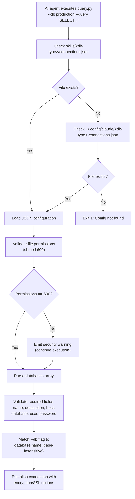
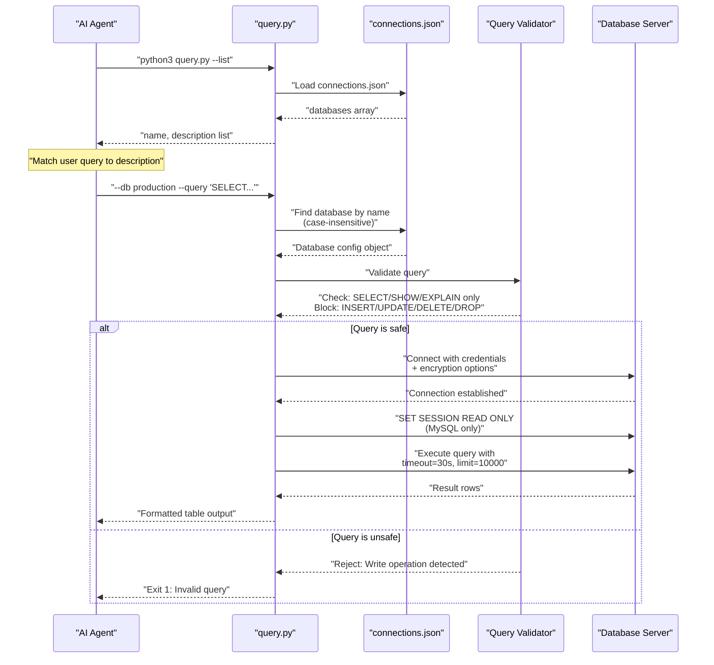
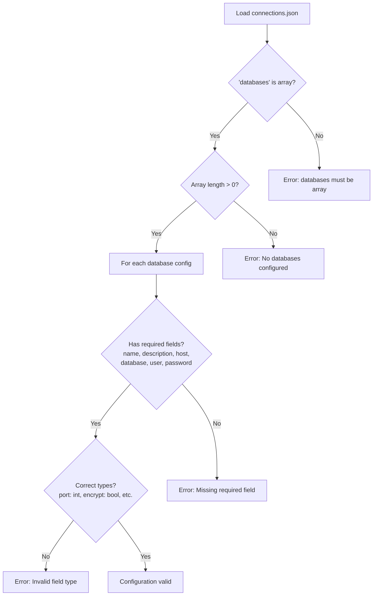

<!-- source: DeepWiki mcp.deepwiki.com · repo sanjay3290/ai-skills · page 6.3 Database Connections · fetched 2026-10-27 -->

# Database Connections

<details>
<summary>Relevant source files</summary>

The following files were used as context for generating this wiki page:

- [skills/mssql/SKILL.md](skills/mssql/SKILL.md)
- [skills/mysql/SKILL.md](skills/mysql/SKILL.md)

</details>


This document covers the `connections.json` configuration file format used by the three database skills (PostgreSQL, MySQL, Microsoft SQL Server) to define database connection credentials and parameters. This configuration enables AI agents to query multiple databases safely with intelligent auto-selection based on semantic descriptions.

For OAuth-based authentication patterns used by Google Workspace skills, see [OAuth & Keyring Setup](#6.2). For general API key management, see [API Keys & Secrets](#6.4). For documentation on the individual database skills themselves, see [Database Skills](#4.2).

## File Location and Security

The database skills search for `connections.json` in two locations, with the skill directory taking precedence:

| Priority | Location | Scope |
|----------|----------|-------|
| 1 | `skills/<skill-name>/connections.json` | Project-specific configuration |
| 2 | `~/.config/claude/<skill-name>-connections.json` | Global user configuration |

**Critical Security Requirement**: Since `connections.json` contains plaintext credentials, file permissions must be restricted to owner-only access:

```bash
chmod 600 connections.json
```

All three database query scripts validate file permissions on startup and emit warnings if permissions are too permissive [skills/mssql/SKILL.md:23-26](), [skills/mysql/SKILL.md:23-26]().

Sources: skills/mssql/SKILL.md:20-26, skills/mysql/SKILL.md:20-26

## Configuration File Resolution



Sources: skills/mssql/SKILL.md:20-21, skills/mysql/SKILL.md:20-21

## Configuration Schema

The `connections.json` file contains a single `databases` array, where each element defines a database connection:

```json
{
  "databases": [
    {
      "name": "production",
      "description": "Main app database - users, orders, transactions",
      "host": "db.example.com",
      "port": 5432,
      "database": "app_prod",
      "user": "readonly_user",
      "password": "your-password"
    },
    {
      "name": "analytics",
      "description": "Business intelligence and reporting data - metrics, dashboards",
      "host": "analytics.example.com",
      "port": 5432,
      "database": "bi_warehouse",
      "user": "analyst_ro",
      "password": "another-password"
    }
  ]
}
```

Sources: skills/mssql/SKILL.md:28-44, skills/mysql/SKILL.md:28-43

## Common Configuration Fields

These fields are required across all three database types:

| Field | Type | Required | Description |
|-------|------|----------|-------------|
| `name` | string | Yes | Unique identifier for the database (case-insensitive matching) |
| `description` | string | Yes | Semantic description of database contents, used for intelligent auto-selection |
| `host` | string | Yes | Database server hostname or IP address |
| `port` | integer | No | Port number (defaults: PostgreSQL=5432, MySQL=3306, MSSQL=1433) |
| `database` | string | Yes | Database/schema name |
| `user` | string | Yes | Username for authentication |
| `password` | string | Yes | Password for authentication (stored in plaintext, requires chmod 600) |

The `name` field serves as the primary identifier for the `--db` command-line argument. Matching is case-insensitive, so `--db production`, `--db Production`, and `--db PRODUCTION` all resolve to the same database [skills/mssql/SKILL.md:50](), [skills/mysql/SKILL.md:49]().

Sources: skills/mssql/SKILL.md:46-58, skills/mysql/SKILL.md:45-59

## Database-Specific Configuration

### PostgreSQL

PostgreSQL connections support SSL/TLS encryption options:

| Field | Type | Default | Description |
|-------|------|---------|-------------|
| `sslmode` | string | `prefer` | SSL mode: `disable`, `allow`, `prefer`, `require`, `verify-ca`, `verify-full` |
| `sslrootcert` | string | null | Path to CA certificate file |
| `sslcert` | string | null | Path to client certificate file |
| `sslkey` | string | null | Path to client private key file |

Example with SSL verification:
```json
{
  "databases": [
    {
      "name": "secure-prod",
      "description": "Production database with certificate verification",
      "host": "pg.example.com",
      "port": 5432,
      "database": "secure_db",
      "user": "app_reader",
      "password": "secret",
      "sslmode": "verify-full",
      "sslrootcert": "/path/to/ca.crt"
    }
  ]
}
```

### MySQL

MySQL connections support comprehensive SSL configuration:

| Field | Type | Default | Description |
|-------|------|---------|-------------|
| `ssl_disabled` | boolean | false | Set to `true` to disable SSL entirely (local development) |
| `ssl_ca` | string | null | Path to CA certificate file |
| `ssl_cert` | string | null | Path to client certificate file |
| `ssl_key` | string | null | Path to client private key file |

The skill enforces read-only sessions via `SET SESSION TRANSACTION READ ONLY` [skills/mysql/SKILL.md:103]().

Example with client certificates:
```json
{
  "databases": [
    {
      "name": "mysql-prod",
      "description": "MySQL production database with client auth",
      "host": "mysql.example.com",
      "port": 3306,
      "database": "app_db",
      "user": "readonly",
      "password": "pass",
      "ssl_ca": "/certs/ca.pem",
      "ssl_cert": "/certs/client-cert.pem",
      "ssl_key": "/certs/client-key.pem"
    }
  ]
}
```

Sources: skills/mysql/SKILL.md:56-59, skills/mysql/SKILL.md:103

### Microsoft SQL Server

MSSQL connections support TDS protocol configuration and encryption:

| Field | Type | Default | Description |
|-------|------|---------|-------------|
| `encrypt` | boolean | false | Enable TLS encryption (required for Azure SQL) |
| `tds_version` | string | auto | TDS protocol version: `7.0`, `7.1`, `7.2`, `7.3`, `7.4` |

The `tds_version` field is critical for compatibility with different SQL Server versions and Azure SQL [skills/mssql/SKILL.md:121]().

Example for Azure SQL:
```json
{
  "databases": [
    {
      "name": "azure-sql",
      "description": "Azure SQL database for cloud application",
      "host": "myserver.database.windows.net",
      "port": 1433,
      "database": "clouddb",
      "user": "sqluser@myserver",
      "password": "azure-password",
      "encrypt": true,
      "tds_version": "7.3"
    }
  ]
}
```

Sources: skills/mssql/SKILL.md:57-58, skills/mssql/SKILL.md:121-122

## Intelligent Database Selection

The `description` field enables semantic database selection by AI agents. When a user's query mentions specific data types, the agent matches keywords in the description to auto-select the appropriate database.

### Keyword Matching Patterns

| User mentions | Match descriptions containing |
|---------------|------------------------------|
| users, accounts, customers | users, accounts, customers, authentication |
| orders, sales, transactions | orders, transactions, sales, purchases, revenue |
| analytics, metrics, reports | analytics, metrics, reports, dashboards, bi, warehouse |
| logs, events, audit | logs, events, audit, history, activity |

Example workflow:
1. User asks: "How many users signed up last month?"
2. Agent runs `--list` to enumerate databases
3. Agent matches "users" → finds database with description containing "users"
4. Agent executes query against the matched database

If no clear match exists, the agent runs `--list` and prompts the user to select a database explicitly [skills/mssql/SKILL.md:89-100](), [skills/mysql/SKILL.md:88-99]().

Sources: skills/mssql/SKILL.md:89-100, skills/mysql/SKILL.md:88-99

## Database Selection and Connection Flow



Sources: skills/mssql/SKILL.md:130-136, skills/mysql/SKILL.md:129-134

## Configuration Validation

All three database skills perform identical validation on startup:



Missing or invalid configurations result in exit code 1 with descriptive error messages [skills/mssql/SKILL.md:118-128](), [skills/mysql/SKILL.md:114-122]().

Sources: skills/mssql/SKILL.md:118-128, skills/mysql/SKILL.md:114-122

## Security Best Practices

1. **File Permissions**: Always set `chmod 600 connections.json` to prevent credential exposure
2. **Read-Only Users**: Configure database users with minimal privileges (e.g., `db_datareader` role for MSSQL)
3. **Network Security**: Use VPNs or private networks for database access
4. **Encryption**: Enable TLS/SSL encryption for production databases
5. **Credential Rotation**: Regularly rotate passwords and update `connections.json`
6. **Separate Configs**: Use project-specific `connections.json` files instead of global configs when working with sensitive databases

The multi-layer safety architecture (query validation, read-only enforcement, encryption, timeouts) ensures that even with plaintext credentials, the risk of data corruption or credential leakage is minimized. For complete safety details, see [Execution & Safety Features](#3.5).

Sources: skills/mssql/SKILL.md:102-113, skills/mysql/SKILL.md:101-111

---

