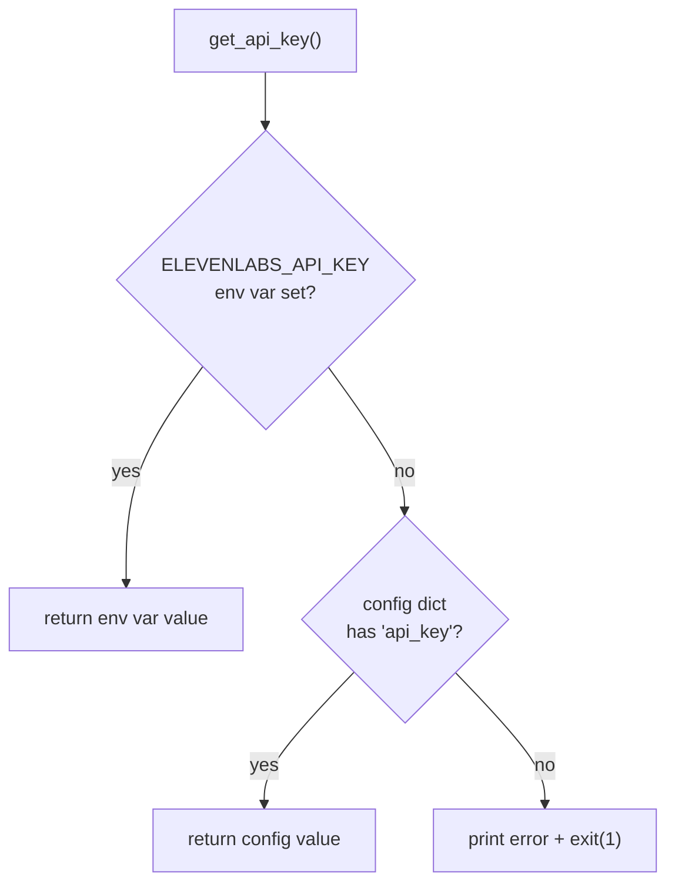
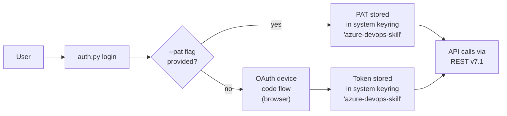
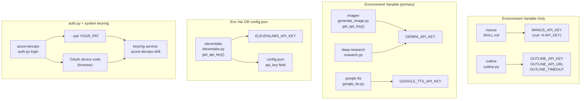

<!-- source: DeepWiki mcp.deepwiki.com · repo sanjay3290/ai-skills · page 6.4 API Keys & Secrets · fetched 2026-10-27 -->

# API Keys & Secrets

<details>
<summary>Relevant source files</summary>

The following files were used as context for generating this wiki page:

- [skills/azure-devops/SKILL.md](skills/azure-devops/SKILL.md)
- [skills/deep-research/SKILL.md](skills/deep-research/SKILL.md)
- [skills/elevenlabs/SKILL.md](skills/elevenlabs/SKILL.md)
- [skills/google-tts/.gitignore](skills/google-tts/.gitignore)
- [skills/google-tts/SKILL.md](skills/google-tts/SKILL.md)
- [skills/google-tts/scripts/extract.py](skills/google-tts/scripts/extract.py)
- [skills/google-tts/scripts/google_tts.py](skills/google-tts/scripts/google_tts.py)
- [skills/imagen/.env.example](skills/imagen/.env.example)
- [skills/imagen/.gitignore](skills/imagen/.gitignore)
- [skills/imagen/README.md](skills/imagen/README.md)
- [skills/imagen/examples.md](skills/imagen/examples.md)
- [skills/imagen/reference.md](skills/imagen/reference.md)
- [skills/imagen/scripts/generate_image.py](skills/imagen/scripts/generate_image.py)

</details>


This page documents how to obtain and configure API keys for skills that use direct API key authentication. It covers six skills: **imagen**, **deep-research**, **elevenlabs**, **google-tts**, **manus**, and **azure-devops**, and the **outline** skill.

For the seven Google Workspace skills (Gmail, Calendar, Chat, Docs, Sheets, Slides, Drive), which use OAuth 2.0 with system keyring storage, see [OAuth & Keyring Setup](#6.2). For database credentials stored in `connections.json`, see [Database Connections](#6.3). For a full list of environment variables, see [Environment Variables](#6.1).

---

## Quick Reference

| Skill | Key Name | Source | Config File |
|-------|----------|--------|-------------|
| `imagen` | `GEMINI_API_KEY` | Google AI Studio | — |
| `deep-research` | `GEMINI_API_KEY` | Google AI Studio | — |
| `elevenlabs` | `ELEVENLABS_API_KEY` | elevenlabs.io | `config.json` (optional) |
| `google-tts` | `GOOGLE_TTS_API_KEY` | Google Cloud Console | `config.json` (optional) |
| `manus` | `MANUS_API_KEY` | manus.im settings | — |
| `azure-devops` | PAT or OAuth token | Azure DevOps portal | system keyring (via `auth.py`) |
| `outline` | `OUTLINE_API_KEY` | Outline wiki settings | — |

> `config.json` and `connections.json` files are excluded from version control via [.gitignore:3-4]().

---

## Gemini API Key (`GEMINI_API_KEY`)

Used by both the `imagen` and `deep-research` skills.

### How to Obtain

1. Go to Google AI Studio: `https://aistudio.google.com/`
2. Click **Get API Key** in the left sidebar.
3. Create a new key or copy an existing one.

### How to Set

```bash
# macOS / Linux
export GEMINI_API_KEY="your-api-key-here"

# Add to shell profile to persist
echo 'export GEMINI_API_KEY="your-api-key-here"' >> ~/.zshrc
```

```powershell
# Windows PowerShell
$env:GEMINI_API_KEY = "your-api-key-here"
```

```cmd
:: Windows CMD
set GEMINI_API_KEY=your-api-key-here
```

### Where It Is Read

The `get_api_key()` function in [skills/imagen/scripts/generate_image.py:40-51]() reads `os.environ.get("GEMINI_API_KEY")` and exits with a usage message if the variable is absent. The `deep-research` skill follows the same pattern via its `scripts/research.py`.

**Notes:**
- Deep Research tasks cost approximately $2–5 per query and take 2–10 minutes. See [Deep Research](#4.3.2).
- The optional `GEMINI_MODEL` env var overrides the default model (`gemini-3-pro-image-preview`) for the imagen skill. See [skills/imagen/scripts/generate_image.py:254]().

Sources: [skills/imagen/scripts/generate_image.py:40-51](), [skills/imagen/README.md:90-97](), [skills/imagen/.env.example:1-7]()

---

## ElevenLabs API Key (`ELEVENLABS_API_KEY`)

Used by the `elevenlabs` skill for text-to-speech and podcast generation.

### How to Obtain

Sign up at `https://elevenlabs.io/` and navigate to **Profile → API Keys**.

### Two Configuration Methods

The `get_api_key()` function in [skills/elevenlabs/scripts/elevenlabs.py:66-84]() checks the environment variable first, then falls back to `config.json`.

**Credential Lookup Flow**



Sources: [skills/elevenlabs/scripts/elevenlabs.py:66-84]()

#### Method 1: Environment Variable

```bash
export ELEVENLABS_API_KEY="your-api-key-here"
```

#### Method 2: `config.json`

Copy the example file and fill in your key:

```bash
cp skills/elevenlabs/config.example.json skills/elevenlabs/config.json
```

The full config format ([skills/elevenlabs/config.example.json:1-8]()):

```json
{
  "api_key": "your-elevenlabs-api-key-here",
  "default_voice": "JBFqnCBsd6RMkjVDRZzb",
  "default_model": "eleven_multilingual_v2",
  "podcast_voice1": "JBFqnCBsd6RMkjVDRZzb",
  "podcast_voice2": "EXAVITQu4vr4xnSDxMaL"
}
```

Only `api_key` is required. The voice ID fields configure defaults used by `cmd_tts()` and `cmd_podcast()` if no `--voice` / `--voice1` / `--voice2` flags are passed.

### Config File Search Locations

The `find_config()` function in [skills/elevenlabs/scripts/elevenlabs.py:45-50]() searches in order:

| Priority | Path |
|----------|------|
| 1 | `skills/elevenlabs/config.json` |
| 2 | `~/.config/claude/elevenlabs-config.json` |

Sources: [skills/elevenlabs/scripts/elevenlabs.py:36-84](), [skills/elevenlabs/config.example.json:1-8]()

---

## Google Cloud TTS API Key (`GOOGLE_TTS_API_KEY`)

Used by the `google-tts` skill.

### How to Obtain

1. Open Google Cloud Console.
2. Enable the **Cloud Text-to-Speech API** for your project.
3. Navigate to **APIs & Services → Credentials → Create Credentials → API Key**.

### How to Set

```bash
export GOOGLE_TTS_API_KEY="your-api-key-here"
```

Alternatively, the skill reads from a `config.json` in the skill directory, following the same pattern as the ElevenLabs skill above.

Sources: [README.md:233-236]()

---

## Manus API Key (`MANUS_API_KEY`)

Used by the `manus` skill. Sent as the `API_KEY` HTTP header on all requests to `https://api.manus.ai`.

### How to Obtain

Log in to `https://manus.im` and navigate to **Settings → API Keys**.

### How to Set

```bash
export MANUS_API_KEY="your-api-key-here"
```

### Where It Is Read

The SKILL.md instructs the AI agent to use `$MANUS_API_KEY` directly in `curl` commands [skills/manus/SKILL.md:65-66](). There is no config file fallback; the variable must be set in the shell environment.

### Example Request Using the Key

```bash
curl -s -X POST "https://api.manus.ai/v1/tasks" \
  -H "API_KEY:$MANUS_API_KEY" \
  -H "Content-Type:application/json" \
  -d '{"prompt":"Research topic","agentProfile":"manus-1.6"}'
```

Sources: [skills/manus/SKILL.md:54-66](), [README.md:217-221]()

---

## Azure DevOps: PAT vs OAuth

The `azure-devops` skill supports two authentication methods, both managed through `scripts/auth.py`.

### Authentication Method Comparison



Sources: [skills/azure-devops/SKILL.md:20-48]()

### Option A: OAuth Device Code Flow (Recommended)

```bash
python skills/azure-devops/scripts/auth.py login --org MyOrganization
```

This opens a browser prompt labeled "Visual Studio Code". Follow the URL and enter the device code shown in the terminal. Tokens are refreshed automatically.

### Option B: Personal Access Token (PAT)

```bash
python skills/azure-devops/scripts/auth.py login --org MyOrganization --pat YOUR_PAT
```

Create a PAT at `https://dev.azure.com/{org}/_usersSettings/tokens`. Required scopes:

| Scope | Permission |
|-------|-----------|
| Work Items | Read & Write |
| Code | Read & Write |
| Build | Read & Execute |
| Wiki | Read & Write |
| Test Management | Read & Write |
| Advanced Security | Read |
| Project and Team | Read |
| Identity | Read |

### Token Storage

Both methods store credentials in the system keyring under the service name `azure-devops-skill`:

| Platform | Storage Backend |
|----------|----------------|
| macOS | Keychain |
| Windows | Windows Credential Locker |
| Linux | Secret Service API |

Requires `pip install keyring` before running `auth.py`.

### Auth Status and Logout

```bash
python skills/azure-devops/scripts/auth.py status
python skills/azure-devops/scripts/auth.py logout
```

Sources: [skills/azure-devops/SKILL.md:19-48](), [skills/azure-devops/SKILL.md:471-478](), [README.md:246-255]()

---

## Outline API Key (`OUTLINE_API_KEY`)

Used by the `outline` skill to access Outline wiki instances.

### How to Obtain

1. Log in to your Outline wiki.
2. Navigate to **Settings → API Tokens**.
3. Create a new token and copy it.

### How to Set

```bash
export OUTLINE_API_KEY="your-api-key-here"

# Optional: point to a self-hosted instance
export OUTLINE_API_URL="https://your-wiki.example.com/api"

# Optional: request timeout in seconds (default varies)
export OUTLINE_TIMEOUT="30"
```

`OUTLINE_API_URL` defaults to the Outline cloud service if not set. Use it when connecting to a self-hosted Outline instance.

Sources: [README.md:200-205]()

---

## Skill-to-Auth-Method Overview

The diagram below maps each skill to the code entity responsible for resolving its credentials.



Sources: [skills/imagen/scripts/generate_image.py:40-51](), [skills/elevenlabs/scripts/elevenlabs.py:66-84](), [skills/manus/SKILL.md:54](), [skills/azure-devops/SKILL.md:19-48](), [README.md:192-255]()

---

## Security Notes

- `config.json` and `connections.json` files are listed in [.gitignore:3-4]() and will not be committed to version control. Never hardcode keys directly in `SKILL.md` or Python source files.
- The `.env.example` pattern (as in [skills/imagen/.env.example:1-7]()) shows the correct way to document required variables without committing actual key values.
- For the ElevenLabs skill, the environment variable `ELEVENLABS_API_KEY` always takes precedence over the value in `config.json` — see [skills/elevenlabs/scripts/elevenlabs.py:68-70]().
- Azure DevOps PATs should be scoped to only the permissions your use case requires. Overly broad PATs increase the blast radius of a key compromise.

---

