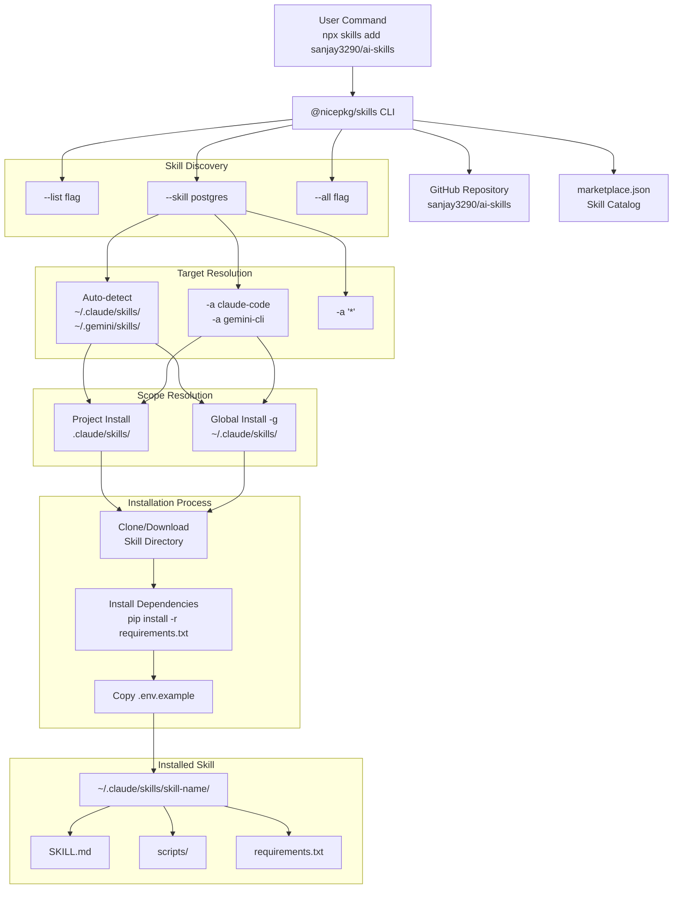
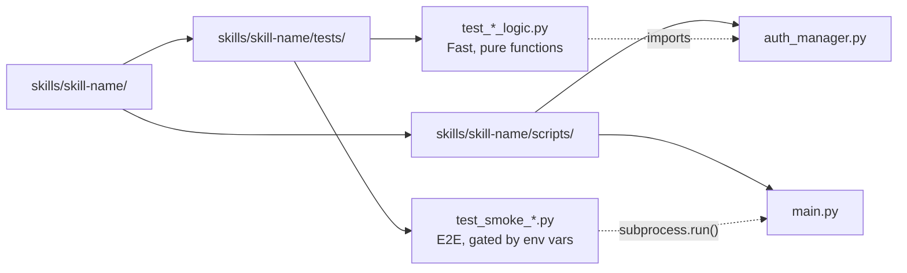
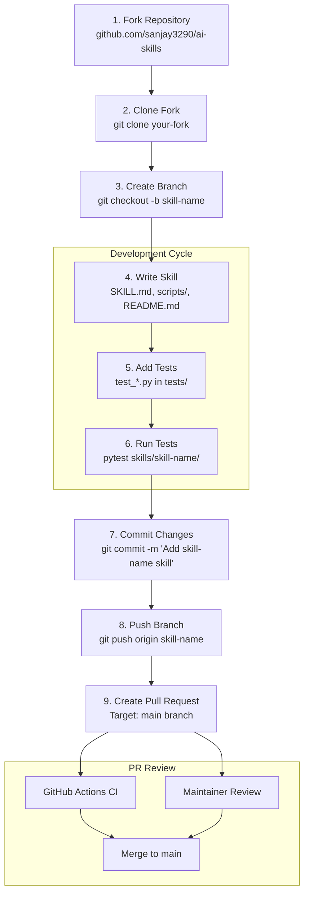

<!-- source: DeepWiki mcp.deepwiki.com · repo sanjay3290/ai-skills · page 7 Development Guide · fetched 2026-10-27 -->

# Development Guide

<details>
<summary>Relevant source files</summary>

The following files were used as context for generating this wiki page:

- [README.md](README.md)
- [skills/jules/SKILL.md](skills/jules/SKILL.md)
- [skills/manus/SKILL.md](skills/manus/SKILL.md)
- [skills/notebooklm/tests/test_ask_question_modes.py](skills/notebooklm/tests/test_ask_question_modes.py)
- [skills/notebooklm/tests/test_remote_manager_filters.py](skills/notebooklm/tests/test_remote_manager_filters.py)
- [skills/notebooklm/tests/test_smoke_playwright.py](skills/notebooklm/tests/test_smoke_playwright.py)

</details>


This guide provides technical documentation for developers creating new skills or contributing to the ai-skills ecosystem. It covers the Agent Skills Standard structure, development workflow, testing patterns, and submission process.

For configuration of existing skills, see [Configuration Guide](#6). For troubleshooting runtime issues, see [Troubleshooting](#8).

---

## Agent Skills Standard Compliance

All skills must follow the [Agent Skills Standard](https://agentskills.io) to ensure portability across 40+ AI clients. The standard defines a consistent directory structure, YAML-based metadata format, and execution conventions that enable "write once, run anywhere" functionality.

### Required Directory Structure

```
skill-name/
├── SKILL.md              # Agent-facing instructions (REQUIRED)
├── README.md             # Human documentation (REQUIRED)
├── scripts/              # Executable code (if applicable)
│   ├── main.py
│   └── helper.py
├── requirements.txt      # Python dependencies (if applicable)
└── .env.example          # Environment variable template (if applicable)
```

**Sources:** [README.md:365-377]()

### SKILL.md Format

The `SKILL.md` file is the primary interface between AI agents and your skill. It must contain YAML frontmatter followed by markdown instructions.

```yaml
---
name: skill-name
description: "Trigger condition: when user says X, or needs Y capability"
license: Apache-2.0
metadata:
  author: username
  version: "1.0"
---

# Skill Instructions

[Detailed instructions for AI agents, including command syntax, examples, and error handling]
```

**Key fields:**
- `name`: Lowercase, hyphenated identifier (must match directory name)
- `description`: Activation criteria - when should the AI agent use this skill?
- `license`: License identifier (typically Apache-2.0)

The markdown body should provide clear, actionable instructions with command examples that AI agents can execute directly. See [skills/manus/SKILL.md:1-8]() and [skills/jules/SKILL.md:1-8]() for reference implementations.

**Sources:** [README.md:379-388](), [skills/manus/SKILL.md:1-8](), [skills/jules/SKILL.md:1-8]()

---

## Skill Installation Flow

Understanding how `npx skills` discovers and installs skills helps you design testable, portable implementations.

### Installation Architecture



**Installation command patterns:**

| Command | Effect |
|---------|--------|
| `npx skills add sanjay3290/ai-skills --skill postgres` | Install postgres skill, auto-detect agent, project scope |
| `npx skills add sanjay3290/ai-skills --skill postgres -g` | Global install to `~/.claude/skills/` |
| `npx skills add sanjay3290/ai-skills --skill postgres -a gemini-cli` | Install to `~/.gemini/skills/` |
| `npx skills add sanjay3290/ai-skills --all -a '*'` | Install all skills to all detected agents |

**Sources:** [README.md:61-141]()

---

## Skill Development Workflow

### 1. Skill Structure Template

Create a new skill directory under `skills/your-skill-name/`:

```bash
skills/your-skill-name/
├── SKILL.md                    # AI agent instructions
├── README.md                   # Human documentation
├── scripts/
│   ├── main.py                 # Primary executable
│   └── auth.py                 # Authentication helper (if needed)
├── requirements.txt            # pip install -r requirements.txt
├── .env.example                # SKILL_API_KEY=your-api-key-here
└── .gitignore                  # *.pyc, __pycache__/, .env, config.json
```

**Sources:** [README.md:365-377]()

### 2. YAML Frontmatter Design

The `description` field is critical - it determines when AI agents activate your skill. Use explicit trigger phrases:

```yaml
description: "Delegate coding tasks to Jules AI agent. Use when user says: 'have Jules fix', 'delegate to Jules', 'send to Jules', 'ask Jules to', 'check Jules sessions'. Handles: bug fixes, documentation, features, tests."
```

This pattern from [skills/jules/SKILL.md:3]() shows:
- Explicit activation phrases ("have Jules fix", "delegate to Jules")
- Capability keywords ("bug fixes", "documentation", "features")
- Action verbs ("check", "ask")

**Sources:** [skills/jules/SKILL.md:1-8](), [skills/manus/SKILL.md:1-8]()

### 3. Script Organization Patterns

#### Single-Purpose Skills
For simple skills, use a single `scripts/main.py`:

```
scripts/
└── main.py                     # All logic in one file
```

#### Multi-Purpose Skills
For complex skills with multiple commands, separate concerns:

```
scripts/
├── auth_manager.py             # Authentication setup/status/reauth
├── notebook_manager.py         # Notebook CRUD operations
├── ask_question.py             # Query execution
└── remote_manager.py           # Remote sync operations
```

This pattern from the NotebookLM skill [skills/notebooklm/scripts/]() separates authentication, local state management, query execution, and remote synchronization.

**Sources:** [skills/notebooklm/tests/test_smoke_playwright.py:12-14]()

### 4. Dependency Management

Declare all Python dependencies in `requirements.txt`:

```txt
playwright==1.40.0
keyring>=24.0.0
```

For optional dependencies (e.g., PDF parsing), document them clearly in README.md:

```bash
# Core functionality
pip install -r requirements.txt

# Optional: PDF and DOCX support
pip install PyPDF2 python-docx
```

**Sources:** [README.md:226-237]()

---

## Testing Strategy

The repository uses two testing approaches: unit tests for logic validation and smoke tests for end-to-end integration.

### Test File Organization



**Sources:** [skills/notebooklm/tests/test_ask_question_modes.py:1-10](), [skills/notebooklm/tests/test_smoke_playwright.py:1-15]()

### Unit Test Pattern

Test pure functions by importing modules directly:

```python
# skills/notebooklm/tests/test_ask_question_modes.py
import sys
from pathlib import Path

SCRIPTS_DIR = Path(__file__).resolve().parents[1] / "scripts"
sys.path.insert(0, str(SCRIPTS_DIR))

import ask_question as aq

def test_extract_questions_single() -> None:
    args = SimpleNamespace(question="What is this?", questions=None, questions_file=None)
    questions, error = aq._extract_questions(args)
    assert error is None
    assert questions == ["What is this?"]
```

This pattern from [skills/notebooklm/tests/test_ask_question_modes.py:7-17]() tests the question extraction logic without external dependencies.

**Sources:** [skills/notebooklm/tests/test_ask_question_modes.py:1-31]()

### Smoke Test Pattern

Test end-to-end workflows via subprocess calls, gated by environment variables:

```python
# skills/notebooklm/tests/test_smoke_playwright.py
@pytest.mark.smoke
def test_remote_manager_create_list_add_delete_smoke() -> None:
    if os.environ.get("NOTEBOOKLM_E2E") != "1":
        pytest.skip("Set NOTEBOOKLM_E2E=1 to run live smoke tests")
    
    # Test actual script execution
    created = _run_json([
        "python3",
        str(REMOTE_MANAGER),
        "create-remote",
        "--name",
        notebook_name,
        "--profile",
        profile,
    ])
    
    notebook_id = created.get("library_notebook", {}).get("id")
    assert notebook_id, created
```

This pattern from [skills/notebooklm/tests/test_smoke_playwright.py:34-64]() uses:
- Environment variable gating (`NOTEBOOKLM_E2E=1`)
- Subprocess execution of actual scripts
- JSON output parsing for validation
- Live external service interaction

**Sources:** [skills/notebooklm/tests/test_smoke_playwright.py:33-64]()

### Test Execution

```bash
# Run unit tests (fast, no external dependencies)
pytest skills/your-skill-name/tests/ -m "not smoke"

# Run smoke tests (slow, requires authentication)
export NOTEBOOKLM_E2E=1
pytest skills/your-skill-name/tests/ -m smoke

# Run all tests
pytest skills/your-skill-name/tests/
```

**Sources:** [skills/notebooklm/tests/test_smoke_playwright.py:35-36]()

---

## Configuration Patterns

### Environment Variables

Use environment variables for API keys and global settings:

```bash
# .env.example
SKILL_API_KEY=your-api-key-here
SKILL_BASE_URL=https://api.example.com
```

Document in SKILL.md:

```markdown
## Environment Setup

Requires `SKILL_API_KEY` environment variable. Base URL: `https://api.example.com`
```

**Sources:** [skills/manus/SKILL.md:52-54]()

### Configuration Files

For complex settings (database connections, multiple accounts), use JSON config files:

```json
{
  "databases": [
    {
      "name": "production",
      "description": "Main production database with user, order, and product data",
      "host": "prod.example.com",
      "port": 5432,
      "user": "readonly",
      "password": "secret",
      "database": "main"
    }
  ]
}
```

Always use `chmod 600` for files containing credentials and document in SKILL.md.

**Sources:** [README.md:183-184]()

### Keyring Storage

For OAuth tokens, use cross-platform keyring storage:

```python
import keyring

# Store token
keyring.set_password("skill-name-oauth", "default", access_token)

# Retrieve token
token = keyring.get_password("skill-name-oauth", "default")
```

This pattern ensures tokens are stored in:
- **macOS**: Keychain
- **Windows**: Credential Locker  
- **Linux**: Secret Service API (GNOME Keyring, KDE Wallet)

**Sources:** [README.md:283-286]()

---

## Testing Infrastructure

### pytest Configuration

All test files use `pytest` with markers for test categorization:

```python
@pytest.mark.smoke
def test_integration_workflow():
    # Smoke test logic
    pass

def test_unit_logic():
    # Unit test logic (no marker = runs by default)
    pass
```

**Sources:** [skills/notebooklm/tests/test_smoke_playwright.py:33]()

### Test Helpers

Create reusable test utilities for subprocess execution and JSON parsing:

```python
def _run_json(command: list[str]) -> dict:
    proc = subprocess.run(
        command,
        cwd=str(SKILL_DIR),
        check=False,
        text=True,
        capture_output=True,
    )
    if proc.returncode != 0:
        raise AssertionError(f"Command failed ({proc.returncode})")
    try:
        return json.loads(proc.stdout)
    except json.JSONDecodeError as exc:
        raise AssertionError(f"Invalid JSON output") from exc
```

This helper from [skills/notebooklm/tests/test_smoke_playwright.py:17-30]() wraps subprocess calls with error handling and JSON parsing.

**Sources:** [skills/notebooklm/tests/test_smoke_playwright.py:17-30]()

### Parametrized Testing

Use `pytest.mark.parametrize` for testing multiple inputs:

```python
@pytest.mark.parametrize("raw", ["abc", "10tb", "1.2.3mb"])
def test_parse_max_size_bytes_invalid(raw: str) -> None:
    with pytest.raises(ValueError):
        rm._parse_max_size_bytes(raw)
```

This pattern from [skills/notebooklm/tests/test_remote_manager_filters.py:23-26]() tests invalid input handling.

**Sources:** [skills/notebooklm/tests/test_remote_manager_filters.py:23-26]()

---

## Contribution Workflow

### Git Workflow



**Sources:** [README.md:390-396]()

### Pre-Submission Checklist

Before submitting a pull request, verify:

- [ ] `SKILL.md` has valid YAML frontmatter with `name`, `description`, `license`
- [ ] `README.md` documents setup, configuration, and usage examples
- [ ] `requirements.txt` lists all dependencies (if applicable)
- [ ] `.env.example` documents required environment variables (if applicable)
- [ ] `.gitignore` excludes credentials (`*.env`, `config.json`, `connections.json`)
- [ ] Tests added to `tests/` directory
- [ ] All tests pass: `pytest skills/your-skill-name/`
- [ ] Scripts are executable and accept `--help` flag
- [ ] Error handling includes user-friendly messages
- [ ] No hardcoded credentials or API keys in code

**Sources:** [README.md:390-396]()

### .gitignore Patterns

Always exclude credentials and environment-specific files:

```gitignore
# Environment files
.env
*.env
!.env.example

# Configuration with secrets
config.json
connections.json
*.key
*.pem

# Python artifacts
__pycache__/
*.pyc
*.pyo

# IDE files
.vscode/
.idea/
```

**Sources:** Implied from security best practices in database skills

---

## Common Development Patterns

### Command-Line Interface Design

Use `argparse` with subcommands for multi-function skills:

```python
import argparse
import sys

def main():
    parser = argparse.ArgumentParser(description="Skill description")
    subparsers = parser.add_subparsers(dest="command", required=True)
    
    # Subcommand: create
    create_parser = subparsers.add_parser("create", help="Create resource")
    create_parser.add_argument("--name", required=True)
    
    # Subcommand: list
    list_parser = subparsers.add_parser("list", help="List resources")
    
    args = parser.parse_args()
    
    if args.command == "create":
        # Handle create
        pass
    elif args.command == "list":
        # Handle list
        pass

if __name__ == "__main__":
    main()
```

This pattern enables: `python scripts/main.py create --name foo` and `python scripts/main.py list`.

**Sources:** Implied from NotebookLM script structure

### JSON Output Format

Always output structured JSON for AI agent consumption:

```python
import json
import sys

def output_success(data: dict):
    result = {"status": "success", **data}
    print(json.dumps(result, indent=2))
    sys.exit(0)

def output_error(message: str, code: int = 1):
    result = {"status": "error", "error": message}
    print(json.dumps(result, indent=2), file=sys.stderr)
    sys.exit(code)
```

**Sources:** [skills/notebooklm/tests/test_smoke_playwright.py:17-30]()

### Retry Logic for External APIs

Implement exponential backoff for unreliable external services:

```python
import time

def call_api_with_retry(func, max_attempts=3):
    for attempt in range(max_attempts):
        try:
            return func()
        except Exception as e:
            if attempt == max_attempts - 1:
                raise
            wait_time = 2 ** attempt  # Exponential backoff: 1s, 2s, 4s
            time.sleep(wait_time)
```

**Sources:** Implied from asynchronous agent patterns

---

## Debugging and Development Tools

### Local Testing Without Installation

Test skills directly from the repository without installing via `npx skills`:

```bash
# Test script execution
python skills/your-skill-name/scripts/main.py --help

# Test with sample data
python skills/your-skill-name/scripts/main.py create --name test

# Run specific test
pytest skills/your-skill-name/tests/test_unit.py::test_function_name -v
```

### Environment Variable Management

Use a `.env` file (gitignored) for local development:

```bash
# Create from template
cp skills/your-skill-name/.env.example skills/your-skill-name/.env

# Edit with your credentials
nano skills/your-skill-name/.env

# Load in shell
export $(cat skills/your-skill-name/.env | xargs)
```

### Symlink for Active Development

During development, symlink your skill to an AI client for testing:

```bash
# Link skill to Claude Code
ln -s $(pwd)/skills/your-skill-name ~/.claude/skills/your-skill-name

# Test with AI client
# (Open Claude Code and use the skill naturally)

# Remove symlink when done
rm ~/.claude/skills/your-skill-name
```

**Sources:** [README.md:169-173]()

---

## Documentation Requirements

### README.md Structure

Every skill requires a `README.md` with the following sections:

```markdown
# Skill Name

Brief description (1-2 sentences).

## Features

- Bullet list of capabilities
- What problems it solves

## Setup

### Prerequisites
- System requirements
- External dependencies

### Installation
```bash
pip install -r requirements.txt
```

### Configuration
- Environment variables
- Config file format
- Authentication steps

## Usage

### Basic Examples
```bash
# Example command 1
# Example command 2
```

### Advanced Usage
- Complex scenarios
- Integration patterns

## Troubleshooting

Common issues and solutions.

## API Reference

Link to detailed API docs if applicable.
```

**Sources:** Implied from README structure across skills

### SKILL.md Best Practices

Write SKILL.md for AI agents, not humans:

1. **Be explicit**: "Use when user says 'X'" > "For X-related tasks"
2. **Include examples**: Show exact command syntax with placeholders
3. **Document outputs**: Explain what AI agents should expect (JSON format, exit codes)
4. **Handle errors**: Describe common failures and recovery steps
5. **State dependencies**: List required environment variables upfront

**Sources:** [skills/jules/SKILL.md:1-201](), [skills/manus/SKILL.md:1-185]()

---

## Continuous Integration

### GitHub Actions Workflow

The repository uses GitHub Actions for automated testing. Skills should be compatible with this CI pipeline.

**Expected CI checks:**
- Python syntax validation
- `pytest` execution (unit tests only by default)
- Dependency installation verification
- SKILL.md YAML validation

**Sources:** Implied from project structure

### Smoke Test Gating

Smoke tests that require authentication should be gated by environment variables:

```python
import os
import pytest

@pytest.mark.smoke
def test_e2e_workflow():
    if os.environ.get("SKILL_E2E") != "1":
        pytest.skip("Set SKILL_E2E=1 to run live smoke tests")
    
    # E2E test logic
```

This ensures CI doesn't fail when credentials aren't available.

**Sources:** [skills/notebooklm/tests/test_smoke_playwright.py:35-36]()

---

## Summary

### Development Checklist

| Task | Status |
|------|--------|
| Create skill directory under `skills/` | ☐ |
| Write `SKILL.md` with YAML frontmatter | ☐ |
| Implement `scripts/` with clear CLI | ☐ |
| Add `README.md` with setup instructions | ☐ |
| Create `requirements.txt` (if Python) | ☐ |
| Add `.env.example` for environment variables | ☐ |
| Write unit tests in `tests/` | ☐ |
| Add smoke tests with env var gating | ☐ |
| Update `.gitignore` to exclude credentials | ☐ |
| Test installation via `npx skills add` | ☐ |
| Submit pull request | ☐ |

### Next Steps

- For detailed skill structure guidance, see [Creating a New Skill](#7.1)
- For testing and CI implementation, see [Testing & CI](#7.2)  
- For pull request submission, see [Contributing to the Ecosystem](#7.3)

**Sources:** [README.md:390-396]()

---

