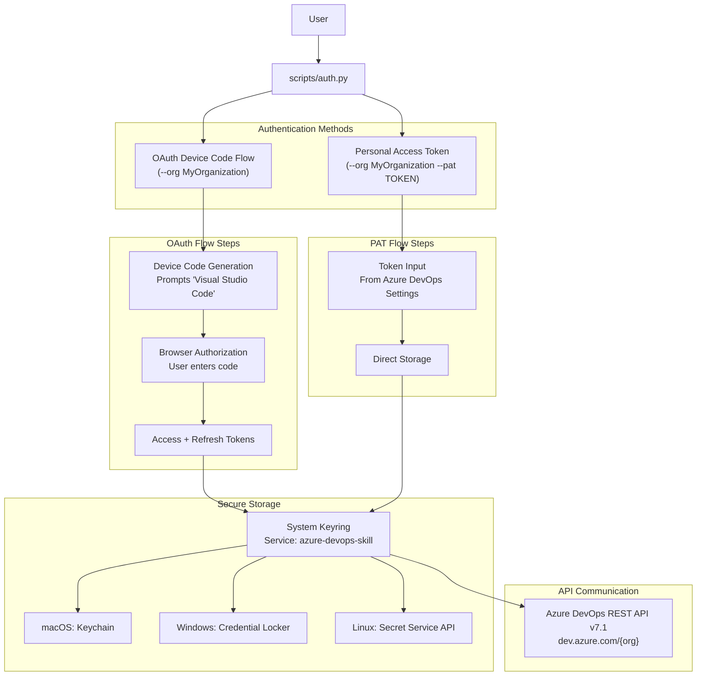
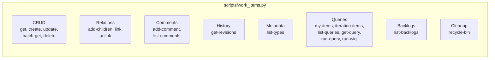
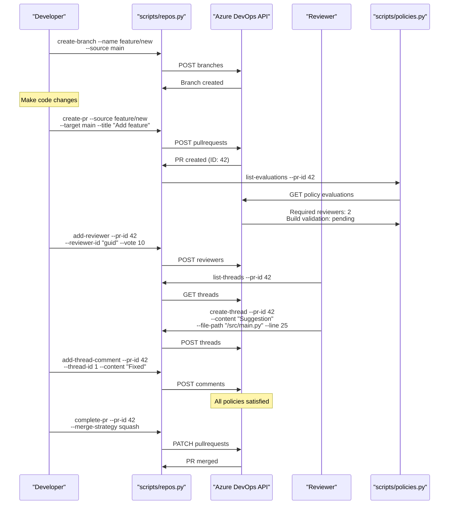
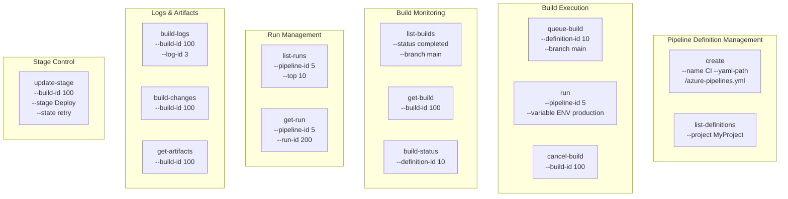
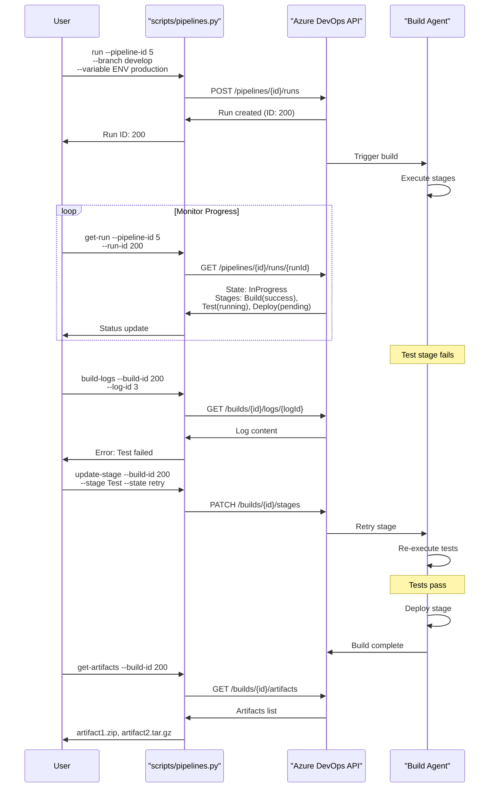
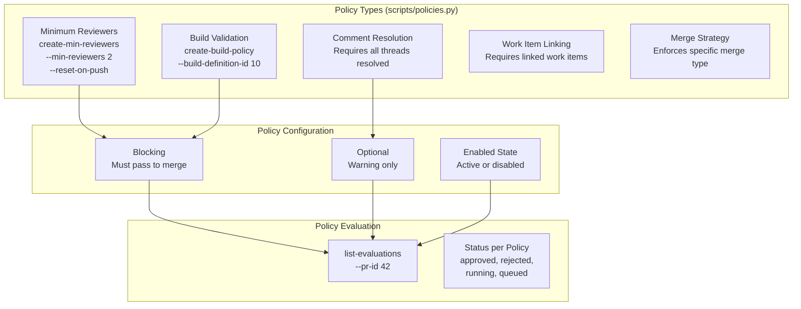
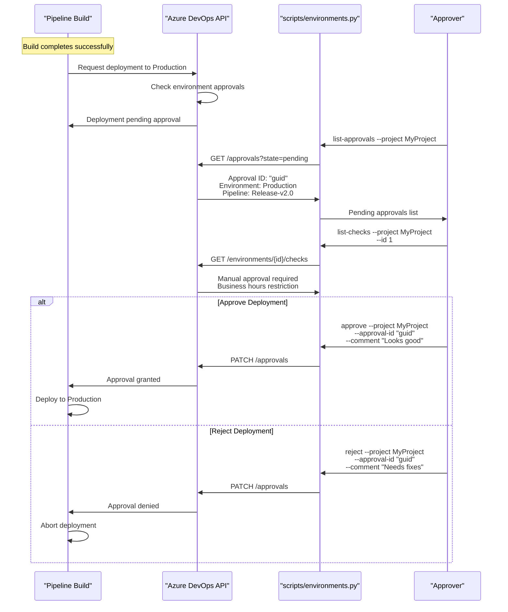
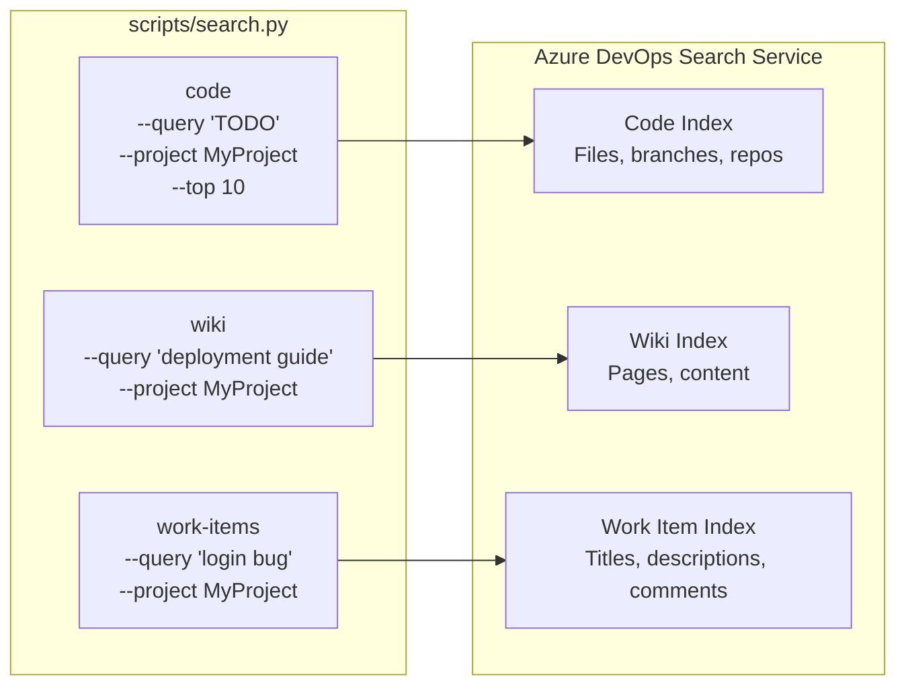
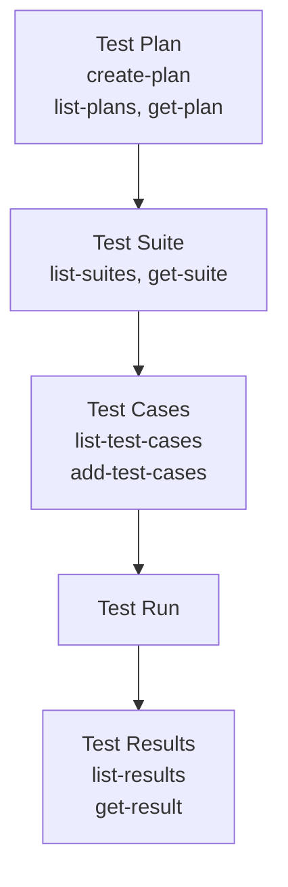

<!-- source: DeepWiki mcp.deepwiki.com · repo sanjay3290/ai-skills · extra page Azure DevOps · fetched 2026-10-27 -->

# Azure DevOps

<details>
<summary>Relevant source files</summary>

The following files were used as context for generating this wiki page:

- [skills/azure-devops/SKILL.md](skills/azure-devops/SKILL.md)
- [skills/deep-research/SKILL.md](skills/deep-research/SKILL.md)
- [skills/elevenlabs/SKILL.md](skills/elevenlabs/SKILL.md)

</details>


## Purpose and Scope

This page documents the **azure-devops skill**, which provides comprehensive integration with Azure DevOps through its REST API v7.1. The skill covers 13 functional domains with 99 total commands, enabling AI assistants to manage the complete DevOps lifecycle including work items, repositories, pull requests, pipelines, wikis, test plans, security alerts, variable groups, environments, branch policies, and attachments.

For other development platform integrations, see [Outline Wiki](#4.5.2). For agent-based task execution, see [Jules (GitHub Agent)](#4.4.1) and [Manus (Research Agent)](#4.4.2).

**Sources:** [skills/azure-devops/SKILL.md:1-18]()

---

## Authentication Architecture

The Azure DevOps skill implements a dual-mode authentication system supporting both OAuth device code flow (recommended for interactive use) and Personal Access Tokens (for automation scenarios). Credentials are stored securely in the platform-native system keyring.

### Dual Authentication Flow



**Key Implementation Details:**

- **OAuth Device Code Flow**: Default method using `scripts/auth.py login --org MyOrganization`. Displays "Visual Studio Code" in the authorization prompt. Tokens automatically refresh without user intervention.
- **PAT Method**: Alternative using `scripts/auth.py login --org MyOrganization --pat YOUR_PAT`. Requires manual token creation at `https://dev.azure.com/{org}/_usersSettings/tokens` with specific scopes (Work Items, Code, Build, Wiki, Test Management, Advanced Security, Project and Team, Identity).
- **Keyring Storage**: Service identifier `azure-devops-skill` stores credentials in platform-native secure storage.
- **Status Checking**: `scripts/auth.py status` verifies current authentication state.
- **Logout**: `scripts/auth.py logout` removes credentials from keyring.

**Sources:** [skills/azure-devops/SKILL.md:19-56](), [skills/azure-devops/SKILL.md:470-477]()

---

## Module Organization

The skill is organized into 13 functional modules, each implemented as a separate Python script in the `scripts/` directory. This modular architecture enables focused functionality and clear command organization.

### Module Structure

```mermaid
graph TB
    subgraph "Core Infrastructure"
        auth["scripts/auth.py<br/>Authentication<br/>login, status, logout"]
        core["scripts/core.py<br/>Projects & Teams<br/>list-projects, list-teams, get-identity"]
    end
    
    subgraph "Work Management (scripts/work_items.py)"
        wi_crud["CRUD Operations<br/>get, create, update, delete"]
        wi_relations["Relations & Links<br/>add-children, link, unlink"]
        wi_comments["Comments & History<br/>add-comment, list-comments, get-revisions"]
        wi_queries["Queries & Search<br/>my-items, iteration-items, run-wiql"]
        wi_backlogs["Backlogs & Planning<br/>list-backlogs, list-queries"]
    end
    
    subgraph "Source Control (scripts/repos.py)"
        repos_mgmt["Repository Management<br/>list, get, create-branch"]
        prs["Pull Requests<br/>create-pr, update-pr, complete-pr"]
        pr_reviews["Reviews & Comments<br/>add-reviewer, list-threads, create-thread"]
        commits["Commits & Diff<br/>search-commits, get-diff, list-files"]
    end
    
    subgraph "Sprint Planning (scripts/work.py)"
        iterations["Iterations<br/>list-iterations, create-iteration"]
        capacity["Capacity Planning<br/>get-capacities, set-capacity"]
    end
    
    subgraph "CI/CD (scripts/pipelines.py)"
        pipeline_mgmt["Pipeline Management<br/>create, list-definitions, run"]
        builds["Build Operations<br/>queue-build, cancel-build, get-build"]
        logs["Logs & Artifacts<br/>build-logs, get-artifacts"]
    end
    
    subgraph "Search (scripts/search.py)"
        search["Universal Search<br/>code, wiki, work-items"]
    end
    
    subgraph "Documentation (scripts/wiki.py)"
        wiki["Wiki Operations<br/>list, get-page, create-or-update-page"]
    end
    
    subgraph "Quality Assurance (scripts/test_plans.py)"
        test_plans["Test Management<br/>list-plans, create-plan"]
        test_suites["Test Suites & Cases<br/>list-suites, add-test-cases"]
        test_results["Test Results<br/>list-results, get-result"]
    end
    
    subgraph "Security (scripts/security.py)"
        alerts["Security Alerts<br/>list-alerts, get-alert"]
    end
    
    subgraph "Configuration (scripts/variable_groups.py)"
        variables["Variable Groups<br/>create, update, add-variable"]
    end
    
    subgraph "Deployment (scripts/environments.py)"
        envs["Environments<br/>create, get, list-checks"]
        approvals["Approvals<br/>list-approvals, approve, reject"]
    end
    
    subgraph "Governance (scripts/policies.py)"
        policy_mgmt["Policy Management<br/>list, create-min-reviewers, create-build-policy"]
        evaluations["Policy Evaluation<br/>list-evaluations"]
    end
    
    subgraph "Attachments (scripts/attachments.py)"
        attach["File Management<br/>upload, attach, download, remove"]
    end
    
    auth --> core
    core --> wi_crud & repos_mgmt & iterations & pipeline_mgmt & search & wiki & test_plans & alerts & variables & envs & policy_mgmt & attach
```



**Module Distribution:**

| Module | Script | Commands | Primary Focus |
|--------|--------|----------|---------------|
| Core | `scripts/core.py` | 3 | Projects, teams, identity search |
| Work Items | `scripts/work_items.py` | 21 | Issue tracking, backlogs, queries |
| Repos & PRs | `scripts/repos.py` | 17 | Source control, pull requests, code review |
| Iterations | `scripts/work.py` | 7 | Sprint planning, capacity management |
| Pipelines | `scripts/pipelines.py` | 16 | CI/CD, builds, deployments |
| Search | `scripts/search.py` | 3 | Code/wiki/work item search |
| Wiki | `scripts/wiki.py` | 6 | Documentation management |
| Test Plans | `scripts/test_plans.py` | 9 | Test management, results |
| Security | `scripts/security.py` | 2 | Vulnerability alerts |
| Variable Groups | `scripts/variable_groups.py` | 7 | Pipeline configuration |
| Environments | `scripts/environments.py` | 8 | Deployment environments, approvals |
| Policies | `scripts/policies.py` | 9 | Branch policies, PR gates |
| Attachments | `scripts/attachments.py` | 6 | File upload/download |

**Total: 99 commands across 13 modules**

**Sources:** [skills/azure-devops/SKILL.md:58-442]()

---

## Work Item Management

The `scripts/work_items.py` module provides comprehensive work item operations covering the complete lifecycle from creation through tracking to archival.

### Work Item Command Hierarchy



### Common Work Item Operations

**Create Work Item:**
```bash
python scripts/work_items.py create \
  --project MyProject \
  --type "User Story" \
  --title "New feature" \
  --field System.Description "Description text" \
  --field System.AssignedTo "user@example.com"
```

**Update Work Item:**
```bash
python scripts/work_items.py update \
  --project MyProject \
  --id 123 \
  --field System.State "Active" \
  --field Microsoft.VSTS.Common.Priority 1
```

**Link Work Items:**
```bash
# Parent-child relationship
python scripts/work_items.py add-children \
  --project MyProject \
  --parent-id 100 \
  --child-ids 101,102

# Custom link type
python scripts/work_items.py link \
  --project MyProject \
  --source-id 100 \
  --target-id 200 \
  --link-type "System.LinkTypes.Dependency-Forward"
```

**WIQL Query:**
```bash
python scripts/work_items.py run-wiql \
  --project MyProject \
  --query "SELECT [System.Id], [System.Title] FROM WorkItems WHERE [System.State] = 'Active'"
```

**Sources:** [skills/azure-devops/SKILL.md:72-135]()

---

## Pull Request Workflow

The `scripts/repos.py` module manages Git repositories and pull requests with support for code review, comments, and merge operations.

### Pull Request Lifecycle



**Key PR Commands:**

| Command | Purpose | Example |
|---------|---------|---------|
| `create-pr` | Initiate pull request | `--source feature/new --target main --title "Title"` |
| `update-pr` | Modify PR metadata | `--pr-id 42 --title "Updated"` |
| `add-reviewer` | Add code reviewer | `--pr-id 42 --reviewer-id "guid" --vote 10` |
| `list-threads` | Get review comments | `--pr-id 42` |
| `create-thread` | Add file comment | `--pr-id 42 --file-path "/src/main.py" --line 25` |
| `complete-pr` | Merge PR | `--pr-id 42 --merge-strategy rebase --keep-source` |
| `abandon-pr` | Cancel PR | `--pr-id 42` |

**Merge Strategies:**
- `noFastForward`: Standard merge commit
- `squash`: Squash commits into one
- `rebase`: Rebase onto target
- `rebaseAndFastForward`: Rebase then fast-forward

**Sources:** [skills/azure-devops/SKILL.md:137-187]()

---

## Pipeline Execution

The `scripts/pipelines.py` module manages CI/CD pipelines with support for builds, runs, artifacts, and stage management.

### Pipeline Command Structure



### Pipeline Execution Flow



**Variable Injection:**
```bash
python scripts/pipelines.py run \
  --project MyProject \
  --pipeline-id 5 \
  --variable ENV production \
  --variable DEPLOY true \
  --variable REGION eastus
```

**Sources:** [skills/azure-devops/SKILL.md:214-256]()

---

## Branch Policy Management

The `scripts/policies.py` module configures and manages branch protection rules, enforcing code review standards and build validation requirements.

### Policy Types and Configuration



**Create Minimum Reviewers Policy:**
```bash
python scripts/policies.py create-min-reviewers \
  --project MyProject \
  --repo-id "repo-guid" \
  --branch main \
  --min-reviewers 2 \
  --reset-on-push
```

**Create Build Validation Policy:**
```bash
python scripts/policies.py create-build-policy \
  --project MyProject \
  --repo-id "repo-guid" \
  --branch main \
  --build-definition-id 10
```

**Update Policy State:**
```bash
# Disable policy
python scripts/policies.py update \
  --project MyProject \
  --id 1 \
  --enabled false

# Make policy blocking
python scripts/policies.py update \
  --project MyProject \
  --id 1 \
  --blocking true
```

**Check PR Policy Compliance:**
```bash
python scripts/policies.py list-evaluations \
  --project MyProject \
  --pr-id 42
```

**Sources:** [skills/azure-devops/SKILL.md:385-415]()

---

## Environment and Approval Management

The `scripts/environments.py` module manages deployment environments and approval gates for release pipelines.

### Approval Workflow



**Environment Setup:**
```bash
# Create environment
python scripts/environments.py create \
  --project MyProject \
  --name "Production" \
  --description "Production environment"

# List checks/approvals configured
python scripts/environments.py list-checks \
  --project MyProject \
  --id 1
```

**Approval Management:**
```bash
# List pending approvals
python scripts/environments.py list-approvals \
  --project MyProject

# List all approvals (including completed)
python scripts/environments.py list-approvals \
  --project MyProject \
  --state all

# Approve deployment
python scripts/environments.py approve \
  --project MyProject \
  --approval-id "guid" \
  --comment "Approved for deployment"

# Reject deployment
python scripts/environments.py reject \
  --project MyProject \
  --approval-id "guid" \
  --comment "Security scan failed"
```

**Sources:** [skills/azure-devops/SKILL.md:355-383]()

---

## Work Item Attachments

The `scripts/attachments.py` module manages file uploads and downloads for work items, supporting screenshots, documents, logs, and other artifacts.

### Attachment Operations

**Upload and Attach Workflow:**
```bash
# One-step upload and attach
python scripts/attachments.py upload-and-attach \
  --project MyProject \
  --id 123 \
  --file ./screenshot.png \
  --comment "Bug screenshot"

# Two-step: upload then attach
python scripts/attachments.py upload \
  --project MyProject \
  --file ./report.pdf

# Returns: https://dev.azure.com/org/project/_apis/wit/attachments/{guid}

python scripts/attachments.py attach \
  --project MyProject \
  --id 123 \
  --url "https://dev.azure.com/org/project/_apis/wit/attachments/{guid}" \
  --comment "Test report"
```

**List and Download:**
```bash
# List all attachments on a work item
python scripts/attachments.py list \
  --project MyProject \
  --id 123

# Download attachment
python scripts/attachments.py download \
  --project MyProject \
  --url "https://dev.azure.com/org/project/_apis/wit/attachments/{guid}" \
  --output ./downloaded.pdf
```

**Remove Attachment:**
```bash
# Remove by relation index (get index from list command)
python scripts/attachments.py remove \
  --project MyProject \
  --id 123 \
  --index 0
```

**Sources:** [skills/azure-devops/SKILL.md:417-442]()

---

## Reference: Work Item Fields

Common work item fields used across `scripts/work_items.py` commands. These reference names are used with `--field` parameters in `create` and `update` operations.

| Field | Reference Name | Usage |
|-------|---------------|--------|
| Title | `System.Title` | Work item title (required) |
| State | `System.State` | Workflow state (Active, Resolved, Closed) |
| Assigned To | `System.AssignedTo` | User email or display name |
| Description | `System.Description` | Detailed description (HTML supported) |
| Area Path | `System.AreaPath` | Team area classification |
| Iteration Path | `System.IterationPath` | Sprint/iteration path |
| Priority | `Microsoft.VSTS.Common.Priority` | Priority level (1-4) |
| Story Points | `Microsoft.VSTS.Scheduling.StoryPoints` | Effort estimation |
| Tags | `System.Tags` | Semicolon-separated tags |
| Repro Steps | `Microsoft.VSTS.TCM.ReproSteps` | Bug reproduction steps |
| Acceptance Criteria | `Microsoft.VSTS.Common.AcceptanceCriteria` | User story acceptance criteria |

**Example Usage:**
```bash
python scripts/work_items.py create \
  --project MyProject \
  --type Bug \
  --title "Login timeout" \
  --field System.Description "Users report timeout after 30s" \
  --field Microsoft.VSTS.Common.Priority 1 \
  --field System.Tags "login;performance;urgent" \
  --field Microsoft.VSTS.TCM.ReproSteps "1. Navigate to login<br/>2. Wait 30s<br/>3. Timeout error"
```

**Sources:** [skills/azure-devops/SKILL.md:444-459]()

---

## Reference: Link Types

Link types used with `scripts/work_items.py link` command to establish relationships between work items.

| Link Type | Reference Name | Direction | Description |
|-----------|---------------|-----------|-------------|
| Related | `System.LinkTypes.Related` | Bidirectional | Generic relationship |
| Parent → Child | `System.LinkTypes.Hierarchy-Forward` | Forward | Parent points to child |
| Child → Parent | `System.LinkTypes.Hierarchy-Reverse` | Reverse | Child points to parent |
| Predecessor | `System.LinkTypes.Dependency-Forward` | Forward | This item blocks target |
| Successor | `System.LinkTypes.Dependency-Reverse` | Reverse | This item is blocked by target |

**Hierarchy Example:**
```bash
# Create parent-child relationship
python scripts/work_items.py link \
  --project MyProject \
  --source-id 100 \
  --target-id 101 \
  --link-type "System.LinkTypes.Hierarchy-Forward"

# Or use convenience command
python scripts/work_items.py add-children \
  --project MyProject \
  --parent-id 100 \
  --child-ids 101,102,103
```

**Dependency Example:**
```bash
# Item 100 must complete before item 200 can start
python scripts/work_items.py link \
  --project MyProject \
  --source-id 100 \
  --target-id 200 \
  --link-type "System.LinkTypes.Dependency-Forward"
```

**Sources:** [skills/azure-devops/SKILL.md:461-469]()

---

## Search Capabilities

The `scripts/search.py` module provides unified search across code, wiki pages, and work items using Azure DevOps Search service.

### Search Command Structure



**Code Search:**
```bash
# Search for security issues
python scripts/search.py code \
  --project MyProject \
  --query "connectionString" \
  --top 10

# Search TODO comments
python scripts/search.py code \
  --project MyProject \
  --query "TODO"
```

**Wiki Search:**
```bash
# Find deployment documentation
python scripts/search.py wiki \
  --project MyProject \
  --query "deployment guide"
```

**Work Item Search:**
```bash
# Find bugs related to login
python scripts/search.py work-items \
  --project MyProject \
  --query "login bug"
```

**Sources:** [skills/azure-devops/SKILL.md:258-270]()

---

## Variable Groups

The `scripts/variable_groups.py` module manages shared configuration variables used across multiple pipelines, supporting both plain-text and secret values.

### Variable Group Operations

**Create Variable Group:**
```bash
python scripts/variable_groups.py create \
  --project MyProject \
  --name "Deploy Vars" \
  --variable ENV production \
  --variable REGION eastus \
  --description "Deployment configuration"
```

**Add Secret Variable:**
```bash
python scripts/variable_groups.py add-variable \
  --project MyProject \
  --id 1 \
  --key API_KEY \
  --value "secret123" \
  --secret
```

**Update Variable Group:**
```bash
python scripts/variable_groups.py update \
  --project MyProject \
  --id 1 \
  --name "Updated Name" \
  --variable ENV staging \
  --variable DEBUG true
```

**Remove Variable:**
```bash
python scripts/variable_groups.py remove-variable \
  --project MyProject \
  --id 1 \
  --key OLD_VAR
```

**List and Get:**
```bash
# List all variable groups
python scripts/variable_groups.py list \
  --project MyProject

# Get specific group
python scripts/variable_groups.py get \
  --project MyProject \
  --id 1
```

**Sources:** [skills/azure-devops/SKILL.md:327-353]()

---

## Wiki Management

The `scripts/wiki.py` module provides wiki operations for creating and managing project documentation.

### Wiki Operations

**List Wikis:**
```bash
python scripts/wiki.py list \
  --project MyProject
```

**Get Wiki Details:**
```bash
python scripts/wiki.py get \
  --project MyProject \
  --wiki-id MyProject.wiki
```

**Page Operations:**
```bash
# List pages (optionally filter by path)
python scripts/wiki.py list-pages \
  --project MyProject \
  --wiki-id MyProject.wiki \
  --path /Architecture

# Get page metadata
python scripts/wiki.py get-page \
  --project MyProject \
  --wiki-id MyProject.wiki \
  --path /Home

# Get page content (markdown)
python scripts/wiki.py get-page-content \
  --project MyProject \
  --wiki-id MyProject.wiki \
  --path /Home

# Create or update page
python scripts/wiki.py create-or-update-page \
  --project MyProject \
  --wiki-id MyProject.wiki \
  --path /NewPage \
  --content "# New Page\n\nContent here"
```

**Sources:** [skills/azure-devops/SKILL.md:272-292]()

---

## Test Plan Management

The `scripts/test_plans.py` module manages test plans, suites, cases, and results for quality assurance workflows.

### Test Hierarchy



**Test Plan Operations:**
```bash
# Create test plan
python scripts/test_plans.py create-plan \
  --project MyProject \
  --name "Release 2.0 Tests"

# List and get plans
python scripts/test_plans.py list-plans \
  --project MyProject

python scripts/test_plans.py get-plan \
  --project MyProject \
  --plan-id 1
```

**Test Suite Operations:**
```bash
# List suites in a plan
python scripts/test_plans.py list-suites \
  --project MyProject \
  --plan-id 1

# Get suite details
python scripts/test_plans.py get-suite \
  --project MyProject \
  --plan-id 1 \
  --suite-id 2
```

**Test Case Management:**
```bash
# List test cases in suite
python scripts/test_plans.py list-test-cases \
  --project MyProject \
  --plan-id 1 \
  --suite-id 2

# Add test cases to suite
python scripts/test_plans.py add-test-cases \
  --project MyProject \
  --plan-id 1 \
  --suite-id 2 \
  --ids 100,101,102
```

**Test Results:**
```bash
# List results from test run
python scripts/test_plans.py list-results \
  --project MyProject \
  --run-id 50

# Get specific result
python scripts/test_plans.py get-result \
  --project MyProject \
  --run-id 50 \
  --result-id 1
```

**Sources:** [skills/azure-devops/SKILL.md:294-313]()

---

## Security Alert Management

The `scripts/security.py` module provides read-only access to Advanced Security alerts including dependency vulnerabilities, code scanning results, and secret scanning findings.

### Security Operations

**List Alerts:**
```bash
# List all alerts
python scripts/security.py list-alerts \
  --project MyProject \
  --repo my-repo

# Filter by severity and state
python scripts/security.py list-alerts \
  --project MyProject \
  --repo my-repo \
  --state active \
  --severity high \
  --type dependency
```

**Filter Parameters:**
- `--state`: `active`, `dismissed`, `fixed`
- `--severity`: `critical`, `high`, `medium`, `low`
- `--type`: `dependency`, `code`, `secret`

**Get Alert Details:**
```bash
python scripts/security.py get-alert \
  --project MyProject \
  --repo my-repo \
  --alert-id 42
```

**Required PAT Scope:** Advanced Security (Read)

**Sources:** [skills/azure-devops/SKILL.md:315-325]()

---

## Iteration and Capacity Planning

The `scripts/work.py` module manages sprint iterations and team capacity planning for Agile workflows.

### Sprint Management

**Create Iteration:**
```bash
python scripts/work.py create-iteration \
  --project MyProject \
  --name "Sprint 5" \
  --start-date 2026-03-01 \
  --finish-date 2026-03-14
```

**List Iterations:**
```bash
# List all iterations
python scripts/work.py list-iterations \
  --project MyProject

# Get specific iteration
python scripts/work.py get-iteration \
  --project MyProject \
  --iteration-id "guid"
```

**Team Iteration Assignment:**
```bash
# List team iterations
python scripts/work.py team-iterations \
  --project MyProject \
  --team "MyTeam" \
  --timeframe current

# Assign iteration to team
python scripts/work.py assign-iteration \
  --project MyProject \
  --team "MyTeam" \
  --iteration-id "guid"
```

**Capacity Planning:**
```bash
# Get team capacities for iteration
python scripts/work.py get-capacities \
  --project MyProject \
  --team "MyTeam" \
  --iteration-id "guid"

# Set individual capacity
python scripts/work.py set-capacity \
  --project MyProject \
  --team "MyTeam" \
  --iteration-id "guid" \
  --member-id "user-guid" \
  --activity Development \
  --capacity-per-day 6
```

**Common Activities:**
- `Development`
- `Testing`
- `Design`
- `Documentation`
- `Deployment`

**Sources:** [skills/azure-devops/SKILL.md:189-212]()

---

## Complete Command Reference

### Command Count by Module

| Module | Python Script | Command Count |
|--------|--------------|---------------|
| Core | `scripts/core.py` | 3 |
| Work Items | `scripts/work_items.py` | 21 |
| Repos & PRs | `scripts/repos.py` | 17 |
| Iterations | `scripts/work.py` | 7 |
| Pipelines | `scripts/pipelines.py` | 16 |
| Search | `scripts/search.py` | 3 |
| Wiki | `scripts/wiki.py` | 6 |
| Test Plans | `scripts/test_plans.py` | 9 |
| Security | `scripts/security.py` | 2 |
| Variable Groups | `scripts/variable_groups.py` | 7 |
| Environments | `scripts/environments.py` | 8 |
| Policies | `scripts/policies.py` | 9 |
| Attachments | `scripts/attachments.py` | 6 |
| **Total** | **13 modules** | **99 commands** |

### Required Personal Access Token Scopes

When using PAT authentication (`scripts/auth.py login --pat`), create a token at `https://dev.azure.com/{org}/_usersSettings/tokens` with these scopes:

| Scope | Permission | Required For |
|-------|-----------|--------------|
| Work Items | Read & Write | Work item operations, queries, comments |
| Code | Read & Write | Repos, branches, PRs, commits, files |
| Build | Read & Execute | Pipelines, builds, runs, artifacts |
| Wiki | Read & Write | Wiki pages, content |
| Test Management | Read & Write | Test plans, suites, cases, results |
| Advanced Security | Read | Security alerts |
| Project and Team | Read | Projects, teams, iterations |
| Identity | Read | User search, reviewer assignment |

**Sources:** [skills/azure-devops/SKILL.md:30-45]()

---

## Integration with Other Skills

The Azure DevOps skill can be combined with other skills in the ecosystem for enhanced workflows:

**With Deep Research ([#4.3.2](#4.3.2)):**
```bash
# Research best practices, then document in wiki
python skills/deep-research/scripts/research.py \
  --query "Azure Pipelines YAML best practices"

# Then create wiki page with findings
python scripts/wiki.py create-or-update-page \
  --project MyProject \
  --wiki-id MyProject.wiki \
  --path /Practices/Pipeline-Best-Practices \
  --content "$(cat research_output.md)"
```

**With ElevenLabs ([#4.3.4](#4.3.4)):**
```bash
# Get wiki documentation
python scripts/wiki.py get-page-content \
  --project MyProject \
  --wiki-id MyProject.wiki \
  --path /Onboarding

# Convert to audio for new team members
python skills/elevenlabs/scripts/elevenlabs.py tts \
  --file /tmp/onboarding.md \
  --output ~/Downloads/onboarding-guide.mp3
```

**With Jules ([#4.4.1](#4.4.1)):**
```bash
# Get PR diff for review
python scripts/repos.py get-diff \
  --project MyProject \
  --repo my-repo \
  --base main \
  --target feature/new

# Delegate code review to Jules agent
jules task create \
  --repo owner/repo \
  --task "Review PR and suggest improvements"
```

**Sources:** [skills/azure-devops/SKILL.md:1-18](), [skills/elevenlabs/SKILL.md:1-131](), [skills/deep-research/SKILL.md:1-107]()

---

