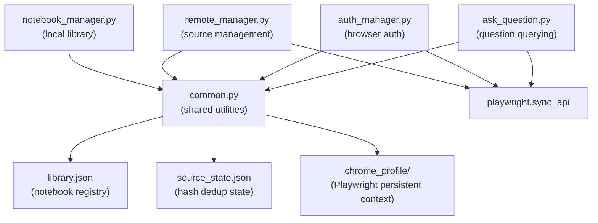
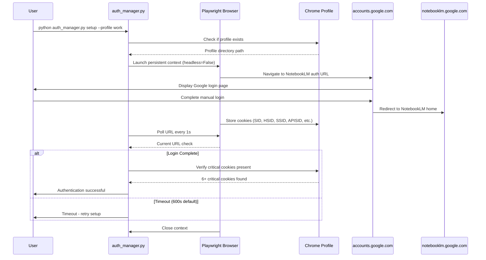
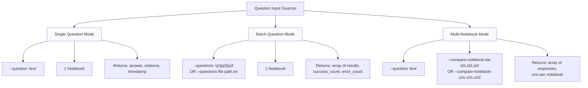
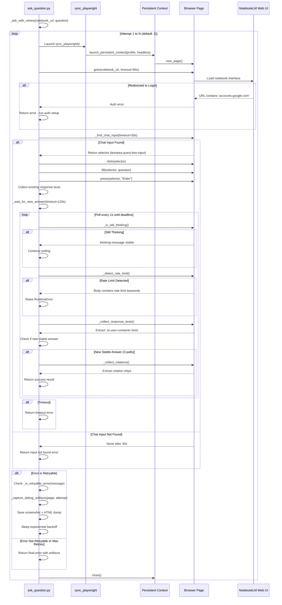
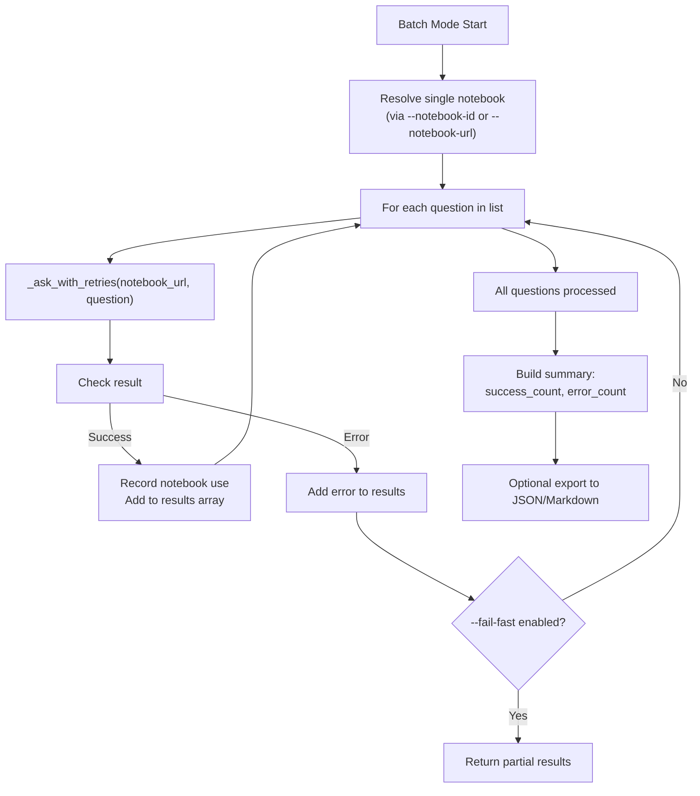
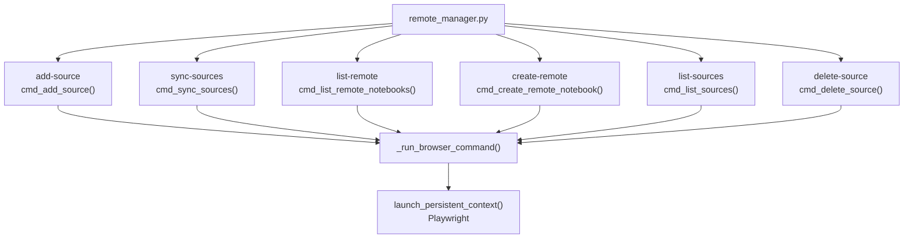
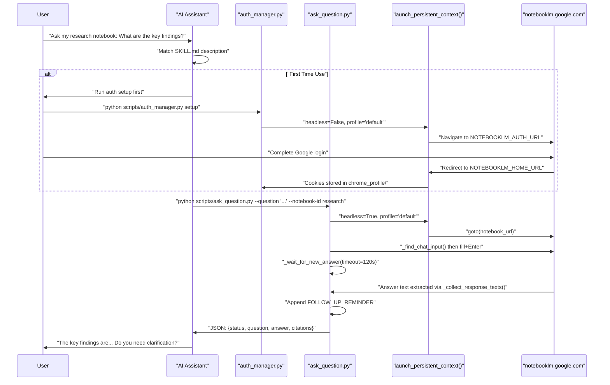

<!-- source: DeepWiki mcp.deepwiki.com · repo sanjay3290/ai-skills · extra page NotebookLM · fetched 2026-10-27 -->

# NotebookLM

<details>
<summary>Relevant source files</summary>

The following files were used as context for generating this wiki page:

- [skills/notebooklm/SKILL.md](skills/notebooklm/SKILL.md)
- [skills/notebooklm/scripts/ask_question.py](skills/notebooklm/scripts/ask_question.py)
- [skills/notebooklm/scripts/auth_manager.py](skills/notebooklm/scripts/auth_manager.py)
- [skills/notebooklm/tests/test_ask_question_modes.py](skills/notebooklm/tests/test_ask_question_modes.py)
- [skills/notebooklm/tests/test_remote_manager_filters.py](skills/notebooklm/tests/test_remote_manager_filters.py)
- [skills/notebooklm/tests/test_smoke_playwright.py](skills/notebooklm/tests/test_smoke_playwright.py)

</details>


This document covers the NotebookLM skill, which provides query and management capabilities for Google NotebookLM notebooks via Playwright browser automation. The skill enables asking questions to notebooks, managing notebook libraries, syncing sources, and exporting results.

Since NotebookLM has no official API, this skill uses browser automation with persistent Chrome profiles to maintain authentication and interact with the web interface. This is the only skill in the ecosystem that uses browser automation instead of direct API calls.

For other AI/ML services using traditional API patterns, see page 4.3.

---

## Script Architecture

The skill is composed of four specialized scripts plus a shared utilities module. All scripts output JSON to stdout and exit with code 1 on error.

**Script-to-Module Dependency Diagram**



Sources: [skills/notebooklm/scripts/common.py:1-273](), [skills/notebooklm/scripts/ask_question.py:1-35](), [skills/notebooklm/scripts/auth_manager.py:1-27](), [skills/notebooklm/scripts/remote_manager.py:1-46](), [skills/notebooklm/scripts/notebook_manager.py:1-23]()

---

## Authentication Pattern: Browser Automation with Persistent Profiles

The NotebookLM skill uses a unique authentication approach based on Playwright browser automation with persistent Chrome profiles stored locally.

### Profile-Based Authentication

Authentication state is maintained in persistent Chrome profiles rather than API tokens or OAuth refresh tokens. Each profile contains browser cookies, session data, and cached content.

**Profile Storage Locations:**

| Profile Type | Directory Path | Purpose |
|-------------|---------------|---------|
| Default profile | `~/.config/claude/notebooklm-skill/chrome_profile/` | Primary profile (constant: `PROFILE_DIR_NAME`) |
| Named profiles | `~/.config/claude/notebooklm-skill/profiles/<name>/` | Isolated profiles for different Google accounts |
| Data directory override | `$NOTEBOOKLM_DATA_DIR/` | Overrides `DEFAULT_DATA_DIR` entirely |

The `get_profile_dir()` function in `common.py` returns `get_data_dir() / "chrome_profile"` for the default profile, and `get_data_dir() / "profiles" / <name>` for named profiles [skills/notebooklm/scripts/common.py:59-64]().

The profile directory can be overridden by setting the `NOTEBOOKLM_DATA_DIR` environment variable [skills/notebooklm/SKILL.md:26]().

### Authentication Flow



**Critical Cookies Verified:** The authentication manager checks for specific Google authentication cookies to confirm successful login [skills/notebooklm/scripts/auth_manager.py:28-36]():

- `SID`, `HSID`, `SSID` (Session IDs)
- `APISID`, `SAPISID` (API access)
- `__Secure-1PSID`, `__Secure-3PSID` (Secure session IDs)

Sources: [skills/notebooklm/SKILL.md:17-19, 25-26](), [skills/notebooklm/scripts/auth_manager.py:1-99, 172-252]()

---

## Authentication Commands

### Setup Authentication

Initiates browser-based login flow with manual Google authentication:

```bash
python scripts/auth_manager.py setup --profile <name> [--timeout <seconds>]
```

**Parameters:**

| Flag | Type | Default | Description |
|------|------|---------|-------------|
| `--profile` | string | `default` | Profile name for isolated auth session |
| `--timeout` | integer | `600` | Max seconds to wait for login completion |

**Behavior:**
- Opens visible browser window (headless=False)
- Navigates to NotebookLM auth URL
- Polls URL every 1 second until redirect to `notebooklm.google.com`
- Stores cookies in persistent profile directory
- Verifies critical cookie count ≥ 6

Sources: [skills/notebooklm/scripts/auth_manager.py:64-99, 176-187]()

### Check Authentication Status

Verifies if profile has valid authentication cookies:

```bash
python scripts/auth_manager.py status --profile <name>
```

**Returns JSON with fields:**

- `authenticated` (boolean): True if critical cookies present and not redirected to login
- `profile` (string): Profile name
- `profileDir` (string): Absolute path to profile directory
- `criticalCookieCount` (integer): Number of critical auth cookies found
- `currentUrl` (string): URL after navigation attempt

**Headless Check:** Status runs in headless mode to avoid opening visible browser [skills/notebooklm/scripts/auth_manager.py:44]().

Sources: [skills/notebooklm/scripts/auth_manager.py:41-61, 189-194]()

### Clear Authentication

Removes profile directory and all stored credentials:

```bash
python scripts/auth_manager.py clear --profile <name> [--all-profiles]
```

**Parameters:**

| Flag | Description |
|------|-------------|
| `--profile <name>` | Clear specific profile (default: `default`) |
| `--all-profiles` | Clear all discovered profiles |

**Operations:**
1. Discovers profile directories in `profiles/` subdirectory
2. Deletes entire profile directory tree using `shutil.rmtree`
3. Recreates empty data directories via `ensure_data_dirs()`

Sources: [skills/notebooklm/scripts/auth_manager.py:130-161, 196-206]()

### List Profiles

Discovers all authentication profiles in data directory:

```bash
python scripts/auth_manager.py profiles
```

**Discovery Logic:**
- Always includes `default` profile (may not exist yet)
- Scans `profiles/` subdirectory for additional profile folders
- Returns profile name, directory path, and existence status

Sources: [skills/notebooklm/scripts/auth_manager.py:101-127, 208]()

### Re-authenticate

Shortcut command that clears profile and runs setup:

```bash
python scripts/auth_manager.py reauth --profile <name> [--timeout <seconds>]
```

**Equivalent to:**
```bash
python scripts/auth_manager.py clear --profile <name>
python scripts/auth_manager.py setup --profile <name> --timeout <seconds>
```

Sources: [skills/notebooklm/scripts/auth_manager.py:210-221, 237-240]()

---

## Question Asking Architecture

The `ask_question.py` script supports three distinct modes for querying NotebookLM notebooks, each optimized for different use cases.

### Question Asking Modes



Sources: [skills/notebooklm/scripts/ask_question.py:599-801](), [skills/notebooklm/SKILL.md:30]()

### Mode Detection Logic

The script automatically determines which mode to use based on arguments provided [skills/notebooklm/scripts/ask_question.py:775-791]():

1. **Multi-notebook mode**: If `--compare-notebook-ids` or `--compare-notebook-urls` provided
2. **Batch mode**: If more than 1 question extracted
3. **Single mode**: If exactly 1 question (default)

### Question Input Methods

Questions can be provided through three different methods [skills/notebooklm/scripts/ask_question.py:341-367]():

| Method | Flag | Format | Example |
|--------|------|--------|---------|
| Single question | `--question` | Plain text string | `--question "What is the main thesis?"` |
| Inline multiple | `--questions` | `\|\|`-separated or comma-separated | `--questions "q1\|\|q2\|\|q3"` |
| File-based | `--questions-file` | One question per line, `#` for comments | `--questions-file questions.txt` |

---

## Core Asking Flow with Retry Logic

### Single Question Execution



Sources: [skills/notebooklm/scripts/ask_question.py:370-423, 425-498]()

### Retry and Error Handling

**Retryable Error Detection** [skills/notebooklm/scripts/ask_question.py:121-125]():

The script distinguishes between transient browser errors (retryable) and permanent failures:

**Retryable errors** (retry with backoff):
- `timeout`, `timed out`
- `connection` issues
- `target closed`, `context closed`
- `execution context was destroyed`
- `protocol error`, `page crashed`
- `browser has been closed`

**Non-retryable errors** (fail immediately):
- `rate limit`, `limit exceeded`
- `quota exhausted`, `daily limit`
- `too many requests`

**Artifact Capture on Failure** [skills/notebooklm/scripts/ask_question.py:97-118]():

On each failed attempt, the script captures debug artifacts:
- Full-page screenshot (PNG)
- Complete page HTML source
- Artifacts saved to `~/.config/claude/notebooklm-skill/artifacts/` (or custom via `--artifacts-dir`)
- Filename pattern: `YYYYMMDDTHHMMSSz-<mode>-attempt<N>.[png|html]`

**Retry Configuration:**

| Flag | Default | Description |
|------|---------|-------------|
| `--retries` | 2 | Number of retry attempts for transient failures |
| `--timeout` | 120 | Seconds to wait for answer after submitting question |
| `--input-timeout` | 30 | Seconds to wait for chat input field to appear |

Sources: [skills/notebooklm/scripts/ask_question.py:73-83, 121-126, 425-498, 829-841]()

---

## Answer Extraction Logic

### Chat Input Selector Discovery

The script tries multiple selectors to find the NotebookLM chat input, supporting different UI versions and localizations [skills/notebooklm/scripts/ask_question.py:41-45]():

```python
CHAT_INPUT_SELECTORS = [
    "textarea.query-box-input",
    "textarea[aria-label*='Ask']",
    "textarea[aria-label*='Anfrage']",  # German UI support
]
```

The `_find_chat_input()` function iterates through selectors with 30-second visibility timeout each [skills/notebooklm/scripts/ask_question.py:145-152]().

### Response Text Collection

**Primary Collection Strategy** [skills/notebooklm/scripts/ask_question.py:155-170]():

1. Query all `.to-user-container` elements (NotebookLM's response containers)
2. Extract `.message-text-content` inner text from each container
3. Return non-empty text values

**Fallback Selectors** [skills/notebooklm/scripts/ask_question.py:172-188]():

If primary strategy returns no results, try fallback selectors:
- `[data-message-author='bot']`
- `[data-message-author='assistant']`
- `[data-testid*='response']`

### Stable Answer Detection

To avoid capturing incomplete or "thinking" placeholder text, the script uses a stability check [skills/notebooklm/scripts/ask_question.py:221-269]():

1. **Filter existing responses**: Track all response texts seen before question submission
2. **Ignore transient placeholders**: Skip texts containing:
   - "analyzing your files", "analyzing your sources"
   - "thinking", "loading", "just a moment"
   - "working on it"
3. **Require stability**: Same answer text must appear for 3 consecutive polls (3 seconds) before accepting
4. **Skip thinking indicator**: If `div.thinking-message` is visible, continue polling [skills/notebooklm/scripts/ask_question.py:135-142]()

### Citation Extraction

Citations are extracted from multiple possible selector patterns [skills/notebooklm/scripts/ask_question.py:64-71, 191-210]():

```python
CITATION_SELECTORS = [
    ".citation-chip",
    ".source-chip",
    ".grounding-chip",
    ".source-link",
    "a[href*='source']",
    "a[href*='notebooklm']",
]
```

**Citation Deduplication**: Uses a `seen` set to ensure each citation text appears only once in results.

**Citation Tracking**: The script captures citations before and after submitting the question, then returns only new citations that appeared in response [skills/notebooklm/scripts/ask_question.py:397-414]().

Sources: [skills/notebooklm/scripts/ask_question.py:41-71, 135-210, 221-269, 370-422]()

---

## Follow-Up Reminder Mechanism

Every answer returned by `ask_question.py` includes an appended reminder message to encourage the AI assistant to ask clarifying questions before responding to the user [skills/notebooklm/scripts/ask_question.py:36-39]():

```python
FOLLOW_UP_REMINDER = (
    "\n\nEXTREMELY IMPORTANT: Is that ALL you need to know? You can always ask another question. "
    "Before replying to the user, check if anything is still unclear, and ask follow-up questions if needed."
)
```

This reminder is automatically appended to every successful answer [skills/notebooklm/scripts/ask_question.py:419]():

```python
"answer": f"{answer.rstrip()}{FOLLOW_UP_REMINDER}",
```

**Purpose**: Prompts AI assistants to engage in multi-turn conversations with NotebookLM rather than making single queries, improving answer quality through iterative refinement.

Sources: [skills/notebooklm/scripts/ask_question.py:36-39, 419]()

---

## Batch and Multi-Notebook Modes

### Batch Mode Implementation

Batch mode executes multiple questions against a single notebook sequentially [skills/notebooklm/scripts/ask_question.py:641-697]():



**Batch Result Structure:**

```json
{
  "status": "success" | "partial_success",
  "mode": "batch",
  "notebook_url": "https://notebooklm.google.com/notebook/...",
  "notebook_id": "local-id",
  "count": 5,
  "success_count": 4,
  "error_count": 1,
  "results": [
    {
      "question": "Question 1",
      "answer": "Answer with follow-up reminder...",
      "citations": ["Source 1", "Source 2"],
      "timestamp_utc": "2024-01-15T10:30:00Z"
    },
    {
      "question": "Question 2",
      "error": "Timeout error message",
      "timestamp_utc": "2024-01-15T10:32:00Z"
    }
  ]
}
```

Sources: [skills/notebooklm/scripts/ask_question.py:641-697]()

### Multi-Notebook Comparison Mode

Multi-notebook mode asks a single question to multiple notebooks and collects answers for comparison [skills/notebooklm/scripts/ask_question.py:700-772]():

**Notebook Resolution:**
- Accepts comma-separated `--compare-notebook-ids` (looks up URLs from local library)
- Accepts comma-separated `--compare-notebook-urls` (direct URLs)
- Deduplicates notebooks by URL to avoid querying same notebook twice

**Comparison Result Structure:**

```json
{
  "status": "success" | "partial_success",
  "mode": "multi",
  "question": "What are the key findings?",
  "count": 3,
  "success_count": 2,
  "error_count": 1,
  "responses": [
    {
      "notebook_url": "https://notebooklm.google.com/notebook/abc",
      "notebook_id": "research-notebook",
      "answer": "According to the research notebook...",
      "citations": ["Source A", "Source B"],
      "timestamp_utc": "2024-01-15T10:35:00Z"
    },
    {
      "notebook_url": "https://notebooklm.google.com/notebook/def",
      "notebook_id": "case-study-notebook",
      "answer": "The case study shows...",
      "citations": ["Case Study 1"],
      "timestamp_utc": "2024-01-15T10:36:00Z"
    },
    {
      "notebook_url": "https://notebooklm.google.com/notebook/ghi",
      "notebook_id": null,
      "error": "Timeout waiting for answer after 120s",
      "timestamp_utc": "2024-01-15T10:38:00Z"
    }
  ]
}
```

**Fail-Fast Behavior:**
Both batch and multi-notebook modes support `--fail-fast` flag [skills/notebooklm/scripts/ask_question.py:841]():
- If enabled, stops processing remaining questions/notebooks on first error
- If disabled (default), processes all items and reports partial success

Sources: [skills/notebooklm/scripts/ask_question.py:309-338, 700-772]()

---

## Export Formats

### JSON Export

Default export format. Outputs complete result structure with all metadata:

```bash
python scripts/ask_question.py --question "..." --export-file result.json
```

**JSON Structure Fields:**

| Field | Type | Description |
|-------|------|-------------|
| `status` | string | `success`, `partial_success`, or absent if error |
| `mode` | string | `single`, `batch`, or `multi` |
| `question` | string | Question text (single/multi modes) |
| `answer` | string | Answer with follow-up reminder appended (single mode) |
| `citations` | array | Citation texts extracted from response |
| `timestamp_utc` | string | ISO 8601 UTC timestamp |
| `notebook_url` | string | NotebookLM notebook URL |
| `notebook_id` | string or null | Local library ID if registered |
| `profile` | string | Profile name used for authentication |
| `attempts` | integer | Retry attempts made (if > 1) |
| `artifacts` | array | Debug artifacts from failed attempts |
| `previous_errors` | array | Error messages from retry attempts |
| `results` | array | Batch mode: array of question results |
| `responses` | array | Multi mode: array of notebook responses |
| `count` | integer | Total items processed (batch/multi modes) |
| `success_count` | integer | Successful items (batch/multi modes) |
| `error_count` | integer | Failed items (batch/multi modes) |

Sources: [skills/notebooklm/scripts/ask_question.py:599-638, 641-697, 700-772]()

### Markdown Export

Human-readable export format with sections and formatting [skills/notebooklm/scripts/ask_question.py:501-571]():

```bash
python scripts/ask_question.py --question "..." --export-format markdown --export-file result.md
```

**Markdown Structure:**

**Single Mode:**
```markdown
# NotebookLM Export (single)

Generated: 2024-01-15T10:30:00Z

Notebook: https://notebooklm.google.com/notebook/...
Question: What is the main thesis?

## Answer

[Answer text with follow-up reminder]

## Citations

- Source 1
- Source 2
- (none detected)
```

**Batch Mode:**
```markdown
# NotebookLM Export (batch)

Generated: 2024-01-15T10:30:00Z

Notebook: https://notebooklm.google.com/notebook/...

## Q1: What is the main thesis?

[Answer text]

Citations:
- Source 1
- (none detected)

## Q2: What are the key findings?

Error: Timeout waiting for answer after 120s
```

**Multi-Notebook Mode:**
```markdown
# NotebookLM Export (multi)

Generated: 2024-01-15T10:30:00Z

Question: What is the main thesis?

## Notebook: https://notebooklm.google.com/notebook/abc

[Answer text from notebook abc]

Citations:
- Source A
- (none detected)

## Notebook: https://notebooklm.google.com/notebook/def

Error: Rate limit reached
```

Sources: [skills/notebooklm/scripts/ask_question.py:501-571, 574-596]()

### Export Destination Options

| Flag | Behavior |
|------|----------|
| `--export-file <path>` | Write to specified file path |
| `--save-notes` | Auto-generate filename in notes directory: `~/.config/claude/notebooklm-skill/notes/notebooklm-<mode>-<timestamp>.<ext>` |
| No export flag | Print JSON to stdout only (default) |

**File Extension:** Automatically determined by `--export-format` (`.json` or `.md`) [skills/notebooklm/scripts/ask_question.py:574-596]().

Sources: [skills/notebooklm/scripts/ask_question.py:574-596, 843-853]()

---

## Notebook Library Management

The NotebookLM skill maintains a local library of notebook metadata to enable quick access and reference by ID instead of full URLs [skills/notebooklm/SKILL.md:42]().

### Library File Structure

**Library Location:** `~/.config/claude/notebooklm-skill/library.json` (constant: `LIBRARY_FILE_NAME`)

**Library Schema** (from `_default_library()` and `cmd_add()` in `notebook_manager.py`):

```json
{
  "version": "1.0.0",
  "active_notebook_id": "research-project",
  "last_modified": "2024-01-20T14:30:00Z",
  "notebooks": [
    {
      "id": "research-project",
      "url": "https://notebooklm.google.com/notebook/abc123",
      "name": "Research Project Notebook",
      "description": "Contains all research papers for the ML project",
      "topics": ["machine learning", "research", "papers"],
      "tags": [],
      "added_at": "2024-01-15T10:00:00Z",
      "last_used": "2024-01-20T14:30:00Z",
      "use_count": 15
    }
  ]
}
```

Note: `topics` and `tags` are stored as lists. `id` is a slugified, unique identifier generated by `generate_notebook_id()` in `common.py` [skills/notebooklm/scripts/common.py:200-209]().

### Notebook Manager Commands

`notebook_manager.py` manages the local `library.json` without browser automation. All commands are pure Python operations on the JSON file.

**Command Reference:**

| Subcommand | Required Flags | Optional Flags | Description |
|------------|---------------|----------------|-------------|
| `add` | `--url`, `--name`, `--description`, `--topics` | `--tags` | Register a notebook in local library |
| `list` | — | — | List all registered notebooks |
| `get` | `--id` | — | Get a specific notebook by ID |
| `activate` | `--id` | — | Set the active (default) notebook |
| `remove` | `--id` | — | Remove notebook from local library |
| `search` | `--query` | — | Full-text search across name/description/topics/tags |
| `update` | `--id` | `--name`, `--description`, `--topics`, `--tags`, `--url` | Update notebook metadata |
| `stats` | — | — | Show total notebooks, active notebook, usage counts |

**Add Notebook to Library:**

```bash
python scripts/notebook_manager.py add \
  --url "https://notebooklm.google.com/notebook/..." \
  --name "Research Project" \
  --description "Contains research papers" \
  --topics "ML,research,papers"
```

**List Notebooks:**

```bash
python scripts/notebook_manager.py list
```

**Set Active Notebook:**

```bash
python scripts/notebook_manager.py activate --id research-project
```

**Active Notebook Fallback:** If no `--notebook-id` or `--notebook-url` is provided to `ask_question.py`, it falls back to `get_active_notebook()` from `common.py` [skills/notebooklm/scripts/ask_question.py:289-298]().

**Notebook Use Tracking:** Each successful query automatically increments `use_count` and updates `last_used` via `record_notebook_use()` in `common.py` [skills/notebooklm/scripts/common.py:263-272]().

Sources: [skills/notebooklm/scripts/notebook_manager.py:1-221](), [skills/notebooklm/scripts/common.py:108-209](), [skills/notebooklm/scripts/ask_question.py:272-306, 621-623, 665-667, 742-743]()

---

## Source Management and Deduplication

The `remote_manager.py` script provides browser-automated operations for managing notebook sources and listing/creating notebooks in the remote NotebookLM account. It also manages the `source_state.json` file for hash-based deduplication.

### Remote Manager Commands

**Remote Manager Command Diagram**



Sources: [skills/notebooklm/scripts/remote_manager.py:108-178, 863-877]()

**Add Sources:**

```bash
# Add files from a directory
python scripts/remote_manager.py add-source \
  --notebook-id <id> \
  --dir ./docs \
  --recursive

# Add a single text snippet
python scripts/remote_manager.py add-source \
  --notebook-id <id> \
  --text "Paste content here"

# Add a URL as source
python scripts/remote_manager.py add-source \
  --notebook-id <id> \
  --url "https://example.com/page"
```

**Sync Sources (with optional deletion of removed files):**

```bash
python scripts/remote_manager.py sync-sources \
  --notebook-id <id> \
  --dir ./docs \
  --recursive \
  --delete-missing \
  --dry-run
```

**List and Delete Sources:**

```bash
# List sources in a notebook
python scripts/remote_manager.py list-sources --notebook-id <id>

# Delete a specific source by title
python scripts/remote_manager.py delete-source \
  --notebook-id <id> \
  --source-title "filename.md" \
  --all-matches
```

**Source Filtering Flags (for `add-source` and `sync-sources`):**

| Flag | Description |
|------|-------------|
| `--dir <path>` | Directory to collect files from |
| `--files <path>` | Comma-separated list of specific files |
| `--recursive` | Recurse into subdirectories |
| `--include-ext <exts>` | Comma-separated file extensions to allow (e.g., `md,pdf`) |
| `--exclude <patterns>` | Fnmatch patterns to exclude (e.g., `*.tmp`) |
| `--max-size <value>` | File size limit (e.g., `2MB`, `1024`, `500KB`) |
| `--modified-since <value>` | Relative (e.g., `7d`, `24h`, `90m`) or ISO datetime |
| `--delete-missing` | Remove sources whose local file no longer exists |
| `--dry-run` | Preview operations without executing |

### Hash-Based Deduplication

The `source_state.json` file tracks SHA-256 hashes of uploaded files per notebook, enabling `sync-sources` to skip unchanged files.

**Source State File Location:** `~/.config/claude/notebooklm-skill/source_state.json` (constant: `SOURCE_STATE_FILE_NAME`)

**Source State Schema:**

```json
{
  "version": "1.0.0",
  "last_modified": "2024-01-20T14:30:00Z",
  "notebooks": {
    "https://notebooklm.google.com/notebook/abc123": {
      "updated_at": "2024-01-20T14:30:00Z",
      "sources": {
        "document.md": {
          "hash": "sha256hexdigest...",
          "size_bytes": 4096,
          "mtime_epoch": 1705756200.0,
          "source_path": "/path/to/document.md",
          "updated_at": "2024-01-20T14:30:00Z"
        }
      }
    }
  }
}
```

**Deduplication Flow:**

1. `_hash_file()` computes SHA-256 of local file content (1 MB chunks) [skills/notebooklm/scripts/remote_manager.py:753-758]()
2. `_get_notebook_state_sources()` retrieves stored hashes for this notebook URL [skills/notebooklm/scripts/remote_manager.py:809-814]()
3. If stored hash matches current hash, the file upload is skipped
4. After successful upload, `_update_notebook_state_hashes()` records new hashes [skills/notebooklm/scripts/remote_manager.py:817-828]()
5. After successful deletion, `_remove_notebook_state_titles()` clears stale entries [skills/notebooklm/scripts/remote_manager.py:831-836]()

The state file is managed by `load_source_state()` and `save_source_state()` in `common.py` [skills/notebooklm/scripts/common.py:159-189]().

Sources: [skills/notebooklm/scripts/remote_manager.py:753-836](), [skills/notebooklm/scripts/common.py:159-189](), [skills/notebooklm/SKILL.md:27-28]()

---

## Command-Line Interface

### ask_question.py Full Reference

```bash
python scripts/ask_question.py \
  # Question input (choose one or more)
  [--question "single question text"] \
  [--questions "q1||q2||q3"] \
  [--questions-file questions.txt] \
  
  # Notebook selection (choose one or use active notebook)
  [--notebook-id local-id] \
  [--notebook-url "https://notebooklm.google.com/notebook/..."] \
  
  # Multi-notebook comparison mode
  [--compare-notebook-ids id1,id2,id3] \
  [--compare-notebook-urls url1,url2] \
  
  # Browser and auth settings
  [--show-browser] \
  [--profile default] \
  [--timeout 120] \
  [--input-timeout 30] \
  [--retries 2] \
  [--artifacts-dir ~/debug-artifacts] \
  
  # Error handling
  [--fail-fast] \
  
  # Export options
  [--export-format json|markdown] \
  [--export-file result.json] \
  [--save-notes]
```

Sources: [skills/notebooklm/scripts/ask_question.py:803-855]()

### auth_manager.py Full Reference

```bash
# Setup authentication
python scripts/auth_manager.py setup [--profile default] [--timeout 600]

# Check authentication status
python scripts/auth_manager.py status [--profile default]

# Clear authentication
python scripts/auth_manager.py clear [--profile default] [--all-profiles]

# List all profiles
python scripts/auth_manager.py profiles

# Re-authenticate (clear + setup)
python scripts/auth_manager.py reauth [--profile default] [--timeout 600]
```

Sources: [skills/notebooklm/scripts/auth_manager.py:172-252](), [skills/notebooklm/SKILL.md:38-39]()

---

## Rate Limit Handling

NotebookLM imposes usage rate limits. The skill detects rate limit responses and fails fast rather than retrying [skills/notebooklm/scripts/ask_question.py:47-53, 213-218]().

**Rate Limit Keywords Detected:**
- "rate limit"
- "limit exceeded"
- "quota exhausted"
- "daily limit"
- "too many requests"

**Detection Method:**
- Extracts full page body text via `page.inner_text("body")`
- Checks if any rate limit keyword present (case-insensitive)
- Raises `RuntimeError` immediately if detected

**User Action Required:**
- Wait and retry later (typically 24 hours for daily limits)
- Or re-authenticate: `python scripts/auth_manager.py reauth`

**Why No Retry:** Rate limit errors are not transient and will persist until quota resets, so retrying wastes time and resources [skills/notebooklm/scripts/ask_question.py:123-125]().

Sources: [skills/notebooklm/scripts/ask_question.py:47-53, 121-125, 213-218, 241]()

---

## Headless vs. Visible Browser Modes

By default, all operations run in headless mode to avoid disrupting user workflow. Visible browser mode is available for debugging.

### Default: Headless Operation

```bash
# Headless (default)
python scripts/ask_question.py --question "..."
python scripts/auth_manager.py status
```

**Behavior:**
- Browser runs without visible window
- Faster execution
- No interference with user's desktop
- Suitable for automation and scripts

**Implementation:** `launch_persistent_context(p, headless=True, profile=profile)` [skills/notebooklm/scripts/ask_question.py:441-443]()

### Visible Browser Mode

```bash
# Show browser window
python scripts/ask_question.py --question "..." --show-browser
python scripts/auth_manager.py setup  # Always visible during setup
```

**Use Cases:**
- Debugging query execution issues
- Observing browser behavior during errors
- Verifying UI selector changes
- Manual intervention during complex workflows

**Auth Setup Exception:** The `setup` command always runs with `headless=False` to allow manual Google login [skills/notebooklm/scripts/auth_manager.py:67]().

Sources: [skills/notebooklm/scripts/ask_question.py:441-443, 827](), [skills/notebooklm/scripts/auth_manager.py:67](), [skills/notebooklm/SKILL.md:25]()

---

## Directory Structure and Data Storage

### Data Directory Layout

```
~/.config/claude/notebooklm-skill/       # DEFAULT_DATA_DIR (or $NOTEBOOKLM_DATA_DIR)
├── chrome_profile/                       # Default profile (PROFILE_DIR_NAME)
│   ├── Cache/
│   ├── Cookies
│   ├── Local Storage/
│   └── Session Storage/
├── profiles/
│   └── work/                             # Named profile: "work"
│       └── [same Chrome profile structure]
├── library.json                          # LIBRARY_FILE_NAME: notebook registry
├── source_state.json                     # SOURCE_STATE_FILE_NAME: hash dedup state
├── notes/                                # NOTES_DIR_NAME: exported results
│   ├── notebooklm-single-20240115-103000.json
│   ├── notebooklm-batch-20240115-104500.md
│   └── notebooklm-multi-20240116-090000.json
└── artifacts/                            # ARTIFACTS_DIR_NAME: debug artifacts
    ├── 20240115T103045Z-single-attempt1.png
    ├── 20240115T103045Z-single-attempt1.html
    ├── 20240115T103050Z-single-attempt2.png
    └── 20240115T103050Z-single-attempt2.html
```

The constants `DEFAULT_DATA_DIR`, `PROFILE_DIR_NAME`, `LIBRARY_FILE_NAME`, `SOURCE_STATE_FILE_NAME`, `ARTIFACTS_DIR_NAME`, and `NOTES_DIR_NAME` are all defined in `common.py` [skills/notebooklm/scripts/common.py:29-34](). The `ensure_data_dirs()` function creates all required directories on first use [skills/notebooklm/scripts/common.py:87-93]().

### Environment Variable Override

**Custom Data Directory:**

```bash
export NOTEBOOKLM_DATA_DIR=/custom/path/to/data
python scripts/ask_question.py --question "..."
```

**Effect:**
- All profiles, library, notes, and artifacts stored under the custom path
- Useful for isolated environments or shared team directories
- Default: `~/.config/claude/notebooklm-skill/` (`DEFAULT_DATA_DIR` in `common.py`)

The `get_data_dir()` function checks `os.environ.get("NOTEBOOKLM_DATA_DIR")` first, and falls back to `DEFAULT_DATA_DIR` [skills/notebooklm/scripts/common.py:42-47]().

---

## Shared Utilities: common.py

`common.py` contains all shared state management, URL validation, and browser context setup used by the other scripts.

**Key Functions and Constants:**

| Symbol | Type | Purpose |
|--------|------|---------|
| `DEFAULT_DATA_DIR` | constant | `~/.config/claude/notebooklm-skill` |
| `NOTEBOOKLM_HOME_URL` | constant | `https://notebooklm.google.com/` |
| `NOTEBOOKLM_AUTH_URL` | constant | Google sign-in URL with NotebookLM `continue` redirect |
| `get_data_dir()` | function | Returns data directory (with env var override) |
| `get_profile_dir(profile)` | function | Returns Chrome profile path for given profile name |
| `sanitize_profile_name(profile)` | function | Normalizes profile name to safe `[a-z0-9_-]` string |
| `load_library()` | function | Reads `library.json`, creates default if missing |
| `save_library(library)` | function | Writes `library.json` with updated `last_modified` |
| `load_source_state()` | function | Reads `source_state.json`, creates default if missing |
| `save_source_state(state)` | function | Writes `source_state.json` with updated `last_modified` |
| `is_valid_notebook_url(url)` | function | Validates `https://notebooklm.google.com/notebook/<id>` pattern |
| `parse_csv_values(raw)` | function | Splits comma-separated string into cleaned list |
| `generate_notebook_id(name, existing_ids)` | function | Creates unique slug ID from notebook name |
| `get_notebook_by_id(library, id)` | function | Lookup notebook in `library["notebooks"]` by ID |
| `get_notebook_by_url(library, url)` | function | Lookup notebook in `library["notebooks"]` by URL |
| `get_active_notebook(library)` | function | Returns notebook matching `library["active_notebook_id"]` |
| `launch_persistent_context(playwright, headless, profile)` | function | Launches Chromium with `user_data_dir` set to profile path |
| `record_notebook_use(library, notebook_id)` | function | Increments `use_count` and updates `last_used` timestamp |
| `now_iso()` | function | Returns current UTC timestamp in ISO 8601 format |
| `ensure_data_dirs()` | function | Creates all required data directories |

The `launch_persistent_context()` function tries to use the system Chrome installation first, then falls back to Playwright's bundled Chromium [skills/notebooklm/scripts/common.py:237-260]().

Sources: [skills/notebooklm/scripts/common.py:1-273]()

---

## Integration with AI Assistants

### SKILL.md Trigger Description

The NotebookLM skill registers with AI clients through its description field [skills/notebooklm/SKILL.md:3]():

```yaml
description: "Query and manage Google NotebookLM notebooks with persistent profile auth, 
source sync, batch/multi queries, and structured exports. Use when user asks to query 
NotebookLM, 'ask my notebook', shares NotebookLM notebook URLs, wants to list/create 
notebooks, manage sources, do bulk folder sync, dedupe, or audit exports."
```

**Trigger Phrases Recognized:**
- "query NotebookLM"
- "ask my notebook"
- NotebookLM notebook URLs (e.g., `https://notebooklm.google.com/notebook/...`)
- "list notebooks", "create notebook"
- "manage sources", "sync sources"
- "bulk folder sync"
- "dedupe" (deduplication)
- "audit exports"

### Typical AI Assistant Workflow

**AI Assistant Invocation Diagram**



**Multi-Turn Conversation Pattern:** The follow-up reminder encourages AI assistants to ask clarifying questions, creating iterative research dialogues rather than single-shot queries [skills/notebooklm/scripts/ask_question.py:36-39]().

Sources: [skills/notebooklm/SKILL.md:3, 10-54]()

---

## Safety and Best Practices

### Dry Run Mode

All destructive operations (create, delete, sync) support `--dry-run` flag [skills/notebooklm/SKILL.md:28]():

```bash
# Preview sync operations without executing
python scripts/remote_manager.py sync-sources \
  --notebook-id research \
  --dir ./docs \
  --recursive \
  --delete-missing \
  --dry-run
```

**Output:** Shows planned operations (uploads, deletes) without modifying notebook.

### Profile Isolation

Using multiple profiles isolates authentication sessions for different Google accounts:

```bash
# Work account
python scripts/auth_manager.py setup --profile work
python scripts/ask_question.py --question "..." --profile work

# Personal account
python scripts/auth_manager.py setup --profile personal
python scripts/ask_question.py --question "..." --profile personal
```

**Benefits:**
- No need to re-authenticate when switching accounts
- Prevents cookie conflicts between accounts
- Enables concurrent access to different notebooks

### Artifact Retention for Debugging

Failed attempts automatically capture debug artifacts [skills/notebooklm/SKILL.md:29]():

- Screenshot shows visual state at failure time
- HTML dump enables offline inspection of DOM
- Useful for reporting issues or diagnosing selector changes

**Artifact Review:**

```bash
# Check artifacts directory
ls -lh ~/.config/claude/notebooklm-skill/artifacts/

# View screenshot
open ~/.config/claude/notebooklm-skill/artifacts/20240115T103045Z-single-attempt1.png

# Inspect HTML
cat ~/.config/claude/notebooklm-skill/artifacts/20240115T103045Z-single-attempt1.html
```

Sources: [skills/notebooklm/SKILL.md:28-29](), [skills/notebooklm/scripts/ask_question.py:97-118]()

---

## Comparison with Other AI/ML Skills

| Feature | NotebookLM | Imagen | Deep Research | ElevenLabs |
|---------|------------|--------|---------------|------------|
| **API Type** | Browser automation (Playwright) | REST API | REST API | REST API |
| **Auth Method** | Cookie-based profile | API key (`GEMINI_API_KEY`) | API key (`GEMINI_API_KEY`) | API key (`ELEVENLABS_API_KEY`) |
| **State Management** | Persistent Chrome profiles | Stateless | Stateless | Stateless |
| **Retry Logic** | Yes, with artifact capture | No | No | No |
| **Multi-mode Support** | Yes (single/batch/multi) | No | No | Yes (single/podcast) |
| **Export Formats** | JSON, Markdown | PNG only | Markdown | MP3 |
| **Use Case** | Query knowledge notebooks | Generate images | Autonomous research | Text-to-speech |

**Unique Characteristics of NotebookLM Skill:**

1. **Only browser automation skill** in the ecosystem (no official API available)
2. **Most complex authentication** (persistent profiles vs. simple API keys)
3. **Only skill with retry logic** and debug artifact capture
4. **Only skill with multi-target comparison mode** (query multiple notebooks simultaneously)
5. **Stateful interactions** (maintains browser session vs. stateless API calls)

For other AI/ML skills, see [Imagen](#4.3.1), [Deep Research](#4.3.2), and [ElevenLabs](#4.3.4).

Sources: [skills/notebooklm/SKILL.md:1-55](), [skills/notebooklm/scripts/ask_question.py:1-869](), [skills/notebooklm/scripts/auth_manager.py:1-253]()

---

