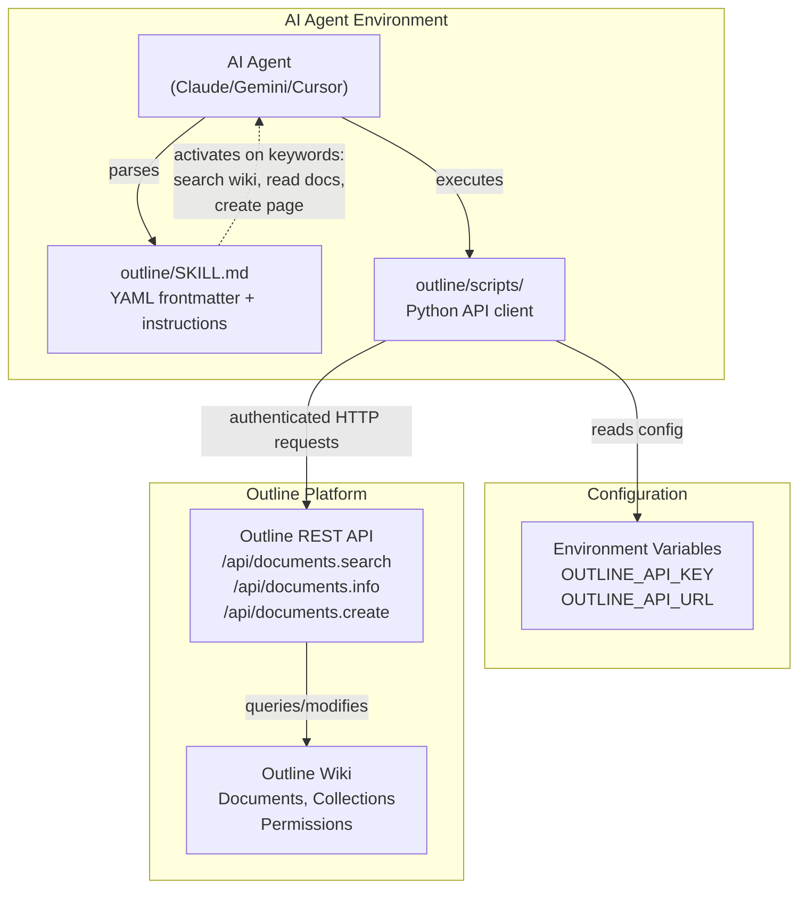
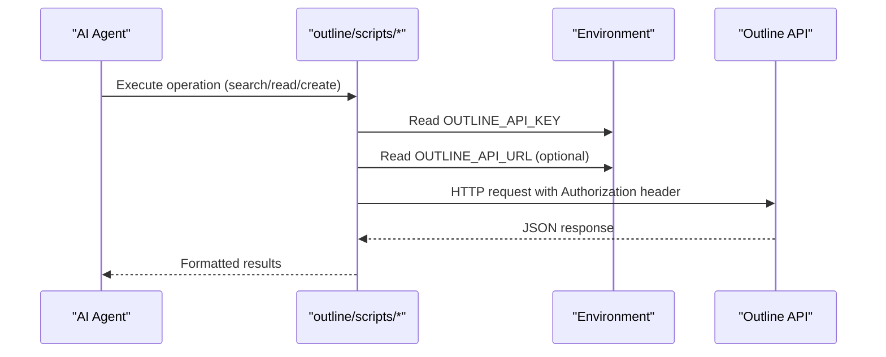
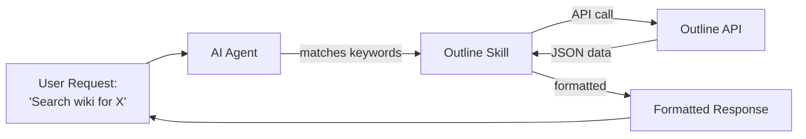

<!-- source: DeepWiki mcp.deepwiki.com · repo sanjay3290/ai-skills · extra page Outline Wiki · fetched 2026-10-27 -->

# Outline Wiki

<details>
<summary>Relevant source files</summary>

The following files were used as context for generating this wiki page:

- [.claude-plugin/marketplace.json](.claude-plugin/marketplace.json)
- [README.md](README.md)
- [skills/jules/SKILL.md](skills/jules/SKILL.md)
- [skills/manus/SKILL.md](skills/manus/SKILL.md)

</details>


## Purpose and Scope

This page documents the Outline wiki integration skill, which enables AI agents to search, read, and manage documents in Outline knowledge bases. For other development tool integrations, see Azure DevOps [4.5.1](#4.5.1). For authentication patterns across skills, see [3.4](#3.4).

**Sources:** [README.md:36](), [README.md:202-206]()

## Overview

The Outline skill provides AI agents with the ability to interact with Outline wiki instances through the Outline REST API. Outline is a modern team knowledge base and wiki platform commonly used for documentation, onboarding materials, and internal knowledge management.

The skill is part of the Development Tools category alongside Azure DevOps, enabling AI agents to access and manipulate documentation programmatically.

**Sources:** [README.md:36](), [.claude-plugin/marketplace.json:20]()

## Configuration

### Environment Variables

The skill requires configuration via environment variables:

| Variable | Required | Description |
|----------|----------|-------------|
| `OUTLINE_API_KEY` | Yes | API key for authentication |
| `OUTLINE_API_URL` | No | Base URL for the Outline API (e.g., `https://your-wiki.example.com/api`) |

**Obtaining an API Key:**

API keys are generated from the Outline wiki settings interface. Users must have appropriate permissions within their Outline workspace to generate API tokens.

**Sources:** [README.md:202-206]()

### API URL Configuration

If `OUTLINE_API_URL` is not specified, the skill likely defaults to a standard Outline API endpoint pattern. Organizations using self-hosted Outline instances must provide the full API URL.

**Sources:** [README.md:204]()

## Skill Structure

Following the Agent Skills Standard [3.1](#3.1), the Outline skill is located at `./skills/outline` within the repository and includes the standard skill components:

```
outline/
├── SKILL.md              # Agent-facing instructions with YAML frontmatter
├── README.md             # Human documentation
├── scripts/              # Executable scripts for API interaction
└── .env.example          # Environment variable template
```

**Sources:** [.claude-plugin/marketplace.json:20](), [README.md:366-377]()

## Capabilities

Based on the skill description and usage patterns, the Outline skill supports three primary operation categories:

### 1. Search Operations

AI agents can search the wiki for specific documents, keywords, or topics. This enables discovery of relevant documentation without prior knowledge of document structure.

**Example prompts:**
- "Search the wiki for deployment guide"
- "Find documentation about the API authentication flow"

### 2. Read Operations

Agents can retrieve and read the full content of wiki pages, enabling them to extract information, summarize documentation, or answer questions based on wiki content.

**Example prompts:**
- "Read the onboarding documentation"
- "What does the deployment guide say about environment variables?"

### 3. Management Operations

The skill supports document creation and modification, allowing agents to add new wiki pages or update existing documentation.

**Example prompts:**
- "Create a new wiki page for the API spec"
- "Add a troubleshooting section to the deployment guide"

**Sources:** [README.md:309-312]()

## Integration Architecture



**Diagram: Outline Skill Integration Flow**

The skill integrates with Outline through a standard REST API client pattern. The AI agent parses `SKILL.md` to determine when to activate the skill, executes Python scripts that read configuration from environment variables, and makes authenticated HTTP requests to the Outline API.

**Sources:** [README.md:202-206](), [README.md:309-312]()

## Authentication Pattern

The Outline skill uses API key authentication, a simpler pattern compared to the OAuth flows used by Google Workspace skills [5.1](#5.1). The API key is passed in HTTP headers with each request to the Outline API.

This authentication pattern is similar to other API key-based skills in the ecosystem:



**Diagram: Outline Authentication Flow**

**Sources:** [README.md:202-206]()

## Common Operations

### Document Search

Search operations enable discovery of relevant documentation across the wiki. The Outline API typically supports full-text search with ranking and relevance scoring.

**Typical workflow:**
1. Agent receives user request to find information
2. Script executes search query against Outline API
3. Results include document titles, excerpts, and URLs
4. Agent can follow up with read operations on specific documents

### Document Retrieval

Read operations fetch complete document content, including markdown formatting, metadata, and document hierarchy information.

**Retrieved data typically includes:**
- Document title and ID
- Full markdown content
- Parent collection/folder
- Creation and modification timestamps
- Author information

### Document Creation

Create operations allow agents to add new documentation pages to the wiki, specifying title, content, and organizational structure.

**Required parameters:**
- Document title
- Markdown content
- Collection ID (parent folder)
- Optional: publish status, parent document

**Sources:** [README.md:309-312]()

## Integration with AI Agents

The skill integrates seamlessly with AI coding assistants through the Agent Skills Standard [3.1](#3.1). When installed via `npx skills add sanjay3290/ai-skills --skill outline`, the skill becomes available to the AI agent through natural language activation.

### Activation Keywords

Based on the description pattern used across skills, the Outline skill likely activates when users mention:
- "search the wiki"
- "read the documentation"
- "create a wiki page"
- "check the Outline docs"
- References to specific documentation needs

### Usage Pattern



**Diagram: End-to-End Usage Flow**

**Sources:** [README.md:309-312](), [README.md:366-377]()

## Installation

The Outline skill is installed using the standard `npx skills` CLI:

```bash
# Install for current project
npx skills add sanjay3290/ai-skills --skill outline

# Install globally for all projects
npx skills add sanjay3290/ai-skills --skill outline -g

# Install for specific AI agent
npx skills add sanjay3290/ai-skills --skill outline -a claude-code
```

After installation, configure the required environment variables:

```bash
export OUTLINE_API_KEY="your-api-key-here"
export OUTLINE_API_URL="https://your-wiki.example.com/api"  # Optional
```

**Sources:** [README.md:66-106](), [README.md:202-206]()

## Comparison with Other Development Tools

The Outline skill provides simpler, more focused functionality compared to Azure DevOps [4.5.1](#4.5.1):

| Feature | Outline | Azure DevOps |
|---------|---------|--------------|
| Primary Focus | Wiki/documentation | Comprehensive DevOps platform |
| API Complexity | Simple REST API | 13 domain areas, 99 tools |
| Authentication | API key | OAuth or PAT |
| Setup Complexity | Minimal (2 env vars) | Moderate (keyring integration) |
| Use Cases | Documentation access | Work items, repos, pipelines, wikis |

Both skills serve the Development Tools category but target different aspects of the development workflow: Outline focuses specifically on knowledge management, while Azure DevOps provides end-to-end DevOps capabilities including wiki functionality.

**Sources:** [README.md:36](), [README.md:43](), [README.md:202-206](), [README.md:258-266]()

## Marketplace Registration

The Outline skill is registered in the marketplace catalog at `.claude-plugin/marketplace.json`:

```json
{
  "plugins": [{
    "skills": [
      "./skills/outline"
    ]
  }]
}
```

This registration enables discovery through the `npx skills` CLI and ensures the skill appears in the browseable catalog when users run `npx skills add sanjay3290/ai-skills --list`.

**Sources:** [.claude-plugin/marketplace.json:20]()

---

