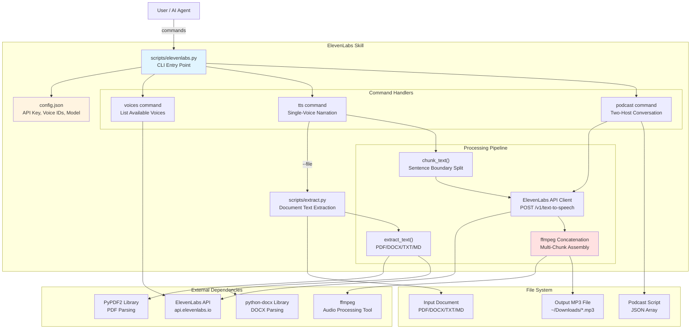
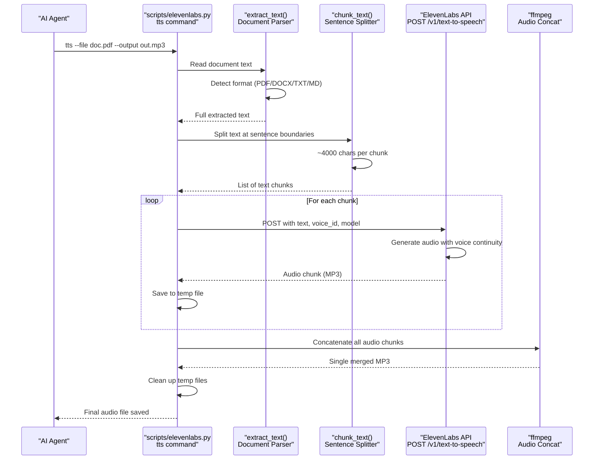
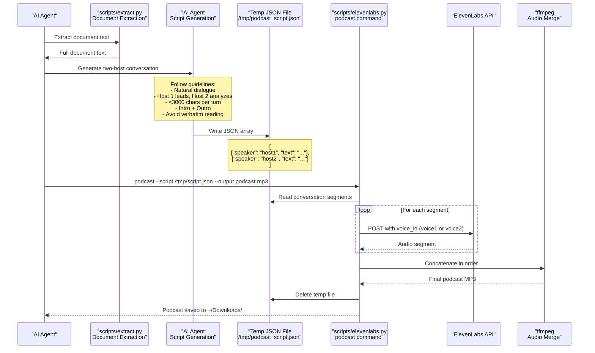
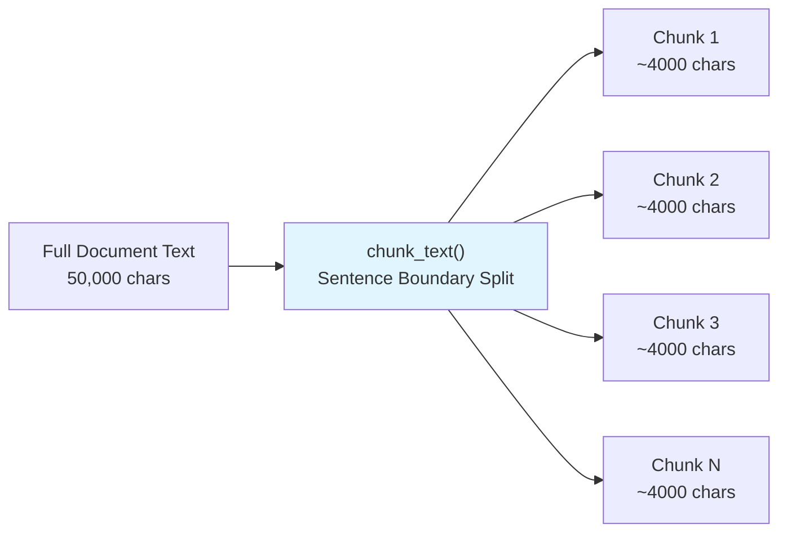

<!-- source: DeepWiki mcp.deepwiki.com · repo sanjay3290/ai-skills · extra page ElevenLabs (Text-to-Speech) · fetched 2026-10-27 -->

# ElevenLabs (Text-to-Speech)

<details>
<summary>Relevant source files</summary>

The following files were used as context for generating this wiki page:

- [skills/azure-devops/SKILL.md](skills/azure-devops/SKILL.md)
- [skills/deep-research/SKILL.md](skills/deep-research/SKILL.md)
- [skills/elevenlabs/SKILL.md](skills/elevenlabs/SKILL.md)

</details>


## Purpose and Scope

This document describes the ElevenLabs skill, which converts text and documents into high-quality audio using the ElevenLabs Text-to-Speech API. The skill supports two distinct modes: single-voice narration for documents and two-host conversational podcast generation. This page covers configuration, command-line interface, text extraction, chunking strategies, audio processing pipeline, and the podcast workflow pattern.

For other AI service integrations, see [AI & ML Services](#4.3). For Google Cloud TTS as an alternative, see [Google Text-to-Speech](#4.3.5).

---

## When to Activate This Skill

The ElevenLabs skill activates when users request:
- "create podcast", "generate podcast", "podcast from document"
- "narrate document", "narrate this file", "read aloud"
- "text to speech", "TTS", "convert to audio"
- "audio from document", "audio version of"

**Sources**: [skills/elevenlabs/SKILL.md:1-26]()

---

## Architecture Overview



**Diagram 1: ElevenLabs Skill Architecture**

The skill consists of a CLI entry point (`scripts/elevenlabs.py`) that dispatches to three command handlers: `voices` for listing available voices, `tts` for single-voice narration, and `podcast` for two-host conversational generation. The TTS pipeline includes document extraction via `extract.py`, sentence-boundary chunking, ElevenLabs API calls with voice continuity parameters, and ffmpeg-based audio concatenation. Podcast mode reads a JSON script array and synthesizes alternating voice segments.

**Sources**: [skills/elevenlabs/SKILL.md:1-131]()

---

## Configuration

### config.json Structure

```json
{
  "api_key": "your-elevenlabs-api-key",
  "default_voice": "JBFqnCBsd6RMkjVDRZzb",
  "default_model": "eleven_multilingual_v2",
  "podcast_voice1": "JBFqnCBsd6RMkjVDRZzb",
  "podcast_voice2": "EXAVITQu4vr4xnSDxMaL"
}
```

| Field | Required | Description |
|-------|----------|-------------|
| `api_key` | Yes | ElevenLabs API key (or use `ELEVENLABS_API_KEY` env var) |
| `default_voice` | No | Voice ID for single-voice TTS |
| `default_model` | No | TTS model identifier (default: `eleven_multilingual_v2`) |
| `podcast_voice1` | No | Voice ID for podcast host 1 |
| `podcast_voice2` | No | Voice ID for podcast host 2 |

Configuration location: `skills/elevenlabs/config.json`

**Sources**: [skills/elevenlabs/SKILL.md:27-43]()

### Dependencies

```bash
pip install PyPDF2 python-docx
```

Required external tool: `ffmpeg` (for multi-chunk narration and podcast concatenation)

**Sources**: [skills/elevenlabs/SKILL.md:42-44]()

---

## Core Commands

### List Voices Command

```bash
python skills/elevenlabs/scripts/elevenlabs.py voices
python skills/elevenlabs/scripts/elevenlabs.py voices --json
```

Retrieves available voices from the ElevenLabs API. Use `--json` flag for machine-readable output. This command helps users discover voice IDs for configuration and parameter overrides.

### Single-Voice TTS Command

```bash
# From raw text
python skills/elevenlabs/scripts/elevenlabs.py tts \
  --text "Hello world" \
  --output ~/Downloads/hello.mp3

# From document file
python skills/elevenlabs/scripts/elevenlabs.py tts \
  --file /path/to/doc.pdf \
  --output ~/Downloads/narration.mp3

# With specific voice override
python skills/elevenlabs/scripts/elevenlabs.py tts \
  --file doc.md \
  --voice VOICE_ID \
  --output out.mp3
```

Accepts either `--text` for direct text input or `--file` for document paths. Supported formats: PDF, DOCX, TXT, MD. The `--voice` parameter overrides `default_voice` from config.

### Podcast Generation Command

```bash
python skills/elevenlabs/scripts/elevenlabs.py podcast \
  --script /tmp/script.json \
  --voice1 ID1 \
  --voice2 ID2 \
  --output ~/Downloads/podcast.mp3
```

Requires a JSON script file with conversation segments:

```json
[
  {"speaker": "host1", "text": "Welcome to our podcast!"},
  {"speaker": "host2", "text": "Thanks for having me!"}
]
```

Parameters `--voice1` and `--voice2` override `podcast_voice1` and `podcast_voice2` from config.

**Sources**: [skills/elevenlabs/SKILL.md:46-87]()

---

## Single-Voice TTS Workflow



**Diagram 2: Single-Voice TTS Processing Sequence**

The workflow begins with document extraction, detecting format (PDF via PyPDF2, DOCX via python-docx, or plain text). Text is chunked at sentence boundaries with approximately 4000 characters per chunk to stay within API limits. Each chunk is sent to the ElevenLabs API with voice continuity parameters (`previous_text`, `next_text`) to maintain natural prosody across boundaries. Temporary audio files are concatenated using ffmpeg's concat demuxer protocol. Cleanup removes intermediate files.

**Sources**: [skills/elevenlabs/SKILL.md:59-71]()

---

## Podcast Generation Workflow



**Diagram 3: AI-Driven Podcast Generation Workflow**

The podcast workflow is designed for AI agent execution across five phases:

1. **Document Extraction**: Run `scripts/extract.py` to get full text from source document
2. **Script Generation**: AI agent creates JSON conversation array following specific guidelines (natural dialogue, contrasting hosts, varied turn lengths, no verbatim reading)
3. **Script Persistence**: Write JSON array to temporary file (e.g., `/tmp/podcast_script.json`)
4. **Audio Synthesis**: Execute `podcast` command, which reads segments sequentially and calls ElevenLabs API with alternating voice IDs
5. **Cleanup**: Remove temporary script file after successful generation

Each conversation turn should be under 3000 characters. Host 1 typically introduces topics and leads transitions, while Host 2 provides analysis and reactions. The script should include intro/outro segments.

**Sources**: [skills/elevenlabs/SKILL.md:88-124]()

---

## Text Extraction

### extract.py Script

```bash
python skills/elevenlabs/scripts/extract.py /path/to/document.pdf
```

Standalone extraction utility that outputs document text to stdout. Supports:

| Format | Library | Method |
|--------|---------|--------|
| PDF | `PyPDF2` | `PdfReader.pages[].extract_text()` |
| DOCX | `python-docx` | `Document.paragraphs[].text` |
| TXT | Built-in | `open().read()` |
| MD | Built-in | `open().read()` |

The script auto-detects format by file extension and returns extracted text. This allows AI agents to preview document content before generating podcast scripts.

**Sources**: [skills/elevenlabs/SKILL.md:92-95]()

---

## Audio Processing Pipeline

### Chunking Strategy



**Diagram 4: Text Chunking at Sentence Boundaries**

The `chunk_text()` function splits text into approximately 4000-character segments at sentence boundaries to avoid mid-sentence cuts. This preserves natural prosody and respects ElevenLabs API character limits per request. Each chunk includes overlap context for voice continuity.

### Voice Continuity Mechanism

When generating audio for chunks, the ElevenLabs API receives `previous_text` and `next_text` parameters to maintain consistent prosody and intonation across chunk boundaries. This prevents robotic transitions between audio segments.

### FFmpeg Concatenation

```bash
# Internal ffmpeg invocation
ffmpeg -f concat -safe 0 -i concat_list.txt -c copy output.mp3
```

After all chunks are synthesized, temporary audio files are listed in a concat demuxer input file and merged without re-encoding (`-c copy` flag). This ensures fast, lossless concatenation.

**Sources**: [skills/elevenlabs/SKILL.md:59-71]()

---

## Voice Management

### Voice Discovery

```bash
python skills/elevenlabs/scripts/elevenlabs.py voices --json
```

Returns a list of available voices from the user's ElevenLabs account. Output includes:
- Voice ID (required for TTS commands)
- Voice name
- Preview URL (optional)
- Voice characteristics (accent, age, gender, etc.)

### Voice Selection Recommendations

From the SKILL.md guidelines:

| Use Case | Recommendation |
|----------|----------------|
| Single-voice narration | Use `--voice` flag or `default_voice` in config |
| Podcast generation | Select contrasting voice pairs (e.g., one deep, one bright) |
| Multi-language content | Use `eleven_multilingual_v2` model |

AI agents should run `voices` command first to let users preview and select preferred voices before generation.

**Sources**: [skills/elevenlabs/SKILL.md:48-56](), [skills/elevenlabs/SKILL.md:126-130]()

---

## Podcast Script Guidelines

### JSON Structure

```json
[
  {"speaker": "host1", "text": "Welcome to today's episode! We're discussing..."},
  {"speaker": "host2", "text": "That's right! What I found fascinating was..."},
  {"speaker": "host1", "text": "Let's break that down. First, consider..."}
]
```

Each object requires:
- `speaker`: Either `"host1"` or `"host2"`
- `text`: The dialogue text (max ~3000 characters per turn)

### Conversation Design Patterns

**Host Roles**:
- **Host 1**: Leads discussions, introduces topics, manages transitions
- **Host 2**: Provides analysis, reactions, and follow-up insights

**Structure**:
1. **Intro**: Welcome listeners, state topic (1-2 turns)
2. **Body**: Natural back-and-forth discussion (variable turns)
3. **Outro**: Summary and closing (1-2 turns)

**Dialogue Best Practices**:
- Vary turn lengths (mix short reactions with longer explanations)
- Use conversational markers: "That's a great point", "What I found interesting was..."
- Reference specific details from source document
- Interpret and discuss rather than reading verbatim
- Keep each turn under 3000 characters for optimal TTS performance

**Sources**: [skills/elevenlabs/SKILL.md:97-107]()

---

## Cost and Performance Considerations

### Character Usage Warning

For large documents, AI agents should warn users about character consumption on their ElevenLabs plan. Approximate costs:
- Standard TTS: ~1000 characters = 1 API call
- Large documents (50k+ chars): 12+ API calls = significant plan usage

### Processing Time

| Operation | Typical Duration |
|-----------|------------------|
| Voice list | <1 second |
| Single-voice TTS (small doc) | 5-30 seconds |
| Single-voice TTS (large doc) | 1-5 minutes |
| Podcast generation | 2-10 minutes |

Podcast generation time scales with script length and number of turns.

### Default Output Location

Unless the user specifies otherwise, default output to `~/Downloads/` directory for easy discoverability.

**Sources**: [skills/elevenlabs/SKILL.md:126-130]()

---

## Error Handling

### Common Error Scenarios

| Error | Cause | Resolution |
|-------|-------|------------|
| API key missing | No `api_key` in config.json or `ELEVENLABS_API_KEY` env var | Set API key in config or environment |
| Voice ID not found | Invalid voice ID specified | Run `voices` command to get valid IDs |
| PyPDF2/python-docx missing | Dependencies not installed for PDF/DOCX | Run `pip install PyPDF2 python-docx` |
| ffmpeg not found | ffmpeg not in PATH | Install ffmpeg via package manager |
| Character limit exceeded | Chunk too large | Internal chunker should prevent this; check for bugs |
| API rate limit | Too many concurrent requests | Add retry logic with exponential backoff |

### Debugging Tips

- Use `--json` flag with `voices` command to verify API connectivity
- Test with small text snippets (`--text`) before processing large documents
- Check ffmpeg installation: `ffmpeg -version`
- Verify file permissions on output directory
- Monitor ElevenLabs dashboard for quota usage

**Sources**: [skills/elevenlabs/SKILL.md:1-131]()

---

