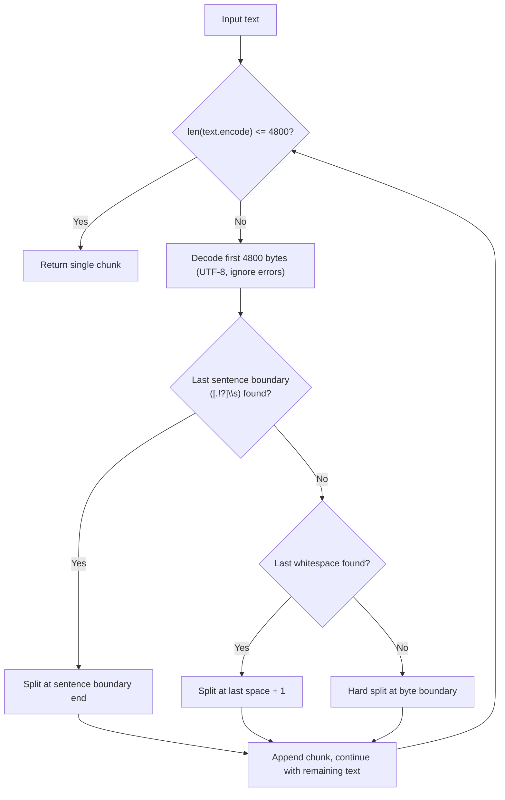
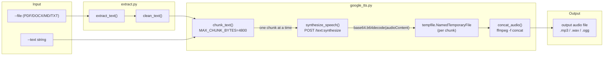
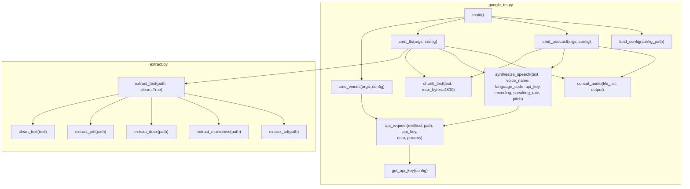

<!-- source: DeepWiki mcp.deepwiki.com · repo sanjay3290/ai-skills · extra page Google Text-to-Speech · fetched 2026-10-27 -->

# Google Text-to-Speech

<details>
<summary>Relevant source files</summary>

The following files were used as context for generating this wiki page:

- [skills/google-tts/.gitignore](skills/google-tts/.gitignore)
- [skills/google-tts/SKILL.md](skills/google-tts/SKILL.md)
- [skills/google-tts/scripts/extract.py](skills/google-tts/scripts/extract.py)
- [skills/google-tts/scripts/google_tts.py](skills/google-tts/scripts/google_tts.py)

</details>


This page covers the `google-tts` skill, which converts text and documents to audio using the Google Cloud Text-to-Speech API. It documents the CLI commands, configuration options, voice types, audio encoding settings, text chunking behavior, and document preprocessing pipeline.

For the comparable ElevenLabs-based TTS skill, see [ElevenLabs (Text-to-Speech)](#4.3.4).

---

## Overview

The skill is implemented in two scripts under `skills/google-tts/scripts/`:

| Script | Purpose |
|---|---|
| `google_tts.py` | Main CLI: `voices`, `tts`, `podcast` subcommands |
| `extract.py` | Document text extraction and TTS-optimized cleaning |

The API endpoint is `https://texttospeech.googleapis.com/v1`, accessed via API key authentication. Audio responses are returned as base64-encoded content and decoded to raw bytes before writing to disk.

Sources: [skills/google-tts/SKILL.md:1-12](), [skills/google-tts/scripts/google_tts.py:1-46]()

---

## Setup

### API Key

The skill resolves an API key by checking two locations in order:

1. `GOOGLE_TTS_API_KEY` environment variable
2. `api_key` field in `config.json`

The `get_api_key` function ([skills/google-tts/scripts/google_tts.py:77-94]()) handles this resolution and exits with an error message if neither source is set. The Cloud Text-to-Speech API must be enabled in your Google Cloud project.

### Configuration File

`config.json` is placed at `skills/google-tts/config.json` (gitignored). It is also searched at `~/.config/claude/google-tts-config.json` as a fallback. The `CONFIG_LOCATIONS` list ([skills/google-tts/scripts/google_tts.py:42-45]()) defines the search order.

A minimal config file:

```json
{
  "api_key": "your-google-cloud-api-key"
}
```

Extended options supported in `config.json`:

| Key | Default | Description |
|---|---|---|
| `api_key` | — | Google Cloud API key |
| `default_voice` | `en-US-Neural2-D` | Voice for `tts` command |
| `default_language` | `en-US` | Language code fallback |
| `default_encoding` | `MP3` | Audio encoding |
| `speaking_rate` | `1.0` | Speaking rate |
| `pitch` | `0.0` | Pitch in semitones |
| `podcast_voice1` | `en-US-Neural2-D` | Default host1 voice |
| `podcast_voice2` | `en-US-Neural2-F` | Default host2 voice |

Sources: [skills/google-tts/scripts/google_tts.py:33-45](), [skills/google-tts/scripts/google_tts.py:56-94](), [skills/google-tts/.gitignore:1-3]()

### Optional Dependencies

| Dependency | Purpose | Install |
|---|---|---|
| `PyPDF2>=3.0.0` | PDF extraction | `pip install 'PyPDF2>=3.0.0'` |
| `python-docx>=1.0.0` | DOCX extraction | `pip install 'python-docx>=1.0.0'` |
| `ffmpeg` | Multi-chunk audio concatenation | `brew install ffmpeg` / `apt install ffmpeg` |

`ffmpeg` is required any time the input text exceeds the 4800-byte chunk limit, producing more than one audio segment.

Sources: [skills/google-tts/SKILL.md:18-22]()

---

## CLI Reference

All commands are invoked through `google_tts.py`:

```
python skills/google-tts/scripts/google_tts.py <command> [options]
```

### `voices` — List Available Voices

Lists voices from the `/voices` endpoint. Output is a formatted table by default.

```bash
python skills/google-tts/scripts/google_tts.py voices --language en-US --type Neural2
python skills/google-tts/scripts/google_tts.py voices --json
```

| Flag | Description |
|---|---|
| `--language` | Filter by BCP-47 language code (e.g., `en-US`, `fr-FR`) |
| `--type` | Filter by voice type string: `Neural2`, `WaveNet`, `Studio`, `Standard` |
| `--json` | Print raw JSON response instead of table |

The `cmd_voices` function ([skills/google-tts/scripts/google_tts.py:288-330]()) extracts voice type by scanning the voice name for known substrings: `Neural2`, `WaveNet`, `Studio`, `Polyglot`, `News`, `Casual`.

---

### `tts` — Text-to-Speech Conversion

Converts a text string or document file to an audio file.

```bash
# From inline text
python skills/google-tts/scripts/google_tts.py tts --text "Hello world" --output ~/Downloads/hello.mp3

# From a document file
python skills/google-tts/scripts/google_tts.py tts --file doc.pdf --output ~/Downloads/narration.mp3

# With all options
python skills/google-tts/scripts/google_tts.py tts \
  --file doc.md --voice en-US-Neural2-F \
  --rate 0.9 --pitch -2.0 --encoding MP3 \
  --output ~/Downloads/out.mp3
```

| Flag | Required | Default | Description |
|---|---|---|---|
| `--text` / `--file` | Yes (one) | — | Input text string or document path |
| `--output` | Yes | — | Output audio file path |
| `--voice` | No | `en-US-Neural2-D` | Voice name |
| `--encoding` | No | `MP3` | `MP3`, `LINEAR16`, or `OGG_OPUS` |
| `--rate` | No | `1.0` | Speaking rate, range `0.25`–`4.0` |
| `--pitch` | No | `0.0` | Pitch in semitones, range `-20.0`–`20.0` |

The language code is automatically derived from the voice name by splitting on `-` and taking the first two parts (e.g., `en-US-Neural2-D` → `en-US`). See `cmd_tts` at [skills/google-tts/scripts/google_tts.py:333-432]().

---

### `podcast` — Multi-Voice Podcast Generation

Synthesizes a JSON conversation script where each segment is attributed to a named speaker.

```bash
python skills/google-tts/scripts/google_tts.py podcast \
  --script /tmp/script.json \
  --output ~/Downloads/podcast.mp3 \
  --voice1 en-US-Neural2-J \
  --voice2 en-US-Neural2-H \
  --rate 0.9
```

| Flag | Required | Default | Description |
|---|---|---|---|
| `--script` | Yes | — | Path to JSON script file |
| `--output` | Yes | — | Output audio file path |
| `--voice1` | No | `en-US-Neural2-D` | Voice for `host1` segments |
| `--voice2` | No | `en-US-Neural2-F` | Voice for `host2` segments |
| `--encoding` | No | `MP3` | Audio encoding |
| `--rate` | No | `1.0` | Speaking rate |
| `--pitch` | No | `0.0` | Pitch in semitones |

**Script format:**

```json
[
  {"speaker": "host1", "text": "Welcome to our podcast!"},
  {"speaker": "host2", "text": "Thanks for having me!"}
]
```

The `cmd_podcast` function ([skills/google-tts/scripts/google_tts.py:435-561]()) maps `host1` and `host2` speaker keys to their respective voice names via `voice_map`. Any speaker key not in `voice_map` falls back to `voice1`. Segments with empty `text` fields are silently skipped.

Sources: [skills/google-tts/scripts/google_tts.py:566-635]()

---

## Voice Types

The Google Cloud TTS API exposes several voice tiers with different quality and cost trade-offs:

| Type | Recommended Use | Example Name |
|---|---|---|
| `Neural2` | Best quality/cost balance (~$4/1M chars) | `en-US-Neural2-D` |
| `WaveNet` | High quality, older generation | `en-US-WaveNet-D` |
| `Studio` | Highest quality, premium pricing | `en-US-Studio-O` |
| `Standard` | Lowest cost, basic quality | `en-US-Standard-D` |

Default voices: `en-US-Neural2-D` (male), `en-US-Neural2-F` (female).

Sources: [skills/google-tts/SKILL.md:80-84](), [skills/google-tts/scripts/google_tts.py:35-37]()

## Audio Encoding Options

| Encoding | Extension | Use Case |
|---|---|---|
| `MP3` | `.mp3` | Default; smallest file, broad compatibility |
| `LINEAR16` | `.wav` | Uncompressed PCM; maximum quality |
| `OGG_OPUS` | `.ogg` | Compressed; good for streaming |

The `ENCODING_EXTENSIONS` dict ([skills/google-tts/scripts/google_tts.py:47-51]()) maps encoding names to file extensions used for temporary chunk files.

Sources: [skills/google-tts/scripts/google_tts.py:47-51]()

---

## Text Chunking

The Google Cloud TTS API enforces a **5000-byte limit per request**. The skill uses a buffer of 4800 bytes (`MAX_CHUNK_BYTES`) to account for UTF-8 multi-byte characters.

The `chunk_text` function ([skills/google-tts/scripts/google_tts.py:170-211]()) implements the splitting strategy:

**Chunking algorithm — `chunk_text`:**



When more than one chunk is produced, `ffmpeg` is required. If `ffmpeg` is not found, the script exits with an installation hint.

Sources: [skills/google-tts/scripts/google_tts.py:170-211](), [skills/google-tts/scripts/google_tts.py:40]()

---

## Document Preprocessing — `extract.py`

The `extract.py` module extracts text from document files before synthesis.

**Supported formats:**

| Extension | Extractor Function | Library Required |
|---|---|---|
| `.pdf` | `extract_pdf` | `PyPDF2` |
| `.docx` | `extract_docx` | `python-docx` |
| `.md`, `.markdown` | `extract_markdown` | None |
| `.txt`, `.text` | `extract_txt` | None |

The `EXTRACTORS` dict ([skills/google-tts/scripts/extract.py:78-85]()) maps lowercase file extensions to extractor functions.

### `clean_text` — TTS Optimization

After extraction, `clean_text` ([skills/google-tts/scripts/extract.py:88-136]()) applies a series of regex transformations to strip markup that would be read aloud literally:

| What is removed / transformed | Regex pattern |
|---|---|
| Fenced code blocks | ` ```...``` ` |
| Inline code | `` `...` `` |
| Markdown images | `` → removed |
| Markdown links | `[text](url)` → `text` |
| Bare URLs | `https?://\S+` |
| HTML tags | `<...>` |
| Header markers | `## Heading` → `Heading` |
| Bold/italic markers | `**text**` → `text` |
| Horizontal rules | `---`, `***` |
| List markers | `-`, `*`, `+`, `1.` |
| Blockquote markers | `>` |
| Table formatting | `\|...\|` rows |
| Excess blank lines | 3+ newlines → 2 |

Pass `--raw` when running `extract.py` directly to skip `clean_text`.

Sources: [skills/google-tts/scripts/extract.py:1-179]()

---

## Data Flow

**`tts` command data flow:**



Sources: [skills/google-tts/scripts/google_tts.py:333-432](), [skills/google-tts/scripts/google_tts.py:253-283](), [skills/google-tts/scripts/google_tts.py:221-250]()

---

## Key Functions Reference



Sources: [skills/google-tts/scripts/google_tts.py:56-635](), [skills/google-tts/scripts/extract.py:22-161]()

---

## Podcast Workflow

The recommended workflow for generating a podcast from a document is described in `SKILL.md` ([skills/google-tts/SKILL.md:70-76]()):

1. Extract document text: `python skills/google-tts/scripts/extract.py /path/to/document.pdf`
2. Generate a two-host JSON conversation script (written by the AI agent to `/tmp/podcast_script.json`). Guidelines:
   - Natural discussion format, not verbatim reading
   - Host 1 leads; Host 2 reacts and analyzes
   - Include intro and outro segments
   - Keep each turn under 4000 characters
3. Run: `python skills/google-tts/scripts/google_tts.py podcast --script /tmp/podcast_script.json --output ~/Downloads/podcast.mp3`
4. Delete temp files

Unlike the ElevenLabs skill (see [ElevenLabs](#4.3.4)), Google TTS does not track voice continuity across segments via request IDs. Each segment is synthesized independently, then all temporary files are concatenated in order by `concat_audio`.

Sources: [skills/google-tts/SKILL.md:68-76](), [skills/google-tts/scripts/google_tts.py:435-561]()

---

## Error Handling

The `handle_http_error` function ([skills/google-tts/scripts/google_tts.py:125-165]()) maps HTTP status codes to user-facing messages:

| HTTP Code | Cause | Message |
|---|---|---|
| `400` | Invalid request payload | Check voice name, encoding, or text content |
| `401` / `403` | Bad API key or API not enabled | Link to GCP API enablement page |
| `429` | Rate limit exceeded | Wait and retry |
| `5xx` | Server error | Retry shortly |

All errors print to `stderr` and call `sys.exit(1)`.

Sources: [skills/google-tts/scripts/google_tts.py:125-165]()

---

