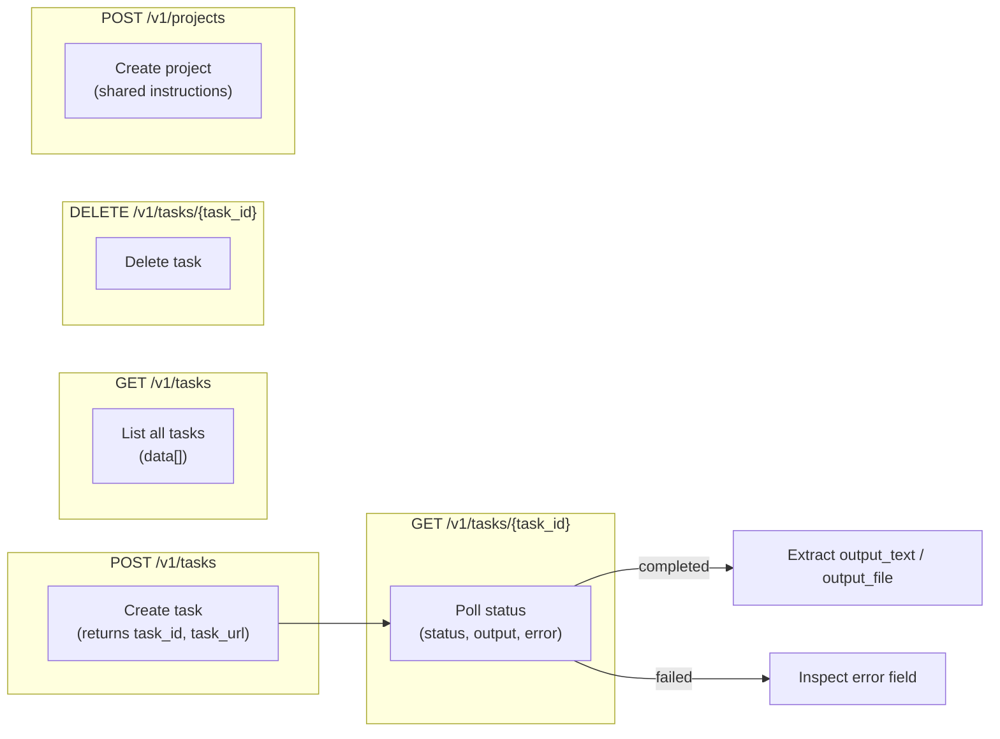
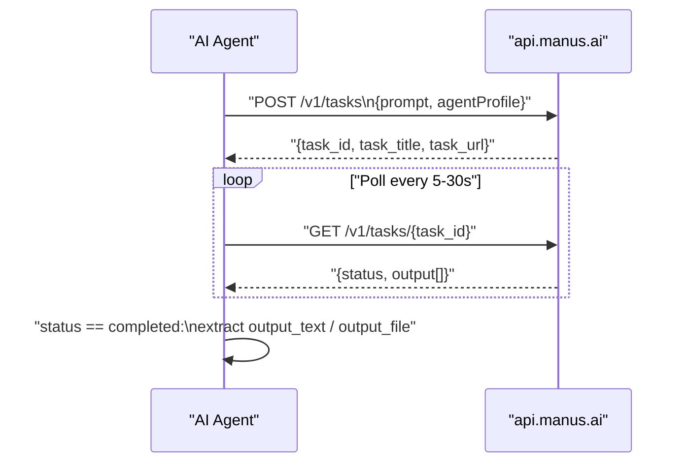

<!-- source: DeepWiki mcp.deepwiki.com · repo sanjay3290/ai-skills · extra page Manus (Research Agent) · fetched 2026-10-27 -->

# Manus (Research Agent)

<details>
<summary>Relevant source files</summary>

The following files were used as context for generating this wiki page:

- [README.md](README.md)
- [skills/jules/SKILL.md](skills/jules/SKILL.md)
- [skills/manus/SKILL.md](skills/manus/SKILL.md)

</details>


This page documents the `manus` skill: how to configure it, how tasks move through their lifecycle, what API endpoints the agent invokes, and how to use advanced features such as multi-turn conversations, file attachments, and projects. For the companion agent-delegation skill that targets GitHub repositories, see [Jules (GitHub Agent)](#4.4.1). For background on how skills are discovered and installed generally, see [Skill Discovery & Installation](#3.2).

---

## Overview

The `manus` skill delegates long-running, autonomous tasks to the Manus AI agent (`api.manus.ai`). Unlike synchronous skills that return a result immediately, Manus tasks run asynchronously: the agent creates a task, receives a `task_id`, polls for status, and retrieves results when the task reaches a terminal state.

Manus is particularly suited for:

| Use Case | Example |
|---|---|
| Deep web research | Market landscape, competitive analysis |
| Stock / financial analysis | Company profile, technical indicators, price charts |
| Product comparison | Spec tables across brands and models |
| Report generation | Markdown reports, CSVs, data visualizations |
| Multi-source synthesis | Aggregating content from many websites |
| Long-running workflows | Tasks that take 1–10+ minutes of autonomous work |

Sources: [skills/manus/SKILL.md:1-22]()

---

## Authentication

The skill uses a single environment variable:

```bash
export MANUS_API_KEY=your-api-key
```

Every API call passes the key in an `API_KEY` HTTP header. There is no OAuth flow or keyring storage — the key is read directly from the environment at call time.

Get your API key from [manus.im](https://manus.im) account settings. For the full list of environment variables used across all skills, see [Environment Variables](#6.1).

Sources: [skills/manus/SKILL.md:52-54](), [README.md:217-221]()

---

## Task Lifecycle

**Task lifecycle diagram**

```mermaid
stateDiagram-v2
    [*] --> "pending" : "POST /v1/tasks"
    "pending" --> "running" : "agent starts"
    "running" --> "completed" : "task finishes"
    "running" --> "failed" : "error / timeout"
    "completed" --> [*] : "retrieve output"
    "failed" --> [*] : "inspect error field"
```

The four status values returned by the API are `pending`, `running`, `completed`, and `failed`. The skill polls `GET /v1/tasks/{task_id}` every 5–30 seconds (shorter intervals for lightweight tasks, longer for research tasks) until a terminal state is reached.

Sources: [skills/manus/SKILL.md:56-86]()

---

## API Endpoints

**API endpoint map**



| Method | Path | Purpose |
|---|---|---|
| `POST` | `/v1/tasks` | Create a new task; returns `task_id`, `task_title`, `task_url` |
| `GET` | `/v1/tasks/{task_id}` | Retrieve task status and output |
| `GET` | `/v1/tasks` | List all tasks; response contains `data[]` array |
| `DELETE` | `/v1/tasks/{task_id}` | Delete a task |
| `POST` | `/v1/projects` | Create a project with shared instructions |

All requests use the header `API_KEY: $MANUS_API_KEY` and base URL `https://api.manus.ai`.

Sources: [skills/manus/SKILL.md:63-116](), [skills/manus/SKILL.md:147-158]()

---

## Agent Profiles

The `agentProfile` field in the task creation request controls the model used:

| Profile | Speed | Best For |
|---|---|---|
| `manus-1.6-lite` | Fast | Simple lookups, quick factual questions |
| `manus-1.6` | Standard | Most research tasks (default) |
| `manus-1.6-max` | Thorough | Deep research, multi-source analysis, detailed reports |

Use `manus-1.6-lite` to reduce latency and credit consumption for simple queries. Use `manus-1.6-max` when tasks require complex reasoning or produce multiple output files.

Sources: [skills/manus/SKILL.md:67-71]()

---

## Creating and Polling a Task

**Request / response flow diagram**



**Extracting text output** from a completed task:

The `.output[]` array is filtered for items with `role == "assistant"`. Within each such item, `.content[]` is further filtered by `type`. Two content types matter:

| `type` value | Meaning |
|---|---|
| `output_text` | The textual result; access via `.text` |
| `output_file` | An attached file; access via `.fileName` and `.fileUrl` |

Sources: [skills/manus/SKILL.md:86-96]()

---

## Multi-Turn Conversations

To continue an existing task (ask a follow-up question or refine results), pass `taskId` in the request body when creating a new task:

```json
{
  "prompt": "Now also add a risk analysis section",
  "taskId": "abc123",
  "agentProfile": "manus-1.6"
}
```

This attaches the new prompt to the existing task context rather than starting fresh. The response follows the same `task_id` / poll / extract pattern.

Sources: [skills/manus/SKILL.md:104-110]()

---

## Advanced Options

| Parameter | Type | Description |
|---|---|---|
| `taskMode` | `string` | `"chat"`, `"adaptive"`, or `"agent"` |
| `projectId` | `string` | Associates the task with a project that carries shared instructions |
| `attachments` | `array` | File inputs (URL, base64, or pre-uploaded file ID) |
| `connectors` | `array` | Pre-configured connector IDs (e.g., Gmail, Calendar, Notion) |
| `createShareableLink` | `boolean` | Generates a public-access URL for the task result |

### File Attachments

Three attachment formats are accepted:

| Format | Required Fields | When to Use |
|---|---|---|
| URL | `type: "url"`, `url` | Reference a publicly accessible document |
| Base64 | `type: "base64"`, `data`, `mime_type` | Embed an image or small file inline |
| File ID | `type: "file"`, `file_id` | Reference a previously uploaded file |

### Projects

Projects provide shared instructions applied to every task within the project. Create a project via `POST /v1/projects` with a `name` and `instruction` string, then pass the returned project ID as `projectId` when creating tasks.

Sources: [skills/manus/SKILL.md:118-157]()

---

## Effective Research Prompts

Research prompts should be specific about scope, timeframe, sources, and desired output format. The SKILL.md defines four template patterns:

**Product comparison**
```
Find the best 4K monitors for Mac with Thunderbolt connectivity and 120Hz+ refresh rate.
Focus on BenQ, Samsung, Dell, LG. Only include models released in the last year.
Compare specs, prices, and Mac-specific features. Output a comparison table.
```

**Stock / company analysis**
```
Analyze [TICKER] stock: company profile, recent performance, technical indicators,
valuation metrics, and insider activity. Include a price chart for the past year.
```

**Market research**
```
Research the [industry] market: key players, market size, growth trends,
recent developments, and competitive landscape. Focus on [region/segment].
```

**Competitive analysis**
```
Compare [Product A] vs [Product B] vs [Product C]: features, pricing,
user reviews, pros/cons. Create a decision matrix for [use case].
```

Manus uses parallel processing — a single well-scoped prompt can cover multiple research angles simultaneously and return several output files.

Sources: [skills/manus/SKILL.md:23-51]()

---

## Skill File Structure

```
skills/manus/
├── SKILL.md             # Agent instructions and API reference
├── README.md            # Human documentation
└── references/
    └── api.md           # Complete endpoint documentation
```

The `SKILL.md` frontmatter description [skills/manus/SKILL.md:1-8]() triggers the skill on phrases like `"use manus"`, `"delegate to manus"`, `"ask manus"`, and `"check manus sessions"`. No Python scripts or dependency files are included — the skill uses `curl` and `jq` directly.

Sources: [skills/manus/SKILL.md:1-8]()

---

## Error Handling

| Error Condition | Cause | Resolution |
|---|---|---|
| `status: "failed"` | Task errored during execution | Inspect `.error` field for reason |
| HTTP 401 | Invalid or missing `MANUS_API_KEY` | Verify the environment variable is set |
| Task timeout | Prompt too broad for the selected profile | Simplify the prompt or switch to `manus-1.6-max` |
| Rate limited | Too many requests | Wait and retry |

Check the `credit_usage` field in the status response to monitor consumption across tasks.

Sources: [skills/manus/SKILL.md:170-183]()

---

## Comparison with Jules

Both Manus and Jules are agent-delegation skills, but they target different problem classes:

| Dimension | Manus | Jules |
|---|---|---|
| Primary use case | Research, analysis, reports | Code changes, tests, documentation |
| Execution environment | Manus cloud with web browsing | GitHub repository sandbox |
| Authentication | `MANUS_API_KEY` env var | `jules login` OAuth CLI |
| Output artifacts | Text reports, CSVs, charts, file URLs | Git diffs, pull requests |
| Repository required | No | Yes (GitHub only) |
| Result retrieval | Poll `GET /v1/tasks/{id}` | `jules remote pull --session <id>` |

For Jules documentation, see [Jules (GitHub Agent)](#4.4.1).

Sources: [skills/manus/SKILL.md:1-185](), [skills/jules/SKILL.md:1-10]()

---

