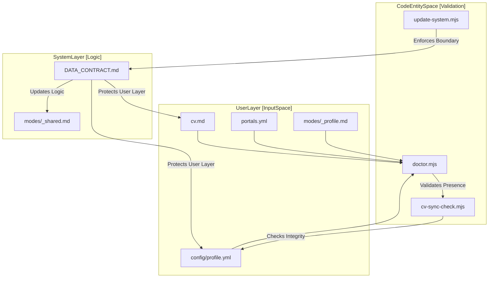
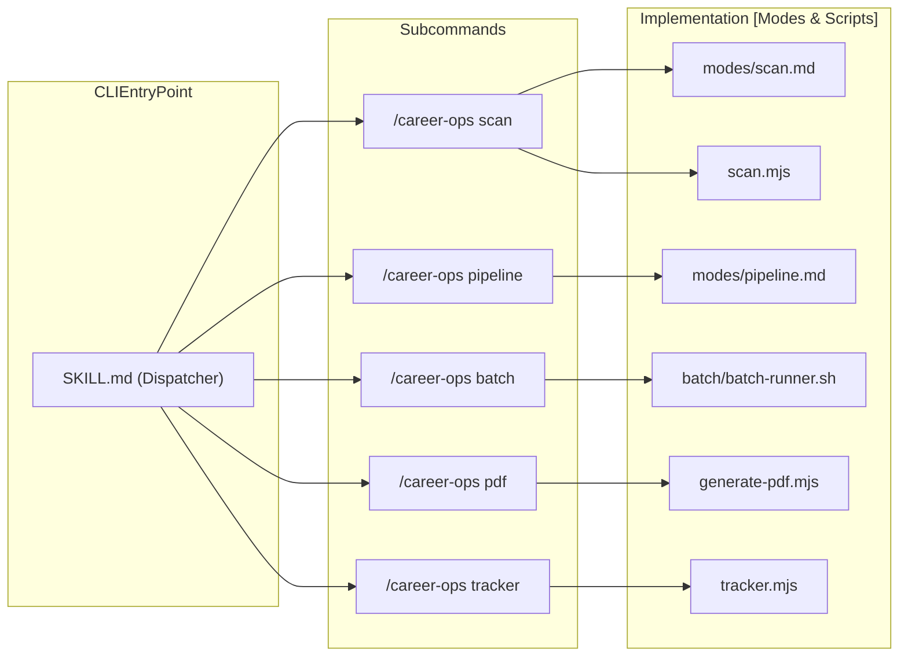

<!-- source: DeepWiki mcp.deepwiki.com · repo santifer/career-ops · page 1.1 Getting Started & Setup · fetched 2026-10-27 -->

# Getting Started & Setup

<details>
<summary>Relevant source files</summary>

The following files were used as context for generating this wiki page:

- [.agents/skills/career-ops/SKILL.md](.agents/skills/career-ops/SKILL.md)
- [.gitignore](.gitignore)
- [AGENTS.md](AGENTS.md)
- [CLAUDE.md](CLAUDE.md)
- [DATA_CONTRACT.md](DATA_CONTRACT.md)
- [OPENCODE.md](OPENCODE.md)
- [README.ar.md](README.ar.md)
- [README.cn.md](README.cn.md)
- [README.es.md](README.es.md)
- [README.fr.md](README.fr.md)
- [README.ja.md](README.ja.md)
- [README.ko-KR.md](README.ko-KR.md)
- [README.md](README.md)
- [README.pl.md](README.pl.md)
- [README.pt-BR.md](README.pt-BR.md)
- [README.ru.md](README.ru.md)
- [README.ua.md](README.ua.md)
- [README.zh-TW.md](README.zh-TW.md)
- [cv-sync-check.mjs](cv-sync-check.mjs)
- [docs/FAQ.md](docs/FAQ.md)
- [docs/RUNNING_ON_A_BUDGET.md](docs/RUNNING_ON_A_BUDGET.md)
- [docs/SCRIPTS.md](docs/SCRIPTS.md)
- [docs/SUPPORTED_CLIS.md](docs/SUPPORTED_CLIS.md)
- [doctor.mjs](doctor.mjs)
- [jsonc-parse.mjs](jsonc-parse.mjs)
- [lib/gemini-node-floor.mjs](lib/gemini-node-floor.mjs)
- [modes/_writing.md](modes/_writing.md)
- [openai-tailor.mjs](openai-tailor.mjs)
- [opencode.example.json](opencode.example.json)
- [scaffolder/bin/skill-entrypoints.mjs](scaffolder/bin/skill-entrypoints.mjs)
- [test-all.mjs](test-all.mjs)
- [tests/doctor-cli-resolution.test.mjs](tests/doctor-cli-resolution.test.mjs)
- [tests/gemini-node-floor.test.mjs](tests/gemini-node-floor.test.mjs)
- [tests/jsonc-parse.test.mjs](tests/jsonc-parse.test.mjs)
- [tests/playwright-mcp-detection.test.mjs](tests/playwright-mcp-detection.test.mjs)
- [update-system.mjs](update-system.mjs)

</details>


This page provides a technical guide for initializing the `career-ops` pipeline. It covers dependency management, configuration of personal identity files, and the validation suite used to ensure the AI agent has a consistent "source of truth" for evaluations.

## System Prerequisites

Before installation, ensure the following environments are available:

*   **AI Coding CLI**: The core execution engine. `career-ops` is built as a suite of specialized prompts and scripts that extend agents like Claude Code, OpenCode, Antigravity CLI, or Gemini CLI [AGENTS.md:65-73](), [.agents/skills/career-ops/SKILL.md:17-25]().
*   **Node.js (v18+)**: Required for running utility scripts and the PDF generation engine. Node >= 22.5.0 is highly recommended to enable native `node:sqlite` support for the tracker index [doctor.mjs:66-91]().
*   **Playwright**: Used for PDF generation, liveness checks, and browser-based job extraction [doctor.mjs:150-170](), [docs/SCRIPTS.md:28-28]().
*   **Go (v1.22+)**: Required for building the Terminal User Interface (TUI) dashboard [README.md:76-78](), [test-all.mjs:1230-1230]().

Sources: [doctor.mjs:66-91](), [README.md:65-81](), [AGENTS.md:1-2]()

## Installation Workflow

The setup follows a structured process to transition from a clean clone to a functional AI job-search agent.

### 1. Recommended Initialization
The fastest way to set up is using the one-command installer which clones the repo and installs dependencies.

```bash
npx @santifer/career-ops init
```
Sources: [README.cn.md:101-105](), [README.es.md:104-106]()

### 2. Manual Clone and Dependency Resolution
Alternatively, you can clone the repository manually and install the required packages.

```bash
git clone https://github.com/santifer/career-ops.git
cd career-ops && npm install
npx playwright install chromium
```
Sources: [README.cn.md:123-129](), [doctor.mjs:139-160]()

### 3. Automated Onboarding & Health Check
`career-ops` includes a "doctor" script to validate the environment. It checks Node versions, dependency presence, Playwright installation, and billing sources to ensure you aren't accidentally using expensive API credits when a subscription is available [doctor.mjs:97-137]().

```bash
npm run doctor
# or for machine-readable output
node doctor.mjs --json
```
Sources: [doctor.mjs:1-60](), [docs/SCRIPTS.md:58-66]()

## Configuration & Identity

The system distinguishes between a **System Layer** (auto-updatable logic) and a **User Layer** (personal data) [DATA_CONTRACT.md:1-4]().

### Required User Files
| File | Purpose | Logic |
| :--- | :--- | :--- |
| `cv.md` | Primary source of truth for facts. | Ground truth for all generated content [AGENTS.md:22-24](). |
| `config/profile.yml` | Identity, target roles, and comp. | Authoritative for prose language and targets [AGENTS.md:91-100](). |
| `modes/_profile.md` | Narrative and negotiation scripts. | User-authored strategy layer [DATA_CONTRACT.md:16-16](). |
| `portals.yml` | Target companies for scanning. | Customized company list for `scan.mjs` [DATA_CONTRACT.md:26-26](). |

Sources: [DATA_CONTRACT.md:5-52](), [AGENTS.md:9-32](), [doctor.mjs:200-210]()

## Data Flow & Entity Mapping

The following diagram illustrates how configuration files and scripts interact to prepare the system for its first evaluation.

### Setup Data Flow: From Config to Execution

Sources: [doctor.mjs:140-210](), [DATA_CONTRACT.md:1-81](), [update-system.mjs:6-19]()

## System Maintenance & Updates

`career-ops` includes a self-updating mechanism to keep the system logic current without risking user data loss.

### The Update Workflow (`update-system.mjs`)
The system layer is defined by a strict list of paths in `update-system.mjs` that are safe to overwrite [update-system.mjs:63-211]().

1.  **Check**: `node update-system.mjs check` compares local version against `RAW_VERSION_URL` [update-system.mjs:10-10](), [update-system.mjs:41-41]().
2.  **Apply**: `node update-system.mjs apply` fetches updates and applies them to the **System Layer** [update-system.mjs:11-15]().
3.  **Rollback**: `node update-system.mjs rollback` restores the previous system state if an update fails [update-system.mjs:16-16]().

### Health Check Commands
| Command | Purpose |
| :--- | :--- |
| `npm run verify` | Health check for pipeline data integrity and status codes [docs/SCRIPTS.md:70-79](). |
| `npm run sync-check` | Validates CV/profile consistency [docs/SCRIPTS.md:20-20](). |
| `npm run normalize` | Maps non-canonical statuses to `templates/states.yml` [docs/SCRIPTS.md:82-94](). |
| `npm run dedup` | Removes duplicate entries from `applications.md` [docs/SCRIPTS.md:97-109](). |

Sources: [docs/SCRIPTS.md:1-54](), [update-system.mjs:1-20](), [DATA_CONTRACT.md:1-19]()

## Slash Commands Overview

Once setup is verified, the system is controlled via `/career-ops` commands routed through a unified skill dispatcher.

### Command Mapping to Code Entities

Sources: [.agents/skills/career-ops/SKILL.md:37-81](), [docs/SCRIPTS.md:1-54](), [AGENTS.md:1-16]()

### Core Command Reference
*   **Auto-Pipeline**: Paste a URL or JD text directly to trigger evaluation + PDF + tracker entry [.agents/skills/career-ops/SKILL.md:83-85]().
*   **`scan`**: Triggers the zero-token portal scanner using `portals.yml` [docs/SCRIPTS.md:29-29]().
*   **`pipeline`**: Processes pending URLs from `data/pipeline.md` [.agents/skills/career-ops/SKILL.md:67-67]().
*   **`pdf` / `latex`**: Generates ATS-optimized output from `cv.md` [.agents/skills/career-ops/SKILL.md:56-58]().
*   **`tracker`**: Interfaces with the SQLite derived index for status overviews [.agents/skills/career-ops/SKILL.md:64-64]().

Sources: [.agents/skills/career-ops/SKILL.md:104-150](), [docs/SCRIPTS.md:1-54](), [README.md:85-96]()

---

