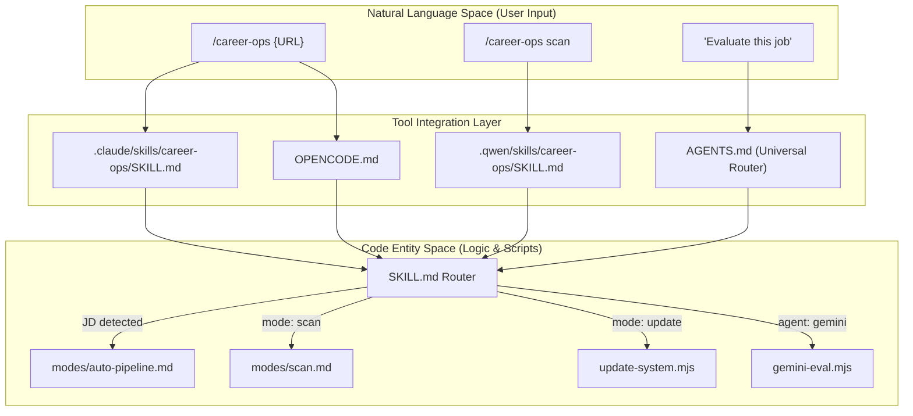
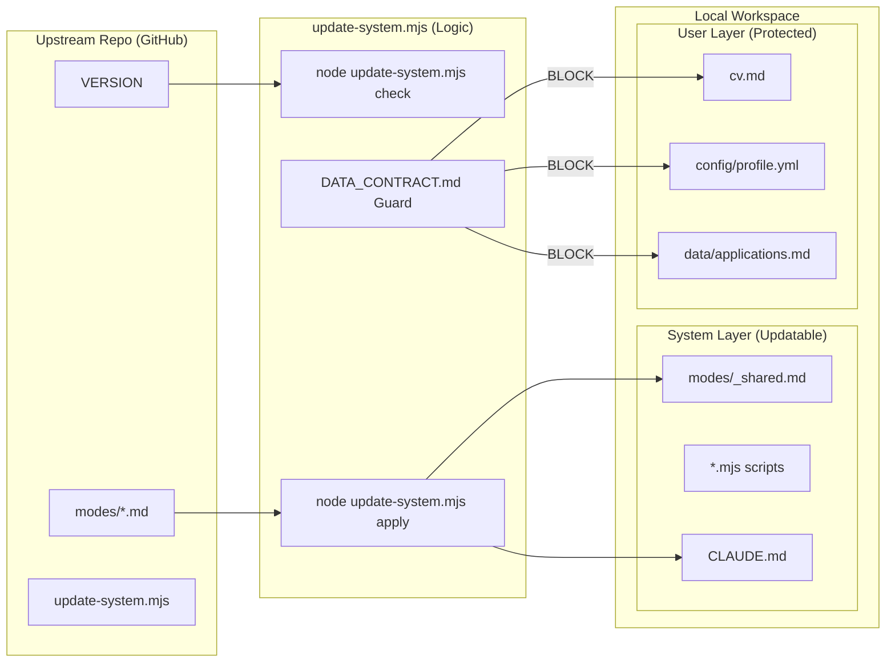

<!-- source: DeepWiki mcp.deepwiki.com · repo santifer/career-ops · page 10 Multi-Agent & Tool Integration · fetched 2026-10-27 -->

# Multi-Agent & Tool Integration

Relevant source files

The following files were used as context for generating this wiki page:

- [.agents/skills/career-ops/SKILL.md](.agents/skills/career-ops/SKILL.md)
- [.env.example](.env.example)
- [.github/labeler.yml](.github/labeler.yml)
- [.gitignore](.gitignore)
- [.grok/skills/career-ops/SKILL.md](.grok/skills/career-ops/SKILL.md)
- [AGENTS.md](AGENTS.md)
- [CLAUDE.md](CLAUDE.md)
- [DATA_CONTRACT.md](DATA_CONTRACT.md)
- [batch/aggregate-tokens.mjs](batch/aggregate-tokens.mjs)
- [docs/SCRIPTS.md](docs/SCRIPTS.md)
- [gemini-eval.mjs](gemini-eval.mjs)
- [lib/context-budget.mjs](lib/context-budget.mjs)
- [lib/context-budget.test.mjs](lib/context-budget.test.mjs)
- [lib/golden-budget-analysis.mjs](lib/golden-budget-analysis.mjs)
- [ollama-eval.mjs](ollama-eval.mjs)
- [openai-eval.mjs](openai-eval.mjs)
- [openrouter-runner.mjs](openrouter-runner.mjs)
- [scaffolder/README.md](scaffolder/README.md)
- [scaffolder/bin/cli.mjs](scaffolder/bin/cli.mjs)
- [test-all.mjs](test-all.mjs)
- [tests/ollama-eval-endpoint.test.mjs](tests/ollama-eval-endpoint.test.mjs)
- [tests/openrouter-tracker-tsv.test.mjs](tests/openrouter-tracker-tsv.test.mjs)
- [tests/title-filter-word-prefix.test.mjs](tests/title-filter-word-prefix.test.mjs)
- [tests/token-tracker.test.mjs](tests/token-tracker.test.mjs)
- [tests/updater-local-system-edits.test.mjs](tests/updater-local-system-edits.test.mjs)
- [tests/updater-rollback-behavior.test.mjs](tests/updater-rollback-behavior.test.mjs)
- [title-keywords.mjs](title-keywords.mjs)
- [update-system.mjs](update-system.mjs)
- [updater-migration-tests.mjs](updater-migration-tests.mjs)
- [utils/token-tracker.mjs](utils/token-tracker.mjs)

This page provides an overview of how `career-ops` functions as a cross-tool command center. While optimized for **Claude Code**, the system architecture is designed to be tool-agnostic, integrating with multiple AI coding assistants (Gemini, Qwen, OpenCode, Antigravity CLI) and maintaining a robust self-update mechanism that preserves user data.

## Integration Architecture

The system uses a layered approach to integration. High-level "Slash Commands" are mapped to specific "Skills," which then route to "Modes" (Markdown-based instruction sets). This ensures that whether a user is in a terminal using Claude Code or an IDE using a different agent, the underlying logic remains consistent.

### Multi-Agent Routing Flow

The following diagram illustrates how a natural language intent (e.g., "evaluate this job") travels from various entry points to the core logic defined in the `modes/` directory.

**Diagram: Intent Routing to Code Entities**

Sources: [.agents/skills/career-ops/SKILL.md:15-83](), [AGENTS.md:1-8]()

---

## Agent Routing Layer (AGENTS.md & SKILL.md)

`career-ops` provides explicit support for multiple agents through a unified skill standard. The `AGENTS.md` file serves as the canonical instruction set shared by all AI CLI clients [AGENTS.md:1-52]().

*   **Claude Code**: Uses `.claude/skills/career-ops/SKILL.md` (or the `.agents/` shim) to dispatch commands and handle auto-pipeline detection [.agents/skills/career-ops/SKILL.md:83-85]().
*   **OpenCode & Antigravity**: Natively support the open agent skill standard. They route all subcommands through the unified skill definition [.agents/skills/career-ops/SKILL.md:1-13]().
*   **Context Loading**: Depending on the mode, the agent dynamically loads `modes/_shared.md` plus the specific mode file to minimize token overhead while maintaining full logic [.agents/skills/career-ops/SKILL.md:96-100]().

For details, see [Agent Routing Layer (AGENTS.md, CLAUDE.md, GEMINI.md, Qwen)](#10.1).

---

## Multi-Model Evaluators (Gemini, OpenRouter, Ollama)

For users seeking alternatives to Claude, the system includes several standalone evaluator scripts that bridge external APIs and local models to the `career-ops` logic.

*   **Gemini Evaluator**: `gemini-eval.mjs` allows for high-quality job evaluations using Google's Gemini models. It defaults to `gemini-3.6-flash` and enforces logic parity by reading `modes/oferta.md` and `cv.md` [gemini-eval.mjs:17-77]().
*   **OpenRouter Bridge**: `openrouter-runner.mjs` provides access to a wide range of free and paid models (Llama, Qwen, Mistral) without requiring the Claude CLI. it includes automatic provider fallback and prompt caching [openrouter-runner.mjs:7-73]().
*   **Local Ollama**: `ollama-eval.mjs` enables private, local evaluations using models like `llama3.3` or `qwen2.5`. It includes a loopback guard to prevent accidental exfiltration of private data to remote endpoints [ollama-eval.mjs:20-177]().

For details, see [Multi-Model Evaluators (Gemini, OpenRouter, Ollama, OpenAI)](#10.2).

---

## System Update & Version Management

To ensure AI agents always use the latest scoring logic and templates without overwriting user data, `career-ops` employs a specialized update utility: `update-system.mjs`.

### The Data Contract
The system enforces a strict boundary defined in `DATA_CONTRACT.md`. This separation ensures that personal files like `cv.md` or `config/profile.yml` are never modified by the update process [DATA_CONTRACT.md:5-52]().

**Diagram: Update Boundary Enforcement**

Sources: [update-system.mjs:6-20](), [DATA_CONTRACT.md:1-52](), [AGENTS.md:9-16]()

### Update Commands
The system logic for updates is executed via `update-system.mjs`:
*   **Check**: `node update-system.mjs check` verifies if a new version is available upstream [update-system.mjs:10-10]().
*   **Apply**: `node update-system.mjs apply` updates the System Layer. It includes a self-reexec pattern to ensure the updater itself is updated before applying changes to other files [update-system.mjs:11-15](), [update-system.mjs:27-35]().
*   **Rollback**: `node update-system.mjs rollback` restores the previous state using backup branches created during the update [update-system.mjs:16-16]().

For details, see [System Update & Version Management](#10.3).

Sources: [update-system.mjs:1-190](), [AGENTS.md:9-16](), [DATA_CONTRACT.md:1-52](), [.agents/skills/career-ops/SKILL.md:80-80]()

---

