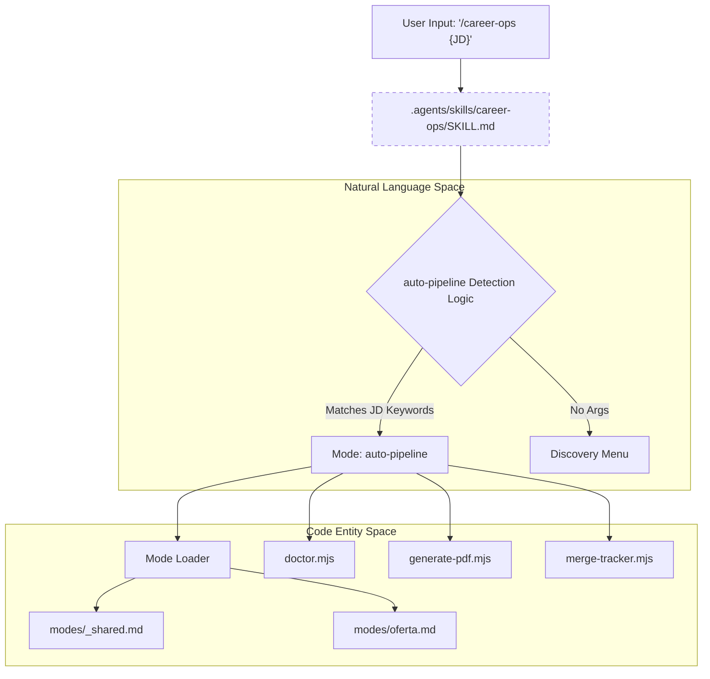
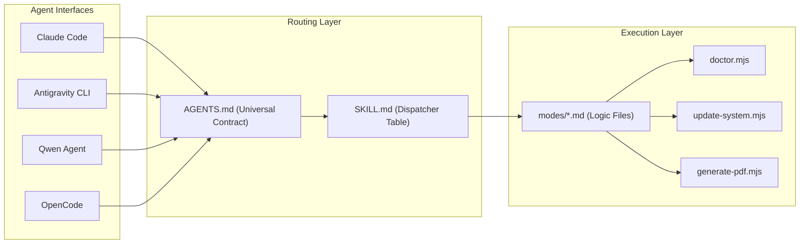

<!-- source: DeepWiki mcp.deepwiki.com · repo santifer/career-ops · page 10.1 Agent Routing Layer (AGENTS.md, CLAUDE.md, GEMINI.md, Qwen) · fetched 2026-10-27 -->

# Agent Routing Layer (AGENTS.md, CLAUDE.md, GEMINI.md, Qwen)

Relevant source files

The following files were used as context for generating this wiki page:

- [.agents/skills/career-ops/SKILL.md](.agents/skills/career-ops/SKILL.md)
- [.github/labeler.yml](.github/labeler.yml)
- [.gitignore](.gitignore)
- [.grok/skills/career-ops/SKILL.md](.grok/skills/career-ops/SKILL.md)
- [AGENTS.md](AGENTS.md)
- [CLAUDE.md](CLAUDE.md)
- [DATA_CONTRACT.md](DATA_CONTRACT.md)
- [OPENCODE.md](OPENCODE.md)
- [docs/SCRIPTS.md](docs/SCRIPTS.md)
- [doctor.mjs](doctor.mjs)
- [jsonc-parse.mjs](jsonc-parse.mjs)
- [lib/gemini-node-floor.mjs](lib/gemini-node-floor.mjs)
- [opencode.example.json](opencode.example.json)
- [scaffolder/README.md](scaffolder/README.md)
- [scaffolder/bin/cli.mjs](scaffolder/bin/cli.mjs)
- [test-all.mjs](test-all.mjs)
- [tests/doctor-cli-resolution.test.mjs](tests/doctor-cli-resolution.test.mjs)
- [tests/gemini-node-floor.test.mjs](tests/gemini-node-floor.test.mjs)
- [tests/jsonc-parse.test.mjs](tests/jsonc-parse.test.mjs)
- [tests/playwright-mcp-detection.test.mjs](tests/playwright-mcp-detection.test.mjs)
- [tests/updater-local-system-edits.test.mjs](tests/updater-local-system-edits.test.mjs)
- [tests/updater-rollback-behavior.test.mjs](tests/updater-rollback-behavior.test.mjs)
- [update-system.mjs](update-system.mjs)
- [updater-migration-tests.mjs](updater-migration-tests.mjs)

The **Agent Routing Layer** is the universal entry point for all AI-enabled CLI clients and IDE extensions. It implements a multi-CLI job-search command center, allowing `career-ops` to function as a cohesive "Skill" across Claude Code, Codex, Gemini, OpenCode, Qwen, and Antigravity CLI. This layer handles mode dispatching, automatic context loading, and environment-specific overrides.

## Universal Routing Logic (AGENTS.md)

The `AGENTS.md` file serves as the primary manifest for all AI agents. It defines the system's origin, the **Data Contract**, and the onboarding workflow that every agent must follow upon session initialization [AGENTS.md:1-16]().

### The Data Contract
To ensure that system updates do not overwrite personal data, the routing layer enforces a strict boundary between user-owned and system-owned files [DATA_CONTRACT.md:1-5]().

| Layer | Files / Paths | Update Policy |
| :--- | :--- | :--- |
| **User Layer** | `cv.md`, `config/profile.yml`, `modes/_profile.md`, `data/*`, `reports/*`, `interview-prep/*` | **NEVER** auto-updated [DATA_CONTRACT.md:5-53]() |
| **System Layer** | `modes/_shared.md`, `AGENTS.md`, `*.mjs` scripts, `dashboard/`, `templates/`, `.claude/skills/` | Auto-updatable via `update-system.mjs` [DATA_CONTRACT.md:63-128]() |

**The Core Rule:** When the user asks to customize facts or targeting (archetypes, narrative, negotiation scripts, proof points, location policy, comp targets), the agent **must** write to `modes/_profile.md` or `config/profile.yml`. Agents are strictly forbidden from editing `modes/_shared.md` for user-specific content [AGENTS.md:16-17]().

### Source-of-Truth Boundary
The routing layer defines a tiered trust model for content generation [AGENTS.md:20-21]():
*   **Primary (Full Trust):** `cv.md`, `article-digest.md`, `config/profile.yml`, `modes/_profile.md` [AGENTS.md:22-27]().
*   **Derived (Narrative Trust):** `interview-prep/story-bank.md`. Quantification in these files requires verification via `story-provenance-check.mjs` [AGENTS.md:28-34]().

**Sources:**
- [AGENTS.md:1-51]()
- [DATA_CONTRACT.md:1-128]()

## Mode Dispatcher (SKILL.md)

The dispatcher located at `.agents/skills/career-ops/SKILL.md` (and its shims in `.claude/`, `.opencode/`, and `.qwen/`) acts as the routing table for the `/career-ops` slash command [.agents/skills/career-ops/SKILL.md:1-13]().

### Mode Routing Table
The dispatcher maps the `$mode` argument to specific Markdown instruction sets [.agents/skills/career-ops/SKILL.md:37-81]():

| Input | Mode | Description |
| :--- | :--- | :--- |
| (empty) | `discovery` | Shows command menu [.agents/skills/career-ops/SKILL.md:43]() |
| JD Text/URL | `auto-pipeline` | Automatic detection of job descriptions via keywords [.agents/skills/career-ops/SKILL.md:83]() |
| `oferta` | `oferta` | Evaluation only A-F [.agents/skills/career-ops/SKILL.md:45]() |
| `scan` | `scan` | Zero-token portal scanner [.agents/skills/career-ops/SKILL.md:69]() |
| `pdf` | `pdf` | Generate ATS-optimized PDF [.agents/skills/career-ops/SKILL.md:56]() |
| `update` | `update` | Triggers `update-system.mjs` [.agents/skills/career-ops/SKILL.md:80]() |

### Auto-Pipeline Detection
If the input is not a known sub-command but contains JD text (keywords: "responsibilities", "requirements", "qualifications") or a URL, the dispatcher automatically routes to `auto-pipeline` [.agents/skills/career-ops/SKILL.md:83-84]().

**Sources:**
- [.agents/skills/career-ops/SKILL.md:15-102]()
- [docs/SCRIPTS.md:1-54]()

## Multi-Agent Integration Flow

The following diagrams bridge the **Natural Language Space** (User Intents) to the **Code Entity Space** (Scripts and Mode files).

### Command Execution Pipeline
Title: Agent Command Resolution & Context Injection

**Sources:**
- [.agents/skills/career-ops/SKILL.md:37-85]()
- [AGENTS.md:52-62]()

## Platform Overlays and Marketplace

While `AGENTS.md` provides universal rules, platform-specific overlays allow for fine-tuning.

*   **CLAUDE.md**: Directs Claude Code specific guidance [CLAUDE.md:1-3]().
*   **GEMINI.md**: Specific overlay for Gemini-based agents [update-system.mjs:145]().
*   **OPENCODE.md**: Manifest for OpenCode integration [update-system.mjs:143]().
*   **Qwen / Antigravity**: Integrated via `.qwen/skills/` and `.antigravitycli/skills/` shims to ensure cross-agent compatibility [updater-migration-tests.mjs:84-85]().
*   **Claude Plugin**: The `.claude-plugin/` directory contains the manifest for the Claude marketplace integration [updater-migration-tests.mjs:83]().

### Agent System Topology
Title: Multi-Platform System Topology and Script Integration

**Sources:**
- [update-system.mjs:64-146]()
- [.agents/skills/career-ops/SKILL.md:15-35]()

## Update and Migration Safety

The routing layer is protected during updates by `update-system.mjs`. This script updates only the **System Layer** paths while explicitly ignoring the **User Layer** [update-system.mjs:3-7]().

*   **System Paths:** Includes `modes/`, `CLAUDE.md`, `AGENTS.md`, and core `.mjs` scripts [update-system.mjs:64-211]().
*   **Migration Invariants:** `updater-migration-tests.mjs` verifies that the updater has a re-exec guard and resolves checkout closures from `FETCH_HEAD` to handle older installed updaters [updater-migration-tests.mjs:130-140]().
*   **Rollback Mechanism:** `removeAdditionsNotInHead` ensures that if an update is rolled back, only files added by the update are removed, preserving any user-staged work in system directories [tests/updater-rollback-behavior.test.mjs:82-128]().
*   **Local Edit Detection:** `locallyModifiedSystemFiles` flags if a user has edited a system file (e.g., `generate-cover-letter.mjs`) before an update overwrites it [tests/updater-local-system-edits.test.mjs:71-83]().

**Sources:**
- [update-system.mjs:1-211]()
- [updater-migration-tests.mjs:1-211]()
- [tests/updater-rollback-behavior.test.mjs:1-170]()
- [tests/updater-local-system-edits.test.mjs:1-171]()

---

