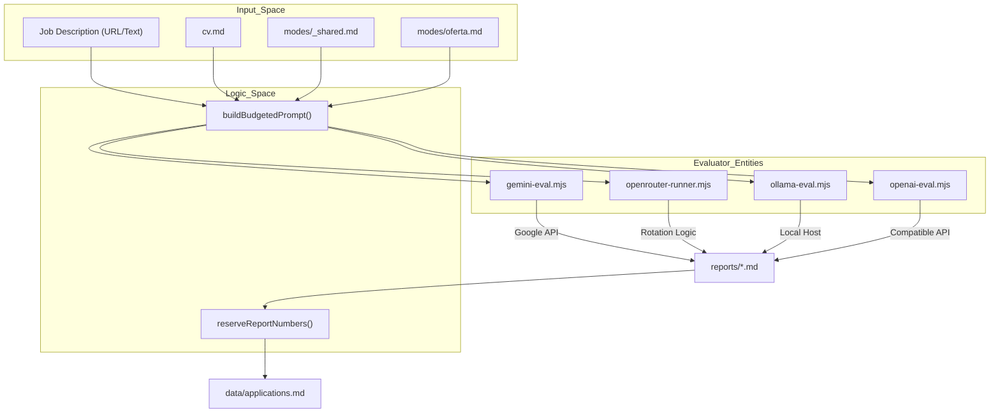
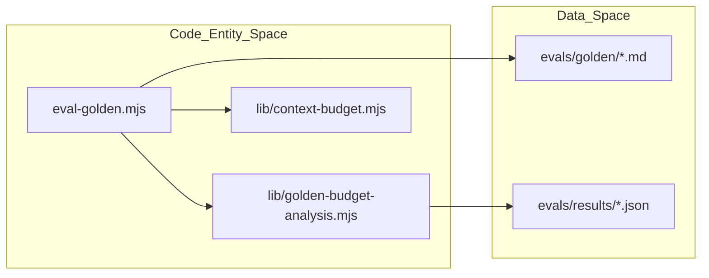

<!-- source: DeepWiki mcp.deepwiki.com · repo santifer/career-ops · page 10.2 Multi-Model Evaluators (Gemini, OpenRouter, Ollama, OpenAI) · fetched 2026-10-27 -->

# Multi-Model Evaluators (Gemini, OpenRouter, Ollama, OpenAI)

Relevant source files

The following files were used as context for generating this wiki page:

- [.env.example](.env.example)
- [batch-evaluate-gemini.mjs](batch-evaluate-gemini.mjs)
- [batch/aggregate-tokens.mjs](batch/aggregate-tokens.mjs)
- [browser-extract.mjs](browser-extract.mjs)
- [gemini-eval.mjs](gemini-eval.mjs)
- [lib/context-budget.mjs](lib/context-budget.mjs)
- [lib/context-budget.test.mjs](lib/context-budget.test.mjs)
- [lib/golden-budget-analysis.mjs](lib/golden-budget-analysis.mjs)
- [ollama-eval.mjs](ollama-eval.mjs)
- [openai-eval.mjs](openai-eval.mjs)
- [openrouter-runner.mjs](openrouter-runner.mjs)
- [tests/application-artifacts.test.mjs](tests/application-artifacts.test.mjs)
- [tests/batch-evaluate.test.mjs](tests/batch-evaluate.test.mjs)
- [tests/batch-runner-jd-prefetch.test.mjs](tests/batch-runner-jd-prefetch.test.mjs)
- [tests/batch-runner-score-delimiter.test.mjs](tests/batch-runner-score-delimiter.test.mjs)
- [tests/browser-extract-flags.test.mjs](tests/browser-extract-flags.test.mjs)
- [tests/browser-extract.test.mjs](tests/browser-extract.test.mjs)
- [tests/ollama-eval-endpoint.test.mjs](tests/ollama-eval-endpoint.test.mjs)
- [tests/openrouter-tracker-tsv.test.mjs](tests/openrouter-tracker-tsv.test.mjs)
- [tests/title-filter-word-prefix.test.mjs](tests/title-filter-word-prefix.test.mjs)
- [tests/token-tracker.test.mjs](tests/token-tracker.test.mjs)
- [title-keywords.mjs](title-keywords.mjs)
- [utils/token-tracker.mjs](utils/token-tracker.mjs)

The `career-ops` ecosystem provides a suite of specialized evaluator scripts that allow users to perform job evaluations and discovery using various LLM backends. These scripts serve as alternatives to the primary Claude-based agent, offering flexibility in terms of cost (free-tier models), privacy (local models), and model selection (OpenRouter rotation).

---

## 1. Gemini Evaluator (gemini-eval.mjs)

The `gemini-eval.mjs` script is a high-performance, free-tier alternative to the standard Claude-based evaluation pipeline. It utilizes Google's Gemini models to analyze job descriptions (JDs) against a user's CV, generating the same structured A-G scoring reports used by the rest of the system [[gemini-eval.mjs:3-8](), [gemini-eval.mjs:172-182]()].

### CLI Usage and Configuration
The script supports direct text input, file-based ingestion, and model overrides [[gemini-eval.mjs:10-12](), [gemini-eval.mjs:93-95]()].

| Option | Description |
|:---|:---|
| `--file <path>` | Read JD from a file instead of inline text [[gemini-eval.mjs:98-98]()]. |
| `--model <name>`| Specify Gemini model (default: `gemini-3.6-flash`) [[gemini-eval.mjs:99-99](), [gemini-eval.mjs:118-118]()]. |
| `--no-save` | Skip writing the generated report to the `reports/` directory [[gemini-eval.mjs:100-100]()]. |
| `--no-compress` | Skip token budget compression (injects full context) [[gemini-eval.mjs:101-101]()]. |

### Model Lifecycle
The script implements a 12-month stable lifecycle for Gemini models, defaulting to the current stable Flash generation [[gemini-eval.mjs:17-27]()].
*   **Default**: `gemini-3.6-flash` [[gemini-eval.mjs:25-25](), [gemini-eval.mjs:118-118]()].
*   **Deprecation**: `gemini-2.0-flash` (2026-03-31), `gemini-2.5-flash` (2026-06-17) [[gemini-eval.mjs:20-22]()].

Sources: [gemini-eval.mjs:1-31](), [gemini-eval.mjs:93-114](), [gemini-eval.mjs:116-139]()

---

## 2. OpenRouter Runner (openrouter-runner.mjs)

The `openrouter-runner.mjs` script is a comprehensive bridge that enables scanning, evaluation, and application drafting using OpenRouter's free model tier [[openrouter-runner.mjs:2-4](), [openrouter-runner.mjs:6-13]()].

### Implementation Details
*   **Automatic Fallback**: It fetches free models live from the OpenRouter API and rotates through them if one fails (e.g., 429 rate limits) [[openrouter-runner.mjs:105-137](), [openrouter-runner.mjs:220-240]()].
*   **Blacklist Mechanism**: Models that consistently fail are stored in `data/model-blacklist.json` to prevent repeated failures in a single session [[openrouter-runner.mjs:79-98]()].
*   **Provider Priority**: Models are sorted by provider (Google, Qwen, OpenAI, etc.) to prioritize higher-quality free endpoints [[openrouter-runner.mjs:62-73](), [openrouter-runner.mjs:132-135]()].

### Supported Commands
| Command | Action |
|:---|:---|
| `scan` | Scans Greenhouse API for new listings [[openrouter-runner.mjs:7-7]()]. |
| `evaluate <url>` | Evaluates a job by URL [[openrouter-runner.mjs:8-8]()]. |
| `pipeline` | Processes all pending URLs from `data/pipeline.md` [[openrouter-runner.mjs:10-10]()]. |
| `models` | Lists currently available free models on OpenRouter [[openrouter-runner.mjs:12-12](), [openrouter-runner.mjs:152-157]()]. |

Sources: [openrouter-runner.mjs:1-19](), [openrouter-runner.mjs:54-73](), [openrouter-runner.mjs:79-101](), [openrouter-runner.mjs:105-149]()

---

## 3. Local & OpenAI-Compatible Evaluators

### Ollama Evaluator (ollama-eval.mjs)
Provides a private, local alternative using models like `llama3.3` or `qwen2.5` [[ollama-eval.mjs:3-8](), [ollama-eval.mjs:21-21]()].
*   **Loopback Guard**: To protect user privacy, the script refuses to connect to non-local Ollama endpoints unless `OLLAMA_ALLOW_REMOTE=1` is set [[ollama-eval.mjs:155-177]()].
*   **Context Guidance**: Recommended for models with 32K+ context windows due to the ~15K token prompt size [[ollama-eval.mjs:19-23]()].

### OpenAI Evaluator (openai-eval.mjs)
A universal bridge for any OpenAI-compatible API (Groq, Together, DeepSeek, LM Studio) [[openai-eval.mjs:3-9]()].
*   **Security**: Enforces HTTPS for all remote endpoints to protect `cv.md` data and API keys [[openai-eval.mjs:151-176]()].
*   **Usage**: `node openai-eval.mjs --url <base> --model <id> --file <path>` [[openai-eval.mjs:78-78]()].

Sources: [ollama-eval.mjs:1-23](), [ollama-eval.mjs:155-177](), [openai-eval.mjs:1-28](), [openai-eval.mjs:151-176]()

---

## 4. System Topology and Data Flow

The multi-model evaluators share a common prompt construction logic, aggregating the user's CV, profile, and evaluation rules before dispatching to the chosen LLM.

**Diagram: Multi-Model Evaluation Data Flow**

Sources: [gemini-eval.mjs:63-77](), [ollama-eval.mjs:49-56](), [openai-eval.mjs:54-60](), [openrouter-runner.mjs:162-171](), [lib/context-budget.mjs:1-20]()

---

## 5. Golden Evaluation Harness (eval-golden.mjs)

The `eval-golden.mjs` script (referenced in the purpose) facilitates benchmarking across these different models. It uses the `evals/` directory to store "golden" (human-verified) evaluation results and compares model outputs against them to measure accuracy in archetype detection and scoring.

### Benchmarking Flow
1.  **Ingestion**: Loads a set of JDs and their corresponding "Golden" scores.
2.  **Execution**: Runs the same JD through multiple evaluators (`gemini-eval.mjs`, `openai-eval.mjs`, etc.).
3.  **Analysis**: Uses `lib/golden-budget-analysis.mjs` to calculate delta between model scores and golden scores.

**Diagram: Golden Eval Entity Mapping**

Sources: [gemini-eval.mjs:46-46](), [ollama-eval.mjs:33-33](), [openai-eval.mjs:38-38](), [lib/context-budget.mjs:1-15]()

---

## 6. Summary of Evaluator Capabilities

| Feature | gemini-eval | openrouter-runner | ollama-eval | openai-eval |
|:---|:---:|:---:|:---:|:---:|
| **Primary Backend** | Google Gemini | Multiple (Rotation) | Local (Ollama) | Any OpenAI-compat |
| **Free Tier** | Yes (Flash) | Yes (Free models) | Yes (Local) | Provider dependent |
| **Privacy** | Cloud | Cloud | **Local-Only** | Cloud/Local |
| **Scan Mode** | No | Yes | No | No |
| **Batch Support** | Yes | No | Yes | Yes |

Sources: [gemini-eval.mjs:5-8](), [openrouter-runner.mjs:7-12](), [ollama-eval.mjs:5-9](), [openai-eval.mjs:5-9]()

---

