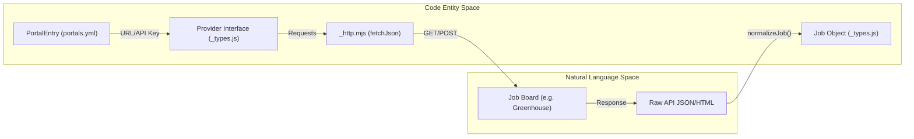
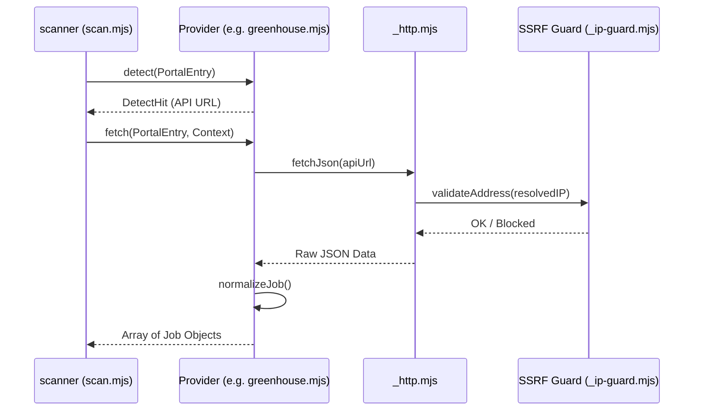

<!-- source: DeepWiki mcp.deepwiki.com · repo santifer/career-ops · page 11 Job Board Providers · fetched 2026-10-27 -->

# Job Board Providers

Relevant source files

The following files were used as context for generating this wiki page:

- [docs/SUPPORTED_JOB_BOARDS.md](docs/SUPPORTED_JOB_BOARDS.md)
- [providers/_dns-cache.mjs](providers/_dns-cache.mjs)
- [providers/_http.mjs](providers/_http.mjs)
- [providers/_ip-guard.mjs](providers/_ip-guard.mjs)
- [providers/_types.js](providers/_types.js)
- [providers/ashby.mjs](providers/ashby.mjs)
- [providers/echojobs.mjs](providers/echojobs.mjs)
- [providers/greenhouse.mjs](providers/greenhouse.mjs)
- [providers/jobbankca.mjs](providers/jobbankca.mjs)
- [providers/lever.mjs](providers/lever.mjs)
- [providers/mycareersfuture.mjs](providers/mycareersfuture.mjs)
- [providers/thehub.mjs](providers/thehub.mjs)
- [test-salary-filter.mjs](test-salary-filter.mjs)
- [tests/providers/ashby-retry.test.mjs](tests/providers/ashby-retry.test.mjs)
- [tests/providers/ashby.test.mjs](tests/providers/ashby.test.mjs)
- [tests/providers/dns-cache.test.mjs](tests/providers/dns-cache.test.mjs)
- [tests/providers/dns-pacing.test.mjs](tests/providers/dns-pacing.test.mjs)
- [tests/providers/echojobs.test.mjs](tests/providers/echojobs.test.mjs)
- [tests/providers/greenhouse.test.mjs](tests/providers/greenhouse.test.mjs)
- [tests/providers/jobbankca.test.mjs](tests/providers/jobbankca.test.mjs)
- [tests/providers/lever.test.mjs](tests/providers/lever.test.mjs)
- [tests/providers/mycareersfuture.test.mjs](tests/providers/mycareersfuture.test.mjs)
- [tests/providers/private-address-guard.test.mjs](tests/providers/private-address-guard.test.mjs)
- [tests/providers/remoteok.test.mjs](tests/providers/remoteok.test.mjs)
- [tests/providers/scan-resolver-breaker.test.mjs](tests/providers/scan-resolver-breaker.test.mjs)
- [tests/providers/thehub.test.mjs](tests/providers/thehub.test.mjs)

The `providers/` directory contains the core logic for discovering and extracting job postings from external sources. The system is designed around a plugin architecture where each job board or Applicant Tracking System (ATS) is represented by a specific provider module. These modules handle the complexities of different APIs, RSS feeds, and server-rendered HTML to produce a standardized job object used by the rest of the career-ops ecosystem.

### The Provider Interface

Every provider module in `providers/` (excluding those prefixed with `_`) must adhere to the `Provider` contract defined in `_types.js`. This ensures that the scanner can interact with diverse job boards through a uniform API.

| Property | Type | Description |
| :--- | :--- | :--- |
| `id` | `string` | A unique identifier for the provider (e.g., `greenhouse`, `ashby`). |
| `detect` | `Function` | (Optional) Analyzes a `PortalEntry` to determine if this provider can handle it. |
| `fetch` | `Function` | (Required) Asynchronously retrieves and normalizes jobs from the source. |

Sources: [providers/_types.js:116-121]()

### Data Flow: From Source to Normalized Job

The primary goal of a provider is to transform raw source data into a `Job` object. This normalization allows downstream filters (like `location_filter` or `content_filter`) to operate without knowing the original source's schema.

**System Mapping: Source to Code Entity**

Sources: [providers/_types.js:12-38](), [providers/_http.mjs:68-70]()

---

### Core Infrastructure & Security

Providers share a robust set of internal utilities to handle networking, security, and performance.

#### HTTP & DNS Management
To prevent overwhelming local DNS resolvers during high-concurrency scans, `_dns-cache.mjs` implements an in-process DNS memoization layer and a token-bucket rate limiter.
*   **DNS Caching:** Memoizes `dns.lookup` to avoid redundant lookups for the same hostname across parallel connections [providers/_dns-cache.mjs:3-23]().
*   **Pacing:** Caps resolver-bound lookups (default 400/min) using `createTokenBucket` [providers/_dns-cache.mjs:127-141]().
*   **HTTP Helpers:** `_http.mjs` provides wrappers like `fetchJson` and `fetchTextHead` with built-in timeouts and retry logic [providers/_http.mjs:12-24]().

#### SSRF & IP Guard
A mandatory security layer, `_ip-guard.mjs`, protects against Server-Side Request Forgery (SSRF).
*   **Private IP Blocking:** Prevents providers from accessing internal network addresses (loopback, link-local, private ranges) [providers/_ip-guard.mjs:53-53]().
*   **Redirect Refusal:** The `fetch` implementation uses `redirect: 'error'` to ensure that a provider cannot be tricked into following a redirect to a sensitive internal IP [providers/_http.mjs:159-165]().

Sources: [providers/_dns-cache.mjs:1-50](), [providers/_http.mjs:1-134](), [providers/_ip-guard.mjs:1-60]()

---

### Supported Job Boards

The system supports a wide array of job boards, categorized by their integration method.

| Provider Category | Examples | Description |
| :--- | :--- | :--- |
| **Major ATS** | Greenhouse, Lever, Ashby, Workday | Deep integrations using public APIs. Often support full-text descriptions and compensation data. |
| **Aggregators** | 4 Day Week, Arbeitnow, EchoJobs (Retired) | Boards that aggregate roles from multiple sources into a single feed. |
| **Specialty/Niche** | CryptocurrencyJobs, Hackernews, TheHub | Focused on specific industries or regions. |
| **Custom Parsers** | Avature, Oracle Cloud, Dassault Systèmes | Handle complex, branded career portals that require specialized HTML parsing. |

**System Mapping: Discovery Workflow**

Sources: [docs/SUPPORTED_JOB_BOARDS.md:1-40](), [providers/greenhouse.mjs:152-176](), [providers/ashby.mjs:167-185]()

---

### Child Pages

For detailed technical specifications, pagination logic, and normalization rules, refer to the following child pages:

*   **[Core ATS Providers (Greenhouse, Lever, Ashby, Workday)](#11.1)**
    Covers the primary ATS providers, including their specific API endpoints, retry strategies (especially for Ashby's latency), and location extraction logic.
*   **[Long-Tail & Specialty Providers](#11.2)**
    Covers the extended library of niche boards, RSS/Atom feed consumers, and specialized company parsers. Includes details on HTML entity decoding and the trust validator.

---

