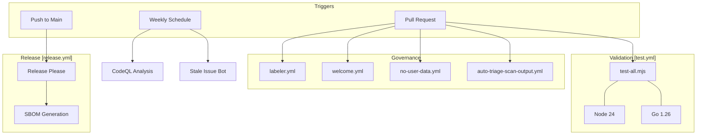
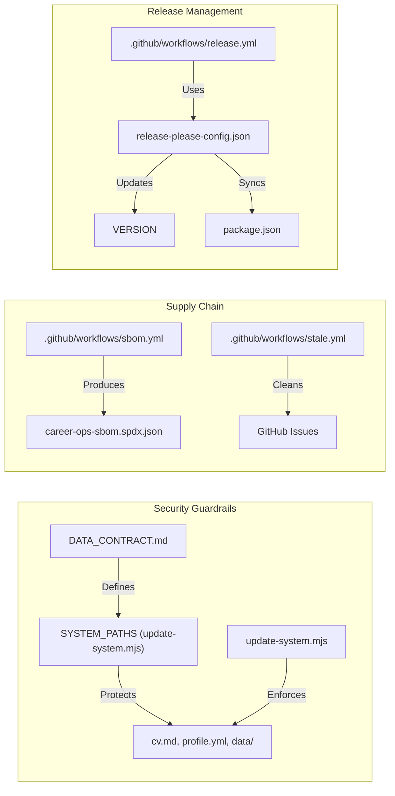

<!-- source: DeepWiki mcp.deepwiki.com · repo santifer/career-ops · page 12 Infrastructure & CI/CD · fetched 2026-10-27 -->

# Infrastructure & CI/CD

Relevant source files

The following files were used as context for generating this wiki page:

- [.agents/skills/career-ops/SKILL.md](.agents/skills/career-ops/SKILL.md)
- [.dockerignore](.dockerignore)
- [.github/workflows/dependency-review.yml](.github/workflows/dependency-review.yml)
- [.github/workflows/gfi-claims.yml](.github/workflows/gfi-claims.yml)
- [.github/workflows/release.yml](.github/workflows/release.yml)
- [.github/workflows/sbom.yml](.github/workflows/sbom.yml)
- [.github/workflows/stale.yml](.github/workflows/stale.yml)
- [.github/workflows/test.yml](.github/workflows/test.yml)
- [.github/workflows/welcome.yml](.github/workflows/welcome.yml)
- [.gitignore](.gitignore)
- [AGENTS.md](AGENTS.md)
- [CLAUDE.md](CLAUDE.md)
- [DATA_CONTRACT.md](DATA_CONTRACT.md)
- [DOCKER.md](DOCKER.md)
- [Dockerfile](Dockerfile)
- [cops](cops)
- [docker-compose.yml](docker-compose.yml)
- [docs/SCRIPTS.md](docs/SCRIPTS.md)
- [release-please-config.json](release-please-config.json)
- [test-all.mjs](test-all.mjs)
- [update-system.mjs](update-system.mjs)

The `career-ops` repository utilizes a robust automation infrastructure to ensure the integrity of its AI agent modes, data processing scripts, and the Go-based dashboard. This infrastructure spans automated testing, dependency management, security scanning, and a standardized release process.

## Automation Architecture

The automation stack is primarily driven by GitHub Actions, which orchestrates the execution of Node.js scripts and Go builds. The system distinguishes between core architectural changes and peripheral updates through a strict labeling taxonomy.

### CI/CD Workflow Topology

The following diagram illustrates how various workflows interact with the codebase upon code changes.

**Diagram: CI/CD Pipeline Orchestration**

**Sources:** [.github/workflows/test.yml:1-20](), [.github/workflows/release.yml:1-18](), [.github/workflows/stale.yml:1-34](), [.github/workflows/welcome.yml:1-53]().

---

## Testing & CI Pipeline

The primary gatekeeper for the repository is the `test.yml` workflow, which executes the `test-all.mjs` master runner. This suite performs critical checks including syntax validation of `.mjs` files, personal data leak prevention, and Go build verification for the dashboard.

*   **Execution Environment:** Runs on a matrix of `ubuntu-latest`, `macos-latest`, and `windows-latest` using Node 24 and Go 1.26 [.github/workflows/test.yml:19-21](), [.github/workflows/test.yml:35-41]().
*   **Test Suite:** `test-all.mjs` serves as the comprehensive runner, auto-discovering tests in the `tests/` directory matching `**/*.test.mjs` [test-all.mjs:107-118]().
*   **Upgrade Safety:** The `upgrade-gate` job in CI ensures that updates via `update-system.mjs` do not compromise user data by running `upgrade-tests.mjs --pr-gate` [.github/workflows/test.yml:73-93]().

For details, see [Testing & CI Pipeline](#12.1).

**Sources:** [test-all.mjs:1-34](), [.github/workflows/test.yml:1-93]().

---

## Release Engineering & Security

The repository follows a "Release Please" strategy to automate versioning and changelog generation based on conventional commits. Security is maintained through a multi-layered approach involving automated dependency updates, SBOM generation, and a strict "Data Contract" that separates system logic from user data.

### Dependency & Security Matrix

| Component | Tool | Frequency / Trigger |
| :--- | :--- | :--- |
| **Versioning** | `release-please` | Push to `main` [.github/workflows/release.yml:1-18]() |
| **Release Manifest** | `.release-please-manifest.json` | Updated on release [release-please-config.json:24]() |
| **System Updates** | `update-system.mjs` | Manual `check`/`apply` by user [update-system.mjs:9-18]() |
| **User Data Guard** | `DATA_CONTRACT.md` | Defines system/user boundary [DATA_CONTRACT.md:1-3]() |
| **SBOM** | `anchore/sbom-action` | On Release Publication [.github/workflows/sbom.yml:3-4]() |
| **Stale Management** | `stale.yml` | Daily cleanup of inactive issues [.github/workflows/stale.yml:1-34]() |

### Code Entity Association: Security & Release

This diagram maps the security and release automation to the specific configuration files and entities they manage.

**Diagram: Security and Release Entity Mapping**

**Sources:** [DATA_CONTRACT.md:5-53](), [update-system.mjs:64-211](), [release-please-config.json:1-52](), [.github/workflows/release.yml:58-69]().

For details, see [Release Engineering & Security](#12.2).

---

## Docker & Nix Development Environments

`career-ops` supports containerized development environments to ensure reproducibility and ease of setup, particularly for dependencies like Playwright/Chromium and LaTeX.

*   **Docker:** The `Dockerfile` provides a Playwright-compatible base image with optional Go and LaTeX toolchains. The `docker-compose.yml` facilitates local development with bind mounts to preserve the user layer [DOCKER.md:1-50]().
*   **Nix:** A `flake.nix` offers a declarative way to set up a development shell on macOS/Linux with pinned dependencies, ensuring a consistent environment without global installs.
*   **CLI Wrapper:** The `cops` shell script acts as a high-level wrapper for the containerized environment, providing commands like `cops doctor` to validate prerequisites [docs/SCRIPTS.md:58-66]().

For details, see [Docker & Nix Development Environments](#12.3).

**Sources:** [Dockerfile:1-45](), [docker-compose.yml:1-20](), [cops:1-73](), [DOCKER.md:1-50](), [flake.nix:1-50]().

---

## Child Pages
- **[Testing & CI Pipeline](#12.1)**: Deep dive into `test-all.mjs`, the Node/Go test matrix, and PR labeling logic.
- **[Release Engineering & Security](#12.2)**: Details on the release manifest, Renovate configuration, SBOM generation, and automated security scanning.
- **[Docker & Nix Development Environments](#12.3)**: Comprehensive guide to setting up and using the containerized and Nix-based development environments.

---

