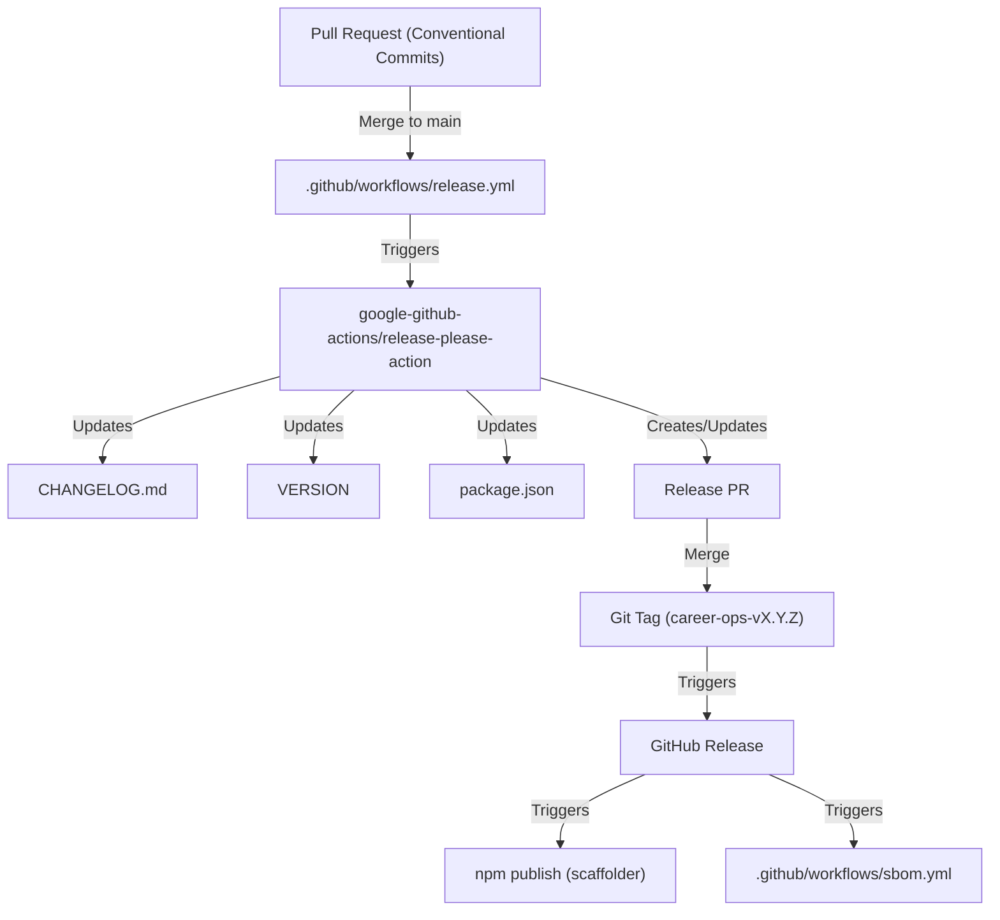
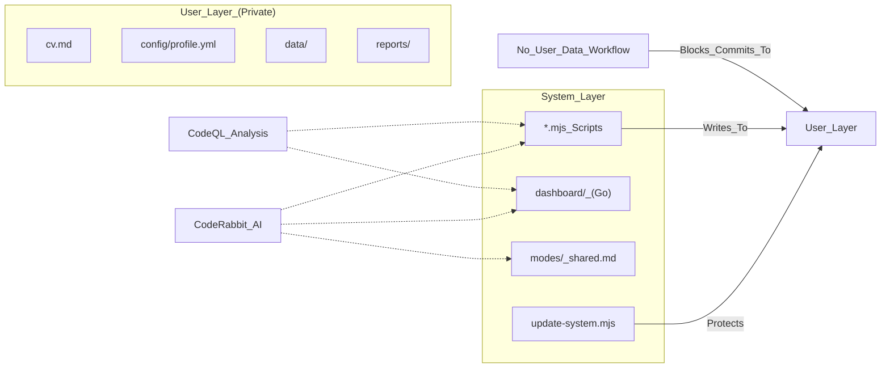

<!-- source: DeepWiki mcp.deepwiki.com · repo santifer/career-ops · page 12.2 Release Engineering & Security · fetched 2026-10-27 -->

# Release Engineering & Security

Relevant source files

The following files were used as context for generating this wiki page:

- [.claude-plugin/marketplace.json](.claude-plugin/marketplace.json)
- [.claude-plugin/plugin.json](.claude-plugin/plugin.json)
- [.github/FUNDING.yml](.github/FUNDING.yml)
- [.github/ISSUE_TEMPLATE/bug_report.yml](.github/ISSUE_TEMPLATE/bug_report.yml)
- [.github/ISSUE_TEMPLATE/config.yml](.github/ISSUE_TEMPLATE/config.yml)
- [.github/ISSUE_TEMPLATE/feature_request.yml](.github/ISSUE_TEMPLATE/feature_request.yml)
- [.github/PULL_REQUEST_TEMPLATE.md](.github/PULL_REQUEST_TEMPLATE.md)
- [.github/SECURITY.md](.github/SECURITY.md)
- [.github/plugin/plugin.json](.github/plugin/plugin.json)
- [.github/workflows/auto-triage-scan-output.yml](.github/workflows/auto-triage-scan-output.yml)
- [.github/workflows/codeql.yml](.github/workflows/codeql.yml)
- [.github/workflows/dependency-review.yml](.github/workflows/dependency-review.yml)
- [.github/workflows/gfi-claims.yml](.github/workflows/gfi-claims.yml)
- [.github/workflows/gh-events-feed.yml](.github/workflows/gh-events-feed.yml)
- [.github/workflows/labeler.yml](.github/workflows/labeler.yml)
- [.github/workflows/ledger-bot.yml](.github/workflows/ledger-bot.yml)
- [.github/workflows/manifesto-guestbook.yml](.github/workflows/manifesto-guestbook.yml)
- [.github/workflows/no-user-data.yml](.github/workflows/no-user-data.yml)
- [.github/workflows/release.yml](.github/workflows/release.yml)
- [.github/workflows/sbom.yml](.github/workflows/sbom.yml)
- [.github/workflows/signature-ci.yml](.github/workflows/signature-ci.yml)
- [.github/workflows/stale.yml](.github/workflows/stale.yml)
- [.github/workflows/test.yml](.github/workflows/test.yml)
- [.github/workflows/web-ci.yml](.github/workflows/web-ci.yml)
- [.github/workflows/welcome.yml](.github/workflows/welcome.yml)
- [.release-please-manifest.json](.release-please-manifest.json)
- [CHANGELOG.md](CHANGELOG.md)
- [CITATION.cff](CITATION.cff)
- [CODE_OF_CONDUCT.md](CODE_OF_CONDUCT.md)
- [GOVERNANCE.md](GOVERNANCE.md)
- [SECURITY.md](SECURITY.md)
- [SUPPORT.md](SUPPORT.md)
- [VERSION](VERSION)
- [package.json](package.json)
- [release-please-config.json](release-please-config.json)
- [scaffolder/package.json](scaffolder/package.json)
- [web/CHANGELOG.md](web/CHANGELOG.md)
- [web/package-lock.json](web/package-lock.json)
- [web/package.json](web/package.json)

This page details the automation infrastructure and security protocols governing the `career-ops` repository. It covers the automated release pipeline, dependency management strategies, AI-assisted code review guardrails, and security analysis workflows that ensure the integrity of the career automation suite.

## Release Management Workflow

The project utilizes `release-please` to automate versioning and changelog generation. This workflow relies on **Conventional Commits** to determine semantic version bumps (e.g., `feat:`, `fix:`, `chore:`).

### Release Please Implementation
The release process is triggered by pushes to the `main` branch. The `release-please-action` parses the commit history to maintain the `CHANGELOG.md` and update the version in the manifest file.

- **Workflow Configuration**: Defined in [.github/workflows/release.yml:1-18]().
- **NPM Scaffolder Publication**: When a release is created, the system automatically publishes the `@santifer/career-ops` init package to npm with provenance [.github/workflows/release.yml:43-46]().
- **Configuration Details**: Uses the `simple` release type and synchronizes the version in `package.json` [release-please-config.json:3-15]().
- **Version Source**: The current system version is maintained in the `VERSION` file [VERSION:1-1]() and the `.release-please-manifest.json` [.release-please-manifest.json:1-4]().

### Release Pipeline Diagram

The following diagram illustrates the flow from a developer's pull request to a finalized GitHub Release and npm publication.

**Release Pipeline Data Flow**

**Sources:** [.github/workflows/release.yml:1-46](), [release-please-config.json:1-17](), [VERSION:1-1](), [.release-please-manifest.json:1-4]().

---

## Dependency Management & Integrity

`career-ops` uses **Renovate** for automated dependency updates across multiple package managers (npm, Go modules, and GitHub Actions).

### Renovate Configuration
The project follows a strict update schedule to minimize developer distraction while maintaining security.
- **Schedule**: Updates are batched for Monday before 7:00 AM [renovate.json:9-9]().
- **Managers**:
    - `github-actions`: Updates workflow actions [renovate.json:14-17]().
    - `gomod`: Manages Go dependencies for the `dashboard/` TUI [renovate.json:19-22]().
    - `npm`: Manages Node.js dependencies for the core scripts and web UI [renovate.json:24-27]().
- **Limits**: Concurrent PRs are capped at 5 to prevent CI congestion [renovate.json:11-11]().

### Dependency Review
For every Pull Request, the `dependency-review-action` scans for new vulnerabilities.
- **Severity Threshold**: The CI is configured to fail if a dependency with a `high` severity vulnerability is introduced [.github/workflows/dependency-review.yml:25-25]().
- **Status**: Currently runs with `continue-on-error: true` as a temporary workaround until dependency graph settings are finalized [.github/workflows/dependency-review.yml:22-23]().

**Sources:** [renovate.json:1-29](), [.github/workflows/dependency-review.yml:1-26](), [package.json:94-99](), [web/package.json:16-29]().

---

## AI Review Guardrails (CodeRabbit)

To maintain high code quality and safety in a project heavily utilizing AI agents, **CodeRabbit** provides automated AI reviews with specific instructions tailored to the system's architecture.

### Instruction Logic
CodeRabbit is configured with path-specific instructions to protect critical system boundaries:
- **Scoring Logic**: Changes to `modes/_shared.md` are flagged to prevent accidental degradation of the A-F evaluation scoring system [.coderabbit.yaml:15-16]().
- **Data Contract**: Changes to `DATA_CONTRACT.md` are reviewed to ensure the boundary between "System Layer" and "User Layer" is preserved [.coderabbit.yaml:17-18]().
- **Script Safety**: `.mjs` files are audited for command injection, path traversal, and SSRF vulnerabilities [.coderabbit.yaml:19-20]().
- **Dashboard Integrity**: Go code in `dashboard/` is checked for proper error handling and hardcoded paths [.coderabbit.yaml:21-22]().

**Sources:** [.coderabbit.yaml:1-25]().

---

## Security Infrastructure & Privacy Guardrails

The project implements a multi-layered security strategy encompassing static analysis, SBOM generation, and automated privacy checks.

### Static Analysis (CodeQL)
GitHub CodeQL runs weekly and on every PR to detect vulnerabilities in the codebase.
- **Languages**: Analyzes `javascript-typescript` for scripts and `go` for the dashboard [.github/workflows/codeql.yml:22-22]().
- **Build Integration**: For Go, the workflow builds the dashboard directly to ensure accurate analysis [.github/workflows/codeql.yml:39-41]().
- **Schedule**: Weekly runs occur every Monday at 4am UTC [.github/workflows/codeql.yml:8-8]().

### No User Data Workflow
A critical security guardrail blocks any PR that attempts to commit private user data. This workflow enforces the `DATA_CONTRACT.md` by scanning for files that should only exist locally.
- **Protected Paths**: Includes `cv.md`, `config/profile.yml`, `data/`, `reports/`, and `portals.yml` [.github/workflows/no-user-data.yml:33-45]().
- **Implementation**: Uses `github-script` to paginate through PR files and matches them against `USER_PATHS` regex patterns [.github/workflows/no-user-data.yml:22-52]().
- **Exemptions**: Documentation like `README.md` or `.gitkeep` files within those directories are allowed [.github/workflows/no-user-data.yml:47-52]().

### Auto-Triage Scan Output
To prevent users from accidentally leaking their personal job search results into the public issue tracker, an auto-triage workflow monitors new issues.
- **Detection**: Identifies automated markers like "Generated by career-ops automated routine" or "Scheduled Portal Scan" [.github/workflows/auto-triage-scan-output.yml:42-56]().
- **Action**: Comments with a privacy warning, applies the `scan-output` label, and closes the issue as `not_planned` [.github/workflows/auto-triage-scan-output.yml:61-79]().

### Code Entity to Security Boundary Mapping
The following diagram illustrates how security tools map to specific code entities and data layers.

**Security Boundary Mapping**

**Sources:** [.github/workflows/codeql.yml:1-51](), [.github/workflows/no-user-data.yml:1-63](), [.github/workflows/auto-triage-scan-output.yml:1-80](), [update-system.mjs:1-100]().

---

## Maintenance & Release Engineering

### SBOM Generation
Software Bill of Materials (SBOM) are generated for every published release to provide transparency into the software supply chain.
- **Format**: SPDX-JSON.
- **Artifact**: `career-ops-sbom.spdx.json` is uploaded to release assets [.github/workflows/sbom.yml:26-26]().

### Stale Issue Management
The `stale` workflow automatically closes inactive issues and PRs to prevent backlog rot.
- **Schedule**: Runs every Monday at 6am UTC [.github/workflows/stale.yml:4-4]().
- **Issue Threshold**: Marked stale after 60 days, closed after 14 more days [.github/workflows/stale.yml:27-29]().
- **PR Threshold**: Marked stale after 30 days [.github/workflows/stale.yml:28-28]().

### Migration Safety Tests
The `upgrade-tests.mjs` script ensures that the system update mechanism correctly identifies system vs. user paths and handles migrations safely.
- **Regression Gate**: Validates that updates from previous releases to the current commit do not break core functionality [.github/workflows/test.yml:74-93]().
- **Local Paths Protection**: Verifies that local-only configuration (like `config/profile.yml`) survives a system update [upgrade-tests.mjs:92-93]().
- **Canary Tests**: Includes canary runs to ensure the test harness itself is capable of detecting failures [upgrade-tests.mjs:90-91]().

**Sources:** [.github/workflows/sbom.yml:1-26](), [.github/workflows/stale.yml:1-34](), [.github/workflows/test.yml:74-93](), [package.json:30-33]().

---

