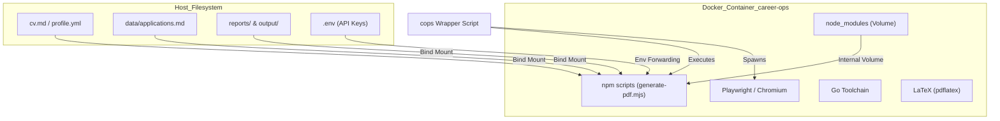
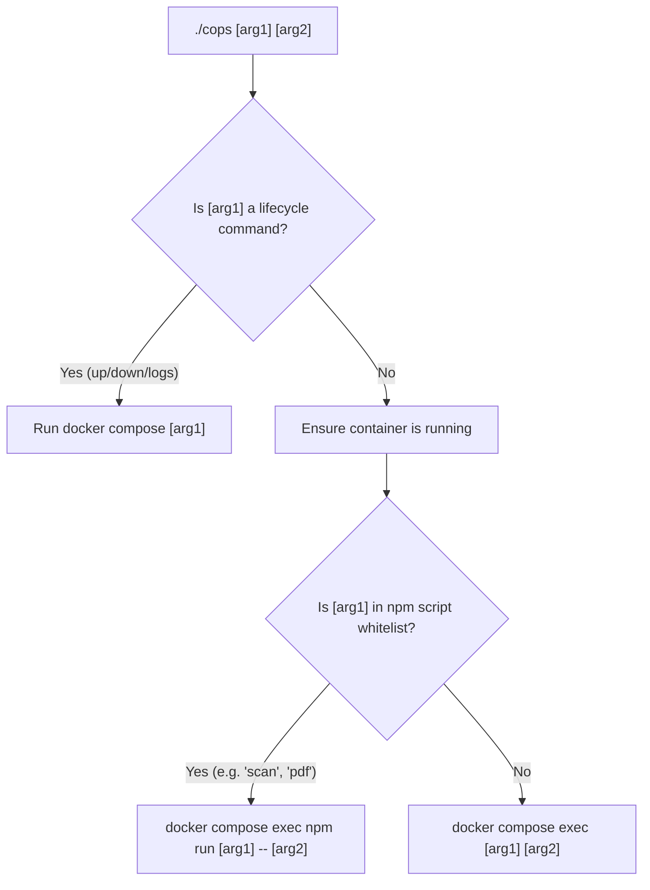

<!-- source: DeepWiki mcp.deepwiki.com · repo santifer/career-ops · page 12.3 Docker & Nix Development Environments · fetched 2026-10-27 -->

# Docker & Nix Development Environments

Relevant source files

The following files were used as context for generating this wiki page:

- [.dockerignore](.dockerignore)
- [DOCKER.md](DOCKER.md)
- [Dockerfile](Dockerfile)
- [cops](cops)
- [docker-compose.yml](docker-compose.yml)

This page covers the containerized and reproducible development environments provided by `career-ops`. These environments ensure that system dependencies—specifically Chromium for Playwright, the Go toolchain for the TUI dashboard, and LaTeX for professional CV exports—are consistent across different operating systems (Linux, macOS) and kernel versions.

### System Environment Architecture

The project provides two primary paths for environment reproducibility: a **Docker-based container environment** for isolation and a **Nix-based development shell** for native performance with pinned dependencies.

#### Environment Topology
The following diagram illustrates how the host filesystem interacts with the containerized environment via the `cops` wrapper.

**Diagram: Container-Host Interaction**

Sources: [docker-compose.yml:15-24](), [cops:64-73](), [DOCKER.md:85-93]()

---

### Dockerized Environment

The Docker environment is designed for systems where native installation of Playwright or specific Chromium versions is difficult (e.g., Ubuntu 26.04+, locked-down corporate environments) [DOCKER.md:3-6]().

#### Dockerfile Implementation
The `Dockerfile` uses the official Microsoft Playwright image as a base to ensure browser compatibility [Dockerfile:6](). It extends this base with:
*   **Go Toolchain**: Installed via `ARG GO_VERSION=1.23.4` to support the dashboard TUI [Dockerfile:14-28]().
*   **LaTeX Support**: Includes `latexmk`, `texlive-latex-recommended`, `texlive-latex-extra`, `texlive-fonts-recommended`, and `texlive-xetex` for `generate-latex.mjs` workflows [Dockerfile:19]().
*   **Dependency Pinning**: Explicitly installs `playwright@1.62.1` to match the bundled Chromium version in the base image [Dockerfile:38]().

#### Bind-Mount Strategy
The `docker-compose.yml` uses a hybrid mounting strategy:
1.  **Project Root**: The entire project is bind-mounted to `/app` so that local edits to `cv.md` or `profile.yml` are immediately reflected [docker-compose.yml:16]().
2.  **Anonymous Volume**: `node_modules` is stored in a named volume `career-ops-node-modules` [docker-compose.yml:17](). This prevents ABI mismatches between the host and the container when native modules are compiled [DOCKER.md:69-71]().
3.  **Shared Memory**: `shm_size` is increased to `1gb` to prevent Chromium crashes during heavy PDF rendering or portal scanning [docker-compose.yml:26]().

Sources: [Dockerfile:1-45](), [docker-compose.yml:1-33](), [DOCKER.md:65-72]()

---

### The `cops` Wrapper Script

The `cops` script is a thin Bash wrapper that forwards commands into the container [cops:2]().

| Command | Internal Action | Purpose |
|:---|:---|:---|
| `./cops up` | `docker compose up -d` | Starts the background container [cops:33-36](). |
| `./cops doctor` | `npm run doctor` (in container) | Validates Node, Go, and Playwright health [cops:65-68](). |
| `./cops scan` | `npm run scan` (in container) | Runs the portal scanner [cops:65-68](). |
| `./cops pdf` | `npm run pdf` (in container) | Generates PDF from HTML/Markdown [cops:65-68](). |
| `./cops shell` | `docker compose exec ... bash` | Opens an interactive session [cops:51-54](). |
| `./cops <cmd>` | `npm run <cmd>` or raw exec | Forwards unknown commands to the container [cops:69-73](). |

#### Logic Flow: Command Forwarding
**Diagram: cops Command Resolution**

Sources: [cops:22-73](), [DOCKER.md:28-54]()

---

### Nix Development Shell

For users on macOS or Linux who prefer native execution, a `flake.nix` (referenced in documentation) provides a reproducible development shell.

*   **Reproducibility**: Pins Playwright browser binaries via Nix store paths.
*   **Environment Integration**: Uses `.envrc` and `direnv` to automatically load the environment upon entering the directory.
*   **Browser Pathing**: Sets `PLAYWRIGHT_BROWSERS_PATH` to ensure the `npm` version of Playwright uses the Nix-provided Chromium binaries rather than attempting to download them to `~/.cache`.

Sources: [DOCKER.md:4](), [docker-compose.yml:20]()

---

### Data Persistence & Security

The environment strictly separates the **System Layer** (the container/shell) and the **User Layer** (the host filesystem).

*   **API Keys**: `GEMINI_API_KEY`, `ANTHROPIC_API_KEY`, and `OPENAI_API_KEY` are forwarded from the host environment into the container [docker-compose.yml:21-24]().
*   **Artifacts**: All generated reports (`reports/`), PDFs (`output/`), and the tracker (`data/applications.md`) persist on the host filesystem via bind mounts [DOCKER.md:85-93]().
*   **Exclusions**: The `.dockerignore` file prevents sensitive or bulky files like `.env`, `node_modules`, and `batch/logs` from being included in the Docker build context [ .dockerignore:1-17]().

Sources: [docker-compose.yml:15-24](), [.dockerignore:1-16](), [DOCKER.md:93-94]()

---

