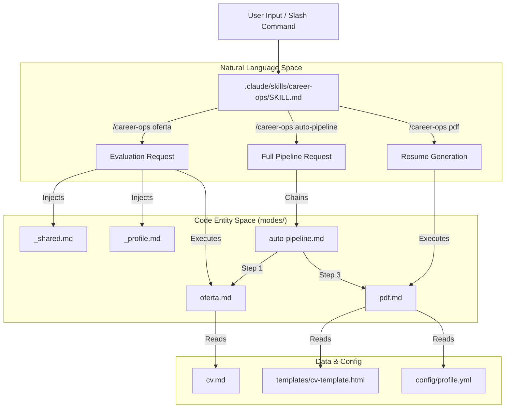
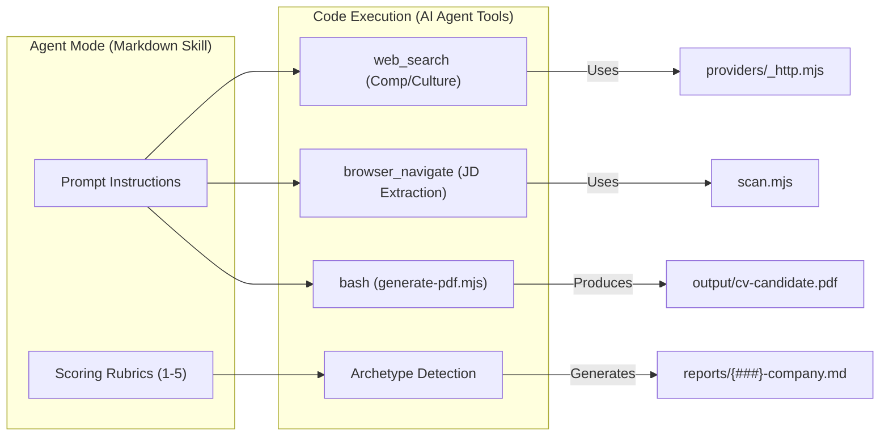

<!-- source: DeepWiki mcp.deepwiki.com · repo santifer/career-ops · page 2 AI Agent Modes · fetched 2026-10-27 -->

# AI Agent Modes

Relevant source files

The following files were used as context for generating this wiki page:

- [analyze-patterns.mjs](analyze-patterns.mjs)
- [batch/batch-prompt.md](batch/batch-prompt.md)
- [config/profile.example.yml](config/profile.example.yml)
- [generate-pdf.mjs](generate-pdf.mjs)
- [modes/_shared.md](modes/_shared.md)
- [modes/apply.md](modes/apply.md)
- [modes/auto-pipeline.md](modes/auto-pipeline.md)
- [modes/contacto.md](modes/contacto.md)
- [modes/followup.md](modes/followup.md)
- [modes/oferta.md](modes/oferta.md)
- [modes/patterns.md](modes/patterns.md)
- [modes/pdf.md](modes/pdf.md)
- [modes/pipeline.md](modes/pipeline.md)
- [modes/scan.md](modes/scan.md)
- [modes/tracker.md](modes/tracker.md)
- [modes/training.md](modes/training.md)
- [scan-ats-full.mjs](scan-ats-full.mjs)
- [scan.mjs](scan.mjs)
- [templates/cv-template.html](templates/cv-template.html)
- [templates/portals.example.yml](templates/portals.example.yml)
- [tests/scan-ats-full-title-filter-full.test.mjs](tests/scan-ats-full-title-filter-full.test.mjs)
- [tests/theme-style-dollar-pattern.test.mjs](tests/theme-style-dollar-pattern.test.mjs)
- [tests/theme-style.test.mjs](tests/theme-style.test.mjs)
- [tests/validate-portals-title-filter-full.test.mjs](tests/validate-portals-title-filter-full.test.mjs)
- [theme-style.mjs](theme-style.mjs)
- [validate-portals.mjs](validate-portals.mjs)

The `career-ops` system is driven by a collection of "Skill Modes" defined as Markdown files in the `modes/` directory. These files serve as the "brain" for the AI agent, providing specific instructions, evaluation rubrics, and behavioral guidelines for every sub-command in the `/career-ops` suite [modes/_shared.md:1-20]().

By separating logic into these Markdown skills, the system allows for deep customization of the agent's behavior—from how it scores a job match to how it drafts LinkedIn outreach—without changing the underlying execution engine.

### The Skill Architecture

When a user invokes a command (e.g., `/career-ops scan`), the agent router identifies the requested mode and loads the corresponding context. The architecture follows a "Shared + Specific" pattern to maintain consistency while allowing for task-specific flexibility.

1.  **Shared Context (`_shared.md`)**: Injected into most modes to provide the "Source of Truth" regarding system rules, scoring logic, and tool config [modes/_shared.md:1-10]().
2.  **User Profile (`_profile.md`)**: A user-layer file that overrides defaults in `_shared.md` with personal archetypes, narrative, and negotiation scripts [modes/_shared.md:18-24]().
3.  **Voice DNA (`voice-dna.md`)**: An optional writing guardrail that enforces anti-AI-slop rules and a conversational human voice across all candidate-facing text [modes/_shared.md:24-25]().
4.  **Mode-Specific Logic**: The individual `.md` file for the command (e.g., `oferta.md`, `pdf.md`) which contains the specific prompt engineering for that task.

**Sources:** [modes/_shared.md:1-35](), [config/profile.example.yml:1-160]()

---

### The Shared Context Layer (`_shared.md`)

The `modes/_shared.md` file is the foundational layer for the agent's reasoning. It ensures that whether the agent is evaluating a job or drafting a message, it maintains a consistent "North Star."

*   **Archetype Detection**: Classifies offers into types (e.g., Platform, Agentic, ML) to adapt framing and proof points [modes/_shared.md:75-88]().
*   **Scoring System**: Establishes a 1-5 global score based on CV Match, North Star alignment, Compensation, and Cultural signals [modes/_shared.md:61-78]().
*   **Source of Truth**: Enforces strict rules to read `cv.md`, `config/profile.yml`, and `article-digest.md` at evaluation time [modes/_shared.md:11-26]().
*   **Spend Tier (Model Routing)**: Maps user-selected tiers (`economy`, `standard`, `premium`) to specific AI models [modes/_shared.md:37-60]().

**Sources:** [modes/_shared.md:1-145]()

---

### Mode Groups

The various modes are categorized by their role in the job search lifecycle. Detailed technical documentation for each group is available in the child pages linked below.

#### [Evaluation Modes (oferta, ofertas, auto-pipeline)](#2.1)
These modes handle the ingestion and analysis of Job Descriptions. They use a standardized A-G evaluation structure, including archetype detection and scoring [modes/oferta.md:1-49](). `auto-pipeline.md` defines the sequence for full automatic processing from URL to PDF generation.
*   **Key Entities**: `modes/oferta.md`, `modes/auto-pipeline.md`, `reports/`.
*   For details, see [Evaluation Modes (oferta, ofertas, auto-pipeline)](#2.1).

#### [Discovery & Pipeline Modes (scan, pipeline, scan-ats-full, local-parser)](#2.2)
Focused on finding new opportunities. The `scan` mode uses a 4-level discovery strategy (Local Parser, Playwright, API, WebSearch) [modes/scan.md:33-108](). `scan-ats-full.mjs` provides reverse-ATS discovery across public directories [scan-ats-full.mjs:1-35]().
*   **Key Entities**: `scan.mjs`, `portals.yml`, `data/pipeline.md`, `scan-ats-full.mjs`.
*   For details, see [Discovery & Pipeline Modes (scan, pipeline, scan-ats-full, local-parser)](#2.2).

#### [Application & Outreach Modes (apply, contacto, tracker, followup, reply-watch, outcome)](#2.3)
Assists with the active phase of the search. Includes `apply.md` for live form-filling using Playwright [modes/apply.md:1-12]() and `pdf.md` for generating ATS-optimized resumes via `generate-pdf.mjs` [modes/pdf.md:1-46]().
*   **Key Entities**: `modes/apply.md`, `modes/contacto.md`, `modes/pdf.md`, `generate-pdf.mjs`, `data/applications.md`.
*   For details, see [Application & Outreach Modes (apply, contacto, tracker, followup, reply-watch, outcome)](#2.3).

#### [Career Development Modes (deep, training, project, patterns, upskill, titles, add)](#2.4)
Supporting modes for long-term growth. `patterns.md` uses `analyze-patterns.mjs` to identify rejection trends [analyze-patterns.mjs:1-14](), while `followup.md` tracks cadence and generates email drafts [modes/followup.md:1-16]().
*   **Key Entities**: `analyze-patterns.mjs`, `followup-cadence.mjs`, `modes/upskill.md`.
*   For details, see [Career Development Modes (deep, training, project, patterns, upskill, titles, add)](#2.4).

#### [Interview & Offer Modes (interview-prep, interview-redflag, offer-prep)](#2.5)
Preparation tools for the final stages. Includes red-flag detection for legally problematic questions and contract reading companions.
*   **Key Entities**: `interview-prep/story-bank.md`, `protected-grounds.yml`, `invite-match.mjs`.
*   For details, see [Interview & Offer Modes (interview-prep, interview-redflag, offer-prep)](#2.5).

#### [Internationalization (i18n Modes)](#2.6)
Localized subdirectories (e.g., `modes/de/`, `modes/fr/`) that adapt evaluation and application logic for specific regional markets and legal frameworks.
*   For details, see [Internationalization (i18n Modes)](#2.6).

---

### Agent Mode Flow

The following diagrams illustrate how the system bridges Natural Language requests to the specific Code Entities (Markdown skills) and tools that govern the agent's behavior.

**System Mode Routing & Context Bridge**

**Sources:** [modes/_shared.md:11-35](), [modes/auto-pipeline.md:1-45](), [modes/pdf.md:1-46]()

**Agent Interaction & Tool Usage**

**Sources:** [modes/_shared.md:61-78](), [modes/pdf.md:42-46](), [scan.mjs:1-38]()

**Sources:** [modes/_shared.md:1-145](), [modes/pdf.md:1-46](), [modes/auto-pipeline.md:1-88](), [modes/apply.md:1-28](), [scan.mjs:1-108]()

---

