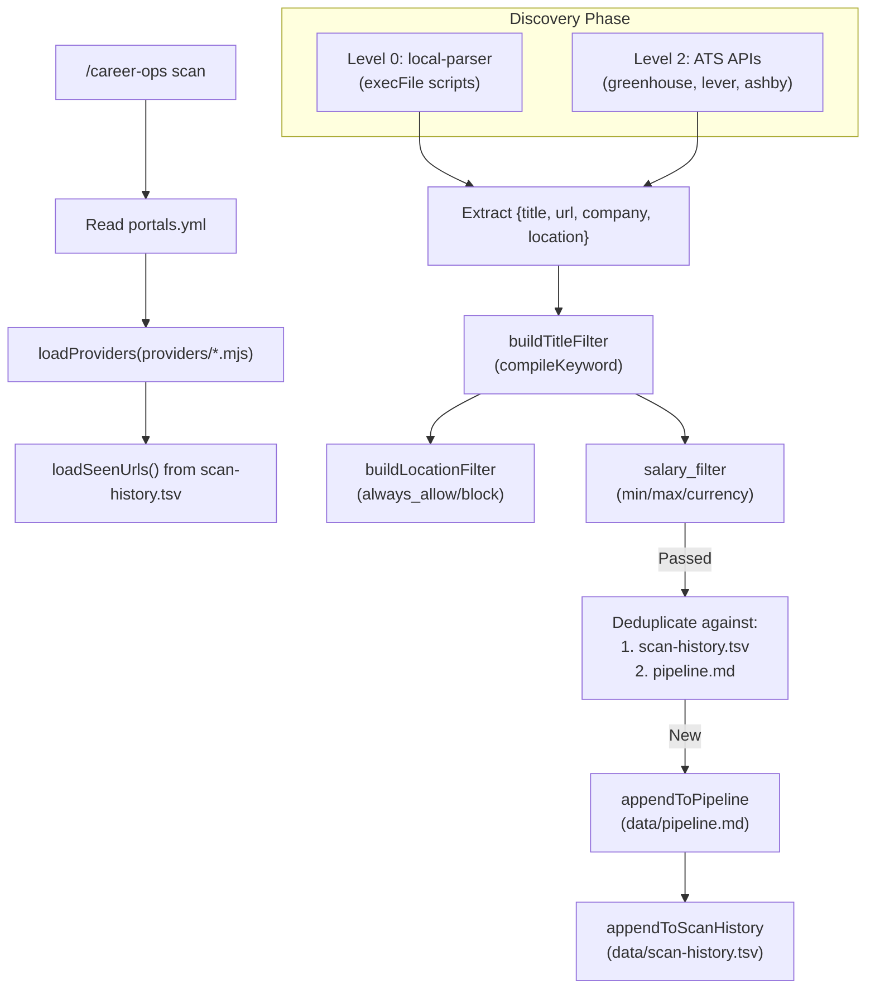
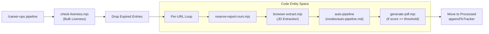

<!-- source: DeepWiki mcp.deepwiki.com · repo santifer/career-ops · page 2.2 Discovery & Pipeline Modes (scan, pipeline, scan-ats-full, local-parser) · fetched 2026-10-27 -->

# Discovery & Pipeline Modes (scan, pipeline, scan-ats-full, local-parser)

Relevant source files

The following files were used as context for generating this wiki page:

- [check-liveness.mjs](check-liveness.mjs)
- [company-funded.mjs](company-funded.mjs)
- [discover-ats.mjs](discover-ats.mjs)
- [discover-ats.test.mjs](discover-ats.test.mjs)
- [liveness-api.mjs](liveness-api.mjs)
- [liveness-browser.mjs](liveness-browser.mjs)
- [liveness-core.mjs](liveness-core.mjs)
- [modes/apply.md](modes/apply.md)
- [modes/contacto.md](modes/contacto.md)
- [modes/discover.md](modes/discover.md)
- [modes/pipeline.md](modes/pipeline.md)
- [modes/scan.md](modes/scan.md)
- [scan-ats-full.mjs](scan-ats-full.mjs)
- [scan-hn.mjs](scan-hn.mjs)
- [scan.mjs](scan.mjs)
- [seeds/vc-portfolios.mjs](seeds/vc-portfolios.mjs)
- [templates/portals.example.yml](templates/portals.example.yml)
- [tests/ci-gemini-check.test.mjs](tests/ci-gemini-check.test.mjs)
- [tests/company-funded.test.mjs](tests/company-funded.test.mjs)
- [tests/hn-scanner.test.mjs](tests/hn-scanner.test.mjs)
- [tests/liveness-core.test.mjs](tests/liveness-core.test.mjs)
- [tests/scan-ats-full-title-filter-full.test.mjs](tests/scan-ats-full-title-filter-full.test.mjs)
- [tests/user-agent.test.mjs](tests/user-agent.test.mjs)
- [tests/validate-portals-title-filter-full.test.mjs](tests/validate-portals-title-filter-full.test.mjs)
- [tests/vc-portfolios-yc-pagination.test.mjs](tests/vc-portfolios-yc-pagination.test.mjs)
- [user-agent.mjs](user-agent.mjs)
- [validate-portals.mjs](validate-portals.mjs)

This page covers the discovery and ingestion engine of `career-ops`. It details how the system identifies new job opportunities via the portal scanner, the specialized reverse ATS discovery, the local-parser extension point, and how it processes queued URLs through the pipeline inbox.

## 1. Portal Scanner (scan mode)

The `scan` mode is responsible for discovering new job postings across various platforms and adding them to the evaluation queue. It implements a multi-tiered discovery strategy to balance speed, reliability, and breadth. While the logic is defined in `modes/scan.md` [modes/scan.md:1-3](), the high-performance implementation for API-based discovery is handled by `scan.mjs` [scan.mjs:4-21]().

### 1.1 Discovery Strategy (4 Levels)

The scanner operates on four levels of depth, executing them additively and deduplicating the results.

| Level | Method | Primary Tool | Description |
| :--- | :--- | :--- | :--- |
| **Level 0** | **Local Parser** | `providers/local-parser.mjs` | Executes per-company scripts for SSR/static pages. Zero-token and most efficient [modes/scan.md:35-37](). |
| **Level 1** | **Direct Playwright** | Playwright | Navigates to `careers_url` for tracked companies. Most reliable for SPAs but token-heavy for agents [modes/scan.md:112-118](). |
| **Level 2** | **ATS APIs / Feeds** | `scan.mjs` / Providers | Queries structured APIs (Greenhouse, Ashby, Lever, etc.). Fast and zero-token [modes/scan.md:5-5](). |
| **Level 3** | **WebSearch** | WebSearch | Uses `site:` filters across job boards to discover roles in companies not yet tracked [modes/scan.md:154-154](). |

### 1.2 Scan Workflow and Data Flow

The scanner follows a strict sequence to ensure data integrity and avoid redundant evaluations.

**Sources:** [scan.mjs:71-85](), [scan.mjs:100-108](), [scan.mjs:220-251](), [scan.mjs:308-320](), [scan.mjs:424-436]()

### 1.3 Local Parser Extension Point

The `local-parser` provider allows users to add custom scrapers for companies that don't use standard ATS APIs. It is configured in `portals.yml` under the `parser:` key [modes/scan.md:41-50]().

*   **Security**: Scripts must reside within the project root. Only whitelisted interpreters (node, python3, etc.) are allowed.
*   **Interface**: The script must output JSON to `stdout` containing an array of job objects [modes/scan.md:54-82]().
*   **Rule**: If a local parser succeeds, the system skips more expensive Playwright or API checks for that company [modes/scan.md:88-102]().

**Sources:** [scan.mjs:13-15](), [modes/scan.md:35-50]()

---

## 2. Reverse ATS Discovery (scan-ats-full)

`scan-ats-full.mjs` implements a "zero-token" broad discovery mode. Instead of scanning specific companies, it walks public directories of thousands of companies hosted on Greenhouse, Lever, Ashby, and Workday [scan-ats-full.mjs:6-10]().

*   **Dataset**: Uses the `job-board-aggregator` dataset, cached in `data/cache/` for 24 hours [scan-ats-full.mjs:17-18](), [scan-ats-full.mjs:60-61]().
*   **Filtering**: Applies the same `title_filter` and `location_filter` from `portals.yml` [scan-ats-full.mjs:8-9](), [scan-ats-full.mjs:51-51]().
*   **Checkpointing**: For multi-hour sweeps, progress is checkpointed every 500 companies to allow `--resume` [scan-ats-full.mjs:90-95]().
*   **Freshness**: Only surfaces postings from the last N days (default: 3) to avoid flooding the pipeline with stale roles [scan-ats-full.mjs:21-22](), [scan-ats-full.mjs:25-26]().

**Sources:** [scan-ats-full.mjs:6-35](), [scan-ats-full.mjs:96-118](), [scan-ats-full.mjs:123-129]()

---

## 3. Pipeline Inbox (pipeline mode)

The `pipeline` mode acts as a "Second Brain" inbox, processing URLs stored in `data/pipeline.md` [modes/pipeline.md:1-3]().

### 3.1 Liveness Sweep

Before processing, the pipeline runs a bulk liveness sweep using `check-liveness.mjs`. This zero-token step prevents wasting AI credits on expired postings [modes/pipeline.md:5-17]().

*   **API Rung**: The system first attempts to verify liveness via ATS-hosted JSON endpoints (Greenhouse, Lever, Ashby, Workday) [liveness-api.mjs:3-9](). This is SSRF-safe by construction, using fixed hosts and strict path segment validation [liveness-api.mjs:25-28]().
*   **Browser Rung**: If the API is inconclusive, it falls back to `liveness-browser.mjs` using Playwright [liveness-api.mjs:7-9]().
*   **Logic**: Uses `liveness-core.mjs` to classify pages based on HTTP status (404/410), text patterns ("job no longer available"), and presence of apply controls [liveness-core.mjs:17-49](), [liveness-core.mjs:78-94]().
*   **Anti-Bot**: Detects Cloudflare/hCaptcha walls and marks them as `uncertain` instead of `expired` to avoid false negatives [liveness-core.mjs:62-72](), [liveness-core.mjs:128-131]().

**Sources:** [modes/pipeline.md:7-17](), [liveness-api.mjs:1-28](), [liveness-core.mjs:17-150]()

### 3.2 Processing Workflow

The system maps natural language commands and file states to specific code entities during the pipeline loop.

**Sources:** [modes/pipeline.md:31-43](), [liveness-api.mjs:62-120](), [liveness-browser.mjs:128-147]()

### 3.3 Configuration: PDF Gate

The pipeline reads `config/profile.yml` for `auto_pdf_score_threshold`. If an evaluation score falls below this threshold (default `3.0`), the PDF generation step is skipped to save time and resources [modes/pipeline.md:40-42]().

**Sources:** [modes/pipeline.md:40-42](), [templates/portals.example.yml:152-153]()

---

